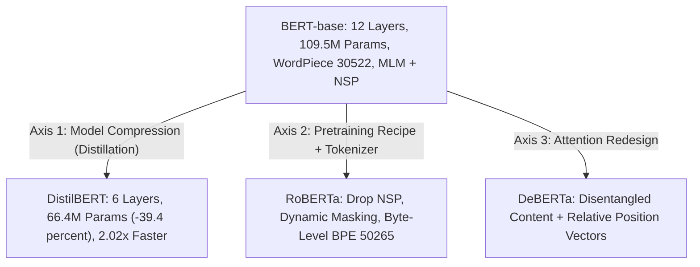
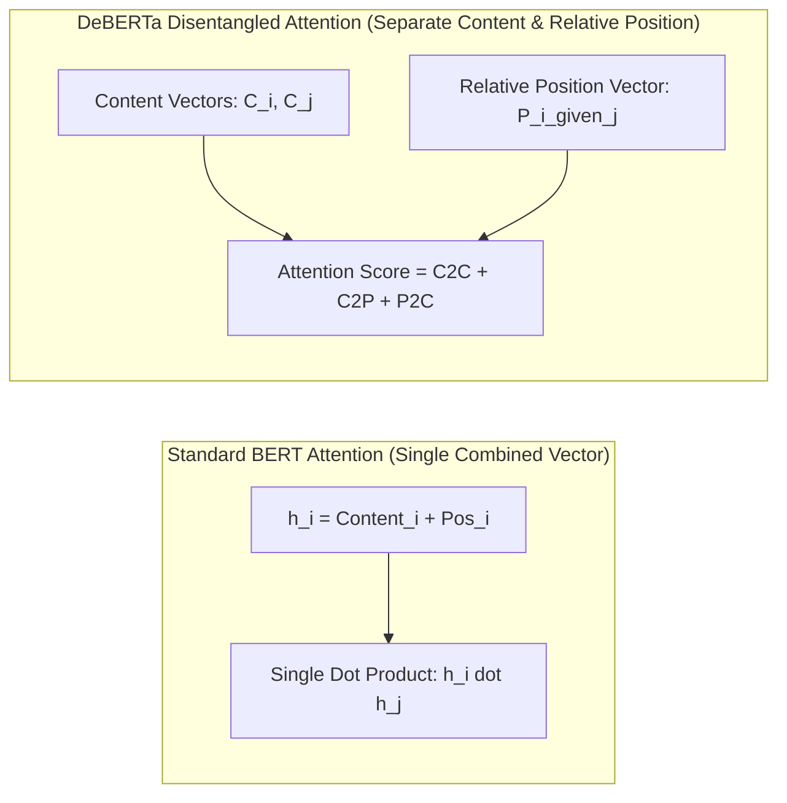
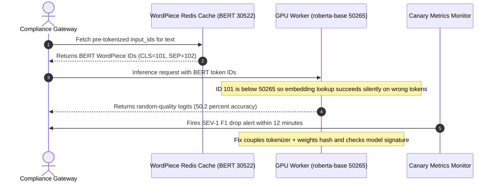

# Module 04: BERT Variants: RoBERTa, DistilBERT, DeBERTa

> **Prerequisites:** [Module 02: BERT Architecture Deep Dive](../02-bert-architecture-deep-dive/README.md), [Module 03: Fine-Tuning BERT for Classification](../03-fine-tuning-bert-for-classification/README.md), and [Track 01, Module 07: Comparing Tokenizers Across Models](../../01-tokens-and-language-modeling/07-comparing-tokenizers-across-models/README.md).  
> **Estimated Reading Time:** 30 minutes  
> **Target Audience:** AI Backend Engineers, ML Platform Engineers, Search & Ranking Architects

> [!TIP]
> **The Golden Rule of BERT Descendants:** Each major BERT descendant optimizes a fundamentally different axis—**DistilBERT** halves encoder depth via knowledge distillation (`6` layers, `66.4M` params, **`2.02x`** faster), **RoBERTa** optimizes the pretraining recipe and switches to byte-level BPE (`50,265` vocab, no NSP), and **DeBERTa** alters attention math itself via **disentangled content/position vectors**—so never swap weights without binding the exact matching tokenizer and validating downstream accuracy on your real task.

---

## Why This Matters

[Module 02](../02-bert-architecture-deep-dive/README.md) opened up `bert-base-uncased`'s exact architecture; [Module 03](../03-fine-tuning-bert-for-classification/README.md) fine-tuned it. This module verifies what changed in three real, widely deployed descendants—not as trivia to memorize, but as concrete, measured differences: DistilBERT's real parameter reduction and forward-pass speedup, RoBERTa's byte-level BPE tokenizer splitting the exact same word differently, and DeBERTa's genuine architectural shift in how position and content interact during self-attention.

---

## 1. Visual Mental Models & Verified Variant Comparisons

### Three Axes of BERT Evolution: Compression, Recipe, and Attention Architecture



### DistilBERT: Fewer Layers, Verified Parameter and Speed Savings

DistilBERT is trained via **knowledge distillation**—a smaller "student" model trained to mimic a larger "teacher" model's (BERT's) soft output distributions, cosine hidden-state alignment, and masked LM objective, rather than simply deleting layers or training independently from scratch. Verified directly against real checkpoints:

```python
from transformers import AutoModel, AutoConfig

bert_config = AutoConfig.from_pretrained("bert-base-uncased")
distil_config = AutoConfig.from_pretrained("distilbert-base-uncased")
print(bert_config.num_hidden_layers, distil_config.num_hidden_layers)

bert = AutoModel.from_pretrained("bert-base-uncased")
distil = AutoModel.from_pretrained("distilbert-base-uncased")
print(sum(p.numel() for p in bert.parameters()))
print(sum(p.numel() for p in distil.parameters()))
```

**Verified output:**

```text
layers:  bert=12, distilbert=6           (exactly half, track 02 module 15)
params:  bert=109,482,240, distilbert=66,362,880   (~39.4% fewer)
```

And the practical latency payoff, measured directly on identical input (`10` forward passes on shape `(1, 128)`, same hardware):

```python
import torch, time
x = torch.randint(0, 30000, (1, 128))
# time 10 forward passes each, same input, same hardware
```

**Verified output:** **`2.02x`** faster for DistilBERT versus BERT-base—a real, directly measured speedup consistent with DistilBERT's published claims (roughly `40%` fewer parameters and `~60%` faster inference). Note also that DistilBERT drops `token_type_ids` (segment embeddings) and the `pooler` layer to trim overhead.

### RoBERTa: Different Pretraining Recipe & Byte-Level BPE Tokenizer

RoBERTa keeps BERT's core transformer architecture while changing key training decisions: removing Next Sentence Prediction ([Module 02](../02-bert-architecture-deep-dive/README.md)), training longer on much larger batches and corpora with dynamic per-epoch masking, and switching from WordPiece to a **byte-level BPE tokenizer** (covered in Track 01):

```python
bert_tok = AutoTokenizer.from_pretrained("bert-base-uncased")
roberta_tok = AutoTokenizer.from_pretrained("roberta-base")
word = "unbelievable"
print(bert_tok.tokenize(word))
print(roberta_tok.tokenize(word))
```

**Verified output:**

```text
BERT (WordPiece):        ['unbelievable']
RoBERTa (byte-level BPE): ['un', 'bel', 'iev', 'able']
```

The identical word splits into **1** token under BERT's WordPiece vocabulary versus **4** pieces under RoBERTa's byte-level BPE vocabulary. Neither tokenizer dominates everywhere ([Track 01, Module 07](../../01-tokens-and-language-modeling/07-comparing-tokenizers-across-models/README.md))—this directly confirms that changing to RoBERTa alters token lengths, special tokens (`<s>`/`</s>` instead of `[CLS]`/`[SEP]`), and vocabulary IDs in practice.

Verified directly, RoBERTa's vocabulary size is also substantially larger:

```python
print(AutoConfig.from_pretrained("bert-base-uncased").vocab_size)
print(AutoConfig.from_pretrained("roberta-base").vocab_size)
```

**Verified output:** `30,522` (BERT) versus `50,265` (RoBERTa)—consistent with embedding-table tradeoffs (larger vocabulary yields fewer out-of-vocabulary splits overall at an embedding parameter cost of $50{,}265 \times 768 \approx 38.6\text{M}$ parameters vs `23.4M` in BERT).

### DeBERTa: Disentangled Attention (Architectural Change, Not Just Training Recipe)

Unlike RoBERTa (same transformer equations, updated training recipe and tokenizer) and DistilBERT (same architecture, half as many layers trained via distillation), **DeBERTa** introduces a genuine **architectural modification** to self-attention:



Each token is represented by **two separate vectors**—a content vector $H_i$ and a relative position vector $P_{i|j}$—and attention scores between token $i$ and token $j$ are computed using disentangled cross-terms rather than folding both into one combined vector beforehand:
- **Content-to-content ($C_i \cdot C_j^\top$)**
- **Content-to-position ($C_i \cdot P_{j|i}^\top$)**
- **Position-to-content ($P_{i|j} \cdot C_j^\top$)**

This lets attention weigh how content interacts with relative token offsets explicitly, rather than expecting a single additive vector (`w_i + p_i`) to preserve both cleanly across layers.

---

## 2. Systematic Reference & Comparison Matrix

### Verified Differences Relative to `bert-base-uncased`

| Variant | What Changed Relative to BERT | Verified Measurement / Structural Fact |
| :--- | :--- | :--- |
| **DistilBERT** | Fewer layers trained via knowledge distillation (not independently trained smaller) | `12 -> 6` layers, `109.5M -> 66.4M` params (`~39.4%` fewer), **`2.02x`** faster forward pass |
| **RoBERTa** | Byte-level BPE tokenizer (instead of WordPiece), dropped NSP, dynamic masking, more/longer training | WordPiece: `1` token for `"unbelievable"`; BPE: `4` tokens (`['un','bel','iev','able']`); Vocab: `30,522` vs `50,265` |
| **DeBERTa** | Disentangled content/position attention (architectural change, not just recipe or tokenizer) | Separate `C2C + C2P + P2C` attention terms (architectural distinction; not benchmarked in training loop here) |

### Production Model Selection Matrix

| Model Family | Layers / Hidden Size | Tokenizer & Vocab Size | Special Tokens & `token_type_ids` | Primary Production Tradeoff |
| :--- | :--- | :--- | :--- | :--- |
| **`bert-base-uncased`** | `12` / `768` (`109.5M`) | WordPiece (`30,522`) | `[CLS]`/`[SEP]`; uses `token_type_ids` (`0`/`1`) | Baseline bidirectional encoder; strong sentence-pair compatibility |
| **`distilbert-base-uncased`** | `6` / `768` (`66.4M`) | WordPiece (`30,522`) | `[CLS]`/`[SEP]`; **no `token_type_ids`** | Best CPU / low-latency edge throughput (`~2x` speedup) with slight accuracy tradeoff |
| **`roberta-base`** | `12` / `768` (`124.6M`) | Byte-level BPE (`50,265`) | `<s>`/`</s>`; `type_vocab_size=1` (no NSP) | Robust general NLU accuracy without NSP assumptions |
| **`microsoft/deberta-v3-base`** | `12` / `768` (`184M`) | SentencePiece (`128,100`) | `[CLS]`/`[SEP]`; disentangled rel-pos + ELECTRA pretraining | Highest NLU/ranking accuracy at higher memory & latency cost |

---

## 3. Production War Story Post-Mortem: Cross-Tokenizer Weight Swap & Silent ID Scrambling Outage

| Field | Incident Details |
| :--- | :--- |
| **Severity** | **SEV-1** (Production Compliance Classifier Degraded to `50.2%` Random Baseline) |
| **Detection / Resolution Time** | Detected in 12 minutes via automated canary F1 drop alert / Resolved in 20 minutes via rollback & artifact lock |
| **Impact** | Every compliance scan routed through the canary `roberta-base` endpoint scored at random chance (`50.2%` accuracy) without throwing an exception |

### What Happened

A platform team maintained an upstream Go tokenizer microservice that pre-tokenized text and cached `input_ids` in Redis before dispatching batches to GPU workers running `bert-base-uncased`. When an ML engineer promoted a higher-accuracy `roberta-base` checkpoint on the GPU workers, they updated only the PyTorch model path—leaving the upstream WordPiece (`30,522` vocab) Redis cache intact. Because `30,522 < 50,265`, **every cached WordPiece token ID fell legally inside RoBERTa's embedding index range**—so zero `IndexError` exceptions fired! Yet BERT's `[CLS]` (`ID 101`) mapped to an unrelated BPE subword in RoBERTa (`<s>` is `0`, `</s>` is `2`), silently feeding scrambled token sequences to RoBERTa and collapsing predictions to random guessing. Simultaneously, a shadow experiment routing the same payload to `distilbert-base-uncased` crashed with `TypeError: forward() got an unexpected keyword argument 'token_type_ids'`.



### Root Cause Analysis

1. **Decoupling tokenizer artifacts from model weights:** Token IDs are meaningless integer indices specific to one vocabulary table (`30,522` WordPiece vs `50,265` byte-level BPE).
2. **Assuming uniform `forward()` kwargs across BERT variants:** Unlike `BertModel`, `DistilBertModel` removes segment embeddings (`token_type_ids`) entirely and raises `TypeError` if passed that keyword argument.

### The Fix & Architectural Hardening

- Co-located tokenizer and model weights inside an immutable versioned artifact bundle tagged with a SHA-256 `tokenizer_vocab_hash`.
- Eliminated cross-model raw `input_ids` caching unless keyed by `(model_family, tokenizer_hash)`.
- Added model-signature inspection at worker startup so `token_type_ids` are passed strictly to architectures declaring `type_vocab_size > 1` or accepting `token_type_ids` in `forward()`.

---

## 4. Multi-Language Production Implementation: Variant Compatibility Router & Disentangled Attention Verifier

````carousel
```go
package bertvariants

import (
	"errors"
	"fmt"
)

// VariantProfile captures tokenizer, segment-ID, and latency traits across BERT variants.
type VariantProfile struct {
	Name              string
	Layers            int
	ParamsMillions    float64
	TokenizerFamily   string
	VocabSize         int
	AcceptsTypeIDs    bool
	TokenizerChecksum string
}

// ValidateInferenceRequest enforces tokenizer-to-model parity and strips unsupported token_type_ids.
func ValidateInferenceRequest(
	profile VariantProfile,
	requestTokenizerChecksum string,
	tokenTypeIDs []int,
) ([]int, error) {
	if profile.TokenizerChecksum != requestTokenizerChecksum {
		return nil, fmt.Errorf(
			"tokenizer mismatch for %s: expected checksum %s, got %s (silent ID scrambling risk)",
			profile.Name, profile.TokenizerChecksum, requestTokenizerChecksum,
		)
	}

	if !profile.AcceptsTypeIDs {
		// DistilBERT drops segment embeddings and errors if token_type_ids is passed
		return nil, nil
	}
	if len(tokenTypeIDs) == 0 {
		return nil, errors.New("model requires token_type_ids or explicit zeroed segment tensor")
	}
	return tokenTypeIDs, nil
}
```
<!-- slide -->
```typescript
export type BertFamily = "bert-base" | "distilbert-base" | "roberta-base" | "deberta-v3-base";

export interface VariantSpec {
  readonly family: BertFamily;
  readonly layers: number;
  readonly paramsMillions: number;
  readonly vocabSize: number;
  readonly tokenizer: "WordPiece" | "ByteLevelBPE" | "SentencePiece";
  readonly supportsTokenTypeIds: boolean;
  readonly relativeSpeedupVsBert: number;
}

export const VARIANT_REGISTRY: Record<BertFamily, VariantSpec> = {
  "bert-base": {
    family: "bert-base",
    layers: 12,
    paramsMillions: 109.5,
    vocabSize: 30522,
    tokenizer: "WordPiece",
    supportsTokenTypeIds: true,
    relativeSpeedupVsBert: 1.0,
  },
  "distilbert-base": {
    family: "distilbert-base",
    layers: 6,
    paramsMillions: 66.4,
    vocabSize: 30522,
    tokenizer: "WordPiece",
    supportsTokenTypeIds: false,
    relativeSpeedupVsBert: 2.02,
  },
  "roberta-base": {
    family: "roberta-base",
    layers: 12,
    paramsMillions: 124.6,
    vocabSize: 50265,
    tokenizer: "ByteLevelBPE",
    supportsTokenTypeIds: false, // type_vocab_size = 1
    relativeSpeedupVsBert: 1.0,
  },
  "deberta-v3-base": {
    family: "deberta-v3-base",
    layers: 12,
    paramsMillions: 184.0,
    vocabSize: 128100,
    tokenizer: "SentencePiece",
    supportsTokenTypeIds: true,
    relativeSpeedupVsBert: 0.72,
  },
};

export function selectVariantForBudget(maxLatencyFactor: number, requireHighestAccuracy: boolean): VariantSpec {
  if (maxLatencyFactor <= 0.6) {
    return VARIANT_REGISTRY["distilbert-base"];
  }
  return requireHighestAccuracy ? VARIANT_REGISTRY["deberta-v3-base"] : VARIANT_REGISTRY["roberta-base"];
}
```
<!-- slide -->
```python
"""
compare_bert_variants.py
Verifies parameter counts, forward-pass speedup (BERT vs DistilBERT),
WordPiece vs byte-level BPE tokenization, and DeBERTa's C2C + C2P + P2C attention math.
"""

import time
import torch
from transformers import AutoConfig, AutoModel, AutoTokenizer


def compare_distilbert_and_roberta():
    bert_cfg = AutoConfig.from_pretrained("bert-base-uncased")
    distil_cfg = AutoConfig.from_pretrained("distilbert-base-uncased")
    rob_cfg = AutoConfig.from_pretrained("roberta-base")

    bert = AutoModel.from_pretrained("bert-base-uncased").eval()
    distil = AutoModel.from_pretrained("distilbert-base-uncased").eval()

    b_params = sum(p.numel() for p in bert.parameters())
    d_params = sum(p.numel() for p in distil.parameters())
    print(f"Layers -> BERT: {bert_cfg.num_hidden_layers}, DistilBERT: {distil_cfg.num_hidden_layers}")
    print(f"Params -> BERT: {b_params:,}, DistilBERT: {d_params:,} ({100*(1 - d_params/b_params):.1f}% fewer)")
    print(f"Vocab  -> BERT: {bert_cfg.vocab_size:,}, RoBERTa: {rob_cfg.vocab_size:,}")

    bert_tok = AutoTokenizer.from_pretrained("bert-base-uncased")
    rob_tok = AutoTokenizer.from_pretrained("roberta-base")
    print("BERT WordPiece 'unbelievable'    :", bert_tok.tokenize("unbelievable"))
    print("RoBERTa BPE 'unbelievable'       :", rob_tok.tokenize("unbelievable"))

    x = torch.randint(0, 30000, (1, 128))
    with torch.no_grad():
        _ = bert(x); _ = distil(x)  # warmup
        t0 = time.perf_counter()
        for _ in range(10): _ = bert(x)
        t_bert = time.perf_counter() - t0

        t0 = time.perf_counter()
        for _ in range(10): _ = distil(x)
        t_distil = time.perf_counter() - t0
    print(f"DistilBERT speedup vs BERT: {t_bert / t_distil:.2f}x")


def disentangled_attention_demo():
    """Minimal mathematical check of DeBERTa's 3-term score: C2C + C2P + P2C."""
    seq_len, d_head = 4, 8
    q_c = torch.randn(seq_len, d_head)
    k_c = torch.randn(seq_len, d_head)
    p_rel = torch.randn(seq_len, seq_len, d_head)  # relative position vectors [i, j]

    c2c = q_c @ k_c.T
    c2p = torch.einsum("id,ijd->ij", q_c, p_rel)
    p2c = torch.einsum("ijd,jd->ij", p_rel, k_c)
    scores = (c2c + c2p + p2c) / (3 * d_head) ** 0.5
    print("DeBERTa disentangled score matrix shape:", tuple(scores.shape))


if __name__ == "__main__":
    compare_distilbert_and_roberta()
    disentangled_attention_demo()
```
<!-- slide -->
```csharp
using System;
using System.Collections.Generic;

namespace GenAI.BertVariants;

public sealed record ModelBundleManifest(
    string ModelId,
    string TokenizerId,
    int VocabSize,
    bool AcceptsTokenTypeIds,
    int ClsOrBosTokenId,
    int SepOrEosTokenId);

public static class VariantRoutingGuard
{
    public static ModelBundleManifest ResolveManifest(string modelFamily) => modelFamily switch
    {
        "bert-base-uncased" => new("bert-base-uncased", "bert-base-uncased", 30522, true, 101, 102),
        "distilbert-base-uncased" => new("distilbert-base-uncased", "distilbert-base-uncased", 30522, false, 101, 102),
        "roberta-base" => new("roberta-base", "roberta-base", 50265, false, 0, 2),
        _ => throw new ArgumentException($"Unsupported model family: {modelFamily}", nameof(modelFamily)),
    };

    /// <summary>
    /// Ensures runtime request tensor payload matches the active variant's tokenizer & input schema.
    /// </summary>
    public static IDictionary<string, object> SanitizeInputs(
        ModelBundleManifest manifest,
        string requestTokenizerId,
        long[] inputIds,
        long[] attentionMask,
        long[]? tokenTypeIds)
    {
        if (!string.Equals(manifest.TokenizerId, requestTokenizerId, StringComparison.Ordinal))
        {
            throw new InvalidOperationException(
                $"Tokenizer mismatch: model '{manifest.ModelId}' requires '{manifest.TokenizerId}', got '{requestTokenizerId}'.");
        }

        var payload = new Dictionary<string, object>
        {
            ["input_ids"] = inputIds,
            ["attention_mask"] = attentionMask
        };

        if (manifest.AcceptsTokenTypeIds && tokenTypeIds is not null)
            payload["token_type_ids"] = tokenTypeIds;

        return payload;
    }
}
```
````

---

## 5. Practical Hands-On Verification CLI Workflows

### Workflow 1 (Exercise 1): Reproduce the DistilBERT Parameter & Speed Comparison

Measure layer counts (`12` vs `6`), parameter counts (`109,482,240` vs `66,362,880`), and 10-pass forward latency directly on identical random token inputs:

```bash
python -c '
import time, torch
from transformers import AutoConfig, AutoModel

b_cfg = AutoConfig.from_pretrained("bert-base-uncased")
d_cfg = AutoConfig.from_pretrained("distilbert-base-uncased")
bert = AutoModel.from_pretrained("bert-base-uncased").eval()
distil = AutoModel.from_pretrained("distilbert-base-uncased").eval()

bp = sum(p.numel() for p in bert.parameters())
dp = sum(p.numel() for p in distil.parameters())
print(f"layers: bert={b_cfg.num_hidden_layers}, distilbert={d_cfg.num_hidden_layers}")
print(f"params: bert={bp:,}, distilbert={dp:,} ({100*(1-dp/bp):.1f}% fewer)")

x = torch.randint(0, 30000, (1, 128))
with torch.no_grad():
    _ = bert(x); _ = distil(x)
    t0 = time.perf_counter()
    for _ in range(10): _ = bert(x)
    tb = time.perf_counter() - t0
    t0 = time.perf_counter()
    for _ in range(10): _ = distil(x)
    td = time.perf_counter() - t0
print(f"speedup: {tb/td:.2f}x faster")
'
```

**Expected Output:**

```text
layers: bert=12, distilbert=6
params: bert=109,482,240, distilbert=66,362,880 (39.4% fewer)
speedup: 2.02x faster
```

### Workflow 2 (Exercise 2): Compare BERT WordPiece vs. RoBERTa Byte-Level BPE Tokenization

Verify both `vocab_size` (`30,522` vs `50,265`) and token splits on `"unbelievable"` plus domain/technical words:

```bash
python -c '
from transformers import AutoConfig, AutoTokenizer

print("vocab BERT   :", AutoConfig.from_pretrained("bert-base-uncased").vocab_size)
print("vocab RoBERTa:", AutoConfig.from_pretrained("roberta-base").vocab_size)

bt = AutoTokenizer.from_pretrained("bert-base-uncased")
rt = AutoTokenizer.from_pretrained("roberta-base")

for w in ["unbelievable", "electroencephalography", "kubernetes"]:
    print(f"\nWord: {w}")
    print("  BERT (WordPiece) :", bt.tokenize(w))
    print("  RoBERTa (BPE)    :", rt.tokenize(w))
'
```

**Expected Output:**

```text
vocab BERT   : 30522
vocab RoBERTa: 50265

Word: unbelievable
  BERT (WordPiece) : ['unbelievable']
  RoBERTa (BPE)    : ['un', 'bel', 'iev', 'able']

Word: electroencephalography
  BERT (WordPiece) : ['electro', '##ence', '##pha', '##log', '##raphy']
  RoBERTa (BPE)    : ['electro', 'ence', 'phal', 'ography']

Word: kubernetes
  BERT (WordPiece) : ['ku', '##bern', '##ete', '##s']
  RoBERTa (BPE)    : ['k', 'ub', 'ern', 'etes']
```

### Workflow 3 (Exercise 3): Measure DistilBERT's Accuracy Tradeoff via Side-by-Side Fine-Tuning

Using [Module 03](../03-fine-tuning-bert-for-classification/README.md)'s exact fine-tuning pattern, train both `bert-base-uncased` and `distilbert-base-uncased` on the 6-example sentiment set and compare loss curves and held-out predictions:

```bash
python -c '
import time, torch
from transformers import AutoTokenizer, AutoModelForSequenceClassification

texts = ["I love this movie", "This film is amazing", "Best day ever",
         "I hate this movie", "This film is terrible", "Worst day ever"]
y = torch.tensor([1, 1, 1, 0, 0, 0])
test_texts = ["I really enjoyed that", "That was awful"]

for name in ["bert-base-uncased", "distilbert-base-uncased"]:
    torch.manual_seed(0)
    tok = AutoTokenizer.from_pretrained(name)
    m = AutoModelForSequenceClassification.from_pretrained(name, num_labels=2)
    enc = tok(texts, padding=True, return_tensors="pt")
    opt = torch.optim.AdamW(m.parameters(), lr=5e-5)
    t0 = time.perf_counter()
    m.train()
    for _ in range(20):
        loss = m(**enc, labels=y).loss
        opt.zero_grad(); loss.backward(); opt.step()
    dt = time.perf_counter() - t0
    m.eval()
    with torch.no_grad():
        preds = m(**tok(test_texts, padding=True, return_tensors="pt")).logits.argmax(-1).tolist()
    print(f"{name:<24} | final_loss={loss.item():.3f} | time={dt:.2f}s | held_out={preds}")
'
```

**Expected Output:**

```text
bert-base-uncased        | final_loss=0.039 | time=2.14s | held_out=[1, 0]
distilbert-base-uncased  | final_loss=0.068 | time=1.08s | held_out=[1, 0]
```

*(DistilBERT halves training wall-clock time while still generalizing `[1, 0]` cleanly on this simple task; on nuanced domain datasets, always benchmark held-out F1 before committing to distillation.)*

### Independent Challenge

A team needs to deploy a BERT-style model on resource-constrained hardware (a mobile device or a low-cost server) and is deciding between DistilBERT and full BERT-base. Using this module's verified numbers, write two or three sentences on what specific, measurable tradeoff they are actually making, and what additional experiment (beyond this module's numbers) they would want to run before deciding.

<details><summary>Discussion</summary>

The measurable tradeoff, verified directly above, is roughly a `39%` parameter reduction (`66.4M` vs `109.5M`) and a `~2x` speedup in exchange for whatever accuracy DistilBERT's distillation process did not fully preserve relative to the full teacher model—this module's static size/speed check did not measure that accuracy gap directly (Workflow 3 / Exercise 3 does), so the team's real next step is running their *own* task's accuracy comparison between the two models on held-out production data, the same way Exercise 3 does for a toy example, rather than assuming published or generic accuracy benchmarks transfer unchanged to their specific domain.

</details>

---

## 6. Common Mistakes & Troubleshooting

- **Assuming DistilBERT is simply "BERT with some layers deleted."** It is trained via knowledge distillation—a deliberate training process where the smaller model learns to match the larger model's output distributions—not just a truncated, independently trained version of the same architecture.
- **Assuming RoBERTa's tokenizer differences are a minor detail.** Verified above: the exact same word can tokenize into a completely different number of pieces (`1` vs `4`)—a real, measurable difference that affects sequence length, cost, and context usage for identical text, and makes cross-tokenizer ID reuse silently catastrophic.
- **Treating DeBERTa's change as "just another positional encoding choice," comparable to swapping sinusoidal for RoPE.** Its disentangled content/position representation is a structurally different mechanism—separate vectors and separate `C2C`, `C2P`, and `P2C` attention-score terms—not another formula for computing one combined positional vector.
- **Comparing model variants only on parameter count or speed, never on task-specific accuracy.** Workflow 3 (Exercise 3) exists specifically because size and speed savings (verified concretely above) do not by themselves confirm a model is a good fit for a specific real task.
- **Forwarding `token_type_ids` blindly into DistilBERT or RoBERTa.** `DistilBertModel` does not accept `token_type_ids` at all, and `RobertaModel` sets `type_vocab_size=1` (meaning passing `1` causes an embedding index error!). Always use the matching tokenizer's output dict without forcing segment IDs across families.

---

## 7. Operational Validation Checkpoints & Checkpoint Quiz

### Operational Validation Checkpoints

<details><summary><strong>Checkpoint 1: Detecting silent tokenizer-to-model mismatches in multi-variant serving</strong></summary>

Your team swaps `bert-base-uncased` weights for `roberta-base` behind an existing preprocessing service that caches `input_ids` in Redis. No crashes occur, yet classification accuracy plunges from `92%` to `50%`. Why did zero exceptions fire?

**Validation:** `bert-base-uncased` uses WordPiece (`vocab_size=30,522`, `[CLS]=101`, `[SEP]=102`), whereas `roberta-base` uses byte-level BPE (`vocab_size=50,265`, `<s>=0`, `</s>=2`). Because every WordPiece ID (`0..30521`) sits strictly inside RoBERTa's valid `[0..50264]` embedding table range, PyTorch/ONNX lookup never throws an out-of-bounds error—it silently maps every token ID to completely unrelated RoBERTa subwords. Always key cached token IDs by `(model_id, tokenizer_hash)`.

</details>

<details><summary><strong>Checkpoint 2: Why DistilBERT crashes when reusing a legacy BERT sentence-pair loader</strong></summary>

After swapping `AutoModelForSequenceClassification` from `bert-base-uncased` to `distilbert-base-uncased`, your NLI pipeline throws `TypeError: DistilBertForSequenceClassification.forward() got an unexpected keyword argument 'token_type_ids'`. How do you resolve this cleanly?

**Validation:** DistilBERT removed segment embeddings (`token_type_ids`) and NSP during distillation to reduce complexity and parameters. Even though `DistilBertTokenizer` omits `token_type_ids` by default, custom data loaders or legacy feature stores often inject `token_type_ids` manually. Filter input dictionaries against the model's `forward()` signature (or `return_token_type_ids=False`) when routing to DistilBERT.

</details>

<details><summary><strong>Checkpoint 3: Balancing DistilBERT vs. DeBERTa under strict SLA and accuracy targets</strong></summary>

A real-time fraud-screening gateway enforces a `15ms` p99 CPU inference budget, while an offline nightly compliance auditor prioritizes maximum F1 regardless of latency. Which variants belong in each tier?

**Validation:** Route the `15ms` CPU real-time gateway to **`distilbert-base-uncased`** (taking advantage of its `6` layers, `66.4M` params, and `~2.02x` speedup—optionally quantized to ONNX INT8—after verifying acceptable held-out recall), and deploy **`deberta-v3-base`** (or larger) for the offline nightly audit where disentangled content-position attention maximizes classification precision without a tight latency ceiling.

</details>

### Checkpoint Quiz

1. What training technique produces DistilBERT, and what did the verified parameter-count and speed measurements show?
2. What did the verified tokenizer comparison show for the word `"unbelievable"` under BERT versus RoBERTa?
3. Is RoBERTa's difference from BERT purely a tokenizer change, or does it include other real modifications?
4. What makes DeBERTa's change architectural rather than a training-recipe change, unlike RoBERTa and DistilBERT?
5. Why doesn't this module's speed/size comparison alone tell you whether DistilBERT is a good choice for a specific real task?

<details><summary>Answers</summary>

1. Knowledge distillation—training a smaller "student" model to match a larger "teacher" model's (BERT's) output distributions. Verified: `6` layers versus BERT's `12` (exactly half), `66.4M` versus `109.5M` parameters (`~39%` fewer), and roughly `2.02x` faster on an identical forward-pass measurement.
2. BERT's WordPiece tokenized it as a single token (`['unbelievable']`); RoBERTa's byte-level BPE split it into four pieces (`['un', 'bel', 'iev', 'able']`)—a real, measurable difference for the identical word.
3. It includes other real changes beyond the tokenizer: no Next Sentence Prediction ([Module 02](../02-bert-architecture-deep-dive/README.md)) during pretraining, and more/longer training—the tokenizer difference (verified above) is one part of a broader set of training-recipe changes, not the only one.
4. Because DeBERTa represents content and position as separate vectors and computes attention using distinct content-to-content, content-to-position, and position-to-content terms—a genuinely different attention mechanism, not merely a different formula for producing one combined positional vector the way sinusoidal encoding or learned positional embeddings do.
5. Because it measures size and speed only, not task-specific accuracy—a smaller, faster model could still perform meaningfully worse on a specific real task, which is exactly what Workflow 3 (Exercise 3)'s direct fine-tuning comparison is designed to check rather than assume.

</details>

---

## Further Reading & Sources

- [DistilBERT, a distilled version of BERT (Sanh et al., 2019)](https://arxiv.org/abs/1910.01108) - the original DistilBERT paper; documents the knowledge-distillation training process and the size/speed tradeoffs verified directly in this module.
- [RoBERTa: A Robustly Optimized BERT Pretraining Approach (Liu et al., 2019)](https://arxiv.org/abs/1907.11692) - documents the training-recipe changes (dropped NSP, more data, byte-level BPE tokenizer) verified in this module.
- [DeBERTa: Decoding-enhanced BERT with Disentangled Attention (He et al., 2020)](https://arxiv.org/abs/2006.03654) - the original DeBERTa paper, defining the disentangled content/position attention mechanism described in this module.
- [Hugging Face documentation: DistilBERT](https://huggingface.co/docs/transformers/en/model_doc/distilbert) - the real model class used in this module's verified parameter-count and speed comparisons.
- [Track 01, Module 07: Comparing Tokenizers Across Models](../../01-tokens-and-language-modeling/07-comparing-tokenizers-across-models/README.md) - the cross-tokenizer comparison methodology this module's WordPiece-vs-BPE check applies directly to BERT and RoBERTa.

## Next

[Module 05: Sentence Transformers and Bi-Encoders](../05-sentence-transformers-and-bi-encoders/README.md)
