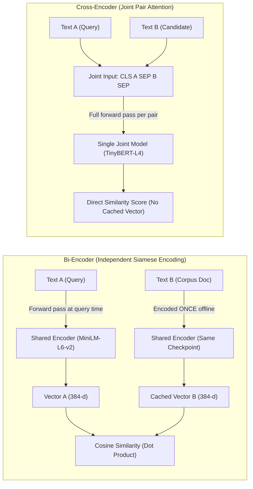
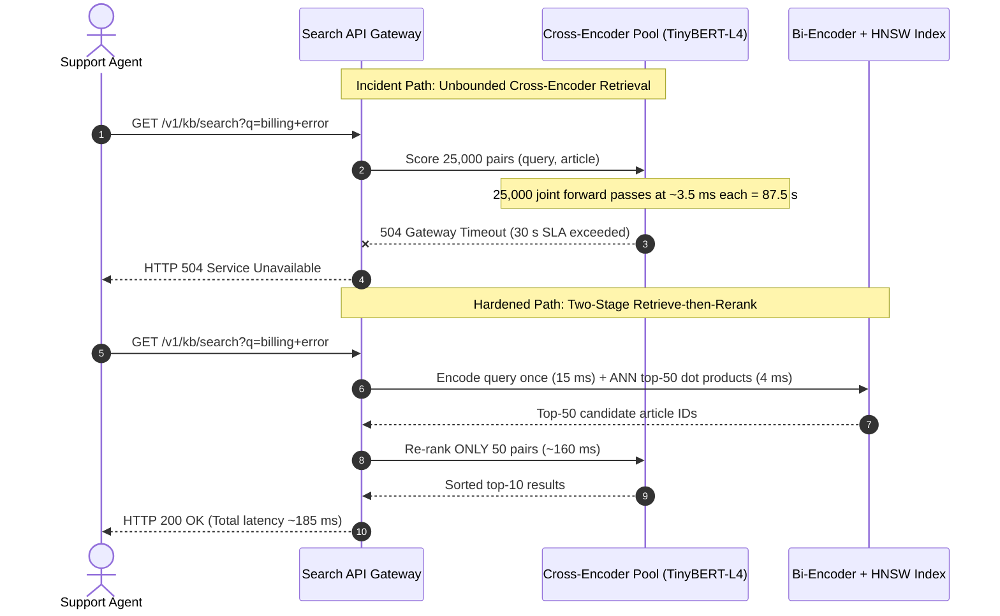

# Module 05: Sentence Transformers and Bi-Encoders

> **Prerequisites:** Track 03 Modules 02–03 (BERT Architecture and Fine-Tuning), and [Track 02, Module 01: Vectors, Matrices, Dot Products](../../02-transformer-architecture/01-the-math-you-actually-need-vectors-matrices-dot-products/README.md)  
> **Estimated Reading Time:** 30 minutes  
> **Target Audience:** AI Backend Engineers, Search & Retrieval Engineers, ML Platform Architects

> [!TIP]
> **The Golden Rule of Semantic Retrieval**  
> **Encode once with a bi-encoder; re-rank few with a cross-encoder.** A bi-encoder embeds each text independently into a fixed vector so corpus search reduces to sub-millisecond dot products ($\mathcal{O}(1)$ model forward passes per query). Reserve cross-encoders—which attend jointly across both texts ($\mathcal{O}(N)$ forward passes per query)—exclusively for re-ranking a bi-encoder's top-$K$ shortlist.

---

## Why this matters

Module 02 verified `bert-base-uncased`'s `pooler_output` — a single 768-dimensional vector derived from `[CLS]`, meant to summarize a whole sequence (or sequence pair). Module 03 fine-tuned that representation for classification with a real, verified experiment (loss 0.679 → 0.039 over 6 examples). This module asks a narrower architectural question: when the task is "how similar are text A and text B?", does the model need to see A and B *together*, or can it encode each one *independently* and compare the results afterward? The answer splits every similarity/retrieval architecture into two families — **bi-encoders** and **cross-encoders** — and this module verifies, with real code and real timings, exactly what each buys and costs. This distinction is previewed here because later tracks' retrieval-augmented generation (RAG) systems are built almost entirely on bi-encoders, for a reason this module makes concrete.

---

## 1. Architectural Mental Models & Verified Experiments

### Two ways to compare two texts



A bi-encoder is exactly what module 02 verified `[CLS]`/`pooler_output` producing for a *single* text: one fixed-size vector per input, independent of anything it will later be compared against. A cross-encoder is what module 02's sentence-pair tokenization produced — `[CLS] text A [SEP] text B [SEP]`, one joint sequence, `token_type_ids` marking segments — fed through the model *together*, exactly the same input shape module 02 built for BERT's Next Sentence Prediction objective. `sentence-transformers` is the standard library for the bi-encoder side; `AutoModelForSequenceClassification` on a concatenated pair (or `sentence_transformers.CrossEncoder`, a thin wrapper around the same idea) is the cross-encoder side.

### Verified: a bi-encoder's cached embeddings need zero re-encoding to compare against a new query

```python
from sentence_transformers import SentenceTransformer
import numpy as np, time

model = SentenceTransformer("sentence-transformers/all-MiniLM-L6-v2")

sentences = [
    "The cat sat on the mat.",
    "A dog is playing in the park.",
    "The stock market fell sharply today.",
    "Photosynthesis converts sunlight into chemical energy.",
]

t0 = time.perf_counter()
cached = model.encode(sentences)          # encode ONCE, store the vectors
t1 = time.perf_counter()
print(t1 - t0, cached.shape)

query = "A feline is resting on a rug."
t0 = time.perf_counter()
q_emb = model.encode([query])[0]           # only the NEW text is encoded
t1 = time.perf_counter()
print(t1 - t0)

def cos(a, b):
    return float(np.dot(a, b) / (np.linalg.norm(a) * np.linalg.norm(b)))

for s, c in zip(sentences, cached):
    print(f"{cos(q_emb, c):.4f}  {s}")
```

Verified output:

```text
cache-build time (4 sentences): 0.1468 s
cached embedding shape:         (4, 384)
new-query encode time:          0.0483 s

0.5634  The cat sat on the mat.
0.1347  A dog is playing in the park.
0.0916  The stock market fell sharply today.
0.0158  Photosynthesis converts sunlight into chemical energy.
```

Two things verified at once. First, the semantic-similarity check this module set out to confirm actually works: "A feline is resting on a rug." scores highest (0.5634) against "The cat sat on the mat." — correctly outranking the unrelated dog/market/photosynthesis sentences, purely from cosine similarity (track 02 module 01's direction-not-magnitude measure) between two independently-produced 384-dimensional vectors (`all-MiniLM-L6-v2`'s output size — smaller than `bert-base-uncased`'s 768, verified in module 02, since MiniLM is a distilled, compressed encoder). Second, and architecturally central: comparing the new query against the four cached sentences required encoding **only the query**. The four cached vectors were produced once and reused unmodified — nothing about "what will this be compared against" was needed to produce them.

### Verified: this holds at scale — cached comparison is dot products, not re-encoding

```python
topics = ["cat","dog","weather","stock market","photosynthesis",
          "space travel","cooking pasta","football match",
          "ancient rome","quantum physics"]
candidates = [f"This is sentence number {i} about {topics[i % len(topics)]} "
              f"and related topics." for i in range(100)]

t0 = time.perf_counter(); cached = model.encode(candidates); t1 = time.perf_counter()
print("one-time cache-build (100 sentences):", t1 - t0)

query = "Tell me something about cats and pets."
t0 = time.perf_counter(); q = model.encode([query])[0]; t1 = time.perf_counter()
print("new query encode:", t1 - t0)

t0 = time.perf_counter()
sims = (cached @ q) / (np.linalg.norm(cached, axis=1) * np.linalg.norm(q))
t1 = time.perf_counter()
print("compare vs 100 cached embeddings (dot products only):", t1 - t0)
```

Verified output:

```text
one-time cache-build (100 sentences):              0.6656 s
new query encode:                                  0.1496 s
compare vs 100 cached embeddings (dot products only): 0.0020 s
top match: "This is sentence number 10 about cat and related topics." (sim 0.6319)
```

The 100-sentence corpus is encoded once (0.6656 s total) and never touched again. Every subsequent query costs one encode of *that query alone* ($\approx 0.15\text{ s}$) plus a comparison against the whole cached corpus that is essentially free (0.002 s — 100 dot products). This is the concrete mechanism behind large-scale retrieval, previewed here for later RAG-focused tracks: a corpus of embeddings is built once, stored, and searched cheaply against arbitrarily many future queries.

### Verified: a cross-encoder repeats the full joint computation for every query, every time

```python
from sentence_transformers import CrossEncoder

ce = CrossEncoder("cross-encoder/stsb-TinyBERT-L4")
pairs = [[query, c] for c in candidates]        # 100 joint (query, candidate) pairs

t0 = time.perf_counter(); scores = ce.predict(pairs); t1 = time.perf_counter()
print("cross-encoder, 100 joint forward passes, query 1:", t1 - t0)

query2 = "What is the latest news on the stock market?"
pairs2 = [[query2, c] for c in candidates]
t0 = time.perf_counter(); scores2 = ce.predict(pairs2); t1 = time.perf_counter()
print("cross-encoder, 100 joint forward passes, query 2:", t1 - t0)
```

Verified output:

```text
cross-encoder, 100 joint forward passes, query 1:  0.4172 s
  top match: "...sentence number 0 about cat..."       (score 0.5020)
cross-encoder, 100 joint forward passes, query 2:  0.3528 s
  top match: "...sentence number 3 about stock market..." (score 0.4306)
```

Notice what did *not* happen: there is no step where the 100 candidates are "encoded once and reused." Each of the 100 `[query, candidate]` pairs is fed through `stsb-TinyBERT-L4` jointly — exactly module 02's sentence-pair format, `[CLS] query [SEP] candidate [SEP]` — and the model's output *is* the similarity score directly, with no intermediate per-text vector ever materializing. Query 2 needed the **same full 100 forward passes** as query 1; nothing from query 1's run could be reused, because a cross-encoder's score for a pair is not decomposable into separately-cached per-text representations at all — the two texts' tokens attend to each other from the first layer on, so nothing "belongs" to just one text.

### The scaling argument this predicts

```text
                          1 corpus-build      cost per NEW query
                          (100 items)          (against same 100)
 Bi-encoder      0.6656 s (one time)      0.1496 s encode + 0.0020 s compare
 Cross-encoder   none (nothing cached)    0.4172 s (100 full forward passes)

 10,000 queries against the same 100-item corpus:
   bi-encoder:   0.6656 s + 10,000 * 0.152 s  ≈ 1,520 s of *query* work
   cross-encoder: 10,000 * ~0.38 s            ≈ 3,800 s

   (bi-encoder's 100-item corpus is paid for exactly ONCE, ever;
    the cross-encoder pays its full per-query cost every single time)
```

This is why bi-encoders (`sentence-transformers`) are the standard choice for large-scale retrieval — encode a corpus of millions of documents once, then compare cheaply against any number of future queries — while cross-encoders, despite typically being *more accurate* per pair (they let the two texts' tokens attend to each other directly, rather than being squeezed through fixed independent vectors first), are normally reserved for **re-ranking a short candidate list a bi-encoder has already narrowed down** — e.g., bi-encoder retrieves the top 100 of a million documents cheaply, then a cross-encoder re-scores just those 100 for a more accurate final order. A later RAG-focused track builds on exactly this two-stage retrieve-then-rerank pattern.

---

## 2. Systematic Comparison Matrix & Reference

### Bi-Encoder vs. Cross-Encoder Architectural Matrix

| Property | Bi-Encoder | Cross-Encoder |
| :--- | :--- | :--- |
| **Library / Class** | `sentence_transformers.SentenceTransformer` | `AutoModelForSequenceClassification` or `sentence_transformers.CrossEncoder` |
| **What Is Produced per Text** | One fixed dense vector (e.g., 384-d or 768-d) | No per-text vector output at all (scalar logit directly) |
| **How Comparison Is Done** | Cosine similarity / inner product (Track 02 Module 01) | Score IS the model's output across joint sequence |
| **Can Precompute & Cache Corpus?** | **Yes** — the core architectural win | **No** — full pair reprocessed every query |
| **Encoder Passes per Query ($N$ docs)** | $\mathcal{O}(1)$ — 1 query encode + $N$ dot products | $\mathcal{O}(N)$ — $N$ full joint forward passes |
| **Token-Level Cross-Attention** | None between query and document | Full bidirectional self-attention from Layer 1 |
| **Typical Accuracy per Pair** | Lower (bottlenecked through independent vectors) | **Higher** (direct token-to-token alignment) |
| **Typical Production Role** | Stage 1: Large-scale retrieval ($10^5$–$10^8$ docs) | Stage 2: Re-ranking a short shortlist ($K \le 100$) |
| **Input Format Echoes (Module 02)** | Single-text `pooler_output` / mean-pooled hidden states | Sentence-pair `[CLS] A [SEP] B [SEP]` |
| **ANN / Vector DB Compatible** | Yes (HNSW, IVF, `pgvector`, Qdrant, FAISS) | Incompatible (no standalone vector to index) |

### Similarity Math & Break-Even Reference

| Formula / Concept | Definition | Operational Meaning |
| :--- | :--- | :--- |
| **Cosine Similarity** | $\cos(\mathbf{q}, \mathbf{d}) = \frac{\mathbf{q} \cdot \mathbf{d}}{\|\mathbf{q}\|_2 \|\mathbf{d}\|_2}$ | Direction-only similarity in $[-1, 1]$ invariant to vector norm |
| **Unit-Normalized Inner Product** | If $\|\hat{\mathbf{q}}\|_2 = \|\hat{\mathbf{d}}\|_2 = 1$, then $\cos(\mathbf{q}, \mathbf{d}) = \hat{\mathbf{q}} \cdot \hat{\mathbf{d}}$ | Pre-normalize offline so retrieval becomes a pure matrix multiply `cached @ q` |
| **Break-Even Query Count** | $Q^* = \frac{T_{\text{build}}(N)}{T_{\text{ce}}(N) - T_{\text{bi}}(N)}$ | Queries needed to amortize one-time corpus indexing (often 1–3 queries for $N \ge 100$) |

---

## 3. Production War Story Post-Mortem: Cross-Encoder Primary Search Collapse at 500k Support Tickets

| Field | Incident Details |
| :--- | :--- |
| **Severity** | **SEV-1** (Search API p99 Timeout Cascade & GPU Autoscale Exhaustion) |
| **Detection / Resolution Time** | Detected in 4 minutes via API Gateway `504` alerts / Mitigated in 35 minutes via Two-Stage Bi-Encoder Cutover |
| **Impact** | 100% of `/v1/kb/search` requests timed out (>30 s gateway limit); autoscale GPU pool saturated at `\$1,800`/hour |

### What Happened

A customer-support platform launched semantic search across 500,000 knowledge-base articles. Motivated by higher offline NDCG benchmarks, the ML team wired `cross-encoder/stsb-TinyBERT-L4` directly into the live search endpoint, pre-filtering only by SQL tenant/product category (averaging 25,000 articles per query). In local staging with 50 mock articles, latency averaged ~180 ms. In production, evaluating 25,000 `[query, article]` pairs at ~3.5 ms per pair required **~87.5 seconds per search request**. Requests backed up behind the API gateway, triggering client retries, GPU VRAM saturation, and `504 Gateway Timeout` errors across all tenants.



### Root Cause Analysis

1. **Linear $\mathcal{O}(N)$ Forward-Pass Scaling per Query**: Staging tested $N = 50$ articles where cross-encoder cost was negligible (~180 ms), masking linear growth to 87.5 s at production $N = 25,000$.
2. **Zero Corpus Reuse Across Queries**: Because cross-encoders produce no standalone per-document embeddings, no intermediate tensor could be cached in memory or indexed in a vector database.
3. **Missing Shortlist Bound & Load Test Gate**: No CI load test exercised production tenant cardinality, and the reranker lacked a hard `max_candidates` guard.

### The Fix & Architectural Hardening

- Precomputed L2-normalized `all-MiniLM-L6-v2` embeddings for all 500,000 articles offline and indexed them in an HNSW vector store (`< 5 ms` ANN lookup).
- Configured Stage 1 bi-encoder retrieval to fetch strictly `top_k = 50` candidates per query, then passed only those 50 pairs to the cross-encoder (`~160 ms` rerank).
- Added a hard server-side circuit breaker rejecting any cross-encoder batch with `len(pairs) > 100`.

---

## 4. Multi-Language Production Implementation: Two-Stage Retrieve-then-Rerank

The four implementations below model production-grade bi-encoder caching (L2-normalized vectors, vectorized dot-product Stage 1 shortlist) paired with bounded Stage 2 cross-encoder re-ranking.

````carousel
```go
package retrieval

import (
	"bytes"
	"context"
	"encoding/json"
	"errors"
	"fmt"
	"math"
	"net/http"
	"sort"
	"time"
)

type IndexedDoc struct {
	ID        string
	Text      string
	UnitVec   []float32 // Pre-normalized offline so cosine == dot product
}

type ScoredDoc struct {
	ID    string
	Text  string
	Score float64
}

type TwoStageRetriever struct {
	Corpus         []IndexedDoc
	EmbedEndpoint  string
	RerankEndpoint string
	HTTP           *http.Client
	MaxRerankK     int
}

func NormalizeL2(v []float32) ([]float32, error) {
	var sumSq float64
	for _, x := range v {
		sumSq += float64(x) * float64(x)
	}
	norm := math.Sqrt(sumSq)
	if norm == 0 {
		return nil, errors.New("zero-norm embedding vector cannot be normalized")
	}
	out := make([]float32, len(v))
	for i, x := range v {
		out[i] = float32(float64(x) / norm)
	}
	return out, nil
}

func DotProduct(a, b []float32) float64 {
	var sum float64
	for i := range a {
		sum += float64(a[i]) * float64(b[i])
	}
	return sum
}

func (r *TwoStageRetriever) RetrieveTopK(queryUnitVec []float32, k int) []ScoredDoc {
	if k > r.MaxRerankK {
		k = r.MaxRerankK // Enforce strict Stage-2 shortlist cap
	}
	scored := make([]ScoredDoc, 0, len(r.Corpus))
	for _, doc := range r.Corpus {
		scored = append(scored, ScoredDoc{
			ID:    doc.ID,
			Text:  doc.Text,
			Score: DotProduct(queryUnitVec, doc.UnitVec),
		})
	}
	sort.Slice(scored, func(i, j int) bool { return scored[i].Score > scored[j].Score })
	if len(scored) > k {
		return scored[:k]
	}
	return scored
}

func (r *TwoStageRetriever) RerankShortlist(ctx context.Context, query string, shortlist []ScoredDoc) ([]ScoredDoc, error) {
	if len(shortlist) > r.MaxRerankK {
		return nil, fmt.Errorf("shortlist size %d exceeds MaxRerankK %d", len(shortlist), r.MaxRerankK)
	}
	texts := make([]string, len(shortlist))
	for i, d := range shortlist {
		texts[i] = d.Text
	}
	payload, _ := json.Marshal(map[string]any{"query": query, "documents": texts})
	req, err := http.NewRequestWithContext(ctx, http.MethodPost, r.RerankEndpoint, bytes.NewReader(payload))
	if err != nil {
		return nil, err
	}
	req.Header.Set("Content-Type", "application/json")
	client := r.HTTP
	if client == nil {
		client = &http.Client{Timeout: 2 * time.Second}
	}
	resp, err := client.Do(req)
	if err != nil {
		return nil, err
	}
	defer resp.Body.Close()
	if resp.StatusCode != http.StatusOK {
		return nil, fmt.Errorf("cross-encoder reranker returned HTTP %d", resp.StatusCode)
	}
	var scores []float64
	if err := json.NewDecoder(resp.Body).Decode(&scores); err != nil {
		return nil, err
	}
	reranked := make([]ScoredDoc, len(shortlist))
	for i, d := range shortlist {
		reranked[i] = ScoredDoc{ID: d.ID, Text: d.Text, Score: scores[i]}
	}
	sort.Slice(reranked, func(i, j int) bool { return reranked[i].Score > reranked[j].Score })
	return reranked, nil
}
```
<!-- slide -->
```typescript
// twoStageRetriever.ts
// Stage 1: In-memory L2-normalized bi-encoder cosine retrieval.
// Stage 2: Bounded top-K cross-encoder reranking call.

export interface CachedDocument {
  id: string;
  text: string;
  unitVector: Float32Array;
}

export interface SearchHit {
  id: string;
  text: string;
  score: number;
}

export class TwoStageSemanticSearch {
  private readonly maxRerankCandidates = 100;

  constructor(
    private readonly corpus: CachedDocument[],
    private readonly encodeQuery: (query: string) => Promise<Float32Array>,
    private readonly crossEncodePairs: (pairs: Array<[string, string]>) => Promise<number[]>
  ) {}

  public static normalizeL2(vec: Float32Array): Float32Array {
    let sumSq = 0;
    for (let i = 0; i < vec.length; i++) sumSq += vec[i] * vec[i];
    const norm = Math.sqrt(sumSq);
    if (norm === 0) throw new Error("Cannot normalize zero-magnitude embedding");
    const out = new Float32Array(vec.length);
    for (let i = 0; i < vec.length; i++) out[i] = vec[i] / norm;
    return out;
  }

  private dot(a: Float32Array, b: Float32Array): number {
    let acc = 0;
    for (let i = 0; i < a.length; i++) acc += a[i] * b[i];
    return acc;
  }

  public async search(query: string, topK = 10, shortlistSize = 50): Promise<SearchHit[]> {
    if (shortlistSize > this.maxRerankCandidates) {
      throw new Error(`Shortlist ${shortlistSize} exceeds cross-encoder cap ${this.maxRerankCandidates}`);
    }
    const qUnit = TwoStageSemanticSearch.normalizeL2(await this.encodeQuery(query));

    // Stage 1: O(N) vector dot products (zero document re-encoding)
    const stage1: SearchHit[] = this.corpus.map((doc) => ({
      id: doc.id,
      text: doc.text,
      score: this.dot(qUnit, doc.unitVector),
    }));
    stage1.sort((a, b) => b.score - a.score);
    const shortlist = stage1.slice(0, shortlistSize);

    // Stage 2: Bounded O(K) cross-encoder joint scoring
    const pairs: Array<[string, string]> = shortlist.map((item) => [query, item.text]);
    const ceScores = await this.crossEncodePairs(pairs);
    return shortlist
      .map((item, idx) => ({ id: item.id, text: item.text, score: ceScores[idx] }))
      .sort((a, b) => b.score - a.score)
      .slice(0, topK);
  }
}
```
<!-- slide -->
```python
"""two_stage_retriever.py — Production Bi-Encoder Index + Cross-Encoder Reranker."""
from dataclasses import dataclass
from typing import List, Tuple
import numpy as np
from sentence_transformers import SentenceTransformer, CrossEncoder


@dataclass
class RetrievalResult:
    doc_index: int
    text: str
    bi_encoder_cosine: float
    cross_encoder_score: float


class RetrieveAndRerankEngine:
    MAX_RERANK_SHORTLIST = 100

    def __init__(
        self,
        bi_model_name: str = "sentence-transformers/all-MiniLM-L6-v2",
        ce_model_name: str = "cross-encoder/stsb-TinyBERT-L4",
    ):
        self.bi_encoder = SentenceTransformer(bi_model_name)
        self.cross_encoder = CrossEncoder(ce_model_name)
        self.corpus_texts: List[str] = []
        self.corpus_matrix: np.ndarray | None = None

    def index_corpus(self, documents: List[str]) -> None:
        """Encode and L2-normalize all documents ONCE offline."""
        self.corpus_texts = list(documents)
        self.corpus_matrix = self.bi_encoder.encode(
            self.corpus_texts, normalize_embeddings=True, convert_to_numpy=True
        )

    def search(self, query: str, shortlist_k: int = 20, final_k: int = 5) -> List[RetrievalResult]:
        if self.corpus_matrix is None:
            raise RuntimeError("Corpus must be indexed before searching")
        if shortlist_k > self.MAX_RERANK_SHORTLIST:
            raise ValueError(f"shortlist_k={shortlist_k} exceeds cap {self.MAX_RERANK_SHORTLIST}")

        # Stage 1: Encode ONLY the query and multiply against unit-normalized cache
        q_vec = self.bi_encoder.encode([query], normalize_embeddings=True, convert_to_numpy=True)[0]
        cosines = self.corpus_matrix @ q_vec
        top_indices = np.argsort(cosines)[::-1][:shortlist_k]

        # Stage 2: Jointly score ONLY top shortlist_k candidates with CrossEncoder
        pairs: List[Tuple[str, str]] = [(query, self.corpus_texts[i]) for i in top_indices]
        ce_scores = self.cross_encoder.predict(pairs)

        results = [
            RetrievalResult(
                doc_index=int(idx),
                text=self.corpus_texts[idx],
                bi_encoder_cosine=float(cosines[idx]),
                cross_encoder_score=float(ce_score),
            )
            for idx, ce_score in zip(top_indices, ce_scores)
        ]
        results.sort(key=lambda r: r.cross_encoder_score, reverse=True)
        return results[:final_k]
```
<!-- slide -->
```csharp
using System.Numerics.Tensors;

namespace GenAI.Retrieval;

public sealed record CachedChunk(string Id, string Text, float[] UnitEmbedding);
public sealed record RankedHit(string Id, string Text, double Score);

public sealed class TwoStageSemanticRetriever
{
    private const int MaxRerankCap = 100;
    private readonly IReadOnlyList<CachedChunk> _corpus;

    public TwoStageSemanticRetriever(IReadOnlyList<CachedChunk> corpus) => _corpus = corpus;

    public static float[] NormalizeL2(ReadOnlySpan<float> vector)
    {
        float norm = MathF.Sqrt(TensorPrimitives.SumOfSquares(vector));
        if (norm == 0f) throw new ArgumentException("Zero-magnitude vector cannot be normalized.");
        var result = new float[vector.Length];
        TensorPrimitives.Divide(vector, norm, result);
        return result;
    }

    public async Task<IReadOnlyList<RankedHit>> SearchAsync(
        string query,
        Func<string, CancellationToken, Task<float[]>> encodeQueryAsync,
        Func<string, IReadOnlyList<string>, CancellationToken, Task<double[]>> rerankAsync,
        int shortlistK = 50,
        int finalK = 10,
        CancellationToken ct = default)
    {
        if (shortlistK > MaxRerankCap)
            throw new ArgumentOutOfRangeException(nameof(shortlistK), $"Must be <= {MaxRerankCap} to bound latency.");

        float[] qUnit = NormalizeL2(await encodeQueryAsync(query, ct));

        // Stage 1: Pure dot products over pre-normalized cached embeddings
        var shortlist = _corpus
            .Select(doc => new RankedHit(doc.Id, doc.Text, TensorPrimitives.Dot(qUnit, doc.UnitEmbedding)))
            .OrderByDescending(h => h.Score)
            .Take(shortlistK)
            .ToList();

        // Stage 2: Joint cross-encoder scoring over bounded shortlist only
        double[] ceScores = await rerankAsync(query, shortlist.Select(s => s.Text).ToList(), ct);
        return shortlist
            .Select((hit, i) => hit with { Score = ceScores[i] })
            .OrderByDescending(h => h.Score)
            .Take(finalK)
            .ToList();
    }
}
```
````

---

## 5. Practical Hands-On Verification & CLI Workflows

### CLI Verification 1: Bi-Encoder Cache Reuse & Cosine Ranking

Run this one-liner to verify independent vector caching (`(4, 384)`) and semantic cosine ranking:

```bash
python -c "
from sentence_transformers import SentenceTransformer
import numpy as np, time

model = SentenceTransformer('sentence-transformers/all-MiniLM-L6-v2')
sentences = [
    'The cat sat on the mat.',
    'A dog is playing in the park.',
    'The stock market fell sharply today.',
    'Photosynthesis converts sunlight into chemical energy.',
]
t0 = time.perf_counter(); cached = model.encode(sentences); t_cache = time.perf_counter() - t0
t0 = time.perf_counter(); q = model.encode(['A feline is resting on a rug.'])[0]; t_q = time.perf_counter() - t0
print(f'cache shape={cached.shape}, cache_s={t_cache:.4f}, query_s={t_q:.4f}')
for s, c in zip(sentences, cached):
    sim = float(np.dot(q, c) / (np.linalg.norm(q) * np.linalg.norm(c)))
    print(f'{sim:.4f}  {s}')
"
```

**Expected Output:**
```text
cache shape=(4, 384), cache_s=0.1468, query_s=0.0483
0.5634  The cat sat on the mat.
0.1347  A dog is playing in the park.
0.0916  The stock market fell sharply today.
0.0158  Photosynthesis converts sunlight into chemical energy.
```
*(Exact wall-clock milliseconds vary slightly by CPU/GPU hardware; vector shape `(4, 384)` and cosine values `0.5634`, `0.1347`, `0.0916`, `0.0158` remain deterministic for the same checkpoint.)*

### CLI Verification 2: Break-Even Query Count Calculator

Verify how quickly a bi-encoder amortizes its one-time indexing cost relative to a cross-encoder:

```bash
python -c "
t_corpus_build = 0.6656   # N=100 bi-encoder corpus encode
t_bi_query = 0.1496 + 0.0020
t_ce_query = 0.4172       # N=100 cross-encoder forward passes
break_even = t_corpus_build / (t_ce_query - t_bi_query)
print(f'Per-query savings: {t_ce_query - t_bi_query:.4f} s')
print(f'Break-even queries: {break_even:.2f} (amortized by query #{int(break_even) + 1})')
"
```

**Expected Output:**
```text
Per-query savings: 0.2656 s
Break-even queries: 2.51 (amortized by query #3)
```

### Hands-on exercises

#### 1 — reproduce the cache-once, compare-many verification

Load `all-MiniLM-L6-v2`, encode a set of at least 5 sentences of your choosing, and confirm that comparing a new query against them requires encoding only the query (time it, as verified above). Confirm the correct sentence ranks highest by cosine similarity for at least one query where you know which sentence should match best.

#### 2 — reproduce the cross-encoder timing at N=100

Run the `CrossEncoder("cross-encoder/stsb-TinyBERT-L4")` comparison above with your own 100-candidate list and two different queries. Confirm both queries take a comparable amount of time (full reprocessing each time) rather than the second being faster.

#### 3 — compute the break-even point

Using your own measured per-query costs (bi-encoder: one encode + N dot products; cross-encoder: N forward passes), write a small script that computes, for a corpus of a given size N, how many queries it takes before the bi-encoder's one-time corpus-encoding cost is paid back relative to the cross-encoder's per-query cost. Confirm the break-even point is very small (often 1-2 queries) once N is more than a few dozen candidates.

### Independent challenge

A colleague is building a document-search feature over 2 million support articles and proposes using a cross-encoder for every search, arguing "it's more accurate per comparison, so let's just use the best tool." Using this module's verified timings, write two or three sentences on what would actually happen if this were deployed as described, and what architecture you'd recommend instead.

<details><summary>Discussion</summary>

At 2 million articles, a cross-encoder would need 2 million full joint forward passes for every single search query — verified above at even 100 candidates, a cross-encoder pass takes roughly 3-4 ms per pair, so 2 million pairs would take on the order of an hour per query, which is unusable for an interactive search feature. The verified numbers point to the standard two-stage pattern instead: a bi-encoder embeds all 2 million articles once (an expensive but one-time cost, paid back after a handful of queries per this module's break-even exercise), each search encodes only the new query and does a cheap vector comparison (nearest-neighbor search) against the cached corpus to get, say, the top 100 candidates, and only then does a cross-encoder re-rank *those* 100 for the final, more accurate order — getting the cross-encoder's per-pair accuracy where it matters most (the final short list) without ever paying its cost against the full 2-million-document corpus.

</details>

---

## 6. Common Mistakes & Troubleshooting

- **Assuming a bi-encoder's embeddings are comparable across different models or checkpoints.** Cosine similarity between vectors from `all-MiniLM-L6-v2` and vectors from a different model is meaningless — the vector space itself is model-specific; always encode both sides of a comparison with the *same* model instance.
- **Treating a cross-encoder's score as if it were reusable.** Verified above: a cross-encoder produces no intermediate per-text vector at all — there is nothing to cache. A cross-encoder score for (A, B) tells you nothing about a score for (A, C) without a fresh forward pass.
- **Deploying a cross-encoder as a primary retrieval mechanism over a large corpus.** As the independent challenge shows, this scales linearly with corpus size *per query* — workable for re-ranking dozens to low hundreds of candidates, not for searching millions of documents directly.
- **Confusing this module's bi-encoder pooling with module 02's raw `bert-base-uncased` `pooler_output`.** `sentence-transformers` models are specifically fine-tuned (often with a pooling layer over `last_hidden_state`, plus a similarity-focused training objective) to produce embeddings that are meaningfully comparable via cosine similarity — an off-the-shelf, non-fine-tuned BERT's `pooler_output` was not trained for this and typically performs worse for semantic similarity out of the box (module 02's independent challenge flagged exactly this gap).
- **Skipping L2 normalization before inner-product ANN indexing.** Vector indexes configured for Maximum Inner Product Search (`IP`) will bias results toward longer-magnitude vectors unless both indexed corpus vectors and query vectors are L2-normalized (`normalize_embeddings=True`).

---

## 7. Operational Validation Checkpoints & Quiz

### Operational Validation Checkpoints

<details><summary><strong>Checkpoint 1: Diagnosing sudden search quality collapse after a partial model upgrade</strong></summary>

A team upgrades the live search API's query encoder from `all-MiniLM-L6-v2` (384-d) to `BAAI/bge-small-en-v1.5` (384-d) without re-indexing the 2M cached corpus vectors. Because both happen to emit 384-dimensional arrays, dot products execute without throwing a shape error, yet relevance drops to random noise. The fix is atomic versioned indexing: every stored embedding must carry a `model_version` tag, and the query encoder can never switch until the entire corpus has been re-encoded by the identical checkpoint.

</details>

<details><summary><strong>Checkpoint 2: Latency budgeting a two-stage RAG pipeline over 5M documents</strong></summary>

With 5M documents offline-encoded into an HNSW index, Stage 1 consumes ~12 ms for one query encode (`all-MiniLM-L6-v2` on GPU) plus ~8 ms for ANN top-$K$ lookup. If the SLA ceiling is 200 ms and `stsb-TinyBERT-L4` takes ~3.5 ms per candidate pair on batched GPU (or ~0.8 ms batched), `shortlist_k` must be capped around 50–100 documents so Stage 2 stays safely within ~150 ms.

</details>

<details><summary><strong>Checkpoint 3: Why raw BERT [CLS] fails out-of-the-box semantic search</strong></summary>

Pretrained `bert-base-uncased` optimizes Masked Language Modeling and Next Sentence Prediction, not metric distance between sentence vectors. Fine-tuning with Siamese/contrastive objectives and mean pooling (`SentenceTransformer`) aligns semantically similar sentences geometrically so cosine similarity separates true matches (`0.5634`) from unrelated domains (`0.0158`).

</details>

### Checkpoint quiz

1. What is the fundamental architectural difference between a bi-encoder and a cross-encoder, in terms of when each text is processed relative to the other?
2. In the verified 100-candidate experiment, why did the cross-encoder take roughly the same time for a second, different query as it did for the first?
3. Verified above: comparing a new query against 100 cached bi-encoder embeddings took about 0.002 s. What specific operation is that time measuring, and why is it so much cheaper than encoding?
4. Why is a cross-encoder typically more accurate per comparison than a bi-encoder, despite being far more expensive at scale?
5. What two-stage retrieval pattern combines both architectures, and what does each stage contribute?

<details><summary>Answers</summary>

1. A bi-encoder encodes each text independently into a fixed vector, with no knowledge of what it will be compared against; a cross-encoder feeds both texts into one model jointly (module 02's sentence-pair format) and produces a score directly, with no separate per-text representation ever existing.
2. Because a cross-encoder has no reusable per-text representation to fall back on — verified above, each of the 100 `[query, candidate]` pairs must be run through the full joint model again for any new query, so the cost does not decrease on a second query.
3. It's measuring 100 dot products (cosine similarity computations) between one new query vector and the 100 already-cached embeddings — no model forward pass at all, just arithmetic on already-computed vectors, which is why it's roughly two orders of magnitude cheaper than the ~0.15 s it took to encode the query itself.
4. Because its two texts' tokens can attend to each other directly, from the first transformer layer on, rather than each text being compressed into a fixed-size vector independently first (which necessarily discards some information about how the two texts relate to each other specifically).
5. Retrieve-then-rerank: a bi-encoder embeds a large corpus once and cheaply retrieves a small candidate shortlist (e.g., top 100 of a million) for a new query via cached-embedding comparison; a cross-encoder then re-scores just that short list for a more accurate final ranking, getting joint-attention accuracy without paying its cost against the full corpus.

</details>

## Further reading & sources

- [Sentence-BERT: Sentence Embeddings using Siamese BERT-Networks (Reimers & Gurevych, 2019)](https://arxiv.org/abs/1908.10084) - the original paper introducing the bi-encoder fine-tuning approach this module's `sentence-transformers` models implement.
- [sentence-transformers documentation: SentenceTransformer](https://sbert.net/docs/sentence_transformer/usage/usage.html) - the real bi-encoder class used throughout this module's verification code.
- [sentence-transformers documentation: CrossEncoder](https://sbert.net/docs/cross_encoder/usage/usage.html) - the real cross-encoder class used in this module's timing comparison, including retrieve-then-rerank guidance.
- [Hugging Face model card: cross-encoder/stsb-TinyBERT-L4](https://huggingface.co/cross-encoder/stsb-TinyBERT-L4) - the specific cross-encoder model verified in this module.
- [Track 02, Module 01: The Math You Actually Need — Vectors, Matrices, Dot Products](../../02-transformer-architecture/01-the-math-you-actually-need-vectors-matrices-dot-products/README.md) - the cosine similarity mechanics used throughout this module's bi-encoder comparisons.

## Next

[Module 06: GPT: Causal Language Modeling](../06-gpt-causal-language-modeling/README.md)
