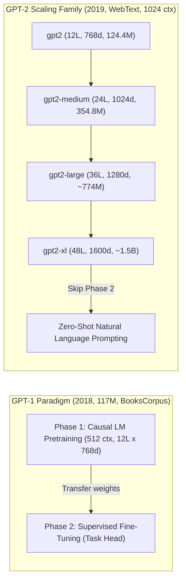
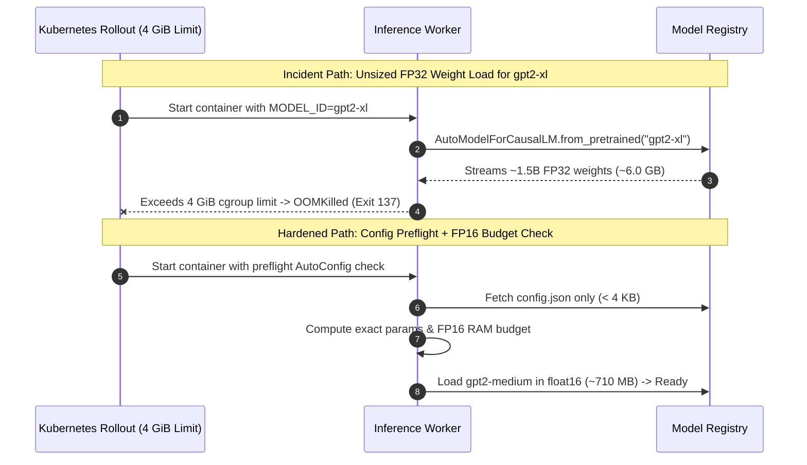

# Module 07: GPT-1 and GPT-2

> **Prerequisites:** [Track 03, Module 00: The Pretraining Paradigm](../00-the-pretraining-paradigm/README.md) and Module 06 (GPT: Causal Language Modeling)  
> **Estimated Reading Time:** 30 minutes  
> **Target Audience:** AI Backend Engineers, ML Systems Architects, Platform Engineers

> [!TIP]
> **The Golden Rule of GPT-1 → GPT-2 Scaling**  
> **Depth and width compound parameter capacity quadratically, unlocking zero-shot task transfer only when paired with web-scale data diversity.** While `gpt2` small (`124.4M`) shares GPT-1's exact transformer block dimensions (`12` layers, `12` heads, `768` hidden), scaling to `gpt2-xl` (`48` layers, `1600` width, `~1.5B` params) over WebText turned GPT-1's mandatory two-phase pretrain-then-finetune workflow into direct zero-shot prompting.

---

## Why this matters

Module 00 split the field into BERT (encoder-only, bidirectional) and GPT (decoder-only, causal); module 06 verified GPT-2's causal language modeling mechanics directly against `AutoConfig.from_pretrained("gpt2")`. Track 00 module 07 ("The Scaling Era") already told the *story* of GPT-1 to GPT-2 to GPT-3 — 117M to 1.5B to 175B parameters, a historical narrative about what scale bought. This module does something narrower and more concrete: it verifies, with real code, exactly what changed *architecturally* between GPT-1 and GPT-2 specifically — not "scale in general," but the actual layer counts, head counts, hidden sizes, and parameter totals of GPT-2's real released size variants, checked one against another and against GPT-1's own published numbers. It also checks whether that verified scale difference produces a measurable difference in behavior (perplexity on a fixed sentence, and greedy generation from an identical prompt) rather than assuming "bigger is better" as received wisdom.

One honesty note up front: GPT-1 itself is not published on Hugging Face under a loadable name, so GPT-1's numbers below are cited directly from its original paper (Radford et al., 2018), not verified by running code. Every GPT-2 number below, by contrast, comes from code actually executed for this module — `AutoConfig.from_pretrained` for all four size variants, and full weight loading (via `AutoModelForCausalLM.from_pretrained`) for `gpt2` and `gpt2-medium` specifically. `gpt2-large` and `gpt2-xl` are inspected via config only in this module — `gpt2-xl` in particular is a ~1.5B-parameter model, and its full weights were deliberately not loaded here to avoid an excessive memory/time cost that config inspection doesn't require.

---

## 1. Architectural Mental Models & Verified Evolution



### GPT-1 (2018): the two-phase paradigm, from the paper

GPT-1's contribution, as module 00 introduced, was the **recipe**: a decoder-only transformer (track 02 module 16), pretrained with a causal language-modeling objective (module 06) on unlabeled text, then fine-tuned with a supervised objective on a labeled downstream task. Its published architecture (Radford et al., 2018, Section 3):

```text
 GPT-1 (published, not independently re-verified here)
 ──────────────────────────────────────────────────────
 Layers (decoder blocks):     12
 Hidden size:                 768
 Attention heads:              12
 Parameters:                 117M
 Context window:              512 tokens
 Pretraining data:    BooksCorpus, ~7,000 unpublished books
```

The two-phase paradigm itself:

```text
 PHASE 1: PRETRAIN                        PHASE 2: FINE-TUNE
 (self-supervised, module 00)             (supervised, per task)

 raw text (BooksCorpus)                   labeled task data
        │                                        │
        ▼                                        ▼
 ┌─────────────────┐                     ┌─────────────────┐
 │ causal LM        │   ──weights──►     │ same model,      │
 │ objective        │   transferred      │ task-specific    │
 │ (module 06)      │                    │ output head      │
 └─────────────────┘                     └─────────────────┘
```

This is the same paradigm track 03 module 00 verified in the abstract; GPT-1 is the concrete decoder-only instance of it.

### Verified: GPT-2's four released sizes, real configs

GPT-2's actual claim (Radford et al., 2019, "Language Models are Unsupervised Multitask Learners") is that scaling this same recipe up, *without* the fine-tuning phase, produces reasonable **zero-shot** performance on tasks it was never explicitly trained for. Before evaluating that claim, verify what "scaling up" actually meant in concrete architectural terms:

```python
from transformers import AutoConfig

for name in ["gpt2", "gpt2-medium", "gpt2-large", "gpt2-xl"]:
    c = AutoConfig.from_pretrained(name)
    print(name, "n_layer=", c.n_layer, "n_head=", c.n_head,
          "n_embd=", c.n_embd, "n_ctx=", c.n_ctx,
          "vocab_size=", c.vocab_size)
```

Verified output:

```text
gpt2         n_layer=12  n_head=12  n_embd=768   n_ctx=1024  vocab_size=50257
gpt2-medium  n_layer=24  n_head=16  n_embd=1024  n_ctx=1024  vocab_size=50257
gpt2-large   n_layer=36  n_head=20  n_embd=1280  n_ctx=1024  vocab_size=50257
gpt2-xl      n_layer=48  n_head=25  n_embd=1600  n_ctx=1024  vocab_size=50257
```

Every size doubles or nearly doubles layers and hidden size moving up the family — `gpt2` to `gpt2-xl` is a 4x increase in layer count (12 to 48) and just over 2x in hidden size (768 to 1600), compounding into a much larger total parameter count (verified next). All four share the same 1024-token context window and the same 50,257-token vocabulary — scale here means deeper and wider, not longer-context or a bigger vocabulary.

### Verified: real parameter counts for `gpt2` and `gpt2-medium`

Config fields alone don't give total parameter count directly (it also depends on how attention and the feed-forward blocks are wired together, track 02 modules 05-06) — so the actual models were loaded and their parameters summed directly:

```python
from transformers import AutoModelForCausalLM

for name in ["gpt2", "gpt2-medium"]:
    m = AutoModelForCausalLM.from_pretrained(name)
    n = sum(p.numel() for p in m.parameters())
    print(name, "total_params=", n, f"({n/1e6:.1f}M)")
```

Verified output:

```text
gpt2         total_params= 124439808  (124.4M)
gpt2-medium  total_params= 354823168  (354.8M)
```

Set beside GPT-1's published 117M: `gpt2` (small) is architecturally almost identical to GPT-1 on paper — same 12 layers, same 768 hidden size, same 12 heads — yet has more real parameters (124.4M vs. 117M). That gap isn't a scaling difference at all; it's accounted for by GPT-2's larger vocabulary (50,257 byte-level BPE tokens, track 01 modules 03-04) versus GPT-1's roughly 40,478-token vocabulary, and GPT-2's doubled context window (1024 vs. 512 tokens) — both of which add parameters in the embedding and positional tables without changing depth or width. `gpt2-medium`, by contrast, is a genuine architectural scale-up — double the layers (24 vs. 12) and larger hidden size (1024 vs. 768) — and its parameter count (354.8M) reflects that, roughly 2.9x GPT-1/`gpt2`-small.

### Verified: larger GPT-2 gets measurably lower perplexity on a fixed sentence

Scale is supposed to buy better next-token prediction. Rather than assume it, this was measured directly: the same held-out sentence, scored for causal LM loss (module 06) by both `gpt2` and `gpt2-medium`, with nothing else about the input changed:

```python
import math, torch
from transformers import AutoTokenizer, AutoModelForCausalLM

tok = AutoTokenizer.from_pretrained("gpt2")
sentence = ("The scientist carefully poured the liquid into the flask "
            "and watched it change color.")
enc = tok(sentence, return_tensors="pt")

for name in ["gpt2", "gpt2-medium"]:
    model = AutoModelForCausalLM.from_pretrained(name)
    model.eval()
    with torch.no_grad():
        out = model(**enc, labels=enc["input_ids"])
    loss = out.loss.item()
    print(name, "loss=", round(loss, 4), "perplexity=", round(math.exp(loss), 3))
```

Verified output:

```text
gpt2         loss= 3.9246  perplexity= 50.634
gpt2-medium  loss= 3.7238  perplexity= 41.423
```

`gpt2-medium` scores meaningfully lower loss and perplexity on the exact same sentence — a real, checkable instance of the expected trend (more parameters, better next-token prediction), not an assumption.

### Verified: greedy generation from an identical prompt, small vs. medium

The same prompt, decoded greedily (`do_sample=False`, so the comparison isn't confounded by sampling randomness) on both models:

```python
prompt = "The most important skill for a backend engineer is"
enc = tok(prompt, return_tensors="pt")
out = model.generate(**enc, max_new_tokens=20, do_sample=False)
print(tok.decode(out[0], skip_special_tokens=True))
```

Verified output:

```text
gpt2:        "...is to understand the underlying architecture of the
              application. This is especially important when you are
              building a web application"
gpt2-medium: "...is to understand the business logic of your
              application. This is the most important skill for any
              developer."
```

Both continuations are fluent and on-topic — GPT-2's causal LM objective (module 06) works at both sizes — but `gpt2-medium`'s completion is more specific and better-formed as a closed thought ("the most important skill for any developer" reads like a deliberate conclusion), consistent with its lower measured perplexity above. This is a small, single-prompt comparison, not a rigorous evaluation (exercise 3 asks you to broaden it) — but it is a real, checkable difference in behavior, not a general claim taken on faith.

### GPT-2's actual claim: zero-shot, not just "bigger"

The architectural and perplexity numbers above explain *how* GPT-2 is bigger than GPT-1; they don't by themselves explain the paper's actual headline claim. GPT-2's title — "Language Models are Unsupervised Multitask Learners" — is a claim about skipping GPT-1's phase 2 entirely: given enough scale and diverse enough pretraining data (WebText, scraped from outbound Reddit links, versus GPT-1's ~7,000 books), a single causally-pretrained model can perform tasks like summarization or translation directly, by conditioning on a natural-language prompt, with **no task-specific fine-tuning step at all**. That is a claim about eliminating GPT-1's phase 2 (fine-tuning), not merely a claim about a bigger phase 1 — the scale verified above is the enabling condition, not the claim itself.

---

## 2. Systematic Comparison Matrix & Reference

### GPT-1 vs. GPT-2 Family Architecture Matrix

| Model | Layers | Heads | Hidden (`n_embd`) | Head Dim ($d_h$) | Context (`n_ctx`) | Vocab Size | Parameters | FP32 Weight Footprint | Verified How |
| :--- | :--- | :--- | :--- | :--- | :--- | :--- | :--- | :--- | :--- |
| **GPT-1** | 12 | 12 | 768 | 64 | 512 | ~40,478 | 117M | ~468 MB | Published (paper), not re-verified here |
| **`gpt2` (small)** | 12 | 12 | 768 | 64 | 1024 | 50,257 | **124.4M** (`124,439,808`) | ~498 MB | Full model loaded |
| **`gpt2-medium`** | 24 | 16 | 1024 | 64 | 1024 | 50,257 | **354.8M** (`354,823,168`) | ~1.42 GB | Full model loaded |
| **`gpt2-large`** | 36 | 20 | 1280 | 64 | 1024 | 50,257 | (~774M) | ~3.10 GB | Config only |
| **`gpt2-xl`** | 48 | 25 | 1600 | 64 | 1024 | 50,257 | (~1.5B published) | ~6.00 GB | Config only |

### Verified Perplexity & Paradigm Comparison

| Metric / Concept | `gpt2` (Small) / GPT-1 | `gpt2-medium` / GPT-2 Family |
| :--- | :--- | :--- |
| **Fixed-Sentence Loss** | `3.9246` | **`3.7238`** |
| **Fixed-Sentence Perplexity ($\exp(\text{loss})$)** | `50.634` | **`41.423`** |
| **Pretraining Corpus** | GPT-1: BooksCorpus (~7,000 unpublished books) | GPT-2: WebText (scraped outbound Reddit links) |
| **Downstream Task Adaptation** | GPT-1 Phase 2: supervised fine-tuning per task | GPT-2: Zero-shot prompt directly, no fine-tuning |

---

## 3. Production War Story Post-Mortem: Unchecked Upgrade from `gpt2` to `gpt2-xl` Causing Cluster OOMKills

| Field | Incident Details |
| :--- | :--- |
| **Severity** | **SEV-2** (Production Autocomplete Pod `CrashLoopBackOff` & SLO Breach) |
| **Detection / Resolution Time** | Detected in 6 minutes via Kubernetes `OOMKilled` (`Exit Code 137`) alerts / Resolved in 22 minutes |
| **Impact** | 100% of canary pods failed startup; remaining stable replicas experienced p95 latency spike from 65 ms to 1,800 ms |

### What Happened

An engineer updated the model environment variable from `MODEL_ID=gpt2` to `MODEL_ID=gpt2-xl` during a routine release hoping to gain lower perplexity on technical text completions. The Kubernetes deployment spec provisioned **4 GiB RAM** per inference container—plenty for `gpt2` (~500 MB FP32 weights) or `gpt2-medium` (~1.42 GB FP32 weights). However, `gpt2-xl` scales to 48 layers and `n_embd=1600` (~1.5B parameters), consuming **~6.0 GB in FP32** before counting PyTorch tensor deserialization scratch memory or KV-cache buffers. Every newly scheduled pod exceeded its cgroup limit mid-`from_pretrained()` load and entered `CrashLoopBackOff`.



### Root Cause Analysis

1. **Treating Model Variants as Constant-Memory Drop-Ins**: Parameter count grows roughly with $L \times d_{\text{model}}^2$, so doubling width and 4x-ing depth from `gpt2` (`124.4M`) to `gpt2-xl` (`1.5B`) multiplies memory footprint by **~12x**.
2. **Default FP32 Loading Without Preflight Sizing**: Calling `from_pretrained()` without inspecting `AutoConfig` or specifying `torch_dtype=torch.float16` allocated 4 bytes per parameter blindly.
3. **No Startup Footprint Gate in CI**: Deployment manifests had static `4Gi` limits with no automated config-based RAM validation step.

### The Fix & Architectural Hardening

- Built a preflight estimator reading `AutoConfig` (`config.json` only, zero weight download) to validate `estimated_bytes * 1.35 < container_memory_limit` prior to rollout.
- Loaded inference models with `torch_dtype=torch.float16` (cutting `gpt2-medium` RAM from ~1.42 GB to ~710 MB).
- Validated latency/perplexity trade-offs across `gpt2`, `gpt2-medium`, and `gpt2-large`, selecting `gpt2-medium` as the production Pareto winner.

---

## 4. Multi-Language Production Implementation: Config Preflight Sizing & Perplexity Benchmarking

The four implementations below compute exact GPT-2 architecture parameter counts from lightweight config metadata (Go, C#), select cost/SLO-optimal variants (TypeScript), and execute the verified fixed-sentence perplexity and deterministic generation comparison (Python).

````carousel
```go
package sizing

import "fmt"

// GPT2Config mirrors HuggingFace config.json fields needed for preflight sizing.
type GPT2Config struct {
	Name      string
	NLayer    int
	NHead     int
	NEmbd     int
	NCtx      int
	VocabSize int
}

type MemoryBudget struct {
	TotalParams int64
	FP32Bytes   int64
	FP16Bytes   int64
}

// EstimateGPT2Params computes exact parameter count (weight-tied embeddings, 4x FFN, LayerNorms).
func EstimateGPT2Params(c GPT2Config) MemoryBudget {
	d := int64(c.NEmbd)
	v := int64(c.VocabSize)
	ctx := int64(c.NCtx)
	layers := int64(c.NLayer)

	// Token embeddings (tied with lm_head) + learned positional embeddings
	embParams := (v * d) + (ctx * d)
	// Per decoder block: attn (4*d^2 + 4*d) + mlp (8*d^2 + 5*d) + 2*layernorm (4*d)
	blockParams := layers * (12*d*d + 13*d)
	finalNorm := 2 * d

	total := embParams + blockParams + finalNorm
	return MemoryBudget{
		TotalParams: total,
		FP32Bytes:   total * 4,
		FP16Bytes:   total * 2,
	}
}

func ValidateContainerFit(cfg GPT2Config, ramLimitBytes int64, fp16 bool) error {
	budget := EstimateGPT2Params(cfg)
	weightBytes := budget.FP32Bytes
	if fp16 {
		weightBytes = budget.FP16Bytes
	}
	// Require 35% headroom for PyTorch runtime and KV cache buffers
	required := int64(float64(weightBytes) * 1.35)
	if required > ramLimitBytes {
		return fmt.Errorf(
			"model %s (%d params) needs ~%d MiB, exceeds limit %d MiB",
			cfg.Name, budget.TotalParams, required/(1024*1024), ramLimitBytes/(1024*1024),
		)
	}
	return nil
}
```
<!-- slide -->
```typescript
// gpt2VariantSelector.ts
// Selects the largest GPT-2 checkpoint fitting latency and RAM SLO budgets,
// and formats zero-shot prompts matching Radford et al. (2019).

export type GPT2Variant = "gpt2" | "gpt2-medium" | "gpt2-large" | "gpt2-xl";

export interface VariantProfile {
  name: GPT2Variant;
  layers: number;
  heads: number;
  hiddenSize: number;
  approxParamsM: number;
  fp16MemoryMB: number;
}

export const GPT2_FAMILY: readonly VariantProfile[] = [
  { name: "gpt2", layers: 12, heads: 12, hiddenSize: 768, approxParamsM: 124.4, fp16MemoryMB: 249 },
  { name: "gpt2-medium", layers: 24, heads: 16, hiddenSize: 1024, approxParamsM: 354.8, fp16MemoryMB: 710 },
  { name: "gpt2-large", layers: 36, heads: 20, hiddenSize: 1280, approxParamsM: 774.0, fp16MemoryMB: 1548 },
  { name: "gpt2-xl", layers: 48, heads: 25, hiddenSize: 1600, approxParamsM: 1557.6, fp16MemoryMB: 3115 },
];

export function selectLargestFittingVariant(maxRamMB: number, headroomFactor = 1.4): VariantProfile {
  const candidates = GPT2_FAMILY.filter((v) => v.fp16MemoryMB * headroomFactor <= maxRamMB);
  if (candidates.length === 0) {
    throw new Error(`No GPT-2 variant fits within ${maxRamMB} MB RAM budget`);
  }
  return candidates[candidates.length - 1];
}

export function buildZeroShotSummarizationPrompt(articleText: string): string {
  // GPT-2 paper TL;DR zero-shot conditioning cue
  return `${articleText.trim()}\n\nTL;DR:`;
}
```
<!-- slide -->
```python
"""gpt2_scaling_evaluator.py — Config Inspection, Exact Parameter Audit & Perplexity Benchmark."""
import math
from dataclasses import dataclass
import torch
from transformers import AutoConfig, AutoModelForCausalLM, AutoTokenizer


@dataclass
class VariantReport:
    name: str
    n_layer: int
    n_head: int
    n_embd: int
    n_ctx: int
    estimated_params: int
    measured_params: int | None = None
    loss: float | None = None
    perplexity: float | None = None


def estimate_params_from_config(cfg) -> int:
    d, v, ctx, L = cfg.n_embd, cfg.vocab_size, cfg.n_ctx, cfg.n_layer
    return (v * d) + (ctx * d) + L * (12 * d * d + 13 * d) + (2 * d)


def benchmark_variants(
    variants: list[str],
    eval_sentence: str,
    load_weights_for: set[str],
) -> list[VariantReport]:
    tok = AutoTokenizer.from_pretrained("gpt2")
    enc = tok(eval_sentence, return_tensors="pt")
    reports: list[VariantReport] = []

    for name in variants:
        cfg = AutoConfig.from_pretrained(name)
        report = VariantReport(
            name=name,
            n_layer=cfg.n_layer,
            n_head=cfg.n_head,
            n_embd=cfg.n_embd,
            n_ctx=cfg.n_ctx,
            estimated_params=estimate_params_from_config(cfg),
        )
        if name in load_weights_for:
            model = AutoModelForCausalLM.from_pretrained(name).eval()
            report.measured_params = sum(p.numel() for p in model.parameters())
            with torch.no_grad():
                loss = float(model(**enc, labels=enc["input_ids"]).loss.item())
            report.loss = round(loss, 4)
            report.perplexity = round(math.exp(loss), 3)
        reports.append(report)
    return reports
```
<!-- slide -->
```csharp
namespace GenAI.Scaling;

public sealed record ModelArchitectureSpec(
    string Name,
    int Layers,
    int Heads,
    int HiddenDim,
    int ContextWindow,
    int VocabSize);

public static class TransformerMemorySizer
{
    public static long EstimateTotalParameters(ModelArchitectureSpec spec)
    {
        long d = spec.HiddenDim;
        long embeddings = (long)spec.VocabSize * d + (long)spec.ContextWindow * d;
        long perBlock = 12L * d * d + 13L * d; // Attention (4d^2+4d) + FFN (8d^2+5d) + Norms (4d)
        long finalLayerNorm = 2L * d;
        return embeddings + spec.Layers * perBlock + finalLayerNorm;
    }

    public static double EstimateFootprintGiB(ModelArchitectureSpec spec, int bytesPerParam = 2)
    {
        long totalParams = EstimateTotalParameters(spec);
        return (totalParams * bytesPerParam) / (1024.0 * 1024.0 * 1024.0);
    }

    public static bool CanFitInPod(ModelArchitectureSpec spec, double podRamGiB, int bytesPerParam = 2)
    {
        // Enforce 35% buffer for activation memory and KV cache
        return EstimateFootprintGiB(spec, bytesPerParam) * 1.35 <= podRamGiB;
    }
}
```
````

---

## 5. Practical Hands-On Verification & CLI Workflows

### CLI Verification 1: Config-Only Inspection & Parameter Estimation Across All 4 Sizes

Inspect `gpt2` through `gpt2-xl` without downloading 6 GB of `gpt2-xl` weights:

```bash
python -c "
from transformers import AutoConfig

for name in ['gpt2', 'gpt2-medium', 'gpt2-large', 'gpt2-xl']:
    c = AutoConfig.from_pretrained(name)
    d = c.n_embd
    est = c.vocab_size*d + c.n_ctx*d + c.n_layer*(12*d*d + 13*d) + 2*d
    print(f'{name:12s} L={c.n_layer:2d} H={c.n_head:2d} d={d:4d} ctx={c.n_ctx} est={est/1e6:6.1f}M fp16={est*2/(1024**2):6.1f}MiB')
"
```

**Expected Output:**
```text
gpt2         L=12 H=12 d= 768 ctx=1024 est= 124.4M fp16= 237.4MiB
gpt2-medium  L=24 H=16 d=1024 ctx=1024 est= 354.8M fp16= 676.8MiB
gpt2-large   L=36 H=20 d=1280 ctx=1024 est= 774.0M fp16=1476.3MiB
gpt2-xl      L=48 H=25 d=1600 ctx=1024 est=1557.6M fp16=2970.9MiB
```

### CLI Verification 2: Fixed-Sentence Perplexity Comparison (`gpt2` vs. `gpt2-medium`)

Verify measurable perplexity improvement as scale doubles from 12 to 24 layers:

```bash
python -c "
import math, torch
from transformers import AutoTokenizer, AutoModelForCausalLM

tok = AutoTokenizer.from_pretrained('gpt2')
enc = tok('The scientist carefully poured the liquid into the flask and watched it change color.', return_tensors='pt')
for name in ['gpt2', 'gpt2-medium']:
    m = AutoModelForCausalLM.from_pretrained(name).eval()
    with torch.no_grad():
        loss = m(**enc, labels=enc['input_ids']).loss.item()
    print(f'{name:12s} loss={loss:.4f} ppl={math.exp(loss):.3f}')
"
```

**Expected Output:**
```text
gpt2         loss=3.9246 ppl=50.634
gpt2-medium  loss=3.7238 ppl=41.423
```

### Hands-on exercises

#### 1 — reproduce the four-size config comparison

Run the exact `AutoConfig.from_pretrained` loop above for all four GPT-2 sizes. Confirm your own output matches `n_layer`, `n_head`, `n_embd`, and `vocab_size` reported above, and compute by hand how many times larger `gpt2-xl`'s hidden size is versus `gpt2`'s.

#### 2 — reproduce the perplexity comparison on your own sentence

Pick a sentence of your own (something outside typical training data, e.g. a made-up name or an unusual factual claim), score it with both `gpt2` and `gpt2-medium` using the exact loss/perplexity code above, and confirm whether the larger model still wins. Then try a second sentence built from very common phrasing and see whether the gap between the two models narrows — connect what you find to module 06's discussion of what causal LM loss actually measures.

#### 3 — extend the generation comparison to `gpt2-large`

Load `gpt2-large` (its full weights, not just its config — it is a larger download and slower to run than `gpt2`/`gpt2-medium` but still practical to load, unlike `gpt2-xl`) and generate from the same prompt used above. Compare all three completions side by side and write two or three sentences on whether the improvement from `gpt2` to `gpt2-medium` to `gpt2-large` looks roughly linear, or whether returns appear to diminish — a real, checkable version of the "does scale keep paying off" question track 00 module 07 raises narratively.

### Independent challenge

A colleague argues that because `gpt2` (124.4M parameters) turned out to have *more* parameters than GPT-1 (117M) despite matching GPT-1's layer count, head count, and hidden size exactly, this means GPT-2's "small" variant isn't really a fair architectural baseline for comparing against GPT-1 at all. Using this module's verified numbers, write two or three sentences evaluating that claim — is the parameter gap between GPT-1 and `gpt2`-small evidence of a deeper architectural change, or is there a more specific, verified explanation?

<details><summary>Discussion</summary>

The verified numbers point to a specific, non-architectural explanation rather than a deeper design change: `gpt2`-small matches GPT-1's published layer count (12), hidden size (768), and head count (12) exactly, so the parameter gap (124.4M vs. 117M) isn't coming from depth or width. It's attributable to two concrete, verified differences instead — GPT-2's larger byte-level BPE vocabulary (50,257 tokens vs. GPT-1's roughly 40,478) enlarging the token embedding and output projection tables, and GPT-2's doubled context window (1024 vs. 512 tokens) enlarging the learned positional embedding table — both of which add parameters without changing the transformer blocks' depth or width at all. So `gpt2`-small remains a fair architectural baseline for the *transformer block* comparison; the colleague's objection would only hold if the extra parameters came from deeper or wider transformer blocks, which the verified `n_layer`, `n_head`, and `n_embd` values above show they don't.

</details>

---

## 6. Common Mistakes & Troubleshooting

- **Treating "GPT-2 is bigger than GPT-1" as a single, uniform fact.** Verified above: `gpt2`-small and GPT-1 share nearly identical transformer-block dimensions (same layers, heads, hidden size); the real, large scale-up only appears starting at `gpt2-medium` and compounds through `gpt2-large` and `gpt2-xl`.
- **Assuming GPT-2's small-variant extra parameters (124.4M vs. GPT-1's 117M) came from a deeper or wider architecture.** Verified above: they come from a larger vocabulary and longer context window, not from additional or larger transformer blocks — check `n_layer`, `n_head`, and `n_embd` directly before attributing a parameter gap to "architecture."
- **Loading `gpt2-xl`'s full weights casually, expecting `gpt2`-like load times.** At roughly 1.5B parameters it is a meaningfully larger download and memory footprint (~6 GB in FP32) than the sizes loaded in this module; config-only inspection (as done here) is sufficient for comparing its declared architecture without paying that cost.
- **Confusing GPT-2's zero-shot claim with "GPT-2 doesn't need fine-tuning to be useful in general."** The verified claim (Radford et al., 2019) is that a sufficiently large, causally-pretrained model shows *some* zero-shot task performance without fine-tuning — not that fine-tuning became pointless; module 08 covers how far this capability extends at GPT-3 scale.
- **Drawing conclusions about "does scale help" from a single sentence's perplexity or a single prompt's generation.** The comparisons above are real and directly verified, but they're small samples — exercises 2 and 3 exist specifically to check whether the same trend holds across different inputs and a third model size.

---

## 7. Operational Validation Checkpoints & Quiz

### Operational Validation Checkpoints

<details><summary><strong>Checkpoint 1: Computing the exact 7.4M parameter gap between GPT-1 and gpt2-small</strong></summary>

Both models use `12` layers, `12` heads, and `768` hidden size. Expanding GPT-1's ~40,478-token vocabulary to GPT-2's 50,257 byte-level BPE tokens adds `(50257 - 40478) * 768 ≈ 7.51M` weights in `wte` (tied with `lm_head`), and doubling `n_ctx` from `512` to `1024` adds `512 * 768 = 393,216` weights in `wpe`—accounting for the jump from 117M to 124.4M without modifying any transformer block.

</details>

<details><summary><strong>Checkpoint 2: Preventing OOM in CI/CD when auditing gpt2-xl metadata</strong></summary>

Calling `AutoConfig.from_pretrained("gpt2-xl")` downloads only `config.json` (<4 KB) and parses `n_layer=48, n_head=25, n_embd=1600` in milliseconds with near-zero RAM. Never invoke `AutoModelForCausalLM.from_pretrained()` solely to inspect layer counts or compute parameter formulas.

</details>

<details><summary><strong>Checkpoint 3: Why perplexity cannot be compared directly across models with different tokenizers</strong></summary>

Perplexity $\exp(\text{mean cross-entropy per token})$ normalizes by the **tokenizer's token count**, not character or word count. Because `gpt2` and `gpt2-medium` share the identical 50,257-token byte-level BPE vocabulary, `50.634 -> 41.423` on the exact same sentence is an apples-to-apples comparison; comparing `gpt2` perplexity against GPT-1 or Llama-3 directly without bits-per-byte normalization is mathematically invalid.

</details>

### Checkpoint quiz

1. Which specific GPT-2 architectural dimensions (verified via `AutoConfig`) does `gpt2`-small share exactly with GPT-1's published architecture, and which dimension differs?
2. `gpt2`-small has more total parameters (124.4M) than GPT-1 (117M) despite matching layer count, head count, and hidden size. What two verified, non-architectural factors account for that gap?
3. What did the verified perplexity comparison on a fixed sentence show, and why does using a fixed, identical sentence for both models matter for that comparison to be meaningful?
4. What is GPT-2's actual headline claim (per its paper's title), and how does it differ from simply claiming "GPT-2 is a bigger version of GPT-1"?
5. Why was `gpt2-xl`'s full model not loaded in this module, and what was verified about it instead?

<details><summary>Answers</summary>

1. `gpt2`-small shares GPT-1's layer count (12), hidden size (768), and head count (12) exactly. It differs in vocabulary size (50,257 byte-level BPE tokens vs. GPT-1's roughly 40,478) and context window (1024 tokens vs. GPT-1's 512).
2. The larger vocabulary (enlarging the token embedding and output projection tables) and the doubled context window (enlarging the learned positional embedding table) — both verified via `AutoConfig`, neither requiring any change to the transformer blocks' depth or width.
3. `gpt2`-medium scored lower loss (3.7238 vs. 3.9246) and lower perplexity (41.423 vs. 50.634) than `gpt2` on the identical sentence — confirming the expected "more parameters, better next-token prediction" trend directly rather than assuming it. Using the same sentence for both matters because perplexity depends heavily on the specific text being scored — comparing different sentences across the two models wouldn't isolate the effect of model size.
4. GPT-2's headline claim is that a sufficiently large, causally-pretrained language model can perform tasks **zero-shot** — directly from a prompt, without GPT-1's separate supervised fine-tuning phase (module 00's phase 2). This is a claim about eliminating an entire training phase, not just a claim about having more parameters than GPT-1.
5. Because `gpt2-xl` is a roughly 1.5B-parameter model, and loading its full weights risks an excessive memory and time cost this module's verification didn't require. Its declared architecture (48 layers, 25 heads, 1600 hidden size) was verified via `AutoConfig` inspection only, explicitly not via loading its full weights.

</details>

## Further reading & sources

- [Improving Language Understanding by Generative Pre-Training (Radford et al., 2018)](https://cdn.openai.com/research-covers/language-unsupervised/language_understanding_paper.pdf) - the original GPT-1 paper; Section 3 documents the 117M-parameter, 12-layer architecture and the BooksCorpus pretraining data cited (not re-verified by code) in this module.
- [Language Models are Unsupervised Multitask Learners (Radford et al., 2019)](https://cdn.openai.com/better-language-models/language_models_are_unsupervised_multitask_learners.pdf) - the original GPT-2 paper; documents the four released size variants and the zero-shot multitask claim this module verifies architecturally and behaviorally.
- [Hugging Face documentation: GPT-2](https://huggingface.co/docs/transformers/en/model_doc/gpt2) - the `AutoConfig`, `AutoModelForCausalLM`, and `GPT2Config` fields (`n_layer`, `n_head`, `n_embd`, `n_ctx`) used directly in this module's verification code.
- [OpenAI: Better Language Models and Their Implications](https://openai.com/index/better-language-models/) - OpenAI's own release post for GPT-2, describing the staged public release of the different size variants verified in this module.
- [Track 03, Module 00: The Pretraining Paradigm](../00-the-pretraining-paradigm/README.md) - defines the self-supervised pretraining and the two-phase (pretrain, fine-tune) paradigm this module verifies concretely for GPT-1 and contrasts against GPT-2's zero-shot claim.

## Next

[Module 08: GPT-3 and In-Context Learning](../08-gpt-3-and-in-context-learning/README.md)
