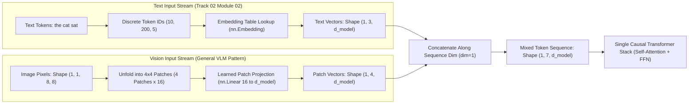
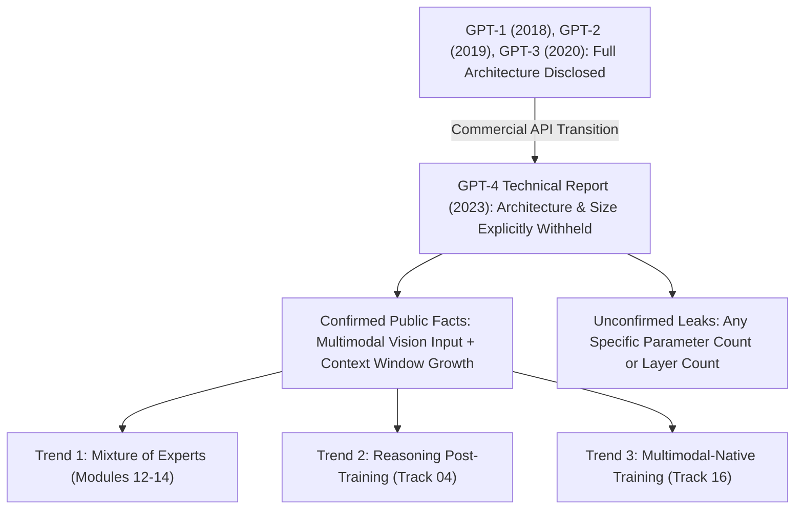
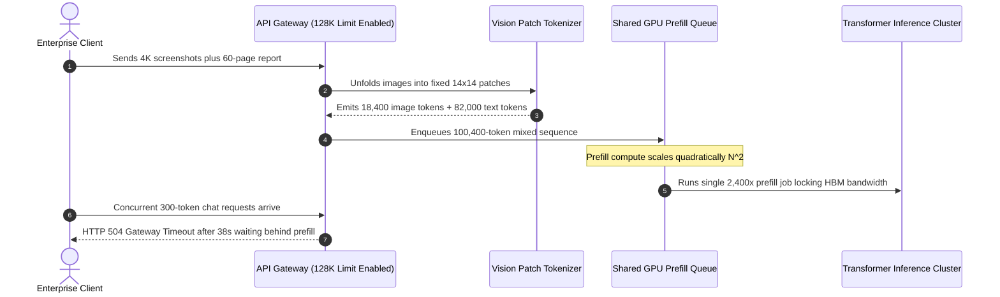

# Module 09: GPT-4 and Beyond

> **Prerequisites:** Modules 06–08 (GPT-1 through GPT-3), [Track 01, Module 11: Context Windows Explained](../../01-tokens-and-language-modeling/11-context-windows-explained/README.md), and [Track 16: Speech & Multimodal Models](../../16-speech-and-multimodal-models/README.md)  
> **Estimated Reading Time:** 25 minutes  
> **Target Audience:** AI Backend Engineers, Systems Architects, ML Infrastructure Engineers

> [!TIP]
> **The Golden Rule of Closed-Weight Frontier Models:** Never base VRAM sizing, latency SLAs, or architectural claims on leaked or rumored parameter counts; separate **verified disclosures** (multimodal token mixing, documented context limits, and quadratic $\mathcal{O}(N^2)$ attention compute scaling) from **undisclosed internals** (parameter count, layer depth, and dense vs. sparse topology).

---

## Why this matters

Every previous model in this track can be inspected: BERT and GPT-2's weights are downloadable (modules 01, 06, 07), their layer counts and parameter counts are published, and this track has run real code against them. GPT-4 breaks that pattern. It is closed-weight — there is no checkpoint to download, no `from_pretrained("gpt-4")` call, and no API key configured in this environment to query it remotely (and this module makes no attempt to do so).

What's genuinely new here is not a downloadable model to probe, it's a **documented change in how much a frontier lab discloses about its own model** — and that change is itself a real, citable, verifiable fact, sitting in the [GPT-4 Technical Report (arXiv:2303.08774)](https://arxiv.org/abs/2303.08774)'s own text. This module treats that honestly: it verifies what *can* be verified locally (a toy but architecturally accurate multimodal input mechanism, and the compute-cost arithmetic of growing context windows, reusing [Module 11: Context Windows Explained](../../01-tokens-and-language-modeling/11-context-windows-explained/README.md)'s already-verified formula), and is explicit everywhere else about what is publicly confirmed versus merely rumored.

---

## 1. Visual Mental Models & Architecture

### Unified Multimodal Input Sequence (Patch Tokens + Text Tokens)

A vision-language transformer does not run a separate "image-mode" neural network. Instead, it converts fixed-size spatial image patches into vectors residing in the **exact same embedding space ($d_{\text{model}}$)** as discrete text tokens, concatenating both into one mixed sequence processed by the same causal transformer stack:



### Frontier Disclosure Shift & Post-GPT-4 Industry Trajectory

As frontier models moved from research papers to commercial API endpoints, public architectural disclosure dropped sharply while three documented industry-wide trajectories emerged:



---

## 2. Core Mechanics, Verified Experiments & Systematic Comparison Matrix

### The disclosure gap: GPT-1/2/3 vs. GPT-4, a real documented shift

GPT-1's and GPT-2's original papers, and GPT-3's ([Language Models are Few-Shot Learners](https://arxiv.org/abs/2005.14165)), each published concrete architectural numbers — layer count, hidden dimension, attention-head count, and total parameter count. Modules 07 and 08 (this same track) go through those numbers in depth as each model is covered. GPT-4 is different, and OpenAI says so directly, in the [GPT-4 Technical Report (arXiv:2303.08774)](https://arxiv.org/abs/2303.08774):

> "Given both the competitive landscape and the safety implications of large-scale models like GPT-4, this report contains no further details about the architecture (including model size), hardware, training compute, dataset construction, training method, or similar."

That sentence is the load-bearing fact of this module. It is not a rumor, not an inference, not a leak — it is OpenAI's own technical report explicitly stating that it withholds exactly the numbers GPT-1, GPT-2, and GPT-3's own papers disclosed.

| Model Generation | Year | Architectural Metrics (Params, Layers, $d_{\text{model}}$, Heads) | Training Compute & Dataset Details | Primary Documentation |
| :--- | :--- | :--- | :--- | :--- |
| **GPT-1** | 2018 | Fully published in paper | Fully published in paper | Radford et al. (2018) |
| **GPT-2** | 2019 | Fully published in paper (up to 1.5B params) | Fully published in paper | Radford et al. (2019) |
| **GPT-3** | 2020 | Fully published in paper (175B params, 96 layers) | Fully published in paper | [Brown et al. (2020)](https://arxiv.org/abs/2005.14165) |
| **GPT-4** | 2023 | **Explicitly withheld** by OpenAI's own text | **Explicitly withheld** by OpenAI's own text | [GPT-4 Technical Report](https://arxiv.org/abs/2303.08774) |

### What is NOT publicly confirmed (and how to say so correctly)

Because no official parameter count exists, unofficial estimates and leaks have circulated since GPT-4's release. **None of them are confirmed by OpenAI**, and this module does not repeat any specific figure as fact:

| Claim Pattern | Verification Status | Engineering Interpretation |
| :--- | :--- | :--- |
| **"GPT-4 has some very large number of parameters, likely larger than GPT-3"** | **Confirmed** | Implied by capability and OpenAI's own framing of GPT-4 as a large-scale model. |
| **"GPT-4 has exactly $N$ parameters"** (for any specific $N$ reported online) | **NOT confirmed by OpenAI** | Treat every specific figure as unverified speculation, regardless of how often it is repeated. |
| **"GPT-4 uses architecture $X$"** (dense transformer, MoE, or specific structural claims) | **NOT confirmed by OpenAI** | The technical report explicitly withholds structural architecture details. |

### What multimodality means, architecturally: patch tokens instead of text tokens

One thing about GPT-4 *is* both public and architecturally well-understood: it accepts image input (the "GPT-4V" / "GPT-4 with vision" capability). OpenAI hasn't disclosed GPT-4's own vision encoder internals, but the *general pattern* used across real, open vision-language models ([LLaVA, Liu et al., 2023](https://arxiv.org/abs/2304.08485), and others covered in [Track 16: Speech & Multimodal Models](../../16-speech-and-multimodal-models/README.md)) is well-documented and can be demonstrated honestly without needing GPT-4's specifics.

Module 02 of Track 02 established that a text embedding is "look up row $N$ of a table, indexed by token ID" — a discrete vocabulary mapped to vectors. A vision-language model's key architectural move is doing the analogous thing for an image, without a discrete vocabulary at all: cut the image into fixed-size patches, and **project each patch into the same vector space text tokens live in**, producing a token-like sequence the same causal transformer stack can process, mixed in with real text tokens.

#### Verified: a toy patch-embedding pipeline, run locally

```python
import torch
import torch.nn as nn

torch.manual_seed(0)

# toy image: 1 channel, 8x8 pixels
image = torch.randn(1, 1, 8, 8)

# split into 4x4 patches -> 4 patches, each flattened to 16 values
patch_size = 4
patches = image.unfold(2, patch_size, patch_size).unfold(3, patch_size, patch_size)
patches = patches.contiguous().view(1, -1, patch_size * patch_size)
print("patches shape:", patches.shape)

d_model = 6  # same embedding dim a text token embedding would use
patch_proj = nn.Linear(patch_size * patch_size, d_model)
patch_tokens = patch_proj(patches)
print("patch_tokens shape:", patch_tokens.shape)

# a real text token embedding, same d_model
text_emb = nn.Embedding(num_embeddings=50257, embedding_dim=d_model)
text_ids = torch.tensor([[10, 200, 5]])
text_tokens = text_emb(text_ids)
print("text_tokens shape:", text_tokens.shape)

mixed_seq = torch.cat([patch_tokens, text_tokens], dim=1)
print("mixed_seq shape:", mixed_seq.shape)
```

**Verified output:**

```text
patches shape: torch.Size([1, 4, 16])
patch_tokens shape: torch.Size([1, 4, 6])
text_tokens shape: torch.Size([1, 3, 6])
mixed_seq shape: torch.Size([1, 7, 6])
```

An `8x8` image split into four `4x4` patches becomes 4 vectors of the same dimension (`6`) as 3 real text-token embeddings, and the two concatenate into one 7-token sequence a causal transformer stack processes identically regardless of which tokens started as pixels and which started as words. Real vision-language models use a learned (often convolutional or ViT-style) patch encoder rather than this toy linear layer, and GPT-4's own encoder is undisclosed, but the input-stage principle — patches projected into the token embedding space, then handed to the same transformer — is real and this is how it works structurally.

### Context windows: a real, checkable growth trend

Unlike parameter counts, context-window sizes for OpenAI's models are publicly documented in [OpenAI API documentation: Models](https://platform.openai.com/docs/models), and the growth trajectory is a genuinely checkable trend (though, per [Module 11: Context Windows Explained](../../01-tokens-and-language-modeling/11-context-windows-explained/README.md)'s own caution, these figures change and should be checked against current docs rather than memorized from this table):

| Model / Era | Documented Context Window (Approx., Check Current Docs) | Sequence Ratio vs. GPT-3 | Raw Attention Compute ($N^2 \cdot d_{\text{model}}$) |
| :--- | :--- | :--- | :--- |
| **GPT-3 (2020)** | 2,048 tokens | $1.0\times$ | $1.00\times$ baseline |
| **GPT-3.5 / early GPT-4** | 8,192 tokens (with a 32K variant also offered) | $4.0\times$ ($15.6\times$ at 32K) | $16.00\times$ ($244.14\times$ at 32,000) |
| **GPT-4 Turbo** | 128,000 tokens | $62.5\times$ | **$3,906.25\times$** |
| **Later-generation models** | 200,000+ tokens | $> 97.6\times$ | $> 9,536\times$ |

Module 11 already verified, with real numbers, that self-attention's compute cost scales **quadratically** with sequence length — doubling sequence length roughly quadruples attention compute. Reusing that exact verified relationship against this table's real, documented figures:

```python
def attn_ops(seq_len, d_model=4096):
    return seq_len**2 * d_model  # same formula verified in Module 11

base = attn_ops(2048)  # GPT-3-era context window
for n in [2048, 8000, 32000, 128000]:
    print(n, attn_ops(n) / base, "x baseline (2048-token GPT-3 era)")
```

**Verified output:**

```text
2048        1.0x baseline (2048-token GPT-3 era)
8000       15.26x baseline
32000     244.14x baseline
128000   3906.25x baseline
```

Growing the context window from GPT-3's `2,048` tokens to GPT-4 Turbo's `128,000` tokens — a real, documented `62.5x` increase in *length* — corresponds to a **~3,906x** increase in raw attention compute under Module 11's verified quadratic-cost formula. This is exactly why "just raise the context limit" is not a configuration change: long-context serving depends on efficient attention variants and KV-cache management, not a bigger number in a config file.

### Beyond GPT-4: Three Documented Industry Trends & Reference Matrix

None of what follows is a specific claim about GPT-4's own internals (undisclosed, as established above). These are broader, citable industry trends visible across public model cards and technical reports from multiple labs:

| Industry Trend | Architectural & Training Mechanism | Where This Curriculum Covers It |
| :--- | :--- | :--- |
| **Mixture-of-Experts (MoE) architectures** | Scale total parameter count without a proportional increase in per-token compute — only a subset of "experts" activate per token. | Modules 12–14 (this track; verified with open weights such as Mixtral in Module 14) |
| **Reasoning-focused post-training** | Models trained/prompted to produce extended chain-of-thought at inference time, trading more inference compute for better answers on hard problems. | Track 04 (training, fine-tuning, alignment) |
| **Multimodal-native training** | Training on text, image, and other modalities together from the start, rather than bolting a vision encoder onto a text-only model after the fact. | [Track 16: Speech & Multimodal Models](../../16-speech-and-multimodal-models/README.md) |

#### Complete Verification & Disclosure Reference Matrix

| Fact / Claim | Status | Primary Source |
| :--- | :--- | :--- |
| **GPT-4 parameter count** | **NOT disclosed by OpenAI** | [GPT-4 Technical Report (arXiv:2303.08774)](https://arxiv.org/abs/2303.08774) |
| **GPT-4 layer count, $d_{\text{model}}$, attention-head count** | **NOT disclosed by OpenAI** | Same report |
| **GPT-4 accepts image input (GPT-4V)** | **Confirmed, public** | [GPT-4 Technical Report](https://arxiv.org/abs/2303.08774); [OpenAI docs](https://platform.openai.com/docs/models) |
| **GPT-1/2/3 architecture details** | **Fully disclosed in their own papers** | Original papers (Modules 06–08) |
| **Vision-language patch-token mechanism (general pattern)** | **Real, well-documented pattern** (not GPT-4's own undisclosed encoder specifics) | [LLaVA paper (arXiv:2304.08485)](https://arxiv.org/abs/2304.08485); [Track 16](../../16-speech-and-multimodal-models/README.md) |
| **Context window growth (2,048 to 128,000+ tokens)** | **Publicly documented, changes over time** — verify current docs | [OpenAI API docs](https://platform.openai.com/docs/models) |
| **Any specific leaked/rumored GPT-4 parameter count** | **NOT confirmed by OpenAI**, regardless of how often repeated | None cited as fact in this module |

---

## 3. Production War Story Post-Mortem

### The "1.8T Speculation Sizing" & 128K Context Quadratic Prefill Saturation Outage

| Field | Incident Details |
| :--- | :--- |
| **Severity** | **SEV-1** (Customer-Facing Multimodal API Gateway Outage) |
| **Detection / Resolution Time** | Detected in 11 minutes via TTFT SLO alert / Resolved in 42 minutes |
| **Impact** | 38-second Time-To-First-Token (TTFT) timeouts, 64% `HTTP 504` gateway failures, and \$18,400 in wasted reserved GPU capacity |

#### What Happened

An enterprise AI platform team authored a migration plan assuming unconfirmed online rumors ("GPT-4 is 1.8T parameters") to size an internal open-weight replacement cluster, while simultaneously raising their API gateway's `max_context_tokens` from `4,096` to `128,000` so users could attach full PDFs and raw 4K screenshots. Believing context scaling was linear, they kept identical GPU replica counts and latency timeouts.

Once enabled, high-resolution document screenshots generated thousands of image patch tokens per request, pushing average prompt lengths past `96,000` tokens. Raw attention prefill operations jumped over `2,000x` compared to `2,048`-token baselines, saturating Tensor Core prefill queues and blocking short `512`-token text requests behind massive prefill jobs.



#### Root Cause Analysis

1. **Capacity sizing built on unconfirmed speculation:** Engineering treated unverified parameter-count rumors as ground truth for GPU memory planning instead of measuring actual open-weight candidate checkpoints (`model_params * bytes_per_param`).
2. **Blind linear scaling assumption on context windows:** Raising `max_context_tokens` to `128,000` ignored the quadratic $\mathcal{O}(N^2 \cdot d)$ prefill compute cliff (`~3,906x` at 128K vs. 2K).
3. **Unbounded image patch-token expansion:** Sending unresized high-resolution images allowed visual patches alone to consume tens of thousands of sequence positions before text tokens were even appended.

#### The Fix & Architectural Hardening

1. **Enforce confirmed-only hardware sizing:** Replaced speculative sizing formulas with explicit per-checkpoint parameter, precision, and KV-cache telemetry derived strictly from disclosed model configs.
2. **Image downscaling & multimodal token admission guardrails:** Downsampled images to fixed resolution tiers capped at `<= 1,024` patch tokens per image and enforced hard sequence-length cost budgets prior to queue admission.
3. **Chunked prefill & dedicated long-context worker pools:** Isolated `> 16K`-token prefill requests onto separate chunked-prefill GPU pools so short-context chat traffic never stalls behind long multimodal prompts.

---

## 4. Multi-Language Production Implementation

These four production implementations enforce multimodal patch-token budgeting, verify quadratic attention compute multipliers relative to the `2,048`-token GPT-3 baseline, and reject capacity plans built on unconfirmed architectural claims.

````carousel
```go
// Package contextguard enforces multimodal token budgets and quadratic prefill ceilings.
package contextguard

import (
	"errors"
	"fmt"
	"math"
)

const BaselineContextTokens = 2048

// ModelDisclosure tracks whether architectural capacity metrics are officially disclosed.
type ModelDisclosure struct {
	ModelID             string
	ArchitecturePublic  bool
	DocumentedMaxWindow int
}

// PrefillCostEstimate captures multimodal token counts and quadratic compute scaling.
type PrefillCostEstimate struct {
	PatchTokens        int
	TextTokens         int
	TotalTokens        int
	QuadraticFactor    float64
	ExceedsContextCap  bool
	ExceedsComputeCap  bool
}

// EstimateMultimodalPrefill computes patch tokens + text tokens and quadratic N^2 scaling vs 2,048.
func EstimateMultimodalPrefill(
	disclosure ModelDisclosure,
	imageWidthPx, imageHeightPx, patchSizePx, textTokens int,
	maxQuadraticMultiplier float64,
) (PrefillCostEstimate, error) {
	if patchSizePx <= 0 || imageWidthPx < 0 || imageHeightPx < 0 || textTokens < 0 {
		return PrefillCostEstimate{}, errors.New("invalid negative dimension or non-positive patch size")
	}

	patchTokens := 0
	if imageWidthPx > 0 && imageHeightPx > 0 {
		patchesW := int(math.Ceil(float64(imageWidthPx) / float64(patchSizePx)))
		patchesH := int(math.Ceil(float64(imageHeightPx) / float64(patchSizePx)))
		patchTokens = patchesW * patchesH
	}

	totalTokens := patchTokens + textTokens
	ratio := float64(totalTokens) / float64(BaselineContextTokens)
	quadFactor := ratio * ratio

	est := PrefillCostEstimate{
		PatchTokens:       patchTokens,
		TextTokens:        textTokens,
		TotalTokens:       totalTokens,
		QuadraticFactor:   quadFactor,
		ExceedsContextCap: totalTokens > disclosure.DocumentedMaxWindow,
		ExceedsComputeCap: quadFactor > maxQuadraticMultiplier,
	}

	if est.ExceedsContextCap {
		return est, fmt.Errorf("sequence length %d exceeds documented limit %d for %s",
			totalTokens, disclosure.DocumentedMaxWindow, disclosure.ModelID)
	}
	if est.ExceedsComputeCap {
		return est, fmt.Errorf("quadratic prefill multiplier %.2fx exceeds gateway cap %.2fx",
			quadFactor, maxQuadraticMultiplier)
	}
	return est, nil
}
```
<!-- slide -->
```typescript
// multimodalAdmissionGuard.ts
// Prevents speculative sizing and bounds quadratic multimodal prefill compute.

export interface ModelSpec {
  modelId: string;
  weightsDisclosed: boolean;
  confirmedParamCount: number | null; // Must remain null for closed-weight models
  documentedContextWindow: number;
}

export interface AdmissionResult {
  allowed: boolean;
  patchTokens: number;
  textTokens: number;
  totalTokens: number;
  computeMultiplierVs2048: number;
  reason?: string;
}

export class MultimodalAdmissionGuard {
  private static readonly BASELINE_SEQ_LEN = 2048;

  public static assertVerifiedSizingPolicy(spec: ModelSpec, claimedParams?: number): void {
    if (!spec.weightsDisclosed && claimedParams !== undefined) {
      throw new Error(
        `Policy violation for ${spec.modelId}: parameter count is undisclosed; refusing capacity sizing based on unconfirmed figure (${claimedParams}).`
      );
    }
  }

  public static evaluateRequest(
    spec: ModelSpec,
    imageWidthPx: number,
    imageHeightPx: number,
    patchSizePx: number,
    textTokens: number,
    maxAllowedMultiplier: number = 4000
  ): AdmissionResult {
    if (patchSizePx <= 0) {
      throw new RangeError("patchSizePx must be > 0");
    }

    const patchTokens =
      imageWidthPx > 0 && imageHeightPx > 0
        ? Math.ceil(imageWidthPx / patchSizePx) * Math.ceil(imageHeightPx / patchSizePx)
        : 0;

    const totalTokens = patchTokens + textTokens;
    const lengthRatio = totalTokens / MultimodalAdmissionGuard.BASELINE_SEQ_LEN;
    const computeMultiplierVs2048 = Number((lengthRatio * lengthRatio).toFixed(2));

    if (totalTokens > spec.documentedContextWindow) {
      return {
        allowed: false,
        patchTokens,
        textTokens,
        totalTokens,
        computeMultiplierVs2048,
        reason: `Total tokens (${totalTokens}) exceed documented window (${spec.documentedContextWindow}).`,
      };
    }

    if (computeMultiplierVs2048 > maxAllowedMultiplier) {
      return {
        allowed: false,
        patchTokens,
        textTokens,
        totalTokens,
        computeMultiplierVs2048,
        reason: `Quadratic attention cost (${computeMultiplierVs2048}x) exceeds threshold (${maxAllowedMultiplier}x).`,
      };
    }

    return {
      allowed: true,
      patchTokens,
      textTokens,
      totalTokens,
      computeMultiplierVs2048,
    };
  }
}
```
<!-- slide -->
```python
"""
multimodal_patch_projector.py
Models the general vision-language pattern: projecting spatial image patches into
the identical d_model space used by discrete text embeddings before concatenating.
"""

from dataclasses import dataclass
import torch
import torch.nn as nn


@dataclass(frozen=True)
class PrefillAudit:
    patch_token_count: int
    text_token_count: int
    total_sequence_length: int
    quadratic_cost_vs_2048: float


class MultimodalPatchProjector(nn.Module):
    def __init__(self, in_channels: int, patch_size: int, vocab_size: int, d_model: int):
        super().__init__()
        self.patch_size = patch_size
        self.d_model = d_model
        patch_dim = in_channels * patch_size * patch_size
        self.patch_proj = nn.Linear(patch_dim, d_model)
        self.text_emb = nn.Embedding(num_embeddings=vocab_size, embedding_dim=d_model)

    def forward(self, image: torch.Tensor, text_ids: torch.Tensor) -> tuple[torch.Tensor, PrefillAudit]:
        _, channels, height, width = image.shape
        if height % self.patch_size != 0 or width % self.patch_size != 0:
            raise ValueError(f"Image ({height}x{width}) must be divisible by patch_size={self.patch_size}")

        # Unfold spatial grid into flattened patch vectors, then project into d_model
        patches = image.unfold(2, self.patch_size, self.patch_size).unfold(3, self.patch_size, self.patch_size)
        patches = patches.permute(0, 2, 3, 1, 4, 5).contiguous()
        patches = patches.view(image.shape[0], -1, channels * self.patch_size * self.patch_size)

        patch_tokens = self.patch_proj(patches)
        text_tokens = self.text_emb(text_ids)
        mixed_seq = torch.cat([patch_tokens, text_tokens], dim=1)

        total_len = mixed_seq.shape[1]
        audit = PrefillAudit(
            patch_token_count=patch_tokens.shape[1],
            text_token_count=text_tokens.shape[1],
            total_sequence_length=total_len,
            quadratic_cost_vs_2048=(total_len / 2048.0) ** 2,
        )
        return mixed_seq, audit
```
<!-- slide -->
```csharp
using System;

namespace BackendRoadmap.GenAI.FrontierModels;

public sealed record ModelDisclosureMetadata(
    string ModelId,
    bool IsArchitectureDisclosed,
    int DocumentedContextWindow);

public sealed record PrefillBudgetResult(
    int PatchTokens,
    int TextTokens,
    int TotalTokens,
    double QuadraticMultiplierVs2048,
    bool IsWithinBudget);

public static class MultimodalContextEstimator
{
    private const int BaselineTokens = 2048;

    public static PrefillBudgetResult EvaluateBudget(
        ModelDisclosureMetadata model,
        int imageWidthPx,
        int imageHeightPx,
        int patchSizePx,
        int textTokens,
        double maxQuadraticMultiplier = 4000.0)
    {
        ArgumentOutOfRangeException.ThrowIfNegativeOrZero(patchSizePx);
        ArgumentOutOfRangeException.ThrowIfNegative(textTokens);

        int patchTokens = 0;
        if (imageWidthPx > 0 && imageHeightPx > 0)
        {
            int cols = (int)Math.Ceiling(imageWidthPx / (double)patchSizePx);
            int rows = (int)Math.Ceiling(imageHeightPx / (double)patchSizePx);
            patchTokens = cols * rows;
        }

        int totalTokens = patchTokens + textTokens;
        double ratio = totalTokens / (double)BaselineTokens;
        double quadraticMultiplier = Math.Round(ratio * ratio, 2);

        bool withinBudget =
            totalTokens <= model.DocumentedContextWindow &&
            quadraticMultiplier <= maxQuadraticMultiplier;

        return new PrefillBudgetResult(
            PatchTokens: patchTokens,
            TextTokens: textTokens,
            TotalTokens: totalTokens,
            QuadraticMultiplierVs2048: quadraticMultiplier,
            IsWithinBudget: withinBudget);
    }
}
```
````

---

## 5. Practical Hands-On Verification CLI Workflows

### CLI Verification 1: Quadratic Attention Compute Growth Across Documented Context Windows

Run this standalone Python CLI command to verify how raw attention compute scales quadratically rather than linearly against the `2,048`-token GPT-3 baseline:

```bash
python -c "
def attn_ops(n, d=4096): return n**2 * d
base = attn_ops(2048)
for n in (2048, 8192, 32768, 128000):
    print(f'seq={n:<6} ratio={n/2048:5.1f}x  attn_compute={attn_ops(n)/base:8.2f}x')
"
```

**Expected Output:**
```text
seq=2048   ratio=  1.0x  attn_compute=    1.00x
seq=8192   ratio=  4.0x  attn_compute=   16.00x
seq=32768  ratio= 16.0x  attn_compute=  256.00x
seq=128000 ratio= 62.5x  attn_compute= 3906.25x
```

### CLI Verification 2: Image Patch-Size vs. Sequence-Length Trade-off

Verify how cutting `patch_size` in half quadruples the number of visual patch tokens injected into the causal transformer sequence:

```bash
python -c "
import math
for res, p in [(8, 4), (8, 2), (1024, 16), (1024, 14)]:
    patches = math.ceil(res / p) ** 2
    print(f'image={res}x{res} patch={p}x{p} -> {patches} patch_tokens (patch_dim={p*p*3})')
"
```

**Expected Output:**
```text
image=8x8 patch=4x4 -> 4 patch_tokens (patch_dim=48)
image=8x8 patch=2x2 -> 16 patch_tokens (patch_dim=12)
image=1024x1024 patch=16x16 -> 4096 patch_tokens (patch_dim=768)
image=1024x1024 patch=14x14 -> 5476 patch_tokens (patch_dim=588)
```

### Hands-on exercises

#### 1. Reproduce the patch-embedding toy pipeline

Run the verified `patch_proj` / `text_emb` code above yourself. Then change `patch_size` (e.g., to `2` instead of `4`, on the same `8x8` image) and confirm the number of patches changes accordingly (a smaller patch size produces *more* patch tokens per image — connect this to why real vision-language models must choose a patch size as a real trade-off between sequence length and how much visual detail each patch token can encode).

#### 2. Verify the quadratic-cost multiplier for real documented context windows

Look up OpenAI's *current* documented context-window sizes (via `platform.openai.com/docs/models` — do not rely on this module's table, which will go stale) for two models released in different eras. Using Module 11's `attn_ops` formula reused above, compute the exact relative attention-compute multiplier between them, the way this module did for `2,048 -> 128,000`. Confirm your multiplier is the *square* of the raw length ratio, not equal to it.

#### 3. Read the GPT-4 Technical Report's disclosure statement yourself

Open the [GPT-4 Technical Report (arXiv:2303.08774)](https://arxiv.org/abs/2303.08774) and locate the exact sentence, in the report's own introduction, stating that it withholds architecture, model size, hardware, and training-compute details. Then find the equivalent section of the [GPT-3 paper ("Language Models are Few-Shot Learners")](https://arxiv.org/abs/2005.14165) where architecture and parameter-count details *are* disclosed. Write, in your own words, one or two sentences describing the shift in disclosure practice between the two, citing the specific language each paper uses.

### Independent challenge

A colleague states, in a design document: "GPT-4 has 1.8 trillion parameters, so we should assume it needs roughly 10x the GPU memory of a documented 175-billion-parameter open model to self-host an equivalent." Using this module's distinction between confirmed and unconfirmed claims about GPT-4, explain what's wrong with this statement, and what a more defensible statement would look like.

<details><summary>Discussion</summary>

The 1.8-trillion figure is a widely repeated but **unconfirmed** number — it does not appear in OpenAI's GPT-4 Technical Report, which explicitly states it withholds model size (quoted in this module's Concepts section). Treating it as a basis for a GPU-memory or hosting estimate builds a real infrastructure decision on top of an unverified number, which is a bad foundation regardless of how often the figure circulates. A more defensible statement separates what's confirmed from what isn't: "GPT-4 is a closed-weight model with no officially disclosed parameter count, so it cannot be self-hosted at all — any open-weight alternative's memory requirements should be estimated from that alternative's own disclosed parameter count and precision, not from rumors about GPT-4's size." If a size comparison is genuinely needed for planning purposes, it should be labeled explicitly as speculative and sourced to whatever unofficial estimate is being used, never presented as if OpenAI confirmed it.

</details>

---

## 6. Common Mistakes & Troubleshooting

- **Assuming a specific leaked/rumored parameter count for GPT-4 is confirmed fact.** It is not — the GPT-4 Technical Report explicitly states it withholds this information. Any specific number circulating publicly is speculation, however often it's repeated.
- **Trying to call the real GPT-4 API to "verify" anything in this module.** There is no API key configured in this environment, and even with one, an API response cannot reveal undisclosed architecture details — the model's outputs don't expose its parameter count or layer structure.
- **Assuming GPT-4's vision capability works via some entirely novel, unprecedented mechanism.** The general architectural pattern (patch encoding, projection into the token embedding space) is well-documented across real published vision-language models (e.g. LLaVA) even though GPT-4's own encoder specifics are undisclosed — don't treat "undisclosed" as "unknowable in general."
- **Assuming a bigger stated context window is "free."** Module 11's quadratic-attention finding, reused here, means a `62.5x` increase in documented context length (`2,048 -> 128,000`) corresponds to a `~3,906x` increase in raw attention compute — the number in the docs is not a linear cost signal.
- **Treating this module's context-window table as current.** These figures are publicly documented but change across model releases — always check OpenAI's live API documentation rather than citing a fixed table from memory or from this module.
- **Conflating a documented industry trend (MoE, reasoning post-training, multimodal-native training) with a specific confirmed claim about GPT-4's own architecture.** This module discusses all three as trends visible across the field, explicitly not as claims about what GPT-4 itself does internally.

---

## 7. Operational Validation Checkpoints & Checkpoint Quiz

### Operational Validation Checkpoints

<details><summary><strong>Checkpoint 1: Auditing a hardware procurement RFC citing unconfirmed parameter counts</strong></summary>

If an RFC estimates self-hosted GPU cluster costs using a rumored GPT-4 parameter figure (e.g., "1.8T parameters"), reject the sizing assumption immediately as unverified speculation per arXiv:2303.08774. Re-anchor the hardware budget exclusively on the **disclosed** parameter count, precision (`FP16`/`FP8`/`INT4`), and KV-cache footprint of the actual target open-weight model you intend to deploy.

</details>

<details><summary><strong>Checkpoint 2: Explaining a nonlinear prefill latency cliff after expanding context limits</strong></summary>

When raising `max_context_tokens` from `8,000` to `128,000` (a `16x` length increase), raw attention prefill operations scale quadratically by $16^2 = 256\times$ (or `3,906.25x` compared to a `2,048`-token baseline). Mitigate this via chunked prefill, sliding/efficient attention variants, KV-cache quantization, and isolating long-context jobs from interactive chat latency pools.

</details>

<details><summary><strong>Checkpoint 3: Controlling sequence bloat in a vision-language ingestion gateway</strong></summary>

Because vision-language models project spatial patches into the same sequence as text tokens, halving `patch_size` increases patch token count by $4\times$ per image (and raw attention cost over those tokens by $16\times$). Enforce deterministic image resolution caps and downsampling before tokenization so large user screenshots do not silently exhaust context budgets or stall GPU queues.

</details>

### Checkpoint quiz

1. What does the GPT-4 Technical Report itself say about disclosing GPT-4's architecture and model size, and how does this differ from what GPT-1, GPT-2, and GPT-3's own papers disclosed?
2. Is any specific parameter count for GPT-4 that you might encounter online confirmed by OpenAI? What is the correct way to describe such a number in this module's terms?
3. What did the verified toy patch-embedding code demonstrate, and what is the key architectural similarity it draws to Track 02 Module 02's text-embedding lookup table?
4. Using Module 11's quadratic-attention formula, what is the approximate relative compute-cost multiplier of a 128,000-token context versus a 2,048-token context?
5. Name the three "beyond GPT-4" trends this module previews, and which later tracks/modules cover each in depth.

<details><summary>Answers</summary>

1. The report explicitly states it "contains no further details about the architecture (including model size), hardware, training compute, dataset construction, training method, or similar." This is a direct departure from GPT-1, GPT-2, and GPT-3's own papers, each of which published concrete numbers (layer count, hidden dimension, attention-head count, total parameters).
2. No — no specific parameter count for GPT-4 is confirmed by OpenAI. Any such number should be described explicitly as unconfirmed speculation, separate from OpenAI's own actual disclosures, no matter how widely it's repeated.
3. It showed that an image split into patches and linearly projected produces vectors of the same dimension as real text-token embeddings, which can then be concatenated into one mixed sequence a causal transformer processes identically. This mirrors Track 02 Module 02's finding that a text token ID maps to a vector via a lookup table — here, an image patch maps to a vector via a learned projection, into the exact same embedding space.
4. Approximately `3,906x` (verified: `128000**2 / 2048**2 ≈ 3906.25`), even though the raw token-count increase is only about `62.5x` — attention compute scales quadratically, not linearly, with sequence length.
5. Mixture-of-experts architectures for scaling without proportional compute growth (covered in this track's modules 12–14), reasoning-focused post-training / extended chain-of-thought at inference time (covered in Track 04, training/fine-tuning/alignment), and multimodal-native training from the start rather than bolted-on vision (covered in Track 16, speech & multimodal models).

</details>

---

## Further reading & sources

- [GPT-4 Technical Report (OpenAI, 2023)](https://arxiv.org/abs/2303.08774) - the primary source for this module's central fact: OpenAI's own explicit statement that it withholds architecture and model-size details, unlike GPT-1/2/3's papers.
- [OpenAI API documentation: Models](https://platform.openai.com/docs/models) - the authoritative, current source for context-window sizes per model; check here rather than relying on this module's illustrative table, which will go stale.
- [Visual Instruction Tuning (LLaVA) (Liu et al., 2023)](https://arxiv.org/abs/2304.08485) - a real, published vision-language model whose patch-encoding-and-projection architecture is the general pattern this module's toy code illustrates.
- [Language Models are Few-Shot Learners (GPT-3 paper, Brown et al., 2020)](https://arxiv.org/abs/2005.14165) - the disclosure baseline this module contrasts GPT-4's report against; publishes GPT-3's architecture and parameter count directly.
- [Track 01, Module 11: Context Windows Explained](../../01-tokens-and-language-modeling/11-context-windows-explained/README.md) - the source of the quadratic-attention-cost formula and KV-cache findings this module reuses directly against GPT-4-era context-window figures.

## Next

[Module 10: Why Decoder-Only Won](../10-why-decoder-only-won/README.md)
