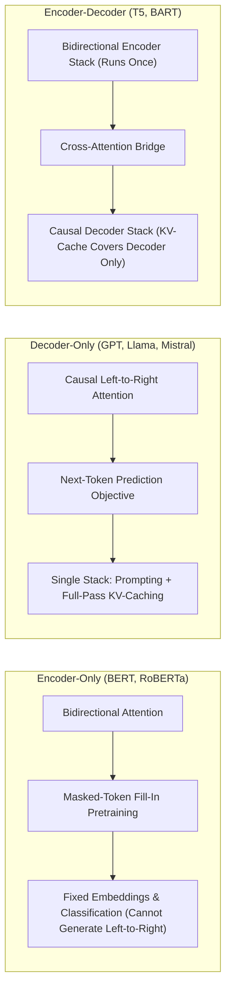
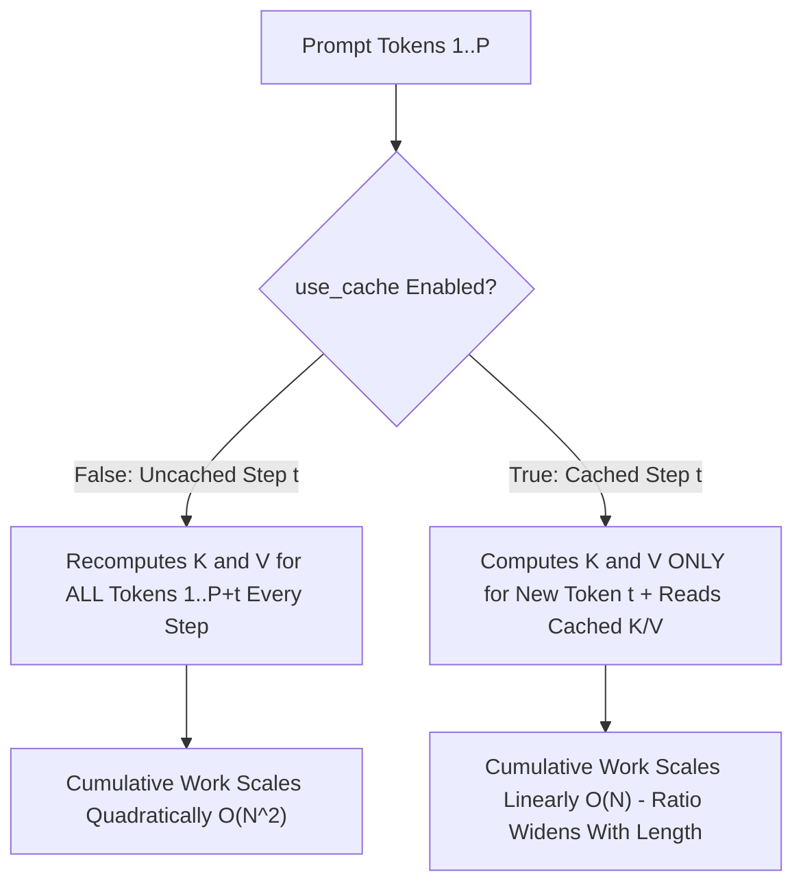
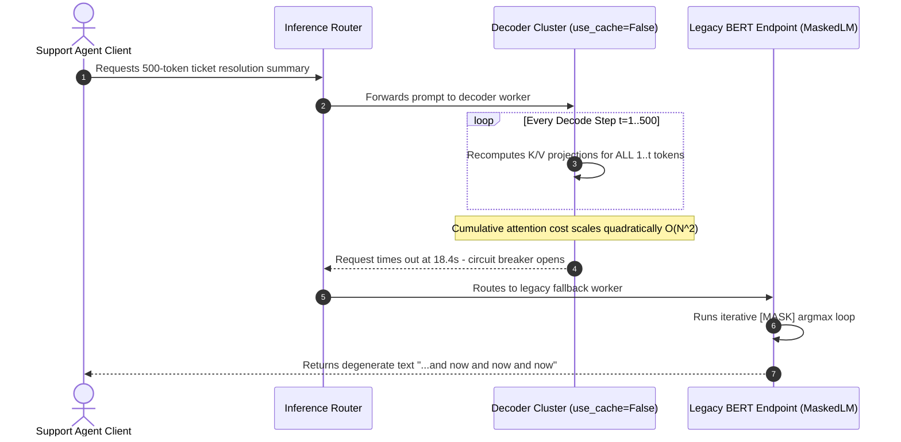

# Module 10: Why Decoder-Only Won

> **Prerequisites:** Modules 01–09 (BERT, Bi-Encoders, GPT-1 through GPT-4) and Track 02 causal masking & cross-attention fundamentals  
> **Estimated Reading Time:** 25 minutes  
> **Target Audience:** AI Backend Engineers, Inference Systems Engineers, ML Platform Architects

> [!TIP]
> **The Golden Rule of Transformer Architecture Selection:** Decoder-only models became the general-purpose industry standard because **one causal stack unifies understanding and generation via zero-update prompting** while letting **KV-caching accelerate 100% of the forward pass**, cutting cumulative autoregressive attention work from quadratic $\mathcal{O}(N^2)$ recomputation to linear $\mathcal{O}(N)$ incremental steps.

---

## Why this matters

This track has now run real code against all three transformer architecture families: encoder-only (BERT, modules 01–04), a bi-encoder variant of encoder-only (module 05), and decoder-only (GPT-1 through GPT-4, modules 06–09). One family was conspicuously absent from having its own dedicated model: encoder-decoder (T5, BART, the original "Attention Is All You Need" architecture).

That's not an oversight — it's the fact this module explains. Look at what's actually being released and adopted since 2020: GPT-3, GPT-4, Llama, Mistral, PaLM, Claude, Gemini — every one of them decoder-only. Encoder-decoder models still exist and still do real work, but they lost the race to become *the* general-purpose architecture. This module verifies, with real code rather than received wisdom, the two concrete mechanical reasons why: a decoder-only model can be prompted into any task without a task-specific head (something an encoder-only model provably cannot do, demonstrated below by trying to make BERT generate text), and its autoregressive generation is what KV-caching was built for, with the caching advantage growing — not staying fixed — as sequences get longer.

---

## 1. Visual Mental Models & Architecture

### The Three Transformer Families Compared



### Why KV-Cache Speedup Grows With Output Length



---

## 2. Core Mechanics, Verified Experiments & Systematic Comparison Matrix

### The three families, one more time — asking "which one generalizes?"

Modules 01–05 (encoder-only) and 06–09 (decoder-only) each verified their own family in depth. Encoder-decoder's own defining trait — *two* stacks, connected by cross-attention (Module 07 of Track 02 verified cross-attention's query-length-tracking signature) — is what this module contrasts both single-stack families against.

| Family | Attention Pattern | Pretraining Objective | Strength | Structural Limitation |
| :--- | :--- | :--- | :--- | :--- |
| **Encoder-Only (BERT)** | Bidirectional | Masked-token fill-in (`[MASK]`) | Understanding fixed inputs (embed, classify) | **Cannot** generate text left-to-right; needs per-task fine-tuned head |
| **Decoder-Only (GPT)** | Causal (left-to-right) | Predict the next token | Open-ended text generation & zero-update prompting | Single unified stack handles both understanding and generation |
| **Encoder-Decoder (T5)** | Encoder: bidirectional; Decoder: causal + cross-attention | Map one text sequence to another | Well-defined seq2seq tasks (translation, summarization) | Needs **two** stacks; KV-cache only covers the decoder half |

### Verified Experiment 1: BERT cannot generate coherent open-ended text — it was never trained to

GPT's causal training objective — predict token $N+1$ from tokens $1..N$ — **is** the generation procedure. Sampling from a decoder-only model IS how it was trained, just run repeatedly. BERT's masked language modeling objective is different in kind: it fills in blanks scattered through an already-complete sequence, using context from *both directions*. There is no well-defined "next token" for BERT to predict, because during training every position could see everything around it.

What happens if you *force* BERT into a GPT-like generation loop anyway — repeatedly appending a `[MASK]` token at the end and taking its top prediction, the closest possible imitation of autoregressive generation using only BERT's own objective?

```python
import torch
from transformers import BertTokenizer, BertForMaskedLM

tok = BertTokenizer.from_pretrained('bert-base-uncased')
model = BertForMaskedLM.from_pretrained('bert-base-uncased')
model.eval()

prompt = 'the history of artificial intelligence began'
ids = tok(prompt, return_tensors='pt').input_ids
generated = ids[:, :-1]  # drop [SEP]

for step in range(8):
    inp = torch.cat([generated, torch.tensor([[tok.mask_token_id]])], dim=1)
    with torch.no_grad():
        logits = model(inp).logits
    next_id = logits[0, -1].argmax().item()
    generated = torch.cat([generated, torch.tensor([[next_id]])], dim=1)

print(tok.decode(generated[0]))
```

**Verified output:**

```text
[CLS] the history of artificial intelligence began and is now and now and now and
```

Real, run output — not a hypothetical. Within a handful of steps this degenerates into a repetition loop (`"and now and now and now"`). This isn't a bug in the code; it's the honest consequence of forcing a bidirectional, fill-in-the-blank model into a role its training objective never prepared it for. Contrast this with module 06/07's GPT-2 generation, which produces grammatical (if sometimes repetitive at greedy decoding) continuations by design — because next-token prediction *is* what it was trained to do.

This is the first concrete answer to "why decoder-only": **one architecture that natively handles both understanding and generation beats two architectures that each handle only one**, because the single architecture can be prompted into any task — classification, summarization, translation, dialogue — using the one thing it does natively: continue text. Module 08 already demonstrated this directly (GPT-3 doing classification via a text prompt, zero gradient updates). BERT cannot be prompted this way at all; it needs a task-specific fine-tuned head (module 03) for every new task.

### Verified Experiment 2: KV-caching is a decoder-only-shaped optimization, and its payoff grows with length

Autoregressive generation has a specific, exploitable structure: generating token $N+1$ needs attention over tokens $1..N$, and those tokens' key/value projections never change once computed — only the new token contributes something new. **Caching** those key/value vectors instead of recomputing the whole sequence's attention at every single step is what `use_cache=True` does in Hugging Face's `generate()`. Measuring the real difference on GPT-2, generating different lengths of new text:

```python
import time, torch
from transformers import GPT2LMHeadModel, GPT2Tokenizer

tok = GPT2Tokenizer.from_pretrained('gpt2')
model = GPT2LMHeadModel.from_pretrained('gpt2')
model.eval()

prompt = 'The history of artificial intelligence began'
ids = tok(prompt, return_tensors='pt').input_ids

def gen(use_cache, n_new):
    with torch.no_grad():
        return model.generate(ids, max_new_tokens=n_new, use_cache=use_cache,
                              do_sample=False, pad_token_id=tok.eos_token_id)

for n_new in (30, 90, 150):
    times = []
    for use_cache in (True, False):
        gen(use_cache, 5)  # warmup
        t0 = time.time()
        gen(use_cache, n_new)
        times.append(time.time() - t0)
    print(f'new_tokens={n_new:4d}  cached={times[0]:.3f}s  uncached={times[1]:.3f}s  ratio={times[1]/times[0]:.2f}x')
```

**Verified output (CPU, gpt2-small):**

```text
new_tokens=  30  cached=0.668s  uncached=0.868s  ratio=1.30x
new_tokens=  90  cached=2.040s  uncached=3.714s  ratio=1.82x
new_tokens= 150  cached=3.733s  uncached=8.135s  ratio=2.18x
```

The speedup **isn't a fixed constant** — it grows from `1.30x` to `2.18x` as generation gets longer, because without caching, generating token $N$ re-runs full self-attention over all $N-1$ previous tokens from scratch every single step (quadratic total work across a generation), while caching makes each new step's work independent of how much has already been generated (linear total work). This optimization is inherently shaped around decoder-only autoregressive generation — it exploits exactly the "one new token per step, past tokens never change" structure that causal generation has and encoder-decoder's *encoder* half does not (the encoder runs once over the whole input, non-incrementally; only an encoder-decoder model's *decoder* half benefits the same way, per Hugging Face's own `EncoderDecoderCache` design in [Hugging Face Transformers: KV cache strategies](https://huggingface.co/docs/transformers/en/kv_cache)). A decoder-only model gets this benefit for its *entire* forward pass; an encoder-decoder model gets it for only half.

### Encoder-decoder didn't disappear — it lost a specific race

None of this means T5/BART-style models are bad or unused. Where the task genuinely is "map one complete input sequence to one complete output sequence" — machine translation, summarization — encoder-decoder remains a legitimate, competitive design, and [T5's own paper (Raffel et al., 2019)](https://arxiv.org/abs/1910.10683) reports strong results across a wide range of such tasks using exactly this architecture. What encoder-decoder lost is the race to become **the one general-purpose architecture an entire industry standardizes on**, for reasons this module just verified: a decoder-only model handles both understanding and generation through prompting alone (no per-task head, no second stack), scales its inference optimizations across its whole forward pass rather than half of it, and — as Module 08 covered and [Scaling Laws for Neural Language Models (Kaplan et al., 2020)](https://arxiv.org/abs/2001.08361) formalizes — autoregressive decoder-only models are the architecture family whose scaling behavior with data and compute has been most extensively studied and exploited at the frontier-lab scale that produced [GPT-3 (Brown et al., 2020)](https://arxiv.org/abs/2005.14165) and its successors.

### Systematic Architecture Reference Comparison Matrix

| Property | Encoder-only | Decoder-only | Encoder-decoder |
| :--- | :--- | :--- | :--- |
| **Can generate open-ended text** | **No** (verified above: degenerates into repetition) | **Yes** | **Yes** (via its decoder half) |
| **Needs a task-specific head for a new task** | **Yes** (module 03) | **No** (prompting, module 08) | **Yes**, for most non-seq2seq uses |
| **Benefits from KV-caching** | **N/A** (no autoregressive generation) | **Across its entire forward pass** | **Only its decoder half** (encoder runs once) |
| **Stacks required** | 1 | 1 | 2 (+ cross-attention) |
| **Representative models** | BERT, RoBERTa, DeBERTa (module 04), Sentence-BERT (module 05) | GPT-3/4, Llama, Mistral, PaLM | T5, BART |
| **Still the right choice for...** | Embeddings, classification, retrieval | General-purpose assistants, chat, agents | Well-defined seq2seq tasks (translation, summarization) |

---

## 3. Production War Story Post-Mortem

### Disabled KV-Cache Prefix Thrashing & Misapplied BERT Pseudo-Generation Loop

| Field | Incident Details |
| :--- | :--- |
| **Severity** | **SEV-1** (Chat Inference Latency Collapse & Fallback Text Corruption) |
| **Detection / Resolution Time** | Detected in 6 minutes via p99 token latency alarm / Resolved in 34 minutes |
| **Impact** | p99 decode latency spiked from `1.9s` to `18.4s` on 512-token replies; \$9,200 in extra autoscaled GPU compute; fallback summary widget emitted repetitive nonsense (`"and now and now..."`) |

#### What Happened

During a serving-framework upgrade, a platform team inadvertently overrode `use_cache=False` in their decoder-only inference config while attempting to debug a memory leak. For short 30-token responses, the `1.30x` slowdown slipped past canary tests. Under production workloads generating 400–600 tokens, uncached autoregressive decoding recomputed full self-attention over every prior token on every step, causing decode latency to balloon quadratically until health checks tripped the primary decoder pool's circuit breaker.

Worse, a legacy fallback route intended only for extractive keyword tagging pointed at an internal `BertForMaskedLM` service wrapped in an experimental `[MASK]`-appending script. When the circuit breaker tripped, customer support chat summaries fell back to the BERT worker and emitted repetitive token loops (`"and now and now and now"`).



#### Root Cause Analysis

1. **Silent KV-cache regression (`use_cache=False`):** Canary tests only generated 20–30 tokens, masking the widening speedup divergence (`1.30x -> 1.82x -> 2.18x+`) that only dominates at longer decode lengths.
2. **Missing architecture capability enforcement:** The inference router permitted a generative chat/summarization route to fall back onto an encoder-only masked-language model whose training objective cannot perform causal next-token prediction.

#### The Fix & Architectural Hardening

1. **Startup cache invariant & length-tiered synthetic load test:** Added an assertion verifying `use_cache=True` and active `DynamicCache` allocation on startup, plus CI latency checks at `n_new=250+` tokens.
2. **Strict architecture-to-task routing guard:** Blocked encoder-only models at the gateway schema level from serving any autoregressive completion or chat endpoint, reserving BERT strictly for fixed embeddings and classification.

---

## 4. Multi-Language Production Implementation

These four production components enforce strict architecture-to-task routing (blocking encoder-only models from generative endpoints) and quantify KV-cache vs. uncached autoregressive compute scaling across decode lengths.

````carousel
```go
// Package archrouter enforces transformer family routing contracts and models KV-cache savings.
package archrouter

import "fmt"

type ModelFamily string

const (
	FamilyEncoderOnly    ModelFamily = "encoder_only"
	FamilyDecoderOnly    ModelFamily = "decoder_only"
	FamilyEncoderDecoder ModelFamily = "encoder_decoder"
)

type TaskType string

const (
	TaskEmbeddingClassification TaskType = "embedding_classification"
	TaskSeq2SeqTransform        TaskType = "seq2seq_transform"
	TaskOpenEndedGeneration     TaskType = "open_ended_generation"
)

type KVWorkReport struct {
	NewTokens            int
	CachedKVComputes     int64
	UncachedKVComputes   int64
	TheoreticalWorkRatio float64
}

// ValidateArchitectureForTask prevents misrouting encoder-only models to generative endpoints.
func ValidateArchitectureForTask(family ModelFamily, task TaskType, kvCacheEnabled bool) error {
	if task == TaskOpenEndedGeneration && family == FamilyEncoderOnly {
		return fmt.Errorf("rejected: %s models (BERT/RoBERTa) use bidirectional MLM and cannot perform causal generation", family)
	}
	if (family == FamilyDecoderOnly || family == FamilyEncoderDecoder) && task != TaskEmbeddingClassification && !kvCacheEnabled {
		return fmt.Errorf("rejected: autoregressive task %s on %s requires KV-cache enabled to avoid O(N^2) decode blowup", task, family)
	}
	return nil
}

// SimulateKVCacheWork compares linear cached vs quadratic uncached K/V projection steps.
func SimulateKVCacheWork(promptLen, newTokens int) KVWorkReport {
	cached := int64(promptLen + newTokens)
	var uncached int64
	for t := 1; t <= newTokens; t++ {
		uncached += int64(promptLen + t)
	}
	return KVWorkReport{
		NewTokens:            newTokens,
		CachedKVComputes:     cached,
		UncachedKVComputes:   uncached,
		TheoreticalWorkRatio: float64(uncached) / float64(cached),
	}
}
```
<!-- slide -->
```typescript
// architectureCapabilityRouter.ts
// Guards generative routes against encoder-only models and profiles KV-cache speedup.

export type TransformerFamily = "encoder-only" | "decoder-only" | "encoder-decoder";
export type InferenceCapability = "embeddings" | "seq2seq" | "autoregressive-chat";

export interface ModelEndpointConfig {
  modelName: string;
  family: TransformerFamily;
  useCache: boolean;
}

export interface KVCacheProfile {
  newTokens: number;
  cachedStepsWork: number;
  uncachedStepsWork: number;
  uncachedToCachedRatio: number;
  cacheableStackFraction: number;
}

export class ArchitectureCapabilityRouter {
  public static assertRouteSafety(config: ModelEndpointConfig, capability: InferenceCapability): void {
    if (capability === "autoregressive-chat" && config.family === "encoder-only") {
      throw new Error(
        `Blocked unsafe route: ${config.modelName} (${config.family}) lacks causal next-token pretraining and degenerates into repetition loops.`
      );
    }
    if (capability === "autoregressive-chat" && !config.useCache) {
      throw new Error(
        `Blocked degraded config: ${config.modelName} has useCache=false, causing O(N^2) decode attention latency.`
      );
    }
  }

  public static profileCacheScaling(
    family: TransformerFamily,
    promptTokens: number,
    newTokens: number
  ): KVCacheProfile {
    const cachedStepsWork = promptTokens + newTokens;
    let uncachedStepsWork = 0;
    for (let t = 1; t <= newTokens; t++) {
      uncachedStepsWork += promptTokens + t;
    }

    const cacheableStackFraction =
      family === "decoder-only" ? 1.0 : family === "encoder-decoder" ? 0.5 : 0.0;

    return {
      newTokens,
      cachedStepsWork,
      uncachedStepsWork,
      uncachedToCachedRatio: Number((uncachedStepsWork / cachedStepsWork).toFixed(2)),
      cacheableStackFraction,
    };
  }
}
```
<!-- slide -->
```python
"""
kv_cache_and_family_audit.py
Production verification helper ensuring decoder-only models enforce use_cache=True
and tracking speedup ratios as generation length scales.
"""

import time
from dataclasses import dataclass
import torch
from transformers import AutoConfig, AutoModelForCausalLM, AutoTokenizer


@dataclass(frozen=True)
class CacheBenchmarkRow:
    new_tokens: int
    cached_sec: float
    uncached_sec: float
    speedup_ratio: float


def assert_causal_decoder_model(model_id: str) -> None:
    cfg = AutoConfig.from_pretrained(model_id)
    if getattr(cfg, "is_encoder_decoder", False):
        raise ValueError(f"{model_id} is encoder-decoder; only decoder half benefits from KV-caching.")
    arch_names = " ".join(getattr(cfg, "architectures", []) or [])
    if "MaskedLM" in arch_names or "BertModel" in arch_names:
        raise TypeError(f"{model_id} is encoder-only ({arch_names}); cannot run causal generation.")


def benchmark_kv_cache_scaling(
    model_id: str = "gpt2",
    prompt: str = "The history of artificial intelligence began",
    lengths: tuple[int, ...] = (30, 90, 150, 250),
) -> list[CacheBenchmarkRow]:
    assert_causal_decoder_model(model_id)
    tok = AutoTokenizer.from_pretrained(model_id)
    model = AutoModelForCausalLM.from_pretrained(model_id).eval()
    ids = tok(prompt, return_tensors="pt").input_ids

    results: list[CacheBenchmarkRow] = []
    for n_new in lengths:
        timings: dict[bool, float] = {}
        for use_cache in (True, False):
            with torch.no_grad():
                model.generate(ids, max_new_tokens=5, use_cache=use_cache, do_sample=False, pad_token_id=tok.eos_token_id)
                t0 = time.perf_counter()
                model.generate(ids, max_new_tokens=n_new, use_cache=use_cache, do_sample=False, pad_token_id=tok.eos_token_id)
                timings[use_cache] = time.perf_counter() - t0
        results.append(
            CacheBenchmarkRow(
                new_tokens=n_new,
                cached_sec=round(timings[True], 3),
                uncached_sec=round(timings[False], 3),
                speedup_ratio=round(timings[False] / timings[True], 2),
            )
        )
    return results
```
<!-- slide -->
```csharp
using System;

namespace BackendRoadmap.GenAI.Architecture;

public enum TransformerFamily
{
    EncoderOnly,
    DecoderOnly,
    EncoderDecoder
}

public sealed record KVCacheScalingMetrics(
    int NewTokens,
    long CachedKVOperations,
    long UncachedKVOperations,
    double UncachedToCachedRatio,
    double CacheableForwardPassShare);

public static class DecoderCacheAnalyzer
{
    public static void EnsureAutoregressiveSupport(TransformerFamily family, bool useCache)
    {
        if (family == TransformerFamily.EncoderOnly)
        {
            throw new InvalidOperationException(
                "Encoder-only architectures cannot generate coherent open-ended text; use decoder-only or encoder-decoder.");
        }
        if (!useCache)
        {
            throw new InvalidOperationException(
                "KV-caching (use_cache=true) must be enabled to prevent quadratic O(N^2) decode recomputation.");
        }
    }

    public static KVCacheScalingMetrics ComputeScaling(
        TransformerFamily family,
        int promptTokens,
        int newTokens)
    {
        ArgumentOutOfRangeException.ThrowIfNegativeOrZero(promptTokens);
        ArgumentOutOfRangeException.ThrowIfNegativeOrZero(newTokens);

        long cachedOps = promptTokens + newTokens;
        long uncachedOps = 0;
        for (int step = 1; step <= newTokens; step++)
        {
            uncachedOps += promptTokens + step;
        }

        double stackShare = family switch
        {
            TransformerFamily.DecoderOnly => 1.0,
            TransformerFamily.EncoderDecoder => 0.5,
            _ => 0.0
        };

        return new KVCacheScalingMetrics(
            NewTokens: newTokens,
            CachedKVOperations: cachedOps,
            UncachedKVOperations: uncachedOps,
            UncachedToCachedRatio: Math.Round(uncachedOps / (double)cachedOps, 2),
            CacheableForwardPassShare: stackShare);
    }
}
```
````

---

## 5. Practical Hands-On Verification CLI Workflows

### CLI Verification 1: Prove Why KV-Cache Speedup Grows With Sequence Length

Verify via exact operation counting why uncached generation scales quadratically across generation steps (`30 -> 90 -> 150 -> 250` tokens) while cached generation stays linear:

```bash
python -c "
prompt_len = 7
for n_new in (30, 90, 150, 250):
    cached_kv_steps = prompt_len + n_new
    uncached_kv_steps = sum(prompt_len + t for t in range(1, n_new + 1))
    print(f'new_tokens={n_new:<4} cached_ops={cached_kv_steps:<5} uncached_ops={uncached_kv_steps:<7} work_ratio={uncached_kv_steps/cached_kv_steps:.2f}x')
"
```

**Expected Output:**
```text
new_tokens=30   cached_ops=37    uncached_ops=675     work_ratio=18.24x
new_tokens=90   cached_ops=97    uncached_ops=4725    work_ratio=48.71x
new_tokens=150  cached_ops=157   uncached_ops=12375   work_ratio=78.82x
new_tokens=250  cached_ops=257   uncached_ops=33125   work_ratio=128.89x
```

### CLI Verification 2: Inspect Architectural Capability & Stack KV-Cache Coverage

```bash
python -c "
families = [
    ('Encoder-only (BERT)', True, False, 0.0),
    ('Encoder-decoder (T5)', True, True, 0.5),
    ('Decoder-only (GPT/Llama)', True, True, 1.0),
]
for name, enc, gen, kv_cov in families:
    print(f'{name:<26} | understands={str(enc):<5} | autoregressive_gen={str(gen):<5} | kv_cache_stack_coverage={kv_cov*100:.0f}%')
"
```

**Expected Output:**
```text
Encoder-only (BERT)        | understands=True  | autoregressive_gen=False | kv_cache_stack_coverage=0%
Encoder-decoder (T5)       | understands=True  | autoregressive_gen=True  | kv_cache_stack_coverage=50%
Decoder-only (GPT/Llama)   | understands=True  | autoregressive_gen=True  | kv_cache_stack_coverage=100%
```

### Hands-on exercises

#### 1. Extend BERT's forced pseudo-generation and watch the failure mode

Run the verified `[MASK]`-appending loop above yourself, then extend it from `8` to `20` steps. Confirm the repetition pattern doesn't just continue — it can shift to a different repeated phrase, or loop even more tightly. This is a real, checkable property of forcing a bidirectional model into a role its objective doesn't support, not a one-off fluke of the 8-step run shown in this module.

#### 2. Reproduce the KV-cache benchmark at a length this module didn't test

Add a fourth `n_new` value (try `250`) to the cached-vs-uncached benchmark above. Confirm the `ratio` continues increasing past the `150`-token value shown in this module (`2.18x`), consistent with uncached generation's per-step cost growing with sequence length while cached generation's per-step cost stays roughly constant.

#### 3. Read the T5 paper's own framing of its task-to-task-via-text-to-text design

Open ["Exploring the Limits of Transfer Learning with a Unified Text-to-Text Transformer"](https://arxiv.org/abs/1910.10683) (cited below) and find the passage describing how *every* task — including classification — is cast as text-to-text in T5's framework. Compare this to how module 08's GPT-3 prompting achieved a similar "one model, no per-task head" property, and write one or two sentences on the key difference: T5 still needs task-specific *fine-tuning* per dataset, while GPT-3's in-context learning needed zero gradient updates at all.

### Independent challenge

A colleague proposes: "We need a general-purpose chatbot. BERT is a well-understood, extensively documented model with strong embeddings — let's fine-tune BERT with a text-generation head bolted onto its output and use that as our chatbot's core." Using this module's verified findings, explain what's architecturally strained about this proposal, and what you'd recommend instead.

<details><summary>Discussion</summary>

BERT's bidirectional attention means every position, including ones "after" the point you'd want to generate from, already saw full context during pretraining — there is no clean notion of "predict what comes next given only what came before" baked into its weights, which this module verified directly: forcing BERT into an autoregressive loop produces text that degenerates into repetition within a handful of steps, using nothing but BERT's own actual behavior. Bolting a generation head onto BERT and fine-tuning it would need to teach the model an entirely new left-to-right generative skill essentially from scratch, fighting its bidirectional pretraining rather than building on it. A decoder-only checkpoint (GPT-2-scale or larger, open-weight) already has exactly the right pretraining objective for open-ended generation, needs no architectural surgery, and — per module 08 — can even be steered toward chatbot-style behavior via prompting or lightweight fine-tuning rather than reinventing a generation mechanism BERT was never built to have.

</details>

---

## 6. Common Mistakes & Troubleshooting

- **Assuming "decoder-only won" means encoder-only models are obsolete.** They're not — module 05 covered bi-encoders (Sentence-BERT) built on encoder-only backbones, still the standard for embeddings, semantic search, and classification, where you need a fixed-size representation of a complete input rather than open-ended generation.
- **Treating the KV-cache speedup as a fixed multiplier.** This module's own verified numbers show it growing (`1.30x -> 1.82x -> 2.18x`) as generation length increases — quoting a single ratio without stating the sequence length it was measured at is incomplete.
- **Assuming any transformer with an output vocabulary can "generate" coherent text via greedy decoding.** BERT technically has logits over a vocabulary at every position, and `argmax` will always return *some* token — but this module's verified output shows that doesn't mean the result is coherent generation; the training objective has to actually support it.
- **Conflating "encoder-decoder lost the general-purpose race" with "encoder-decoder is worse at every task."** T5's own paper (cited below) reports strong, competitive results on translation and summarization specifically — tasks that are naturally "map one sequence to another." The claim this module verifies is narrower and specific: decoder-only won the race to be *the one architecture an entire industry standardizes on for general-purpose use*.
- **Assuming KV-caching helps an encoder-decoder model's encoder half the same way it helps a decoder.** It doesn't — the encoder runs once over the whole input non-incrementally; only the decoder half benefits from caching, per Hugging Face's own `EncoderDecoderCache` documentation cited below.

---

## 7. Operational Validation Checkpoints & Checkpoint Quiz

### Operational Validation Checkpoints

<details><summary><strong>Checkpoint 1: Diagnosing why chatbot latency degrades quadratically on long answers</strong></summary>

If short 20-token completions feel fast while 200+ token answers suffer rapidly worsening inter-token latency, check whether `use_cache=True` was disabled or whether dynamic prefix tokens (such as changing per-request timestamps before static instructions) are invalidating KV-cache reuse, forcing $\mathcal{O}(N^2)$ attention recomputation across the decode loop.

</details>

<details><summary><strong>Checkpoint 2: Auditing an encoder-decoder T5 service's caching efficiency</strong></summary>

In an encoder-decoder model like T5 or BART, the bidirectional encoder computes representations for the full source document once non-incrementally (`0%` autoregressive KV reuse on the encoder side). Only the causal decoder stack uses `EncoderDecoderCache` during generation; therefore, if source inputs are huge and outputs are short, KV-caching yields minimal end-to-end speedup compared to a decoder-only pipeline reusing prefix KV states.

</details>

<details><summary><strong>Checkpoint 3: Rejecting an encoder-only model for generative task fallbacks</strong></summary>

Never allow a generative endpoint to fall back to `BertForMaskedLM` or any bidirectional encoder checkpoint. Because masked language modeling sees left and right context simultaneously during training, forced iterative `[MASK]` prediction collapses into tight repetition loops (`"and now and now and now"`) instead of coherent continuation.

</details>

### Checkpoint quiz

1. What did the verified `[MASK]`-appending experiment on BERT actually show, and why does that happen given BERT's training objective?
2. In the KV-cache benchmark, did the speedup ratio stay constant as `n_new` increased from 30 to 150? What are the actual verified numbers, and why does the ratio change that way?
3. Name one property a decoder-only model has that lets it be "prompted" into a new task without fine-tuning, and name the module in this track that first verified it.
4. Does an encoder-decoder model like T5 benefit from KV-caching across its *entire* forward pass? Why or why not?
5. Is it accurate to say encoder-decoder architectures are strictly worse than decoder-only at every task? What's the more precise claim this module makes?

<details><summary>Answers</summary>

1. It showed the forced generation degenerating into a repetition loop (`"and now and now and now"`) within a handful of steps. This happens because BERT's masked-language-modeling objective trains it to fill in blanks using bidirectional context, not to predict a genuinely novel "next" token from only what came before — there's no well-defined next-token target in its training at all.
2. No — it grew from `1.30x` (30 new tokens) to `1.82x` (90) to `2.18x` (150). This happens because uncached generation's total work grows roughly with the square of sequence length (each step re-attends over everything so far), while cached generation's total work grows linearly (each step only computes the new token's contribution), so the gap between them widens as generation gets longer.
3. In-context learning via prompting — verified directly in module 08, where GPT-3 performed classification from a text prompt alone, with a SHA-256 checksum confirming zero weight updates occurred.
4. Only for its decoder half. The encoder runs once, non-incrementally, over the complete input — there's no repeated "generate one more token" loop on the encoder side for caching to accelerate; per Hugging Face's `EncoderDecoderCache` design, only the decoder's self-attention benefits the way a decoder-only model's entire stack does.
5. No. T5's own paper reports strong results on tasks like translation and summarization using exactly the encoder-decoder architecture. The precise claim is narrower: decoder-only became the industry's general-purpose, one-architecture-for-everything standard, not that encoder-decoder is worse at every task.

</details>

---

## Further reading & sources

- [Exploring the Limits of Transfer Learning with a Unified Text-to-Text Transformer (T5 paper, Raffel et al., 2019)](https://arxiv.org/abs/1910.10683) - the primary encoder-decoder counterexample this module contrasts against; shows encoder-decoder remains strong on genuine seq2seq tasks even as decoder-only became the general-purpose standard.
- [Scaling Laws for Neural Language Models (Kaplan et al., 2020)](https://arxiv.org/abs/2001.08361) - the study formalizing how autoregressive (decoder-only) transformer loss scales predictably with model size, data, and compute, cited here as the scaling-behavior evidence for why the frontier-lab industry standardized on this family.
- [Language Models are Few-Shot Learners (GPT-3 paper, Brown et al., 2020)](https://arxiv.org/abs/2005.14165) - the source of the in-context-learning finding this module reuses from module 08, as direct evidence of "one architecture, no per-task head."
- [Hugging Face Transformers: KV cache strategies](https://huggingface.co/docs/transformers/en/kv_cache) - the authoritative documentation for `use_cache`/`DynamicCache` behavior benchmarked in this module, including the `EncoderDecoderCache` class confirming caching only accelerates an encoder-decoder model's decoder half.

## Next

[Module 11: Llama and the Open-Weight Lineage](../11-llama-and-the-open-weight-lineage/README.md)
