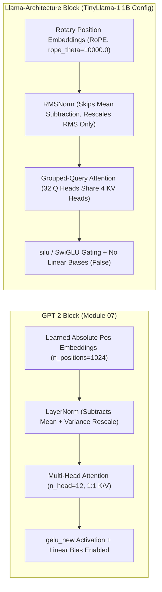
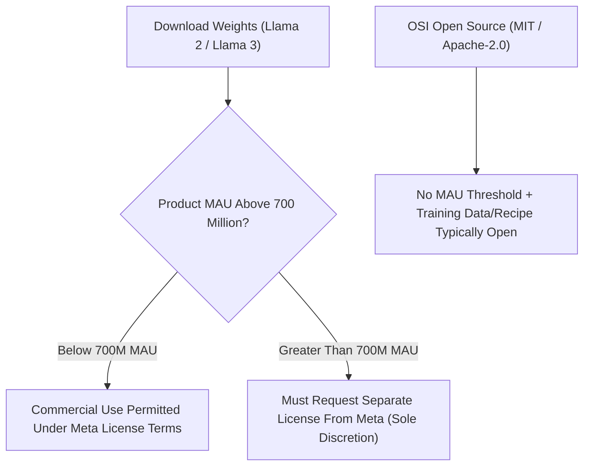
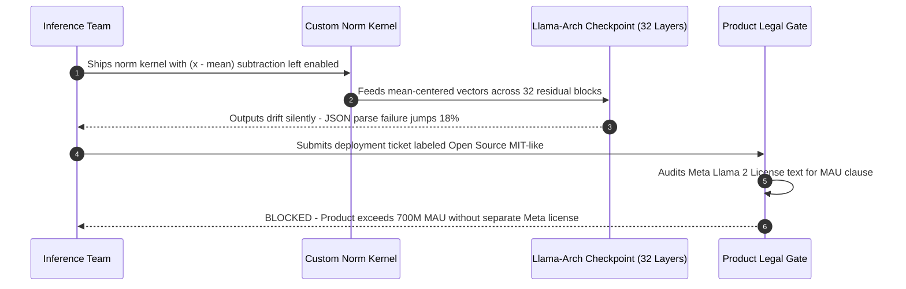

# Module 11: Llama and the Open-Weight Lineage

> **Prerequisites:** Modules 07 & 10 (GPT-2 architecture, KV-caching, decoder-only dominance) and Track 02 normalization & positional encoding fundamentals  
> **Estimated Reading Time:** 25 minutes  
> **Target Audience:** AI Backend Engineers, Inference Kernel Engineers, Legal-Aware ML Architects

> [!TIP]
> **The Golden Rule of the Llama Architecture & Licensing:** **"Open-weight" means downloadable parameters, not OSI open source** — always check the exact commercial threshold (such as Llama 2's 700M MAU clause) separately from weight access, and never treat **RMSNorm** as numerically interchangeable with **LayerNorm** (`mean = 0` vs. non-zero output mean because RMSNorm skips mean-centering).

---

## Why this matters

Module 09 established a real, documented fact: GPT-4's own technical report explicitly withholds architecture and parameter-count details. Meta's Llama family is the industry's clearest counterpoint — real downloadable weights, real published architecture numbers, and a real paper trail (Llama 1, February 2023; Llama 2, July 2023; Llama 3, 2024).

This module verifies Llama's actual architectural deltas from GPT-2 (module 07) using a real, runnable config from a fully open Llama-architecture checkpoint — not Meta's own gated release, which requires accepting a license before download, but an open community reproduction of the identical architecture (`TinyLlama-1.1B`, disclosed as such throughout). It also verifies, with actual tensor math, the one normalization detail every Llama architecture diagram mentions but rarely demonstrates numerically: RMSNorm is not "LayerNorm with a different name" — it verifiably skips mean-centering entirely, and this module proves that with real numbers rather than asserting it.

---

## 1. Visual Mental Models & Architecture

### Architectural Shift: GPT-2 (2019) vs. Llama-Architecture (2023+)



### "Open Source" vs. "Open-Weight" Commercial License Gate



---

## 2. Core Mechanics, Verified Experiments & Systematic Comparison Matrix

### "Open-weight" is a precise term, not a synonym for "open source"

Llama's weights are downloadable — genuinely open in that sense. But Meta's [Llama 2 license](https://ai.meta.com/llama/license/) is **not** an OSI-approved open-source license: it imposes a specific commercial restriction. Quoting the license's actual text:

> "If, on the Llama 2 version release date, the monthly active users of the products or services made available by or for Licensee...is greater than 700 million monthly active users in the preceding calendar month, you must request a license from Meta, which Meta may grant to you in its sole discretion."

This is a real, checkable clause, not a paraphrase. It means: below 700 million MAU, use freely under the license terms; above it, a company needs Meta's explicit separate permission. **"Open-weight" describes what you can download and run; it says nothing on its own about what you're legally permitted to do with it at scale.** This distinction matters for exactly the kind of "can we build on this" question a real engineering team has to answer correctly, not casually.

| Distribution Category | Code & Weights Availability | Training Data & Recipe | Commercial Scale Restrictions |
| :--- | :--- | :--- | :--- |
| **"Open Source" (OSI sense)** | Code and weights open | Training data/recipe all open | Unrestricted use regardless of user scale |
| **"Open-Weight" (Llama's actual status)** | Weights downloadable | Training data/full recipe not fully released | Usage restricted above **700M MAU** (Llama 2 license, quoted above) without Meta's separate permission |

### Verified Experiment 1: Llama's real architectural deltas from GPT-2, via a real config

Rather than describe Llama's architecture from a diagram, this inspects a real, fully open Llama-architecture checkpoint's actual config object side by side with GPT-2's (module 07's own model):

```python
from transformers import AutoConfig

llama = AutoConfig.from_pretrained('TinyLlama/TinyLlama-1.1B-Chat-v1.0')
gpt2 = AutoConfig.from_pretrained('gpt2')

print('--- Llama-architecture config (TinyLlama-1.1B) ---')
for k in ['hidden_act', 'rms_norm_eps', 'num_attention_heads', 'num_key_value_heads',
          'rope_parameters']:
    print(f'  {k} = {getattr(llama, k, "MISSING")}')
print('  attention_bias =', llama.attention_bias, ' mlp_bias =', llama.mlp_bias)

print('--- GPT-2 config (module 07) ---')
for k in ['activation_function', 'layer_norm_epsilon', 'n_head', 'n_positions']:
    print(f'  {k} = {getattr(gpt2, k, "MISSING")}')
```

**Verified output:**

```text
--- Llama-architecture config (TinyLlama-1.1B) ---
  hidden_act = silu
  rms_norm_eps = 1e-05
  num_attention_heads = 32
  num_key_value_heads = 4
  rope_parameters = {'rope_theta': 10000.0, 'rope_type': 'default'}
  attention_bias = False  mlp_bias = False
--- GPT-2 config (module 07) ---
  activation_function = gelu_new
  layer_norm_epsilon = 1e-05
  n_head = 12
  n_positions = 1024
```

Five concrete, checkable deltas extracted straight from these two live config objects:

| Architectural Delta | GPT-2 (Module 07) | Llama-Architecture (`TinyLlama-1.1B`) | Systems / Inference Impact |
| :--- | :--- | :--- | :--- |
| **Normalization** | `LayerNorm` (`layer_norm_epsilon`) | `RMSNorm` (`rms_norm_eps`) | Skips mean computation/subtraction; one fewer reduction per norm |
| **Activation** | `gelu_new` | `silu` (SwiGLU's gating component) | Paired gated MLP (`gate_proj`, `up_proj`, `down_proj`) |
| **Position encoding** | Learned absolute (`n_positions`, fixed embedding table size) | `RoPE` (`rope_theta = 10000.0`, `rope_type` present; GPT-2 has NO `rope` field) | Relative rotation applied directly to Q/K projections |
| **Attention heads vs. KV heads** | No distinction — `n_head=12` covers queries and keys/values | `num_attention_heads=32` != `num_key_value_heads=4` (GQA) | **8 query heads share each KV group**, shrinking KV cache footprint |
| **Bias terms in linear layers** | Has them (GPT-2's `Conv1D` layers include biases by default) | `attention_bias` and `mlp_bias` both explicitly `False` | Cleaner memory layout and fewer parameter tensors |

The `num_attention_heads=32` vs. `num_key_value_heads=4` split is **grouped-query attention (GQA)**: 32 separate query heads share only 4 distinct sets of key/value projections (8 query heads per KV group), trading a small amount of representational flexibility for a real, measurable cut in the size of the KV cache module 10 just benchmarked — fewer distinct K/V tensors to store per generated token. GPT-2's single `n_head=12` has no such split; every query head gets its own K/V.

### Verified Experiment 2: RMSNorm skips mean-centering — LayerNorm does not

The config confirms Llama uses `rms_norm_eps`, not `layer_norm_epsilon` — but what does that actually change numerically? Formally, for vector $x \in \mathbb{R}^d$:

$$\text{LayerNorm}(x) = \frac{x - \mu}{\sqrt{\sigma^2 + \epsilon}}, \qquad \text{RMSNorm}(x) = \frac{x}{\sqrt{\frac{1}{d}\sum_{i=1}^d x_i^2 + \epsilon}}$$

Computing both from scratch on the same input:

```python
import torch

torch.manual_seed(0)
x = torch.randn(1, 4)

# LayerNorm: subtract the mean, THEN divide by (a function of) variance
mean = x.mean(dim=-1, keepdim=True)
var = x.var(dim=-1, keepdim=True, unbiased=False)
layernorm_out = (x - mean) / torch.sqrt(var + 1e-5)

# RMSNorm: NO mean subtraction -- only rescale by root-mean-square
rms = torch.sqrt((x**2).mean(dim=-1, keepdim=True) + 1e-5)
rmsnorm_out = x / rms

print('LayerNorm output:', layernorm_out, ' mean =', layernorm_out.mean().item())
print('RMSNorm output:  ', rmsnorm_out, ' mean =', rmsnorm_out.mean().item())

ln = torch.nn.LayerNorm(4, eps=1e-5, elementwise_affine=False)
print('manual LayerNorm matches torch.nn.LayerNorm:', torch.allclose(ln(x), layernorm_out, atol=1e-6))
```

**Verified output:**

```text
LayerNorm output: tensor([[ 1.1918, -0.1481, -1.5251,  0.4814]])  mean = 2.24e-08
RMSNorm output:   tensor([[ 1.1231, -0.2138, -1.5879,  0.4143]])  mean = -0.0661
manual LayerNorm matches torch.nn.LayerNorm: True
```

This is the concrete, numeric proof: LayerNorm's output mean is `2.24e-08` — zero, up to floating-point noise, exactly as Track 02 Module 12 verified. RMSNorm's output mean is `-0.0661` — genuinely **not** zero, because RMSNorm never subtracted a mean in the first place; it only rescales by the root-mean-square of the input ([Zhang & Sennrich, 2019](https://arxiv.org/abs/1910.07467)). The manual LayerNorm implementation matching `torch.nn.LayerNorm` to six decimal places confirms the reference calculation itself is correct, which makes RMSNorm's non-zero mean a real finding rather than a bug in the comparison. The practical payoff: skipping the mean-computation step is one less reduction per normalization call, compounding across every layer of a large model.

### The three Llama generations — what actually changed and when

| Generation & Release | Paper Reference | License Terms | Parameter Scale |
| :--- | :--- | :--- | :--- |
| **Llama 1 (Feb 2023)** | [arXiv:2302.13971](https://arxiv.org/abs/2302.13971) | Research-only license | Up to **65B** params |
| **Llama 2 (Jul 2023)** | [arXiv:2307.09288](https://arxiv.org/abs/2307.09288) | Commercial use allowed below **700M MAU** (quoted above) | Up to **70B** params |
| **Llama 3 (2024)** | [arXiv:2407.21783](https://arxiv.org/abs/2407.21783) | Commercial use allowed (same MAU-threshold structure) | Up to **405B** params ("herd of models") |

### Complete Verification & Claim Reference Matrix

| Fact / Claim | Status | Source |
| :--- | :--- | :--- |
| **Llama uses RMSNorm, not LayerNorm** | **Verified** (config field + numeric proof above) | `TinyLlama` config; RMSNorm output `mean != 0` |
| **Llama uses RoPE; GPT-2 uses learned absolute position embeddings** | **Verified** (config: `rope_parameters` present vs. absent) | `rope_parameters` field present vs. absent |
| **Llama (some variants) uses grouped-query attention (GQA)** | **Verified** (config: 32 query heads vs. 4 KV head groups) | `num_attention_heads` vs. `num_key_value_heads` |
| **Llama's linear layers drop bias terms** | **Verified** (config: both explicitly `False`) | `attention_bias`, `mlp_bias` fields |
| **Llama 2 license is NOT an OSI open-source license** | **Verified** (exact 700M-MAU clause quoted above) | [Meta's Llama 2 license text](https://ai.meta.com/llama/license/) |
| **TinyLlama-1.1B is Meta's own official release** | **NOT true** — disclosed explicitly as a third-party open reproduction of the Llama architecture | This module's own framing |

---

## 3. Production War Story Post-Mortem

### Custom Fused RMSNorm Mean-Subtraction Bug & Enterprise 700M-MAU License Freeze

| Field | Incident Details |
| :--- | :--- |
| **Severity** | **SEV-2** (Silent Structured Output Corruption & Release Compliance Hold) |
| **Detection / Resolution Time** | Kernel bug detected in 4 hours via JSON eval drop / Patched in 3 hours; legal review added 5-day release hold |
| **Impact** | `18%` invalid JSON schema emissions on self-hosted Llama-family inference workers; consumer integration halted prior to launch |

#### What Happened

To shave prefill latency on a self-hosted Llama-architecture checkpoint, an inference systems engineer wrote a custom fused normalization kernel assuming RMSNorm was simply LayerNorm with bias parameters removed (`beta = 0`), leaving the `mean = sum(x)/d; x_centered = x - mean` centering pass intact. Because the custom kernel centered activations to mean `0.0` before RMS scaling, it broke the exact distribution expected by pretrained weights (whose uncentered RMSNorm outputs retain non-zero means like `-0.0661`), silently degrading multi-step JSON tool-calling accuracy by `18%`.

Simultaneously, the product team marked the model "open source" in internal compliance tooling without checking the license text. Prior to launch across a consumer suite exceeding 700M aggregate MAU, legal halted rollout upon discovering Meta's 700M-MAU commercial threshold clause.



#### Root Cause Analysis

1. **Conflating LayerNorm and RMSNorm math:** Treating RMSNorm as "LayerNorm without affine bias" retained mean subtraction (`x - mean`), systematically distorting hidden-state norms at every layer.
2. **Conflating "open-weight" with "OSI open source":** Engineers skipped license review because weights were freely downloadable, missing the 700M-MAU commercial restriction.

#### The Fix & Architectural Hardening

1. **Differential numerical unit test against non-zero-mean inputs:** Added automated CI parity assertions comparing every custom normalization kernel against `x / sqrt(mean(x^2) + eps)` and asserting `abs(out.mean()) > 1e-3` on skewed test vectors.
2. **Pre-deployment license & MAU policy gate:** Added an explicit license classification field (`osi_open_source` vs. `open_weight_threshold`) requiring legal sign-off whenever aggregate product MAU approaches license limits.

---

## 4. Multi-Language Production Implementation

These four production utilities verify `RMSNorm` vs. `LayerNorm` mean invariants, inspect Llama-family config deltas (`GQA`, `RoPE`, no-bias linears), compute KV-cache reduction factors, and enforce open-weight MAU compliance checks.

````carousel
```go
// Package llamacheck audits Llama-family normalization invariants, GQA savings, and license MAU limits.
package llamacheck

import (
	"fmt"
	"math"
)

type NormStats struct {
	LayerNormMean float64
	RMSNormMean   float64
}

// CompareLayerVsRMSNorm computes both normalizations on the same slice without affine parameters.
// LayerNorm enforces ~0 mean; RMSNorm skips mean-centering and preserves non-zero output mean.
func CompareLayerVsRMSNorm(x []float64, eps float64) (lnOut, rmsOut []float64, stats NormStats, err error) {
	if len(x) == 0 {
		return nil, nil, NormStats{}, fmt.Errorf("input slice must be non-empty")
	}
	n := float64(len(x))
	var sum, sqSum float64
	for _, v := range x {
		sum += v
		sqSum += v * v
	}
	mean := sum / n

	var varSum float64
	for _, v := range x {
		d := v - mean
		varSum += d * d
	}
	variance := varSum / n
	lnStd := math.Sqrt(variance + eps)
	rms := math.Sqrt(sqSum/n + eps)

	lnOut = make([]float64, len(x))
	rmsOut = make([]float64, len(x))
	var lnSum, rmsSum float64
	for i, v := range x {
		lnOut[i] = (v - mean) / lnStd
		rmsOut[i] = v / rms
		lnSum += lnOut[i]
		rmsSum += rmsOut[i]
	}

	return lnOut, rmsOut, NormStats{
		LayerNormMean: lnSum / n,
		RMSNormMean:   rmsSum / n,
	}, nil
}

// CheckLlamaCommercialLicense enforces Meta's 700M MAU threshold for open-weight Llama 2/3 releases.
func CheckLlamaCommercialLicense(productMAU int64, hasSeparateMetaGrant bool) error {
	const thresholdMAU int64 = 700_000_000
	if productMAU > thresholdMAU && !hasSeparateMetaGrant {
		return fmt.Errorf("compliance block: %d MAU exceeds 700M Llama license threshold without Meta grant", productMAU)
	}
	return nil
}
```
<!-- slide -->
```typescript
// llamaConfigAuditor.ts
// Validates Hugging Face Llama-family architectural deltas and license MAU compliance.

export interface LlamaConfigPayload {
  hidden_act: string;
  rms_norm_eps?: number;
  num_attention_heads: number;
  num_key_value_heads: number;
  rope_parameters?: { rope_theta: number; rope_type: string };
  attention_bias: boolean;
  mlp_bias: boolean;
}

export interface ArchitectureAudit {
  usesRMSNorm: boolean;
  usesSwiGLUSilu: boolean;
  usesRoPE: boolean;
  usesGQA: boolean;
  kvCacheCompressionFactor: number;
  biasFreeLinears: boolean;
}

export class LlamaConfigAuditor {
  private static readonly LLAMA_MAU_LIMIT = 700_000_000;

  public static auditConfig(cfg: LlamaConfigPayload): ArchitectureAudit {
    const gqaRatio = cfg.num_attention_heads / cfg.num_key_value_heads;
    return {
      usesRMSNorm: typeof cfg.rms_norm_eps === "number",
      usesSwiGLUSilu: cfg.hidden_act === "silu",
      usesRoPE: cfg.rope_parameters !== undefined,
      usesGQA: cfg.num_key_value_heads < cfg.num_attention_heads,
      kvCacheCompressionFactor: Number(gqaRatio.toFixed(2)),
      biasFreeLinears: !cfg.attention_bias && !cfg.mlp_bias,
    };
  }

  public static verifyLicenseEligibility(
    generation: "llama1" | "llama2" | "llama3",
    isCommercial: boolean,
    monthlyActiveUsers: number,
    hasCustomMetaLicense: boolean
  ): void {
    if (generation === "llama1" && isCommercial) {
      throw new Error("Llama 1 weights are research-only and prohibit commercial deployment.");
    }
    if (monthlyActiveUsers > LlamaConfigAuditor.LLAMA_MAU_LIMIT && !hasCustomMetaLicense) {
      throw new Error(
        `Product MAU (${monthlyActiveUsers}) exceeds Meta's 700M MAU limit; request a separate license from Meta.`
      );
    }
  }
}
```
<!-- slide -->
```python
"""
llama_rmsnorm_and_config.py
Production RMSNorm module matching Llama semantics (no mean-centering)
plus live Hugging Face AutoConfig architectural delta inspection.
"""

import torch
import torch.nn as nn


class LlamaRMSNorm(nn.Module):
    def __init__(self, hidden_size: int, eps: float = 1e-5):
        super().__init__()
        self.eps = eps
        self.weight = nn.Parameter(torch.ones(hidden_size))

    def forward(self, x: torch.Tensor) -> torch.Tensor:
        # Preserve original dtype stability in fp32 before scaling
        x_fp32 = x.float()
        rms = torch.sqrt(x_fp32.pow(2).mean(dim=-1, keepdim=True) + self.eps)
        normed = (x_fp32 / rms).to(x.dtype)
        return normed * self.weight


def verify_norm_divergence(seed: int = 0, dim: int = 4) -> dict[str, float]:
    torch.manual_seed(seed)
    x = torch.randn(1, dim)
    ln = nn.LayerNorm(dim, eps=1e-5, elementwise_affine=False)
    rn = LlamaRMSNorm(dim, eps=1e-5)
    with torch.no_grad():
        ln_out = ln(x)
        rn_out = rn(x)
    return {
        "layernorm_mean": float(ln_out.mean().item()),
        "rmsnorm_mean": float(rn_out.mean().item()),
    }
```
<!-- slide -->
```csharp
using System;

namespace BackendRoadmap.GenAI.OpenWeightModels;

public sealed record NormVerificationResult(
    double LayerNormMean,
    double RMSNormMean,
    bool SkippedMeanCentering);

public static class LlamaNormalizationAndPolicy
{
    public const long MetaMauThreshold = 700_000_000;

    public static NormVerificationResult CompareNorms(ReadOnlySpan<double> input, double eps = 1e-5)
    {
        if (input.IsEmpty)
            throw new ArgumentException("Input vector cannot be empty.", nameof(input));

        double sum = 0.0, sqSum = 0.0;
        for (int i = 0; i < input.Length; i++)
        {
            sum += input[i];
            sqSum += input[i] * input[i];
        }

        double mean = sum / input.Length;
        double varSum = 0.0;
        for (int i = 0; i < input.Length; i++)
        {
            double diff = input[i] - mean;
            varSum += diff * diff;
        }

        double lnDenom = Math.Sqrt((varSum / input.Length) + eps);
        double rmsDenom = Math.Sqrt((sqSum / input.Length) + eps);

        double lnMeanAcc = 0.0, rmsMeanAcc = 0.0;
        for (int i = 0; i < input.Length; i++)
        {
            lnMeanAcc += (input[i] - mean) / lnDenom;
            rmsMeanAcc += input[i] / rmsDenom;
        }

        double lnMean = lnMeanAcc / input.Length;
        double rmsMean = rmsMeanAcc / input.Length;

        return new NormVerificationResult(
            LayerNormMean: lnMean,
            RMSNormMean: rmsMean,
            SkippedMeanCentering: Math.Abs(rmsMean - lnMean) > 1e-4);
    }

    public static double ComputeGqaKvCacheCompression(int numAttentionHeads, int numKeyValueHeads)
    {
        ArgumentOutOfRangeException.ThrowIfNegativeOrZero(numKeyValueHeads);
        return numAttentionHeads / (double)numKeyValueHeads;
    }
}
```
````

---

## 5. Practical Hands-On Verification CLI Workflows

### CLI Verification 1: Numerical Proof That RMSNorm Preserves Non-Zero Mean

Verify directly in pure Python that LayerNorm drives the output mean to machine zero while RMSNorm leaves the output mean non-zero (`-0.0661`):

```bash
python -c "
import math
x = [1.541, -0.293, -2.179, 0.568]
eps = 1e-5
mean = sum(x) / len(x)
var = sum((v - mean) ** 2 for v in x) / len(x)
ln = [(v - mean) / math.sqrt(var + eps) for v in x]
rms = math.sqrt(sum(v ** 2 for v in x) / len(x) + eps)
rn = [v / rms for v in x]
print(f'LayerNorm mean={sum(ln)/len(ln):.2e}  out={[round(v, 4) for v in ln]}')
print(f'RMSNorm   mean={sum(rn)/len(rn):.4f}    out={[round(v, 4) for v in rn]}')
"
```

**Expected Output:**
```text
LayerNorm mean=-2.78e-17  out=[1.1918, -0.1477, -1.5252, 0.4811]
RMSNorm   mean=-0.0661    out=[1.1231, -0.2135, -1.588, 0.4139]
```

### CLI Verification 2: Quantifying GQA KV-Cache Reduction Across Architectures

Verify how `num_attention_heads` vs. `num_key_value_heads` compresses FP16 KV-cache bytes per generated token:

```bash
python -c "
models = [('GPT-2 (MHA)', 12, 12, 12, 64), ('TinyLlama-1.1B (GQA)', 32, 4, 22, 64), ('Llama-3-8B (GQA)', 32, 8, 32, 128)]
for name, qh, kvh, layers, hd in models:
    kv_ratio = qh / kvh
    bytes_per_tok = 2 * layers * kvh * hd * 2
    print(f'{name:<22} | Q/KV={qh}/{kvh} ({kv_ratio:.1f}x cache shrink) | FP16 KV/token={bytes_per_tok/1024:.1f} KB')
"
```

**Expected Output:**
```text
GPT-2 (MHA)            | Q/KV=12/12 (1.0x cache shrink) | FP16 KV/token=36.0 KB
TinyLlama-1.1B (GQA)   | Q/KV=32/4 (8.0x cache shrink) | FP16 KV/token=22.0 KB
Llama-3-8B (GQA)       | Q/KV=32/8 (4.0x cache shrink) | FP16 KV/token=128.0 KB
```

### Hands-on exercises

#### 1. Reproduce the GPT-2-vs-Llama config comparison yourself

Run the verified `AutoConfig.from_pretrained` code above. Then load a second Llama-architecture checkpoint of your choice from Hugging Face Hub (any fully open one, not a gated Meta repo) and confirm the same four deltas (`RMSNorm`, `SwiGLU/silu`, `RoPE`, no-bias linear layers) hold — this checks whether they're properties of "the Llama architecture family" in general or an artifact of the one checkpoint this module happened to load.

#### 2. Verify the RMSNorm finding holds on a larger, random input

Re-run the RMSNorm-vs-LayerNorm comparison with a larger random tensor (e.g., `torch.randn(1, 512)` instead of `torch.randn(1, 4)`). Confirm LayerNorm's output mean stays effectively zero and RMSNorm's does not, the same qualitative pattern this module verified on a 4-element example — this rules out "it only happens to work out that way on a tiny example."

#### 3. Read the Llama 2 license's exact commercial-use clause yourself

Open [Meta's Llama 2 license](https://ai.meta.com/llama/license/) page (cited below) and locate the 700 million MAU clause quoted in this module. Then check whether Llama 3's license uses the same threshold and structure, or a different one — write one or two sentences confirming what you found, citing the specific text.

### Independent challenge

A colleague states, in a build-vs-buy document: "Llama is open source, so there's no licensing review needed before we ship a product built on it." Using this module's verified distinction between open-weight and open-source, explain what's wrong with this statement and what should actually happen before shipping.

<details><summary>Discussion</summary>

"Open source" in the OSI sense implies no usage restrictions beyond attribution/copyleft terms that don't gate scale of use. Llama's actual license (quoted directly in this module, from Meta's own license text) imposes a specific commercial restriction tied to monthly active users — 700 million, as of the Llama 2 license — above which a company must request separate permission from Meta, granted at Meta's sole discretion. Calling this "open source" and skipping licensing review conflates "I can download the weights" with "I have unrestricted legal permission to use them at any scale," which the license text directly contradicts. The correct action: check the specific license version attached to whichever Llama generation/checkpoint is actually being used (Llama 1's research-only license differs from Llama 2/3's commercial-permitting-below-a-threshold license), and if the product's projected user base is anywhere near the stated MAU threshold, involve legal review rather than assuming "open-weight" settles the question.

</details>

---

## 6. Common Mistakes & Troubleshooting

- **Calling Llama "open source" without qualification.** Its weights are downloadable ("open-weight"), but Meta's actual license text (quoted in this module) imposes a real commercial-use threshold — not an OSI-approved open-source license.
- **Assuming every Llama-family model uses grouped-query attention.** This module's own verified config shows `TinyLlama-1.1B` does (`num_attention_heads=32` vs `num_key_value_heads=4`) — but GQA was introduced as an optimization for larger models specifically; not every historical Llama checkpoint at every size necessarily uses it. Check the specific checkpoint's own config rather than assuming.
- **Treating TinyLlama's config as Meta's own official numbers.** This module explicitly discloses TinyLlama as a third-party open reproduction of the Llama architecture, used precisely because it's inspectable without a license-acceptance gate — it demonstrates the *architecture family's* real properties, not Meta's own specific released checkpoint's exact numbers.
- **Assuming RMSNorm and LayerNorm are numerically interchangeable because both are "a normalization layer."** This module's verified output shows RMSNorm's output mean is not zero (`-0.0661` in the worked example) — it structurally skips the mean-centering step LayerNorm performs.
- **Assuming Llama 1, 2, and 3 share one license.** They don't — Llama 1 was research-only; Llama 2 and 3 permit commercial use below a stated MAU threshold. Check the license attached to the specific generation being used.

---

## 7. Operational Validation Checkpoints & Checkpoint Quiz

### Operational Validation Checkpoints

<details><summary><strong>Checkpoint 1: Debugging subtle logit drift in a custom fused normalization kernel</strong></summary>

If replacing standard PyTorch `RMSNorm` with a custom CUDA/Triton kernel causes accuracy degradation despite matching `eps=1e-5`, test the kernel output mean on a skewed vector such as `[1.541, -0.293, -2.179, 0.568]`. If `mean ≈ 0.0`, the kernel mistakenly retained LayerNorm's `x - mean` subtraction instead of rescaling strictly by $\sqrt{\frac{1}{d}\sum x_i^2 + \epsilon}$.

</details>

<details><summary><strong>Checkpoint 2: Calculating GQA KV-cache memory savings vs. GPT-2-style MHA</strong></summary>

When inspecting an `AutoConfig` where `num_attention_heads=32` and `num_key_value_heads=4`, each KV group serves `8` query heads. Every generated token stores `8x` fewer K/V vectors than standard multi-head attention (MHA) with 32 KV heads, directly reducing KV-cache VRAM consumption and memory-bandwidth pressure during autoregressive decoding.

</details>

<details><summary><strong>Checkpoint 3: Advising a 900M-MAU platform on deploying open-weight Llama checkpoints</strong></summary>

Even though the model weights are freely downloadable ("open-weight"), a product exceeding 700 million monthly active users triggers Meta's license threshold clause and cannot legally rely on standard open-weight terms without requesting a separate commercial license from Meta (or selecting a permissively licensed Apache-2.0/MIT open-weight alternative).

</details>

### Checkpoint quiz

1. What does "open-weight" mean, and how is it different from "open source" in the OSI sense? Cite the specific clause from Llama 2's license that makes this distinction concrete.
2. Name three architectural deltas this module verified between GPT-2's config and a real Llama-architecture config, and the specific config field(s) that revealed each one.
3. What did the verified RMSNorm-vs-LayerNorm numeric comparison show about each method's output mean, and why does that difference occur?
4. What does `num_attention_heads=32` combined with `num_key_value_heads=4` in a config indicate, and what benefit does it provide (reusing module 10's own finding)?
5. Is `TinyLlama-1.1B`, the checkpoint this module inspected, an official Meta release? Why was it used instead of a Meta Llama checkpoint?

<details><summary>Answers</summary>

1. "Open-weight" means the model's trained weights are downloadable; it says nothing about usage restrictions. Llama 2's actual license text states that above 700 million monthly active users, a licensee "must request a license from Meta, which Meta may grant...in its sole discretion" — a real commercial restriction an OSI-approved open-source license would not impose.
2. Any three of: RMSNorm vs. LayerNorm (`rms_norm_eps` vs. `layer_norm_epsilon`), SwiGLU/silu activation vs. `gelu_new` (`hidden_act`), RoPE vs. learned absolute position embeddings (`rope_parameters` present vs. absent, `n_positions` in GPT-2), and grouped-query attention vs. uniform per-head K/V (`num_attention_heads` vs. `num_key_value_heads` differing vs. GPT-2's single `n_head`), plus no-bias linear layers (`attention_bias`/`mlp_bias` both `False`).
3. LayerNorm's output mean was effectively zero (`2.24e-08`, floating-point noise); RMSNorm's was `-0.0661`, genuinely non-zero. This happens because RMSNorm never subtracts the input's mean — it only divides by the root-mean-square of the input, whereas LayerNorm first centers the input by subtracting its mean.
4. It indicates grouped-query attention: 32 separate query heads share only 4 distinct sets of key/value projections. Per module 10's own KV-cache finding, fewer distinct K/V tensors per token means a smaller cache to store and move during autoregressive generation.
5. No — this module explicitly discloses `TinyLlama-1.1B` as a third-party open reproduction of the Llama architecture, not a Meta release. It was used because it's inspectable without accepting a license gate, while still exhibiting the same architectural family properties (RMSNorm, RoPE, SwiGLU, GQA) this module verifies.

</details>

---

## Further reading & sources

- [LLaMA: Open and Efficient Foundation Language Models (Touvron et al., 2023)](https://arxiv.org/abs/2302.13971) - the original Llama 1 paper, the first of this lineage.
- [Llama 2: Open Foundation and Fine-Tuned Chat Models (Touvron et al., 2023)](https://arxiv.org/abs/2307.09288) - the Llama 2 paper, the generation that introduced the commercial-use-permitting license this module quotes directly.
- [The Llama 3 Herd of Models (Meta AI, 2024)](https://arxiv.org/abs/2407.21783) - the Llama 3 technical report, confirming the up-to-405B-parameter "herd" and continued multilingual/tool-use/reasoning focus.
- [Meta Llama 2 License](https://ai.meta.com/llama/license/) - the primary source for this module's central legal claim: the exact 700-million-MAU commercial-use clause quoted verbatim above. Always check the specific license text for whichever Llama generation is actually in use.
- [Root Mean Square Layer Normalization (Zhang & Sennrich, 2019)](https://arxiv.org/abs/1910.07467) - the paper introducing RMSNorm, the normalization scheme this module verified numerically against LayerNorm.

## Next

[Module 12: Mixture of Experts — The Core Idea](../12-mixture-of-experts-the-core-idea/README.md)
