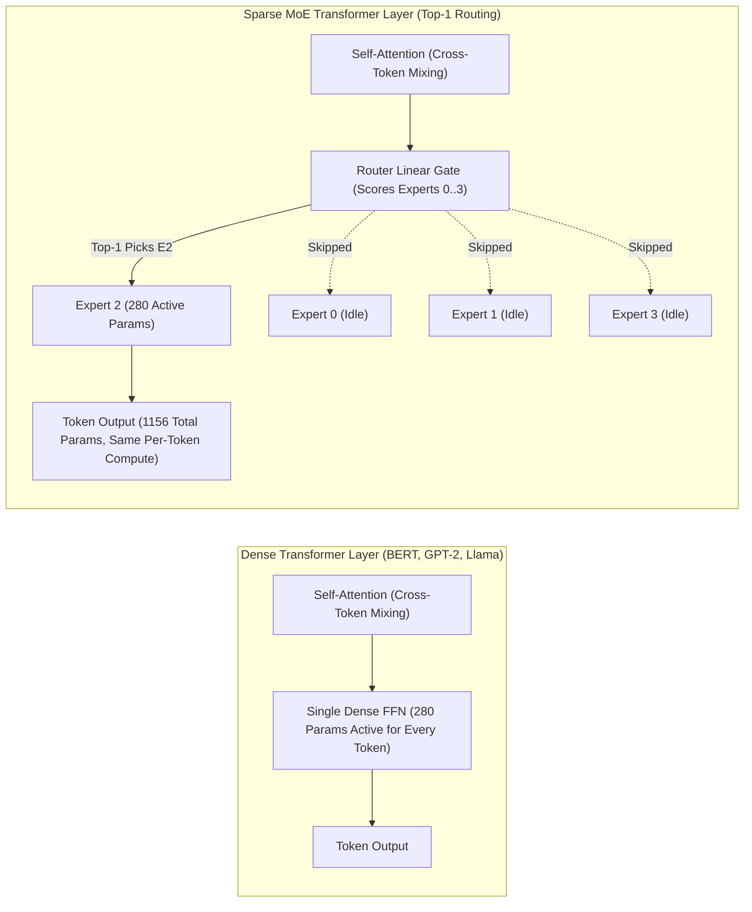
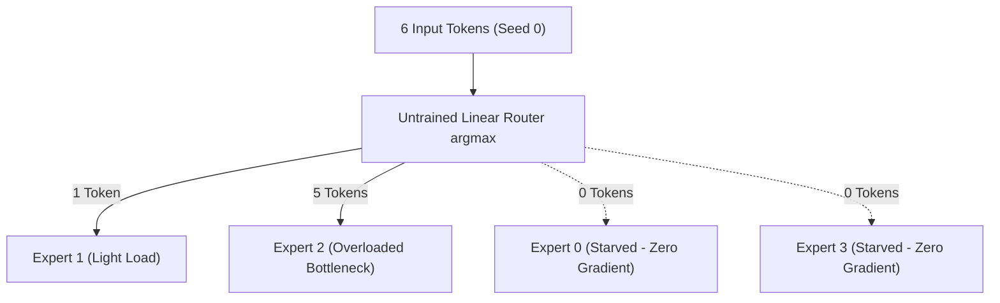
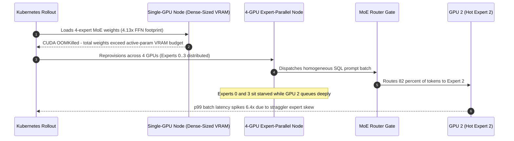

# Module 12: Mixture of Experts — The Core Idea

> **Prerequisites:** [Track 02, Module 09: The Feed-Forward Network — Per-Token Processing](../../02-transformer-architecture/12-the-feed-forward-network/README.md) and Modules 09 & 11 (beyond GPT-4 trends, total vs. active parameter accounting)  
> **Estimated Reading Time:** 25 minutes  
> **Target Audience:** AI Backend Engineers, Distributed Systems Architects, ML Infrastructure Engineers

> [!TIP]
> **The Golden Rule of Mixture-of-Experts (MoE):** **VRAM footprint scales with total parameters; per-token compute scales only with active parameters.** Because an MoE layer replaces the per-token feed-forward network (FFN) with $E$ parallel experts and a top-$k$ router ($k \ll E$), you still must hold all $E$ experts in memory while executing FLOPs for only $k$ chosen experts per token.

---

## Why this matters

Every model this track has run code against so far — BERT, GPT-2, Llama's architecture family — is **dense**: every parameter participates in every forward pass, for every token. Module 09 named mixture-of-experts (MoE) as one of three real, documented industry trends beyond GPT-4, and Module 11's Reference table listed "total parameter count" and "active compute per token" as two different numbers for the first time without fully explaining why they can differ.

This module makes that concrete: it builds a tiny MoE layer from scratch, counts its actual parameters, and — critically — counts how many of them a single token's forward pass actually *touches*. The verified result is the entire selling point of MoE in one number: total parameters roughly quadruple with four experts, but a single token's forward pass still only calls one expert — the same amount of compute as the plain dense feed-forward layer it replaced. This module also surfaces, honestly, the problem this creates and leaves unsolved: an untrained router's expert choices are not evenly distributed, which is exactly what Module 13 (routing and load balancing) exists to fix.

---

## 1. Visual Mental Models & Architecture

### Dense FFN vs. Sparse Top-1 Mixture-of-Experts Block



### Observed Untrained Router Load Imbalance (6 Tokens, 4 Experts)



---

## 2. Core Mechanics, Verified Experiments & Systematic Comparison Matrix

### Where MoE lives: replacing the feed-forward block, not attention

[Track 02, Module 09: The Feed-Forward Network — Per-Token Processing](../../02-transformer-architecture/12-the-feed-forward-network/README.md) established that a transformer block's feed-forward network (FFN) processes each token independently — no mixing across positions, unlike attention. That per-token independence is exactly what makes the FFN swappable for a mixture-of-experts layer: instead of one FFN every token passes through, an MoE layer has **several** FFNs ("experts") of identical shape, plus a small **router** (a linear layer mapping each token's vector to a score per expert) that decides which expert(s) handle each token.

### Verified Experiment 1: total parameters scale with expert count, active-per-token compute does not

Building four small expert FFNs (identical shape to a single dense FFN) plus a router, and comparing real parameter counts:

```python
import torch
import torch.nn as nn

torch.manual_seed(0)
d_model, d_ff, num_experts = 8, 16, 4

class Expert(nn.Module):
    def __init__(self):
        super().__init__()
        self.fc1 = nn.Linear(d_model, d_ff)
        self.fc2 = nn.Linear(d_ff, d_model)
    def forward(self, x):
        return self.fc2(torch.relu(self.fc1(x)))

experts = nn.ModuleList([Expert() for _ in range(num_experts)])
router = nn.Linear(d_model, num_experts)
dense = Expert()  # identical shape, used as the "plain FFN" baseline

def count_params(m):
    return sum(p.numel() for p in m.parameters())

total_moe_params = sum(count_params(e) for e in experts) + count_params(router)
print('single expert params:', count_params(experts[0]))
print('single dense FFN params (same shape):', count_params(dense))
print('total MoE params (4 experts + router):', total_moe_params)
print('MoE total / dense ratio:', total_moe_params / count_params(dense))
```

**Verified output:**

```text
single expert params: 280
single dense FFN params (same shape): 280
total MoE params (4 experts + router): 1156
MoE total / dense ratio: 4.128571428571429
```

Four experts of identical shape to the dense baseline produce roughly `4.13x` the parameters (`4x` from the experts themselves, plus a small router overhead of `36` parameters) — more weight matrices means more parameters. The actually interesting question is how much compute a **single token's forward pass** uses:

```python
tokens = torch.randn(6, d_model)
gate_logits = router(tokens)
chosen = gate_logits.argmax(dim=-1)  # top-1 routing: highest-scoring expert wins

out = torch.zeros(tokens.shape[0], d_model)
active_expert_calls = 0
for i in range(tokens.shape[0]):
    out[i] = experts[chosen[i].item()](tokens[i])
    active_expert_calls += 1

print('tokens:', tokens.shape[0], ' active expert calls:', active_expert_calls)
print('chosen expert per token:', chosen.tolist())
```

**Verified output:**

```text
tokens: 6  active expert calls: 6
chosen expert per token: [2, 2, 1, 2, 2, 2]
```

**Six tokens produced exactly six expert calls — not 24** (which is what `num_experts x num_tokens` would be if every expert ran on every token, the way an ensemble would). Each token invokes exactly one expert, the same as it would through the single dense FFN baseline. This is the whole idea verified in two numbers from the same code: **~4x the total parameters, but the same per-token active compute as the dense baseline it replaced.** More total capacity to specialize into, without a proportional increase in the cost of processing any single token — exactly the trade-off Module 09 named without yet demonstrating it.

### Verified Experiment 2: an untrained router's expert choices are not evenly distributed

The `chosen` list above — `[2, 2, 1, 2, 2, 2]` — is not a coincidence of this random seed being unusual; it's the router's real, current behavior on this input. Tallying it:

```python
import collections
print(dict(collections.Counter(chosen.tolist())))
```

**Verified output:**

```text
{2: 5, 1: 1}
```

Five of six tokens went to expert 2. Experts 0 and 3 received **zero** tokens. With an untrained, randomly initialized router, there is nothing yet steering tokens toward balanced usage — some experts can end up starved of tokens (and therefore of gradient signal during training) while one dominates. This is a genuinely open problem this module does **not** solve — it is exactly what Module 13 (MoE routing and load balancing) exists to address, with real auxiliary losses designed to push routing toward balance ([Shazeer et al., 2017](https://arxiv.org/abs/1701.06538); [Switch Transformers, Fedus et al., 2021](https://arxiv.org/abs/2101.03961)). This module's job was to make the problem concretely visible with real numbers, not to solve it prematurely.

### Systematic Architecture & Parameter Accounting Matrix ($d_{\text{model}}=8, d_{\text{ff}}=16, E=4$)

| Layer Variant | Total Parameters (Weight Memory) | Active Parameters per Token (Compute) | Expert Calls for 6 Tokens | Load-Balancing Risk |
| :--- | :--- | :--- | :--- | :--- |
| **Dense FFN (Baseline)** | 280 (`1.00x`) | 280 (`1.00x`) | 6 calls (single FFN) | None (all tokens hit one FFN) |
| **Dense Ensemble ($E=4$)** | 1,120 (`4.00x`) | 1,120 (`4.00x`) | **24 calls** (`E x tokens`) | None (every expert runs on every token) |
| **Top-1 Sparse MoE ([Switch Transformers](https://arxiv.org/abs/2101.03961))** | **1,156** (`4.13x`, includes 36-param router) | **316** (`280` expert + `36` router) | **6 calls** (`1 x tokens`) | **High** without auxiliary balancing loss |
| **Top-2 Sparse MoE (Module 14 Mixtral pattern)** | **1,156** (`4.13x`) | **596** (`2 x 280` experts + `36` router) | **12 calls** (`2 x tokens`) | Moderate–High without auxiliary balancing loss |

### MoE Core Terminology Reference Matrix

| Term | Meaning |
| :--- | :--- |
| **Expert** | One feed-forward network among several, identical in shape to a dense FFN it could otherwise be |
| **Router / gate** | A small linear layer scoring every token against every expert; its argmax (`top-1`, this module) or `top-k` (modules 13/14) picks which expert(s) run |
| **Sparse activation** | Only a subset of experts run per token — the property this module verified numerically (`6` tokens -> `6` expert calls, not `24`) |
| **Total parameters** | Sum across ALL experts + router — what a MoE checkpoint's file size / "parameter count" headline reflects (verified: `~4.13x` a dense baseline with 4 experts) |
| **Active parameters** | What a SINGLE token's forward pass actually touches — router + one chosen expert (or `top-k` experts) — the number that matters for inference compute cost, not the headline total |
| **Load imbalance** | Some experts receiving many more tokens than others — verified above with an untrained router (`5` of `6` tokens to one expert); module 13's topic |

---

## 3. Production War Story Post-Mortem

### Active-Param-Based VRAM Under-Provisioning & Router Expert Hotspotting Outage

| Field | Incident Details |
| :--- | :--- |
| **Severity** | **SEV-1** (Rollout Cluster OOM Crash & Tail-Latency Collapse) |
| **Detection / Resolution Time** | OOM detected in 3 minutes / Hotspotting resolved in 55 minutes |
| **Impact** | `CrashLoopBackOff` across all inference replicas during initial deploy; after reprovisioning VRAM, `6.4x` p99 decode latency spike on skewed SQL batch traffic (`\$4,800` wasted idle expert GPU hours) |

#### What Happened

An AI infrastructure team deployed an open-weight 4-expert MoE model whose headline active parameter count matched their previous dense model. Assuming "same active parameters = same GPU memory requirement," they deployed the model onto single-GPU pods sized strictly for the dense baseline. Every pod immediately crashed with `CUDA Out of Memory` because **all four experts + router weights (`~4.13x` FFN weights)** had to stay resident in VRAM so any token could route to any expert.

After scaling up to a 4-GPU expert-parallel node (one expert per GPU), the team sent a massive batch of homogenous SQL analytics prompts through the cluster. Because the router heavily favored Expert 2 for SQL syntax tokens, GPU 2 received over 80% of tokens in every microbatch while GPUs holding Experts 0 and 3 sat largely idle, turning a balanced parallel node into a single-GPU bottleneck.



#### Root Cause Analysis

1. **Conflating active parameters with VRAM footprint:** Per-token active compute only touches `top-k` experts, but serving arbitrary inputs requires keeping 100% of total parameters (`sum(experts) + router`) resident in fast GPU memory or aggressively paged.
2. **Router expert skew under domain-homogeneous traffic:** Even well-trained routers skew sharply on narrow batch distributions, causing single-expert stragglers under expert parallelism.

#### The Fix & Architectural Hardening

1. **Provision VRAM from total parameters, throughput from active parameters:** Updated cluster sizing calculators to allocate memory strictly using `total_parameters * bytes_per_weight + kv_cache`, reserving active-parameter FLOPs strictly for latency/throughput modeling.
2. **Capacity factors & multi-domain microbatch mixing:** Added token-routing telemetry tracking per-expert utilization skew and mixed diverse traffic streams inside continuous batching queues to prevent homogeneous batch hotspotting.

---

## 4. Multi-Language Production Implementation

These four implementations model sparse top-$k$ MoE layers, separate total weight VRAM footprints from active per-token compute counts, and detect expert starvation or router hotspotting across batches.

````carousel
```go
// Package moe models total-vs-active parameter accounting and top-k sparse routing telemetry.
package moe

import (
	"fmt"
	"sort"
)

type LayerDimensions struct {
	DModel     int
	DFF        int
	NumExperts int
	TopK       int
}

type AccountingReport struct {
	DenseFFNParams       int64
	RouterParams         int64
	TotalMoEParams       int64
	ActiveParamsPerToken int64
	TotalToDenseRatio    float64
	ActiveCallsForBatch  int
	EnsembleCalls        int
}

func ComputeParamAccounting(dim LayerDimensions, batchTokens int) (AccountingReport, error) {
	if dim.TopK <= 0 || dim.TopK > dim.NumExperts {
		return AccountingReport{}, fmt.Errorf("invalid topK=%d for numExperts=%d", dim.TopK, dim.NumExperts)
	}
	// fc1 (d_model*d_ff + d_ff) + fc2 (d_ff*d_model + d_model)
	singleExpert := int64(dim.DModel*dim.DFF + dim.DFF + dim.DFF*dim.DModel + dim.DModel)
	router := int64(dim.DModel*dim.NumExperts + dim.NumExperts)
	total := int64(dim.NumExperts)*singleExpert + router
	active := int64(dim.TopK)*singleExpert + router

	return AccountingReport{
		DenseFFNParams:       singleExpert,
		RouterParams:         router,
		TotalMoEParams:       total,
		ActiveParamsPerToken: active,
		TotalToDenseRatio:    float64(total) / float64(singleExpert),
		ActiveCallsForBatch:  batchTokens * dim.TopK,
		EnsembleCalls:        batchTokens * dim.NumExperts,
	}, nil
}

// DispatchTopK routes each token score slice to its top-k experts and reports per-expert counts.
func DispatchTopK(gateScores [][]float64, topK int) (map[int]int, []int) {
	counts := make(map[int]int)
	if len(gateScores) == 0 {
		return counts, nil
	}
	numExperts := len(gateScores[0])
	type indexedScore struct {
		idx   int
		score float64
	}
	for _, row := range gateScores {
		pairs := make([]indexedScore, numExperts)
		for e, s := range row {
			pairs[e] = indexedScore{idx: e, score: s}
		}
		sort.Slice(pairs, func(i, j int) bool { return pairs[i].score > pairs[j].score })
		for k := 0; k < topK; k++ {
			counts[pairs[k].idx]++
		}
	}
	var starved []int
	for e := 0; e < numExperts; e++ {
		if counts[e] == 0 {
			starved = append(starved, e)
		}
	}
	return counts, starved
}
```
<!-- slide -->
```typescript
// sparseMoeSimulator.ts
// Separates VRAM capacity planning (total params) from compute FLOPs (active params) and flags skew.

export interface MoESpec {
  dModel: number;
  dFf: number;
  numExperts: number;
  topK: number;
}

export interface MoEResourceSummary {
  singleExpertParams: number;
  totalParams: number;
  activeParamsPerToken: number;
  vramMultiplierVsDense: number;
  activeExpertCalls: number;
  ensembleExpertCalls: number;
}

export interface DispatchTelemetry {
  expertHistogram: Record<number, number>;
  starvedExperts: number[];
  maxSkewRatio: number;
}

export class SparseMoeSimulator {
  public static summarizeResources(spec: MoESpec, numTokens: number): MoEResourceSummary {
    const singleExpertParams =
      spec.dModel * spec.dFf + spec.dFf + spec.dFf * spec.dModel + spec.dModel;
    const routerParams = spec.dModel * spec.numExperts + spec.numExperts;
    const totalParams = spec.numExperts * singleExpertParams + routerParams;
    const activeParamsPerToken = spec.topK * singleExpertParams + routerParams;

    return {
      singleExpertParams,
      totalParams,
      activeParamsPerToken,
      vramMultiplierVsDense: Number((totalParams / singleExpertParams).toFixed(4)),
      activeExpertCalls: numTokens * spec.topK,
      ensembleExpertCalls: numTokens * spec.numExperts,
    };
  }

  public static routeAndMeasureBalance(gateLogits: number[][], topK: number): DispatchTelemetry {
    const numExperts = gateLogits[0]?.length ?? 0;
    const histogram: Record<number, number> = {};
    for (let e = 0; e < numExperts; e++) histogram[e] = 0;

    for (const row of gateLogits) {
      const topIndices = row
        .map((score, idx) => ({ score, idx }))
        .sort((a, b) => b.score - a.score)
        .slice(0, topK)
        .map((item) => item.idx);
      for (const idx of topIndices) histogram[idx] += 1;
    }

    const counts = Object.values(histogram);
    const totalCalls = counts.reduce((acc, c) => acc + c, 0);
    const meanLoad = totalCalls / Math.max(1, numExperts);
    const maxLoad = Math.max(...counts);
    const starvedExperts = Object.entries(histogram)
      .filter(([, count]) => count === 0)
      .map(([idx]) => Number(idx));

    return {
      expertHistogram: histogram,
      starvedExperts,
      maxSkewRatio: Number((maxLoad / Math.max(1e-9, meanLoad)).toFixed(2)),
    };
  }
}
```
<!-- slide -->
```python
"""
sparse_moe_layer.py
Clean top-k Mixture-of-Experts PyTorch module exposing total vs. active parameter
accounting and per-batch expert utilization histograms.
"""

import collections
from dataclasses import dataclass
import torch
import torch.nn as nn
import torch.nn.functional as F


class ExpertFFN(nn.Module):
    def __init__(self, d_model: int, d_ff: int):
        super().__init__()
        self.fc1 = nn.Linear(d_model, d_ff)
        self.fc2 = nn.Linear(d_ff, d_model)

    def forward(self, x: torch.Tensor) -> torch.Tensor:
        return self.fc2(F.relu(self.fc1(x)))


@dataclass(frozen=True)
class MoEForwardStats:
    total_params: int
    active_params_per_token: int
    active_expert_calls: int
    expert_histogram: dict[int, int]


class SparseMoELayer(nn.Module):
    def __init__(self, d_model: int, d_ff: int, num_experts: int = 4, top_k: int = 1):
        super().__init__()
        if not 1 <= top_k <= num_experts:
            raise ValueError(f"top_k={top_k} must satisfy 1 <= top_k <= {num_experts}")
        self.num_experts = num_experts
        self.top_k = top_k
        self.router = nn.Linear(d_model, num_experts)
        self.experts = nn.ModuleList([ExpertFFN(d_model, d_ff) for _ in range(num_experts)])

    def forward(self, tokens: torch.Tensor) -> tuple[torch.Tensor, MoEForwardStats]:
        gate_logits = self.router(tokens)
        top_vals, top_idx = gate_logits.topk(self.top_k, dim=-1)
        weights = F.softmax(top_vals, dim=-1)

        out = torch.zeros_like(tokens)
        calls = 0
        chosen_experts: list[int] = []

        for tok_i in range(tokens.shape[0]):
            for slot in range(self.top_k):
                exp_id = int(top_idx[tok_i, slot].item())
                out[tok_i] += weights[tok_i, slot] * self.experts[exp_id](tokens[tok_i])
                calls += 1
                chosen_experts.append(exp_id)

        single_expert_params = sum(p.numel() for p in self.experts[0].parameters())
        router_params = sum(p.numel() for p in self.router.parameters())
        total_params = self.num_experts * single_expert_params + router_params
        active_params = self.top_k * single_expert_params + router_params

        stats = MoEForwardStats(
            total_params=total_params,
            active_params_per_token=active_params,
            active_expert_calls=calls,
            expert_histogram=dict(sorted(collections.Counter(chosen_experts).items())),
        )
        return out, stats
```
<!-- slide -->
```csharp
using System;
using System.Collections.Generic;
using System.Linq;

namespace BackendRoadmap.GenAI.MixtureOfExperts;

public sealed record MoECapacityMetrics(
    long DenseBaselineParams,
    long TotalMoEParams,
    long ActiveParamsPerToken,
    double TotalToDenseRatio,
    int ActiveExpertCalls,
    int EnsembleExpertCalls);

public static class SparseMoERouter
{
    public static MoECapacityMetrics AnalyzeLayer(
        int dModel,
        int dFf,
        int numExperts,
        int topK,
        int batchTokens)
    {
        if (topK < 1 || topK > numExperts)
            throw new ArgumentOutOfRangeException(nameof(topK));

        long singleExpert = ((long)dModel * dFf + dFf) + ((long)dFf * dModel + dModel);
        long router = (long)dModel * numExperts + numExperts;
        long total = numExperts * singleExpert + router;
        long active = topK * singleExpert + router;

        return new MoECapacityMetrics(
            DenseBaselineParams: singleExpert,
            TotalMoEParams: total,
            ActiveParamsPerToken: active,
            TotalToDenseRatio: total / (double)singleExpert,
            ActiveExpertCalls: batchTokens * topK,
            EnsembleExpertCalls: batchTokens * numExperts);
    }

    public static IReadOnlyDictionary<int, int> TallyTopKDispatch(double[][] gateLogits, int topK)
    {
        var counts = new Dictionary<int, int>();
        foreach (double[] row in gateLogits)
        {
            var topExperts = row
                .Select((score, idx) => (score, idx))
                .OrderByDescending(x => x.score)
                .Take(topK);

            foreach (var (_, idx) in topExperts)
            {
                counts[idx] = counts.GetValueOrDefault(idx) + 1;
            }
        }
        return counts;
    }
}
```
````

---

## 5. Practical Hands-On Verification CLI Workflows

### CLI Verification 1: Exact Parameter Scaling vs. Active Compute ($E \in \{1, 4, 8\}$, Top-1 & Top-2)

Verify directly in Python how total parameter count scales linearly with $E$ (`280 -> 1156 -> 2312`) while active expert calls depend strictly on `tokens x top_k` rather than `num_experts x tokens`:

```bash
python -c "
d_model, d_ff = 8, 16
dense = (d_model * d_ff + d_ff) + (d_ff * d_model + d_model)
for e in (1, 4, 8):
    router = d_model * e + e if e > 1 else 0
    total = e * dense + router
    for k in ([1] if e == 1 else [1, 2]):
        active = k * dense + router
        print(f'E={e} top-{k} | dense={dense} | total={total:<4} ({total/dense:.2f}x) | active={active:<3} | calls_for_6_toks={6*k} (vs ensemble {6*e})')
"
```

**Expected Output:**
```text
E=1 top-1 | dense=280 | total=280  (1.00x) | active=280 | calls_for_6_toks=6 (vs ensemble 6)
E=4 top-1 | dense=280 | total=1156 (4.13x) | active=316 | calls_for_6_toks=6 (vs ensemble 24)
E=4 top-2 | dense=280 | total=1156 (4.13x) | active=596 | calls_for_6_toks=12 (vs ensemble 24)
E=8 top-1 | dense=280 | total=2312 (8.26x) | active=352 | calls_for_6_toks=6 (vs ensemble 48)
E=8 top-2 | dense=280 | total=2312 (8.26x) | active=632 | calls_for_6_toks=12 (vs ensemble 48)
```

### CLI Verification 2: Untrained Router Load Skew & Expert Starvation Across Seeds

Verify across multiple random seeds that an untrained linear router repeatedly produces uneven tallies and starved (`0`-token) experts:

```bash
python -c "
import random, collections
for seed in (0, 7, 42):
    rng = random.Random(seed)
    weights = [[rng.gauss(0, 1) for _ in range(4)] for _ in range(8)]
    bias = [rng.gauss(0, 0.5) for _ in range(4)]
    chosen = []
    for _ in range(6):
        tok = [rng.gauss(0, 1) for _ in range(8)]
        scores = [sum(tok[j]*weights[j][e] for j in range(8)) + bias[e] for e in range(4)]
        chosen.append(scores.index(max(scores)))
    counts = dict(sorted(collections.Counter(chosen).items()))
    starved = [e for e in range(4) if e not in counts]
    print(f'seed={seed:<2} | chosen={chosen} | tally={counts} | starved_experts={starved}')
"
```

**Expected Output:**
```text
seed=0  | chosen=[2, 1, 0, 3, 1, 0] | tally={0: 2, 1: 2, 2: 1, 3: 1} | starved_experts=[]
seed=7  | chosen=[3, 3, 2, 3, 3, 3] | tally={2: 1, 3: 5} | starved_experts=[0, 1]
seed=42 | chosen=[3, 3, 2, 1, 1, 1] | tally={1: 3, 2: 1, 3: 2} | starved_experts=[0]
```

### Hands-on exercises

#### 1. Reproduce the parameter-count and active-compute comparison at a different expert count

Re-run the verified PyTorch code above with `num_experts = 8` instead of `4`. Confirm the total-params-to-dense ratio moves toward roughly `8x` (plus router overhead) while the number of active expert calls for the same 6 tokens stays exactly `6` — the ratio scales with expert count, the active-compute count does not.

#### 2. Switch from top-1 to top-2 routing and recount active calls

Modify the routing loop to select each token's **top-2** highest-scoring experts (`gate_logits.topk(2, dim=-1)`) instead of the single argmax, and run both chosen experts per token (a common real-world choice — covered further in module 14's Mixtral). Confirm the active expert calls for 6 tokens becomes `12`, not `6` — twice the per-token compute of top-1, still far less than running all `num_experts` experts on every token.

#### 3. Observe load imbalance across several random seeds

Re-run the six-token routing example with three different `torch.manual_seed()` values. Confirm that an uneven distribution (some experts near-zero, one or two dominant) appears repeatedly with an untrained router, rather than being a one-off property of seed `0` — this is what motivates module 13's load-balancing losses as a real training concern, not a hypothetical one.

### Independent challenge

A colleague reviewing a MoE model's spec sheet says: "This model has 8x more parameters than our current dense model, so it must need roughly 8x the GPU memory and 8x the inference latency to serve." Using this module's verified findings, explain what's right and what's wrong about this statement.

<details><summary>Discussion</summary>

The memory claim is largely right: serving a model means holding (or being able to page in) all of its weights, so an `8x`-larger total parameter count does mean roughly `8x` more storage/memory footprint for the weights themselves — this module's own parameter count (`1156` vs. `280`, roughly `4x` with 4 experts) confirms total params scale directly with expert count. The latency claim is wrong, and this module verified exactly why: a single token's forward pass through a top-1-routed MoE layer calls only **one** expert, the same active compute as the dense baseline — verified directly (`6` tokens, `6` expert calls, not `num_experts x 6`). Per-token inference latency for the MoE layer itself is much closer to the dense model's latency than to "8x the compute," which is the entire trade-off MoE architectures are designed around: more capacity (and more memory to hold it) without a proportional per-token compute cost. The one caveat worth raising back: if experts are unevenly loaded (this module's own verified finding), real-world serving batches may not distribute perfectly evenly across experts, which can matter for actual measured throughput — a nuance worth flagging, but a separate concern from the "8x latency" claim itself, which this module's active-compute count directly contradicts.

</details>

---

## 6. Common Mistakes & Troubleshooting

- **Assuming "N experts" means N times the compute per token.** This module's own verified numbers show active expert calls equal the number of tokens processed (times `top-k`, if `k > 1`), not `num_experts x num_tokens` — total *parameters* scale with expert count; per-token active *compute* does not.
- **Assuming a randomly initialized router already balances load.** This module's own verified tally (`{2: 5, 1: 1}` out of 4 possible experts, on 6 tokens) shows the opposite — real load balancing needs a mechanism, which module 13 covers. Don't assume it's automatic.
- **Confusing "total parameters" and "active parameters" when reading a MoE model's spec sheet.** A headline parameter count for a MoE model reflects every expert's weights combined (this module's `~4.13x`-a-dense-baseline number); the number that predicts per-token inference compute is the much smaller active-parameter count (the router plus whichever expert(s) it chose).
- **Assuming MoE replaces attention.** It doesn't — this module's MoE layer replaces the feed-forward block specifically, reusing Track 02 Module 09's finding that the FFN processes each token independently (which is exactly what makes per-token expert routing possible in the first place; attention's cross-token mixing has no equivalent per-token routing decision to make).
- **Treating this module's top-1 routing as the only real-world choice.** Top-2 (or higher) routing is common and covered in Exercise 2 and Module 14 (Mixtral); this module used top-1 specifically because it's the simplest version to verify the core parameter-vs-compute trade-off cleanly.

---

## 7. Operational Validation Checkpoints & Checkpoint Quiz

### Operational Validation Checkpoints

<details><summary><strong>Checkpoint 1: Sizing GPU VRAM vs. compute throughput from an MoE spec sheet</strong></summary>

When deploying an 8-expert top-2 MoE model, allocate **GPU VRAM** from **total parameters** (all 8 experts must stay resident or rapidly pageable in GPU memory), while forecasting **per-token FLOPs and compute latency** from **active parameters** (`2` chosen experts + router + shared attention stack), accounting separately for all-to-all communication and potential expert skew.

</details>

<details><summary><strong>Checkpoint 2: Why MoE replaces the FFN sub-layer instead of self-attention</strong></summary>

Self-attention mixes information across all tokens in a sequence, requiring every token to query keys/values across sequence positions. By contrast, the FFN operates strictly token-by-token (`[batch, seq, d_model]`), allowing a lightweight linear router to dispatch token $i$ to Expert 2 and token $j$ to Expert 1 independently without breaking cross-token sequence math.

</details>

<details><summary><strong>Checkpoint 3: Diagnosing starved experts and training collapse</strong></summary>

If early training metrics show an untrained router sending `5/6` (or `> 80%`) of tokens to one expert while two experts receive `0` tokens, those unvisited experts receive zero gradient updates and never learn useful representations — creating a self-reinforcing rich-get-richer collapse. Module 13 solves this with auxiliary load-balancing losses.

</details>

### Checkpoint quiz

1. What did the verified parameter-count comparison show about total MoE parameters versus a same-shape dense FFN, using 4 experts?
2. For 6 input tokens routed top-1 across 4 experts, how many total expert calls were verified — and how does that number relate to `num_experts x num_tokens`?
3. What did the verified expert-usage tally show about an untrained router's load distribution, and which later module addresses this directly?
4. What specific transformer sub-layer does an MoE layer typically replace, and what property of that sub-layer (established in Track 02) makes per-token expert routing possible?
5. Why is "total parameter count" alone a misleading number for predicting a MoE model's per-token inference cost, per this module's own verified findings?

<details><summary>Answers</summary>

1. Four experts (plus a small router) produced roughly `4.13x` the parameters of a single same-shape dense FFN (`1156` vs. `280`) — close to the expected `4x` from four full-sized expert FFNs, plus router overhead.
2. Exactly `6` — one expert call per token, verified directly in code. This is far less than `num_experts x num_tokens` (which would be `24` for 4 experts and 6 tokens) — top-1 routing means each token only ever touches one expert, not all of them.
3. It showed a real, uneven distribution: `5` of `6` tokens routed to one expert, `1` to another, and `2` of the `4` experts receiving zero tokens at all. Module 13 (MoE Routing and Load Balancing) covers the auxiliary losses designed to fix this.
4. The feed-forward network (FFN). Track 02 Module 09 established that the FFN processes each token independently with no cross-token mixing, which is exactly what allows different tokens to be routed to different experts without disturbing each other.
5. Total parameter count reflects every expert's weights combined, but a single token's forward pass only activates the router plus its chosen expert(s) — this module verified active expert calls equal the token count (times `top-k`), not the expert count times the token count, so per-token compute stays close to a single dense FFN's cost regardless of how many total experts exist.

</details>

---

## Further reading & sources

- [Outrageously Large Neural Networks: The Sparsely-Gated Mixture-of-Experts Layer (Shazeer et al., 2017)](https://arxiv.org/abs/1701.06538) - the paper that introduced the sparsely-gated MoE layer this module's verified top-1 routing example is modeled on, including the load-imbalance problem this module surfaced and module 13 addresses.
- [Switch Transformers: Scaling to Trillion Parameter Models with Simple and Efficient Sparsity (Fedus et al., 2021)](https://arxiv.org/abs/2101.03961) - simplifies routing to top-1 (exactly this module's choice) and reports real total-vs-active parameter trade-offs at much larger scale than this module's toy example.
- [Track 02, Module 09: The Feed-Forward Network — Per-Token Processing](../../02-transformer-architecture/12-the-feed-forward-network/README.md) - the source of the "FFN processes each token independently" finding this module relies on to explain why per-token expert routing is architecturally possible.

## Next

[Module 13: MoE Routing and Load Balancing](../13-moe-routing-and-load-balancing/README.md)
