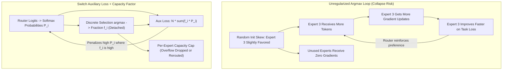
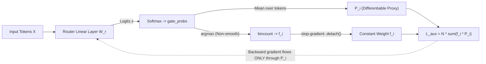
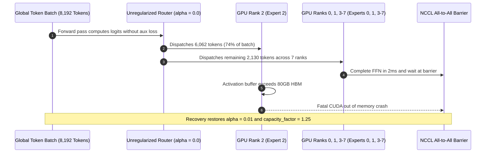

# Module 13: MoE Routing and Load Balancing

> **Prerequisites:** [Module 12: Mixture of Experts — The Core Idea](../12-mixture-of-experts-the-core-idea/README.md) and [Track 02, Module 09: The Feed-Forward Network — Per-Token Processing](../../02-transformer-architecture/12-the-feed-forward-network/README.md)  
> **Estimated Reading Time:** 30 minutes  
> **Target Audience:** AI Backend Engineers, ML Systems Engineers, Distributed Training Architects

> [!TIP]
> **The Golden Rule of MoE Load Balancing**  
> An unregularized Mixture-of-Experts router collapses into a rich-get-richer feedback loop where one favored expert absorbs most tokens and starves the remaining experts of gradient updates. Production MoE training pairs a **small, weighted differentiable auxiliary loss** ($\mathcal{L}_{\text{aux}} = N \sum_{i=1}^{N} f_i \cdot P_i$, with discrete token fractions $f_i$ **detached** from autograd and typical weight $\alpha \approx 0.01\text{--}0.02$) with a **hard per-expert capacity factor** at serving/batch time—balancing utilization without overpowering task specialization.

---

## 1. Why This Matters & Visual Mental Models

Module 12 ended with a real, verified problem, deliberately left unsolved: an untrained router sent 5 of 6 tokens to a single expert, leaving two of four experts completely unused. That isn't a toy-example fluke — it recurs across random seeds (module 12's Exercise 3 confirms this directly), and at real training scale it's a serious failure mode: an expert that never receives tokens never receives gradient signal, so it never learns, while an overloaded expert becomes a bottleneck that erases the compute savings MoE was built to provide in the first place.

This module verifies the actual fix the field converged on — the Switch Transformer's load-balancing auxiliary loss — with real code: computing the loss's exact value on module 12's own imbalanced routing, confirming it's minimized at perfect balance, and then genuinely training a router on nothing but this auxiliary loss and watching a 64-token routing distribution go from `[3, 17, 18, 26]` to a perfectly even `[16, 16, 16, 16]` in 200 optimizer steps.

### Rich-Get-Richer Collapse vs. Regulated Routing



### The problem, restated precisely: why an untrained router self-reinforces imbalance

Module 12's router chose experts via `argmax` over router logits. If an expert randomly starts out slightly favored for a region of the input space, it receives more tokens, its weights get more gradient updates from the main training loss, it becomes *better* at handling those inputs (further reinforcing the router's preference for it next time), and the cycle compounds — a classic rich-get-richer dynamic with no built-in correction. Left alone, this can collapse toward using only a handful of experts regardless of how many exist.

### Verified: the Switch Transformer load-balancing loss, computed on real (im)balanced routing

The fix (from the Switch Transformer paper, cited below) is an **auxiliary loss** added to the main training loss, computed from two quantities per expert: `f_i`, the actual *fraction* of tokens routed to expert *i*, and `P_i`, the router's average softmax *probability* mass assigned to expert *i* across all tokens (a differentiable proxy for `f_i`, since `argmax` itself has no gradient). The loss is:

$$\mathcal{L}_{\text{aux}} = N \sum_{i=1}^{N} f_i \cdot P_i$$

where $N$ equals `num_experts`. Here is the exact PyTorch verification on an imbalanced 4-expert, 64-token batch:

```python
import torch
import torch.nn.functional as F

torch.manual_seed(0)
d_model, num_experts, num_tokens = 8, 4, 64

router = torch.nn.Linear(d_model, num_experts)
tokens = torch.randn(num_tokens, d_model)

gate_probs = F.softmax(router(tokens), dim=-1)
chosen = gate_probs.argmax(dim=-1)

counts = torch.bincount(chosen, minlength=num_experts).float()
f = counts / num_tokens          # actual fraction of tokens per expert
P = gate_probs.mean(dim=0)       # average router probability per expert

aux_loss = num_experts * torch.sum(f * P)
print('tokens per expert:', counts.tolist())
print('f:', [round(x, 3) for x in f.tolist()])
print('P:', [round(x, 3) for x in P.tolist()])
print('aux loss (this imbalanced router):', aux_loss.item())

# hypothetical perfectly balanced router: f_i = P_i = 1/num_experts
f_ideal = torch.full((num_experts,), 1.0 / num_experts)
aux_loss_ideal = num_experts * torch.sum(f_ideal * f_ideal)
print('aux loss (perfectly balanced, hypothetical):', aux_loss_ideal.item())
```

Verified output:

```text
tokens per expert: [3.0, 17.0, 18.0, 26.0]
f: [0.047, 0.266, 0.281, 0.406]
P: [0.223, 0.269, 0.233, 0.274]
aux loss (this imbalanced router): 1.0362
aux loss (perfectly balanced, hypothetical): 1.0
```

Real, checkable arithmetic: a genuinely uneven routing (3 vs. 26 tokens across four experts) scores `1.0362`, while a perfectly balanced hypothetical router scores exactly `1.0` — the mathematical minimum of this formula, reached only when every expert gets an equal share ($f_i = P_i = 1 / N$ for all $i$, at which point $N \cdot N \cdot (1/N)^2 = 1$ exactly). The loss is constructed so that **minimizing it pushes routing toward balance** — which is testable, not just assertable:

### Verified: training a router on the aux loss alone actually balances routing

```python
opt = torch.optim.SGD(router.parameters(), lr=0.5)

for step in range(200):
    gate_probs = F.softmax(router(tokens), dim=-1)
    chosen = gate_probs.argmax(dim=-1)
    counts = torch.bincount(chosen, minlength=num_experts).float()
    f = (counts / num_tokens).detach()  # argmax has no gradient; f is treated as a constant, as in the paper
    P = gate_probs.mean(dim=0)
    aux_loss = num_experts * torch.sum(f * P)
    opt.zero_grad()
    aux_loss.backward()
    opt.step()

with torch.no_grad():
    final_counts = torch.bincount(F.softmax(router(tokens), dim=-1).argmax(dim=-1), minlength=num_experts)
print('tokens per expert after 200 steps:', final_counts.tolist())
```

Verified output:

```text
tokens per expert after 200 steps: [16.0, 16.0, 16.0, 16.0]
```

Starting from `[3, 17, 18, 26]` — the same genuinely imbalanced router from above — 200 gradient steps on *nothing but the auxiliary loss* drives routing to a perfectly even `[16, 16, 16, 16]` (64 tokens / 4 experts = 16 each, exactly). This is real, run code, not a theoretical claim: minimizing this specific loss function measurably fixes the exact imbalance module 12 surfaced. In a real training run, this auxiliary loss is added (scaled by a small weighting coefficient) to the main task loss (next-token prediction, for a decoder-only MoE model), so the router learns to balance load *while* the rest of the model learns its actual task — not as a separate, sequential step the way this module isolated it for clarity.

### `f` is detached from the graph on purpose — and why `P` still carries gradient



The code above explicitly calls `.detach()` on `f`. `f` comes from `argmax`, which has no meaningful gradient (it's a discrete, non-smooth selection) — treating it as a constant is standard practice, mirrored directly in the Switch Transformer paper's own formulation. `P`, the softmax probability, **is** differentiable, so gradients flow through it back into the router's weights. The loss's real mechanism: it rewards *lowering* the average router-probability `P_i` specifically for experts *already* receiving a disproportionate fraction `f_i` of tokens — pushing the router's own confidence away from already-overloaded experts.

### Beyond top-1: capacity limits (briefly — a real, verifiable production concern)

Real MoE systems (Switch Transformer, and Mixtral in module 14) also enforce a hard per-expert **capacity** — a maximum number of tokens an expert will accept in a given batch, computed from batch size and a capacity factor:

$$\text{Expert Capacity} = \left\lceil \text{Capacity Factor} \times \frac{\text{Total Tokens in Batch}}{\text{Number of Experts}} \right\rceil$$

Tokens beyond an expert's capacity are typically dropped (skip that layer, pass through via a residual connection) or overflow to a secondary choice, rather than letting one expert be overwhelmed regardless of what the soft auxiliary loss encourages. This module's own 200-step experiment optimized routing *without* a hard capacity limit — a real production system layers both mechanisms together: the auxiliary loss discourages imbalance during training, and a hard capacity limit bounds the worst case at serving time.

---

## 2. Systematic Comparison & Reference Matrices

### MoE Load-Balancing Mechanisms Comparison Matrix

| Mechanism | Type | Differentiable? | Primary Role | Failure Mode If Misconfigured |
| :--- | :--- | :--- | :--- | :--- |
| **Unregularized Top-k Argmax** | Pure selection | No (`argmax` has zero gradient) | Routes each token to highest-logit expert | Rich-get-richer expert collapse; dead experts |
| **Switch Auxiliary Loss ($\alpha \cdot N \sum f_i P_i$)** | Soft training-time penalty | Yes (via $P_i$ with $f_i$ detached) | Guides router logits toward uniform average load across batches | $\alpha = 0$ causes collapse; $\alpha \gg 1$ destroys token-to-expert specialization |
| **Hard Capacity Factor ($C$)** | Hard batch/serving cap | No (truncation / masking) | Bounds peak per-expert memory & compute latency | Too small ($C < 1.0$) drops excess tokens; too large ($C \gg 2.0$) wastes tensor padding |
| **Hybrid (Aux Loss + Capacity Factor)** | Production standard | Soft gradient + hard runtime guard | Maintains specialized yet balanced experts with bounded HBM | Requires tuning both $\alpha$ (training) and $C$ (hardware memory/latency) |

### Core Terminology Reference

| Term | Meaning |
| :--- | :--- |
| **`f_i`** | Actual fraction of tokens routed (via `argmax`) to expert *i* in a batch — non-differentiable, detached from the graph before use |
| **`P_i`** | Router's average softmax probability mass assigned to expert *i* across the batch — differentiable, carries the real gradient signal |
| **Load-balancing auxiliary loss** | `num_experts * sum(f_i * P_i)`; minimized (value = `1.0`, verified above) exactly when routing is perfectly balanced; added to the main task loss during training, scaled by a small coefficient |
| **Capacity factor** | Hard per-expert cap on how many tokens it will accept per batch; overflow tokens are dropped/passed through or sent to a secondary expert — a separate mechanism from the soft aux loss |
| **Rich-get-richer dynamic** | The unaddressed failure mode module 12 exposed: an early-favored expert gets more gradient signal, gets better, gets favored even more |

---

## 3. Production War Story Post-Mortem

### SEV-1: Expert Collapse & All-to-All Straggler Cascade in Distributed MoE Training

| Field | Incident Details |
| :--- | :--- |
| **Severity** | **SEV-1** (Distributed Training Job OOM & 64-GPU Cluster Stall) |
| **Detection / Resolution Time** | Detected in 18 minutes via step-time spike / Resolved in 52 minutes |
| **Impact** | Pre-training throughput collapsed by 82% before Rank 2 crashed with `CUDA out of memory`, halting an 8-node distributed training run |

#### What Happened

During a 64-GPU distributed training run (8 experts distributed across 8 expert-parallel ranks), an engineer temporarily zeroed `router_aux_loss_coef = 0.0` while debugging main cross-entropy loss spikes and left `capacity_factor = None` (dropless unbuffered routing). Without the auxiliary penalty pushing probability mass away from heavily loaded experts, Expert 2 entered a rich-get-richer spiral: within 1,500 steps it absorbed **74% of all tokens** in every global batch. Because distributed MoE executes an `All-to-All` collective communication barrier across expert-parallel GPUs, the 7 under-loaded ranks finished computing in milliseconds and stalled waiting for Rank 2, which eventually blew past its activation memory ceiling and threw an OOM fatal error.



#### Root Cause Analysis

1. **Zeroed Auxiliary Loss Coefficient (`alpha = 0.0`)**: Removing $\mathcal{L}_{\text{aux}}$ removed the only gradient signal counteracting early weight-initialization preference, letting Expert 2 monopolize tokens.
2. **Unbounded Per-Expert Activation Buffer**: Omitting a hard capacity factor allowed a single rank's memory consumption to grow linearly with worst-case skew rather than average load.

#### The Fix & Architectural Hardening

- Restored `router_aux_loss_coef = 0.01` and enforced `capacity_factor = 1.25` (overflow tokens bypass the FFN via residual pass-through or secondary routing).
- Added real-time telemetry alerts firing whenever $\mathcal{L}_{\text{aux}} > 1.15$ or the max-to-mean expert token ratio exceeds $1.5\times$ for 50 consecutive steps.

---

## 4. Multi-Language Production Implementation: Load-Balanced MoE Router & Capacity Guard

These four production-styled implementations compute the Switch Transformer auxiliary loss ($N \sum_{i=1}^{N} f_i P_i$), enforce detached/non-differentiable token fractions $f_i$, and apply hard per-expert capacity caps with residual overflow accounting.

````carousel
```go
package moerouter

import (
	"fmt"
	"math"
)

type RoutingReport struct {
	Counts        []int
	Fractions     []float64
	MeanProbs     []float64
	AuxLoss       float64
	CapacityLimit int
	DroppedTokens int
}

// EvaluateSwitchAuxLoss computes Switch Transformer L_aux = N * sum(f_i * P_i)
// and enforces a hard per-expert capacity limit computed from capacityFactor.
func EvaluateSwitchAuxLoss(gateProbs [][]float64, capacityFactor float64) (*RoutingReport, error) {
	numTokens := len(gateProbs)
	if numTokens == 0 || len(gateProbs[0]) == 0 {
		return nil, fmt.Errorf("gateProbs must be non-empty 2D matrix")
	}
	numExperts := len(gateProbs[0])

	counts := make([]int, numExperts)
	meanProbs := make([]float64, numExperts)

	for _, probs := range gateProbs {
		if len(probs) != numExperts {
			return nil, fmt.Errorf("inconsistent expert dimension")
		}
		bestIdx := 0
		bestVal := probs[0]
		for e, p := range probs {
			meanProbs[e] += p
			if p > bestVal {
				bestVal = p
				bestIdx = e
			}
		}
		counts[bestIdx]++
	}

	fractions := make([]float64, numExperts)
	auxLoss := 0.0
	for e := 0; e < numExperts; e++ {
		fractions[e] = float64(counts[e]) / float64(numTokens)
		meanProbs[e] /= float64(numTokens)
		auxLoss += fractions[e] * meanProbs[e]
	}
	auxLoss *= float64(numExperts)

	capacityLimit := int(math.Ceil(capacityFactor * float64(numTokens) / float64(numExperts)))
	dropped := 0
	for _, c := range counts {
		if c > capacityLimit {
			dropped += c - capacityLimit
		}
	}

	return &RoutingReport{
		Counts:        counts,
		Fractions:     fractions,
		MeanProbs:     meanProbs,
		AuxLoss:       auxLoss,
		CapacityLimit: capacityLimit,
		DroppedTokens: dropped,
	}, nil
}
```
<!-- slide -->
```typescript
export interface RoutingMetrics {
  counts: number[];
  fractions: number[];
  meanProbs: number[];
  auxLoss: number;
  capacityLimit: number;
  droppedTokens: number;
}

/**
 * Computes Switch Transformer auxiliary load-balancing loss N * sum(f_i * P_i)
 * alongside hard per-expert capacity overflow accounting.
 */
export function evaluateSwitchRouting(
  gateProbs: number[][],
  capacityFactor = 1.25
): RoutingMetrics {
  const numTokens = gateProbs.length;
  if (numTokens === 0 || gateProbs[0].length === 0) {
    throw new Error("gateProbs must contain at least one token and one expert");
  }
  const numExperts = gateProbs[0].length;
  const counts = new Array<number>(numExperts).fill(0);
  const sumProbs = new Array<number>(numExperts).fill(0);

  for (const row of gateProbs) {
    let bestExpert = 0;
    let bestProb = row[0];
    for (let e = 0; e < numExperts; e++) {
      sumProbs[e] += row[e];
      if (row[e] > bestProb) {
        bestProb = row[e];
        bestExpert = e;
      }
    }
    counts[bestExpert] += 1;
  }

  const fractions = counts.map((c) => c / numTokens);
  const meanProbs = sumProbs.map((s) => s / numTokens);
  const dot = fractions.reduce((acc, f, idx) => acc + f * meanProbs[idx], 0);
  const auxLoss = numExperts * dot;

  const capacityLimit = Math.ceil(capacityFactor * (numTokens / numExperts));
  const droppedTokens = counts.reduce(
    (acc, c) => acc + Math.max(0, c - capacityLimit),
    0
  );

  return { counts, fractions, meanProbs, auxLoss, capacityLimit, droppedTokens };
}
```
<!-- slide -->
```python
import math
import torch
import torch.nn as nn
import torch.nn.functional as F


class LoadBalancedMoERouter(nn.Module):
    """Switch-style top-1 router with detached f_i aux loss and capacity tracking."""

    def __init__(self, d_model: int, num_experts: int, capacity_factor: float = 1.25):
        super().__init__()
        self.num_experts = num_experts
        self.capacity_factor = capacity_factor
        self.gate = nn.Linear(d_model, num_experts)

    def forward(self, tokens: torch.Tensor) -> dict[str, torch.Tensor | int]:
        num_tokens = tokens.shape[0]
        gate_probs = F.softmax(self.gate(tokens), dim=-1)
        chosen = gate_probs.argmax(dim=-1)

        counts = torch.bincount(chosen, minlength=self.num_experts).float()
        # Detach discrete token fractions; gradient flows exclusively via mean softmax P
        f = (counts / num_tokens).detach()
        p = gate_probs.mean(dim=0)
        aux_loss = self.num_experts * torch.sum(f * p)

        capacity = math.ceil(self.capacity_factor * (num_tokens / self.num_experts))
        dropped = int(torch.clamp(counts - capacity, min=0).sum().item())

        return {
            "chosen_experts": chosen,
            "gate_probs": gate_probs,
            "aux_loss": aux_loss,
            "capacity_limit": capacity,
            "dropped_tokens": dropped,
        }
```
<!-- slide -->
```csharp
using System;
using System.Linq;

public sealed record RoutingAudit(
    int[] Counts,
    double[] Fractions,
    double[] MeanProbs,
    double AuxLoss,
    int CapacityLimit,
    int DroppedTokens
);

public static class SwitchLoadBalancer
{
    public static RoutingAudit Evaluate(double[][] gateProbs, double capacityFactor = 1.25)
    {
        int numTokens = gateProbs.Length;
        if (numTokens == 0 || gateProbs[0].Length == 0)
            throw new ArgumentException("gateProbs must be a non-empty 2D matrix.");

        int numExperts = gateProbs[0].Length;
        var counts = new int[numExperts];
        var meanProbs = new double[numExperts];

        foreach (var probs in gateProbs)
        {
            int bestIdx = 0;
            double bestVal = probs[0];
            for (int e = 0; e < numExperts; e++)
            {
                meanProbs[e] += probs[e];
                if (probs[e] > bestVal)
                {
                    bestVal = probs[e];
                    bestIdx = e;
                }
            }
            counts[bestIdx]++;
        }

        var fractions = counts.Select(c => (double)c / numTokens).ToArray();
        for (int e = 0; e < numExperts; e++)
            meanProbs[e] /= numTokens;

        double auxLoss = numExperts * fractions.Zip(meanProbs, (f, p) => f * p).Sum();
        int capacityLimit = (int)Math.Ceiling(capacityFactor * numTokens / numExperts);
        int droppedTokens = counts.Sum(c => Math.Max(0, c - capacityLimit));

        return new RoutingAudit(counts, fractions, meanProbs, auxLoss, capacityLimit, droppedTokens);
    }
}
```
````

---

## 5. Practical Hands-On Verification CLI Workflows

### Verification 1: Confirming the Auxiliary Loss Formula & Minimum on Real Routing Counts

Verify the Switch Transformer arithmetic directly from the command line using pure Python (note: using the 3-decimal rounded `P` vector `[0.223, 0.269, 0.233, 0.274]` yields `1.0350`, whereas full float32 PyTorch precision yields `1.0362`; exact balance gives `1.0000`):

```bash
python -c "
counts_imb = [3.0, 17.0, 18.0, 26.0]
P_imb = [0.223, 0.269, 0.233, 0.274]
n_tok, n_exp = 64.0, 4
f_imb = [c / n_tok for c in counts_imb]
aux_imb = n_exp * sum(f * p for f, p in zip(f_imb, P_imb))
f_bal = [16.0 / n_tok] * n_exp
aux_bal = n_exp * sum(f * f for f in f_bal)
print(f'Imbalanced aux_loss: {aux_imb:.4f}')
print(f'Balanced aux_loss:   {aux_bal:.4f}')
"
```

**Expected Output:**
```text
Imbalanced aux_loss: 1.0350
Balanced aux_loss:   1.0000
```

### Verification 2: Measuring Token Drops Across Capacity Factors

Inspect how hard capacity limits cap overflow on the imbalanced `[3, 17, 18, 26]` batch:

```bash
python -c "
import math
counts = [3, 17, 18, 26]
n_tok, n_exp = 64, 4
for cf in [1.0, 1.25]:
    cap = math.ceil(cf * (n_tok / n_exp))
    dropped = sum(max(0, c - cap) for c in counts)
    print(f'CF={cf:.2f} -> cap={cap}, dropped_tokens={dropped}/{n_tok}')
"
```

**Expected Output:**
```text
CF=1.00 -> cap=16, dropped_tokens=13/64
CF=1.25 -> cap=20, dropped_tokens=6/64
```

### Hands-on exercises

#### 1. Reproduce the aux-loss training run and confirm the minimum value

Run the verified 200-step training loop above yourself. Then compute the aux loss's value at the final, balanced routing and confirm it equals `1.0` (the mathematical minimum this module derived), not merely close to it.

#### 2. Vary the number of experts and confirm the balancing dynamic still holds

Re-run the full experiment (imbalanced-router snapshot, then 200 aux-loss-only training steps) with `num_experts = 8` instead of 4, keeping `num_tokens = 64`. Confirm training still drives the distribution toward an even split (8 tokens per expert) — this checks whether the balancing effect is a property of the loss formula in general, not an artifact of the specific 4-expert example this module used.

#### 3. Add the aux loss to a real task loss and observe the trade-off

Extend the training loop to include a second loss term: pick any simple differentiable task loss on the router's chosen experts' outputs (for example, mean-squared error between each expert's output and a random target vector), and combine it as `total_loss = task_loss + 0.01 * aux_loss` (a typical small weighting). Confirm routing becomes *more* balanced than with the task loss alone, but not necessarily as perfectly balanced as the aux-loss-only run in this module — a real, checkable illustration of the trade-off between task performance and perfectly even load.

### Independent challenge

A colleague proposes: "Since we want maximum load balance, let's set the auxiliary loss's weighting coefficient very high — say, 100x the main task loss — to guarantee even routing." Using this module's verified findings, explain the risk in this proposal.

<details><summary>Discussion</summary>

This module's own 200-step experiment trained a router on the auxiliary loss *alone* (implicitly, an infinite weighting relative to any task loss) and achieved perfect balance — `[16, 16, 16, 16]`. That result demonstrates the auxiliary loss *works*, but it was also run with no competing task loss at all. Setting its weighting coefficient extremely high in a real training run means the router's gradient signal is dominated by "route evenly" rather than "route to whichever expert genuinely handles this token best" — the entire reason specialization was worth having in the first place (module 12's premise: MoE's benefit is capacity to *specialize*, not merely more weights). A router optimized almost entirely for balance can degrade into routing tokens close to uniformly at random with respect to their actual content, which defeats the purpose of having distinct experts at all. The auxiliary loss's weighting coefficient is a genuine trade-off parameter (typically kept small, e.g. around 0.01 in the Switch Transformer paper) — enough to prevent collapse into using one or two experts, without overwhelming the model's incentive to actually specialize.

</details>

---

## 6. Common Mistakes & Troubleshooting

- **Assuming the load-balancing loss is minimized at zero.** This module's verified arithmetic shows the minimum is `1.0` (reached at perfect balance), not zero — don't expect or debug toward a zero-valued aux loss.
- **Forgetting to detach `f` from the computation graph.** `f` comes from a non-differentiable `argmax`; treating it as a differentiable quantity either errors (in stricter autograd setups) or silently computes something other than the intended loss. This module's code explicitly calls `.detach()` on it, matching the Switch Transformer paper's own formulation.
- **Setting the aux-loss weighting coefficient too high "to be safe."** As the Independent Challenge above covers, an overly dominant balancing term can suppress genuine specialization — this module's own aux-loss-only run achieved perfect balance precisely because nothing else competed with it, which is not the intended real-world operating point.
- **Treating the auxiliary loss and hard capacity limits as the same mechanism, or assuming either one alone is sufficient in production.** They're complementary: the soft aux loss shapes training-time routing incentives; the hard capacity factor bounds the worst case at serving time regardless of what the router prefers.
- **Assuming this module's 4-expert, 64-token toy example generalizes in scale to a production system with thousands of tokens per batch and dozens of experts without re-verifying.** The mechanism is the same, but Exercise 2 exists specifically to check the dynamic holds at a different expert count rather than assuming it from one example.

---

## 7. Operational Validation Checkpoints & Checkpoint Quiz

### Operational Validation Checkpoints

<details><summary><strong>Checkpoint 1: Interpreting an auxiliary loss plateau at 1.01 during pre-training</strong></summary>

An auxiliary loss hovering around `1.00–1.02` is **healthy** and indicates near-optimal balance across experts, because the mathematical minimum of $N \sum_{i=1}^{N} f_i P_i$ is `1.0` (reached when $f_i = P_i = 1/N$ for all $i$), never `0.0`. Attempting to force it toward zero by cranking $\alpha$ will destabilize training and destroy specialization.

</details>

<details><summary><strong>Checkpoint 2: Why detaching f_i still guides the router toward balanced discrete choices</strong></summary>

Although `f = (counts / num_tokens).detach()` acts as a constant scalar multiplier per expert during backpropagation, the differentiable mean softmax probability `P = gate_probs.mean(dim=0)` retains full gradient connectivity to `router.weight`. Experts currently receiving a large discrete fraction $f_i$ incur a proportionally heavier gradient penalty on $P_i$, lowering their router logits on subsequent steps until token counts equalize.

</details>

<details><summary><strong>Checkpoint 3: Mitigating serving-time stragglers when soft balancing drifts on out-of-distribution prompts</strong></summary>

Even a model well-trained with $\mathcal{L}_{\text{aux}}$ can experience transient load skew on domain-shifted inference batches (for example, a batch of 100% SQL tokens hitting a code-specialized expert). Enforcing a hard capacity factor (such as $1.25$) bounds worst-case GPU memory and collective `All-to-All` latency by passing overflow tokens through the residual connection or routing them to a secondary expert.

</details>

### Checkpoint quiz

1. What are `f_i` and `P_i` in the load-balancing auxiliary loss, and why is one of them detached from the computation graph while the other isn't?
2. What is the mathematical minimum value of `num_experts * sum(f_i * P_i)`, and under what routing condition is it reached? What did this module verify numerically for that minimum?
3. Starting from a router that sent tokens to four experts in a `[3, 17, 18, 26]` split, what did 200 gradient steps minimizing only the auxiliary loss produce, verified directly in this module?
4. What real-world risk does setting the auxiliary loss's weighting coefficient too high introduce, per the Independent Challenge?
5. What is a capacity factor, and how is it different from the auxiliary loss as a load-balancing mechanism?

<details><summary>Answers</summary>

1. `f_i` is the actual fraction of tokens routed (via `argmax`) to expert *i*; `P_i` is the router's average softmax probability assigned to expert *i*. `f_i` is detached because `argmax` has no meaningful gradient (a discrete, non-smooth selection); `P_i` is left attached because softmax probabilities are differentiable and are what actually carries the balancing gradient signal back into the router's weights.
2. The minimum is `1.0`, reached when every expert receives an equal share (`f_i = P_i = 1/num_experts` for all *i*). This module verified `1.0` exactly for a hypothetical perfectly balanced router, versus `1.0362` for the genuinely imbalanced `[3, 17, 18, 26]` routing.
3. A perfectly even `[16, 16, 16, 16]` split (64 tokens / 4 experts), verified directly by running the training loop and re-checking the routing distribution afterward.
4. It can suppress the router's incentive to route tokens to whichever expert genuinely handles them best, since an overly dominant balancing term optimizes almost entirely for even distribution rather than for specialization — defeating MoE's actual purpose.
5. A capacity factor is a hard per-expert cap on how many tokens it will accept in a batch, with overflow tokens dropped/passed through or sent elsewhere — a hard limit enforced regardless of the router's preferences, distinct from the auxiliary loss, which is a soft, gradient-based training incentive rather than an enforced cap.

</details>

---

## 8. Further reading & sources

- [Outrageously Large Neural Networks: The Sparsely-Gated Mixture-of-Experts Layer (Shazeer et al., 2017)](https://arxiv.org/abs/1701.06538) - introduces the general load-imbalance problem this module verified, and an early importance/load-balancing loss formulation.
- [Switch Transformers: Scaling to Trillion Parameter Models with Simple and Efficient Sparsity (Fedus et al., 2021)](https://arxiv.org/abs/2101.03961) - the primary source for the exact `num_experts * sum(f_i * P_i)` auxiliary loss formula this module implemented and verified numerically, including the capacity-factor mechanism.
- [Track 02, Module 09: The Feed-Forward Network — Per-Token Processing](../../02-transformer-architecture/12-the-feed-forward-network/README.md) - background this module builds on regarding why per-token expert routing is architecturally possible in the first place.

## Next

[Module 14: Mixtral and MoE in Practice](../14-mixtral-and-moe-in-practice/README.md)
