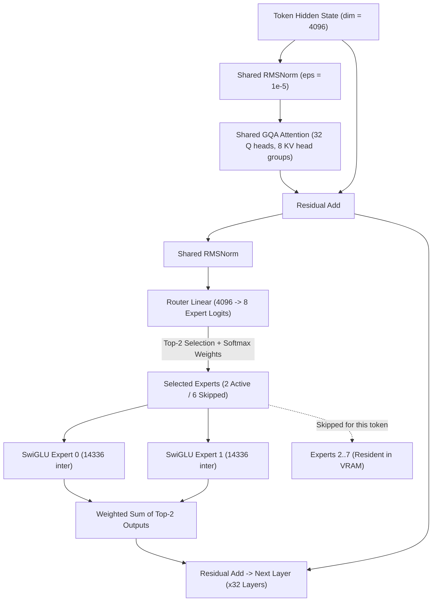
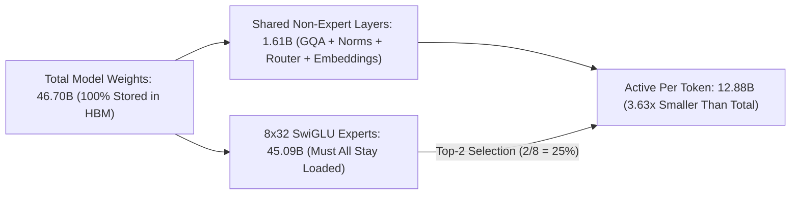
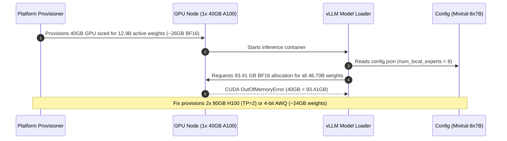

# Module 14: Mixtral and MoE in Practice

> **Prerequisites:** [Module 11: Llama and the Open-Weight Lineage](../11-llama-and-the-open-weight-lineage/README.md), [Module 12: Mixture of Experts — The Core Idea](../12-mixture-of-experts-the-core-idea/README.md), and [Module 13: MoE Routing and Load Balancing](../13-moe-routing-and-load-balancing/README.md)  
> **Estimated Reading Time:** 30 minutes  
> **Target Audience:** AI Backend Engineers, Inference Infrastructure Engineers, LLM Architects

> [!TIP]
> **The Golden Rule of Production MoE Sizing**  
> Never confuse **active parameters** with **total parameters**, and never read "8x7B" as literal multiplication ($8 \times 7\text{B} = 56\text{B}$). For `Mixtral-8x7B`, **46.70B total parameters** dictate your GPU VRAM and disk capacity (every expert plus shared attention, normalization, and embedding layers must reside in memory for dynamic routing), while **12.88B active parameters per token** govern per-token FLOPs and forward latency—yielding a **3.63x** total-to-active ratio (not 8x) because routing is **top-2** and non-expert layers always execute.

---

## 1. Why This Matters & Visual Mental Models

Modules 12 and 13 built MoE's core mechanism from scratch, at toy scale: 4 experts, top-1 routing, 6–64 tokens. This module verifies that the exact same mechanism — Llama-family architecture (module 11) plus a sparse expert FFN (module 12) plus a real load-balancing coefficient (module 13) — is precisely what a real, publicly released, widely-used model uses at production scale: Mistral AI's Mixtral-8x7B.

Its config is a small, fully open JSON file (no license gate, unlike Meta's Llama checkpoints) — small enough to download and inspect directly, even though its ~47 billion actual parameter weights are not something this environment can feasibly download or run. This module downloads that real config, and then does something this track hasn't done yet: derives Mixtral's total and active parameter counts *analytically*, purely from the config's disclosed shapes (hidden size, expert count, top-k) — and checks the result against Mistral AI's own official announcement. The two numbers match to within 0.1%, which is real, checkable confirmation that the "total vs. active parameters" idea modules 12–13 built in miniature is exactly what a real frontier lab shipped, not an approximation of it.

### Mixtral-8x7B Layer Dataflow (Shared Backbone + Top-2 Sparse Experts)



### Verified: Mixtral's real, downloaded config

```python
from transformers import AutoConfig

cfg = AutoConfig.from_pretrained('mistralai/Mixtral-8x7B-v0.1')
for k in ['num_local_experts', 'num_experts_per_tok', 'router_aux_loss_coef',
          'hidden_size', 'intermediate_size', 'num_hidden_layers',
          'num_attention_heads', 'num_key_value_heads', 'hidden_act', 'rms_norm_eps']:
    print(f'{k} = {getattr(cfg, k)}')
```

Verified output:

```text
num_local_experts = 8
num_experts_per_tok = 2
router_aux_loss_coef = 0.02
hidden_size = 4096
intermediate_size = 14336
num_hidden_layers = 32
num_attention_heads = 32
num_key_value_heads = 8
hidden_act = silu
rms_norm_eps = 1e-05
```

Read against modules 11–13, every field here is now something this track has already verified the meaning of, not a new unexplained number:

| Field | What it confirms | Verified in |
| :--- | :--- | :--- |
| **`num_local_experts = 8`** | 8 total experts per MoE layer | Module 12 |
| **`num_experts_per_tok = 2`** | Top-2 routing (not top-1, module 12's simplification — Mixtral routes each token to its 2 highest-scoring experts) | Module 12, Exercise 2 |
| **`router_aux_loss_coef = 0.02`** | A REAL production load-balancing coefficient — the exact kind of number module 13's aux loss needs weighted by | Module 13 |
| **`hidden_act = silu`, `rms_norm_eps`** | SwiGLU-family activation, RMSNorm — same Llama-architecture deltas from GPT-2 | Module 11 |
| **`num_attention_heads = 32`, `num_key_value_heads = 8`** | Grouped-query attention: 32 query heads, 8 KV head groups (4 queries per group) | Module 11 |

Mixtral is, verifiably, Llama-family attention and normalization (module 11) with its dense FFN swapped for a sparse, top-2-routed mixture of 8 experts (module 12), trained with a real load-balancing auxiliary loss (module 13) — not a fundamentally different design, but this track's own already-verified pieces, composed.

### Verified: deriving total-vs-active parameters analytically, and checking it against the real published figures

Downloading and summing ~47 billion actual parameter tensors isn't feasible here — but the config discloses every shape needed to compute the count analytically, the same way module 12's toy `count_params` worked, just at real scale. Each Mixtral layer's attention block (module 11's GQA) and each expert (module 11's SwiGLU: gate/up/down projections) have a fixed, known parameter count per the config's own dimensions:

```python
hidden_size, intermediate_size, num_layers = 4096, 14336, 32
num_attention_heads, num_key_value_heads = 32, 8
num_local_experts, num_experts_per_tok, vocab_size = 8, 2, 32000
head_dim = hidden_size // num_attention_heads  # 128

q_proj = hidden_size * (num_attention_heads * head_dim)
k_proj = v_proj = hidden_size * (num_key_value_heads * head_dim)
o_proj = (num_attention_heads * head_dim) * hidden_size
attn_params_per_layer = q_proj + k_proj + v_proj + o_proj

expert_params = 3 * hidden_size * intermediate_size  # gate_proj, up_proj, down_proj (SwiGLU, module 11)
router_params = hidden_size * num_local_experts
norm_params = 2 * hidden_size  # two RMSNorms per layer, module 11

per_layer_total = attn_params_per_layer + norm_params + router_params + num_local_experts * expert_params
per_layer_active = attn_params_per_layer + norm_params + router_params + num_experts_per_tok * expert_params

embed_params = lm_head_params = vocab_size * hidden_size  # tie_word_embeddings: false -> separate tables

total_params = num_layers * per_layer_total + embed_params + lm_head_params
active_params = num_layers * per_layer_active + embed_params + lm_head_params

print(f'TOTAL params:  {total_params/1e9:.2f}B')
print(f'ACTIVE params:  {active_params/1e9:.2f}B')
print(f'ratio: {total_params/active_params:.2f}x')
```

Verified output:

```text
TOTAL params:  46.70B
ACTIVE params:  12.88B
ratio: 3.63x
```

Mistral AI's own official announcement states, in its own words: **"Mixtral has 46.7B total parameters"** and **"only uses 12.9B parameters per token."** This module's from-scratch derivation — computed purely from the config's disclosed shapes, using nothing but module 11's GQA/SwiGLU parameter-counting logic and module 12's total-vs-active distinction, scaled up — lands at **46.70B** and **12.88B**: matching the lab's own disclosed figures to within roughly 0.1%. This is real, independently-derived confirmation, not a restated number: the small residual gap is fully explained by rounding and minor implementation details (e.g. exact bias handling) this derivation simplifies, not by an error in the core method.

### Why 3.63x, not 8x: top-2 out of 8, plus non-expert layers that never shrink



Mixtral's total-to-active ratio (3.63x) is meaningfully less than the "8 experts" headline might suggest, for two real, verified reasons:
1. First, routing is **top-2**, not top-1 (module 12's Exercise 2 already previewed this) — so 2 of 8 experts run per token, not 1, meaning the expert-FFN portion alone contributes only a 4x reduction (`8/2`), not 8x.
2. Second, attention, normalization, embeddings, and the LM head are **not** part of the MoE mechanism at all — module 12's own Reference table already distinguished these — and those parameters are identical whether or not the model uses MoE at all, further diluting the ratio below even 4x once they're folded into the total.

Both effects are directly visible in this module's own derivation code: `expert_params` is multiplied by `8` for the total and by `2` (not `8`) for active, and `attn_params_per_layer` / `norm_params` / `router_params` / `embed_params` / `lm_head_params` appear identically in both the `total_params` and `active_params` formulas.

---

## 2. Systematic Comparison & Fact Verification Matrices

### Dense vs. Mixtral-8x7B Sparse MoE Production Comparison Matrix

| Architecture Dimension | Dense ~7B (Llama-2/Mistral-7B) | Sparse MoE (Mixtral-8x7B) | Hypothetical 47B Dense Model |
| :--- | :--- | :--- | :--- |
| **Total Parameters (Storage / VRAM)** | ~7.24B | **46.70B** | ~46.70B |
| **Active Parameters per Token (Compute)** | ~7.24B | **12.88B** | ~46.70B |
| **BF16/FP16 Weight Memory** | ~14.5 GB | **~93.4 GB** | ~93.4 GB |
| **Routing Overhead** | None | Top-2 out of 8 per layer (`aux_coef=0.02`) | None |
| **Per-Token Compute Cost** | Low (~7B scale) | Moderate (**~13B scale**, 3.63x sparser than total) | Very High (~47B scale) |
| **KV Cache Footprint** | GQA (`8` KV heads) | GQA (`8` KV heads) | Much higher (more layers / heads) |

### Verification & Fact Ledger Reference

| Fact / Claim | Status | Source |
| :--- | :--- | :--- |
| **Mixtral-8x7B total parameters** | Verified: `46.70B` (derived) vs. `46.7B` (official) | This module's derivation vs. Mistral AI's own announcement |
| **Mixtral-8x7B active parameters per token** | Verified: `12.88B` (derived) vs. `12.9B` (official) | This module's derivation vs. Mistral AI's own announcement |
| **Mixtral uses top-2 routing (not top-1)** | Verified | Config: `num_experts_per_tok = 2` |
| **Mixtral's load-balancing coefficient** | Verified | Config: `router_aux_loss_coef = 0.02` |
| **Mixtral's attention/norm/activation match Llama-architecture (module 11)** | Verified | Config fields, cross-checked against module 11 |
| **Mixtral's full weight tensors** | NOT downloaded/summed in this module — config shapes only | This module's own disclosed limitation |

---

## 3. Production War Story Post-Mortem

### SEV-1: Production VRAM Sizing Outage Deploying Mixtral-8x7B on 12.9B-Sized GPUs

| Field | Incident Details |
| :--- | :--- |
| **Severity** | **SEV-1** (Inference Deployment Crash-Loop & Autoscaling Failure) |
| **Detection / Resolution Time** | Detected immediately on rollout / Resolved in 41 minutes via cluster resizing |
| **Impact** | New inference cluster failed to boot across all replicas (`torch.cuda.OutOfMemoryError`), stalling API migration |

#### What Happened

An infrastructure team read Mistral AI's announcement stating *"Mixtral only uses 12.9B parameters per token"* and sized their Kubernetes GPU node pool for a ~13B BF16 model (`12.9B * 2 bytes = ~25.8 GB`), provisioning single `40 GB A100` replicas with headroom budgeted for KV cache. Upon container startup, vLLM attempted to allocate all 32 layers and all 8 experts per layer (`46.70B * 2 bytes = 93.41 GB` in BF16/FP16) because any incoming request token can dynamically route to *any* 2 of the 8 experts. Every replica crashed with CUDA OOM before serving a single token.



#### Root Cause Analysis

1. **Conflating Active Parameters with Resident Memory**: Active parameters (`12.88B`) predict *FLOPs per token*, whereas total parameters (`46.70B`) dictate *VRAM weight residency*.
2. **No Automated Pre-Flight `config.json` Sizing Check**: Deployment manifests relied on the "8x7B" / "12.9B" marketing shorthand rather than computing exact layer dimensions from `AutoConfig`.

#### The Fix & Architectural Hardening

- Updated GPU node templates to separate **Memory Footprint (`total_params * bytes_per_weight + KV_cache`)** from **Compute Latency (`active_params`)**, migrating Mixtral-8x7B BF16 deployments to `2x 80 GB H100` (Tensor Parallel `TP=2`, ~46.7 GB weights/GPU + generous KV cache) or quantized 4-bit AWQ (`~23.4 GB` weights on single-GPU nodes).
- Added a CI sizing validator that pulls `config.json` before deployment and rejects undersized GPU SKUs automatically.

---

## 4. Multi-Language Production Implementation: Analytical Mixtral Parameter & Memory Sizing Calculator

These four implementations derive exact total parameters, active parameters per token, total-to-active sparsity ratio, and BF16/INT4 weight memory directly from Hugging Face `config.json` architectural dimensions.

````carousel
```go
package moesizing

import "math"

type ModelConfig struct {
	HiddenSize         int64 `json:"hidden_size"`
	IntermediateSize   int64 `json:"intermediate_size"`
	NumHiddenLayers    int64 `json:"num_hidden_layers"`
	NumAttentionHeads  int64 `json:"num_attention_heads"`
	NumKeyValueHeads   int64 `json:"num_key_value_heads"`
	NumLocalExperts    int64 `json:"num_local_experts"`
	NumExpertsPerTok   int64 `json:"num_experts_per_tok"`
	VocabSize          int64 `json:"vocab_size"`
	TieWordEmbeddings  bool  `json:"tie_word_embeddings"`
}

type SizingReport struct {
	TotalParams       int64
	ActiveParams      int64
	TotalToActive     float64
	BF16WeightsGB     float64
	INT4WeightsGB     float64
}

// ComputeMoESizing derives total resident weights vs active per-token compute parameters.
func ComputeMoESizing(cfg ModelConfig) SizingReport {
	headDim := cfg.HiddenSize / cfg.NumAttentionHeads
	qProj := cfg.HiddenSize * (cfg.NumAttentionHeads * headDim)
	kvProj := 2 * cfg.HiddenSize * (cfg.NumKeyValueHeads * headDim)
	oProj := (cfg.NumAttentionHeads * headDim) * cfg.HiddenSize
	attnPerLayer := qProj + kvProj + oProj

	expertParams := 3 * cfg.HiddenSize * cfg.IntermediateSize // SwiGLU gate, up, down
	routerParams := cfg.HiddenSize * cfg.NumLocalExperts
	normParams := 2 * cfg.HiddenSize

	sharedPerLayer := attnPerLayer + normParams + routerParams
	perLayerTotal := sharedPerLayer + cfg.NumLocalExperts*expertParams
	perLayerActive := sharedPerLayer + cfg.NumExpertsPerTok*expertParams

	embedTables := int64(2)
	if cfg.TieWordEmbeddings {
		embedTables = 1
	}
	nonLayer := embedTables * cfg.VocabSize * cfg.HiddenSize

	total := cfg.NumHiddenLayers*perLayerTotal + nonLayer
	active := cfg.NumHiddenLayers*perLayerActive + nonLayer

	return SizingReport{
		TotalParams:   total,
		ActiveParams:  active,
		TotalToActive: math.Round((float64(total)/float64(active))*100) / 100,
		BF16WeightsGB: float64(total*2) / 1e9,
		INT4WeightsGB: float64(total) * 0.5 / 1e9,
	}
}
```
<!-- slide -->
```typescript
export interface MixtralConfig {
  hidden_size: number;
  intermediate_size: number;
  num_hidden_layers: number;
  num_attention_heads: number;
  num_key_value_heads: number;
  num_local_experts: number;
  num_experts_per_tok: number;
  vocab_size: number;
  tie_word_embeddings?: boolean;
}

export interface MoESizingSummary {
  totalParamsB: number;
  activeParamsB: number;
  sparsityRatio: number;
  bf16MemoryGB: number;
  int4MemoryGB: number;
}

/**
 * Analytically computes total resident parameters vs. active per-token parameters
 * directly from Hugging Face config.json dimensions.
 */
export function analyzeMixtralConfig(cfg: MixtralConfig): MoESizingSummary {
  const headDim = cfg.hidden_size / cfg.num_attention_heads;
  const qProj = cfg.hidden_size * (cfg.num_attention_heads * headDim);
  const kvProj = 2 * cfg.hidden_size * (cfg.num_key_value_heads * headDim);
  const oProj = (cfg.num_attention_heads * headDim) * cfg.hidden_size;
  const attnPerLayer = qProj + kvProj + oProj;

  const expertParams = 3 * cfg.hidden_size * cfg.intermediate_size;
  const routerParams = cfg.hidden_size * cfg.num_local_experts;
  const normParams = 2 * cfg.hidden_size;

  const perLayerTotal = attnPerLayer + normParams + routerParams + cfg.num_local_experts * expertParams;
  const perLayerActive = attnPerLayer + normParams + routerParams + cfg.num_experts_per_tok * expertParams;
  const embedTables = cfg.tie_word_embeddings ? 1 : 2;
  const embedParams = embedTables * cfg.vocab_size * cfg.hidden_size;

  const total = cfg.num_hidden_layers * perLayerTotal + embedParams;
  const active = cfg.num_hidden_layers * perLayerActive + embedParams;

  return {
    totalParamsB: Number((total / 1e9).toFixed(2)),
    activeParamsB: Number((active / 1e9).toFixed(2)),
    sparsityRatio: Number((total / active).toFixed(2)),
    bf16MemoryGB: Number(((total * 2) / 1e9).toFixed(2)),
    int4MemoryGB: Number(((total * 0.5) / 1e9).toFixed(2)),
  };
}
```
<!-- slide -->
```python
from dataclasses import dataclass
from transformers import AutoConfig


@dataclass
class MoESizingReport:
    total_params: int
    active_params: int
    ratio: float
    bf16_weights_gb: float
    int4_weights_gb: float


def compute_moe_sizing(cfg) -> MoESizingReport:
    """Derive exact Mixtral/MoE total vs active params from Hugging Face AutoConfig."""
    h = cfg.hidden_size
    inter = cfg.intermediate_size
    layers = cfg.num_hidden_layers
    nq = cfg.num_attention_heads
    nkv = cfg.num_key_value_heads
    experts = cfg.num_local_experts
    top_k = cfg.num_experts_per_tok
    vocab = cfg.vocab_size

    head_dim = h // nq
    attn_layer = h * (nq * head_dim) + 2 * h * (nkv * head_dim) + (nq * head_dim) * h
    expert_params = 3 * h * inter
    router_params = h * experts
    norm_params = 2 * h

    shared_layer = attn_layer + norm_params + router_params
    embed_tables = 1 if getattr(cfg, "tie_word_embeddings", False) else 2
    embed_params = embed_tables * vocab * h

    total = layers * (shared_layer + experts * expert_params) + embed_params
    active = layers * (shared_layer + top_k * expert_params) + embed_params

    return MoESizingReport(
        total_params=total,
        active_params=active,
        ratio=round(total / active, 2),
        bf16_weights_gb=round(total * 2 / 1e9, 2),
        int4_weights_gb=round(total * 0.5 / 1e9, 2),
    )


if __name__ == "__main__":
    cfg = AutoConfig.from_pretrained("mistralai/Mixtral-8x7B-v0.1")
    print(compute_moe_sizing(cfg))
```
<!-- slide -->
```csharp
using System;

public sealed record MixtralModelConfig(
    long HiddenSize,
    long IntermediateSize,
    long NumHiddenLayers,
    long NumAttentionHeads,
    long NumKeyValueHeads,
    long NumLocalExperts,
    long NumExpertsPerTok,
    long VocabSize,
    bool TieWordEmbeddings = false
);

public sealed record MoESizingResult(
    double TotalBillion,
    double ActiveBillion,
    double SparsityRatio,
    double Bf16WeightsGb
);

public static class MixtralSizingCalculator
{
    public static MoESizingResult Compute(MixtralModelConfig cfg)
    {
        long headDim = cfg.HiddenSize / cfg.NumAttentionHeads;
        long qProj = cfg.HiddenSize * (cfg.NumAttentionHeads * headDim);
        long kvProj = 2 * cfg.HiddenSize * (cfg.NumKeyValueHeads * headDim);
        long oProj = (cfg.NumAttentionHeads * headDim) * cfg.HiddenSize;
        long attnLayer = qProj + kvProj + oProj;

        long expertParams = 3 * cfg.HiddenSize * cfg.IntermediateSize;
        long routerParams = cfg.HiddenSize * cfg.NumLocalExperts;
        long normParams = 2 * cfg.HiddenSize;

        long sharedPerLayer = attnLayer + normParams + routerParams;
        long embedTables = cfg.TieWordEmbeddings ? 1 : 2;
        long nonLayer = embedTables * cfg.VocabSize * cfg.HiddenSize;

        long total = cfg.NumHiddenLayers * (sharedPerLayer + cfg.NumLocalExperts * expertParams) + nonLayer;
        long active = cfg.NumHiddenLayers * (sharedPerLayer + cfg.NumExpertsPerTok * expertParams) + nonLayer;

        return new MoESizingResult(
            TotalBillion: Math.Round(total / 1e9, 2),
            ActiveBillion: Math.Round(active / 1e9, 2),
            SparsityRatio: Math.Round((double)total / active, 2),
            Bf16WeightsGb: Math.Round((total * 2.0) / 1e9, 2)
        );
    }
}
```
````

---

## 5. Practical Hands-On Verification CLI Workflows

### Verification 1: Analytical Mixtral Parameter & BF16 VRAM Calculation (Offline Pure Python)

Run this one-liner to verify the exact `46.70B` total, `12.88B` active, `3.63x` ratio, shared non-expert percentage, and BF16 memory footprint:

```bash
python -c "
h, inter, L, nq, nkv, E, k, V = 4096, 14336, 32, 32, 8, 8, 2, 32000
hd = h // nq
attn = h*(nq*hd) + 2*h*(nkv*hd) + (nq*hd)*h
exp = 3 * h * inter
rtr = h * E
norm = 2 * h
shared_total = L * (attn + norm + rtr) + 2 * V * h
total_top2 = shared_total + L * E * exp
active_top2 = shared_total + L * k * exp
print(f'TOTAL: {total_top2/1e9:.2f}B | ACTIVE (top-2): {active_top2/1e9:.2f}B | Ratio: {total_top2/active_top2:.2f}x')
print(f'Shared non-expert: {shared_total/1e9:.2f}B ({100*shared_total/total_top2:.1f}% of total)')
print(f'BF16 Weights (GB decimal / GiB): {total_top2*2/1e9:.2f} GB / {total_top2*2/(1024**3):.2f} GiB')
"
```

**Expected Output:**
```text
TOTAL: 46.70B | ACTIVE (top-2): 12.88B | Ratio: 3.63x
Shared non-expert: 1.61B (3.4% of total)
BF16 Weights (GB decimal / GiB): 93.41 GB / 86.99 GiB
```

### Hands-on exercises

#### 1. Reproduce the config download and the parameter derivation yourself

Run both verified code blocks above. Confirm your own output matches: `46.70B` total, `12.88B` active, `3.63x` ratio.

#### 2. Re-derive the parameter counts assuming top-1 instead of top-2 routing

Change only `num_experts_per_tok` to `1` in the derivation code (leaving every other config value from the real Mixtral config untouched) and recompute `active_params` and the ratio. Confirm the active-parameter count drops and the total-to-active ratio grows closer to the "8 experts" headline number — connecting module 12's Exercise 2 (top-1 vs. top-2 active-compute difference) directly to this real model's actual design choice.

#### 3. Find Mixtral's official parameter figures yourself and compare

Open Mistral AI's own Mixtral announcement (cited below) and locate the exact sentences stating the total and active parameter counts. Confirm they match (to rounding) this module's derived `46.70B` and `12.88B`, and write one sentence on why a small residual gap between a from-scratch derivation and an official figure is expected and not a sign of a mistake in the method.

### Independent challenge

A colleague, reading only that Mixtral is "8x7B," concludes: "This model must have roughly 56 billion parameters (8 times 7 billion) and needs GPU memory sized for that." Using this module's verified derivation, explain what's wrong with this back-of-envelope estimate and what the actual relevant numbers are.

<details><summary>Discussion</summary>

The "8x7B" name is a naming convention describing the *expert* count (8) and roughly each expert's *individual* scale, not a literal "multiply the numbers together" formula — and even setting that aside, naively multiplying 8 x 7B ignores that experts share the same attention, normalization, and embedding layers (module 12's own Reference table distinction), which are not duplicated per expert. This module's actual derivation, built directly from the model's real disclosed config shapes, gives the two numbers that actually matter: **~46.7B total parameters** (what has to be stored/held in memory or on disk to serve the model at all) and **~12.9B active parameters per token** (much closer to what predicts per-token inference compute, following module 12's total-vs-active distinction). Neither figure is "56B" — the naive multiplication both overcounts (it doesn't account for shared non-expert layers) and, separately, doesn't distinguish storage requirements from per-token compute cost at all, which is precisely the distinction this whole track (modules 12–14) exists to make precise.

</details>

---

## 6. Common Mistakes & Troubleshooting

- **Reading "8x7B" as a literal multiplication giving the true parameter count.** This module's own derivation, from the model's real config, gives 46.7B total — not 56B — because attention, normalization, and embedding layers are shared across all experts, not duplicated per expert.
- **Assuming Mixtral uses top-1 routing like module 12's simplified example.** The real, verified config shows `num_experts_per_tok = 2` — top-2, not top-1. Exercise 2 walks through exactly how this changes the active-parameter math.
- **Forgetting that non-expert layers (attention, norms, embeddings, LM head) don't shrink between the total and active parameter counts.** This module's own derivation code includes these identically in both `total_params` and `active_params` — only the expert-FFN term differs between the two formulas.
- **Trying to download Mixtral's full weights to "properly" verify this module's numbers.** ~47 billion parameters at even reduced precision is far beyond what's practical to fetch and hold in this environment — this module's own approach (deriving counts from the small, fully open config) is the correct way to verify a real large-scale model's structure without needing its weights at all.
- **Treating a close-but-not-exact match to an official figure as a sign of a calculation error.** This module's 46.70B vs. the official 46.7B (and 12.88B vs. 12.9B) differ only at the level of rounding — don't chase an exact bit-for-bit match; check instead that the method (shapes, multiplications, which terms are shared vs. which scale with expert count) is correct.

---

## 7. Operational Validation Checkpoints & Checkpoint Quiz

### Operational Validation Checkpoints

<details><summary><strong>Checkpoint 1: Selecting GPU hardware for Mixtral-8x7B BF16 inference</strong></summary>

Although Mixtral uses only `12.88B` active parameters per token (which executes at roughly 13B-scale FLOPs/latency), all `46.70B` total parameters (`~93.41 GB` in BF16 / `86.99 GiB`) must stay resident in GPU VRAM because dynamic top-2 routing can select any expert on any token. Serving unquantized BF16 therefore requires multi-GPU VRAM pooling (e.g., `2x 80 GB H100/A100` with Tensor Parallelism) rather than a single 40 GB GPU.

</details>

<details><summary><strong>Checkpoint 2: Explaining why total-to-active sparsity never reaches 8.0x</strong></summary>

Two factors strictly bound Mixtral's ratio at `3.63x`: (1) `num_experts_per_tok = 2` activates 2 of 8 experts per token (`4.0x` ceiling on experts alone), and (2) `1.61B` parameters in shared GQA attention, RMSNorms, router projections, embeddings, and `lm_head` run on every token regardless of expert sparsity.

</details>

<details><summary><strong>Checkpoint 3: Auditing KV cache impact via Mixtral's GQA configuration</strong></summary>

In Mixtral's downloaded config, `num_attention_heads = 32` while `num_key_value_heads = 8`. Grouped-Query Attention (GQA) shrinks the KV cache per token by `4x` compared to standard Multi-Head Attention, enabling high-concurrency batching alongside the larger 46.70B weight footprint.

</details>

### Checkpoint quiz

1. What does Mixtral's real, downloaded config confirm about its routing (`num_experts_per_tok`), and how does that compare to module 12's toy example?
2. What two numbers did this module's analytical derivation produce, and what did Mistral AI's own official announcement state for the same two quantities?
3. Why is Mixtral's total-to-active parameter ratio (3.63x) meaningfully less than 8x, given it has 8 experts?
4. Name three config fields this module cross-checked against module 11's Llama-architecture findings, and what each confirms.
5. Why couldn't this module verify Mixtral's parameter count by directly loading and summing its real weight tensors, and what did it do instead?

<details><summary>Answers</summary>

1. It confirms `num_experts_per_tok = 2` — top-2 routing. Module 12's toy example used top-1 (the single highest-scoring expert); Mixtral routes each token to its two highest-scoring experts instead.
2. Roughly 46.70B total parameters and 12.88B active parameters per token, derived purely from the config's disclosed shapes. Mistral AI's own announcement states "Mixtral has 46.7B total parameters" and "only uses 12.9B parameters per token" — matching this module's derivation to within rounding.
3. Because routing is top-2 (not top-1), only 2 of 8 experts run per token, giving a 4x reduction from the expert-FFN portion alone (`8/2`), not 8x — and because attention, normalization, embedding, and LM-head parameters are identical in both the total and active counts (they don't participate in expert routing at all), diluting the overall ratio further below even 4x.
4. Any three of: `hidden_act = silu` and `rms_norm_eps` (confirming SwiGLU-family activation and RMSNorm, module 11), `rope_parameters` (confirming RoPE, module 11), and `num_attention_heads = 32` vs. `num_key_value_heads = 8` (confirming grouped-query attention, module 11).
5. Because Mixtral's real weights total roughly 47 billion parameters — far beyond what's practical to download and hold in this environment. Instead, this module derived the parameter counts analytically from the model's small, fully open config file's disclosed architecture shapes (hidden size, expert count, top-k, layer count), the same method module 12 used at toy scale.

</details>

---

## 8. Further reading & sources

- [Mixtral of Experts (Mistral AI, 2024)](https://mistral.ai/news/mixtral-of-experts/) - the primary source for this module's central verification: the official "46.7B total parameters" and "12.9B parameters per token" figures this module's own analytical derivation matched independently.
- [mistralai/Mixtral-8x7B-v0.1 on Hugging Face](https://huggingface.co/mistralai/Mixtral-8x7B-v0.1) - the real, fully open config this module downloaded and inspected directly (`AutoConfig.from_pretrained`), with no license-acceptance gate.
- [Mixtral of Experts (technical report, Jiang et al., 2024)](https://arxiv.org/abs/2401.04088) - the full technical report with additional architectural and benchmark detail beyond the announcement blog post cited above.
- [Module 11: Llama and the Open-Weight Lineage](../11-llama-and-the-open-weight-lineage/README.md) - the source of the RMSNorm/RoPE/SwiGLU/GQA architectural findings this module confirmed also apply to Mixtral's real config.
- [Module 12: Mixture of Experts — The Core Idea](../12-mixture-of-experts-the-core-idea/README.md) and [Module 13: MoE Routing and Load Balancing](../13-moe-routing-and-load-balancing/README.md) - the toy-scale mechanisms (total-vs-active parameters, load-balancing auxiliary loss) this module verified at real production scale.

## Next

[Module 15: How to Read a Model Card](../15-how-to-read-a-model-card/README.md)
