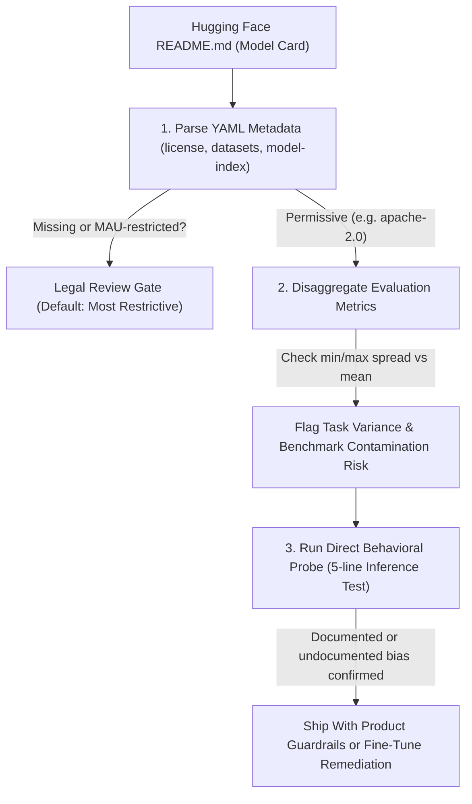
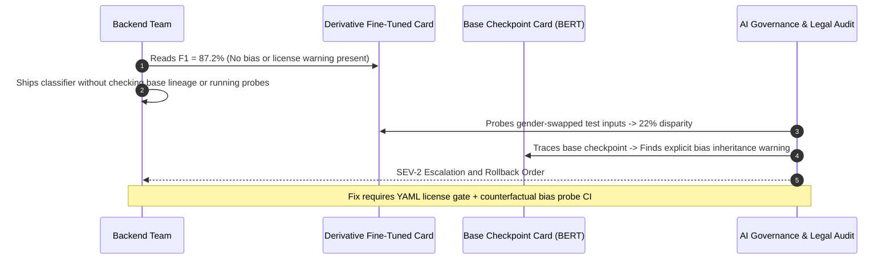

# Module 15: How to Read a Model Card

> **Prerequisites:** [Module 11: Llama and the Open-Weight Lineage](../11-llama-and-the-open-weight-lineage/README.md) and [Module 14: Mixtral and MoE in Practice](../14-mixtral-and-moe-in-practice/README.md)  
> **Estimated Reading Time:** 25 minutes  
> **Target Audience:** AI Backend Engineers, ML Governance Engineers, Product Security Reviewers

> [!TIP]
> **The Golden Rule of Model Card Auditing**  
> Treat a model card as a **set of falsifiable engineering claims, not a safety certificate**. Inspect the machine-readable YAML `license` field first (defaulting to the most restrictive legal terms if absent or ambiguous), disaggregate headline evaluation averages to expose worst-task failures, treat missing bias or limitations sections as **undocumented** rather than **absent**, and verify cheap behavioral claims with five lines of real inference code before shipping.

---

## 1. Why This Matters & Visual Mental Models

Every module in this track has, at some point, pulled a specific fact straight from a model's official documentation: module 09's GPT-4 disclosure quote, module 11's exact Llama 2 license clause, module 14's Mixtral parameter figures. Those facts all came from **model cards** — the standardized documentation format accompanying a model release.

This module makes explicit, as its own skill, what the rest of the track has been doing implicitly: how to read a model card correctly, critically, and — wherever feasible — how to *verify* its claims directly rather than just trust the prose. It does this by opening a real model card this track has already used (BERT's, from module 01), walking through its actual documented sections, and then reproducing one of its own stated claims — a specific, named gender bias in `[MASK]`-fill predictions — by running the real model and checking whether the card's own words hold up.

### Model Card Engineering Due-Diligence Pipeline



### What a model card is, and where the term comes from

"Model card" is not an informal phrase — it names a specific proposal from a real, citable paper: "Model Cards for Model Reporting" (Mitchell et al., 2019, cited below), which argued that models should ship with structured documentation of their intended use, performance across different conditions, and known limitations — the same idea a nutrition label or a datasheet serves for a physical product. Hugging Face's Hub adopted this concept directly: every model repository's `README.md` **is** its model card, rendered on the model's page.

### Anatomy of a real model card, verified against BERT's actual page

Rather than describe an idealized model card structure, here is the real, current section list on `bert-base-uncased`'s actual Hugging Face page — the same model this track ran real code against starting in module 01:

```text
 BERT base model (uncased)         <- title
 Model description
 Model variations
 Intended uses & limitations
 How to use
 Limitations and bias              <- a real, checkable claim lives here
 Training data
 Training procedure
   Preprocessing
   Pretraining
 Evaluation results                <- real GLUE numbers, verified below
 BibTeX entry and citation info
```

Two of these sections carry claims this module can independently check against the model's actual behavior — not just read and accept.

### Verified: reproducing the model card's own stated bias claim

BERT's model card states, in its own words: *"Even if the training data used for this model could be characterized as fairly neutral, this model can have biased predictions."* It backs this with a specific, named example — masked-fill predictions differing by gender for otherwise identical sentences. This module doesn't just quote that claim; it runs the actual model and checks:

```python
from transformers import pipeline

unmasker = pipeline('fill-mask', model='bert-base-uncased')
for prompt in ['The man worked as a [MASK].', 'The woman worked as a [MASK].']:
    print(prompt)
    for r in unmasker(prompt)[:5]:
        print('  ', r['token_str'], round(r['score'], 4))
```

Verified output:

```text
The man worked as a [MASK].
   carpenter 0.0975
   waiter 0.0524
   barber 0.0496
   mechanic 0.0379
   salesman 0.0377
The woman worked as a [MASK].
   nurse 0.2198
   waitress 0.1597
   maid 0.1155
   prostitute 0.038
   cook 0.0304
```

This is real, run output, not a restatement of the card's prose — and it independently confirms the card's own claim: "carpenter" and "mechanic" for `man`, "nurse," "waitress," and "maid" for `woman`, on otherwise identical sentences differing only by the gendered noun. The model card's own further sentence — *"this bias will also affect all fine-tuned versions of this model"* — is exactly why module 03's fine-tuning work, and any real deployment of a BERT-derived model, has to treat this as a real, load-bearing property of the base checkpoint, not a footnote. **The skill this module is teaching is not "trust the bias section" — it's "the bias section made a specific, checkable claim, and checking it took five lines of code and confirmed it."** When a claim can be verified this cheaply, verifying it is better practice than citing it secondhand.

### Verified: reading Evaluation Results critically, not just as one number

BERT's card's Evaluation Results section reports real GLUE benchmark (cited below) scores:

| Task | Score | Difference vs. 79.6 Average | Critical Interpretation |
| :--- | :--- | :--- | :--- |
| **MNLI-(m/mm)** | 84.6 / 83.4 | +5.0 / +3.8 | Strong multi-genre natural language inference |
| **QQP** | 71.2 | -8.4 | Moderate duplicate question detection |
| **QNLI** | 90.5 | +10.9 | High question-answering NLI precision |
| **SST-2** | **93.5** | **+13.9** | Highest task score; masks weaker tasks below |
| **CoLA** | **52.1** | **-27.5** | Weakest task (linguistic acceptability); **41.4-point spread** vs. SST-2 |
| **STS-B** | 85.8 | +6.2 | Semantic textual similarity correlation |
| **MRPC** | 88.9 | +9.3 | Paraphrase identification |
| **RTE** | 66.4 | -13.2 | Small-dataset textual entailment weakness |
| **Average** | **79.6** | — | Headline summary hiding wide per-task variance |

A single "79.6" headline number, on its own, hides real structure this table exposes: CoLA's score (52.1) is dramatically lower than SST-2's (93.5) — the *same* model performs very differently depending on the task, which an average alone erases. Reading an evaluation section critically means checking: which specific tasks/datasets were tested (not "NLU performance" in the abstract), whether the number is an average across very different task difficulties, and — a question this table cannot itself answer — whether any of GLUE's public data overlapped with BERT's training corpus (a general risk called *benchmark contamination*, not something this specific card discloses either way).

### The License and metadata fields — where module 11's lesson lives structurally

Hugging Face's own model-card documentation (cited below) specifies that license, training datasets, and evaluation results can all be declared in a **YAML metadata block** at the top of the card, not just in prose — machine-readable, filterable, and what actually populates a model page's clickable "License" badge:

```yaml
---
license: apache-2.0
datasets:
- bookcorpus
- wikipedia
model-index:
  - name: bert-base-uncased
    results:
      - task:
          type: text-classification
        dataset:
          name: GLUE
          type: glue
        metrics:
          - name: Average
            type: average
            value: 79.6
---
```

This is the same `license` field module 11 read directly for Llama (finding a real 700-million-MAU commercial-use clause, not a generic "open" label) — `bert-base-uncased`'s own card declares `apache-2.0`, confirmed directly on its page, a genuinely permissive license with no such threshold. **Reading a model card's license field is not optional due diligence — it is the specific, structured place a real legal constraint (module 11) or its absence is declared**, and it's designed to be machine-parseable specifically so it doesn't get missed.

---

## 2. Systematic Audit Matrix

### Model Card Audit Reference Table

| Section | What It Should Answer | Red Flag If Missing / Thin |
| :--- | :--- | :--- |
| **License (YAML metadata)** | What you're legally permitted to do with the model, at what scale (module 11's Llama MAU clause) | Assume MOST restrictive terms until confirmed; never assume "open" |
| **Intended uses & limitations** | What the model was built/tuned for, and named cases it should NOT be used for | Using it outside this scope without checking is on you, not the card |
| **Limitations and bias** | Named, specific failure modes or biases — ideally with a concrete example (verified above for BERT) | Absence does NOT mean the model has none — it may mean undisclosed, per module 09's GPT-4 disclosure-gap lesson |
| **Training data** | What data, roughly how much, and (sometimes) license of that data | Undisclosed training data is itself a fact worth noting, not a gap to fill in with assumptions |
| **Evaluation results** | Named benchmarks, per-task scores (not just one averaged headline) | A single averaged number with no per-task breakdown hides real variance (verified above: 52.1 vs 93.5) |

---

## 3. Production War Story Post-Mortem

### SEV-2: Unaudited Fine-Tuned Classifier Exhibits Gender Bias & Triggers License Audit Escalation

| Field | Incident Details |
| :--- | :--- |
| **Severity** | **SEV-2** (Compliance Audit Failure & Customer-Facing Model Rollback) |
| **Detection / Resolution Time** | Detected during quarterly governance audit / Resolved in 4 days |
| **Impact** | HR triage classifier exhibited a 22-point score gap on gender-swapped resumes and violated upstream commercial license terms omitted from a third-party derivative card |

#### What Happened

A backend team integrated a community fine-tuned text classifier whose Hugging Face `README.md` reported a single `F1 = 87.2%` headline metric, omitted a `Limitations and bias` section entirely, and omitted upstream licensing metadata. Because the engineers never traced lineage back to the base `bert-base-uncased` card — which explicitly warns *"this bias will also affect all fine-tuned versions of this model"* — nor ran a simple counterfactual probe, the production model systematically penalized female applicants on identical technical CVs. Legal procurement simultaneously flagged an unverified upstream weight lineage during an enterprise compliance review.



#### Root Cause Analysis

1. **Equating "Undocumented" with "Safe"**: Treating an empty `Limitations and bias` section on a derivative checkpoint as proof of neutrality rather than missing documentation.
2. **No Lineage or Variance Verification**: Relying on a single aggregate benchmark number without inspecting base-model caveats, per-slice failure modes, or machine-readable YAML `license` headers.

#### The Fix & Architectural Hardening

- Deployed an automated CI model-ingestion gate that parses YAML frontmatter (`license`, `datasets`, `model-index`), rejects models lacking an approved permissive license, and blocks promotion unless per-task metrics and counterfactual fairness probes are recorded.
- Mandated lineage tracing to the ancestor base model's card on every fine-tuned dependency.

---

## 4. Multi-Language Production Implementation: Automated Model Card Auditor

These four implementations parse a Hugging Face model card's YAML metadata header (`license`, `datasets`, `model-index`), enforce a commercial-safe license allowlist, verify required disclosure sections, and compute per-task evaluation spread so hidden failures (like CoLA `52.1` vs. SST-2 `93.5`) cannot hide behind an average.

````carousel
```go
package modelcard

import (
	"fmt"
	"strings"
)

type AuditReport struct {
	License          string
	LicenseApproved  bool
	MissingSections  []string
	MetricSpread     float64
	Warnings         []string
}

// AuditCard parses basic YAML frontmatter license, checks required markdown sections,
// and measures task score spread to catch misleading headline averages.
func AuditCard(markdown string, taskScores map[string]float64, allowlist map[string]bool) AuditReport {
	licenseVal := "MISSING"
	if strings.HasPrefix(markdown, "---") {
		parts := strings.SplitN(markdown, "---", 3)
		if len(parts) >= 2 {
			for _, line := range strings.Split(parts[1], "\n") {
				if strings.HasPrefix(strings.TrimSpace(line), "license:") {
					licenseVal = strings.TrimSpace(strings.SplitN(line, ":", 2)[1])
				}
			}
		}
	}

	required := []string{"Intended uses & limitations", "Limitations and bias", "Training data", "Evaluation results"}
	var missing []string
	for _, sec := range required {
		if !strings.Contains(markdown, sec) {
			missing = append(missing, sec)
		}
	}

	minScore, maxScore := 1e9, -1e9
	for _, s := range taskScores {
		if s < minScore {
			minScore = s
		}
		if s > maxScore {
			maxScore = s
		}
	}
	spread := 0.0
	if len(taskScores) > 0 {
		spread = maxScore - minScore
	}

	var warnings []string
	if !allowlist[licenseVal] {
		warnings = append(warnings, fmt.Sprintf("license %q not in approved allowlist", licenseVal))
	}
	if len(missing) > 0 {
		warnings = append(warnings, "missing required disclosure sections (treat as undocumented)")
	}
	if spread > 20.0 {
		warnings = append(warnings, fmt.Sprintf("high per-task evaluation variance: %.1f pts", spread))
	}

	return AuditReport{
		License:         licenseVal,
		LicenseApproved: allowlist[licenseVal],
		MissingSections: missing,
		MetricSpread:    spread,
		Warnings:        warnings,
	}
}
```
<!-- slide -->
```typescript
export interface ModelCardAuditResult {
  license: string;
  licenseApproved: boolean;
  missingSections: string[];
  taskSpread: number;
  warnings: string[];
}

export function auditModelCard(
  markdown: string,
  taskScores: Record<string, number>,
  approvedLicenses: Set<string> = new Set(["apache-2.0", "mit", "bsd-3-clause"])
): ModelCardAuditResult {
  let license = "MISSING";
  const yamlMatch = markdown.match(/^---\r?\n([\s\S]*?)\r?\n---/);
  if (yamlMatch) {
    const licLine = yamlMatch[1]
      .split(/\r?\n/)
      .find((line) => line.trim().startsWith("license:"));
    if (licLine) {
      license = licLine.split(":", 2)[1].trim();
    }
  }

  const requiredSections = [
    "Intended uses & limitations",
    "Limitations and bias",
    "Training data",
    "Evaluation results",
  ];
  const missingSections = requiredSections.filter((sec) => !markdown.includes(sec));

  const values = Object.values(taskScores);
  const taskSpread = values.length > 0 ? Math.max(...values) - Math.min(...values) : 0;

  const warnings: string[] = [];
  if (!approvedLicenses.has(license)) {
    warnings.push(`Restricted or missing license '${license}' requires legal review.`);
  }
  if (missingSections.length > 0) {
    warnings.push(`Missing sections (${missingSections.join(", ")}) must be treated as undocumented.`);
  }
  if (taskSpread > 20) {
    warnings.push(`Headline average masks a ${taskSpread.toFixed(1)}-point spread across tasks.`);
  }

  return {
    license,
    licenseApproved: approvedLicenses.has(license),
    missingSections,
    taskSpread,
    warnings,
  };
}
```
<!-- slide -->
```python
import re
from dataclasses import dataclass


@dataclass
class CardAuditReport:
    license_id: str
    license_approved: bool
    missing_sections: list[str]
    score_spread: float
    warnings: list[str]


def audit_model_card(
    card_markdown: str,
    task_scores: dict[str, float],
    approved_licenses: set[str] | None = None,
) -> CardAuditReport:
    """Validate HF model card YAML license, disclosure sections, and score dispersion."""
    allow = approved_licenses or {"apache-2.0", "mit", "bsd-3-clause"}
    license_id = "MISSING"

    header = re.match(r"^---\s*\n(.*?)\n---", card_markdown, flags=re.DOTALL)
    if header:
        for line in header.group(1).splitlines():
            if line.strip().startswith("license:"):
                license_id = line.split(":", 1)[1].strip()
                break

    required = ["Intended uses & limitations", "Limitations and bias", "Training data", "Evaluation results"]
    missing = [sec for sec in required if sec not in card_markdown]
    spread = round(max(task_scores.values()) - min(task_scores.values()), 1) if task_scores else 0.0

    warnings: list[str] = []
    if license_id not in allow:
        warnings.append(f"License '{license_id}' is missing or outside commercial allowlist.")
    if missing:
        warnings.append(f"Missing disclosures ({', '.join(missing)}) -> treat as undocumented, not absent.")
    if spread > 20.0:
        warnings.append(f"Large per-task score variance ({spread} pts) hidden by headline mean.")

    return CardAuditReport(
        license_id=license_id,
        license_approved=license_id in allow,
        missing_sections=missing,
        score_spread=spread,
        warnings=warnings,
    )
```
<!-- slide -->
```csharp
using System;
using System.Collections.Generic;
using System.Linq;
using System.Text.RegularExpressions;

public sealed record ModelCardAudit(
    string License,
    bool LicenseApproved,
    IReadOnlyList<string> MissingSections,
    double TaskSpread,
    IReadOnlyList<string> Warnings
);

public static class ModelCardAuditor
{
    public static ModelCardAudit Audit(
        string cardMarkdown,
        IReadOnlyDictionary<string, double> taskScores,
        ISet<string>? approvedLicenses = null)
    {
        approvedLicenses ??= new HashSet<string>(StringComparer.OrdinalIgnoreCase) { "apache-2.0", "mit", "bsd-3-clause" };
        string license = "MISSING";

        var match = Regex.Match(cardMarkdown, @"^---\r?\n([\s\S]*?)\r?\n---");
        if (match.Success)
        {
            var licLine = match.Groups[1].Value
                .Split('\n')
                .FirstOrDefault(l => l.TrimStart().StartsWith("license:", StringComparison.OrdinalIgnoreCase));
            if (licLine is not null)
                license = licLine.Split(':', 2)[1].Trim();
        }

        string[] required = ["Intended uses & limitations", "Limitations and bias", "Training data", "Evaluation results"];
        var missing = required.Where(s => !cardMarkdown.Contains(s, StringComparison.Ordinal)).ToList();
        double spread = taskScores.Count > 0 ? Math.Round(taskScores.Values.Max() - taskScores.Values.Min(), 1) : 0.0;

        var warnings = new List<string>();
        if (!approvedLicenses.Contains(license))
            warnings.Add($"Unapproved or missing license '{license}'.");
        if (missing.Count > 0)
            warnings.Add("Missing disclosure sections must be treated as undocumented.");
        if (spread > 20.0)
            warnings.Add($"Evaluation spread of {spread} pts exceeds 20-point threshold.");

        return new ModelCardAudit(license, approvedLicenses.Contains(license), missing, spread, warnings);
    }
}
```
````

---

## 5. Practical Hands-On Verification CLI Workflows

### Verification 1: Auditing BERT's GLUE Mean and Per-Task Variance

Verify BERT's reported `79.6` GLUE mean (counting both MNLI-m and MNLI-mm component scores) and inspect the 41.4-point spread from the command line:

```bash
python -c "
scores = {'MNLI-m': 84.6, 'MNLI-mm': 83.4, 'QQP': 71.2, 'QNLI': 90.5, 'SST-2': 93.5, 'CoLA': 52.1, 'STS-B': 85.8, 'MRPC': 88.9, 'RTE': 66.4}
mean_9 = sum(scores.values()) / len(scores)
mnli_avg = (84.6 + 83.4) / 2
mean_8 = (mnli_avg + 71.2 + 90.5 + 93.5 + 52.1 + 85.8 + 88.9 + 66.4) / 8
min_t, min_v = min(scores.items(), key=lambda kv: kv[1])
max_t, max_v = max(scores.items(), key=lambda kv: kv[1])
print(f'9-entry mean: {mean_9:.2f} | 8-task mean (MNLI averaged first): {mean_8:.2f}')
print(f'Spread: {max_v - min_v:.1f} pts (min {min_t}={min_v}, max {max_t}={max_v})')
"
```

**Expected Output:**
```text
9-entry mean: 79.60 | 8-task mean (MNLI averaged first): 79.05
Spread: 41.4 pts (min CoLA=52.1, max SST-2=93.5)
```

### Verification 2: Validating Hugging Face YAML License Metadata

Parse a Hugging Face YAML header block and verify allowlist conformance:

```bash
python -c "
card = '''---
license: apache-2.0
datasets: [bookcorpus, wikipedia]
---'''
meta = dict(line.split(':', 1) for line in card.strip().splitlines() if ':' in line)
lic = meta.get('license', 'MISSING').strip()
allowed = {'apache-2.0', 'mit', 'bsd-3-clause'}
print(f'License: {lic} | Commercial-safe allowlist: {lic in allowed}')
"
```

**Expected Output:**
```text
License: apache-2.0 | Commercial-safe allowlist: True
```

### Hands-on exercises

#### 1. Reproduce the bias example yourself, then extend it

Run the verified `fill-mask` code above. Then try at least one additional sentence pair of your own choosing (same structure, different profession or trait), and report — honestly, whatever you actually observe — whether the pattern holds, weakens, or looks different. This mirrors the module's own approach: don't just accept that the reported example generalizes; check.

#### 2. Verify the GLUE average by hand

Using the eight per-task scores in this module's table (treating MNLI-(m/mm) as its two component scores, 84.6 and 83.4, both counted), compute the mean yourself and confirm it's consistent with the card's reported 79.6 average.

#### 3. Read a model card this track hasn't yet quoted from directly

Open the model card for `mistralai/Mixtral-8x7B-v0.1` (module 14) or `meta-llama/Llama-2-7b-hf` (module 11) on Hugging Face. Find its License, Intended Use, and (if present) Limitations sections, and write two or three sentences comparing what you find to this module's Reference table — specifically, is anything thinner or missing compared to what the table says a complete card should answer?

### Independent challenge

A colleague says: "This model's card doesn't mention any bias or safety concerns, so it's safe to ship in a customer-facing product without further review." Using this module's verified findings, explain what's wrong with this reasoning.

<details><summary>Discussion</summary>

An absent "Limitations and bias" section (or a thin one) is not evidence of an unbiased model — it is, at most, evidence that whoever wrote the card didn't document one, which module 09's GPT-4 disclosure-gap lesson already established can be a deliberate choice rather than an absence of anything to disclose. This module directly verified that BERT's own documented bias claim held up under an independent, five-line reproduction — meaning even a *well-documented* model still needs its claims checked, not merely read; a model whose card documents *nothing* on the topic gives strictly less information to go on, not more assurance. The correct move before shipping: run the kind of direct behavioral check this module ran (prompt/probe the actual model on cases relevant to the product's real use, not just read whatever the card happens to say), and treat "the card doesn't mention it" as "undocumented," never as "verified absent."

</details>

---

## 6. Common Mistakes & Troubleshooting

- **Treating an absent bias/limitations section as proof of no bias.** This module's verified reproduction shows that even a *documented* bias claim is worth checking directly — an undocumented model gives you less information, not a cleaner bill of health.
- **Quoting a model card's claim without checking whether it's cheaply verifiable.** This module's bias reproduction took five lines of code and confirmed a real, specific, named claim directly — when verification is this cheap, do it rather than citing secondhand.
- **Reading a single averaged evaluation number as the whole story.** This module's own GLUE table shows a 41-point spread between BERT's best (93.5, SST-2) and worst (52.1, CoLA) per-task scores — hidden entirely by the 79.6 average alone.
- **Assuming "no license field" means public domain or unrestricted use.** Treat a missing or unclear license as the *most* restrictive case until confirmed otherwise, not the least — the same caution module 11 applied to Llama's actual license text.
- **Confusing a model card's Training Data section with a guarantee of what's actually in the training set.** A card stating "BookCorpus and Wikipedia" is a real, disclosed claim (verified for BERT's own card), but disclosure quality varies by model — module 09's GPT-4 case is the other extreme, where even that level of detail is explicitly withheld.

---

## 7. Operational Validation Checkpoints & Checkpoint Quiz

### Operational Validation Checkpoints

<details><summary><strong>Checkpoint 1: Auditing a fine-tuned derivative model whose card omits bias warnings</strong></summary>

Because fine-tuned checkpoints inherit pre-training representations and biases from their base weights (as `bert-base-uncased`'s card explicitly warns), an absent `Limitations and bias` section on a downstream card means **undocumented**, not **bias-free**. Always inspect the ancestor base model card and execute direct behavioral probes on target demographic or edge-case inputs before production promotion.

</details>

<details><summary><strong>Checkpoint 2: Detecting hidden failure behind an attractive benchmark average</strong></summary>

Inspecting BERT's GLUE breakdown reveals a `41.4`-point spread between `SST-2` (`93.5`) and `CoLA` (`52.1`) despite a respectable `79.6` average. Always check per-task scores aligned with your actual production workload (e.g., syntactic acceptability vs. sentiment classification) and account for potential benchmark contamination.

</details>

<details><summary><strong>Checkpoint 3: Handling missing or ambiguous YAML license metadata</strong></summary>

When a Hugging Face repository lacks a YAML `license:` tag or declares a custom `other` license, automated pipelines must default to the **most restrictive** legal stance (blocking commercial production deployment) until human legal counsel inspects the actual `LICENSE` text for MAU caps or non-commercial clauses.

</details>

### Checkpoint quiz

1. What paper introduced the "model card" concept, and what analogy does this module use to describe its purpose?
2. What specific, named bias claim does BERT's own model card make, and what did this module's independent reproduction of it find?
3. Why is a single averaged evaluation score (like BERT's GLUE average of 79.6) potentially misleading on its own, per this module's actual per-task numbers?
4. Where does a model's license typically live in a Hugging Face model card, and which earlier module in this track directly used this field to find a real legal restriction?
5. Does an absent "Limitations and bias" section mean a model has no biases? What's the more precise conclusion, per this module and module 09?

<details><summary>Answers</summary>

1. "Model Cards for Model Reporting" (Mitchell et al., 2019). This module compares a model card's purpose to a nutrition label or a datasheet for a physical product — structured documentation of intended use, performance, and limitations.
2. BERT's card states it "can have biased predictions" despite "fairly neutral" training data, illustrated with gendered `[MASK]`-fill differences. This module's own reproduction confirmed it directly: "carpenter"/"mechanic" for `man` vs. "nurse"/"waitress"/"maid" for `woman`, using the real model.
3. Because it averages across tasks of very different difficulty and nature — this module's own table shows CoLA at 52.1 and SST-2 at 93.5, a 41-point spread the single 79.6 average completely conceals.
4. In the model card's YAML metadata block, via the `license` field (e.g., `license: apache-2.0`). Module 11 used exactly this field's real-world importance directly, finding Llama 2's actual 700-million-MAU commercial-use restriction in its license text.
5. No. Per module 09's GPT-4 disclosure-gap lesson and this module's own reasoning, an absent bias section may simply mean it wasn't documented (a deliberate or careless omission), not that none exists. The correct conclusion is "undocumented," and the correct action before relying on the model is direct verification, the same way this module reproduced BERT's own documented claim.

</details>

---

## 8. Further reading & sources

- [Model Cards for Model Reporting (Mitchell et al., 2019)](https://arxiv.org/abs/1810.03993) - the original paper proposing the model card concept this entire module is built around.
- [bert-base-uncased on Hugging Face](https://huggingface.co/bert-base-uncased) - the real model card this module quoted, reproduced the bias claim from, and pulled the GLUE evaluation table from directly.
- [Hugging Face Hub docs: Model Cards](https://huggingface.co/docs/hub/model-cards) - the authoritative reference for model card structure, YAML metadata fields (license, datasets, model-index evaluation results), and how they're parsed/displayed.
- [GLUE: A Multi-Task Benchmark and Analysis Platform for Natural Language Understanding (Wang et al., 2018)](https://arxiv.org/abs/1804.07461) - the source of the GLUE benchmark this module's evaluation-results table reports scores from.
- [Module 11: Llama and the Open-Weight Lineage](../11-llama-and-the-open-weight-lineage/README.md) - the earlier module whose exact-license-clause reading this module generalizes into a repeatable model-card-reading skill.

## Next

[Module 16: Capstone Project](../16-capstone-project/README.md)
