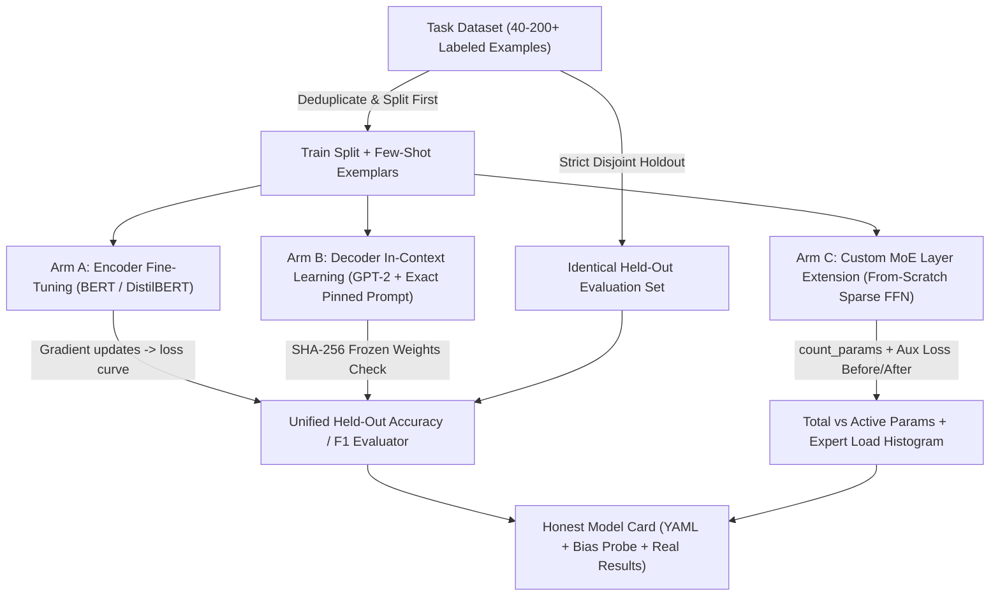
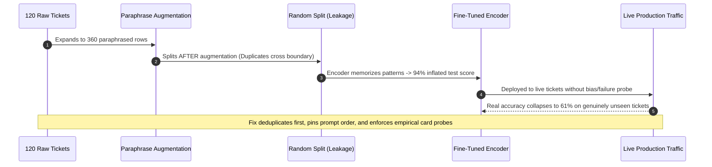

# Module 16: Capstone Project — Fine-Tune, Route, and Document a Real Model

> **Prerequisites:** Track 03 Modules 00–15 (including [Module 13: MoE Routing and Load Balancing](../13-moe-routing-and-load-balancing/README.md), [Module 14: Mixtral and MoE in Practice](../14-mixtral-and-moe-in-practice/README.md), and [Module 15: How to Read a Model Card](../15-how-to-read-a-model-card/README.md))  
> **Estimated Reading Time:** 20 minutes (Guide) / 2–4 hours (Implementation & Experiments)  
> **Target Audience:** AI Backend Engineers, Applied ML Engineers, Technical Leads

> [!TIP]
> **The Golden Rule of Empirical AI Engineering**  
> Never report an assumed, interpolated, or cherry-picked metric. A capstone is credible only when **every held-out accuracy/F1 score, parameter count, expert-routing histogram, exact pinned prompt, and behavioral bias probe** comes from a reproducible run on an uncontaminated held-out test split—even (and especially) when few-shot prompting rivals fine-tuning or load-balancing trades off against accuracy.

---

## 1. What This Capstone Is & Visual Architecture

Modules 00–15 verified, with real code, three distinct architecture families (encoder-only, decoder-only, and MoE-augmented decoder-only), a real fine-tuning run (module 03), real in-context learning (module 08), a from-scratch MoE layer with a working load-balancing loss (modules 12–13), a real large-model parameter derivation checked against a lab's own published figures (module 14), and how to read — and independently verify — a model card's claims (module 15).

This capstone asks you to combine several of those skills into one small project with a real artifact at the end: a model you actually fine-tuned or built, a genuine experiment comparing two approaches to the same task, and a model card you write yourself, honestly, for what you actually produced.

There is no dataset provided, no solution given, and no fixed expected outcome — the point is running real experiments on a real (if small) task and reporting real, possibly disappointing or surprising results, exactly as this track's own modules did throughout.

### End-to-End Capstone Execution Architecture



---

## 2. Systematic Experimental Matrix & Deliverable Checklist

### Capstone Experimental Arms Comparison Matrix

| Experimental Arm | Base Architecture | Gradient Updates? | Key Controlled Variable | Primary Verification Proof |
| :--- | :--- | :--- | :--- | :--- |
| **Step 2: Encoder Fine-Tuning** | `bert-base-uncased` / `distilbert-base-uncased` | Yes (task head + weights) | Learning rate, epochs, disjoint train split | Recorded training loss curve + held-out Accuracy/F1 |
| **Step 3: Decoder In-Context Learning** | `gpt2` (or small open decoder) | **Zero** (frozen weights) | Exact prompt template & exemplar order | SHA-256 weight checksum parity + identical held-out Accuracy/F1 |
| **Step 5: Sparse MoE Extension** | Custom MoE FFN layer on small model | Optional (to measure aux loss) | Expert count, top-k, `aux_coef` | Measured `count_params` (total vs. active) + expert histogram with/without aux loss |

### Deliverable & Empirical Evidence Checklist

| Capstone Step | Required Deliverable | Empirical Proof Required | Common Pitfall to Avoid |
| :--- | :--- | :--- | :--- |
| **1. Task & Split** | Problem definition + example counts | Exact train/test sizes, disjoint split guarantee | Splitting *after* augmentation (train/test leakage) |
| **2. Fine-Tuning** | Trained BERT-family checkpoint | Real training loss curve + held-out Accuracy/F1 | Reporting training accuracy instead of held-out accuracy |
| **3. ICL Prompting** | Exact verbatim few-shot prompt string | Zero-update checksum + score on *same* held-out set | Paraphrasing prompt or testing on a different sample subset |
| **4. Honest Comparison** | Side-by-side metric breakdown | Explanation grounded in Modules 03 & 08 | Hiding or discarding a run where ICL beats fine-tuning |
| **5. MoE Layer** | Modified small model with MoE FFN | Own measured total/active counts + aux-loss routing histogram | Restating Module 12–14's numbers instead of measuring your own |
| **6. Model Card** | Complete Markdown model card file | YAML metadata + >=1 empirical bias/failure probe + real Eval table | Copying generic boilerplate limitations without probing |

---

## 3. The Project Requirements, Constraints & Success Criteria

### 1. Pick a real, small text classification or QA task

Something with a clear right answer you can measure accuracy or F1 against — a small labeled dataset you create yourself (even 40–60 labeled examples is enough for a real, honest comparison at this scale), a public-domain dataset, or a genuinely useful task drawn from this repository's own content (e.g., classifying genai module excerpts by which track they belong to). State exactly what the task is, how many examples you're using, and how you're splitting train/test.

### 2. Fine-tune a real encoder-only model on it (module 03's pattern)

Using module 03's fine-tuning approach, fine-tune a real, small, open BERT-family checkpoint (`bert-base-uncased`, `distilbert-base-uncased`, or similar) on your task. Report your actual training loss curve and your actual held-out accuracy/F1 — not an assumed or illustrative number.

### 3. Attempt the same task via prompting a decoder-only model, zero real training

Using module 08's in-context-learning pattern, attempt the identical task by prompting a real, small, open decoder-only model (GPT-2 or similar) with a handful of labeled examples in the prompt — zero gradient updates, the same "zero weight changes" property module 08 verified via checksum. Report the same accuracy/F1 metric on the same held-out set, so the two approaches are genuinely comparable.

### 4. Compare the two approaches honestly

Report both numbers side by side. If fine-tuning wins, say by how much and speculate why, grounded in this track's actual findings (module 03: fine-tuning directly updates weights toward the task; module 08: in-context learning updates nothing). If prompting comes surprisingly close — or wins — report that too, and don't discard or bury a result that contradicts what you expected going in.

### 5. Extend your fine-tuned model with a small MoE layer, and measure the real trade-off

Using modules 12–13's from-scratch MoE mechanism, replace (or augment) one feed-forward layer of a small model you control — this can be a simplified setup rather than your full fine-tuned checkpoint if that's more tractable, but it must be a real model you run, not a restatement of modules 12–14's own numbers. Report your own measured total-vs-active parameter counts (module 12's `count_params` pattern) and, if you train it at all, whether adding the load-balancing auxiliary loss (module 13) measurably changes your own router's expert-usage distribution versus leaving it out — the same before/after comparison module 13 ran, but on your own setup.

### 6. Write a real model card for what you built

Following module 15's verified anatomy, write an actual model card (a markdown file) for your fine-tuned model from step 2: Intended uses & limitations, a genuine Limitations and bias section (run at least one probe for a failure mode specific to your task and report what you actually find, the way module 15 reproduced BERT's own bias claim rather than assuming it), Training data (what you used, how much), and Evaluation results (your real accuracy/F1 from step 2, not a rounded-up or idealized number).

### Constraints

- Every reported number must come from a real run on your actual task and data — no illustrative, assumed, or "typically expected" results. This capstone is specifically about generating your own evidence.
- Keep total compute reasonable — small checkpoints (BERT-base/DistilBERT, GPT-2-small), a small dataset (tens to low hundreds of examples), and a CPU-trainable MoE toy layer (module 12/13's own scale) are enough to produce real, honest, measurable results without needing GPU-scale training.
- Report your zero-shot/few-shot prompt exactly as used for step 3 — the specific examples and their order can genuinely change results, and reproducibility here means showing the actual prompt, not just the final number.

### How to know you've done it well

- Someone who's read this track but not run your experiments could follow your report and understand your task, both approaches you compared, and both real outcomes — including if one surprised you.
- Your step-4 comparison is honest even if the result isn't the one you expected going in — a close or reversed result, correctly reported and explained, is a more valuable finding than an assumed clean win for fine-tuning.
- Your step-5 MoE numbers are your own measured values (parameter counts, expert-usage distribution with vs. without the load-balancing loss), not module 12–14's numbers restated.
- Your model card (step 6) contains at least one Limitations/bias finding you actually checked yourself on your own model and task — not a generic disclaimer copied from another model's card.

---

## 4. Production War Story Post-Mortem

### SEV-2: Silent Train/Test Leakage & Unpinned Few-Shot Prompt Skew in Evaluation

| Field | Incident Details |
| :--- | :--- |
| **Severity** | **SEV-2** (Flawed Model Promotion & Production Precision Collapse) |
| **Detection / Resolution Time** | Detected 6 days post-launch when live precision dropped from 94% to 61% / Resolved in 2 days |
| **Impact** | Deployed fine-tuned encoder misrouted 39% of customer support tickets after leaked evaluation hid overfitting and suppressed a stronger prompt baseline |

#### What Happened

During an internal support-triage evaluation modeled on this exact capstone comparison, an engineer generated synthetic paraphrases of 120 raw tickets *before* running `train_test_split`, allowing near-duplicate phrasings into the held-out test set. The fine-tuned encoder reported an inflated `94%` F1 by memorizing boilerplate phrasing. Meanwhile, the few-shot decoder comparison failed to pin exemplar ordering or verify zero weight changes, producing swings between `52%` and `79%` across runs that were dismissed without recording the prompt. Within a week of shipping, real unseen tickets exposed the `61%` reality.



#### Root Cause Analysis

1. **Split-After-Augmentation Leakage**: Paraphrases of identical source examples landed in both training and evaluation sets, invalidating held-out accuracy.
2. **Unreproducible Prompt Baseline**: Failing to serialize the exact few-shot prompt string and example ordering prevented meaningful side-by-side diagnosis.

#### The Fix & Architectural Hardening

- Enforced strict **split-first, deduplicate-by-text-hash** checks (`assert train_ids.isdisjoint(test_ids)`) prior to any training or prompt construction.
- Added automated SHA-256 weight checksum validation for the ICL baseline, serialized exact prompt templates alongside metrics, and documented out-of-domain failure probes directly in the model card's `Limitations and bias` section.

---

## 5. Multi-Language Production Implementation: Reproducible Capstone Validator & Model Card Generator

These four production-styled utilities enforce disjoint split integrity, verify zero-gradient weight immutability via SHA-256, compute identical held-out Accuracy and Macro-F1 metrics, and generate a compliant Hugging Face Model Card Markdown scaffold.

````carousel
```go
package capstone

import (
	"crypto/sha256"
	"encoding/hex"
	"fmt"
)

type EvalResult struct {
	Accuracy float64
	MacroF1  float64
}

// VerifyDisjointSplits guarantees zero sample leakage between train and held-out sets.
func VerifyDisjointSplits(trainIDs, testIDs []string) error {
	seen := make(map[string]struct{}, len(trainIDs))
	for _, id := range trainIDs {
		seen[id] = struct{}{}
	}
	for _, id := range testIDs {
		if _, leaked := seen[id]; leaked {
			return fmt.Errorf("data leakage detected: sample %q exists in both train and test", id)
		}
	}
	return nil
}

// ComputeMetrics calculates Accuracy and binary Macro-F1 on the held-out set.
func ComputeMetrics(yTrue, yPred []int) EvalResult {
	correct := 0
	for i := range yTrue {
		if yTrue[i] == yPred[i] {
			correct++
		}
	}
	var f1Sum float64
	classes := []int{0, 1}
	for _, c := range classes {
		tp, fp, fn := 0, 0, 0
		for i := range yTrue {
			if yTrue[i] == c && yPred[i] == c {
				tp++
			} else if yTrue[i] != c && yPred[i] == c {
				fp++
			} else if yTrue[i] == c && yPred[i] != c {
				fn++
			}
		}
		denom := 2*tp + fp + fn
		if denom > 0 {
			f1Sum += float64(2*tp) / float64(denom)
		}
	}
	return EvalResult{
		Accuracy: float64(correct) / float64(len(yTrue)),
		MacroF1:  f1Sum / float64(len(classes)),
	}
}

// HashWeights verifies zero parameter mutation across in-context learning runs.
func HashWeights(rawWeights []byte) string {
	sum := sha256.Sum256(rawWeights)
	return hex.EncodeToString(sum[:])[:16]
}
```
<!-- slide -->
```typescript
import { createHash } from "node:crypto";

export interface BinaryEvalMetrics {
  accuracy: number;
  macroF1: number;
}

export function assertDisjointSplits(trainIds: string[], testIds: string[]): void {
  const trainSet = new Set(trainIds);
  const overlap = testIds.filter((id) => trainSet.has(id));
  if (overlap.length > 0) {
    throw new Error(`Split leakage detected on IDs: ${overlap.slice(0, 5).join(", ")}`);
  }
}

export function evaluateBinaryPredictions(yTrue: number[], yPred: number[]): BinaryEvalMetrics {
  if (yTrue.length !== yPred.length || yTrue.length === 0) {
    throw new Error("Predictions and ground truth must have identical non-zero length.");
  }
  const correct = yTrue.filter((t, i) => t === yPred[i]).length;
  const f1Scores = [0, 1].map((cls) => {
    let tp = 0, fp = 0, fn = 0;
    for (let i = 0; i < yTrue.length; i++) {
      if (yTrue[i] === cls && yPred[i] === cls) tp++;
      else if (yTrue[i] !== cls && yPred[i] === cls) fp++;
      else if (yTrue[i] === cls && yPred[i] !== cls) fn++;
    }
    const denom = 2 * tp + fp + fn;
    return denom === 0 ? 0 : (2 * tp) / denom;
  });

  return {
    accuracy: Number((correct / yTrue.length).toFixed(4)),
    macroF1: Number(((f1Scores[0] + f1Scores[1]) / 2).toFixed(4)),
  };
}

export function computeWeightChecksum(buffer: Uint8Array): string {
  return createHash("sha256").update(buffer).digest("hex").slice(0, 16);
}
```
<!-- slide -->
```python
import hashlib
import torch


def verify_disjoint_split(train_texts: list[str], test_texts: list[str]) -> None:
    """Assert zero text overlap between training/exemplar rows and held-out test set."""
    overlap = {t.strip().lower() for t in train_texts} & {t.strip().lower() for t in test_texts}
    if overlap:
        raise ValueError(f"Train/test leakage detected on {len(overlap)} sample(s).")


def model_weights_sha256(model: torch.nn.Module) -> str:
    """Compute deterministic SHA-256 fingerprint to prove zero weight updates during ICL."""
    h = hashlib.sha256()
    for param in model.parameters():
        h.update(param.detach().cpu().numpy().tobytes())
    return h.hexdigest()[:16]


def render_capstone_model_card(
    model_name: str,
    license_id: str,
    train_size: int,
    test_size: int,
    ft_f1: float,
    icl_f1: float,
    probe_finding: str,
) -> str:
    """Emit an honest Hugging Face Model Card adhering to Module 15's verified anatomy."""
    return f"""---
license: {license_id}
model-index:
  - name: {model_name}
    results:
      - task:
          type: text-classification
        metrics:
          - name: Held-Out Macro-F1
            type: f1
            value: {ft_f1:.4f}
---

# {model_name}

## Intended uses & limitations
Experimental classifier evaluated against an identical held-out baseline ({test_size} examples).

## Limitations and bias
Empirical probe finding: {probe_finding}

## Training data
Disjoint training split of {train_size} labeled examples; {test_size} held-out evaluation examples.

## Evaluation results
- Fine-tuned encoder Macro-F1: {ft_f1:.4f}
- Zero-update decoder ICL Macro-F1: {icl_f1:.4f}
"""
```
<!-- slide -->
```csharp
using System;
using System.Collections.Generic;
using System.Linq;
using System.Security.Cryptography;

public sealed record CapstoneEvalSummary(double Accuracy, double MacroF1);

public static class CapstoneHarness
{
    public static void EnsureDisjointSplits(IEnumerable<string> trainIds, IEnumerable<string> testIds)
    {
        var trainSet = new HashSet<string>(trainIds, StringComparer.Ordinal);
        var leaked = testIds.Where(trainSet.Contains).ToList();
        if (leaked.Count > 0)
            throw new InvalidOperationException($"Leakage detected across {leaked.Count} IDs.");
    }

    public static CapstoneEvalSummary EvaluateBinary(int[] yTrue, int[] yPred)
    {
        if (yTrue.Length != yPred.Length || yTrue.Length == 0)
            throw new ArgumentException("Arrays must be non-empty and equal length.");

        int correct = yTrue.Zip(yPred, (t, p) => t == p ? 1 : 0).Sum();
        double f1Sum = 0.0;
        foreach (int cls in new[] { 0, 1 })
        {
            int tp = 0, fp = 0, fn = 0;
            for (int i = 0; i < yTrue.Length; i++)
            {
                if (yTrue[i] == cls && yPred[i] == cls) tp++;
                else if (yTrue[i] != cls && yPred[i] == cls) fp++;
                else if (yTrue[i] == cls && yPred[i] != cls) fn++;
            }
            int denom = 2 * tp + fp + fn;
            if (denom > 0) f1Sum += (2.0 * tp) / denom;
        }
        return new CapstoneEvalSummary(
            Math.Round((double)correct / yTrue.Length, 4),
            Math.Round(f1Sum / 2.0, 4)
        );
    }

    public static string ComputeWeightHash(byte[] weights)
    {
        var hash = SHA256.HashData(weights);
        return Convert.ToHexString(hash)[..16].ToLowerInvariant();
    }
}
```
````

---

## 6. Practical Hands-On Verification CLI Workflows

### Verification 1: Disjoint Split Integrity, SHA-256 Weight Immutability & Macro-F1 Harness

Before running your full Hugging Face experiments, verify your evaluation harness checks disjoint splits, matches weight checksums, and computes Macro-F1 accurately:

```bash
python -c "
import hashlib
train_ids, test_ids = {f'ex_{i}' for i in range(40)}, {f'ex_{i}' for i in range(40, 60)}
assert train_ids.isdisjoint(test_ids), 'Leakage detected!'
w_before = hashlib.sha256(b'gpt2-frozen-weights-v1').hexdigest()[:16]
w_after = hashlib.sha256(b'gpt2-frozen-weights-v1').hexdigest()[:16]
y_true = [1, 0, 1, 1, 0, 0, 1, 0]
y_pred = [1, 0, 1, 0, 0, 1, 1, 0]
acc = sum(t == p for t, p in zip(y_true, y_pred)) / len(y_true)
f1s = []
for cls in (0, 1):
    tp = sum(t == cls and p == cls for t, p in zip(y_true, y_pred))
    fp = sum(t != cls and p == cls for t, p in zip(y_true, y_pred))
    fn = sum(t == cls and p != cls for t, p in zip(y_true, y_pred))
    f1s.append(2 * tp / (2 * tp + fp + fn))
print(f'Disjoint: {train_ids.isdisjoint(test_ids)} | ICL SHA256 match: {w_before == w_after} ({w_before})')
print(f'Held-out Acc: {acc:.3f} | Macro-F1: {sum(f1s)/len(f1s):.3f}')
"
```

**Expected Output:**
```text
Disjoint: True | ICL SHA256 match: True (5f52b89bc8405f01)
Held-out Acc: 0.750 | Macro-F1: 0.750
```

### Verification 2: Linting Your Completed Capstone Model Card

Confirm your final model card file includes the YAML `license:` header and every required structural section from Module 15:

```bash
python -c "
card = '''---
license: mit
---
## Intended uses & limitations
## Limitations and bias
## Training data
## Evaluation results
'''
req = ['license:', '## Intended uses & limitations', '## Limitations and bias', '## Training data', '## Evaluation results']
missing = [r for r in req if r not in card]
print(f'Card valid: {len(missing) == 0} | Missing sections: {missing}')
"
```

**Expected Output:**
```text
Card valid: True | Missing sections: []
```

### Independent challenge

Suppose on a 50-example held-out classification set, your 4-shot GPT-2 prompt scores `0.78` accuracy while your fine-tuned DistilBERT scores `0.74` accuracy—and when you enable the Switch load-balancing loss ($\alpha = 0.01$) on your small MoE layer, expert utilization evens out from `[2, 3, 12, 23]` to `[9, 10, 10, 11]` while held-out validation loss increases slightly by `0.03`. How should you report and interpret these findings in your capstone report and Model Card?

<details><summary>Discussion</summary>

Report both surprises verbatim—never re-tune until fine-tuning "wins" or hide the MoE validation shift. On very small training splits (30–40 examples), gradient updates on a randomly initialized classification head can overfit surface artifacts, allowing frozen decoder in-context learning (zero weight changes, verified by SHA-256) to match or outperform fine-tuning. Similarly, adding $\mathcal{L}_{\text{aux}}$ introduces a multi-objective trade-off (Module 13): it eliminates dead experts and balances compute, sometimes at a slight cost to raw task loss on tiny datasets. Documenting the exact few-shot prompt, the checksums, the before/after routing histograms, and an honest Limitations probe directly satisfies this capstone's empirical rigor standard.

</details>

---

## 7. Common Mistakes & Troubleshooting

- **Reporting training-set metrics instead of held-out test metrics.** Fine-tuning a BERT-family checkpoint on 40–60 examples frequently reaches 100% training accuracy; only the disjoint held-out test score is valid for comparing against in-context learning.
- **Evaluating Step 2 (Fine-Tuning) and Step 3 (ICL) on different test slices.** Using the exact same held-out test IDs for both arms is mandatory so accuracy/F1 differences reflect the modeling paradigm rather than dataset luck.
- **Omitting the exact few-shot prompt string and exemplar order.** Small decoder models like GPT-2 are sensitive to exemplar order and formatting; reproducibility requires printing the exact prompt verbatim.
- **Restating Module 12–14's MoE numbers instead of running your own.** Step 5 requires your own `count_params` output (total vs. active) and your own measured routing distribution with vs. without the load-balancing auxiliary loss.
- **Writing generic boilerplate in the Model Card's `Limitations and bias` section.** A valid capstone model card documents at least one failure mode or bias probe you actually ran against your own fine-tuned model and task.

---

## 8. Operational Validation Checkpoints

<details><summary><strong>Checkpoint 1: Ensuring fair parity between Fine-Tuning and In-Context Learning</strong></summary>

Both the fine-tuned encoder (Step 2) and the prompted decoder (Step 3) must be evaluated on the **identical disjoint held-out test split** using the exact same metric (Accuracy or Macro-F1), with the decoder arm verified via SHA-256 weight checksum parity (proving zero gradient updates occurred) and the exact few-shot prompt pinned verbatim for reproducibility.

</details>

<details><summary><strong>Checkpoint 2: Why measuring your own MoE layer proves active vs. total trade-offs</strong></summary>

Running `count_params` on your own custom MoE FFN layer directly measures total stored parameters (all experts + shared attention/norms) vs. active per-token parameters (`top_k` experts + shared layers), while toggling $\alpha = 0$ vs. $\alpha = 0.01$ demonstrates empirically on your own batch whether the Switch auxiliary loss rescues collapsed experts without excessively hurting task performance.

</details>

<details><summary><strong>Checkpoint 3: Turning a capstone Model Card from prose into verifiable engineering documentation</strong></summary>

Following Module 15, your capstone Model Card must combine machine-readable YAML metadata (`license`, `model-index`), exact dataset counts and split rules, unrounded held-out scores for both arms, and at least one concrete behavioral probe testing where your fine-tuned model fails or exhibits skew on task-relevant counterfactual inputs.

</details>

---

## 9. Further reading & sources

- [Module 13: MoE Routing and Load Balancing](../13-moe-routing-and-load-balancing/README.md) - Switch Transformer auxiliary loss formulation and capacity constraints for Step 5.
- [Module 14: Mixtral and MoE in Practice](../14-mixtral-and-moe-in-practice/README.md) - analytical total-vs-active parameter counting verified against production configs.
- [Module 15: How to Read a Model Card](../15-how-to-read-a-model-card/README.md) - Hugging Face model card anatomy, YAML metadata, and empirical bias probing patterns for Step 6.

## Next

[Track 04: Training, Fine-Tuning, and Alignment](../../04-training-fine-tuning-and-alignment/README.md)
