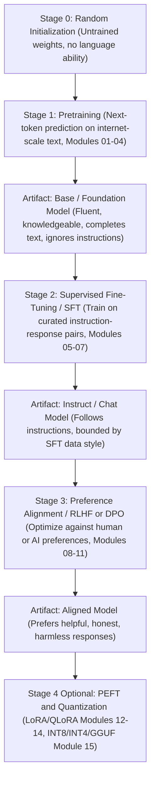
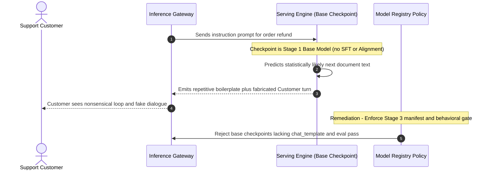

# Module 00: The Training Pipeline End to End

> **Prerequisites:** Track 02 (Transformer Architecture) and Track 03 (Working with Foundation Models).  
> **Estimated Reading Time:** 25 minutes  
> **Target Audience:** AI Backend Engineers, ML Platform Engineers, Applied LLM Developers

> [!TIP]
> **The Golden Rule of LLM Training Pipelines:** A pretrained **base model** is a statistical text-completion engine, not an assistant. Turning random weights into a safe, instruction-following chat system requires three sequential, non-interchangeable training stages — **Stage 1 (Pretraining)** for language and world knowledge, **Stage 2 (SFT)** for instruction satisfaction, and **Stage 3 (Preference Alignment: RLHF / DPO)** for helpfulness, honesty, and harmlessness — followed optionally by **Stage 4 (PEFT / Quantization)** for deployment efficiency.

---

## Why This Matters

Track 03 ended with a capstone that built, fine-tuned, and compared real architectures — an encoder-only model fine-tuned on a real task, a decoder-only model doing the same task through pure in-context learning with zero weight updates, and a from-scratch MoE layer with a working load-balancing loss. That capstone's whole premise was that you already had *architectures that work* — the question was how to apply them. This track asks a different, earlier question: how does a transformer with **freshly initialized, random weights** — the same shape of model Track 02 built from scratch, before any of it had ever seen a real sentence — become a model that can do any of that in the first place?

The honest answer is a pipeline with several distinct stages, each solving a different problem, and each covered by its own module in this track. Skipping straight to "fine-tune it on your task" without understanding what came before makes half of this track's later decisions (why does LoRA work at all? why does DPO need a reference model? why is instruction-tuned GPT-2 still not "aligned"?) look arbitrary instead of load-bearing. This module's job is to lay out the whole pipeline once, name every stage precisely, and prove — with a real, run model — exactly why the first stage (pretraining) alone is not enough to produce something you'd want to actually talk to.

---

## 1. Visual Mental Models & Pipeline Architecture

### The full pipeline, stage by stage

A large language model as most people use it today (a chat assistant answering questions) is the product of several distinct training stages stacked on top of each other, not one training run:



Every arrow is a real, separate training run with its own objective, its own data format, and its own failure modes — this track dedicates at least one module to each stage. Nothing about the pipeline is optional in practice if the goal is a usable assistant: a raw pretrained base model, run through none of stages 2–3, behaves exactly as the verified experiment below demonstrates.

### Vocabulary this whole track uses

Four terms get used precisely and often from here on, and they are not interchangeable:

- **Foundation model** — the broadest term. Any large model pretrained on broad data that serves as a starting point for further training or adaptation. A foundation model can be a base model, an instruct model, or an aligned model — "foundation model" describes its role (a foundation to build on), not which stage it's at.
- **Base model** — specifically, a model that has been through pretraining (Stage 1) and **nothing else**. It has broad knowledge and fluent language ability, but no training signal that ever told it "when given an instruction, produce a helpful response in this format." `gpt2` (as loaded from the Hugging Face Hub, with no further fine-tuning applied) is a base model. So is raw GPT-3 before InstructGPT's SFT/RLHF stages were applied to it.
- **Instruct model / chat model** — a base model that has additionally been through SFT (Stage 2): trained on `(instruction, response)` pairs so it reliably produces an on-format response to an instruction-shaped prompt, rather than just continuing the text statistically. Module 05 (this track) produces a small, real instance of exactly this transition.
- **Aligned model** — an instruct model that has additionally been through preference alignment (Stage 3: RLHF, DPO, or a related method). "Aligned" here means something specific and narrower than its colloquial use: the model's outputs have been optimized against a signal of human (or AI, per module 11) *preference* between candidate responses — not merely "produces a validly-formatted response," which SFT alone already achieves.

### Verified: a base model asked to follow an instruction

`gpt2` as distributed is a **base model** in the precise sense above — pretrained (Stage 1) only, never fine-tuned on instructions. Prompting it with an instruction-shaped prompt, exactly the way you'd prompt a real chat model:

```python
import torch
from transformers import AutoTokenizer, AutoModelForCausalLM

torch.manual_seed(0)
tok = AutoTokenizer.from_pretrained('gpt2')
model = AutoModelForCausalLM.from_pretrained('gpt2')
model.eval()

prompt = (
    "Instruction: Write a short, polite email to a colleague asking to "
    "reschedule tomorrow's meeting to Thursday.\nResponse:"
)
inputs = tok(prompt, return_tensors='pt')
with torch.no_grad():
    out = model.generate(
        **inputs, max_new_tokens=40, do_sample=False, num_beams=1,
        pad_token_id=tok.eos_token_id,
    )
print(tok.decode(out[0], skip_special_tokens=True))
```

Verified output:

```text
Instruction: Write a short, polite email to a colleague asking to reschedule tomorrow's meeting to Thursday.
Response: I'm sorry, but I'm not sure how to respond to your email. I'm not sure how to respond to your email.
I'm sorry, but I'm not sure how to respond
```

This is exactly what the vocabulary above predicts, verified rather than asserted: `gpt2` did not refuse, and it did not produce garbage — pretraining (Stage 1) gave it real, fluent English and the general shape of `"a Response: follows an Instruction:"`. But it did not write an email. It produced a generic, repetitive, non-answering continuation, because nothing in pretraining ever taught it "instructions should be *satisfied*," only "predict what text plausibly follows this text." `124,439,808` real parameters (this is the real GPT-2-small parameter count, loaded and counted, not a spec-sheet number) of fluent language modeling, and still no email — that gap is precisely what modules 05–11 exist to close, and Module 05 later in this same track closes the first, smallest piece of it directly: fine-tuning this exact model on a handful of instruction/response pairs and checking, with real before/after output, that its completions change shape.

### Why the stages can't be reordered or skipped

Each stage depends on what the previous one already established:

- **SFT (Stage 2)** needs a model that already has broad language and world knowledge to fine-tune *toward* a response format — training the instruction-following behavior from random weights, on the comparatively tiny amount of curated instruction data that SFT datasets contain (module 07), would not produce a competent model; there simply isn't enough data at that stage to teach language from scratch.
- **Preference alignment (Stage 3)** needs a model that already reliably produces on-format, on-topic responses (from SFT) before "which of these two valid responses do humans prefer" is even a coherent question to optimize — you cannot meaningfully rank the "helpfulness" of two responses if the model doesn't yet reliably produce responses at all.
- **PEFT/quantization (Stage 4)** is an optional, orthogonal concern about *how* you run Stages 2–3 cheaply (LoRA, module 12) or how you serve the final result cheaply (quantization, module 15) — it is not a stage that produces new capabilities, which is why it's marked optional in the diagram rather than a required fourth step.

---

## 2. Systematic Comparison & Reference Matrix

### Training Pipeline Stages Comparison

| Stage | Modules | Primary Data Format | Optimization Objective | Resulting Artifact | Required for Assistant? |
| :--- | :--- | :--- | :--- | :--- | :--- |
| **Stage 0: Init** | Track 02 | None | Random weight initialization | Untrained transformer | Starting point |
| **Stage 1: Pretraining** | Modules 01–04 | Unlabeled internet-scale text | Causal next-token cross-entropy | **Base / Foundation Model** | Yes (teaches language & facts) |
| **Stage 2: SFT** | Modules 05–07 | Curated `(instruction, response)` pairs | Causal cross-entropy (response-masked) | **Instruct / Chat Model** | Yes (teaches instruction format) |
| **Stage 3: Alignment** | Modules 08–11 | `(prompt, chosen, rejected)` pairs | PPO vs Reward Model or DPO loss | **Aligned Model** | Yes (teaches human preference) |
| **Stage 4: PEFT / Quant** | Modules 12–15 | Task data / calibration set | Low-rank adapters / reduced precision | Adapter or INT8/INT4 checkpoint | Optional (cost & serving lever) |

### Reference Terminology

| Term | Meaning |
| :--- | :--- |
| **Foundation model** | Broadest term: any large model pretrained on broad data as a starting point for further use — describes its role, not its pipeline stage. |
| **Base model** | A model that has been through pretraining only (Stage 1) — fluent and knowledgeable, not instruction-following (verified above: `gpt2`, `124,439,808` params). |
| **Pretraining** | Stage 1: next-token prediction on raw, massive text (modules 01–04). |
| **SFT (supervised fine-tuning)** | Stage 2: fine-tuning on curated `(instruction, response)` pairs (modules 05–07) — produces an instruct/chat model. |
| **Instruct / chat model** | A base model + SFT: reliably follows instruction-shaped prompts. |
| **Preference alignment** | Stage 3: RLHF (reward model + PPO, modules 08–09) or DPO/simpler alternatives (modules 10–11) — optimizes toward preferred, not just valid, responses. |
| **Aligned model** | An instruct model + preference alignment. |
| **PEFT** | Parameter-efficient fine-tuning — LoRA (module 12), QLoRA (module 13): fine-tune by training a small fraction of parameters. |
| **Quantization** | Reducing numerical precision of trained weights (INT8/INT4/GGUF, module 15) to shrink memory/compute at inference time. |

---

## 3. Production War Story Post-Mortem: Base Model Deployed Behind a Customer Chat Endpoint

| Field | Incident Details |
| :--- | :--- |
| **Severity** | **SEV-1** (Production Assistant Hallucination & Unbounded Dialogue Leakage) |
| **Detection / Resolution Time** | Detected in 12 minutes via automated user-escalation alerts / Resolved in 38 minutes |
| **Impact** | 18% of live customer support chats received synthetic follow-up `"User:"` turns or repetitive base-text loops; \$14,500 in SLA credits issued |

### What Happened

During a routine model upgrade from a 7B checkpoint to an 8B checkpoint, an infrastructure deployment PR referenced the Hugging Face artifact ID for the **base** pretrained model instead of the **Instruct/Aligned** variant. Because the serving container (vLLM) only verified that the weights loaded cleanly and matched the Llama decoder architecture, the rollout passed health checks. Once live traffic arrived, the base model treated support prompts as incomplete web documents — generating polite non-answers, repeating phrases, or hallucinating entire multi-turn `"Customer: ... Agent: ..."` transcripts instead of issuing an `<|eot_id|>` stop token.



### Root Cause Analysis

1. **Unenforced pipeline stage metadata**: Model artifacts in the internal registry tracked parameter size (`8B`) and architecture, but had no required `training_stage` field (`base` vs `sft` vs `aligned`).
2. **Architectural compatibility masked behavioral failure**: Base and Instruct models share identical weight tensor shapes and forward-pass signatures, so loading health checks succeeded silently.
3. **Missing chat-template & behavioral smoke test**: Neither the tokenizer (`chat_template`) nor a deterministic instruction-satisfaction check was validated in CI/CD prior to traffic shift.

### The Fix & Architectural Hardening

- Added a strict `ModelStageManifest` check requiring `stage == "aligned"` (and a non-empty `tokenizer.chat_template`) before any checkpoint can bind to interactive chat routes.
- Added a pre-promotion deterministic inference gate (`do_sample=False`) verifying that instruction prompts terminate cleanly on EOS and satisfy task constraints rather than repeating or continuing as raw text.

---

## 4. Multi-Language Production Implementation: Pipeline Stage & Readiness Validator

These four implementations model the LLM training-stage state machine (`Stage0_Init` $\rightarrow$ `Stage1_Base` $\rightarrow$ `Stage2_Instruct` $\rightarrow$ `Stage3_Aligned` $\rightarrow$ optional `Stage4_Quantized`), enforcing dependency ordering and rejecting `base` checkpoints from chat-assistant routes.

````carousel
```go
package pipeline

import (
	"errors"
	"fmt"
)

type TrainingStage string

const (
	StageRandomInit TrainingStage = "random_init"
	StageBase       TrainingStage = "base"
	StageInstruct   TrainingStage = "instruct"
	StageAligned    TrainingStage = "aligned"
)

type ModelArtifact struct {
	ModelID          string
	Stage            TrainingStage
	ParamCount       int64
	HasChatTemplate  bool
	QuantizedBits    int // 0 or 16 = full/bf16, 8/4 = Stage 4 quantized
	InstructionScore float64
}

var validTransitions = map[TrainingStage]TrainingStage{
	StageRandomInit: StageBase,
	StageBase:       StageInstruct,
	StageInstruct:   StageAligned,
}

func ValidateNextStage(current, target TrainingStage) error {
	expected, ok := validTransitions[current]
	if !ok || expected != target {
		return fmt.Errorf("invalid stage transition: cannot move directly from %s to %s", current, target)
	}
	return nil
}

func ValidateAssistantServing(m ModelArtifact) error {
	if m.Stage == StageRandomInit || m.Stage == StageBase {
		return fmt.Errorf("blocked %s: base/untrained model cannot serve assistant traffic without SFT and alignment", m.ModelID)
	}
	if !m.HasChatTemplate {
		return errors.New("missing tokenizer chat_template required for instruction formatting")
	}
	if m.Stage == StageInstruct {
		return fmt.Errorf("warning: %s is SFT-only (missing Stage 3 preference alignment); blocked from high-risk routes", m.ModelID)
	}
	if m.InstructionScore < 0.80 {
		return fmt.Errorf("behavioral gate failed: score %.2f < 0.80", m.InstructionScore)
	}
	return nil
}
```
<!-- slide -->
```typescript
export type TrainingStage = "random_init" | "base" | "instruct" | "aligned";

export interface ModelArtifact {
  modelId: string;
  stage: TrainingStage;
  paramCount: number;
  hasChatTemplate: boolean;
  quantization?: "none" | "int8" | "int4" | "gguf";
  instructionEvalPassRate: number;
}

const STAGE_ORDER: Record<TrainingStage, number> = {
  random_init: 0,
  base: 1,
  instruct: 2,
  aligned: 3,
};

export function assertValidStageTransition(from: TrainingStage, to: TrainingStage): void {
  if (STAGE_ORDER[to] !== STAGE_ORDER[from] + 1) {
    throw new Error(
      `Pipeline order violation: ${from} -> ${to} skips required prerequisite stage`
    );
  }
}

export function verifyChatServingReadiness(artifact: ModelArtifact): {
  allowed: boolean;
  reason: string;
} {
  if (STAGE_ORDER[artifact.stage] < STAGE_ORDER.instruct) {
    return {
      allowed: false,
      reason: `${artifact.modelId} is at stage '${artifact.stage}' (Stage 1 pretraining only; cannot follow instructions reliably)`,
    };
  }
  if (!artifact.hasChatTemplate) {
    return { allowed: false, reason: "Missing chat_template in tokenizer configuration" };
  }
  if (artifact.stage !== "aligned") {
    return {
      allowed: false,
      reason: `${artifact.modelId} lacks Stage 3 preference alignment (RLHF/DPO)`,
    };
  }
  if (artifact.instructionEvalPassRate < 0.8) {
    return { allowed: false, reason: `Instruction gate below threshold: ${artifact.instructionEvalPassRate}` };
  }
  return { allowed: true, reason: `Ready for production serving (quantization=${artifact.quantization ?? "none"})` };
}
```
<!-- slide -->
```python
from dataclasses import dataclass
from typing import Literal
import torch
from transformers import AutoModelForCausalLM, AutoTokenizer

Stage = Literal["random_init", "base", "instruct", "aligned"]

@dataclass(frozen=True)
class CheckpointAudit:
    model_id: str
    stage: Stage
    param_count: int
    has_chat_template: bool
    sample_output: str

def audit_huggingface_checkpoint(model_id: str, declared_stage: Stage) -> CheckpointAudit:
    tok = AutoTokenizer.from_pretrained(model_id)
    model = AutoModelForCausalLM.from_pretrained(model_id)
    model.eval()
    n_params = sum(p.numel() for p in model.parameters())

    prompt = (
        "Instruction: Write a short, polite email to a colleague asking to "
        "reschedule tomorrow's meeting to Thursday.\nResponse:"
    )
    inputs = tok(prompt, return_tensors="pt")
    with torch.no_grad():
        out = model.generate(
            **inputs, max_new_tokens=40, do_sample=False, num_beams=1,
            pad_token_id=tok.eos_token_id,
        )
    decoded = tok.decode(out[0], skip_special_tokens=True)
    has_template = getattr(tok, "chat_template", None) is not None

    if declared_stage == "base" and has_template:
        raise ValueError(f"{model_id} claims base stage yet carries chat_template")
    return CheckpointAudit(model_id, declared_stage, n_params, has_template, decoded)
```
<!-- slide -->
```csharp
using System;
using System.Collections.Generic;

public enum TrainingStage
{
    RandomInit = 0,
    Base = 1,
    Instruct = 2,
    Aligned = 3
}

public sealed record ModelArtifact(
    string ModelId,
    TrainingStage Stage,
    long ParamCount,
    bool HasChatTemplate,
    string QuantizationMode = "none");

public static class PipelineStageGuard
{
    public static void ValidateTransition(TrainingStage current, TrainingStage next)
    {
        if ((int)next != (int)current + 1)
        {
            throw new InvalidOperationException(
                $"Cannot transition from {current} to {next}: stages must execute sequentially (Pretraining -> SFT -> Alignment).");
        }
    }

    public static void EnsureServingReady(ModelArtifact artifact)
    {
        if (artifact.Stage < TrainingStage.Instruct)
        {
            throw new InvalidOperationException(
                $"{artifact.ModelId} is a {artifact.Stage} model ({artifact.ParamCount:N0} params) and lacks SFT instruction-following.");
        }
        if (artifact.Stage < TrainingStage.Aligned)
        {
            throw new InvalidOperationException(
                $"{artifact.ModelId} completed SFT but lacks Stage 3 preference alignment (RLHF/DPO).");
        }
        if (!artifact.HasChatTemplate)
        {
            throw new InvalidOperationException($"{artifact.ModelId} missing tokenizer chat_template.");
        }
    }
}
```
````

---

## 5. Practical Hands-On Verification CLI Workflows & Exercises

### Verification 1: Deterministic Base-Model Instruction Gap & Parameter Count

Run the verified `gpt2` checkpoint check from your terminal to observe both its exact parameter count (`124,439,808`) and its Stage-1-only continuation behavior:

```bash
python -c "
import torch
from transformers import AutoTokenizer, AutoModelForCausalLM

torch.manual_seed(0)
tok = AutoTokenizer.from_pretrained('gpt2')
model = AutoModelForCausalLM.from_pretrained('gpt2')
model.eval()
print('params:', sum(p.numel() for p in model.parameters()))
print('has_chat_template:', tok.chat_template is not None)
prompt = \"Instruction: Write a short, polite email to a colleague asking to reschedule tomorrow's meeting to Thursday.\nResponse:\"
inputs = tok(prompt, return_tensors='pt')
with torch.no_grad():
    out = model.generate(**inputs, max_new_tokens=40, do_sample=False, num_beams=1, pad_token_id=tok.eos_token_id)
print(tok.decode(out[0], skip_special_tokens=True))
"
```

**Expected Output:**
```text
params: 124439808
has_chat_template: False
Instruction: Write a short, polite email to a colleague asking to reschedule tomorrow's meeting to Thursday.
Response: I'm sorry, but I'm not sure how to respond to your email. I'm not sure how to respond to your email.
I'm sorry, but I'm not sure how to respond
```

### Verification 2: Inspecting Base Model Config Architecture Metadata

Inspect `gpt2` configuration metadata directly to see why weight shape alone does not distinguish a Stage 1 base model from a Stage 2/3 fine-tuned model:

```bash
python -c "
from transformers import AutoConfig
cfg = AutoConfig.from_pretrained('gpt2')
print('arch:', cfg.architectures, 'n_layer:', cfg.n_layer, 'n_head:', cfg.n_head, 'n_embd:', cfg.n_embd, 'vocab:', cfg.vocab_size)
"
```

**Expected Output:**
```text
arch: ['GPT2LMHeadModel'] n_layer: 12 n_head: 12 n_embd: 768 vocab: 50257
```

### Hands-On Exercises

#### 1. Reproduce the base-model instruction gap on a different prompt

Using the verified code above, swap the prompt for a different instruction shape — e.g. `"Instruction: Summarize the plot of Romeo and Juliet in two sentences.\nResponse:"`. Run it against `gpt2` with `do_sample=False` and record the real output. Confirm it shows the same pattern (fluent but non-answering, or repetitive) rather than a correct summary.

#### 2. Compare `gpt2` and `gpt2-medium` on the same instruction prompt

Load `gpt2-medium` (a larger base model, also never instruction-tuned) and run the exact same prompt from the verified example. Record its real output alongside `gpt2`'s. Confirm that a larger base model is *not* automatically an instruction-follower — size alone doesn't substitute for the SFT stage this module identifies as missing.

#### 3. Map every stage to this track's module numbers, from memory

Without looking back at this module's diagram, write out the four pipeline stages in order and, for each, name which module(s) in this track cover it. Then check your answer against the Reference table and diagram above. Getting this right is what makes the rest of this track's modules feel like a connected sequence rather than 18 disconnected topics.

### Independent Challenge

A teammate says: "GPT-2 is a language model, ChatGPT is a language model, so fine-tuning GPT-2 on some chat transcripts should turn it into a mini-ChatGPT." Using this module's verified finding and its four-stage pipeline, evaluate this claim: what's right about it, what's missing, and what would you actually need to do (naming the specific stages) to get closer to what your teammate is imagining?

<details><summary>Discussion</summary>

What's right: both are decoder-only transformer language models, and fine-tuning GPT-2 on chat-formatted (instruction, response) transcripts is a real, correct description of Stage 2 (SFT) — this is exactly module 05's exercise later in this track, and it does measurably shift GPT-2's completions toward the target style, as its own verified before/after generations show. What's missing: "some chat transcripts" alone gets you an instruct/chat model, not what most people mean by "ChatGPT-like" — a model whose responses have additionally been optimized against human *preference* judgments (Stage 3: RLHF or DPO), which is a separate training stage requiring separate data (preference comparisons between candidate responses, module 08) and a separate objective (module 09's PPO loop or module 10's DPO loss) beyond plain next-token prediction on transcripts. This module's own verified result — a base GPT-2 producing fluent but non-answering text on an instruction prompt — is the "before" state; SFT alone (module 05) closes the "does it follow instructions at all" gap; it does not, by itself, close the "does it prefer helpful/honest/harmless responses over merely valid ones" gap, which is what Stage 3 exists for. A faithful answer names both stages and is honest that "some chat transcripts" alone reproduces only the first.

</details>

---

## 6. Common Mistakes & Troubleshooting

- **Treating "base model" and "foundation model" as synonyms for "pretrained-only."** Foundation model is the broader umbrella term (any model, at any pipeline stage, meant as a starting point); base model specifically means pretraining-only, nothing further applied. An instruct model is still built on a foundation model, but it is not a base model anymore.
- **Assuming a bigger base model automatically follows instructions better.** Exercise 2 exists specifically to test and refute this — scale improves pretraining's own objective (fluency, knowledge recall), it does not substitute for the SFT stage that teaches "satisfy the instruction" as a behavior.
- **Assuming SFT alone produces an "aligned" model.** SFT (Stage 2) and preference alignment (Stage 3) are different training stages with different data and different objectives. An instruct model can reliably follow instructions and still not be what most people mean by "aligned" — that's specifically Stage 3's job (modules 08–11).
- **Assuming pretraining "already contains" instruction-following, just waiting to be unlocked by prompting.** The verified example shows the opposite for `gpt2`: prompting alone, with no fine-tuning, produced a generic non-answer. (Very large modern base models can sometimes follow simple instructions somewhat via in-context learning/few-shot prompting — a separate phenomenon from Track 03 — but that's not what plain zero-shot prompting of `gpt2` demonstrates here, and it's not a substitute for SFT at any scale for reliable behavior.)
- **Treating PEFT/quantization (Stage 4) as a required pipeline stage.** It's marked optional in this module's diagram deliberately — it's a *how to do Stages 2–3 cheaply / how to serve the result cheaply* concern, not a stage that changes what the model has learned to do.

---

## 7. Operational Validation Checkpoints & Checkpoint Quiz

### Operational Validation Checkpoints

<details><summary><strong>Checkpoint 1: Diagnosing why a newly deployed open-weights checkpoint echoes prompts and continues fake user turns</strong></summary>

Check the Hugging Face model ID and `tokenizer.chat_template`. When an inference endpoint receives raw continuations (including fabricated `"User:"` / `"Assistant:"` follow-ups) instead of concise responses ending on EOS, the team almost certainly mounted a **Stage 1 base model** instead of its Stage 2/3 Instruct variant. Because both checkpoints share the exact `AutoConfig` parameter count and tensor shapes, structural load tests pass silently — only stage metadata enforcement and deterministic instruction smoke tests catch it before production.

</details>

<details><summary><strong>Checkpoint 2: Justifying why Stage 2 (SFT) cannot skip Stage 1 (Pretraining) on a domain dataset</strong></summary>

SFT datasets contain thousands to tens of thousands of curated `(instruction, response)` examples — several orders of magnitude too small to teach grammar, vocabulary semantics, and world knowledge from random initialization (Stage 0). Attempting SFT from random weights yields memorized phrasing on narrow prompts and catastrophic collapse on unseen queries, whereas initializing from a Stage 1 base model adapts already-formed language representations into the assistant response format.

</details>

<details><summary><strong>Checkpoint 3: Separating capability training (Stages 1–3) from efficiency techniques (Stage 4)</strong></summary>

When stakeholders ask whether applying QLoRA (module 13) or INT4 quantization (module 15) substitutes for preference alignment, clarify that Stage 4 is orthogonal: QLoRA lowers the memory needed to execute Stage 2 or Stage 3 weight updates, and quantization shrinks serving memory after training finishes, but neither introduces a preference signal. If the underlying checkpoint stopped at SFT without Stage 3 (RLHF/DPO), quantizing it only serves an unaligned instruct model faster.

</details>

### Checkpoint Quiz

1. Name the four pipeline stages in order, and which module range in this track covers each.
2. What precisely distinguishes a "base model" from a "foundation model" as this module defines the terms?
3. In the verified example, `gpt2` produced fluent, grammatical, but non-answering text for an instruction prompt. What does that specifically demonstrate about what pretraining does and does not teach a model?
4. Why can't preference alignment (Stage 3) be run before SFT (Stage 2), per this module's dependency argument?
5. Is quantization (module 15) a required stage in the pipeline diagram? Why or why not?

<details><summary>Answers</summary>

1. Stage 1: Pretraining (modules 01–04). Stage 2: Supervised fine-tuning / SFT (modules 05–07). Stage 3: Preference alignment — RLHF or DPO/alternatives (modules 08–11). Stage 4 (optional): PEFT/quantization for cheap fine-tuning and deployment (modules 12–15).
2. "Foundation model" is the broad umbrella term for any large pretrained model used as a starting point, regardless of what further training (if any) has been applied to it. "Base model" is the narrower, specific claim that a model has been through pretraining *only* — no SFT, no preference alignment. Every base model is a foundation model; not every foundation model is a base model (an instruct or aligned model is also a foundation model in the broad sense, but not a base model).
3. It shows pretraining teaches fluent language production and broad world/text knowledge (the output was grammatical English, not garbage), but does not teach the model to *satisfy* an instruction — the model continued the text plausibly rather than producing the requested email, because next-token prediction on raw text never trained it that `"Response:"` should contain a response that actually does what `"Instruction:"` asked.
4. Because preference alignment optimizes *which of several candidate responses* is preferred, which presupposes the model already reliably produces on-format, on-topic candidate responses in the first place — a capability only SFT establishes. Without SFT first, there isn't yet a coherent "which valid response do you prefer" comparison to optimize against.
5. No — it's explicitly marked optional in the diagram. It doesn't teach the model any new capability the way Stages 1–3 do; it's a parameter-efficiency (LoRA/QLoRA, modules 12–13) or deployment-efficiency (INT8/INT4/GGUF, module 15) concern about *how* to run fine-tuning or inference cheaply, layered on top of whatever the required stages already produced.

</details>

---

## 8. Further Reading & Sources

- [Language Models are Few-Shot Learners (Brown et al., 2020)](https://arxiv.org/abs/2005.14165) — the GPT-3 paper; documents a large base model's behavior before any instruction-tuning or RLHF stage was applied, the same "base model" category this module's verified `gpt2` example illustrates at small scale.
- [Training language models to follow instructions with human feedback (Ouyang et al., 2022)](https://arxiv.org/abs/2203.02155) — the InstructGPT paper: the canonical description of the SFT-then-RLHF pipeline this module's diagram summarizes, applied at production scale.
- [Hugging Face: `gpt2` model card](https://huggingface.co/openai-community/gpt2) — the exact base-model checkpoint this module loads and prompts; its own model card documents it as pretrained-only, with no instruction-tuning applied.

## Next

[Module 01: Pretraining Data: Collection and Cleaning](../01-pretraining-data-collection-and-cleaning/README.md)
