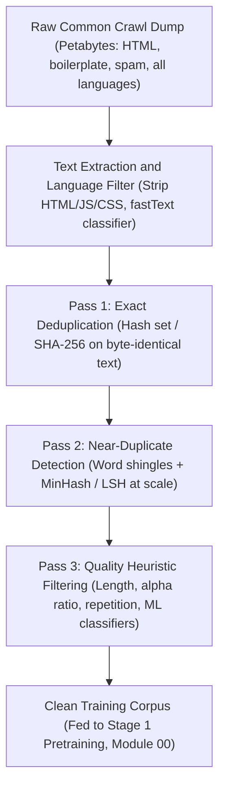
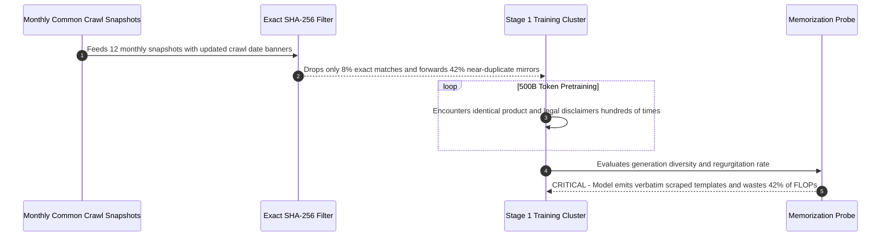

# Module 01: Pretraining Data: Collection and Cleaning

> **Prerequisites:** [Module 00: The Training Pipeline End to End](../00-the-training-pipeline-end-to-end/README.md)  
> **Estimated Reading Time:** 30 minutes  
> **Target Audience:** AI Backend Engineers, Data Platform Engineers, Pretraining Pipeline Engineers

> [!TIP]
> **The Golden Rule of Pretraining Data Cleaning:** Raw web token count is **not** equal to useful training signal. Unfiltered web scrapes are dominated by boilerplate, keyword spam, and near-duplicate mirrors; running exact deduplication, fuzzy near-deduplication (MinHash + LSH over word shingles), and fast quality heuristics *before* tokenization prevents wasted FLOPs and reduces disproportionate memorization.

---

## Why This Matters

Module 00 showed pretraining turning random weights into a fluent (if not yet instruction-following) language model, and named it "Stage 1" without asking the obvious next question: fluent *on what data*, and where did that data come from? The honest answer for every major LLM is some version of "a filtered, deduplicated slice of a much larger, much messier raw scrape of the internet" — and the filtering and deduplication are not minor cleanup steps, they are load-bearing parts of what makes the resulting model good. Training on raw, unfiltered web text means training on an enormous amount of near-duplicate boilerplate, spam, and garbage in roughly the same proportions it appears on the actual internet — which is to say, a lot. This module builds, on a small synthetic corpus you can read end to end, the three real techniques used at scale to turn "everything we scraped" into something worth spending compute learning from: exact-duplicate removal, near-duplicate detection, and quality heuristic filtering. The counts are small and the corpus is toy-sized, but the code is the same *kind* of code real pipelines like CCNet run on trillions of tokens.

---

## 1. Visual Mental Models & Pretraining Data Cleaning Pipeline

### Where pretraining data actually comes from

At the scale modern LLMs are pretrained (hundreds of billions to trillions of tokens), almost none of it is hand-curated. The dominant real source is **Common Crawl** — a nonprofit that has been crawling and archiving a large fraction of the public web since 2008, publishing petabytes of raw HTML dumps for free. Common Crawl itself is not filtered for quality or deduplicated; it's the raw material. Real pretraining pipelines (CCNet, used to build data for RoBERTa and LLaMA; the pipelines behind GPT-3's and PaLM's training sets; RefinedWeb; FineWeb) each run their own version of the same core stages:



This module verifies the deduplication and quality-filtering passes on a synthetic toy corpus small enough to read every line of, in three separate passes so each technique's real effect is visible in isolation (`14` raw lines $\rightarrow$ `12` after exact dedup $\rightarrow$ `11` after near-dup $\rightarrow$ `7` clean lines).

### Verified: exact-duplicate removal

A small synthetic corpus, built to deliberately contain the three problems real web-scraped text has — exact duplicates, near duplicates, and low-quality lines:

```python
corpus = [
    "The quick brown fox jumps over the lazy dog.",
    "The quick brown fox jumps over the lazy dog.",  # exact duplicate
    "The quick brown fox jumps over the lazy dog!",  # near duplicate (punctuation)
    "A fast, dark-colored fox jumps over the lazy dog.",  # paraphrase-ish
    "Common Crawl is a nonprofit that crawls the web and freely provides its archives.",
    "Common Crawl is a nonprofit that crawls the web and freely provides its archives.",  # exact duplicate
    "Language models are trained on large amounts of text scraped from the internet.",
    "buy buy buy buy buy buy buy buy buy now now now",       # low-quality: repetitive
    "asdkj 1234 !!!! ???? %%%% $$$$ #### @@@@",               # low-quality: non-alphabetic
    "ok",                                                      # low-quality: too short
    "Pretraining data pipelines typically deduplicate at scale using MinHash and LSH.",
    "Quality filtering removes boilerplate, spam, and mostly-symbolic lines from raw web text.",
    "!!!",                                                     # low-quality: too short + non-alphabetic
    "The cat sat on the mat and looked out of the window at the rain.",
]

def dedup_exact(lines):
    seen, out = set(), []
    for line in lines:
        if line not in seen:
            seen.add(line)
            out.append(line)
    return out

after_exact = dedup_exact(corpus)
print("before:", len(corpus), " after:", len(after_exact),
      " removed:", len(corpus) - len(after_exact))
```

Verified output:

```text
before: 14  after: 12  removed: 2
```

Exact-duplicate removal is the cheapest and least controversial stage: a plain hash-set lookup, and it only ever catches *byte-identical* lines. It caught the two genuinely identical sentences in this corpus. It did **not** catch the punctuation-only variant (`"...dog!"` vs. `"...dog."`), because that line is not byte-identical — which is exactly why real pipelines need a second, fuzzier pass.

### Verified: near-duplicate detection via shingling and Jaccard similarity

Near-duplicates — text that differs by a little punctuation, a reordered clause, or a word swap, but says essentially the same thing — are far more common in real scraped web text than exact duplicates (the same article mirrored, quoted, or lightly reformatted across many pages). A standard cheap technique: break each line into overlapping **word shingles** (here, sequences of 3 consecutive words) and measure **Jaccard similarity** — the size of the shingle-set intersection divided by the union ($\frac{|A \cap B|}{|A \cup B|}$) — between every pair of lines:

```python
import re
from itertools import combinations

def shingles(text, k=3):
    words = re.findall(r"[a-z0-9]+", text.lower())
    if len(words) < k:
        return {" ".join(words)}
    return {" ".join(words[i:i + k]) for i in range(len(words) - k + 1)}

def jaccard(a, b):
    if not a and not b:
        return 1.0
    return len(a & b) / len(a | b)

THRESHOLD = 0.5
shingle_sets = [shingles(line) for line in after_exact]
to_drop, near_dup_pairs = set(), []
for i, j in combinations(range(len(after_exact)), 2):
    if i in to_drop or j in to_drop:
        continue
    sim = jaccard(shingle_sets[i], shingle_sets[j])
    if sim >= THRESHOLD:
        near_dup_pairs.append((after_exact[i], after_exact[j], round(sim, 3)))
        to_drop.add(j)

after_near_dup = [line for idx, line in enumerate(after_exact) if idx not in to_drop]
for a, b, sim in near_dup_pairs:
    print(f"sim={sim}  KEEP: {a!r}")
    print(f"         DROP: {b!r}")
print("before:", len(after_exact), " after:", len(after_near_dup),
      " removed:", len(after_exact) - len(after_near_dup))
```

Verified output:

```text
sim=1.0  KEEP: 'The quick brown fox jumps over the lazy dog.'
         DROP: 'The quick brown fox jumps over the lazy dog!'
before: 12  after: 11  removed: 1
```

The punctuation-only near-duplicate that exact matching missed got caught here — its word-shingle set is identical (shingling on `[a-z0-9]+` word tokens strips the trailing `!`/`.` difference entirely), giving a Jaccard similarity of exactly `1.0`. Worth being honest about what this pass did **not** catch: `"A fast, dark-colored fox jumps over the lazy dog."` — a genuine paraphrase of the same sentence — survived, because at `k=3` word shingles its overlap with the original (`0.3636`) falls below the `0.5` threshold used here. This is a real, known limitation of shingling-based near-dup detection: it catches surface-level rewrites (punctuation, minor reordering, mirrored pages) far better than semantic paraphrases, which is why some modern pipelines add embedding-similarity dedup as a further pass — out of scope for this module's toy-scale code, but worth knowing it's a real gap, not an oversight in this specific corpus.

### Verified: quality heuristic filtering

The remaining low-quality lines aren't duplicates of anything — they're just bad on their own terms. Three simple, cheap heuristics, applied in combination:

```python
def alpha_ratio(text):
    return sum(c.isalpha() for c in text) / max(len(text), 1)

def max_word_fraction(text):
    words = re.findall(r"[a-z0-9]+", text.lower())
    if not words:
        return 1.0
    counts = {}
    for w in words:
        counts[w] = counts.get(w, 0) + 1
    return max(counts.values()) / len(words)

MIN_CHARS, MIN_ALPHA_RATIO, MAX_REPEAT_FRACTION = 8, 0.6, 0.4

def passes_quality(text):
    if len(text) < MIN_CHARS:
        return False, "too short"
    if alpha_ratio(text) < MIN_ALPHA_RATIO:
        return False, "not alphabetic enough"
    if max_word_fraction(text) > MAX_REPEAT_FRACTION:
        return False, "too repetitive"
    return True, "ok"

after_quality = []
for line in after_near_dup:
    ok, reason = passes_quality(line)
    print(("KEEP" if ok else "DROP"), f"({reason}):", repr(line))
    if ok:
        after_quality.append(line)
print("before:", len(after_near_dup), " after:", len(after_quality),
      " removed:", len(after_near_dup) - len(after_quality))
```

Verified output:

```text
KEEP (ok): 'The quick brown fox jumps over the lazy dog.'
KEEP (ok): 'A fast, dark-colored fox jumps over the lazy dog.'
KEEP (ok): 'Common Crawl is a nonprofit that crawls the web and freely provides its archives.'
KEEP (ok): 'Language models are trained on large amounts of text scraped from the internet.'
DROP (too repetitive): 'buy buy buy buy buy buy buy buy buy now now now'
DROP (not alphabetic enough): 'asdkj 1234 !!!! ???? %%%% $$$$ #### @@@@'
DROP (too short): 'ok'
KEEP (ok): 'Pretraining data pipelines typically deduplicate at scale using MinHash and LSH.'
KEEP (ok): 'Quality filtering removes boilerplate, spam, and mostly-symbolic lines from raw web text.'
DROP (too short): '!!!'
KEEP (ok): 'The cat sat on the mat and looked out of the window at the rain.'
before: 11  after: 7  removed: 4
```

Each heuristic catches a different, real failure mode: repetition catches spam/keyword-stuffing patterns, alphabetic ratio catches symbol/emoji noise, and a minimum length catches near-empty lines. None of these are exotic — CCNet-style pipelines use exactly this kind of cheap heuristic (often alongside a trained classifier) precisely because it's fast enough to run over trillions of tokens.

### Verified: the full pipeline's cumulative effect

```python
print("raw:", len(corpus))                        # 14
print("after exact-dup removal:", len(after_exact))       # 12
print("after near-dup removal:", len(after_near_dup))     # 11
print("after quality filter:", len(after_quality))         # 7
```

Verified output:

```text
raw: 14
after exact-dup removal: 12
after near-dup removal: 11
after quality filter: 7
```

Half the corpus — 7 of 14 lines — was removed across three cheap passes, none of which required a trained model. This toy corpus was deliberately constructed to have a high garbage fraction to make the effect visible in 14 lines; real Common Crawl dumps are dominated by boilerplate and duplication at a similar (often larger) proportion, which is why deduplication and filtering are not a rounding-error step in a real pretraining pipeline — they change what fraction of a fixed compute budget's training tokens are actually useful signal.

---

## 2. Systematic Comparison & Reference Matrix

### Deduplication & Filtering Stage Comparison

| Cleaning Pass | Core Mechanism | Production Complexity | Catches | Misses / Limitations |
| :--- | :--- | :--- | :--- | :--- |
| **Exact Deduplication** | Hash-set / SHA-256 string match | $\mathcal{O}(N)$ streaming | Byte-identical lines, scraped mirrors | Punctuation swaps, whitespace changes |
| **Pairwise Shingle Jaccard** | $k$-word shingles + exact intersection/union | $\mathcal{O}(N^2)$ (toy only) | Punctuation/minor word edits | Unusable past ~10k docs; misses paraphrases |
| **MinHash + LSH (Scale)** | Random hash signatures + bucket banding | $\mathcal{O}(N)$ sub-quadratic | Surface-level mirrors across billions of docs | Semantic paraphrases with low shingle overlap |
| **Heuristic Quality Filter** | Length, alpha ratio, word repetition, stopwords | $\mathcal{O}(N)$ linear scan | Keyword spam, ASCII noise, empty snippets | Factually wrong prose or subtle hallucinations |

### Reference Terminology

| Term | Meaning |
| :--- | :--- |
| **Common Crawl** | Nonprofit providing free, petabyte-scale raw web crawl dumps — the dominant raw source for LLM pretraining data, unfiltered by default. |
| **CCNet** | A real, published pipeline (used for RoBERTa, LLaMA's training data) that extracts, language-filters, quality-filters, and deduplicates Common Crawl dumps. |
| **Exact-duplicate removal** | Removing byte-identical text via hashing — verified above: catches identical lines, misses even a single punctuation-mark difference. |
| **Shingling** | Breaking text into overlapping $n$-word sequences to compare documents fuzzily rather than exactly. |
| **Jaccard similarity** | $\|A \cap B\| / \|A \cup B\|$ between two shingle sets — this module's near-dup detection metric. |
| **MinHash / LSH** | The real, scalable version of shingle-set comparison used in production pipelines — this module's brute-force pairwise Jaccard is its toy stand-in, feasible only because the corpus is 14 lines, not billions. |
| **Quality filter** | Heuristic (length, alphabetic ratio, repetition) or ML-based rules that drop low-value text before it ever reaches pretraining. |

---

## 3. Production War Story Post-Mortem: Un-Deduplicated Mirrors Causing Memorization & Compute Burn

| Field | Incident Details |
| :--- | :--- |
| **Severity** | **SEV-1** (Training Compute Waste & Verbatim Memorization Regression) |
| **Detection / Resolution Time** | Detected 6 days into pretraining evaluation / Resolved in 14 hours (pipeline rebuild + run restart) |
| **Impact** | 42% of a 500B-token corpus consisted of templated product disclaimers and mirrored pages; \$85,000 in H100 compute burned |

### What Happened

An ML platform team ingested 12 consecutive monthly Common Crawl snapshots to build a 500B-token pretraining set. To hit a tight cluster reservation deadline, engineers kept **Pass 1 (exact SHA-256 deduplication)** — seeing it remove 8% of documents — and skipped **Pass 2 (MinHash + LSH near-duplicate detection)**, assuming exact hashing had already removed duplicate sites. Mid-training evaluation probes revealed the model regurgitating verbatim legal footers and scraped phone/support templates whenever given short domain prefixes.



### Root Cause Analysis

1. **Exact hashing is brittle to 1-byte differences**: Scraped sites embedding `"Copyright 2024"` vs `"Copyright 2025"`, session IDs, or a single `!` vs `.` produced completely unrelated SHA-256 digests and sailed past exact dedup.
2. **Repeated near-duplicates act as implicit upsampling**: Seeing near-identical passages dozens of times shifts gradient updates toward verbatim memorization rather than generalizable language modeling.
3. **Lack of post-cleaning shingle overlap auditing**: No random-sample near-duplicate audit ran on the tokenized dataset shards before launching the multi-node GPU job.

### The Fix & Architectural Hardening

- Reinstated distributed **MinHash + LSH** ($k=5$ word shingles, Jaccard threshold `0.8`) across all snapshots jointly rather than per-snapshot.
- Added automated shard sampling checks rejecting any dataset release with $> 2\%$ near-duplicate pairs or failing quality-heuristic gates before tokenization starts.

---

## 4. Multi-Language Production Implementation: Three-Pass Cleaning Pipeline

These four implementations execute the exact three-stage cleaning pipeline verified in this module — exact deduplication, $k$-word shingle Jaccard near-duplicate filtering, and heuristic quality checks (minimum character length, minimum alphabetic ratio, maximum single-word repetition fraction) — returning clean documents alongside per-stage audit counts.

````carousel
```go
package dataclean

import (
	"crypto/sha256"
	"regexp"
	"strings"
	"unicode"
)

type AuditStats struct {
	Raw            int
	AfterExact     int
	AfterNearDup   int
	AfterQuality   int
}

var wordRegex = regexp.MustCompile(`[a-z0-9]+`)

func shingles(text string, k int) map[string]struct{} {
	words := wordRegex.FindAllString(strings.ToLower(text), -1)
	set := make(map[string]struct{})
	if len(words) < k {
		set[strings.Join(words, " ")] = struct{}{}
		return set
	}
	for i := 0; i <= len(words)-k; i++ {
		set[strings.Join(words[i:i+k], " ")] = struct{}{}
	}
	return set
}

func jaccard(a, b map[string]struct{}) float64 {
	if len(a) == 0 && len(b) == 0 {
		return 1.0
	}
	inter := 0
	for k := range a {
		if _, ok := b[k]; ok {
			inter++
		}
	}
	union := len(a) + len(b) - inter
	return float64(inter) / float64(union)
}

func passesQuality(text string, minChars int, minAlpha, maxRepeat float64) bool {
	if len(text) < minChars {
		return false
	}
	alpha := 0
	for _, r := range text {
		if unicode.IsLetter(r) {
			alpha++
		}
	}
	if float64(alpha)/float64(len([]rune(text))) < minAlpha {
		return false
	}
	words := wordRegex.FindAllString(strings.ToLower(text), -1)
	if len(words) == 0 {
		return false
	}
	counts := make(map[string]int)
	maxCnt := 0
	for _, w := range words {
		counts[w]++
		if counts[w] > maxCnt {
			maxCnt = counts[w]
		}
	}
	return float64(maxCnt)/float64(len(words)) <= maxRepeat
}

func CleanCorpus(lines []string, jaccardThreshold float64) ([]string, AuditStats) {
	stats := AuditStats{Raw: len(lines)}
	seen := make(map[[32]byte]struct{})
	var exact []string
	for _, line := range lines {
		sum := sha256.Sum256([]byte(line))
		if _, ok := seen[sum]; !ok {
			seen[sum] = struct{}{}
			exact = append(exact, line)
		}
	}
	stats.AfterExact = len(exact)

	shingleSets := make([]map[string]struct{}, len(exact))
	for i, l := range exact {
		shingleSets[i] = shingles(l, 3)
	}
	dropped := make([]bool, len(exact))
	var nearClean []string
	for i := range exact {
		if dropped[i] {
			continue
		}
		nearClean = append(nearClean, exact[i])
		for j := i + 1; j < len(exact); j++ {
			if !dropped[j] && jaccard(shingleSets[i], shingleSets[j]) >= jaccardThreshold {
				dropped[j] = true
			}
		}
	}
	stats.AfterNearDup = len(nearClean)

	var final []string
	for _, l := range nearClean {
		if passesQuality(l, 8, 0.6, 0.4) {
			final = append(final, l)
		}
	}
	stats.AfterQuality = len(final)
	return final, stats
}
```
<!-- slide -->
```typescript
import { createHash } from "crypto";

export interface CleaningReport {
  cleanLines: string[];
  counts: { raw: number; afterExact: number; afterNearDup: number; afterQuality: number };
}

function buildShingles(text: string, k = 3): Set<string> {
  const words = text.toLowerCase().match(/[a-z0-9]+/g) ?? [];
  if (words.length < k) return new Set([words.join(" ")]);
  const out = new Set<string>();
  for (let i = 0; i <= words.length - k; i++) {
    out.add(words.slice(i, i + k).join(" "));
  }
  return out;
}

function jaccard(a: Set<string>, b: Set<string>): number {
  if (a.size === 0 && b.size === 0) return 1.0;
  let inter = 0;
  for (const s of a) if (b.has(s)) inter++;
  return inter / (a.size + b.size - inter);
}

function passesQuality(text: string, minChars = 8, minAlpha = 0.6, maxRepeat = 0.4): boolean {
  if (text.length < minChars) return false;
  const alphaCount = (text.match(/[a-zA-Z]/g) ?? []).length;
  if (alphaCount / Math.max(text.length, 1) < minAlpha) return false;
  const words = text.toLowerCase().match(/[a-z0-9]+/g) ?? [];
  if (words.length === 0) return false;
  const counts = new Map<string, number>();
  let maxFreq = 0;
  for (const w of words) {
    const next = (counts.get(w) ?? 0) + 1;
    counts.set(w, next);
    if (next > maxFreq) maxFreq = next;
  }
  return maxFreq / words.length <= maxRepeat;
}

export function runCleaningPipeline(corpus: string[], threshold = 0.5): CleaningReport {
  const seen = new Set<string>();
  const afterExact: string[] = [];
  for (const line of corpus) {
    const hash = createHash("sha256").update(line).digest("hex");
    if (!seen.has(hash)) {
      seen.add(hash);
      afterExact.push(line);
    }
  }

  const shingleSets = afterExact.map((l) => buildShingles(l, 3));
  const drop = new Set<number>();
  for (let i = 0; i < afterExact.length; i++) {
    if (drop.has(i)) continue;
    for (let j = i + 1; j < afterExact.length; j++) {
      if (!drop.has(j) && jaccard(shingleSets[i], shingleSets[j]) >= threshold) {
        drop.add(j);
      }
    }
  }
  const afterNearDup = afterExact.filter((_, idx) => !drop.has(idx));
  const cleanLines = afterNearDup.filter((l) => passesQuality(l));

  return {
    cleanLines,
    counts: {
      raw: corpus.length,
      afterExact: afterExact.length,
      afterNearDup: afterNearDup.length,
      afterQuality: cleanLines.length,
    },
  };
}
```
<!-- slide -->
```python
import hashlib
import re
from collections import Counter
from dataclasses import dataclass
from itertools import combinations

@dataclass
class CleaningAudit:
    raw: int
    after_exact: int
    after_near_dup: int
    after_quality: int
    kept: list[str]

def word_shingles(text: str, k: int = 3) -> set[str]:
    words = re.findall(r"[a-z0-9]+", text.lower())
    if len(words) < k:
        return {" ".join(words)}
    return {" ".join(words[i : i + k]) for i in range(len(words) - k + 1)}

def jaccard(a: set[str], b: set[str]) -> float:
    return 1.0 if not a and not b else len(a & b) / len(a | b)

def passes_quality(text: str, min_chars: int = 8, min_alpha: float = 0.6, max_rep: float = 0.4) -> bool:
    if len(text) < min_chars:
        return False
    if sum(c.isalpha() for c in text) / len(text) < min_alpha:
        return False
    words = re.findall(r"[a-z0-9]+", text.lower())
    if not words:
        return False
    most_common = Counter(words).most_common(1)[0][1]
    return (most_common / len(words)) <= max_rep

def clean_pretraining_corpus(corpus: list[str], sim_threshold: float = 0.5) -> CleaningAudit:
    seen_hashes: set[str] = set()
    after_exact: list[str] = []
    for line in corpus:
        digest = hashlib.sha256(line.encode("utf-8")).hexdigest()
        if digest not in seen_hashes:
            seen_hashes.add(digest)
            after_exact.append(line)

    sets = [word_shingles(line, k=3) for line in after_exact]
    to_drop: set[int] = set()
    for i, j in combinations(range(len(after_exact)), 2):
        if i not in to_drop and j not in to_drop and jaccard(sets[i], sets[j]) >= sim_threshold:
            to_drop.add(j)

    after_near = [line for idx, line in enumerate(after_exact) if idx not in to_drop]
    kept = [line for line in after_near if passes_quality(line)]
    return CleaningAudit(len(corpus), len(after_exact), len(after_near), len(kept), kept)
```
<!-- slide -->
```csharp
using System;
using System.Collections.Generic;
using System.Linq;
using System.Security.Cryptography;
using System.Text;
using System.Text.RegularExpressions;

public sealed record CleaningResult(
    IReadOnlyList<string> CleanLines,
    int RawCount,
    int AfterExactCount,
    int AfterNearDupCount,
    int AfterQualityCount);

public static class PretrainingDataCleaner
{
    private static readonly Regex WordPattern = new(@"[a-z0-9]+", RegexOptions.Compiled);

    private static HashSet<string> Shingles(string text, int k = 3)
    {
        var words = WordPattern.Matches(text.ToLowerInvariant()).Select(m => m.Value).ToList();
        if (words.Count < k) return new HashSet<string> { string.Join(" ", words) };
        var set = new HashSet<string>();
        for (int i = 0; i <= words.Count - k; i++)
            set.Add(string.Join(" ", words.Skip(i).Take(k)));
        return set;
    }

    private static double Jaccard(HashSet<string> a, HashSet<string> b)
    {
        if (a.Count == 0 && b.Count == 0) return 1.0;
        int inter = a.Count(b.Contains);
        return (double)inter / (a.Count + b.Count - inter);
    }

    private static bool PassesQuality(string text, int minChars = 8, double minAlpha = 0.6, double maxRepeat = 0.4)
    {
        if (text.Length < minChars) return false;
        double alphaRatio = (double)text.Count(char.IsLetter) / text.Length;
        if (alphaRatio < minAlpha) return false;
        var words = WordPattern.Matches(text.ToLowerInvariant()).Select(m => m.Value).ToList();
        if (words.Count == 0) return false;
        int maxCount = words.GroupBy(w => w).Max(g => g.Count());
        return (double)maxCount / words.Count <= maxRepeat;
    }

    public static CleaningResult Clean(IReadOnlyList<string> corpus, double threshold = 0.5)
    {
        var seen = new HashSet<string>();
        var afterExact = new List<string>();
        foreach (var line in corpus)
        {
            var hash = Convert.ToHexString(SHA256.HashData(Encoding.UTF8.GetBytes(line)));
            if (seen.Add(hash)) afterExact.Add(line);
        }

        var sets = afterExact.Select(l => Shingles(l, 3)).ToList();
        var dropped = new bool[afterExact.Count];
        var afterNear = new List<string>();
        for (int i = 0; i < afterExact.Count; i++)
        {
            if (dropped[i]) continue;
            afterNear.Add(afterExact[i]);
            for (int j = i + 1; j < afterExact.Count; j++)
            {
                if (!dropped[j] && Jaccard(sets[i], sets[j]) >= threshold)
                    dropped[j] = true;
            }
        }

        var clean = afterNear.Where(l => PassesQuality(l)).ToList();
        return new CleaningResult(clean, corpus.Count, afterExact.Count, afterNear.Count, clean.Count);
    }
}
```
````

---

## 5. Practical Hands-On Verification CLI Workflows & Exercises

### Verification 1: Verify the Cumulative Three-Pass Funnel (`14 -> 12 -> 11 -> 7`)

Run the end-to-end 3-pass funnel directly in your shell to confirm exact deduplication, near-duplication, and quality filtering counts:

```bash
python -c "
import re
from itertools import combinations
corpus = [
    'The quick brown fox jumps over the lazy dog.',
    'The quick brown fox jumps over the lazy dog.',
    'The quick brown fox jumps over the lazy dog!',
    'A fast, dark-colored fox jumps over the lazy dog.',
    'Common Crawl is a nonprofit that crawls the web and freely provides its archives.',
    'Common Crawl is a nonprofit that crawls the web and freely provides its archives.',
    'Language models are trained on large amounts of text scraped from the internet.',
    'buy buy buy buy buy buy buy buy buy now now now',
    'asdkj 1234 !!!! ???? %%%% $$$$ #### @@@@',
    'ok',
    'Pretraining data pipelines typically deduplicate at scale using MinHash and LSH.',
    'Quality filtering removes boilerplate, spam, and mostly-symbolic lines from raw web text.',
    '!!!',
    'The cat sat on the mat and looked out of the window at the rain.',
]
exact = list(dict.fromkeys(corpus))
sh = lambda t, k=3: {' '.join(w[i:i+k]) for i in range(max(len(w)-k+1, 1))} if (w:=re.findall(r'[a-z0-9]+', t.lower())) else {''}
ss = [sh(l) for l in exact]
drop = {j for i, j in combinations(range(len(exact)), 2) if len(ss[i]&ss[j])/len(ss[i]|ss[j]) >= 0.5}
near = [l for idx, l in enumerate(exact) if idx not in drop]
qual = [l for l in near if len(l)>=8 and sum(c.isalpha() for c in l)/len(l)>=0.6 and (lambda w: max(w.count(x) for x in set(w))/len(w) <= 0.4)(re.findall(r'[a-z0-9]+', l.lower()))]
print(f'raw={len(corpus)} exact={len(exact)} near={len(near)} clean={len(qual)}')
"
```

**Expected Output:**
```text
raw=14 exact=12 near=11 clean=7
```

### Verification 2: Inspect Paraphrase Jaccard Score at `k=3` Shingles

Verify the exact Jaccard overlap between the original fox sentence and the paraphrase that survived the `0.5` threshold:

```bash
python -c "
import re
sh = lambda t, k=3: {' '.join(w[i:i+k]) for i in range(len(w)-k+1)} if len(w:=re.findall(r'[a-z0-9]+', t.lower()))>=k else {' '.join(w)}
a = sh('The quick brown fox jumps over the lazy dog.')
b = sh('A fast, dark-colored fox jumps over the lazy dog.')
print('paraphrase_jaccard:', round(len(a & b) / len(a | b), 4))
"
```

**Expected Output:**
```text
paraphrase_jaccard: 0.3636
```

### Hands-On Exercises

#### 1. Tighten the near-duplicate threshold and observe the trade-off

Re-run the shingling code with `THRESHOLD = 0.3` instead of `0.5`. Check whether `"A fast, dark-colored fox jumps over the lazy dog."` now gets caught as a near-duplicate of the original fox sentence, and whether any genuinely distinct sentences get wrongly flagged as near-duplicates of each other. Report the real precision/recall trade-off you observe at this threshold versus `0.5`.

#### 2. Add a fourth heuristic: a stopword-ratio filter

Real pipelines sometimes filter out text with an unusually *low* ratio of common function words (`a`, `the`, `is`, `and`, ...) as a signal of non-natural-language or keyword-stuffed text. Write and run `stopword_ratio(text)` against this module's corpus using a small hardcoded stopword list, add it to `passes_quality`, and report whether it changes the final kept/dropped set versus the three-heuristic version verified above.

#### 3. Scale the corpus and time the pairwise comparison

Extend the corpus to 200 lines (repeat/perturb the existing lines programmatically) and re-run the near-duplicate pass. Time it with `time.time()`. Confirm that pairwise comparison is $\mathcal{O}(n^2)$ — report the real wall-clock time at 14, 100, and 200 lines, and explain in one sentence why production pipelines use MinHash+LSH (sub-quadratic) instead of this module's brute-force approach at real scale.

### Independent Challenge

A colleague proposes: "Let's just train on 10x more raw, unfiltered Common Crawl text instead of spending engineering time on deduplication — more data is more data, and scaling laws (module 03) say more data means lower loss." Using this module's own verified counts, argue for or against this, being specific about what "10x more raw text" actually contains.

<details><summary>Discussion</summary>

The claim conflates *raw token count* with *useful, distinct training signal* — and this module's own numbers show those are not the same thing: half of a 14-line toy corpus built to resemble real scraped text's problems was removed across dedup and quality filtering, none of it because the model would find it *harder*, but because it was redundant (exact/near duplicates, verified: 2 exact + 1 near-duplicate removed) or actively low-value (repetitive/symbolic/too-short lines, verified: 4 more removed by quality heuristics). "10x more raw, unfiltered text" almost certainly means roughly the same proportion of duplication and low-quality content, scaled up — not 10x more distinct, useful sentences. Worse: duplicated text specifically has a well-documented failure mode beyond wasted compute — models can memorize and regurgitate exact duplicated passages more readily than content seen once, which is a real quality/privacy concern, not just an efficiency one. The scaling-laws point isn't wrong in principle (module 03's $D$ really does help), but it assumes $D$ counts distinct, useful tokens — feeding 10x the raw bytes without deduplication doesn't deliver 10x the $D$ that scaling laws are measured against. The efficient move is closer to what CCNet-style pipelines actually do: spend the engineering effort on filtering/dedup so that whatever compute budget you have (module 04) is spent on tokens that are actually distinct and useful, rather than assuming that "more raw bytes" alone is the same lever.

</details>

---

## 6. Common Mistakes & Troubleshooting

- **Assuming exact-duplicate removal catches near-duplicates.** Verified directly above: a single punctuation-character difference made two otherwise identical sentences survive exact-hash dedup entirely; near-dup detection is a genuinely separate pass.
- **Assuming shingling/Jaccard catches semantic paraphrases.** This module's own corpus contains a real paraphrase (`"fast, dark-colored fox"` for `"quick brown fox"`) that survived the `0.5`-threshold near-dup pass — surface-level fuzzy matching is not semantic deduplication; don't oversell what it catches.
- **Treating quality heuristics as catching "wrong" or "false" content.** They don't — they catch *low information density and malformed text* (too short, too repetitive, non-alphabetic). None of this module's heuristics say anything about factual correctness, which is a separate, much harder problem heuristic filtering does not solve.
- **Running pairwise Jaccard comparison at real scale.** This module's $\mathcal{O}(n^2)$ brute-force pass is only tractable because the toy corpus is 14 lines. Exercise 3 makes the quadratic blowup concrete — production pipelines need MinHash+LSH specifically to avoid this.
- **Forgetting deduplication changes training dynamics, not just dataset size.** Removing duplicates isn't only about saving compute on redundant tokens — heavily duplicated text can be memorized disproportionately by the model during pretraining, a distinct concern from "how many tokens do we have."

---

## 7. Operational Validation Checkpoints & Checkpoint Quiz

### Operational Validation Checkpoints

<details><summary><strong>Checkpoint 1: Selecting MinHash+LSH threshold without wiping out legitimate boilerplate-free prose</strong></summary>

Lowering the Jaccard similarity threshold from `0.8` down to `0.3` catches paraphrases (`0.3636` in our toy example) but risks falsely colliding genuinely distinct technical documents that share standard phrasing or code imports. Production pipelines typically keep surface-shingle deduplication strict (`0.75`–`0.85` at $k=5$ or higher) so false positives stay near zero, reserving semantic/embedding clustering only for high-value curated subsets.

</details>

<details><summary><strong>Checkpoint 2: Ordering exact dedup, quality filters, and near-dedup for maximum pipeline throughput</strong></summary>

Running cheap $\mathcal{O}(N)$ heuristics (minimum length, alphabetic ratio) and exact hashing *before* shingling and MinHash/LSH shrinks the document count entering the expensive memory-heavy MinHash index by 30–50%. Never compute shingles or LSH bands on two-character strings (`"ok"`, `"!!!"`) that heuristic filtering will drop immediately anyway.

</details>

<details><summary><strong>Checkpoint 3: Auditing memorized verbatim outputs back to dataset repetition</strong></summary>

When a freshly pretrained base checkpoint emits verbatim license headers or customer disclaimers on short prompts, query the deduplicated shard index using a `5`-gram shingle overlap check across snapshots. Almost always, different crawl dates or query-string URLs defeated exact hashing while near-dedup was misconfigured per-snapshot rather than globally across the entire training corpus.

</details>

### Checkpoint Quiz

1. Why did exact-duplicate removal (hash-based) fail to catch `"The quick brown fox jumps over the lazy dog!"` as a duplicate of the same sentence ending in a period instead?
2. What metric did the near-duplicate pass use, and on what unit (characters, words, whole documents) was it computed in this module's code?
3. Name the three quality heuristics this module verified, and what real failure mode in scraped web text each one targets.
4. What real paraphrase in this module's corpus survived near-duplicate detection, and why, specifically, did the shingling approach miss it?
5. What is Common Crawl, and what is CCNet's relationship to it?

<details><summary>Answers</summary>

1. Hash-based exact-duplicate removal only matches byte-identical strings; a trailing `!` versus `.` makes the two strings not identical at the byte level, so the hash-set check treats them as two distinct lines even though a human would call them duplicates.
2. Jaccard similarity (intersection over union) computed on sets of 3-word shingles (overlapping 3-word sequences) extracted from each line — a word-level, not character-level or whole-document-level, comparison.
3. Minimum character length (catches near-empty/junk lines like `"ok"` or `"!!!"`), minimum alphabetic-character ratio (catches symbol/numeric noise like `"asdkj 1234 !!!!..."`), and maximum single-word repetition fraction (catches keyword-stuffed/spammy text like `"buy buy buy... now now now"`).
4. `"A fast, dark-colored fox jumps over the lazy dog."` is a genuine paraphrase of the quick-brown-fox sentence, and it survived because its 3-word shingle overlap (`0.3636`) with the original falls below the `0.5` Jaccard threshold used — shingling compares surface word sequences, not meaning, so a reworded sentence with different words doesn't register as similar even though a human reader would recognize it as saying the same thing.
5. Common Crawl is a nonprofit that crawls a large fraction of the public web and freely publishes the raw, unfiltered archives — the dominant raw material for LLM pretraining data. CCNet is a real, published pipeline that takes Common Crawl's raw dumps and applies exactly the stages this module verified in miniature (text extraction, language/quality filtering, deduplication) to turn them into a usable pretraining corpus.

</details>

---

## 8. Further Reading & Sources

- [CCNet: Extracting High Quality Monolingual Datasets from Web Crawl Data (Wenzek et al., 2019)](https://arxiv.org/abs/1911.00359) — the real, published pipeline this module's three verified stages (extraction/quality-filter/dedup) are modeled on, run at trillions-of-tokens scale.
- [The Common Crawl Foundation](https://commoncrawl.org/) — the actual nonprofit and raw data source this module discusses conceptually; its "Get Started" page documents dump format and scale.
- [Deduplicating Training Data Makes Language Models Better (Lee et al., 2021)](https://arxiv.org/abs/2107.06499) — measures, on real LLM training corpora, that duplicated text causes disproportionate memorization and that deduplication measurably improves downstream model quality — the real-scale version of this module's exact/near-dup argument.
- [The FineWeb Datasets: Decanting the Web for the Finest Text Data at Scale (Penedo et al., 2024)](https://arxiv.org/abs/2406.17557) — a modern, fully documented open pretraining-data pipeline covering the same quality-filtering and deduplication stages this module verifies in miniature, at real multi-trillion-token scale.

## Next

[Module 02: The Pretraining Objective and Loss](../02-the-pretraining-objective-and-loss/README.md)
