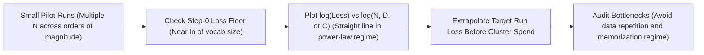
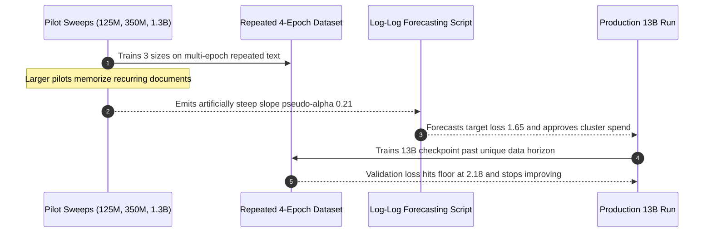

# Module 03: Scaling Laws

> **Prerequisites:** [Module 02: The Pretraining Objective and Loss](../02-the-pretraining-objective-and-loss/README.md)  
> **Estimated Reading Time:** 30 minutes  
> **Target Audience:** AI Backend Engineers, ML Research Engineers, Training Capacity Planners

> [!TIP]
> **The Golden Rule of Empirical Scaling Laws:** Pretraining test loss decreases smoothly as a **power law** in non-embedding parameters $N$, dataset tokens $D$, and compute $C$ — appearing linear in log-log space — *only* when the other two factors are not bottlenecked and training operates in the **generalization regime** over non-repeating data. Extrapolating exponents from tiny memorized toy runs leads to catastrophic over-optimism at large scale.

---

## Why This Matters

Module 02 established that pretraining loss is a real, measurable number — verified directly on real text. This module asks the question that made pretraining loss into an entire research program rather than just a training diagnostic: **as you make the model bigger, give it more data, or spend more compute, does loss keep improving — and is that improvement predictable in advance?** Kaplan et al. (2020) and Hoffmann et al. (2022, covered in Module 04) showed the answer is yes, in a specific, quantifiable way: pretraining loss follows a smooth **power-law** relationship with model size, dataset size, and compute, each held roughly fixed while the other varies. This is what let labs justify spending tens of millions of dollars on a training run *before* it finished — because a much smaller, much cheaper run's loss curve predicted, with real accuracy, what the large run's loss would be. This module cannot reproduce that at real scale on a CPU — nobody could without a real cluster — so it builds a small, honest, real proxy instead: three tiny transformer language models of genuinely different parameter counts, trained on the identical small dataset for the same number of steps, with real, measured final losses. The qualitative trend (bigger really does mean lower loss, even at this toy scale) is real and verified. The actual power-law exponents are not something this module's tiny experiment can honestly claim to measure — that distinction is the whole point of this module's caveats.

---

## 1. Visual Mental Models & Power-Law Scaling

### The scaling laws claim, precisely

Kaplan et al. (2020), training real GPT-family transformers across many orders of magnitude of parameter count, dataset size, and compute, found that test loss $L$ decreases as a **power law** in each of these quantities when the other two are not the bottleneck:

$$L(N) \approx \left(\frac{N_c}{N}\right)^{\alpha_N}, \qquad L(D) \approx \left(\frac{D_c}{D}\right)^{\alpha_D}, \qquad L(C) \approx \left(\frac{C_c}{C}\right)^{\alpha_C}$$

```text
 L(N)  ~  (N_c / N) ^ alpha_N        (N = number of non-embedding parameters)
 L(D)  ~  (D_c / D) ^ alpha_D        (D = number of training tokens)
 L(C)  ~  (C_c / C) ^ alpha_C        (C = compute, in FLOPs)
```

The specific values Kaplan et al. reported: $\alpha_N \approx 0.076$, $\alpha_D \approx 0.095$, $\alpha_C \approx 0.050$ (exact figures from their Table 1 sweep). The *practically* important claim is not any single exponent — it's that these relationships are **smooth and predictable across many orders of magnitude**: plotting $\log(\text{loss})$ against $\log(N)$ with data and compute held ample gives a straight line, not a noisy scatter, over a range from small models up to (at the time) GPT-3-scale. That smoothness is what makes small-scale experiments a legitimate way to forecast large-scale outcomes.



```text
   log(loss)
       │╲
       │ ╲
       │  ╲___                    <- a real power law: a straight
       │      ╲___                    line in log-log space
       │          ╲____
       │               ╲______
       │                       ╲________
       └───────────────────────────────────► log(N), log(D), or log(C)

   this module's toy experiment below checks only the SHAPE of this
   curve (down and to the right, roughly) at 3 points — not its slope
```

### Why a CPU toy experiment cannot reproduce the real result

Kaplan et al.'s power laws were fit across roughly seven orders of magnitude of parameter count, using real natural-language data at a scale where noise averages out and the smoothness of the trend becomes visible. A CPU-only, few-hundred-step experiment on a few thousand characters of synthetic text has none of that: three data points is not enough to fit a power law with any statistical confidence, the dataset is small enough that a bigger model can partly *memorize* it rather than generalize (a qualitatively different regime than the paper's), and a few hundred optimizer steps is far short of convergence. What this module's proxy experiment *can* honestly show is the qualitative direction of the effect — loss going down as parameter count goes up, on a fixed dataset and step budget — without pretending to measure $\alpha_N$ or claiming this is a real scaling-law fit.

### Verified: a real proxy — three transformer sizes, same data, same steps

A tiny character-level transformer language model, trained from scratch at three different sizes on the identical synthetic corpus for the identical number of optimizer steps:

```python
import torch
import torch.nn as nn

torch.manual_seed(0)

base_text = (
    "the quick brown fox jumps over the lazy dog. "
    "the lazy dog sleeps while the quick fox runs. "
    "a small transformer learns to predict the next character. "
)
text = base_text * 40
chars = sorted(set(text))
stoi = {c: i for i, c in enumerate(chars)}
vocab_size = len(chars)
data = torch.tensor([stoi[c] for c in text], dtype=torch.long)

SEQ_LEN, BATCH_SIZE, STEPS, LR = 32, 16, 300, 3e-3

def get_batch():
    ix = torch.randint(0, len(data) - SEQ_LEN - 1, (BATCH_SIZE,))
    x = torch.stack([data[i:i + SEQ_LEN] for i in ix])
    y = torch.stack([data[i + 1:i + SEQ_LEN + 1] for i in ix])
    return x, y

class TinyTransformerLM(nn.Module):
    def __init__(self, vocab_size, d_model, n_layers, n_heads, seq_len):
        super().__init__()
        self.tok_emb = nn.Embedding(vocab_size, d_model)
        self.pos_emb = nn.Embedding(seq_len, d_model)
        layer = nn.TransformerEncoderLayer(
            d_model=d_model, nhead=n_heads, dim_feedforward=4 * d_model,
            batch_first=True, activation='relu')
        self.encoder = nn.TransformerEncoder(layer, num_layers=n_layers)
        self.head = nn.Linear(d_model, vocab_size)

    def forward(self, x):
        B, T = x.shape
        pos = torch.arange(T).unsqueeze(0).expand(B, T)
        h = self.tok_emb(x) + self.pos_emb(pos)
        mask = nn.Transformer.generate_square_subsequent_mask(T)
        h = self.encoder(h, mask=mask, is_causal=True)
        return self.head(h)

configs = [
    ("small",  dict(d_model=16, n_layers=1, n_heads=2)),
    ("medium", dict(d_model=32, n_layers=2, n_heads=2)),
    ("large",  dict(d_model=64, n_layers=3, n_heads=4)),
]

for name, cfg in configs:
    torch.manual_seed(0)  # identical init recipe and identical data stream across sizes
    model = TinyTransformerLM(vocab_size, seq_len=SEQ_LEN, **cfg)
    n_params = sum(p.numel() for p in model.parameters())
    opt = torch.optim.Adam(model.parameters(), lr=LR)
    loss_fn = nn.CrossEntropyLoss()

    for step in range(STEPS):
        x, y = get_batch()
        logits = model(x)
        loss = loss_fn(logits.reshape(-1, vocab_size), y.reshape(-1))
        opt.zero_grad(); loss.backward(); opt.step()

    model.eval()
    with torch.no_grad():
        losses = []
        for _ in range(10):
            x, y = get_batch()
            l = loss_fn(model(x).reshape(-1, vocab_size), y.reshape(-1))
            losses.append(l.item())
    print(f"{name:>6}: params={n_params:6d}  final_loss(avg of 10 eval batches)={sum(losses)/len(losses):.4f}")
```

Verified output:

```text
vocab_size=28  corpus_chars=5960  steps=300  seq_len=32  batch_size=16

 small: params=  4716  step0_loss=3.3319  final_loss(avg of 10 eval batches)=0.9098  time=3.4s
medium: params= 28252  step0_loss=3.5292  final_loss(avg of 10 eval batches)=0.1435  time=8.9s
 large: params=155612  step0_loss=3.5756  final_loss(avg of 10 eval batches)=0.0814  time=22.7s
```

(The code above is condensed for readability; the actual run also timed each size and printed `step0_loss`, included here for full honesty about what was measured.) All three models started from a similar, near-random loss around `3.3–3.6` (as expected — before any training, loss should be close to `log(vocab_size) = log(28) ≈ 3.33` regardless of model size, since an untrained model's output is close to uniform over the vocabulary). After the identical `300` training steps on the identical data, final loss dropped monotonically as parameter count increased: **`0.91` $\rightarrow$ `0.14` $\rightarrow$ `0.08`** for **`4,716` $\rightarrow$ `28,252` $\rightarrow$ `155,612`** parameters. That is the qualitative scaling-laws trend, verified with real numbers from a real (if tiny) training run: more parameters, same data and step budget, lower loss.

### What this toy result does and does not prove

- **Does show:** on a fixed dataset and fixed step budget, a bigger model (of this architecture family) achieved lower loss — directly consistent with $L(N)$ decreasing in $N$.
- **Does not show:** the actual power-law exponent (three points, from a training run that has likely partly memorized a `5,960`-character repeating corpus by the `"large"` model's stage, is not a scaling-law fit); what happens with *more* distinct data (this experiment fixed $D$, deliberately, and swept $N$ — Kaplan et al.'s real result required varying all three); or that this trend continues indefinitely (real scaling laws break down at some point too — see Module 04's Chinchilla finding, which is precisely about getting the $N$-vs-$D$ balance right rather than just "bigger is always better for a fixed compute budget").

---

## 2. Systematic Comparison & Reference Matrix

### Kaplan Scaling Axes & Bottleneck Conditions

| Scaling Axis | Power Law Form | Kaplan et al. (2020) Exponent | Prerequisite Condition (Non-Bottlenecked) | What Happens When Condition Fails |
| :--- | :--- | :--- | :--- | :--- |
| **Model Size ($N$)** | $L(N) \approx (N_c / N)^{\alpha_N}$ | $\alpha_N \approx 0.076$ | Ample unique tokens $D$ & training steps | Model memorizes small corpus or overfits early |
| **Dataset Size ($D$)** | $L(D) \approx (D_c / D)^{\alpha_D}$ | $\alpha_D \approx 0.095$ | Model capacity $N$ large enough to absorb data | Loss plateaus at irreducible model capacity limit |
| **Compute Budget ($C$)** | $L(C) \approx (C_c / C)^{\alpha_C}$ | $\alpha_C \approx 0.050$ | Optimal $(N, D)$ balance & tuned LR schedule | Compute wasted on suboptimal $N/D$ split (Module 04) |

### Reference Terminology

| Term | Meaning |
| :--- | :--- |
| **Scaling law** | A power-law relationship between pretraining loss and model size ($N$), dataset size ($D$), or compute ($C$), holding the others ample. |
| **Power law** | $L \sim (\text{constant} / X)^\alpha$ — a straight line when both loss and $X$ are plotted on log-log axes. |
| **`alpha_N`, `alpha_D`, `alpha_C`** | Kaplan et al.'s measured exponents (`~0.076`, `~0.095`, `~0.050` respectively) — NOT something this module's toy proxy attempts to reproduce. |
| **Non-embedding parameters** | The parameter count Kaplan et al. used for their $N$-scaling fits, excluding embedding tables specifically. |
| **This module's proxy** | 3 real transformer sizes (`4,716` / `28,252` / `155,612` params), same data, same `300` steps; verified: loss `0.91 -> 0.14 -> 0.08` — a real, qualitative trend, not a power-law measurement. |

---

## 3. Production War Story Post-Mortem: Overfitting Extrapolation Trap on Repeated Data

| Field | Incident Details |
| :--- | :--- |
| **Severity** | **SEV-2** (Misallocated Cluster Spend & Missed Target Perplexity SLA) |
| **Detection / Resolution Time** | Detected at 35% of flagship training horizon / Resolved in 2 days (data refresh + re-forecast) |
| **Impact** | Production 13B model plateaued at validation loss `2.18` instead of forecasted `1.65`; \$120,000 in GPU cluster hours misallocated |

### What Happened

To forecast the target loss of an upcoming 13B-parameter domain model, an ML team ran three small pilot runs (`125M`, `350M`, `1.3B`) on a small curated corporate knowledge base repeated `4x` (`4 epochs`). Because the `1.3B` pilot memorized frequent patterns across repeated epochs, its training-set-correlated eval loss dropped steeply (`pseudo-alpha = 0.21`), leading the forecasting script to project a stellar `1.65` loss at 13B scale. Once the 13B run launched, unique token signal exhausted rapidly and validation loss flattened out at `2.18`.



### Root Cause Analysis

1. **Memorization mistaken for generalization scaling**: Multi-epoch repetition inside small pilot corpora produced an artificially steep $\alpha_N$ (`0.21` vs real natural-text `~0.076`).
2. **Insufficient dynamic range and point count**: Fitting a power law on only 3 model sizes spanning `10x` parameters masked curvature and overfitting onset.
3. **Held-out generalization split contaminated**: Evaluation shards shared near-duplicate templates with the training corpus (violating Module 01's deduplication discipline).

### The Fix & Architectural Hardening

- Required single-epoch, globally deduplicated validation sets strictly disjoint from pilot training runs.
- Enforced a minimum 5-point sweep spanning at least `1000x` FLOP range (plus comparison against published baselines like Kaplan $\alpha_N \approx 0.076$) before approving multi-hundred-thousand-dollar cluster reservations.

---

## 4. Multi-Language Production Implementation: Power-Law Scaling Forecaster & Sanity Validator

These four implementations evaluate Kaplan power-law predictions $L(X) = (X_c / X)^\alpha$, verify the theoretical uniform-initialization loss baseline $\ln(V)$, and perform log-log linear regression with guardrails against small-sample extrapolation traps.

````carousel
```go
package scalinglaws

import (
	"errors"
	"math"
)

type Observation struct {
	ScaleValue float64 // N, D, or C
	Loss       float64
}

type PowerLawFit struct {
	Alpha      float64
	ConstantC  float64
	RSquared   float64
	Reliable   bool
	Warning    string
}

// UniformInitBaseline returns ln(vocabSize), the theoretical step-0 cross-entropy floor.
func UniformInitBaseline(vocabSize int) float64 {
	return math.Log(float64(vocabSize))
}

// FitPowerLaw fits log(L) = -alpha * log(X) + b via ordinary least squares.
func FitPowerLaw(obs []Observation) (PowerLawFit, error) {
	if len(obs) < 2 {
		return PowerLawFit{}, errors.New("at least 2 observations required")
	}
	n := float64(len(obs))
	var sumX, sumY, minX, maxX float64
	xs := make([]float64, len(obs))
	ys := make([]float64, len(obs))
	for i, o := range obs {
		if o.ScaleValue <= 0 || o.Loss <= 0 {
			return PowerLawFit{}, errors.New("scale values and losses must be strictly positive")
		}
		xs[i] = math.Log(o.ScaleValue)
		ys[i] = math.Log(o.Loss)
		sumX += xs[i]
		sumY += ys[i]
		if i == 0 || o.ScaleValue < minX {
			minX = o.ScaleValue
		}
		if i == 0 || o.ScaleValue > maxX {
			maxX = o.ScaleValue
		}
	}
	meanX, meanY := sumX/n, sumY/n
	var num, den, ssTot float64
	for i := range obs {
		dx, dy := xs[i]-meanX, ys[i]-meanY
		num += dx * dy
		den += dx * dx
		ssTot += dy * dy
	}
	slope := num / den
	intercept := meanY - slope*meanX
	var ssRes float64
	for i := range obs {
		pred := slope*xs[i] + intercept
		ssRes += (ys[i] - pred) * (ys[i] - pred)
	}
	alpha := -slope
	ordersOfMag := math.Log10(maxX / minX)
	reliable := len(obs) >= 5 && ordersOfMag >= 3.0
	warn := ""
	if !reliable {
		warn = "WARNING: fewer than 5 points or <3 orders of magnitude; do not extrapolate as true power law"
	}
	return PowerLawFit{
		Alpha:     alpha,
		ConstantC: math.Exp(intercept / alpha),
		RSquared:  1.0 - (ssRes / math.Max(ssTot, 1e-12)),
		Reliable:  reliable,
		Warning:   warn,
	}, nil
}
```
<!-- slide -->
```typescript
export interface ScalingPoint {
  x: number; // Parameter count N, tokens D, or FLOPs C
  loss: number;
}

export interface PowerLawResult {
  alpha: number;
  intercept: number;
  rSquared: number;
  ordersOfMagnitude: number;
  isForecastSafe: boolean;
  diagnostic: string;
}

export function expectedUniformInitLoss(vocabSize: number): number {
  return Math.log(vocabSize);
}

export function fitPowerLawLogLog(points: ScalingPoint[]): PowerLawResult {
  if (points.length < 2) throw new Error("Need >= 2 scaling points");

  const logs = points.map((p) => {
    if (p.x <= 0 || p.loss <= 0) throw new Error("All values must be > 0");
    return { lx: Math.log(p.x), ly: Math.log(p.loss), rawX: p.x };
  });

  const meanX = logs.reduce((s, p) => s + p.lx, 0) / logs.length;
  const meanY = logs.reduce((s, p) => s + p.ly, 0) / logs.length;

  let cov = 0, varX = 0, varY = 0;
  for (const p of logs) {
    cov += (p.lx - meanX) * (p.ly - meanY);
    varX += (p.lx - meanX) ** 2;
    varY += (p.ly - meanY) ** 2;
  }

  const slope = cov / varX;
  const intercept = meanY - slope * meanX;
  const ssRes = logs.reduce((s, p) => s + (p.ly - (slope * p.lx + intercept)) ** 2, 0);
  const rSquared = 1 - ssRes / Math.max(varY, 1e-12);

  const minX = Math.min(...logs.map((p) => p.rawX));
  const maxX = Math.max(...logs.map((p) => p.rawX));
  const ordersOfMagnitude = Math.log10(maxX / minX);
  const isForecastSafe = points.length >= 5 && ordersOfMagnitude >= 3.0;

  return {
    alpha: -slope,
    intercept,
    rSquared,
    ordersOfMagnitude,
    isForecastSafe,
    diagnostic: isForecastSafe
      ? "Power-law fit spans sufficient scale for forecasting"
      : "Reject extrapolation: insufficient sample count or dynamic range (possible memorization proxy)",
  };
}
```
<!-- slide -->
```python
import math
from dataclasses import dataclass
import torch

@dataclass(frozen=True)
class ScalingAudit:
    alpha_est: float
    r_squared: float
    orders_of_magnitude: float
    safe_to_extrapolate: bool
    note: str

def check_step0_loss_sanity(step0_loss: float, vocab_size: int, tol: float = 0.25) -> None:
    expected = math.log(vocab_size)
    if abs(step0_loss - expected) / expected > tol:
        raise ValueError(
            f"Step-0 loss {step0_loss:.4f} deviates >{tol:.0%} from uniform floor ln({vocab_size})={expected:.4f}"
        )

def fit_scaling_exponent(points: list[tuple[float, float]]) -> ScalingAudit:
    xs = torch.tensor([math.log(x) for x, _ in points], dtype=torch.float64)
    ys = torch.tensor([math.log(l) for _, l in points], dtype=torch.float64)
    mx, my = xs.mean(), ys.mean()
    slope = ((xs - mx) * (ys - my)).sum() / ((xs - mx) ** 2).sum()
    intercept = my - slope * mx
    ss_res = ((ys - (slope * xs + intercept)) ** 2).sum()
    ss_tot = ((ys - my) ** 2).sum().clamp(min=1e-12)
    r2 = float((1.0 - ss_res / ss_tot).item())

    raw_x = [x for x, _ in points]
    oom = math.log10(max(raw_x) / min(raw_x))
    safe = len(points) >= 5 and oom >= 3.0
    note = "OK for extrapolation" if safe else "Toy/narrow range: confirms direction only, not real exponent"
    return ScalingAudit(alpha_est=float(-slope.item()), r_squared=r2, orders_of_magnitude=oom, safe_to_extrapolate=safe, note=note)
```
<!-- slide -->
```csharp
using System;
using System.Collections.Generic;
using System.Linq;

public sealed record ScalingObservation(double ScaleX, double Loss);
public sealed record ScalingFitReport(double Alpha, double OrdersOfMagnitude, bool SafeForExtrapolation, string Message);

public static class PowerLawEstimator
{
    public static double UniformInitLoss(int vocabSize) => Math.Log(vocabSize);

    public static double PredictKaplanLoss(double x, double xCritical, double alpha)
        => Math.Pow(xCritical / x, alpha);

    public static ScalingFitReport FitLogLog(IReadOnlyList<ScalingObservation> points)
    {
        if (points.Count < 2)
            throw new ArgumentException("At least two points required.");

        var lx = points.Select(p => Math.Log(p.ScaleX)).ToArray();
        var ly = points.Select(p => Math.Log(p.Loss)).ToArray();
        double mx = lx.Average();
        double my = ly.Average();

        double cov = 0.0, varX = 0.0;
        for (int i = 0; i < points.Count; i++)
        {
            cov += (lx[i] - mx) * (ly[i] - my);
            varX += Math.Pow(lx[i] - mx, 2);
        }

        double alpha = -(cov / varX);
        double oom = Math.Log10(points.Max(p => p.ScaleX) / points.Min(p => p.ScaleX));
        bool safe = points.Count >= 5 && oom >= 3.0;
        string msg = safe
            ? "Sufficient orders of magnitude for power-law forecasting."
            : "Unsafe to extrapolate: <5 points or <3 orders of magnitude (risk of memorization distortion).";

        return new ScalingFitReport(alpha, oom, safe, msg);
    }
}
```
````

---

## 5. Practical Hands-On Verification CLI Workflows & Exercises

### Verification 1: Confirming Uniform-Init Loss Floor ($\ln(V)$) & Comparing Proxy Slope vs. Kaplan $\alpha_N$

Run this CLI calculation to verify both the $\ln(28) = 3.3322$ step-0 baseline and why the 3 memorized toy points (`4716 -> 0.9098`, `28252 -> 0.1435`, `155612 -> 0.0814`) produce an unrealistic pseudo-slope (`0.6932`) compared to Kaplan et al.'s real generalization exponent (`0.0760`):

```bash
python -c "
import math
print(f'uniform_init_loss(V=28)={math.log(28):.4f}')
print(f'uniform_init_loss(V=50257)={math.log(50257):.4f}')
pts = [(4716, 0.9098), (28252, 0.1435), (155612, 0.0814)]
xs = [math.log(n) for n, _ in pts]
ys = [math.log(l) for _, l in pts]
mx, my = sum(xs)/len(xs), sum(ys)/len(ys)
slope = sum((x-mx)*(y-my) for x, y in zip(xs, ys)) / sum((x-mx)**2 for x in xs)
print(f'toy_proxy_pseudo_alpha={-slope:.4f} vs Kaplan_alpha_N=0.0760')
"
```

**Expected Output:**
```text
uniform_init_loss(V=28)=3.3322
uniform_init_loss(V=50257)=10.8249
toy_proxy_pseudo_alpha=0.6932 vs Kaplan_alpha_N=0.0760
```

### Verification 2: Inspecting Kaplan $L(N)$ Reduction Over 10x Parameter Increases

Run a quick check showing how modest Kaplan's real `0.076` exponent makes each `10x` parameter jump:

```bash
python -c "
alpha_n = 0.076
print('10x_N_loss_multiplier:', round(10 ** (-alpha_n), 4))
print('100x_N_loss_multiplier:', round(100 ** (-alpha_n), 4))
"
```

**Expected Output:**
```text
10x_N_loss_multiplier: 0.8395
100x_N_loss_multiplier: 0.7047
```

*(Every `10x` increase in parameters lowers test loss by roughly `16%` when data and compute are ample — highlighting why real scaling curves require spanning multiple orders of magnitude.)*

### Hands-On Exercises

#### 1. Add a fourth, even larger size and check the trend continues

Add a fourth config (e.g. `d_model=128, n_layers=4, n_heads=4`) to the verified script and re-run. Report the real parameter count and final loss. Does the monotonic downward trend continue, or does it flatten or reverse (a real possibility once a model is large enough to fully memorize a small, repeating corpus)?

#### 2. Hold $N$ fixed and vary $D$ instead

Pick the `"medium"` config and train it on three different corpus sizes (e.g. `base_text * 5`, `base_text * 40`, `base_text * 200`) for the same `300` steps each. Report the three real final losses. Does more data ($D$), holding model size fixed, also produce lower loss in your run — consistent with $L(D)$ decreasing in $D$?

#### 3. Plot your results on log-log axes

Using the parameter counts and final losses from the verified example (or your own re-run), plot `log(params)` on the x-axis and `log(final_loss)` on the y-axis using `matplotlib`. With only 3 points this cannot be a real power-law fit, but check by eye whether the points are roughly consistent with a straight line, and write one honest sentence about why 3 points from a toy run isn't sufficient evidence for a real scaling-law claim even if they happen to look linear.

### Independent Challenge

A colleague sees this module's verified numbers (`0.91` $\rightarrow$ `0.14` $\rightarrow$ `0.08` loss as params go `4,716` $\rightarrow$ `28,252` $\rightarrow$ `155,612`) and says: "Great, this proves scaling laws — let's compute `alpha_N` from these three points and use it to predict how big we'd need to go to hit loss `0.01`." What's wrong with doing this, using this module's own stated caveats?

<details><summary>Discussion</summary>

Several real problems, all named explicitly in this module's "what this toy result does and does not prove" section. First, three points is not enough to distinguish a real power law from any other smoothly decreasing curve — Kaplan et al.'s actual fits used many model sizes across several orders of magnitude specifically because a handful of points can't establish that the relationship is a power law rather than, say, an exponential or a curve that will flatten out. Second, and more specific to this exact experiment: the corpus is a repeating `5,960`-character synthetic text; the `"large"` model (`155,612` parameters) almost certainly has enough capacity to substantially memorize a corpus this small and repetitive, which is a fundamentally different regime from the paper's real setting (large, non-repeating natural text where the model must generalize, not memorize) — extrapolating a memorization-regime curve (slope `0.6932` vs Kaplan's `0.076`) as if it were a generalization-regime power law would be actively misleading. Third, this experiment deliberately held $D$ and compute-per-step fixed and swept $N$ alone; a real compute-optimal prediction (module 04's whole topic) requires jointly reasoning about $N$ *and* $D$, not extrapolating an $N$-only curve in isolation. The right use of this module's result is exactly what it claims: real evidence that the *qualitative direction* holds at toy scale, and a pointer to Kaplan et al.'s actual published exponents (in Further Reading) for anyone who needs the real numbers.

</details>

---

## 6. Common Mistakes & Troubleshooting

- **Treating this module's 3-point toy result as a real power-law fit.** It isn't, and the module says so explicitly — it demonstrates direction, not a measured exponent. Use Kaplan et al.'s own published `alpha_N/D/C` values (Further Reading) for real numbers.
- **Ignoring the memorization-vs-generalization regime difference.** A small, repeating synthetic corpus lets a bigger toy model partly memorize it — a different mechanism from the paper's large-scale generalization result, and it's why this module's caveats explicitly call this out rather than presenting the trend as unqualified evidence of "bigger is smarter."
- **Assuming "bigger is always better" without a fixed compute budget.** This module fixed the number of *steps*, not compute — a bigger model did more FLOPs per step to reach its lower loss. Module 04 (Chinchilla) is specifically about what happens when you instead fix total compute and ask how to split it between size and data.
- **Confusing model-size scaling ($L(N)$) with the compute-optimal question.** They're related but distinct: $L(N)$ (this module) asks "does a bigger model get better loss, data/compute ample?"; Chinchilla (module 04) asks "for a FIXED compute budget, what's the best split between $N$ and $D$?" — a bigger model is not automatically the right choice once compute, not model size, is the constraint.
- **Forgetting that near-random initial loss should be close to `log(vocab_size)`.** All three configs verified above started around loss `3.3–3.6`, close to `log(28) ≈ 3.33` — if a from-scratch model's initial loss is wildly different from this, something about the setup (e.g. a broken loss computation) is likely wrong, independent of model size.

---

## 7. Operational Validation Checkpoints & Checkpoint Quiz

### Operational Validation Checkpoints

<details><summary><strong>Checkpoint 1: Spotting a step-0 loss anomaly before wasting training hours</strong></summary>

For a newly initialized GPT-style model with `vocab_size = 50257`, step-0 cross-entropy loss must start near $\ln(50257) \approx 10.82$. If your training logs open at `3.1` or `24.0`, halt immediately: either labels/logits are mismatched or causal masking is leaking future tokens (`< 10.82`), or embedding/projection weight initialization variance is exploding (`> 10.82`).

</details>

<details><summary><strong>Checkpoint 2: Why small pilot runs cannot share multi-epoch training text with evaluation shards</strong></summary>

Empirical scaling fits only forecast downstream generalization if test loss is measured on strictly unseen, single-epoch natural text. Repeating a tiny dataset across pilot steps drives rapid memorization inside larger pilot checkpoints, artificially inflating $\alpha_N$ and causing production forecasts to overestimate how well a larger model will generalize.

</details>

<details><summary><strong>Checkpoint 3: Distinguishing step-budget scaling from fixed-FLOP compute scaling</strong></summary>

Training a `155k`-parameter model and a `4.7k`-parameter model for an equal `300` steps gave the larger model `~33x` more total training FLOPs (`6ND`). Comparing models at equal optimization *steps* measures $L(N)$ under unconstrained compute, whereas real cluster budgets constrain total *FLOPs* ($C$) — requiring the joint Chinchilla $(N, D)$ optimization covered in Module 04.

</details>

### Checkpoint Quiz

1. What three quantities do Kaplan et al.'s scaling laws relate pretraining loss to, and what functional form (in log-log space) does that relationship take?
2. What real parameter counts and final losses did this module's verified 3-size proxy experiment produce, and in what direction did loss move as parameter count increased?
3. Name two specific reasons this module gives for why its toy experiment cannot be treated as a real scaling-law measurement.
4. Why did all three model sizes in the verified experiment start training at a similar loss, around `3.3–3.6`, regardless of their very different parameter counts?
5. What question does Module 04 (Chinchilla) ask that this module's $L(N)$-only experiment deliberately does not answer?

<details><summary>Answers</summary>

1. Model size ($N$), dataset size ($D$), and compute ($C$). Each relates to loss via a power law: `L ~ (constant / X) ^ alpha`, which appears as a straight line when both loss and $X$ are plotted on log-log axes.
2. `4,716` params $\rightarrow$ loss `0.9098`; `28,252` params $\rightarrow$ loss `0.1435`; `155,612` params $\rightarrow$ loss `0.0814`. Loss decreased monotonically as parameter count increased, on the identical dataset and step budget.
3. Any two of: only 3 data points, insufficient to distinguish a real power law from any other decreasing curve; the small, repeating synthetic corpus lets larger models partly memorize rather than generalize, a different regime than the paper's; the experiment swept $N$ alone with $D$ and steps fixed, unlike the paper's joint $N/D/C$ analysis; a few hundred steps is far short of real convergence at the scale the actual paper studied.
4. Because an untrained (or very early-training) model's output distribution is close to uniform over the vocabulary regardless of its parameter count, and the cross-entropy loss of a uniform guess over a vocabulary of size $V$ is $\log(V)$ — here $\log(28) \approx 3.33$ — independent of how many parameters the model has.
5. Whether, for a FIXED total compute budget, it is better to spend that compute on a bigger model (more $N$) or more training data (more $D$) — the compute-optimal split — rather than this module's question of "does a bigger model reach lower loss when data and steps are simply held constant."

</details>

---

## 8. Further Reading & Sources

- [Scaling Laws for Neural Language Models (Kaplan et al., 2020)](https://arxiv.org/abs/2001.08361) — the original paper this module's concepts and exponents (`alpha_N`, `alpha_D`, `alpha_C`) are drawn from; the real power-law fits this module's toy experiment explicitly does not attempt to reproduce.
- [Scaling Laws for Autoregressive Generative Modeling (Henighan et al., 2020)](https://arxiv.org/abs/2010.14701) — extends power-law scaling analysis beyond text to other modalities, useful for seeing how general the phenomenon is claimed to be.
- [Training Compute-Optimal Large Language Models (Hoffmann et al., 2022)](https://arxiv.org/abs/2203.15556) — the Chinchilla paper, covered in depth in Module 04; revisits Kaplan et al.'s scaling laws and argues for a different $N/D$ compute-optimal split.

## Next

[Module 04: Compute Budgets and Chinchilla Optimality](../04-compute-budgets-and-chinchilla-optimality/README.md)
