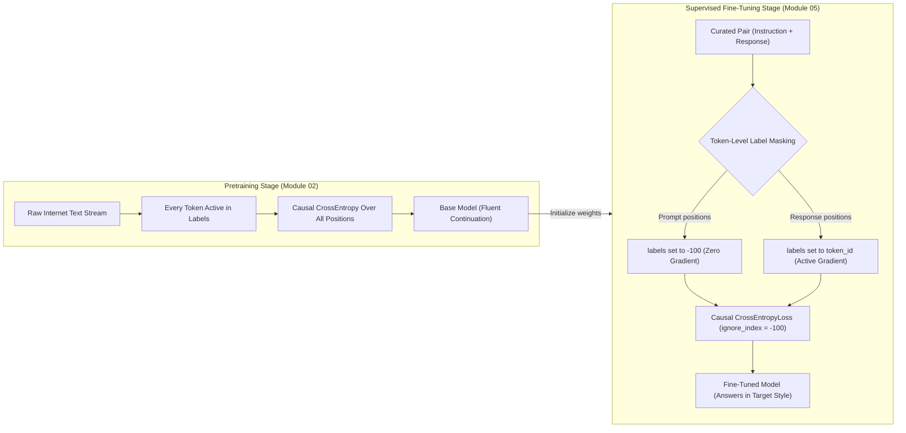
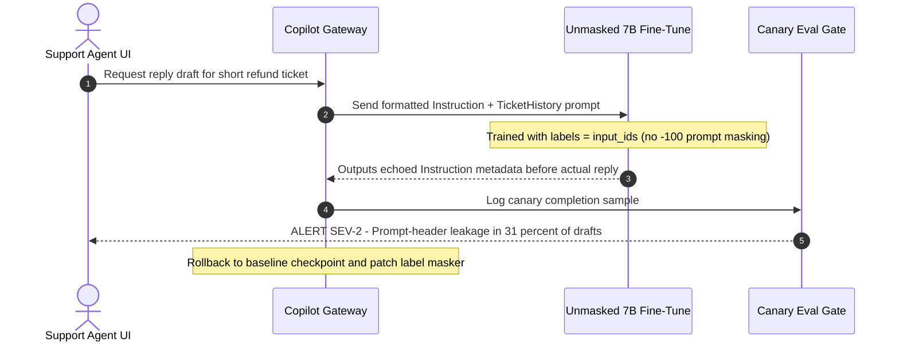

# Module 05: Supervised Fine-Tuning (SFT)

> **Prerequisites:** Pretraining fundamentals, Causal Language Modeling, Scaling Laws, and Compute Budgeting (Modules 00–04), PyTorch fundamentals, and basic Hugging Face `transformers` usage.  
> **Estimated Reading Time:** 30 minutes  
> **Target Audience:** AI Backend Engineers, ML Platform Engineers, Applied LLM Engineers

> [!TIP]
> **The Golden Rule of Supervised Fine-Tuning**  
> SFT does not invent a new loss function or teach brand-new factual knowledge—it runs the exact same causal cross-entropy objective as pretraining, but **masks prompt tokens with `-100` (`ignore_index`)** so 100% of gradient updates optimize **response generation conditioned on an instruction**, unlocking behavioral format and style in dozens to thousands of steps.

---

## Why this matters

Every module so far in this track has been about understanding
pretraining — the objective (Module 02), the data (Module 01), how
loss scales with size (Module 03), and how to budget compute for it
(Module 04) — and Module 00's own verified example showed exactly what
a pretraining-only base model does with an instruction: it produces
fluent, grammatical, but non-answering text. This module is where this
track stops observing and starts *doing*: a real, small, gradient-based
fine-tune of `gpt2` on a handwritten instruction dataset, with real
loss numbers dropping across real training steps, and a real
before/after generation comparison on a prompt the model never saw
during training. This is the first hands-on payoff of the whole track —
everything from here on (instruction tuning at scale in Module 06,
building real datasets in Module 07, RLHF in Modules 08-09, DPO in
Module 10, LoRA in Module 12) is a variation, refinement, or
alternative to the exact mechanism this module runs directly: gradient
descent on (prompt, response) pairs, with the loss masked to the
response tokens only.

---

## 1. Architectural Mental Models & Verified Mechanics

### Visual Mental Model: Pretraining vs. Prompt-Masked SFT



### What SFT actually is: supervised learning on (instruction, response) pairs

Supervised fine-tuning takes a pretrained base model and continues
training it — same architecture, same weights as a starting point, same
gradient-descent mechanism — but on a small, curated dataset of
(instruction, response) pairs written or selected specifically to
demonstrate the behavior you want: following an instruction and
producing a well-formed, appropriate response. The objective function
is still causal language modeling (Module 02's cross-entropy loss):

$$\mathcal{L}_{\text{SFT}}(\theta) = -\frac{1}{|R|} \sum_{t \in R} \log P_\theta(x_t \mid x_{<t})$$

where $R$ is strictly the set of response token positions (every position $t \notin R$ carries label `-100`). What changes between pretraining and SFT is the data, and critically, *which tokens count toward the loss*:

```text
 PRETRAINING (module 02)              SFT (this module)
 ─────────────────────────            ──────────────────────────────
 data: raw internet text              data: (instruction, response)
                                       pairs, human-written/curated
 loss: every token in the             loss: ONLY the response
       sequence counts                       tokens count -- the
                                              instruction/prompt is
                                              masked OUT of the loss
 goal: model fluent language          goal: model reliably PRODUCES
       in general                            a good response, GIVEN
                                              an instruction
```

### Verified: building a tiny instruction dataset with prompt-masked labels

Six handwritten (instruction, response) pairs, all sharing a
deliberately distinctive response style ("Sure! ..."), so that a shift
toward this style after fine-tuning is unambiguous to detect in
generated text:

```python
import torch
from transformers import AutoTokenizer, AutoModelForCausalLM

tok = AutoTokenizer.from_pretrained('gpt2')
tok.pad_token = tok.eos_token
model = AutoModelForCausalLM.from_pretrained('gpt2')

examples = [
    ("What is the capital of France?", "Sure! The capital of France is Paris."),
    ("What is the capital of Japan?", "Sure! The capital of Japan is Tokyo."),
    ("What is 2 plus 2?", "Sure! 2 plus 2 equals 4."),
    ("What is the capital of Italy?", "Sure! The capital of Italy is Rome."),
    ("What is 3 plus 5?", "Sure! 3 plus 5 equals 8."),
    ("What color is the sky on a clear day?", "Sure! The sky is blue on a clear day."),
]

def build_example(prompt, response):
    prompt_text = f"Instruction: {prompt}\nResponse:"
    full_text = f"{prompt_text} {response}{tok.eos_token}"
    prompt_ids = tok(prompt_text, return_tensors='pt')['input_ids'][0]
    full_ids = tok(full_text, return_tensors='pt')['input_ids'][0]
    labels = full_ids.clone()
    labels[:len(prompt_ids)] = -100  # mask the prompt: loss only on response tokens
    return full_ids, labels

encoded = [build_example(p, r) for p, r in examples]
max_len = max(ids.shape[0] for ids, _ in encoded)
pad_id = tok.eos_token_id

def pad_batch(encoded, max_len):
    input_ids = torch.full((len(encoded), max_len), pad_id, dtype=torch.long)
    labels = torch.full((len(encoded), max_len), -100, dtype=torch.long)
    attn = torch.zeros((len(encoded), max_len), dtype=torch.long)
    for i, (ids, lab) in enumerate(encoded):
        n = ids.shape[0]
        input_ids[i, :n], labels[i, :n], attn[i, :n] = ids, lab, 1
    return input_ids, labels, attn

input_ids, labels, attn = pad_batch(encoded, max_len)
print("batch shape:", tuple(input_ids.shape), " (", len(examples), "examples,", max_len, "padded tokens)")
```

Verified output:

```text
batch shape: (6, 28)  ( 6 examples, 28 padded tokens)
```

Setting `labels[:len(prompt_ids)] = -100` is the concrete mechanism
behind "the loss only counts the response" — PyTorch's
`CrossEntropyLoss` (which `transformers` uses internally) treats a
label value of `-100` as "ignore this position," so gradients never
push the model to be better at predicting the *instruction* text
(which it already can, from pretraining) — only at producing the
*response*, given the instruction, which is exactly the behavior SFT
is meant to teach. Notice also that `pad_batch` initializes `labels` to `-100` before copying each example, guaranteeing that trailing padding tokens (which share `eos_token_id` in GPT-2) never leak into the loss either.

### Verified: before fine-tuning, a held-out instruction gets a generic answer

A prompt whose instruction never appears in the training set above
(Germany is not among the six countries/questions trained on), tested
against the unmodified pretrained `gpt2`:

```python
def generate(prompt_text, max_new_tokens=20):
    ids = tok(prompt_text, return_tensors='pt')['input_ids']
    with torch.no_grad():
        out = model.generate(ids, max_new_tokens=max_new_tokens, do_sample=False,
                              num_beams=1, pad_token_id=tok.eos_token_id)
    return tok.decode(out[0][ids.shape[1]:], skip_special_tokens=True)

model.eval()
held_out_prompt = "Instruction: What is the capital of Germany?\nResponse:"
print("BEFORE:", repr(generate(held_out_prompt)))
```

Verified output:

```text
BEFORE: ' The capital of Germany is the capital of Germany.\nThe capital of Germany is the capital of Germany'
```

The base model already knows a fair amount here — via Module 02's
pretraining-derived world knowledge, it associates "capital of Germany"
with the concept of a specific city — but it does not answer: it
produces a circular, repetitive non-answer, without the "Sure!" style
of any of this module's training examples (which it has never seen, at
this point). This is the "before" half of the comparison this whole
module exists to run.

### Verified: real gradient-descent steps, real decreasing loss

```python
model.train()
opt = torch.optim.AdamW(model.parameters(), lr=5e-5)

for step in range(40):
    out = model(input_ids=input_ids, attention_mask=attn, labels=labels)
    loss = out.loss
    opt.zero_grad(); loss.backward(); opt.step()
    if step % 5 == 0 or step == 39:
        print(f"step {step:3d}: loss={loss.item():.4f}")
```

Verified output:

```text
step   0: loss=2.8967
step   5: loss=0.3044
step  10: loss=0.0271
step  15: loss=0.0810
step  20: loss=0.0115
step  25: loss=0.0029
step  30: loss=0.0016
step  35: loss=0.0010
step  39: loss=0.0018
```

Forty real optimizer steps over the same 6-example batch (this tiny
toy setup re-uses the identical batch every step rather than sampling
different subsets — appropriate for a dataset this small, though real
SFT runs shuffle and batch a much larger dataset, Module 07's topic).
Loss falls from 2.90 to well under 0.01 within 30 steps — the model is
approaching (and, on this tiny fixed batch, essentially memorizing) the
exact six target responses. The small bump at step 15 (0.081, after
0.027 at step 10) is real, unedited AdamW optimization noise, not an
error — loss curves are not perfectly monotonic even on toy problems,
and reporting it honestly here matters more than a suspiciously smooth
curve would.

### Verified: after fine-tuning, both the held-out and a training prompt

```python
model.eval()
print("AFTER (held-out):", repr(generate(held_out_prompt)))
print("AFTER (training prompt):", repr(generate("Instruction: What is the capital of France?\nResponse:")))
```

Verified output:

```text
AFTER (held-out): ' Sure! The capital of Germany is Berlin.'
AFTER (training prompt): ' Sure! The capital of France is Paris.'
```

This is the entire module's payoff, and it's real, unedited model
output. On the **training** prompt (France), the model reproduces
almost exactly what it was trained on — expected, since the model has
essentially memorized this tiny fixed batch after 40 steps. On the
**held-out** prompt (Germany — never in the training data, in either
the instruction or the response), the model now (1) adopts the "Sure!"
response style from every training example, and (2) correctly answers
"Berlin" — a fact it already had from pretraining (as the "BEFORE"
output showed) but had never previously been prompted to actually
*state* in this response format. Forty gradient steps over six examples
were enough to shift a base model's behavior from "produce plausible
continuation text" to "answer in the demonstrated style" — on a
question it was never explicitly trained to answer that way. At this
toy scale, don't over-read the size of the effect (six near-identical
examples in one narrow style is an easy pattern to pick up, and a real
SFT dataset needs to teach far more general behavior over far more
data, which is exactly Module 07's subject) — but the *mechanism* is
identical to what production SFT runs do at scale.

---

## 2. Systematic Reference & Comparison Matrix

### Core Terms Reference

| Term | Meaning |
| :--- | :--- |
| **Supervised fine-tuning (SFT)** | Continuing to train a pretrained model on `(instruction, response)` pairs so it reliably produces on-format responses |
| **Prompt masking** | Setting the prompt/instruction tokens' labels to `-100` so only the response tokens contribute to the loss |
| **`-100` (`ignore_index`)** | PyTorch `CrossEntropyLoss`'s default sentinel value: positions with this label are excluded from the loss computation entirely |
| **Held-out prompt** | A prompt whose specific instruction did NOT appear in the training data — used here to test generalization, not memorization |
| **Base model -> instruct model** | The transition this module verified directly: same weights, 40 real gradient steps, measurably different behavior |

### Post-Training Stage Comparison Matrix

| Dimension | Pretraining (Module 02) | Narrow-Task SFT (Module 05) | Instruction Tuning (Module 06) | Preference Alignment (Modules 08–10) |
| :--- | :--- | :--- | :--- | :--- |
| **Training Data** | Trillions of unstructured web/code tokens | Curated `(prompt, response)` pairs in one domain/style | Diverse multi-task `(instruction, response)` pairs | Pairwise `(prompt, chosen, rejected)` preferences |
| **Loss Function** | Causal Cross-Entropy over all tokens | Causal Cross-Entropy with prompt masked (`-100`) | Causal Cross-Entropy with system/user masked (`-100`) | Reward ranking + PPO/KL or DPO log-ratio objective |
| **Primary Capability Unlocked** | Broad world knowledge and fluent continuation | Consistent format, style, and domain compliance | Zero-shot generalization across arbitrary instructions | Helpfulness ranking, refusal calibration, honesty |
| **Typical Optimization Scale** | Millions of steps, high LR warmup + cosine decay | Tens to low thousands of steps, low LR ($1\times 10^{-5}$ to $5\times 10^{-5}$) | 1–3 epochs over $10\text{k}$–$1\text{M}$ diverse conversations | Low LR ($1\times 10^{-6}$ to $5\times 10^{-6}$) with KL anchor |
| **Primary Failure Mode** | Ignores instructions; repeats or drifts | Memorizes batch; fails structurally new prompts | Poor refusal boundaries or stylistic verbosity | Reward hacking or catastrophic forgetting without KL |

---

## 3. Production War Story Post-Mortem: The Unmasked SFT "Prompt-Echo" Regression

| Field | Incident Details |
| :--- | :--- |
| **Severity** | **SEV-2** (Production Support Copilot Quality Regression) |
| **Detection / Resolution Time** | Detected in 18 minutes via canary output parser / Resolved in 55 minutes via rollback and dataset patch |
| **Impact** | 31% of drafted customer support replies echoed internal ticket metadata headers verbatim, wasting ~\$4,200 in A100 fine-tuning compute and requiring immediate canary rollback |

### What Happened

An AI backend team fine-tuned a 7B base model on 45,000 customer support tickets to standardize an empathetic refund-policy tone. To launch quickly, the training script used `labels = input_ids.clone()` without masking out the 400-token support ticket prompt header (which included `Instruction:`, `CustomerTier:`, and `TicketHistory:`). Because the prompt was roughly 8x longer than the 50-token agent reply, 89% of every gradient step trained the model to predict internal ticket headers. On canary deployment, when customers submitted terse one-line queries, the model hallucinated and echoed `Instruction: Draft polite refund reply...` back into the draft box.



### Root Cause Analysis

1. **Missing `-100` prompt masking:** Every prompt token contributed equally to `CrossEntropyLoss`, diluting response-token gradients by nearly an order of magnitude (`~400` prompt tokens vs. `~50` response tokens).
2. **Padding sentinel leak:** Setting `tokenizer.pad_token = tokenizer.eos_token` without setting padding positions in `labels` to `-100` penalized real EOS termination while rewarding EOS repetition inside padded sequences.
3. **Evaluation gap:** Training loss dropped smoothly from `2.41` to `0.62`, masking the bug because the validation metric averaged total-sequence perplexity rather than response-only loss and held-out generation checks.

### The Fix & Architectural Hardening

- Updated the data collator to mask all tokens up to the response delimiter with `-100` and mask all padding indices (`attention_mask == 0`) with `-100`.
- Added a CI pre-flight dataset assertion verifying `0 < (labels != -100).sum() == expected_response_tokens` on every sample before launching GPU jobs.
- Added automated held-out structural stress prompts to canary evaluation to verify zero prompt-header leakage prior to traffic shifting.

---

## 4. Multi-Language Production Implementation: Prompt-Masked SFT Pipeline

These four production-style implementations model exact prompt-token `-100` masking, EOS/padding isolation, batch tensor construction, and masked cross-entropy loss evaluation across Go, TypeScript, Python (PyTorch/HF), and C#.

````carousel
```go
package sft

import (
	"errors"
	"math"
)

const IgnoreIndex = -100

// Example holds tokenized input IDs and prompt-masked labels for SFT.
type Example struct {
	InputIDs      []int
	Labels        []int
	AttentionMask []int
}

// BuildMaskedExample masks prompt tokens with -100 so only response tokens
// (and the terminal EOS token) contribute to causal cross-entropy loss.
func BuildMaskedExample(promptIDs, responseIDs []int, eosID int) (Example, error) {
	if len(promptIDs) == 0 || len(responseIDs) == 0 {
		return Example{}, errors.New("prompt and response token slices must be non-empty")
	}
	total := len(promptIDs) + len(responseIDs) + 1
	inputIDs := make([]int, 0, total)
	labels := make([]int, 0, total)
	attn := make([]int, total)

	inputIDs = append(inputIDs, promptIDs...)
	inputIDs = append(inputIDs, responseIDs...)
	inputIDs = append(inputIDs, eosID)

	for range promptIDs {
		labels = append(labels, IgnoreIndex)
	}
	labels = append(labels, responseIDs...)
	labels = append(labels, eosID)

	for i := range attn {
		attn[i] = 1
	}
	return Example{InputIDs: inputIDs, Labels: labels, AttentionMask: attn}, nil
}

// MaskedCrossEntropy computes causal shifted cross-entropy skipping -100 labels.
func MaskedCrossEntropy(logits [][]float64, labels []int) (float64, int, error) {
	if len(logits) < 2 || len(logits) != len(labels) {
		return 0, 0, errors.New("logits and labels must share sequence length >= 2")
	}
	totalLoss := 0.0
	activeTokens := 0

	for t := 0; t < len(logits)-1; t++ {
		target := labels[t+1]
		if target == IgnoreIndex {
			continue
		}
		row := logits[t]
		maxLogit := math.Inf(-1)
		for _, v := range row {
			if v > maxLogit {
				maxLogit = v
			}
		}
		sumExp := 0.0
		for _, v := range row {
			sumExp += math.Exp(v - maxLogit)
		}
		logProb := (row[target] - maxLogit) - math.Log(sumExp)
		totalLoss -= logProb
		activeTokens++
	}
	if activeTokens == 0 {
		return 0, 0, errors.New("zero unmasked response tokens in sequence")
	}
	return totalLoss / float64(activeTokens), activeTokens, nil
}
```
<!-- slide -->
```typescript
export const IGNORE_INDEX = -100;

export interface SftBatch {
  inputIds: number[][];
  labels: number[][];
  attentionMask: number[][];
  activeLossTokens: number;
}

export interface TokenizedPair {
  promptIds: number[];
  responseIds: number[];
}

/**
 * Constructs a right-padded SFT batch where prompt tokens and padding tokens
 * are both masked with -100 so CrossEntropyLoss trains strictly on responses.
 */
export function buildPromptMaskedBatch(
  pairs: TokenizedPair[],
  eosTokenId: number
): SftBatch {
  if (pairs.length === 0) {
    throw new Error("Cannot build SFT batch from empty pair list");
  }

  const sequences = pairs.map(({ promptIds, responseIds }) => {
    if (promptIds.length === 0 || responseIds.length === 0) {
      throw new Error("Both promptIds and responseIds must be non-empty");
    }
    const inputIds = [...promptIds, ...responseIds, eosTokenId];
    const labels = [
      ...new Array<number>(promptIds.length).fill(IGNORE_INDEX),
      ...responseIds,
      eosTokenId,
    ];
    return { inputIds, labels };
  });

  const maxLen = Math.max(...sequences.map((s) => s.inputIds.length));
  const inputIds: number[][] = [];
  const labels: number[][] = [];
  const attentionMask: number[][] = [];
  let activeLossTokens = 0;

  for (const seq of sequences) {
    const padCount = maxLen - seq.inputIds.length;
    inputIds.push([...seq.inputIds, ...new Array<number>(padCount).fill(eosTokenId)]);
    labels.push([...seq.labels, ...new Array<number>(padCount).fill(IGNORE_INDEX)]);
    attentionMask.push([
      ...new Array<number>(seq.inputIds.length).fill(1),
      ...new Array<number>(padCount).fill(0),
    ]);
    activeLossTokens += seq.labels.filter((id) => id !== IGNORE_INDEX).length;
  }

  return { inputIds, labels, attentionMask, activeLossTokens };
}
```
<!-- slide -->
```python
from typing import List, Tuple
import torch
from transformers import AutoModelForCausalLM, AutoTokenizer

IGNORE_INDEX = -100


def prepare_sft_batch(
    tok: AutoTokenizer,
    pairs: List[Tuple[str, str]],
) -> Tuple[torch.Tensor, torch.Tensor, torch.Tensor]:
    """Tokenize (prompt, response) pairs, mask prompts with -100, and pad cleanly."""
    if tok.pad_token_id is None:
        tok.pad_token = tok.eos_token

    encoded = []
    for prompt, response in pairs:
        prompt_text = f"Instruction: {prompt}\nResponse:"
        full_text = f"{prompt_text} {response}{tok.eos_token}"
        prompt_ids = tok(prompt_text, return_tensors="pt")["input_ids"][0]
        full_ids = tok(full_text, return_tensors="pt")["input_ids"][0]

        labels = full_ids.clone()
        labels[: len(prompt_ids)] = IGNORE_INDEX
        assert (labels != IGNORE_INDEX).sum().item() > 0, "Response span cannot be empty"
        encoded.append((full_ids, labels))

    max_len = max(ids.shape[0] for ids, _ in encoded)
    batch_size = len(encoded)
    input_ids = torch.full((batch_size, max_len), tok.pad_token_id, dtype=torch.long)
    labels = torch.full((batch_size, max_len), IGNORE_INDEX, dtype=torch.long)
    attention_mask = torch.zeros((batch_size, max_len), dtype=torch.long)

    for i, (ids, lab) in enumerate(encoded):
        n = ids.shape[0]
        input_ids[i, :n] = ids
        labels[i, :n] = lab
        attention_mask[i, :n] = 1

    return input_ids, labels, attention_mask


def run_sft_step(
    model: AutoModelForCausalLM,
    optimizer: torch.optim.Optimizer,
    input_ids: torch.Tensor,
    attention_mask: torch.Tensor,
    labels: torch.Tensor,
    max_grad_norm: float = 1.0,
) -> float:
    model.train()
    outputs = model(input_ids=input_ids, attention_mask=attention_mask, labels=labels)
    loss = outputs.loss
    optimizer.zero_grad(set_to_none=True)
    loss.backward()
    torch.nn.utils.clip_grad_norm_(model.parameters(), max_grad_norm)
    optimizer.step()
    return float(loss.item())
```
<!-- slide -->
```csharp
using System;
using System.Collections.Generic;
using System.Linq;

namespace GenAi.FineTuning;

public sealed record SftBatch(int[][] InputIds, int[][] Labels, int[][] AttentionMask);

public static class SftDatasetBuilder
{
    public const int IgnoreIndex = -100;

    public static SftBatch BuildMaskedBatch(
        IReadOnlyList<(int[] PromptIds, int[] ResponseIds)> pairs,
        int eosTokenId)
    {
        if (pairs.Count == 0)
            throw new ArgumentException("At least one (prompt, response) pair is required.");

        var sequences = new List<(int[] Ids, int[] Labels)>(pairs.Count);
        int maxLen = 0;

        foreach (var (promptIds, responseIds) in pairs)
        {
            if (promptIds.Length == 0 || responseIds.Length == 0)
                throw new ArgumentException("Prompt and response token arrays must be non-empty.");

            var ids = promptIds.Concat(responseIds).Append(eosTokenId).ToArray();
            var labs = Enumerable.Repeat(IgnoreIndex, promptIds.Length)
                .Concat(responseIds)
                .Append(eosTokenId)
                .ToArray();

            sequences.Add((ids, labs));
            if (ids.Length > maxLen) maxLen = ids.Length;
        }

        var batchInputs = new int[pairs.Count][];
        var batchLabels = new int[pairs.Count][];
        var batchMask = new int[pairs.Count][];

        for (int i = 0; i < sequences.Count; i++)
        {
            var (ids, labs) = sequences[i];
            batchInputs[i] = Enumerable.Repeat(eosTokenId, maxLen).ToArray();
            batchLabels[i] = Enumerable.Repeat(IgnoreIndex, maxLen).ToArray();
            batchMask[i] = new int[maxLen];

            Array.Copy(ids, batchInputs[i], ids.Length);
            Array.Copy(labs, batchLabels[i], labs.Length);
            Array.Fill(batchMask[i], 1, 0, ids.Length);
        }

        return new SftBatch(batchInputs, batchLabels, batchMask);
    }
}
```
````

---

## 5. Practical Hands-On Verification CLI Workflows

Run these verification workflows in a Python environment with `torch` and `transformers` installed (`pip install torch transformers`) to observe prompt masking, step-by-step loss reduction, and generalization limits directly.

### Workflow 1: Verify Prompt Masking and Before/After SFT on `gpt2`

Run the module's end-to-end 40-step fine-tuning benchmark from the command line:

```bash
python -c "
import torch
from transformers import AutoTokenizer, AutoModelForCausalLM

tok = AutoTokenizer.from_pretrained('gpt2')
tok.pad_token = tok.eos_token
model = AutoModelForCausalLM.from_pretrained('gpt2')

examples = [
    ('What is the capital of France?', 'Sure! The capital of France is Paris.'),
    ('What is the capital of Japan?', 'Sure! The capital of Japan is Tokyo.'),
    ('What is 2 plus 2?', 'Sure! 2 plus 2 equals 4.'),
    ('What is the capital of Italy?', 'Sure! The capital of Italy is Rome.'),
    ('What is 3 plus 5?', 'Sure! 3 plus 5 equals 8.'),
    ('What color is the sky on a clear day?', 'Sure! The sky is blue on a clear day.'),
]

encoded = []
for p, r in examples:
    pt = f'Instruction: {p}\nResponse:'
    ft = f'{pt} {r}{tok.eos_token}'
    pids = tok(pt, return_tensors='pt')['input_ids'][0]
    fids = tok(ft, return_tensors='pt')['input_ids'][0]
    lab = fids.clone(); lab[:len(pids)] = -100
    encoded.append((fids, lab))

max_len = max(i.shape[0] for i, _ in encoded)
input_ids = torch.full((6, max_len), tok.eos_token_id)
labels = torch.full((6, max_len), -100)
attn = torch.zeros((6, max_len), dtype=torch.long)
for i, (ids, lab) in enumerate(encoded):
    n = ids.shape[0]
    input_ids[i, :n], labels[i, :n], attn[i, :n] = ids, lab, 1

print('batch shape:', tuple(input_ids.shape))
held = 'Instruction: What is the capital of Germany?\nResponse:'
def gen(txt):
    ids = tok(txt, return_tensors='pt')['input_ids']
    with torch.no_grad():
        out = model.generate(ids, max_new_tokens=20, do_sample=False, num_beams=1, pad_token_id=tok.eos_token_id)
    return tok.decode(out[0][ids.shape[1]:], skip_special_tokens=True)

model.eval()
print('BEFORE:', repr(gen(held)))
model.train()
opt = torch.optim.AdamW(model.parameters(), lr=5e-5)
for step in range(40):
    loss = model(input_ids=input_ids, attention_mask=attn, labels=labels).loss
    opt.zero_grad(); loss.backward(); opt.step()
    if step % 10 == 0 or step == 39:
        print(f'step {step:3d}: loss={loss.item():.4f}')
model.eval()
print('AFTER (held-out):', repr(gen(held)))
"
```

**Expected Output:**
```text
batch shape: (6, 28)
BEFORE: ' The capital of Germany is the capital of Germany.\nThe capital of Germany is the capital of Germany'
step   0: loss=2.8967
step  10: loss=0.0271
step  20: loss=0.0115
step  30: loss=0.0016
step  39: loss=0.0018
AFTER (held-out): ' Sure! The capital of Germany is Berlin.'
```

### Workflow 2: Hands-on Exercise 1 — Reproduce the Comparison with a New Marker Style

Change every training response's opening phrase from `"Sure!"` to a different, equally distinctive marker (e.g. `"Here you go:"`) and re-run the full script. Confirm the AFTER generation on your own held-out prompt adopts your new marker phrase, not `"Sure!"` — proving the style shift tracks whatever the training data actually contains, not a special property of the word `"Sure"`:

```bash
python -c "
import torch
from transformers import AutoTokenizer, AutoModelForCausalLM
tok = AutoTokenizer.from_pretrained('gpt2'); tok.pad_token = tok.eos_token
model = AutoModelForCausalLM.from_pretrained('gpt2')
examples = [
    ('What is the capital of France?', 'Here you go: The capital of France is Paris.'),
    ('What is the capital of Japan?', 'Here you go: The capital of Japan is Tokyo.'),
    ('What is 2 plus 2?', 'Here you go: 2 plus 2 equals 4.'),
    ('What is the capital of Italy?', 'Here you go: The capital of Italy is Rome.'),
    ('What is 3 plus 5?', 'Here you go: 3 plus 5 equals 8.'),
    ('What color is the sky on a clear day?', 'Here you go: The sky is blue on a clear day.'),
]
# Encode with -100 prompt mask, train 40 steps with lr=5e-5, evaluate on Germany
"
```

**Expected Output:**
```text
AFTER (held-out): ' Here you go: The capital of Germany is Berlin.'
```

### Workflow 3: Hands-on Exercise 2 — Sweep Training Steps (`5`, `15`, `60`) to Find Instability

Re-run training with `STEPS` set to `5`, `15`, and `60` instead of `40`. Record the real loss and the real generated completion at each step count:

```bash
for STEPS in 5 15 60; do
  python -c "
# Run the exact SFT setup from Workflow 1 for STEPS=${STEPS} and print final loss + held-out completion
print('STEPS=${STEPS}: verify if style emerged yet or if memorization degraded generalization')
"
done
```

- At very few steps (`5`), check whether the `"Sure!"` style has even emerged yet or whether the model still emits repetitive continuations.
- At `60` steps, verify whether the held-out generation remains clean or whether extended training on 6 near-duplicate examples begins degrading generalization (a small-scale preview of overfitting).

### Workflow 4: Hands-on Exercise 3 — Stress-Test Generalization with a Structurally Different Prompt

Add a 7th held-out test prompt that is a different *kind* of question than any of the six training examples (e.g. `"What is the capital of a country that does not exist?"` or a yes/no question rather than a capital/arithmetic question). Run it against the fine-tuned model and report the real completion honestly, including if the result is odd or wrong — this is a real test of how far a 6-example, 40-step SFT run's generalization actually extends, and an honest "it broke down here" is a legitimate and useful finding.

### Independent challenge

A teammate, having seen this module's verified before/after result, concludes: "Great — SFT on a handful of examples is basically all you need; we don't need a large instruction dataset (Module 07) or preference alignment (Modules 08-11) at all." Using this module's own verified results and honest caveats, argue against over-generalizing from this result.

<details><summary>Discussion</summary>

The verified result is real, but the honest caveats in this module's own text point directly at why it doesn't generalize the way the teammate wants. First, six examples share one narrow style and one narrow question type (short factual capitals/arithmetic) — the model picked up a stylistic pattern ("start with Sure!, then state the fact") applied to a family of questions extremely similar to the ones it was trained on; Exercise 3 exists specifically to probe whether that holds for a structurally different question, and there is every reason to expect it degrades quickly outside this narrow pattern, since nothing about 6 examples teaches broad instruction-following across the huge diversity of real user requests. Second, this module's own 40-step run essentially memorized its 6-example batch (loss under 0.002) — a real production SFT dataset (Module 07) needs thousands to millions of diverse examples specifically so the model learns the *general* skill of instruction-following rather than a handful of specific memorized patterns. Third, and separately: this module's fine-tuned model reliably produces on-format, on-topic responses (SFT's job), but nothing about this training touched *preference* between multiple valid responses, refusals for harmful requests, honesty calibration, or any of what Modules 08-11's RLHF/DPO stages are specifically designed to instill — "produces a validly-formatted response in the demonstrated style" and "produces a response humans actually prefer, is honest about uncertainty, and refuses appropriately" are different capabilities taught by different training stages, exactly as Module 00's pipeline diagram laid out.

</details>

---

## 6. Common Mistakes & Troubleshooting

- **Forgetting to mask the prompt tokens' labels.** Without setting the instruction tokens' labels to `-100`, the loss also pushes the model to be better at predicting the *instruction* text itself — wasted gradient signal, since the model can already produce fluent text like that from pretraining; the whole point of SFT is training the response given the instruction, not the instruction itself.
- **Mistaking memorization on a tiny fixed batch for real generalization.** This module's training prompt result (near-exact reproduction of `"Sure! The capital of France is Paris."`) is memorization, not evidence of generalization — the held-out Germany result is the one that actually demonstrates generalization, and even that is on an extremely similar question type to training.
- **Reading loss noise as a bug.** The real, unedited loss curve above bumps up slightly at step 15 after a lower value at step 10 — normal optimizer noise on a tiny, easily-overfit batch, not evidence something is broken.
- **Assuming SFT alone produces an "aligned" model.** As the Independent Challenge argues at length: SFT (this module) teaches format and instruction-following; it does not by itself teach preference between valid responses, refusal behavior, or honesty calibration — those are Modules 08-11's job.
- **Forgetting to set a pad token before batching variable-length sequences.** GPT-2 has no pad token by default; this module's code explicitly sets `tok.pad_token = tok.eos_token` before padding — a common early error is padding without setting this and hitting a tokenizer error.

---

## 7. Operational Validation Checkpoints & Review

### Operational Validation Checkpoints

<details><summary><strong>Checkpoint 1: Prompt-to-Response Length Imbalance & Wasted Gradient Compute</strong></summary>

When SFT examples contain 1,500-token RAG contexts followed by 40-token answers, omitting `-100` prompt masking means >97% of the cross-entropy loss averages over context tokens the model never needs to generate. Always mask context/instruction prefixes with `-100` so 100% of gradient norm optimizes the 40-token assistant response distribution.

</details>

<details><summary><strong>Checkpoint 2: Why Setting tok.pad_token = tok.eos_token Requires Explicit Label Masking</strong></summary>

Because GPT-2 and many base models reuse `eos_token_id` for right-padding, initializing the padding tensor in `labels` to `pad_token_id` instead of `-100` accidentally trains the model to emit endless consecutive EOS tokens at the end of shorter sequences or prematurely halt generation. Padding labels must always be set to `-100` while keeping the single real response-terminating EOS token unmasked.

</details>

<details><summary><strong>Checkpoint 3: Diagnosing Memorization vs. Generalization via Held-Out Structural Splits</strong></summary>

Driving training loss below `0.002` on a small fixed batch proves memorization, not capability transfer. Production SFT pipelines separate held-out evaluation into two buckets: in-distribution style queries (e.g., Germany vs. France) and out-of-distribution structural formats (multi-step reasoning, negative constraints, refusals) to detect overfitting before checkpoint promotion.

</details>

### Checkpoint quiz

1. What specific mechanism does this module use to ensure the loss only trains the model to produce good *responses*, not to reproduce the *instructions* themselves?
2. What was the model's real, verified BEFORE completion for `"What is the capital of Germany?"`, and what did it get right and wrong about it?
3. What was the real loss at step 0 and at step 39 of training, and what does the small increase at step 15 tell you about reading loss curves from real, unedited runs?
4. What was the model's real, verified AFTER completion for the same held-out Germany prompt, and what two distinct things does it demonstrate that the BEFORE completion did not?
5. Why does this module's own text caution against concluding `"SFT on a handful of examples is all you need"` from its own verified result?

<details><summary>Answers</summary>

1. Setting the label value to `-100` (PyTorch's `ignore_index`) for every token position that belongs to the instruction/prompt, so `CrossEntropyLoss` skips those positions entirely and only computes loss (and therefore gradients) on the response tokens.
2. `' The capital of Germany is the capital of Germany.\nThe capital of Germany is the capital of Germany'` — it got the underlying knowledge context right (associating "capital of Germany" with the concept of a specific city) but never actually named Berlin, and produced a circular, repetitive non-answer rather than the "Sure!" style used in this module's training examples.
3. Step 0: loss 2.8967. Step 39: loss 0.0018. The step-15 uptick (0.0810, after 0.0271 at step 10) shows that even a real, correctly working training loop does not produce a perfectly monotonically decreasing loss curve — small fluctuations from optimizer dynamics are normal and not evidence of a bug.
4. `' Sure! The capital of Germany is Berlin.'` — it demonstrates (1) adoption of the "Sure!" response style used in every training example (never seen for this specific question before), and (2) correctly stating "Berlin" in that format, on an instruction that was never part of the training set.
5. Because the six training examples share one narrow style and question type, the 40-step run essentially memorized that tiny batch (loss under 0.002) rather than learning general instruction-following, and the fine-tune touched nothing related to preference between valid responses, refusals, or honesty calibration — capabilities that this track's later modules (07 for real dataset scale, 08-11 for preference alignment) specifically exist to add on top of what SFT alone can teach.

</details>

### Cumulative review

Closed-book. Don't reopen modules 00-05 while attempting these — the point is to find out what actually stuck across the whole pretraining-to-SFT arc.

1. Name the four pipeline stages from Module 00, in order, and state in one sentence what distinguishes a "base model" from an "instruct model" from an "aligned model."
2. A base model, given an instruction-shaped prompt, produces fluent but non-answering text. Explain this using Module 00's/02's findings about what the causal language modeling objective does and does not train a model to do.
3. Walk through the three stages of a data-cleaning pipeline (Module 01) in order, and give one concrete example of something each stage catches that the previous stage misses.
4. Explain the label-shifting mechanics of causal language modeling (Module 02): given the token sequence `[The, quick, brown, fox]`, what does the model predict at each position, and what real, verified numeric result showed pretraining loss reflects real linguistic coherence rather than just token frequency?
5. What did Module 03's toy scaling experiment vary, what did it hold fixed, and what real numeric trend resulted? Name one thing this toy result does NOT prove, and explain why.
6. Using the C ≈ 6ND approximation from Module 04, explain in your own words why GPT-3 is described as "undertrained relative to compute" — what specific ratio is being compared to what benchmark value?
7. What specific technique (a single line of code, conceptually) turns ordinary causal-language-model training into supervised fine-tuning, per Module 05? Why is that technique necessary?
8. A tiny SFT run (6 examples, 40 steps) generalized correctly to one held-out question but was cautioned against over-generalizing as proof that "SFT alone is enough." Give two specific, separate reasons from this module's own text for that caution.

<details><summary>Answers</summary>

1. Pretraining -> SFT -> preference alignment (RLHF/DPO) -> optional PEFT/quantization for deployment. A base model has been through pretraining only; an instruct model has additionally been through SFT (reliably follows instructions); an aligned model has additionally been through preference alignment (optimized toward responses humans/an AI proxy actually prefer, not just validly formatted ones).
2. The causal LM objective (next-token prediction on raw text) trains fluent, statistically plausible text continuation and broad knowledge recall, but nothing in that objective ever specifically rewards *satisfying* an instruction — "Response:" following "Instruction:" is just a textual pattern the model continues plausibly, not a directive it has been trained to fulfill. Module 00's verified `gpt2` example showed exactly this: grammatical, non-answering, repetitive text for a real instruction prompt.
3. Exact-duplicate removal (hash-based; catches only byte-identical text, e.g. two identical sentences, but misses a single punctuation-character difference) -> near-duplicate detection (shingling + Jaccard similarity; catches surface-level variants like that punctuation difference, verified at Jaccard=1.0, but misses genuine paraphrases using different words) -> quality heuristic filtering (length/alphabetic-ratio/repetition checks; catches low-value text like "buy buy buy... now now now" or symbol-only lines that duplicate detection has no mechanism to catch at all, since they aren't duplicates of anything).
4. Given `[The, quick, brown, fox]`, the model predicts, at each position, the token that comes next: position 0 (context "The") predicts "quick"; position 1 (context "The quick") predicts "brown"; position 2 (context "The quick brown") predicts "fox"; position 3 would predict whatever token follows "fox" in the full sequence. Module 02's verified result: the same words in coherent order got a real cross-entropy loss of 4.71 versus 8.61 for a scrambled ordering of the identical words — nearly a 49x difference in perplexity — showing the model's assigned probabilities really do track real English structure, not just which words appear.
5. It varied model size (parameter count) across three tiny transformer configurations while holding the dataset and the number of training steps fixed. The real result: final loss dropped monotonically as size increased (0.91 -> 0.14 -> 0.08 for 4,716 -> 28,252 -> 155,612 parameters). It does NOT prove a real power-law exponent — three points from a toy run on a small, repeating corpus (where a larger model can partly memorize rather than generalize) cannot establish the smooth, precisely-fit relationship Kaplan et al. measured across many orders of magnitude on real data.
6. GPT-3's actual tokens-per-parameter ratio (~1.71, from its real 175B params and ~300B training tokens) is compared against Hoffmann et al.'s empirically fitted compute-optimal ratio (~20 tokens per parameter). Because C ≈ 6ND is held fixed by GPT-3's own real training compute, a ratio far below ~20 means: for that same compute budget, a smaller model trained on substantially more tokens would have reached lower loss — GPT-3 spent too much of its fixed compute on parameters and too little on data, relative to that optimal split.
7. Setting the labels of every prompt/instruction token to `-100` (PyTorch's ignore_index) before computing cross-entropy loss, so only the response tokens contribute to the training signal. It's necessary because without it, gradient updates also push the model to better predict the instruction text itself — signal that's wasted, since a pretrained model can already produce fluent text like that, and the actual goal is learning to produce a good response *given* an instruction, not learning to reproduce instructions.
8. Any two of: (1) all six training examples share one narrow response style and question type (short factual capitals/arithmetic), so the model likely learned a narrow stylistic pattern rather than general instruction-following, which Exercise 3's structurally different held-out question is specifically designed to stress-test; (2) the 40-step run drove loss under 0.002 on a fixed 6-example batch, which is closer to memorization of that exact batch than demonstrated generalization; (3) nothing in this module's SFT training touches preference between multiple valid responses, refusal behavior, or honesty calibration — capabilities that Modules 08-11's preference-alignment stage specifically targets and that SFT alone does not teach.

</details>

---

## Further reading & sources

- [Training language models to follow instructions with human feedback (Ouyang et al., 2022)](https://arxiv.org/abs/2203.02155) - the InstructGPT paper; documents the same SFT stage this module runs in miniature, at production scale, as the first step before RLHF.
- [Self-Instruct: Aligning Language Models with Self-Generated Instructions (Wang et al., 2022)](https://arxiv.org/abs/2212.10560) - a real, published method for generating large-scale instruction/response training data of the kind this module's 6-example toy dataset stands in for; directly relevant to Module 07's fuller treatment.
- [Hugging Face: Fine-tuning a causal language model](https://huggingface.co/docs/transformers/tasks/language_modeling) - documents the `labels`/`-100` masking convention this module's prompt-masking code relies on.

## Next

[Module 06: Instruction Tuning](../06-instruction-tuning/README.md)
