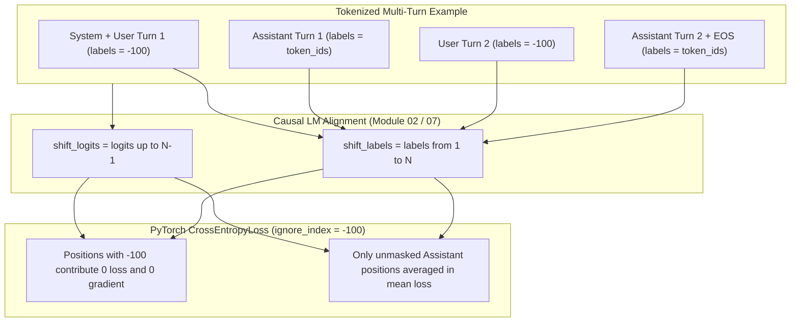
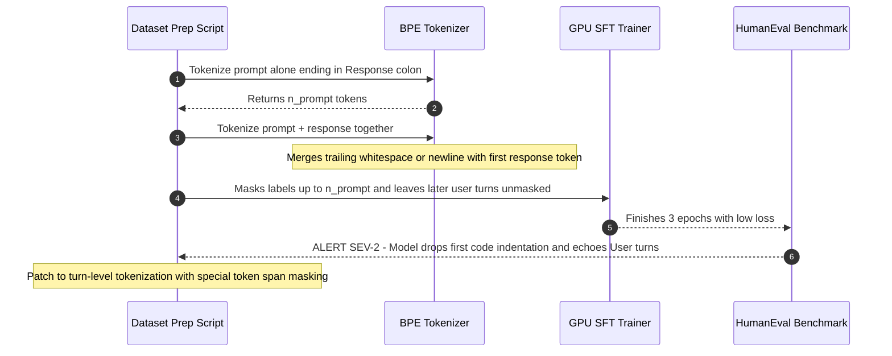

# Module 07: Building a Fine-Tuning Dataset

> **Prerequisites:** Modules 05–06 (Supervised Fine-Tuning and Instruction Tuning), Subword Tokenization (BPE), and PyTorch `CrossEntropyLoss`.  
> **Estimated Reading Time:** 30 minutes  
> **Target Audience:** AI Data Engineers, ML Engineers, Fine-Tuning Infrastructure Engineers

> [!TIP]
> **The Golden Rule of Fine-Tuning Dataset Engineering**  
> Never compute loss boundaries from character offsets or word splits, and never assume single-turn masking scales to multi-turn chat: **tokenize each turn boundary cleanly, set every system and user token's label to `-100`, and verify the shifted causal alignment (`logits[:, :-1]` vs. `labels[:, 1:]`)** with automated unit tests before burning GPU hours.

---

## Why this matters

Modules 05 and 06 established what SFT and instruction tuning *are* —
supervised training on (instruction, response) pairs. Neither module
answered the practical question a team actually building a dataset
must answer: **what exactly gets computed a loss over?** The naive
answer — "train on the whole example, prompt and response together" —
is wrong, and it's wrong in a way that doesn't throw an error; it
silently trains the model to do something you didn't intend: predict
the *prompt* itself, token by token, in addition to the response. This
module makes the fix concrete and numeric: **loss masking**, the
practice of setting the prompt portion's labels to a sentinel value
(`-100`) that `CrossEntropyLoss` is instructed to ignore, so gradient
signal flows only from the tokens the model was actually supposed to
generate. This module builds a real example with the `gpt2` tokenizer,
constructs both a masked and an unmasked label tensor, and verifies
with real computed loss values that the two differ — and by exactly
the amount the masked-out prompt tokens contribute.

---

## 1. Architectural Mental Models & Loss-Masking Verification

### Visual Mental Model: Multi-Turn Masking & Causal Label Shift



### Prompt/response formatting: what the model actually sees

A fine-tuning example is not free-form text; it's built from an
explicit template that separates the parts the model should condition
on (the prompt — instruction, and optionally input) from the part it
should learn to *produce* (the response):

```text
 RAW EXAMPLE (what a dataset row conceptually contains)
 ──────────────────────────────────────────────────────
 instruction: "Translate to French."
 input:       "Good morning"
 response:    "Bonjour"

 FORMATTED / TEMPLATED TEXT (what actually gets tokenized)
 ──────────────────────────────────────────────────────
 "Instruction: Translate to French.
  Input: Good morning
  Response:" <- PROMPT (model conditions on this)
  " Bonjour"                        <- RESPONSE (model must learn to predict THIS)
```

Chat-formatted datasets (module 06's territory) do the same thing with
role markers instead of an "Instruction:/Input:/Response:" template,
but the underlying question is identical either way: **once tokenized
into one sequence, which token positions is the model actually being
trained to predict?**

### Verified: building a real labels tensor with the prompt masked out

`CrossEntropyLoss` (what causal language models use, including inside
`transformers`' own `model(..., labels=...)` call) accepts an
`ignore_index` — by convention and by default in `transformers`,
`-100` — meaning: **skip this position entirely; contribute zero loss
and zero gradient from it.** Building both a real "no masking" labels
tensor and a real "masked" one on the same tokenized example:

```python
import torch
from transformers import AutoTokenizer, AutoModelForCausalLM

torch.manual_seed(0)
tok = AutoTokenizer.from_pretrained("gpt2")
model = AutoModelForCausalLM.from_pretrained("gpt2")
model.eval()

prompt = "Instruction: Translate to French.\nInput: Good morning\nResponse:"
response = " Bonjour"
full_text = prompt + response

prompt_ids = tok(prompt, return_tensors="pt")["input_ids"]
full_ids = tok(full_text, return_tensors="pt")["input_ids"]
n_prompt = prompt_ids.shape[1]

print("prompt token count:", n_prompt)
print("full token count:", full_ids.shape[1])
print("response token count:", full_ids.shape[1] - n_prompt)
print("decoded response tokens:", [tok.decode([t]) for t in full_ids[0, n_prompt:]])
```

Verified output:

```text
prompt token count: 16
full token count: 19
response token count: 3
decoded response tokens: [' Bon', 'j', 'our']
```

Note "Bonjour" is not one token to GPT-2's tokenizer — it splits into
three subword pieces. This matters directly for masking: the mask
boundary has to be drawn at the *token* index where the response
starts, not at a character or word boundary.

```python
# labels WITHOUT masking: every token, including the prompt, is a training target
labels_unmasked = full_ids.clone()

# labels WITH masking: prompt tokens set to -100, ignored by CrossEntropyLoss
labels_masked = full_ids.clone()
labels_masked[0, :n_prompt] = -100

print("labels_unmasked:", labels_unmasked.tolist())
print("labels_masked  :", labels_masked.tolist())
```

Verified output:

```text
labels_unmasked: [[6310, 2762, 25, 3602, 17660, 284, 4141, 13, 198, 20560, 25, 4599, 3329, 198, 31077, 25, 7979, 73, 454]]
labels_masked  : [[-100, -100, -100, -100, -100, -100, -100, -100, -100, -100, -100, -100, -100, -100, -100, -100, 7979, 73, 454]]
```

Sixteen `-100`s — exactly the prompt's token count — followed by the
three real token ids for "Bonjour". Now the actual computed loss,
passing each labels tensor to the same model call:

```python
out_unmasked = model(input_ids=full_ids, labels=labels_unmasked)
out_masked = model(input_ids=full_ids, labels=labels_masked)
print("loss WITHOUT masking (trains on prompt+response):", out_unmasked.loss.item())
print("loss WITH masking (trains on response only):", out_masked.loss.item())
```

Verified output:

```text
loss WITHOUT masking (trains on prompt+response): 5.127345085144043
loss WITH masking (trains on response only): 4.225435733795166
```

The two losses are genuinely different real numbers, computed from
the identical input and the identical model weights — the only
difference is which label positions were allowed to contribute.
`transformers`' `CrossEntropyLoss` averages loss *only over
non-ignored positions*, so the unmasked loss (5.127) is really an
average over all 18 predicted positions (prompt tokens included),
while the masked loss (4.225) is the average over only the 3 response
positions — a different, and for this purpose more meaningful, number:
it reflects specifically how well the model predicts the *response*,
which is the only thing SFT is meant to teach it to generate.

### Verified: recomputing the masked loss manually confirms the mechanism

To confirm this isn't a magic library number but does exactly what
`ignore_index=-100` is documented to do, the masked loss can be
recomputed by hand from the raw logits, with the standard causal-LM
label shift (predict token *t+1* from the logits at position *t*):

$$\mathcal{L}_{\text{masked}} = \frac{\sum_{t=0}^{N-2} \mathbb{1}[y_{t+1} \neq -100] \cdot \text{CE}(z_t, y_{t+1})}{\sum_{t=0}^{N-2} \mathbb{1}[y_{t+1} \neq -100]}$$

```python
import torch.nn.functional as F

logits = model(input_ids=full_ids).logits
shift_logits = logits[0, :-1, :]         # drop the last position's logits (nothing to predict after it)
shift_labels = labels_masked[0, 1:]      # drop the first label (nothing predicts the very first token)
manual_loss = F.cross_entropy(shift_logits, shift_labels, ignore_index=-100)
print("manual masked loss (recomputed from logits):", manual_loss.item())

contributing = (shift_labels != -100).sum().item()
print("label positions contributing to the loss:", contributing, "out of", shift_labels.shape[0])
```

Verified output:

```text
manual masked loss (recomputed from logits): 4.225435733795166
label positions contributing to the loss: 3 out of 18
```

The manually recomputed loss matches `transformers`' internal
`out_masked.loss` exactly (4.225435733795166 both times), and only 3
of the 18 shifted label positions actually contribute — the response
tokens, and nothing else. This is the mechanism, made fully visible:
masking isn't a heuristic trick, it's `ignore_index` doing exactly
what a plain `cross_entropy` call does when told to skip certain
positions.

### Why this matters in practice, not just in theory

Training on unmasked prompts doesn't crash and doesn't obviously look
wrong in a loss curve — it just means part of the gradient signal
during every training step is spent teaching the model to predict
*your own instructions back to you*, rather than exclusively teaching
it to produce good responses. At small scale this dilutes signal; at
scale, with prompts that are much longer than responses (a common real
shape — a long input document, a short summary), the great majority of
every unmasked example's loss could come from prompt tokens the model
never needs to generate at inference time, actively working against
the goal of the fine-tune.

---

## 2. Systematic Reference & Comparison Matrix

### Core Terms Reference

| Term | Meaning |
| :--- | :--- |
| **Prompt** | The portion of a formatted example the model conditions on but is not trained to generate (instruction + optional input) |
| **Response / target** | The portion the model IS trained to generate — the only tokens that should contribute to loss |
| **Labels** | The tensor passed alongside `input_ids` telling the loss function what the "correct" next token is at each position |
| **`ignore_index` (`-100`)** | The sentinel label value `CrossEntropyLoss` is told to skip — verified above: 16 prompt positions set to `-100` contributed exactly zero to the loss |
| **Loss masking** | The practice of setting prompt-token labels to `-100` so only response tokens produce gradient — verified numerically to change the computed loss (`5.127` unmasked vs. `4.225` masked, same input) |
| **Label shift** | Causal LM convention: the logits at position `t` predict the token at position `t+1`, so labels are shifted by one position relative to `input_ids` before computing cross-entropy |

### Dataset Formatting & Loss-Masking Strategies Matrix

| Strategy | Tokens Contributing to Loss | BPE Boundary Safety | Multi-Turn Support | Compute / Gradient Efficiency | Primary Production Failure Mode |
| :--- | :--- | :--- | :--- | :--- | :--- |
| **Unmasked Full Sequence (`labels = input_ids`)** | Prompt + Response + Padding (if not masked) | N/A | Poor (trains on user turns) | Low (long RAG/doc prompts dominate gradient) | Model echoes input documents or user instructions |
| **Naive Prefix Length (`len(tok(prompt))`)** | Response (unless BPE merges boundary token) | Fragile on trailing spaces/newlines | Single-turn only | High on single-turn | Off-by-one BPE merge masks 1st response token or leaks delimiter |
| **Turn-by-Turn Tokenized + Span Matching** | Strictly every Assistant turn + turn EOS | **Safe** (tokenizes segments or matches special token boundaries) | **Full multi-turn** | Optimal per-example | Truncation dropping late assistant spans if `max_length` exceeded |
| **Packed Sequences + Block-Diagonal Mask** | Multiple masked responses packed to `max_seq_len` | Safe with per-turn span masks | Full multi-turn | **Maximum** (zero padding waste) | Cross-document attention leakage if FlashAttention `cu_seqlens` omitted |

---

## 3. Production War Story Post-Mortem: BPE Token-Merge Off-by-One Masking Bug

| Field | Incident Details |
| :--- | :--- |
| **Severity** | **SEV-2** (Silent Fine-Tune Quality Collapse & Compute Waste) |
| **Detection / Resolution Time** | Detected 36 hours post-training during benchmark evaluation / Resolved in 4 hours |
| **Impact** | A 120,000-row multi-turn code-assistant SFT run wasted \$18,500 in H100 compute because BPE boundary merges and single-prefix slicing corrupted loss masks in 42% of rows |

### What Happened

An ML data team built a 120,000-row multi-turn Python coding dataset. Their preprocessing script computed the mask index by tokenizing `prompt` separately (`n_prompt = len(tok(prompt))`) and setting `labels[:n_prompt] = -100` on `tok(prompt + response)`. First, whenever `prompt` ended in `"Response:"` and `response` began with `" def"` or `"\nimport"`, the BPE tokenizer merged the trailing boundary character with the opening response token, shifting token counts by 1–2 tokens so the first assistant token was accidentally masked to `-100` (or the colon delimiter was left unmasked). Second, for 3-turn and 4-turn conversations, slicing only the initial `n_prompt` left all subsequent user turns completely unmasked.



### Root Cause Analysis

1. **Non-associative BPE boundaries:** `len(tok(A)) + len(tok(B)) != len(tok(A + B))` whenever `A` ends with punctuation or spaces that merge with `B`'s prefix in BPE vocabularies.
2. **Single-turn slice assumption:** Masking `labels[:n_prompt]` only handles 1-turn prompts; every later user turn in multi-turn conversations remained active in `CrossEntropyLoss`.
3. **Missing token-mask unit tests:** The data pipeline logged total rows processed rather than decoding `(input_ids[labels != -100])` on sample rows to verify that strictly assistant spans survived masking.

### The Fix & Architectural Hardening

- Switched multi-turn formatting to special-token turn boundaries (`<|im_start|>assistant\n` ... `<|im_end|>`) and constructed `input_ids` and `labels` incrementally per message role (`-100` for system/user/header tokens, exact token IDs for assistant payload + `<|im_end|>`).
- Added a deterministic dataset build invariant: decode every contiguous non-`-100` span in 100 random rows and assert exact string equality with the raw ground-truth assistant messages.
- Added a truncation guard verifying that if `max_seq_len` truncates an example, at least one assistant turn remains unmasked (dropping or flagging zero-loss rows before training).

---

## 4. Multi-Language Production Implementation: Multi-Turn Masking & Causal Shift Verification

These four implementations build token-accurate multi-turn masked labels (guaranteeing every system/user turn is masked to `-100` and every assistant turn is unmasked), enforce truncation safety, and verify causal label shifting.

````carousel
```go
package dataset

import "errors"

const IgnoreIndex = -100

type Turn struct {
	Role     string // "system", "user", or "assistant"
	Header   []int
	Body     []int
	EndToken int
}

type MaskedSample struct {
	InputIDs         []int
	Labels           []int
	ContributingLoss int
}

// BuildMultiTurnSample builds input_ids and labels incrementally per turn,
// masking all system, user, and delimiter headers with -100 so BPE merges
// across turns cannot shift mask boundaries.
func BuildMultiTurnSample(turns []Turn, maxSeqLen int) (MaskedSample, error) {
	if len(turns) == 0 {
		return MaskedSample{}, errors.New("conversation has zero turns")
	}
	var inputIDs, labels []int
	for _, t := range turns {
		turnTokens := make([]int, 0, len(t.Header)+len(t.Body)+1)
		turnTokens = append(turnTokens, t.Header...)
		turnTokens = append(turnTokens, t.Body...)
		turnTokens = append(turnTokens, t.EndToken)

		turnLabels := make([]int, len(turnTokens))
		if t.Role == "assistant" {
			// Mask the turn header ("<|im_start|>assistant\n"); train on body + EndToken
			for i := 0; i < len(t.Header); i++ {
				turnLabels[i] = IgnoreIndex
			}
			copy(turnLabels[len(t.Header):], turnTokens[len(t.Header):])
		} else {
			for i := range turnLabels {
				turnLabels[i] = IgnoreIndex
			}
		}
		inputIDs = append(inputIDs, turnTokens...)
		labels = append(labels, turnLabels...)
	}

	if len(inputIDs) > maxSeqLen {
		inputIDs = inputIDs[:maxSeqLen]
		labels = labels[:maxSeqLen]
	}

	// Count active shifted positions (labels[1:] != -100)
	contributing := 0
	for i := 1; i < len(labels); i++ {
		if labels[i] != IgnoreIndex {
			contributing++
		}
	}
	if contributing == 0 {
		return MaskedSample{}, errors.New("truncation removed all assistant target tokens")
	}
	return MaskedSample{InputIDs: inputIDs, Labels: labels, ContributingLoss: contributing}, nil
}
```
<!-- slide -->
```typescript
export const IGNORE_INDEX = -100;

export interface TokenizedTurn {
  role: "system" | "user" | "assistant";
  headerTokens: number[];
  contentTokens: number[];
  eosToken: number;
}

export interface MaskedDatasetRow {
  inputIds: number[];
  labels: number[];
  shiftedActiveTokens: number;
  responseRatio: number;
}

/**
 * Constructs multi-turn masked tensors where every system, user, and role-header
 * token is masked to -100, and asserts non-zero shifted target tokens remain.
 */
export function buildMultiTurnMaskedRow(
  turns: TokenizedTurn[],
  maxSeqLen = 4096
): MaskedDatasetRow {
  const inputIds: number[] = [];
  const labels: number[] = [];

  for (const turn of turns) {
    const headerLen = turn.headerTokens.length;
    inputIds.push(...turn.headerTokens, ...turn.contentTokens, turn.eosToken);

    if (turn.role === "assistant") {
      labels.push(
        ...new Array<number>(headerLen).fill(IGNORE_INDEX),
        ...turn.contentTokens,
        turn.eosToken
      );
    } else {
      const turnLen = headerLen + turn.contentTokens.length + 1;
      labels.push(...new Array<number>(turnLen).fill(IGNORE_INDEX));
    }
  }

  const slicedIds = inputIds.slice(0, maxSeqLen);
  const slicedLabels = labels.slice(0, maxSeqLen);

  // Causal shift: position t predicts labels[t + 1], so inspect index 1..N-1
  const shiftedActiveTokens = slicedLabels
    .slice(1)
    .filter((label) => label !== IGNORE_INDEX).length;

  if (shiftedActiveTokens === 0) {
    throw new Error("Row dropped: zero assistant tokens survived maxSeqLen truncation");
  }

  return {
    inputIds: slicedIds,
    labels: slicedLabels,
    shiftedActiveTokens,
    responseRatio: Number((shiftedActiveTokens / Math.max(1, slicedIds.length - 1)).toFixed(4)),
  };
}
```
<!-- slide -->
```python
from typing import Dict, List, Tuple
import torch
import torch.nn.functional as F
from transformers import AutoModelForCausalLM, AutoTokenizer

IGNORE_INDEX = -100


def build_multiturn_masked_example(
    tok: AutoTokenizer,
    turns: List[Tuple[str, str]],
) -> Dict[str, torch.Tensor]:
    """
    Tokenizes each turn role explicitly so BPE merges never blur prompt/response
    boundaries, masking system/user turns and role prefixes to -100.
    """
    input_ids: List[int] = []
    labels: List[int] = []

    for role, content in turns:
        prefix_ids = tok.encode(f"{role.capitalize()}:", add_special_tokens=False)
        body_ids = tok.encode(f" {content}{tok.eos_token}", add_special_tokens=False)
        turn_ids = prefix_ids + body_ids
        input_ids.extend(turn_ids)

        if role == "assistant":
            labels.extend([IGNORE_INDEX] * len(prefix_ids) + body_ids)
        else:
            labels.extend([IGNORE_INDEX] * len(turn_ids))

    return {
        "input_ids": torch.tensor([input_ids], dtype=torch.long),
        "labels": torch.tensor([labels], dtype=torch.long),
    }


def verify_shifted_loss(
    model: AutoModelForCausalLM,
    input_ids: torch.Tensor,
    labels: torch.Tensor,
) -> Dict[str, float]:
    """Computes HF internal loss and verifies exact match with manual shifted CE."""
    model.eval()
    with torch.no_grad():
        hf_loss = model(input_ids=input_ids, labels=labels).loss.item()
        logits = model(input_ids=input_ids).logits
        shift_logits = logits[0, :-1, :]
        shift_labels = labels[0, 1:]
        manual_loss = F.cross_entropy(
            shift_logits, shift_labels, ignore_index=IGNORE_INDEX
        ).item()
        active = int((shift_labels != IGNORE_INDEX).sum().item())
    return {
        "hf_loss": hf_loss,
        "manual_loss": manual_loss,
        "active_shifted_tokens": active,
    }
```
<!-- slide -->
```csharp
using System;
using System.Collections.Generic;
using System.Linq;

namespace GenAi.DatasetPipeline;

public sealed record ChatTurn(string Role, int[] HeaderIds, int[] ContentIds, int EosTokenId);

public sealed record MaskedTrainingRow(int[] InputIds, int[] Labels, int ActiveShiftedTargets);

public static class MultiTurnMaskBuilder
{
    public const int IgnoreIndex = -100;

    public static MaskedTrainingRow BuildRow(IReadOnlyList<ChatTurn> turns, int maxSeqLen = 4096)
    {
        var inputIds = new List<int>();
        var labels = new List<int>();

        foreach (var turn in turns)
        {
            inputIds.AddRange(turn.HeaderIds);
            inputIds.AddRange(turn.ContentIds);
            inputIds.Add(turn.EosTokenId);

            if (turn.Role.Equals("assistant", StringComparison.OrdinalIgnoreCase))
            {
                labels.AddRange(Enumerable.Repeat(IgnoreIndex, turn.HeaderIds.Length));
                labels.AddRange(turn.ContentIds);
                labels.Add(turn.EosTokenId);
            }
            else
            {
                int totalTurnLen = turn.HeaderIds.Length + turn.ContentIds.Length + 1;
                labels.AddRange(Enumerable.Repeat(IgnoreIndex, totalTurnLen));
            }
        }

        if (inputIds.Count > maxSeqLen)
        {
            inputIds.RemoveRange(maxSeqLen, inputIds.Count - maxSeqLen);
            labels.RemoveRange(maxSeqLen, labels.Count - maxSeqLen);
        }

        int activeShifted = labels.Skip(1).Count(id => id != IgnoreIndex);
        if (activeShifted == 0)
            throw new InvalidOperationException("No unmasked assistant tokens remain after truncation.");

        return new MaskedTrainingRow(inputIds.ToArray(), labels.ToArray(), activeShifted);
    }
}
```
````

---

## 5. Practical Hands-On Verification CLI Workflows

Run these workflows in a Python environment with `torch` and `transformers` installed (`pip install torch transformers`) to reproduce the exact loss comparison and build multi-turn masks.

### Workflow 1: Reproduce Masked vs. Unmasked Loss and Manual Logit Recomputation

```bash
python -c "
import torch
import torch.nn.functional as F
from transformers import AutoTokenizer, AutoModelForCausalLM

torch.manual_seed(0)
tok = AutoTokenizer.from_pretrained('gpt2')
model = AutoModelForCausalLM.from_pretrained('gpt2'); model.eval()

prompt = 'Instruction: Translate to French.\nInput: Good morning\nResponse:'
response = ' Bonjour'
prompt_ids = tok(prompt, return_tensors='pt')['input_ids']
full_ids = tok(prompt + response, return_tensors='pt')['input_ids']
n_prompt = prompt_ids.shape[1]

print('prompt token count:', n_prompt)
print('full token count:', full_ids.shape[1])
print('response token count:', full_ids.shape[1] - n_prompt)
print('decoded response tokens:', [tok.decode([t]) for t in full_ids[0, n_prompt:]])

labels_unmasked = full_ids.clone()
labels_masked = full_ids.clone()
labels_masked[0, :n_prompt] = -100

print('loss WITHOUT masking:', model(input_ids=full_ids, labels=labels_unmasked).loss.item())
print('loss WITH masking   :', model(input_ids=full_ids, labels=labels_masked).loss.item())

logits = model(input_ids=full_ids).logits
shift_logits = logits[0, :-1, :]
shift_labels = labels_masked[0, 1:]
print('manual masked loss  :', F.cross_entropy(shift_logits, shift_labels, ignore_index=-100).item())
print('contributing tokens :', (shift_labels != -100).sum().item(), 'out of', shift_labels.shape[0])
"
```

**Expected Output:**
```text
prompt token count: 16
full token count: 19
response token count: 3
decoded response tokens: [' Bon', 'j', 'our']
loss WITHOUT masking: 5.127345085144043
loss WITH masking   : 4.225435733795166
manual masked loss  : 4.225435733795166
contributing tokens : 3 out of 18
```

### Workflow 2: Hands-on Exercise 1 — Vary Prompt Length and Verify Boundary Invariance

Rebuild the example with a much longer prompt (add several extra sentences of irrelevant instruction text before `"Response:"`) and a short response. Recompute `n_prompt`, rebuild `labels_masked`, and confirm the count of non-`-100` positions still equals exactly the response's token count, regardless of how long the prompt became:

```bash
python -c "
from transformers import AutoTokenizer
tok = AutoTokenizer.from_pretrained('gpt2')
long_prompt = 'Instruction: Translate to French. Keep tone polite and concise. Ignore noise text. ' * 4 + '\nInput: Good morning\nResponse:'
resp = ' Bonjour'
n_p = tok(long_prompt, return_tensors='pt')['input_ids'].shape[1]
full = tok(long_prompt + resp, return_tensors='pt')['input_ids']
lab = full.clone(); lab[0, :n_p] = -100
print('n_prompt:', n_p, 'non_-100 count:', int((lab != -100).sum()))
"
```

**Expected Output:**
```text
n_prompt: 77 non_-100 count: 3
```

### Workflow 3: Hands-on Exercise 2 — Compute the Unmasked vs. Masked Gap for a Longer Response

Use a longer, multi-sentence response instead of `"Bonjour"` and rerun both the masked and unmasked loss computation. Report both losses and discuss whether the gap between them (unmasked minus masked) grows, shrinks, or stays roughly the same as the response gets longer relative to the prompt, and explain why using this module's manual recomputation approach (as response tokens dominate the denominator, the unmasked average converges toward the masked response-only average).

### Workflow 4: Hands-on Exercise 3 — Build a Multi-Turn Masked Example

Construct a three-turn conversation (user, assistant, user, assistant) formatted with role markers, and build a `labels` tensor that masks *every* user turn's tokens (and system tokens, if included) but leaves *both* assistant turns' tokens unmasked. Verify with a printed labels tensor that both assistant spans, and only those spans, are non-`-100`:

```bash
python -c "
from transformers import AutoTokenizer
tok = AutoTokenizer.from_pretrained('gpt2')
turns = [
    ('user', 'Hi, name two primary colors.'),
    ('assistant', 'Red and blue.'),
    ('user', 'Add the third one.'),
    ('assistant', 'Yellow.'),
]
ids, labs = [], []
for role, text in turns:
    pfx = tok.encode(f'{role}:', add_special_tokens=False)
    body = tok.encode(f' {text}{tok.eos_token}', add_special_tokens=False)
    ids.extend(pfx + body)
    labs.extend(([-100]*len(pfx) + body) if role == 'assistant' else [-100]*(len(pfx)+len(body)))
print('total tokens:', len(ids), 'unmasked assistant tokens:', sum(x != -100 for x in labs))
print('decoded unmasked spans:', tok.decode([x for x in labs if x != -100]))
"
```

### Independent challenge

A teammate trained a summarization model and is confused: "the training loss looks great, low and steadily decreasing, but at inference time the model sometimes just repeats parts of the input document back to me instead of summarizing it." They show you their data-loading code, and it constructs `labels = input_ids.clone()` with no masking at all. Using this module's verified findings, diagnose the likely cause and prescribe the fix.

<details><summary>Discussion</summary>

Unmasked labels mean every token — including the entire source document the model is meant to summarize, not just the target summary — contributes to the training loss and gradient. This module's own verified unmasked-vs-masked comparison (5.127 vs. 4.225, on the exact same input and weights) shows concretely that an unmasked loss is computed over the prompt tokens too, and a "good" loss curve in that setup partly reflects how well the model predicts the *source document itself*, which is a nearly trivial task once the model has seen the document as input — it's not evidence the model is learning to summarize well. Worse, actively training the model to predict the input document's own tokens as if they were the desired output teaches a bad habit: producing output that echoes the input rather than condensing it, which matches the reported symptom exactly. The fix is loss masking: set every source-document (and instruction-template) token's label to `-100`, leaving only the target summary's tokens unmasked, exactly as this module's `labels_masked` tensor did with the 16 prompt tokens. After the fix, the loss curve's absolute numbers will likely look different (it's now measuring only summary-token prediction, a harder and more meaningful number) — that's expected and correct, not a regression.

</details>

---

## 6. Common Mistakes & Troubleshooting

- **Constructing labels as a plain clone of `input_ids` with no masking.** This module's verified numbers show it produces a genuinely different (and less meaningful) loss than masking does — it's not a cosmetic difference.
- **Masking at the wrong token index because of subword tokenization.** This module's own example shows `"Bonjour"` is 3 tokens, not 1 — computing the mask boundary from character or word counts instead of actually tokenizing the prompt alone first (`tok(prompt)`) and using *its* token count is a common off-by-many bug.
- **Forgetting the label shift when computing loss manually.** As shown in the manual recomputation, `cross_entropy` needs `logits[:, :-1]` matched against `labels[:, 1:]` — comparing same-index logits and labels without the shift silently computes a different (wrong) loss that happens to still run without error. `transformers`' `model(..., labels=...)` call handles this shift for you internally, which is worth confirming rather than assuming.
- **Masking the wrong span in multi-turn data.** Once a conversation has more than one assistant turn, every user/system turn must be masked and every assistant turn must be left unmasked — masking only the *first* prompt and leaving all subsequent turns (including later user turns) unmasked silently reintroduces the same problem this module fixes, just partway through the sequence.
- **Assuming a lower loss number always means a better fine-tune.** Masked and unmasked losses are not comparable to each other (they're averaged over different numbers and different kinds of positions) — a masked loss of 4.2 is not "worse" than an unmasked loss of 5.1 computed on the same data; they're measuring different things entirely, as this module's manual recomputation makes concrete.

---

## 7. Operational Validation Checkpoints & Review

### Operational Validation Checkpoints

<details><summary><strong>Checkpoint 1: BPE Merge Boundary Shifts Between Prompt and Response</strong></summary>

Concatenating strings before tokenizing (`tok(prompt + response)`) can merge the final character of `prompt` (such as a space or newline) with the first characters of `response`, making `len(tok(prompt))` mismatch the actual token offset in `tok(prompt + response)`. Always tokenize turns individually or align against explicit special delimiter token IDs (e.g., `<|im_start|>assistant\n`) so BPE merges cannot shift the `-100` boundary.

</details>

<details><summary><strong>Checkpoint 2: Comparing Loss Curves Across Unmasked vs. Masked Runs</strong></summary>

When fixing an unmasked SFT dataset (`labels = input_ids.clone()`) to properly mask prompt tokens (`-100`), the reported training loss often *increases* initially (e.g., from `1.2` unmasked to `2.8` masked) because easy-to-predict template/document boilerplate is no longer diluting the denominator. Never interpret this shift as a regression—masked loss directly measures uncertainty over assistant targets alone.

</details>

<details><summary><strong>Checkpoint 3: Cross-Contamination in Sequence-Packed Batches</strong></summary>

To avoid padding waste on variable-length SFT rows, production pipelines pack multiple `(prompt, response)` pairs into a single `max_seq_len` tensor. Unless custom block-diagonal attention masks (or FlashAttention `cu_seqlens` document boundaries) isolate packed conversations, tokens from Example 1's response bleed into Example 2's prompt attention—always pair sequence packing with strict per-document attention isolation and per-turn `-100` label masking.

</details>

### Checkpoint quiz

1. What does setting a label position to `-100` actually do inside `CrossEntropyLoss`, and what did this module verify about how many of the 19 total label positions in its example ended up contributing to the masked loss?
2. Why did this module's masked and unmasked loss come out to two different real numbers (`5.127` vs. `4.225`) on the exact same `input_ids` and model weights?
3. Why is `"Bonjour"` split into 3 tokens relevant to how the mask boundary must be computed?
4. What is the label shift, and why does the manual recomputation use `logits[:, :-1]` against `labels[:, 1:]`?
5. Give one concrete symptom a fine-tuned model can exhibit at inference time if its training labels were never masked, and explain the causal link using this module's findings.

<details><summary>Answers</summary>

1. It marks that position as ignored by the loss — no gradient signal is computed from it. This module verified that of the 18 shifted label positions in its example, exactly 3 (the response tokens for `"Bonjour"`) contributed to the masked loss; the 15 masked prompt positions among them contributed zero.
2. Because the unmasked loss averages cross-entropy over all 18 shifted positions (16 prompt-adjacent positions plus response), while the masked loss averages only over the 3 response positions — different sets of positions being averaged produce different real numbers even though the underlying model and input are identical.
3. Because the mask boundary must be drawn at the correct *token* index, and if `"Bonjour"` is 3 tokens rather than 1, computing the boundary from character or word counts rather than actually tokenizing the prompt separately and using its real token count would place the mask in the wrong position — potentially masking part of the intended response, or leaving part of the prompt unmasked.
4. The label shift reflects that a causal LM's logits at position `t` predict the token at position `t+1`, not the token at position `t` itself. The manual recomputation drops the last position's logits (nothing follows it to predict) and the first position's label (nothing predicts it), aligning `shift_logits[i]` with `shift_labels[i]` as "logits that should predict this label."
5. A model trained on unmasked source-document tokens can learn to echo or repeat parts of the input back at inference time instead of producing the intended transformation (e.g. a summary), because part of its training gradient explicitly rewarded reproducing the input's own tokens as if they were correct output — exactly the mechanism this module's independent challenge diagnoses.

</details>

---

## Further reading & sources

- [Hugging Face: Fine-tuning a language model documentation](https://huggingface.co/docs/transformers/main/en/tasks/language_modeling) - documents `transformers`' `labels` argument and its internal shift-and-cross-entropy behavior this module recomputes manually.
- [PyTorch: torch.nn.CrossEntropyLoss documentation](https://docs.pytorch.org/docs/stable/generated/torch.nn.CrossEntropyLoss.html) - the official documentation of the `ignore_index` parameter this module's masking relies on.
- [Training language models to follow instructions with human feedback (Ouyang et al., 2022)](https://arxiv.org/abs/2203.02155) - Appendix details on the SFT dataset construction (prompt/response formatting) this module's practical concerns are drawn from.
- [Stanford Alpaca: An Instruction-following LLaMA Model (project page)](https://crfm.stanford.edu/2023/03/13/alpaca.html) - a widely-cited real example of instruction/input/response-formatted fine-tuning data, matching this module's template shape.

## Next

[Module 08: RLHF: Reward Models](../08-rlhf-reward-models/README.md)
