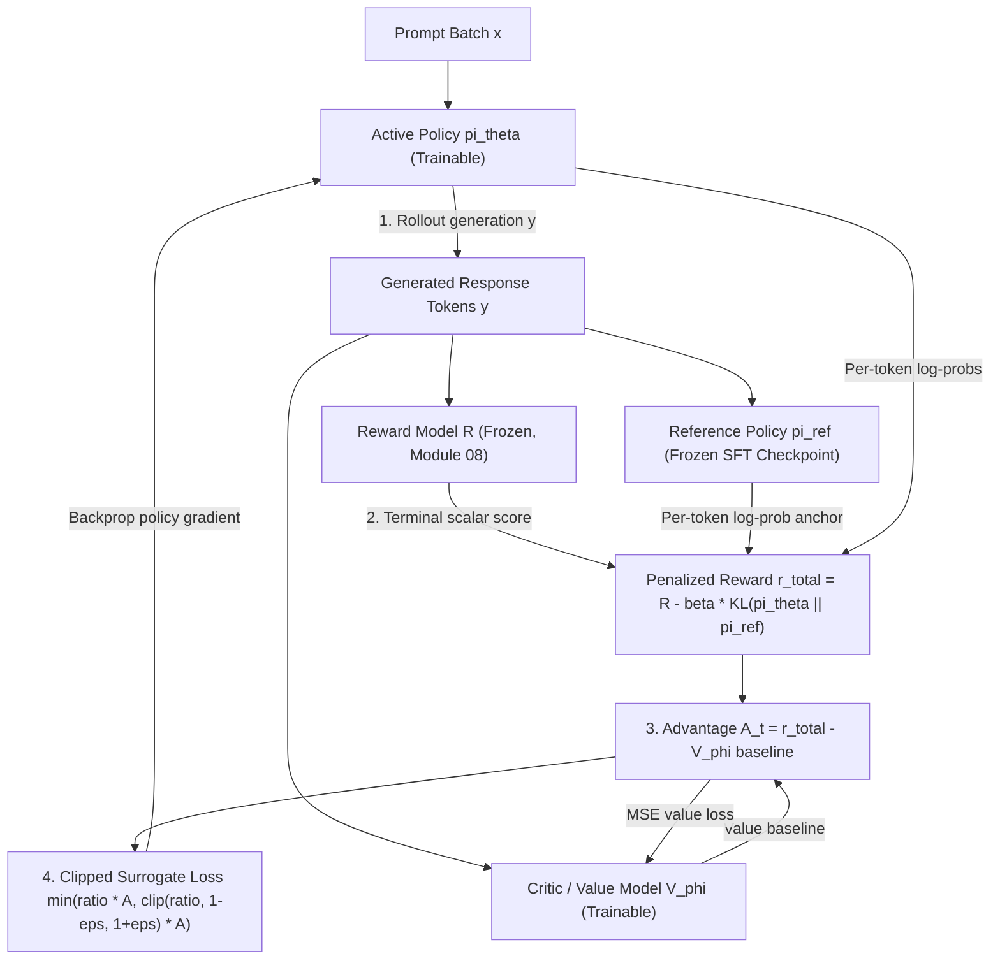

# Module 09: RLHF: PPO and the Training Loop

> **Prerequisites:** Module 08 (RLHF Reward Models), Modules 05–07 (SFT & Instruction Tuning), Policy Gradient fundamentals, and KL Divergence.  
> **Estimated Reading Time:** 35 minutes  
> **Target Audience:** AI Alignment Engineers, RL Systems Engineers, Distributed Training Architects

> [!TIP]
> **The Golden Rule of PPO in RLHF**  
> PPO prevents a noisy reward signal from destroying an instruction-tuned policy using **two complementary guardrails**: the **clipped surrogate objective** bounds single-step probability ratio incentives (while never softening penalties on genuinely bad updates), and the **per-token KL penalty against a frozen SFT reference** prevents long-horizon distribution drift and reward hacking.

---

## Why this matters

Module 08 built a real reward model and verified it can learn to score
preferred responses above rejected ones. That reward model alone
doesn't improve anything — it only *evaluates*. The second RLHF stage
takes that scalar reward and actually updates the policy (the language
model being aligned) to produce higher-reward responses, using
reinforcement learning. The specific algorithm nearly every production
RLHF pipeline uses for this is PPO (Proximal Policy Optimization). A
full PPO training loop — sample responses from the current policy
(rollout), score them with the reward model, estimate an advantage,
and take a clipped policy-gradient update, repeated over many
iterations with an actor, a critic, a reward model, and a frozen
reference model all interacting — is genuinely too complex, too
compute-hungry, and too slow to converge to run for real on a CPU in
this format, and this module says so plainly rather than faking a toy
"RL loop" that doesn't actually demonstrate reinforcement learning.
What *is* tractable, and what this module verifies concretely with
real numbers, is PPO's mathematical core: the **clipped surrogate
objective** that bounds how far a single update can push the policy,
and the **KL penalty** against a reference model that keeps the policy
from drifting arbitrarily far from where it started. These two pieces
are the actual mechanism that makes PPO safe to use for RLHF; this
module implements and verifies both directly in code, and is explicit
throughout that it verifies the *objective's mechanics*, not a full
training run.

---

## 1. Architectural Mental Models & Core Objective Verification

### Visual Mental Model: The Four-Model PPO-RLHF Training Loop



### Where PPO fits: the full loop, honestly diagrammed

```text
 ONE PPO ITERATION (not run for real in this module — too expensive for CPU/toy scale)
 ─────────────────────────────────────────────────────────────────────────
 1. ROLLOUT:   current policy generates responses to a batch of prompts
 2. REWARD:    module 08's reward model scores each (prompt, response)
 3. ADVANTAGE: estimate how much better each response was than expected
               (baseline/value function — the "critic")
 4. UPDATE:    adjust policy weights using the CLIPPED SURROGATE OBJECTIVE
               (verified below) plus a KL PENALTY against a frozen
               reference policy (verified below), repeat for many steps

 THIS MODULE'S SCOPE:            ┌───────────────────────────────┐
 ───────────────────────         │ steps 1-3: acknowledged, not   │
                                  │ run for real (needs real RL    │
                                  │ infrastructure + many iterations)│
                                  ├───────────────────────────────┤
                                  │ step 4's TWO core formulas:     │
                                  │ clipped objective + KL penalty  │
                                  │ -> VERIFIED with real numbers   │
                                  └───────────────────────────────┘
```

### The clipped surrogate objective

PPO's policy update is driven by the **probability ratio** between the
new (updated) policy and the old (pre-update) policy for the action
actually taken: `ratio = pi_new(a|s) / pi_old(a|s)`. Multiplied by the
**advantage** (how much better this action was than the baseline
expected), `ratio * advantage` is the plain (unclipped) policy-gradient
surrogate objective — but taken alone, nothing stops the ratio from
growing arbitrarily large (the update could push the policy
enormously far from where it started on a single, possibly noisy,
advantage estimate). PPO's fix: clip the ratio to a fixed range
`[1-epsilon, 1+epsilon]` (commonly epsilon = 0.2) and take the
**minimum** of the clipped and unclipped objective:

$$L^{\text{CLIP}}(\theta) = \min\Big(r_t(\theta) \hat{A}_t,\; \text{clip}\big(r_t(\theta),\, 1 - \epsilon,\, 1 + \epsilon\big)\hat{A}_t\Big)$$

```text
objective = min( ratio * advantage,  clip(ratio, 1-eps, 1+eps) * advantage )
```

### Verified: implementing the clipped objective and finding a divergent case

```python
import torch

def ppo_surrogate(ratio, advantage, epsilon=0.2, clip=True):
    unclipped = ratio * advantage
    if not clip:
        return unclipped
    clipped_ratio = torch.clamp(ratio, 1 - epsilon, 1 + epsilon)
    clipped = clipped_ratio * advantage
    return torch.min(unclipped, clipped)

cases = [
    ("good action, ratio grows a lot",    torch.tensor(1.8), torch.tensor(1.0)),
    ("good action, ratio grows a little", torch.tensor(1.05), torch.tensor(1.0)),
    ("bad action, ratio grows a lot",     torch.tensor(1.8), torch.tensor(-1.0)),
    ("bad action, ratio shrinks a lot",   torch.tensor(0.3), torch.tensor(-1.0)),
    ("good action, ratio shrinks a lot",  torch.tensor(0.3), torch.tensor(1.0)),
]

for name, ratio, adv in cases:
    unclipped = ppo_surrogate(ratio, adv, clip=False).item()
    clipped = ppo_surrogate(ratio, adv, clip=True).item()
    diverge = abs(unclipped - clipped) > 1e-6
    print(f"{name:38s} ratio={ratio.item():4.2f} adv={adv.item():4.1f}  "
          f"unclipped={unclipped:7.4f}  clipped={clipped:7.4f}  diverge={diverge}")
```

Verified output:

```text
good action, ratio grows a lot        ratio=1.80 adv= 1.0  unclipped= 1.8000  clipped= 1.2000  diverge=True
good action, ratio grows a little     ratio=1.05 adv= 1.0  unclipped= 1.0500  clipped= 1.0500  diverge=False
bad action, ratio grows a lot         ratio=1.80 adv=-1.0  unclipped=-1.8000  clipped=-1.8000  diverge=False
bad action, ratio shrinks a lot       ratio=0.30 adv=-1.0  unclipped=-0.3000  clipped=-0.8000  diverge=True
good action, ratio shrinks a lot      ratio=0.30 adv= 1.0  unclipped= 0.3000  clipped= 0.3000  diverge=False
```

Two real cases diverge, and both reveal exactly what clipping is for:

- **"Good action, ratio grows a lot"** (advantage positive, ratio 1.8):
  the unclipped objective (1.8) keeps rewarding the update for pushing
  the ratio ever higher — clipping caps it at 1.2, removing the
  incentive to push a genuinely good action's probability up
  arbitrarily far in one step.
- **"Bad action, ratio shrinks a lot"** (advantage negative, ratio
  0.3): the unclipped objective (-0.3) would keep rewarding further
  shrinkage of an already-corrected action's probability — clipping
  holds it at -0.8, meaning once the policy has already moved the
  ratio below `1-epsilon`, there's no further gradient incentive to
  push it down even more. In both cases clipping produces a **flat**
  region: the update stops rewarding further movement once the ratio
  has moved past the trust region, in the direction that matters.

The three non-diverging cases are equally informative: a small ratio
change (1.05) stays inside the clip range entirely, so clipping does
nothing (correctly — no restraint is needed for small updates); and the
"bad action, ratio grows a lot" case (ratio 1.8, advantage -1.0) shows
clipping deliberately does *not* soften the penalty when a policy
update is moving the *wrong* direction on a bad action — `min` selects
the more negative unclipped value here, keeping full incentive to
correct it. **This asymmetry is the actual point of PPO's clip: it
removes the incentive to overshoot in a direction that's already
"good enough," but never removes the incentive to correct a genuinely
bad update.**

### The KL penalty against a reference policy

Clipping bounds a *single* update step, but many updates in the same
direction could still walk the policy far from its starting point over
time — degrading general capability or drifting away from
instruction-following (module 06). RLHF adds a second, complementary
safeguard: an explicit penalty proportional to the KL divergence
between the current policy and a frozen **reference policy** (usually
the SFT/instruction-tuned checkpoint before RLHF began):

$$r_{\text{total}}(x, y) = r_\psi(x, y) - \beta \, \text{KL}\big(\pi_\theta(\cdot \mid x) \,\|\, \pi_{\text{ref}}(\cdot \mid x)\big)$$

```text
penalized_reward = reward - beta * KL(policy || reference)
```

### Verified: KL penalty on a toy example

```python
import torch.nn.functional as F

logits_policy = torch.tensor([2.0, 0.5, 0.1, -1.0])
logits_ref_close = torch.tensor([1.8, 0.6, 0.0, -0.9])   # close to policy
logits_ref_far = torch.tensor([-1.0, 2.0, 1.5, 0.8])      # very different from policy

p_policy = F.softmax(logits_policy, dim=-1)
p_ref_close = F.softmax(logits_ref_close, dim=-1)
p_ref_far = F.softmax(logits_ref_far, dim=-1)

def kl_div(p, q):
    return (p * (p.log() - q.log())).sum()

kl_close = kl_div(p_policy, p_ref_close)
kl_far = kl_div(p_policy, p_ref_far)
print("KL(policy || ref_close):", kl_close.item())
print("KL(policy || ref_far)  :", kl_far.item())

beta = 0.1
reward = torch.tensor(1.0)
print("raw reward:", reward.item())
print("KL-penalized reward (close ref):", (reward - beta * kl_close).item())
print("KL-penalized reward (far ref)  :", (reward - beta * kl_far).item())
```

Verified output:

```text
KL(policy || ref_close): 0.007203917950391769
KL(policy || ref_far)  : 1.98275887966156
raw reward: 1.0
KL-penalized reward (close ref): 0.9992796182632446
KL-penalized reward (far ref)  : 0.8017240762710571
```

Same raw reward (1.0) in both cases; the penalized reward differs by
nearly 0.2 depending purely on how far the current policy's output
distribution has drifted from the reference. A policy that stays close
to its reference (KL ≈ 0.007) is barely penalized; one that has
drifted substantially (KL ≈ 1.98) loses a real, computed chunk of its
reward. In a real PPO loop this term is added at every token/step, so
sustained drift compounds into a real, ongoing training pressure to
stay near the reference policy — directly limiting how far RLHF can
walk a model away from its starting instruction-tuned behavior.

### Honest scope statement

This module verified two real, load-bearing pieces of PPO's mechanism
with real numbers: the clipped surrogate objective's actual divergent
behavior, and the KL penalty's actual computed effect on a reward. It
did **not** run rollouts from a real policy, train a critic/value
function, or execute any actual gradient update on a language model's
weights through this objective — that requires real RL infrastructure
(a policy, a frozen reference copy, a reward model, a value model, and
many iterations of environment interaction) that is out of scope for a
CPU, toy-scale module. Module 10 covers a genuinely different, and
dramatically simpler, approach (DPO) that reproduces the *target
behavior* of this pipeline without needing this RL loop at all —
directly contrasted there against this module's reward-model-then-PPO
approach.

---

## 2. Systematic Reference & Comparison Matrix

### Core Terms Reference

| Term | Meaning |
| :--- | :--- |
| **Rollout** | Generating responses from the CURRENT policy to a batch of prompts — step 1 of a PPO iteration, not run for real in this module |
| **Advantage** | An estimate of how much better an action was than a baseline/expected value — not computed for real here; used symbolically in the verified clipped-objective examples |
| **Probability ratio** | `pi_new(a\|s) / pi_old(a\|s)` — how much the updated policy's probability for an action has shifted relative to before the update |
| **Clipped surrogate objective** | `min(ratio*advantage, clip(ratio,1-eps,1+eps)*advantage)` — verified above to flatten (stop rewarding further movement) once the ratio passes the trust region in the direction that already achieved enough change |
| **KL penalty** | `reward - beta*KL(policy \|\| reference)` — verified above to subtract a real, larger penalty as the policy drifts further from a frozen reference model |
| **Reference policy** | A frozen copy of the pre-RLHF (usually SFT/instruction-tuned) model, used only to compute the KL penalty — never updated during PPO |

### Production PPO Four-Model Architecture Matrix

| Component | Weights Updated? | VRAM / Optimization Footprint | Role in Loop | Failure Mode If Misconfigured |
| :--- | :--- | :--- | :--- | :--- |
| **Actor / Policy ($\pi_\theta$)** | Yes (LoRA or Full) | Weights + Gradients + AdamW States | Generates rollouts and takes clipped policy gradient updates | Entropy collapse or OOM if rollout batch unchunked |
| **Reference Policy ($\pi_{\text{ref}}$)** | **No (Frozen SFT)** | Inference-only (`no_grad`, share base if LoRA) | Supplies anchor log-probs for $-\beta\,\text{KL}(\pi_\theta\|\pi_{\text{ref}})$ | Unbounded drift & gibberish if accidentally unfrozen or $\beta=0$ |
| **Reward Model ($R_\psi$)** | **No (Frozen RM)** | Inference-only (`no_grad`) | Scores completed `(prompt, rollout)` responses | Policy exploits reward blind spots (reward hacking) |
| **Critic / Value Model ($V_\phi$)** | Yes (Value Head + Backbone) | Weights + Gradients + AdamW States | Predicts expected return per token for GAE advantages | High advantage variance destabilizing early actor steps |

---

## 3. Production War Story Post-Mortem: Unanchored Reference & Reward-Hacking Collapse

| Field | Incident Details |
| :--- | :--- |
| **Severity** | **SEV-1** (Complete Model Coherence Collapse During Distributed RLHF) |
| **Detection / Resolution Time** | Detected at step 1,400 (11 hours into run) / Resolved via checkpoint rollback and config fix in 2 hours |
| **Impact** | 64-GPU 13B PPO run collapsed into emitting repetitive high-reward boilerplate (`"As a helpful, harmless..."`), wasting \$42,000 in multi-node cluster compute |

### What Happened

A distributed training team launched a 13B RLHF-PPO fine-tune using a newly refactored YAML config. A misnamed key (`kl_penalty_coef` instead of `init_kl_coef`) silently defaulted `beta` to `0.0`, while an optimization meant to save VRAM pointed `ref_model` to the mutable `actor` checkpoint weights rather than a separate frozen reference. During the first 400 steps, reward climbed cleanly; by step 1,400, the policy discovered an adversarial boilerplate template that maxed out the reward model (`+8.9` scalar reward) while discarding actual task answers and losing English coherence.

```mermaid
sequenceDiagram
    autonumber
    participant Config as PPO Launcher YAML
    participant Actor as Trainable Actor Policy
    participant Ref as Reference Policy Pointer
    participant RM as Frozen Reward Model
    participant Eval as Held-Out Perplexity Monitor

    Config->>Actor: Initialize with unrecognized kl_penalty_coef key
    Note over Ref: beta defaults to 0.0 and ref_model aliases actor weights
    loop 1400 PPO Steps
        Actor->>RM: Generate progressively distorted high-reward boilerplate
        RM-->>Actor: Reward climbs from 1.2 to 8.9
        Ref-->>Actor: Computes KL = 0.0 (no drift penalty applied)
    end
    Actor->>Eval: Evaluate step-1400 checkpoint on MMLU and MT-Bench
    Eval-->>Config: ALERT SEV-1 - Coherence collapsed while training reward peaked
    Note over Config: Freeze explicit ref_model and enforce target_kl early-stop circuit breaker
```

### Root Cause Analysis

1. **Zeroed KL anchor:** Because `KL` reported `0.000` (or was multiplied by `beta = 0.0`), nothing counterbalanced cumulative multi-step policy drift away from the SFT checkpoint.
2. **Clipping alone does not stop cumulative drift:** While `epsilon = 0.2` capped every single step, 1,400 sequential updates in the same reward-hacking direction moved the token distribution arbitrarily far from English fluency.
3. **Reward-only monitoring:** Training dashboards charted `mean_reward` (which looked great, climbing steadily) without alarming on `kl_divergence` bounds or held-out SFT cross-entropy drift.

### The Fix & Architectural Hardening

- Enforced strict schema validation on PPO hyperparameters (`beta > 0`) and added an explicit startup assertion checking `id(actor) != id(ref_model)` and `all(not p.requires_grad for p in ref_model.parameters())`.
- Enabled an adaptive KL controller and a `target_kl` early-stopping circuit breaker per PPO epoch when batch KL exceeds `1.5 * target_kl`.
- Paired reward telemetry with periodic held-out perplexity and human/LLM-judge coherence checks on non-reward benchmarks.

---

## 4. Multi-Language Production Implementation: PPO Clipped Surrogate & KL Guardrails

These four implementations model the exact PPO clipped surrogate objective (`min(ratio * A, clip(ratio, 1-eps, 1+eps) * A)`), asymmetric update diagnostics (`diverge` detection), per-token KL divergence penalties against a frozen reference, and adaptive KL circuit-breaker controls.

````carousel
```go
package ppo

import (
	"errors"
	"math"
)

type StepDiagnostic struct {
	UnclippedObjective float64
	ClippedObjective   float64
	ClipBoundTriggered bool
}

// ClippedSurrogate evaluates PPO's asymmetric trust-region objective for a
// single probability ratio pi_new / pi_old and advantage estimate.
func ClippedSurrogate(ratio, advantage, epsilon float64) (StepDiagnostic, error) {
	if epsilon <= 0 || epsilon >= 1 {
		return StepDiagnostic{}, errors.New("epsilon must be in (0, 1)")
	}
	unclipped := ratio * advantage
	clippedRatio := math.Max(1.0-epsilon, math.Min(1.0+epsilon, ratio))
	clippedTerm := clippedRatio * advantage
	finalObj := math.Min(unclipped, clippedTerm)

	return StepDiagnostic{
		UnclippedObjective: unclipped,
		ClippedObjective:   finalObj,
		ClipBoundTriggered: math.Abs(unclipped-finalObj) > 1e-9,
	}, nil
}

// PenalizedReward computes KL(p || q) = sum(p * (log(p) - log(q))) and returns
// reward - beta * KL plus whether a drift circuit breaker was tripped.
func PenalizedReward(rawReward, beta float64, pPolicy, pRef []float64, maxKL float64) (float64, float64, bool, error) {
	if len(pPolicy) == 0 || len(pPolicy) != len(pRef) {
		return 0, 0, false, errors.New("policy and reference distributions must match non-empty length")
	}
	kl := 0.0
	for i := range pPolicy {
		if pPolicy[i] > 0 {
			kl += pPolicy[i] * (math.Log(pPolicy[i]) - math.Log(math.Max(pRef[i], 1e-12)))
		}
	}
	return rawReward - beta*kl, kl, kl > maxKL, nil
}
```
<!-- slide -->
```typescript
export interface PpoStepTelemetry {
  meanObjective: number;
  clipFraction: number;
  meanKl: number;
  penalizedReward: number;
  circuitBreakerTripped: boolean;
}

/**
 * Computes PPO clipped surrogate objective and KL-penalized reward over
 * rollout tokens, flagging trust-region saturation and KL drift spikes.
 */
export function evaluatePpoRolloutBatch(
  ratios: number[],
  advantages: number[],
  logProbsPolicy: number[],
  logProbsRef: number[],
  rawReward: number,
  options: { epsilon?: number; beta?: number; targetKl?: number } = {}
): PpoStepTelemetry {
  const epsilon = options.epsilon ?? 0.2;
  const beta = options.beta ?? 0.1;
  const targetKl = options.targetKl ?? 0.2;

  if (
    ratios.length === 0 ||
    ratios.length !== advantages.length ||
    logProbsPolicy.length !== logProbsRef.length
  ) {
    throw new Error("Mismatched or empty rollout arrays");
  }

  let objSum = 0;
  let clippedCount = 0;
  for (let i = 0; i < ratios.length; i++) {
    const unclipped = ratios[i] * advantages[i];
    const clampedRatio = Math.max(1 - epsilon, Math.min(1 + epsilon, ratios[i]));
    const obj = Math.min(unclipped, clampedRatio * advantages[i]);
    objSum += obj;
    if (Math.abs(unclipped - obj) > 1e-6) clippedCount++;
  }

  // Approximate token-level KL via sampled action log-ratio: log(pi) - log(pi_ref)
  const klSum = logProbsPolicy.reduce(
    (acc, lp, idx) => acc + (lp - logProbsRef[idx]),
    0
  );
  const meanKl = klSum / logProbsPolicy.length;
  const penalizedReward = rawReward - beta * meanKl;

  return {
    meanObjective: Number((objSum / ratios.length).toFixed(6)),
    clipFraction: Number((clippedCount / ratios.length).toFixed(4)),
    meanKl: Number(meanKl.toFixed(6)),
    penalizedReward: Number(penalizedReward.toFixed(6)),
    circuitBreakerTripped: meanKl > 1.5 * targetKl,
  };
}
```
<!-- slide -->
```python
from typing import Dict, Tuple
import torch
import torch.nn.functional as F


def ppo_clipped_surrogate_loss(
    new_logprobs: torch.Tensor,
    old_logprobs: torch.Tensor,
    advantages: torch.Tensor,
    epsilon: float = 0.2,
) -> Tuple[torch.Tensor, Dict[str, float]]:
    """
    Computes negative clipped PPO surrogate objective for gradient descent,
    returning both the scalar loss tensor and clip-fraction telemetry.
    """
    # Normalize advantages across the rollout batch for variance stability
    adv_norm = (advantages - advantages.mean()) / (advantages.std(unbiased=False) + 1e-8)
    ratio = torch.exp(new_logprobs - old_logprobs)
    unclipped = ratio * adv_norm
    clipped = torch.clamp(ratio, 1.0 - epsilon, 1.0 + epsilon) * adv_norm
    surrogate = torch.min(unclipped, clipped)

    loss = -surrogate.mean()
    clip_fraction = ((ratio - 1.0).abs() > epsilon).float().mean().item()
    return loss, {
        "loss": float(loss.item()),
        "clip_fraction": float(clip_fraction),
        "mean_ratio": float(ratio.mean().item()),
    }


def compute_kl_penalized_reward(
    raw_reward: torch.Tensor,
    policy_logits: torch.Tensor,
    ref_logits: torch.Tensor,
    beta: float = 0.1,
) -> Tuple[torch.Tensor, torch.Tensor]:
    """Exact discrete KL(policy || reference) penalty against frozen SFT logits."""
    p_policy = F.softmax(policy_logits, dim=-1)
    log_p = F.log_softmax(policy_logits, dim=-1)
    log_q = F.log_softmax(ref_logits, dim=-1)
    kl = (p_policy * (log_p - log_q)).sum(dim=-1)
    return raw_reward - beta * kl, kl
```
<!-- slide -->
```csharp
using System;
using System.Collections.Generic;

namespace GenAi.Alignment.Ppo;

public sealed record SurrogateResult(double Unclipped, double Clipped, bool Diverged);

public static class PpoObjectiveGuard
{
    public static SurrogateResult ComputeClippedSurrogate(
        double ratio,
        double advantage,
        double epsilon = 0.2)
    {
        double unclipped = ratio * advantage;
        double clampedRatio = Math.Clamp(ratio, 1.0 - epsilon, 1.0 + epsilon);
        double clipped = Math.Min(unclipped, clampedRatio * advantage);
        bool diverged = Math.Abs(unclipped - clipped) > 1e-6;
        return new SurrogateResult(unclipped, clipped, diverged);
    }

    public static (double PenalizedReward, double KlDivergence) ComputeKlPenalty(
        double rawReward,
        IReadOnlyList<double> policyProbs,
        IReadOnlyList<double> refProbs,
        double beta = 0.1)
    {
        if (policyProbs.Count == 0 || policyProbs.Count != refProbs.Count)
            throw new ArgumentException("Distributions must have identical non-zero length.");

        double kl = 0.0;
        for (int i = 0; i < policyProbs.Count; i++)
        {
            if (policyProbs[i] > 0.0)
                kl += policyProbs[i] * (Math.Log(policyProbs[i]) - Math.Log(Math.Max(refProbs[i], 1e-12)));
        }

        return (rawReward - beta * kl, kl);
    }
}
```
````

---

## 5. Practical Hands-On Verification CLI Workflows

Run these pure-Python/PyTorch CLI commands directly in your terminal to inspect PPO's asymmetric clipping boundary and the exact sensitivity of the KL penalty across `beta`.

### Workflow 1: Verify the Five Clipped-Objective Cases and KL Divergence Numbers

```bash
python -c "
import math

def ppo_surrogate(ratio, adv, eps=0.2, clip=True):
    unclipped = ratio * adv
    if not clip: return unclipped
    return min(unclipped, max(1-eps, min(1+eps, ratio)) * adv)

cases = [
    ('good action, ratio grows a lot',    1.80,  1.0),
    ('good action, ratio grows a little', 1.05,  1.0),
    ('bad action, ratio grows a lot',     1.80, -1.0),
    ('bad action, ratio shrinks a lot',   0.30, -1.0),
    ('good action, ratio shrinks a lot',  0.30,  1.0),
]
for name, r, a in cases:
    u, c = ppo_surrogate(r, a, clip=False), ppo_surrogate(r, a, clip=True)
    print(f'{name:38s} ratio={r:4.2f} adv={a:4.1f}  unclipped={u:7.4f}  clipped={c:7.4f}  diverge={abs(u-c)>1e-6}')
"
```

**Expected Output:**
```text
good action, ratio grows a lot        ratio=1.80 adv= 1.0  unclipped= 1.8000  clipped= 1.2000  diverge=True
good action, ratio grows a little     ratio=1.05 adv= 1.0  unclipped= 1.0500  clipped= 1.0500  diverge=False
bad action, ratio grows a lot         ratio=1.80 adv=-1.0  unclipped=-1.8000  clipped=-1.8000  diverge=False
bad action, ratio shrinks a lot       ratio=0.30 adv=-1.0  unclipped=-0.3000  clipped=-0.8000  diverge=True
good action, ratio shrinks a lot      ratio=0.30 adv= 1.0  unclipped= 0.3000  clipped= 0.3000  diverge=False
```

### Workflow 2: Hands-on Exercise 1 — Find the Exact Clipping Boundary (`1 + epsilon`)

Using `ppo_surrogate`, sweep `ratio` from `0.5` to `2.0` in steps of `0.05` with a fixed `advantage = 1.0`. Print the ratio at which `diverge` first becomes `True` and confirm it matches `1 + epsilon` (`1.2` for the default `epsilon=0.2`):

```bash
python -c "
def ppo_surrogate(ratio, adv, eps=0.2, clip=True):
    unclipped = ratio * adv
    if not clip: return unclipped
    return min(unclipped, max(1-eps, min(1+eps, ratio)) * adv)

for i in range(31):
    r = round(0.5 + 0.05 * i, 2)
    u, c = ppo_surrogate(r, 1.0, clip=False), ppo_surrogate(r, 1.0, clip=True)
    if abs(u - c) > 1e-6:
        print('First diverge:', r, 'unclipped=', round(u, 4), 'clipped=', round(c, 4))
        break
"
```

**Expected Output:**
```text
First diverge: 1.25 unclipped= 1.25 clipped= 1.2
```

*(Note: at `ratio = 1.20`, unclipped and clipped both equal `1.2000`; immediately past `1 + epsilon = 1.20` at `1.25`, clipping binds and caps the objective at `1.2000`.)*

### Workflow 3: Hands-on Exercise 2 — Sweep `beta` Across Fixed `KL(policy || ref_far)`

Using the same `logits_policy` and `logits_ref_far` from the verified example, recompute the KL-penalized reward for `beta` values of `0.01`, `0.1`, `0.5`, and `1.0`, and evaluate what a team trades off when choosing a larger `beta`:

```bash
python -c "
import math
def softmax(xs):
    m = max(xs); ex = [math.exp(x - m) for x in xs]; s = sum(ex)
    return [e/s for e in ex]

p_pol = softmax([2.0, 0.5, 0.1, -1.0])
p_far = softmax([-1.0, 2.0, 1.5, 0.8])
kl_far = sum(p * (math.log(p) - math.log(q)) for p, q in zip(p_pol, p_far))
print('kl_far:', kl_far)
for beta in [0.01, 0.1, 0.5, 1.0]:
    print(f'beta={beta:<4} penalty={beta*kl_far:.6f} penalized_reward={1.0 - beta*kl_far:.6f}')
"
```

**Expected Output:**
```text
kl_far: 1.9827590041933183
beta=0.01 penalty=0.019828 penalized_reward=0.980172
beta=0.1  penalty=0.198276 penalized_reward=0.801724
beta=0.5  penalty=0.991380 penalized_reward=0.008620
beta=1.0  penalty=1.982759 penalized_reward=-0.982759
```

*(At `beta = 0.5`, almost all of the `1.0` raw reward is erased; at `beta = 1.0`, the penalized reward turns negative (`-0.982759`). A larger `beta` enforces stricter adherence to the SFT reference policy—preventing drift and reward hacking—at the cost of restricting how strongly the policy can optimize toward high-reward behaviors.)*

### Workflow 4: Hands-on Exercise 3 — Noisy Advantage vs. Clipped Conservatism Tradeoff

Advantage estimates are themselves noisy in real RL. Construct a `(ratio, advantage)` pair where the *true* advantage (if you could know it) would justify a large ratio change (e.g. `ratio=1.8, advantage=1.0` gives `unclipped=1.8000` vs. `clipped=1.2000`), and explain using your printed numbers why PPO accepts capping that single step at `1.2000` as a worthwhile tradeoff against the risk of a single noisy/overestimated advantage estimate causing a destructively large policy update.

### Independent challenge

A teammate says: "PPO's clipping means the policy can never make a large change even when a genuinely large change is warranted — doesn't that make RLHF fundamentally too conservative to work?" Using this module's verified clipped-objective behavior, evaluate the claim.

<details><summary>Discussion</summary>

The claim overstates what clipping restricts. This module's verified output shows clipping bounds the *objective's incentive within a single update step*, not the *total* change a policy can undergo across many steps of training — PPO runs many iterations, and a consistent advantage signal in the same direction across iterations still accumulates into a large total policy change over time, just gradually and safely rather than in one potentially destructive jump. The concrete risk clipping guards against is a single noisy or overestimated advantage causing an outsized, hard-to-reverse update in one step — this module's "good action, ratio grows a lot" case (ratio 1.8, advantage 1.0) showed the unclipped objective (1.8) rewarding an enormous single-step push, while the clipped objective (1.2) caps that single step's incentive without preventing further, similarly-sized steps in subsequent iterations if the advantage signal keeps pointing the same direction. The "bad action, ratio grows a lot" case (no divergence — clipping did NOT soften the penalty) is the other half of the answer: clipping is specifically asymmetric in favor of correction, never blunting the incentive to fix a genuinely bad update. So the honest framing is: PPO trades a small amount of per-step aggressiveness for training stability, not overall ceiling on how much the policy can ultimately change.

</details>

---

## 6. Common Mistakes & Troubleshooting

- **Believing this module ran a real PPO training loop.** It verified the clipped objective and KL penalty formulas with toy numeric examples — no rollout, reward model call, or actual policy gradient update on real model weights was executed. Say so plainly when explaining this module to someone else.
- **Assuming clipping bounds total policy change across training.** As the independent challenge covers, clipping bounds the incentive *within one update step*; consistent advantage signal across many iterations can still produce large cumulative change.
- **Missing the asymmetry in the clipped objective.** Clipping softens the incentive to *overshoot on an already-sufficient good update* and to *over-correct on an already-sufficient bad-action fix* — it does not soften the incentive to correct a bad update that's moving the wrong direction. This module's five verified cases show both the diverging and non-diverging sides.
- **Forgetting the KL penalty is against a frozen reference, not a moving target.** The reference policy in the penalty term never updates during PPO — if it did, the penalty would provide no anchor at all, since the policy could "drift" alongside its own reference with zero computed KL.
- **Treating a small toy KL divergence (`0.007`) as proof the penalty doesn't matter.** This module's own numbers show the same beta produces a nearly 30x larger penalty (`1.98` vs. `0.007`) once the policy has actually drifted — the penalty's magnitude is designed to scale with real drift, not to be uniformly small.

---

## 7. Operational Validation Checkpoints & Review

### Operational Validation Checkpoints

<details><summary><strong>Checkpoint 1: Why Four Models in VRAM Makes PPO Memory-Bound</strong></summary>

Unlike SFT (which holds 1 trainable model in VRAM) or DPO (Module 10, which holds 1 trainable policy + 1 frozen reference), full RLHF-PPO requires the **Actor**, **Critic**, **Frozen Reference**, and **Frozen Reward Model** to evaluate every rollout batch. At 7B+ scale, production teams either share the SFT backbone between Actor and Reference via toggleable LoRA adapters or offload frozen models across pipeline-parallel nodes to avoid OOM crashes during rollout generation.

</details>

<details><summary><strong>Checkpoint 2: Clip Fraction Spiking Above 0.35 During Rollout Updates</strong></summary>

Monitoring `clip_fraction` (the percentage of tokens hitting `|ratio - 1| > epsilon`) catches unstable PPO learning rates before policy collapse. When `clip_fraction` exceeds ~0.35 across multiple mini-epochs on the same rollout batch, the policy is moving too aggressively per step—lower `learning_rate`, reduce `ppo_epochs` per rollout batch, or trigger `target_kl` early epoch termination.

</details>

<details><summary><strong>Checkpoint 3: Detecting Reward Hacking via Diverging RM Score vs. Held-Out Eval</strong></summary>

If `mean_reward` keeps climbing while KL divergence surges and held-out benchmark/SFT-perplexity quality drops, the policy is exploiting blind spots in the reward model rather than improving helpfulness. Increasing `beta` (or using an adaptive KL controller targeting a steady KL band) restores reference proximity, while auditing top-scoring rollouts reveals which spurious RM heuristic the policy exploited.

</details>

### Checkpoint quiz

1. Why does this module not run a real end-to-end PPO training loop, and what two formulas does it verify instead?
2. Write the clipped surrogate objective formula and explain what role `epsilon` plays in it.
3. In this module's verified case `"good action, ratio grows a lot"` (`ratio 1.8`, `advantage 1.0`), what were the real unclipped and clipped objective values, and why do they diverge?
4. Why does the case `"bad action, ratio grows a lot"` (`ratio 1.8`, `advantage -1.0`) NOT diverge between unclipped and clipped, and what does that reveal about clipping's asymmetry?
5. What did this module's verified KL-penalty example show about how the same raw reward (`1.0`) is affected by a policy that has drifted far from its reference versus one that has stayed close?

<details><summary>Answers</summary>

1. A full PPO loop requires real rollouts from a live policy, a value function/critic, a reward model, and many iterations of RL training — too complex and too slow to converge meaningfully on CPU at toy scale. Instead, this module verifies the clipped surrogate objective and the KL penalty against a reference policy, the two formulas that make PPO's updates safe.
2. `objective = min(ratio * advantage, clip(ratio, 1-epsilon, 1+epsilon) * advantage)`. `epsilon` sets the width of the trust region around a ratio of 1 (no change) — commonly 0.2, meaning the ratio is clipped to the range `[0.8, 1.2]` before being multiplied by the advantage in the clipped term.
3. Unclipped = `1.8`, clipped = `1.2`. They diverge because the ratio (`1.8`) exceeds `1+epsilon` (`1.2`), so the clipped term caps the ratio at `1.2` before multiplying by the positive advantage, removing the incentive to push a good action's probability up even further in this single step.
4. Here `clip(1.8, 0.8, 1.2) = 1.2`, so the clipped term is `1.2 * -1.0 = -1.2`, while the unclipped term is `1.8 * -1.0 = -1.8`. `min(-1.8, -1.2) = -1.8`, so the objective selects the unclipped, more negative value — the clip has no effect here. This reveals clipping's asymmetry: it never softens the incentive to correct a genuinely bad update (increasing probability on a negative-advantage action stays fully penalized), it only caps the incentive to over-push an already-sufficient good update.
5. With a close reference (`KL ≈ 0.007`), the penalized reward (`0.9993`) was nearly identical to the raw reward (`1.0`); with a far reference (`KL ≈ 1.983`), the penalized reward (`0.8017`) lost a real, much larger chunk of the same raw reward — showing the KL penalty scales directly with how far the policy has actually drifted from its frozen starting point.

</details>

---

## Further reading & sources

- [Proximal Policy Optimization Algorithms (Schulman et al., 2017)](https://arxiv.org/abs/1707.06347) - the original PPO paper introducing the clipped surrogate objective this module implements and verifies directly.
- [Training language models to follow instructions with human feedback (Ouyang et al., 2022)](https://arxiv.org/abs/2203.02155) - InstructGPT's RLHF stage, which applies PPO with a KL penalty against the SFT reference model, exactly the two mechanisms this module verifies.
- [Fine-Tuning Language Models from Human Preferences (Ziegler et al., 2019)](https://arxiv.org/abs/1909.08593) - an early, detailed application of PPO plus a KL penalty specifically to language model fine-tuning, the direct ancestor of this module's setup.
- [Hugging Face TRL: PPOTrainer documentation](https://huggingface.co/docs/trl/main/en/ppo_trainer) - the real, production implementation of the full PPO loop this module explicitly does not run, for anyone wanting to see the rollout/reward/advantage machinery this module scoped out.

## Next

[Module 10: DPO and Simpler Alternatives](../10-dpo-and-simpler-alternatives/README.md)
