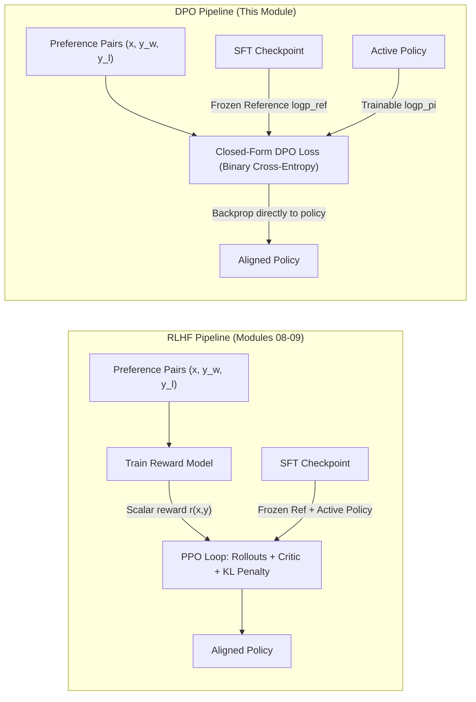
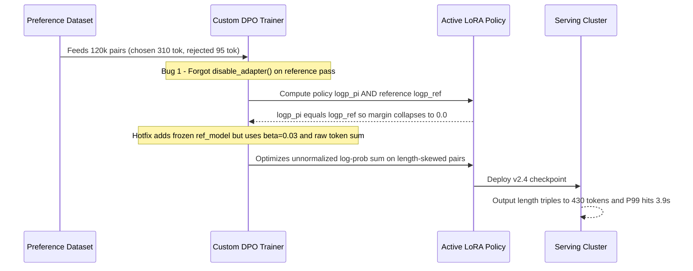

# Module 10: DPO and Simpler Alternatives

> **Prerequisites:** Modules 08–09 (Reward Modeling and RLHF with PPO) and Track 02 Transformer Logits & Softmax Cross-Entropy.  
> **Estimated Reading Time:** 30 minutes  
> **Target Audience:** AI Backend Engineers, Alignment Engineers, ML Systems Architects.

> [!TIP]
> **The Golden Rule of Direct Preference Optimization**  
> DPO does **not** change the RLHF objective—it algebraically solves the exact KL-constrained reward maximization objective in closed form, substituting an explicit reward model and unstable PPO rollouts with a single supervised-style binary cross-entropy loss on log-probability ratios against a **frozen reference policy**. Always keep the reference model frozen, audit preference datasets for response-length skew, and tune $\beta$ like a KL temperature knob rather than a free parameter.

---

## 1. Why This Matters

Modules 08–09 built the classic RLHF pipeline in full, piece by piece: train a separate reward model on human preference pairs (module 08), then use it inside a genuinely complex reinforcement learning loop — rollouts, advantage estimation, a clipped surrogate objective, and a KL penalty against a reference policy (module 09) — to update the policy model. That pipeline works (it is what produced InstructGPT and many production aligned models), but it carries heavy operational machinery: a second full model (the reward model), a value function/critic, careful RL hyperparameter tuning, and real training instability risks.

**DPO (Direct Preference Optimization)** asks a sharp question: can the same target behavior — a policy that prefers chosen responses over rejected ones, without drifting arbitrarily far from a reference model — be produced with **no reward model and no RL loop at all**, by training directly on preference pairs with a single closed-form loss? This module implements that loss exactly as published (Rafailov et al., 2023), verifies numerically that it decreases strictly when the policy grows to prefer chosen over rejected relative to the reference model, surveys simpler reference-free and unpaired alternatives (IPO, SimPO, ORPO, KTO), and lays the DPO pipeline directly alongside modules 08–09's reward-model-then-PPO pipeline so the algorithmic difference — same target, radically different mechanism — is concrete rather than asserted.

---

## 2. Visual Mental Models: RLHF vs. DPO & Simpler Alternatives

In standard RLHF, preference alignment requires training an intermediate scalar reward model and sampling on-policy rollouts inside a four-model PPO loop (Policy, Reference, Reward, Critic). DPO proves that the policy itself implicitly defines the exact reward function when paired with a frozen reference policy, collapsing the pipeline into a single supervised forward/backward pass over static preference pairs.



### The two pipelines, side by side

```text
 RLHF (modules 08-09): reward model + reinforcement learning
 ─────────────────────────────────────────────────────────────
 preference pairs -> [train REWARD MODEL] -> scalar reward function
                                                      │
                     policy rollouts -> reward scores │
                                              ▼        ▼
                     [PPO: clipped objective + KL penalty] -> updated policy
                     (a full RL loop: rollout, advantage, clipped update,
                      repeated over many iterations — module 09's subject)

 DPO (this module): one closed-form loss, no reward model, no RL loop
 ─────────────────────────────────────────────────────────────
 preference pairs -> [ DPO loss, computed directly from        ] -> updated
                     [ policy log-probs vs. reference log-probs ]    policy
                     (a single supervised-style loss — no rollouts,
                      no advantage estimation, no separate reward model)
```

---

## 3. Core Mechanics, Mathematics & Verified Experiments

### Mathematical Derivation: From RLHF Objective to Closed-Form DPO

DPO's central mathematical result (Rafailov et al., 2023) starts from module 09's exact KL-constrained reward maximization objective:

$$\max_{\pi_\theta} \; \mathbb{E}_{x \sim \mathcal{D},\, y \sim \pi_\theta(y \mid x)} \big[ r(x, y) \big] - \beta \, \mathbb{D}_{\text{KL}}\!\left( \pi_\theta(y \mid x) \,\big\|\, \pi_{\text{ref}}(y \mid x) \right)$$

Solving this variational problem analytically shows that the optimal policy $\pi^*(y \mid x)$ has an exact closed form:

$$\pi^*(y \mid x) = \frac{1}{Z(x)} \, \pi_{\text{ref}}(y \mid x) \exp\!\left( \frac{1}{\beta} r(x, y) \right)$$

Rearranging for the reward $r(x, y)$ expresses the **ground-truth reward in terms of the optimal policy and reference policy**:

$$r(x, y) = \beta \log \frac{\pi^*(y \mid x)}{\pi_{\text{ref}}(y \mid x)} + \beta \log Z(x)$$

When we substitute this reparameterization into the Bradley-Terry pairwise preference model $P(y_w \succ y_l \mid x) = \sigma(r(x, y_w) - r(x, y_l))$, the intractable partition function $\beta \log Z(x)$ **cancels completely**:

$$\mathcal{L}_{\text{DPO}}(\pi_\theta; \pi_{\text{ref}}) = -\mathbb{E}_{(x, y_w, y_l) \sim \mathcal{D}} \left[ \log \sigma \left( \beta \log \frac{\pi_\theta(y_w \mid x)}{\pi_{\text{ref}}(y_w \mid x)} - \beta \log \frac{\pi_\theta(y_l \mid x)}{\pi_{\text{ref}}(y_l \mid x)} \right) \right]$$

No explicit reward model ever needs to be trained or evaluated separately. The reward is *implicit* in the policy itself.

### The DPO loss, exactly as published

```text
loss = -log( sigmoid( beta * ( (logpi_chosen - logref_chosen)
                              - (logpi_rejected - logref_rejected) ) ) )
```

Reading it in pieces: `logpi_chosen - logref_chosen` is how much more (or less) likely the *current policy* makes the chosen response, relative to the frozen *reference* model — call this the policy's "implicit reward" for the chosen response. The same quantity is computed for the rejected response. The loss is minimized when the policy's relative preference for chosen-over-rejected (compared to what the reference model already had) grows — structurally the same Bradley-Terry pairwise form module 08's reward model loss used (`-log(sigmoid(r_chosen - r_rejected))`), except here the "reward difference" is computed directly from log-probability ratios, with no separate reward-model network anywhere in the loss.

### Verified: real log-probabilities, three scenarios

Using small, synthetic (but realistic-shaped) log-probability values — the kind a real model would actually produce summed over a response's tokens — for a fixed reference model and three different hypothetical policy states:

```python
import torch
import torch.nn.functional as F

def dpo_loss(logp_pi_chosen, logp_pi_rejected, logp_ref_chosen, logp_ref_rejected, beta=0.1):
    pi_logratio = logp_pi_chosen - logp_pi_rejected
    ref_logratio = logp_ref_chosen - logp_ref_rejected
    logits = beta * (pi_logratio - ref_logratio)
    return -F.logsigmoid(logits), logits

# reference model's FIXED log-probs (frozen throughout training)
logp_ref_chosen = torch.tensor(-12.0)
logp_ref_rejected = torch.tensor(-11.5)   # reference slightly prefers "rejected" — realistic pre-alignment

# scenario A: policy identical to reference (start of training)
logp_pi_chosen_A, logp_pi_rejected_A = torch.tensor(-12.0), torch.tensor(-11.5)
# scenario B: policy has started shifting probability mass toward chosen
logp_pi_chosen_B, logp_pi_rejected_B = torch.tensor(-10.0), torch.tensor(-12.0)
# scenario C: policy has shifted even further toward chosen over rejected
logp_pi_chosen_C, logp_pi_rejected_C = torch.tensor(-8.0), torch.tensor(-14.0)

for name, lpc, lpr in [("A (== reference)", logp_pi_chosen_A, logp_pi_rejected_A),
                        ("B (moderate shift toward chosen)", logp_pi_chosen_B, logp_pi_rejected_B),
                        ("C (strong shift toward chosen)", logp_pi_chosen_C, logp_pi_rejected_C)]:
    loss, logits = dpo_loss(lpc, lpr, logp_ref_chosen, logp_ref_rejected)
    print(f"{name:38s} implicit-reward-margin={logits.item():7.3f}  DPO loss={loss.item():.4f}")
```

Verified output:

```text
A (== reference)                       implicit-reward-margin=  0.000  DPO loss=0.6931
B (moderate shift toward chosen)       implicit-reward-margin=  0.250  DPO loss=0.5759
C (strong shift toward chosen)         implicit-reward-margin=  0.650  DPO loss=0.4201
```

Three real, computed numbers, monotonically decreasing exactly as the policy's relative preference for chosen-over-rejected grows. Scenario A's loss (`0.6931`) is exactly $\ln(2)$ — expected, since a policy identical to the reference produces a zero implicit-reward-margin, and $-\ln(\sigma(0)) = -\ln(0.5) = \ln(2)$. As the policy diverges from the reference *specifically in the direction of preferring chosen* (scenarios B, then C), the loss falls — `0.5759`, then `0.4201` — with no reward model ever evaluated and no RL update ever taken. This is DPO's entire selling point verified numerically: **the same "chosen-over-rejected, relative-to-reference" behavior RLHF's reward-model-then-PPO pipeline is designed to produce, computed here from a single closed-form loss on log-probabilities alone.**

### Where the reference model's log-probs come from, and why they're frozen

In a real DPO implementation, `logp_ref_chosen`/`logp_ref_rejected` are computed once by running the frozen SFT/instruction-tuned checkpoint (the same role module 09's reference model played inside the KL penalty) over the chosen and rejected sequences and summing each response token's log-probability (masking prompt tokens with `-100`). They never change during training — only the policy's own log-probs are updated by the optimizer. Because `logp_ref` is constant for static offline pairs, production pipelines often precompute reference log-probs offline or use LoRA's `disable_adapter()` context manager to evaluate $\pi_{\text{ref}}$ without storing a second full model copy in GPU VRAM.

### Simpler Alternatives Beyond DPO

Follow-up research addressed DPO's remaining limitations — overfitting deterministic margins, carrying a frozen reference model in memory, needing a separate SFT warmup, or requiring strictly paired completions:

1. **IPO (Identity Preference Optimization — Azar et al., 2023):** Replaces DPO's unbounded $-\log\sigma(\beta \Delta)$ with a quadratic regression target $(\Delta - \frac{1}{2\beta})^2$. In standard DPO, if one response is deterministically preferred in the dataset, $-\log\sigma(\cdot)$ keeps pushing the margin toward $+\infty$, causing the policy to drift away from the reference even as KL grows. IPO caps the target margin at $\frac{1}{2\beta}$.
2. **SimPO (Simple Preference Optimization):** Eliminates the reference model entirely by replacing the log-ratio with the **length-normalized** average log-probability $\frac{1}{|y|}\log \pi_\theta(y \mid x)$ plus a target margin $\gamma$: $\mathcal{L}_{\text{SimPO}} = -\log\sigma\!\left(\frac{\beta}{|y_w|}\log\pi_\theta(y_w|x) - \frac{\beta}{|y_l|}\log\pi_\theta(y_l|x) - \gamma\right)$. Dropping $\pi_{\text{ref}}$ cuts forward-pass memory and prevents length inflation simultaneously.
3. **ORPO (Odds Ratio Preference Optimization):** Combines SFT negative log-likelihood and an odds-ratio preference penalty in a single stage without requiring an initial SFT checkpoint or reference model.
4. **KTO (Kahneman-Tversky Optimization):** Trains on **unpaired** binary feedback (thumbs-up / thumbs-down) rather than paired $(y_w, y_l)$ completions, making it practical for production telemetry logs where only single responses are rated.

---

## 4. Systematic Comparison Matrix & Reference Terminology

### Direct contrast with modules 08-09

```text
                    RLHF (08-09)                    DPO (this module)
 ─────────────────  ──────────────────────────────  ──────────────────────────
 Reward model        Trained separately (module 08)  Never trained — implicit
                                                       in the policy itself
 Training loop        Full RL loop: rollout, reward   One supervised-style loss
                      scoring, advantage, clipped      pass over preference
                      update (module 09)               pairs — no rollouts
 Reference model       Used inside the KL penalty       Used directly inside
                       term, alongside PPO's clip        the loss's log-ratio
 Stability concerns     RL training instability,        Simpler/more stable in
                       reward hacking, hyperparameter    practice, but sensitive
                       sensitivity (rollout length,      to beta and to
                       KL coefficient, clip epsilon)     preference-data quality
 Verified in this       PPO clip's divergent behavior     DPO loss's monotonic
 track                  and KL penalty computation        decrease as chosen-
                       (module 09) on real numbers        over-rejected margin
                                                          grows (real numbers)
```

### Alignment Methods Comparison Matrix

| Method | Reward Model Required? | Reference Model Required? | Data Format | Key Hyperparameters | Primary Failure Mode | Production GPU Footprint (7B Model) |
| :--- | :--- | :--- | :--- | :--- | :--- | :--- |
| **RLHF (RM + PPO)** | Yes (separate network) | Yes (frozen SFT) | Prompts + online rollouts | `kl_coef`, `clip_eps`, GAE $\lambda$ | Reward hacking, PPO divergence, rollout bottleneck | **Very High** (4 models / heavy rollouts) |
| **DPO (Rafailov et al.)** | No (implicit) | Yes (or `disable_adapter()`) | Paired `(x, y_w, y_l)` | `beta` ($0.05\text{–}0.5$) | Length explosion, margin overfitting on noisy pairs | **Medium** (2 forward passes or precomputed ref) |
| **IPO (Azar et al.)** | No (implicit) | Yes | Paired `(x, y_w, y_l)` | `tau` ($\frac{1}{2\beta}$) | Underfitting if $\tau$ is overly conservative | **Medium** (same compute as DPO) |
| **SimPO** | No | **No** | Paired `(x, y_w, y_l)` | `beta`, target margin $\gamma$ | SFT drift without reference KL anchor if LR is high | **Low** (1 model forward pass only) |
| **ORPO** | No | **No** (nor SFT stage) | Paired `(x, y_w, y_l)` | Odds penalty weight $\lambda$ | Coupling SFT and preference gradients limits tuning | **Low** (single-stage training) |
| **KTO** | No | Yes | Unpaired `(x, y, good/bad)` | `beta`, desirability weights | Sensitive to skewed positive/negative class ratio | **Medium** (handles existing thumbs logs) |

### Reference Terminology

```text
 Term                    Meaning
 ──────────────────────  ──────────────────────────────────────────────
 DPO (Direct Preference   A method that optimizes a policy directly on
 Optimization)            preference pairs via one closed-form loss —
                         no separate reward model, no RL loop
 Implicit reward           logpi - logref for a response — DPO's stand-in
                         for an explicit reward-model score, computed
                         directly from log-probability ratios
 beta                      DPO's temperature-like hyperparameter scaling
                         the implicit reward margin before the sigmoid —
                         plays a role loosely analogous to the KL
                         coefficient in module 09's penalty
 Reference model            The frozen pre-alignment checkpoint whose
                         log-probs anchor the implicit reward — same
                         role as module 09's reference policy, entering
                         directly into DPO's loss instead of a separate
                         penalty term
 Closed-form loss          A loss computable directly from data and
                         model outputs in one pass, with no simulation/
                         rollout/RL machinery required — DPO's defining
                         practical advantage over modules 08-09's
                         pipeline
```

---

## 5. Production War Story Post-Mortem: Reference Anchor Bug & Length Explosion in DPO

| Field | Incident Details |
| :--- | :--- |
| **Severity** | **SEV-1** (Production P99 Latency SLA Breach & Alignment Regression) |
| **Detection / Resolution Time** | Detected 6 hours post-rollout via latency alerts / Resolved in 3.5 hours via emergency checkpoint rollback |
| **Impact** | Mean completion length tripled from 140 to 430 tokens; P99 assistant latency jumped 2.8x (1.4s to 3.9s), burning \$42,000 in excess H100 inference capacity and triggering a 19% user session abandonment spike |

### What Happened

An AI platform team migrated their customer-support model from PPO to DPO on 120,000 synthetic preference pairs (`chosen` generated by a frontier model averaged 310 tokens; `rejected` from the baseline model averaged 95 tokens). To save VRAM, the engineer reused the active LoRA-wrapped model as `ref_model=None` in a custom training wrapper that forgot to invoke `model.disable_adapter()` around the reference forward pass. Because both $\log\pi_\theta$ and $\log\pi_{\text{ref}}$ were evaluated through the active adapters, `pi_logratio - ref_logratio` collapsed to `0.0` except for floating-point dropout noise (`loss ≈ 0.6931` stuck flat), while a second follow-up fix with `beta=0.03` and unnormalized summed sequence log-probs pushed the model to generate padded, multi-paragraph boilerplate to maximize sequence preference margins.



### Root Cause Analysis

1. **Unfrozen / Shared Reference Pass:** Evaluating `logp_ref` without `disable_adapter()` or a frozen checkpoint made the implicit reward margin collapse to zero, wasting the initial training run.
2. **Unnormalized Summed Log-Probabilities + Dataset Length Skew:** Summing token log-probabilities without length normalization ($\frac{1}{|y|}\sum \log p$) systematically paired with a 3.2x chosen/rejected length skew taught the model a spurious shortcut: *longer responses win preference pairs*.
3. **Under-Constrained $\beta$ (`0.03`):** Allowed aggressive probability mass redistribution far away from the SFT reference distribution without sufficient KL anchoring.

### The Fix & Architectural Hardening

- Precomputed and cached `ref_chosen_logps` and `ref_rejected_logps` offline over the frozen SFT checkpoint before training (halving GPU VRAM and guaranteeing `logp_ref` immutability).
- Added a pre-training CI dataset gate rejecting batches where `mean(len(chosen)) / mean(len(rejected)) > 1.25` without length-matched pair stratification or SimPO/length-normalized loss.
- Enforced an automated invariant test asserting `(policy_logps - ref_logps).abs().max() == 0` at step 0 and `> 1e-3` by step 50, alongside `beta=0.1` and length-aware evaluation gates before promotion.

---

## 6. Multi-Language Production Implementation

These four production implementations model DPO batch telemetry validation, $\beta$ sensitivity auditing, masked PyTorch/TRL sequence log-probability computation, and numerically stable DPO/IPO objective evaluation.

````carousel
```go
// dpo_auditor.go
// Validates DPO preference batch metrics, detects reference collapse, and flags length-bias anomalies.
package dpo

import (
	"fmt"
	"math"
)

type PreferenceSampleMetrics struct {
	SampleID        string
	LogPiChosen     float64
	LogPiRejected   float64
	LogRefChosen    float64
	LogRefRejected  float64
	ChosenTokens    int
	RejectedTokens  int
}

type AuditResult struct {
	SampleID             string
	ImplicitRewardMargin float64
	DPOLoss              float64
	IPOLoss              float64
	GradWeight           float64
	LengthRatio          float64
	LengthSkewWarning    bool
}

// StableNegLogSigmoid computes -log(sigmoid(x)) without float64 overflow/underflow.
func StableNegLogSigmoid(x float64) float64 {
	if x >= 0 {
		return math.Log1p(math.Exp(-x))
	}
	return -x + math.Log1p(math.Exp(x))
}

func EvaluateSample(s PreferenceSampleMetrics, beta float64) (AuditResult, error) {
	if beta <= 0 {
		return AuditResult{}, fmt.Errorf("beta must be > 0, got %v", beta)
	}
	if s.ChosenTokens <= 0 || s.RejectedTokens <= 0 {
		return AuditResult{}, fmt.Errorf("token counts must be positive for %s", s.SampleID)
	}

	piRatio := s.LogPiChosen - s.LogPiRejected
	refRatio := s.LogRefChosen - s.LogRefRejected
	rawMargin := piRatio - refRatio
	scaledMargin := beta * rawMargin

	// DPO loss: -log(sigmoid(beta * (piRatio - refRatio)))
	dpoLoss := StableNegLogSigmoid(scaledMargin)
	// IPO loss (Azar et al., 2023): (rawMargin - 1/(2*beta))^2
	ipoTarget := 1.0 / (2.0 * beta)
	ipoLoss := math.Pow(rawMargin-ipoTarget, 2)
	// Gradient weight sigmoid(-scaledMargin) decays as margin grows positive
	gradWeight := 1.0 / (1.0 + math.Exp(scaledMargin))
	lenRatio := float64(s.ChosenTokens) / float64(s.RejectedTokens)

	return AuditResult{
		SampleID:             s.SampleID,
		ImplicitRewardMargin: scaledMargin,
		DPOLoss:              dpoLoss,
		IPOLoss:              ipoLoss,
		GradWeight:           gradWeight,
		LengthRatio:          lenRatio,
		LengthSkewWarning:    lenRatio > 1.35 || lenRatio < 0.74,
	}, nil
}
```
<!-- slide -->
```typescript
// dpoTelemetryGate.ts
// Audits preference pair batches for length bias, reference invariance, and beta sensitivity.

export interface DpoBatchItem {
  id: string;
  chosenLogPi: number;
  rejectedLogPi: number;
  chosenLogRef: number;
  rejectedLogRef: number;
  chosenLen: number;
  rejectedLen: number;
}

export interface DpoTelemetryReport {
  meanLoss: number;
  meanImplicitMargin: number;
  meanLengthRatio: number;
  stepZeroFrozenAnchorOk: boolean;
  warnings: string[];
}

function stableNegLogSigmoid(x: number): number {
  return x >= 0 ? Math.log1p(Math.exp(-x)) : -x + Math.log1p(Math.exp(x));
}

export function auditDpoBatch(
  items: DpoBatchItem[],
  beta: number = 0.1,
  isStepZero: boolean = false
): DpoTelemetryReport {
  if (items.length === 0) throw new Error("Cannot audit empty DPO batch");
  if (beta <= 0) throw new Error(`Invalid beta=${beta}; must be > 0`);

  let totalLoss = 0;
  let totalMargin = 0;
  let totalLenRatio = 0;
  let maxStepZeroDiff = 0;
  const warnings: string[] = [];

  for (const item of items) {
    const piDelta = item.chosenLogPi - item.rejectedLogPi;
    const refDelta = item.chosenLogRef - item.rejectedLogRef;
    const scaledMargin = beta * (piDelta - refDelta);

    totalLoss += stableNegLogSigmoid(scaledMargin);
    totalMargin += scaledMargin;
    totalLenRatio += item.chosenLen / Math.max(1, item.rejectedLen);

    if (isStepZero) {
      maxStepZeroDiff = Math.max(
        maxStepZeroDiff,
        Math.abs(item.chosenLogPi - item.chosenLogRef),
        Math.abs(item.rejectedLogPi - item.rejectedLogRef)
      );
    }
  }

  const n = items.length;
  const meanLengthRatio = totalLenRatio / n;
  const stepZeroFrozenAnchorOk = !isStepZero || maxStepZeroDiff < 1e-4;

  if (!stepZeroFrozenAnchorOk) {
    warnings.push(`Step-0 policy/reference log-prob mismatch (${maxStepZeroDiff.toFixed(4)}): check ref checkpoint.`);
  }
  if (meanLengthRatio > 1.25) {
    warnings.push(`Length bias detected: chosen/rejected token ratio = ${meanLengthRatio.toFixed(2)}x. Consider SimPO or length-balanced sampling.`);
  }

  return {
    meanLoss: Number((totalLoss / n).toFixed(4)),
    meanImplicitMargin: Number((totalMargin / n).toFixed(4)),
    meanLengthRatio: Number(meanLengthRatio.toFixed(2)),
    stepZeroFrozenAnchorOk,
    warnings,
  };
}
```
<!-- slide -->
```python
"""
dpo_production_trainer.py
Production masked sequence log-probability DPO loss + Hugging Face TRL DPOConfig setup.
"""

from typing import Tuple
import torch
import torch.nn.functional as F
from trl import DPOConfig, DPOTrainer


def masked_sequence_logprobs(
    logits: torch.Tensor,
    labels: torch.Tensor,
    ignore_index: int = -100,
) -> torch.Tensor:
    """Sum token log-probabilities strictly over completion tokens (labels != -100)."""
    shift_logits = logits[:, :-1, :]
    shift_labels = labels[:, 1:].clone()
    loss_mask = shift_labels != ignore_index
    shift_labels[shift_labels == ignore_index] = 0

    per_token_logps = torch.gather(
        F.log_softmax(shift_logits, dim=-1),
        dim=2,
        index=shift_labels.unsqueeze(2),
    ).squeeze(2)
    return (per_token_logps * loss_mask).sum(dim=-1)


def compute_dpo_batch_loss(
    policy_chosen_logps: torch.Tensor,
    policy_rejected_logps: torch.Tensor,
    ref_chosen_logps: torch.Tensor,
    ref_rejected_logps: torch.Tensor,
    beta: float = 0.1,
    label_smoothing: float = 0.0,
) -> Tuple[torch.Tensor, torch.Tensor, torch.Tensor]:
    """Computes cDPO/DPO loss and chosen/rejected implicit reward margins."""
    pi_logratios = policy_chosen_logps - policy_rejected_logps
    with torch.no_grad():
        ref_logratios = ref_chosen_logps - ref_rejected_logps

    logits = pi_logratios - ref_logratios
    losses = (
        -F.logsigmoid(beta * logits) * (1.0 - label_smoothing)
        - F.logsigmoid(-beta * logits) * label_smoothing
    )
    chosen_rewards = beta * (policy_chosen_logps - ref_chosen_logps).detach()
    rejected_rewards = beta * (policy_rejected_logps - ref_rejected_logps).detach()
    return losses.mean(), chosen_rewards.mean(), rejected_rewards.mean()


def build_trl_dpo_trainer(model, ref_model, tokenizer, train_dataset, output_dir: str):
    """Configures production TRL DPOTrainer with bf16, cosine decay, and explicit beta."""
    args = DPOConfig(
        output_dir=output_dir,
        beta=0.1,
        loss_type="sigmoid",          # swap to "ipo" for noisy preference datasets
        per_device_train_batch_size=4,
        gradient_accumulation_steps=8,
        learning_rate=5e-7,           # DPO uses ~10x smaller LR than SFT
        max_length=2048,
        max_prompt_length=1024,
        bf16=True,
        logging_steps=10,
        save_strategy="steps",
        save_steps=200,
    )
    return DPOTrainer(
        model=model,
        ref_model=ref_model,          # pass None only when using PEFT disable_adapter()
        args=args,
        train_dataset=train_dataset,
        processing_class=tokenizer,
    )
```
<!-- slide -->
```csharp
// DpoObjectiveEvaluator.cs
// Numerically stable DPO, cDPO, and SimPO objective evaluator for alignment telemetry.
using System;

namespace GenAi.Alignment.Dpo
{
    public readonly record struct PreferenceLogProbs(
        double LogPiChosen,
        double LogPiRejected,
        double LogRefChosen,
        double LogRefRejected,
        int ChosenTokenCount,
        int RejectedTokenCount
    );

    public readonly record struct DpoMetrics(
        double ImplicitRewardMargin,
        double DpoLoss,
        double SimPoLoss,
        double GradientScale
    );

    public static class DpoObjectiveEvaluator
    {
        private static double NegLogSigmoid(double x) =>
            x >= 0.0 ? Math.Log(1.0 + Math.Exp(-x)) : -x + Math.Log(1.0 + Math.Exp(x));

        public static DpoMetrics Evaluate(PreferenceLogProbs sample, double beta = 0.1, double simPoGamma = 0.5)
        {
            if (beta <= 0.0) throw new ArgumentOutOfRangeException(nameof(beta), "beta must be positive.");
            if (sample.ChosenTokenCount <= 0 || sample.RejectedTokenCount <= 0)
                throw new ArgumentException("Token counts must be positive.");

            double piLogRatio = sample.LogPiChosen - sample.LogPiRejected;
            double refLogRatio = sample.LogRefChosen - sample.LogRefRejected;
            double margin = beta * (piLogRatio - refLogRatio);

            double dpoLoss = NegLogSigmoid(margin);
            double gradScale = 1.0 / (1.0 + Math.Exp(margin));

            // SimPO drops reference model and normalizes log-probs by token length
            double normChosen = sample.LogPiChosen / sample.ChosenTokenCount;
            double normRejected = sample.LogPiRejected / sample.RejectedTokenCount;
            double simPoLoss = NegLogSigmoid(beta * (normChosen - normRejected) - simPoGamma);

            return new DpoMetrics(margin, dpoLoss, simPoLoss, gradScale);
        }
    }
}
```
````

---

## 7. Practical Hands-On Verification CLI Workflows

### Verification 1: Numerical DPO Scenarios & Beta Sensitivity Sweep (Stdlib Python)

Run this terminal command (no GPU required) to reproduce the module's exact three-scenario monotonic decrease (`0.6931` -> `0.5759` -> `0.4201`) and execute Exercise 2's $\beta$ sweep (`0.01`, `0.10`, `0.50`, `1.00`):

```bash
python -c "
import math
def dpo(lpc, lpr, ref_c=-12.0, ref_r=-11.5, beta=0.1):
    logits = beta * ((lpc - lpr) - (ref_c - ref_r))
    loss = math.log1p(math.exp(-logits)) if logits >= 0 else -logits + math.log1p(math.exp(logits))
    return loss, logits

for name, c, r in [('A (== ref)', -12.0, -11.5), ('B (moderate)', -10.0, -12.0), ('C (strong)', -8.0, -14.0)]:
    loss, m = dpo(c, r)
    print(f'{name:14s} margin={m:6.3f} loss={loss:.4f}')

for b in [0.01, 0.1, 0.5, 1.0]:
    loss, m = dpo(-10.0, -12.0, beta=b)
    print(f'beta={b:4.2f} margin={m:6.3f} loss={loss:.4f}')
"
```

**Expected Output:**
```text
A (== ref)     margin= 0.000 loss=0.6931
B (moderate)   margin= 0.250 loss=0.5759
C (strong)     margin= 0.650 loss=0.4201
beta=0.01 margin= 0.025 loss=0.6807
beta=0.10 margin= 0.250 loss=0.5759
beta=0.50 margin= 1.250 loss=0.2519
beta=1.00 margin= 2.500 loss=0.0789
```

### Verification 2: PyTorch `F.logsigmoid` Verification Command

In a Python environment with PyTorch installed, reproduce the module's exact tensor-based verification:

```bash
python -c "
import torch, torch.nn.functional as F
def dpo_loss(lpc, lpr, rc, rr, beta=0.1):
    logits = beta * ((lpc - lpr) - (rc - rr))
    return -F.logsigmoid(logits), logits
for n, c, r in [('A', -12.0, -11.5), ('B', -10.0, -12.0), ('C', -8.0, -14.0)]:
    l, m = dpo_loss(torch.tensor(c), torch.tensor(r), torch.tensor(-12.0), torch.tensor(-11.5))
    print(n, round(m.item(), 3), round(l.item(), 4))
"
```

**Expected Output:**
```text
A 0.0 0.6931
B 0.25 0.5759
C 0.65 0.4201
```

### Hands-On Exercises

#### 1. Reproduce the monotonic decrease with your own numbers

Pick different (but still plausible, negative) log-probability values for a reference model and three policy scenarios of your own construction (identical-to-reference, moderate shift, strong shift toward chosen). Verify the DPO loss still decreases monotonically across your three scenarios and report the actual numbers.

#### 2. Sweep beta and observe its effect on the loss's sensitivity

Using scenario B's numbers from the verified example, recompute the DPO loss for `beta` values of 0.01, 0.1, 0.5, and 1.0. Report how sharply the loss responds to the same underlying log-probability shift as beta grows, and connect this to beta's role as a temperature-like scaling factor on the implicit reward margin.

#### 3. Construct a case where the policy prefers the WRONG response

Set `logp_pi_chosen` lower than `logp_pi_rejected` by a wide margin (the policy has learned to prefer the rejected response) while keeping the reference model's log-probs fixed at the verified example's values. Compute the DPO loss and confirm it is larger than scenario A's `0.6931` baseline — verifying the loss correctly penalizes a policy that has moved in the *wrong* preference direction, not just one that has not moved at all.

### Independent Challenge

A team has an existing production RLHF pipeline (reward model + PPO, matching modules 08–09) and is deciding whether to migrate to DPO for their next alignment run. List the concrete tradeoffs they should weigh, grounded in this module's verified findings and the contrast table above.

<details><summary>Discussion</summary>

In favor of migrating: DPO removes an entire model (the reward model) and an entire class of infrastructure (rollout generation, advantage estimation, PPO's clipped update, careful RL hyperparameter tuning) — this module's verified DPO loss computed a real, meaningful, monotonically-behaving training signal from nothing but preference pairs and two models' log-probabilities, with no simulation step at all. That is a genuine simplicity and stability win, and is exactly why DPO saw rapid production adoption after publication.

Against migrating, or at least worth flagging: DPO is not free of hyperparameters or failure modes of its own — `beta` plays a role roughly analogous to module 09's KL coefficient, and the same preference-data-quality dependency module 08 already established (a reward model trained on mislabeled pairs learns the wrong ordering) applies just as directly to DPO, since DPO trains on the identical preference pairs, just without an intermediate reward-model step. Moreover, off-policy static DPO cannot query a reward model on its own fresh on-policy mistakes unless paired with iterative/online preference generation.

A team with an already-working, well-tuned RLHF pipeline and deep RL infrastructure investment may reasonably decide the marginal simplicity gain does not justify a migration risk; a team starting fresh, or hitting real RL training instability, has a much stronger case for DPO. The one thing this module's verification does NOT settle is which approach produces a *better-aligned* model in practice on real, large-scale preference data — that is an empirical question the published literature (cited below) addresses with real comparative results, not something this toy-scale module's three-scenario loss check can answer on its own.

</details>

---

## 8. Common Mistakes & Troubleshooting

- **Believing DPO eliminates the need for preference data.** It does not — DPO trains on the exact same `(prompt, chosen, rejected)` triples module 08's reward model did; what it eliminates is the *intermediate reward-model training step and the RL loop*, not the need for human preference labels.
- **Forgetting the reference model's log-probs must stay frozen.** If `logp_ref_chosen`/`logp_ref_rejected` were computed from the same, currently-updating policy instead of a frozen snapshot, the implicit reward margin (`pi_logratio - ref_logratio`) would collapse toward zero regardless of real progress — the frozen reference is what gives the margin meaning, exactly as module 09's KL penalty needed a frozen reference for the same reason.
- **Treating beta as a free lunch with no downside.** As Exercise 2 shows, `beta` scales how sharply the loss responds to a given log-probability shift — too small and the training signal is weak; too large and (per the published paper) training can become unstable, echoing module 09's own KL-coefficient tuning concerns.
- **Assuming a lower DPO loss always means a better-aligned model.** This module's verified numbers show the loss decreasing as a policy's chosen-over-rejected margin grows, which is the training signal working as intended — but as with module 08's reward model, the ceiling on real alignment quality is bounded by the preference data's quality and coverage, not by the loss mechanics alone.
- **Confusing DPO's "implicit reward" with a real deployable reward model.** The `logpi - logref` quantity is useful for computing the DPO loss during training, but it is not packaged as a standalone scoring model the way module 08's reward model is — DPO's whole point is that no such separate artifact needs to exist.

---

## 9. Operational Validation Checkpoints & Checkpoint Quiz

### Operational Validation Checkpoints

<details><summary><strong>Checkpoint 1: Diagnosing Flat DPO Loss Stuck at 0.6931</strong></summary>

If training logs show DPO loss pinned near `0.6931` (`ln 2`) and `chosen_reward - rejected_reward == 0.0` across hundreds of steps, the active policy and reference model are producing identical log-probabilities — almost always caused by sharing a PEFT model without invoking `disable_adapter()` during the reference forward pass or accidentally updating `ref_model` parameters in the optimizer. Assert `step_0_loss == 0.6931` *only* at step 0, and verify `ref_model` has `requires_grad=False`.

</details>

<details><summary><strong>Checkpoint 2: Preventing Length Explosion Without Throwing Away Preference Pairs</strong></summary>

Because standard DPO sums log-probabilities across all completion tokens, longer chosen responses receive larger log-probability magnitudes, rewarding verbosity even when shorter answers are clearer. Mitigate this by (1) stratifying preference pairs so chosen and rejected lengths match closely, or (2) switching to **SimPO** (length-normalized average token log-probabilities with margin $\gamma$) when verbosity drift appears in validation rollouts.

</details>

<details><summary><strong>Checkpoint 3: Choosing IPO or cDPO Over Standard DPO for Noisy Crowd Labels</strong></summary>

When human or synthetic preference labels contain 10%–20% noise or contradictions, standard DPO's unbounded $-\log\sigma(\beta \Delta)$ pushes margins indefinitely toward $\pm\infty$, severely overfitting mislabeled pairs. Switching to **IPO** (quadratic loss targeting margin $\frac{1}{2\beta}$) or **conservative DPO (cDPO)** with `label_smoothing=0.1` bounds gradient magnitude on noisy samples and stabilizes generalization.

</details>

### Checkpoint quiz

1. What two things does DPO eliminate compared to modules 08–09's RLHF pipeline, and what does it still require exactly as much as RLHF does?
2. Write the DPO loss formula and identify which two quantities play a role analogous to module 08's `r_chosen` and `r_rejected`.
3. In this module's verified three-scenario example, what were the real computed DPO loss values, and why does scenario A's loss equal `log(2)` exactly?
4. What role does the frozen reference model's log-probabilities play inside the DPO loss, and what would break if they were allowed to update alongside the policy?
5. Name one genuine advantage and one genuine remaining risk of DPO relative to the reward-model-plus-PPO pipeline, grounded in this module's and module 09's verified findings.

<details><summary>Answers</summary>

1. It eliminates the separate reward-model training stage (module 08) and the full RL loop — rollouts, advantage estimation, PPO's clipped update (module 09). It still requires exactly the same human preference data (chosen/rejected pairs) that RLHF's reward model was trained on.
2. `loss = -log(sigmoid(beta * ((logpi_chosen - logref_chosen) - (logpi_rejected - logref_rejected))))`. The quantities `logpi_chosen - logref_chosen` and `logpi_rejected - logref_rejected` ("implicit rewards" for chosen and rejected) play the role module 08's `r_chosen` and `r_rejected` played, but are computed directly from log-probability ratios rather than from a trained reward-model network.
3. The values were `0.6931` (scenario A), `0.5759` (scenario B), and `0.4201` (scenario C) — monotonically decreasing as the policy's chosen-over-rejected preference grew relative to the reference. Scenario A's loss equals `log(2)` because a policy identical to the reference produces a zero implicit-reward-margin, and `-log(sigmoid(0)) = -log(0.5) = log(2) ≈ 0.6931`.
4. The frozen reference log-probs anchor the "implicit reward" as a measure of how much the *current* policy prefers a response *relative to where training started* — without a frozen anchor, `pi_logratio - ref_logratio` would trivially collapse toward zero as the reference "chased" the policy's own changes, destroying the training signal entirely (the same reason module 09's KL penalty needs a frozen reference).
5. Genuine advantage: no reward model or RL loop is needed — this module verified a real, meaningful, monotonically decreasing loss computed from log-probabilities alone, a simpler and more stable pipeline than modules 08–09's. Genuine remaining risk: DPO still depends entirely on preference-data quality (the same dependency module 08 established) and introduces its own hyperparameter (`beta`) with its own tuning sensitivity, echoing module 09's KL-coefficient concerns in a different form.

</details>

---

## 10. Further reading & sources

- [Direct Preference Optimization: Your Language Model is Secretly a Reward Model (Rafailov et al., 2023)](https://arxiv.org/abs/2305.18290) - the paper that derives and introduces the exact DPO loss this module implements and verifies.
- [Training language models to follow instructions with human feedback (Ouyang et al., 2022)](https://arxiv.org/abs/2203.02155) - the reward-model-plus-PPO pipeline this module contrasts DPO against, covered in full in modules 08-09.
- [A General Theoretical Paradigm to Understand Learning from Human Preferences (Azar et al., 2023)](https://arxiv.org/abs/2310.12036) - situates DPO within a broader family of preference-optimization objectives, useful context for "simpler alternatives" beyond DPO itself.
- [Hugging Face TRL: DPOTrainer documentation](https://huggingface.co/docs/trl/main/en/dpo_trainer) - the real, production implementation of this exact loss at scale, for comparison against this module's from-scratch verification.

## Next

[Module 11: Constitutional AI and RLAIF](../11-constitutional-ai-and-rlaif/README.md)
