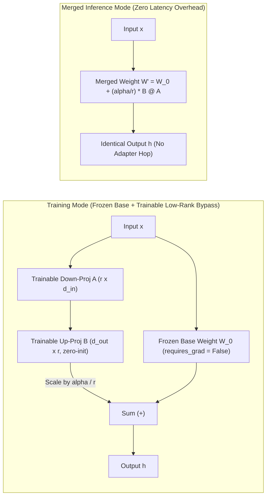
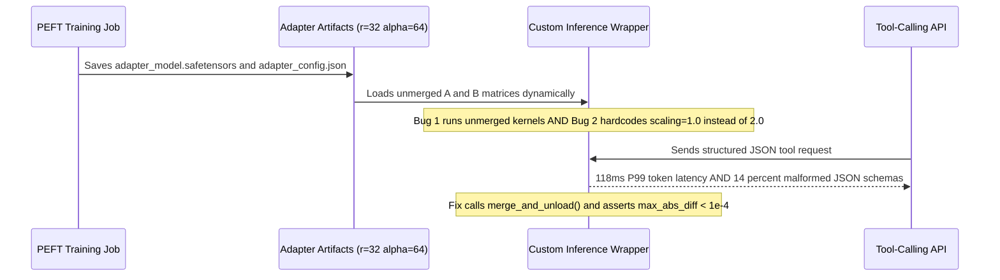

# Module 12: LoRA: Low-Rank Adaptation

> **Prerequisites:** Modules 05–11 (SFT, RLHF, DPO, RLAIF) and Transformer Attention/MLP Linear Projections (Track 02).  
> **Estimated Reading Time:** 30 minutes  
> **Target Audience:** AI Backend Engineers, ML Infrastructure Engineers, Fine-Tuning Practitioners.

> [!TIP]
> **The Golden Rule of LoRA**  
> LoRA decouples **how many parameters you optimize** from **how large the pretrained model is**: by freezing $W_0$ and training a zero-initialized low-rank decomposition $\Delta W = \frac{\alpha}{r} B A$ alongside it, you eliminate optimizer-state memory for 99%+ of the weights and start training from an **exact identity baseline**. In single-tenant production serving, always call `merge_and_unload()` to eliminate runtime bypass latency; in multi-tenant serving, explicitly match `lora_alpha / r` scaling and `fan_in_fan_out` transposition rules.

---

## 1. Why This Matters

Modules 08–11 covered *what* to optimize a model toward after pretraining — a reward model's preferences (module 08), PPO's RL loop (module 09), DPO's simpler closed-form loss (module 10), or a constitution the model critiques itself against (module 11). None of those modules said anything about *how many of the model's weights get touched* while doing it. That is a separate, orthogonal question, and it is this module's entire subject: full fine-tuning updates every parameter in the model, which for anything past toy scale means storing a full optimizer state and gradient for billions of numbers.

**LoRA (Low-Rank Adaptation, Hu et al., 2021)** is the standard answer to *"what if we do not need to update all of them"* — freeze the pretrained weight matrix entirely and add a small, trainable *low-rank* detour next to it. This module builds that detour from scratch, counts real parameters to show exactly how small "small" is, proves mathematically and numerically why zero-initialization on $B$ prevents first-step damage, and cross-checks the same finding against the real `peft` library teams use in production, so the claim rests on two independent measurements rather than one.

---

## 2. Visual Mental Models: LoRA Bypass, Freezing & Zero-Latency Merging

During training, input activations flow in parallel through the frozen base matrix $W_0$ and the low-rank bottleneck $A \rightarrow B$ scaled by $\frac{\alpha}{r}$, with gradients updating **only** $A$ and $B$. Because both paths are purely linear operations, at inference time you can fold the adapter back into a single matrix $W' = W_0 + \frac{\alpha}{r} B A$ for **zero extra latency**, or keep adapters hot-swappable per tenant request.



### The idea: freeze the big matrix, train a small detour next to it

```text
 FULL FINE-TUNING                    LoRA
 ───────────────────                 ───────────────────────────
 x -> [ W  (d x d), TRAINABLE ] -> y  x -> [ W (d x d), FROZEN ] ─┐
                                                                   ├─► + ─► y
      every entry of W gets a        x -> [ A (r x d) ] -> [ B (d x r) ]
      gradient and an optimizer            (r << d, BOTH trainable,
      slot                                  their product has the
                                             same shape as W's update)
```

A linear layer computes $y = x W^T + b$. Full fine-tuning updates every entry of $W$ directly. LoRA instead freezes $W_0$ completely and adds a correction term built from two much smaller matrices, $A$ and $B$, whose product approximates the update $W$ would have needed:

$$h = W_0 x + \Delta W x = W_0 x + \frac{\alpha}{r} B A x, \qquad A \in \mathbb{R}^{r \times d_{\text{in}}}, \quad B \in \mathbb{R}^{d_{\text{out}} \times r}$$

$r$, the *rank*, is a small number (4, 8, 16 — chosen by the user) far smaller than the layer's own dimension $d$. $A$ maps the input down to an $r$-dimensional bottleneck; $B$ maps it back up to the output dimension. The product $B A$ (or `x @ A.T @ B.T` per-input) has the same shape as a full update to $W$ would, but it is built from only $r \cdot (d_{\text{in}} + d_{\text{out}})$ numbers instead of $d_{\text{in}} \cdot d_{\text{out}}$. $B$ is conventionally initialized to all zeros, so at the very start of training the LoRA path contributes **exactly nothing** and the wrapped layer's output is identical to the frozen base layer alone — training then nudges $A$ and $B$ away from that no-op starting point.

---

## 3. Core Mechanics, Memory Math & Verified Experiments

### Why Full Fine-Tuning Blows Up GPU Memory (AdamW Breakdown)

In mixed-precision BF16 training with AdamW, each **trainable** parameter requires roughly **16 bytes** of GPU memory before activations:
- **2 bytes:** BF16 model weights
- **2 bytes:** BF16 gradients
- **4 bytes:** FP32 master weight copy (for numerical precision during weight updates)
- **4 bytes:** AdamW first moment ($m$, running gradient mean)
- **4 bytes:** AdamW second moment ($v$, running squared gradient variance)

For a **7B parameter model**, full fine-tuning demands $7\times 10^9 \times 16 \approx 112\text{ GB}$ just for static weights, gradients, and optimizer states — exceeding an 80 GB A100/H100 before batch activations even begin. Under LoRA with `trainable% = 0.24%` (~16.8M trainable parameters), the frozen base takes only $7\times 10^9 \times 2 = 14\text{ GB}$ (no gradients, no FP32 master weights, no Adam moments), while the trainable adapters + optimizer states consume just $16.8\times 10^6 \times 16 \approx 0.27\text{ GB}$ — shrinking static VRAM from **112 GB down to ~14.27 GB**.

### Verified, from scratch: trainable parameters vs. a frozen base layer, across ranks

```python
import torch
import torch.nn as nn

torch.manual_seed(0)

class LoRALinear(nn.Module):
    """Wraps a frozen nn.Linear and adds a trainable low-rank A @ B update."""
    def __init__(self, base: nn.Linear, r: int, alpha: float = None):
        super().__init__()
        self.base = base
        for p in self.base.parameters():
            p.requires_grad_(False)
        out_features, in_features = base.weight.shape
        self.r = r
        self.alpha = alpha if alpha is not None else r
        self.scaling = self.alpha / self.r
        self.A = nn.Parameter(torch.randn(r, in_features) * 0.01)
        self.B = nn.Parameter(torch.zeros(out_features, r))  # zero init: starts as a no-op

    def forward(self, x):
        base_out = self.base(x)
        lora_out = (x @ self.A.T) @ self.B.T
        return base_out + self.scaling * lora_out

def count_params(params):
    return sum(p.numel() for p in params)

in_features, out_features = 768, 768  # gpt2's attention projection shape
base_layer = nn.Linear(in_features, out_features)
frozen_params = count_params(base_layer.parameters())
print(f"Frozen base nn.Linear({in_features}, {out_features}) params:", frozen_params)

for r in (1, 4, 8, 16, 64):
    lora = LoRALinear(nn.Linear(in_features, out_features), r=r)
    trainable = count_params([lora.A, lora.B])
    ratio = trainable / frozen_params
    print(f"  r={r:>3}  trainable A+B params = {trainable:>7}  "
          f"ratio to frozen base = {ratio:.5f}  ({ratio*100:.3f}%)")
```

Verified output:

```text
Frozen base nn.Linear(768, 768) params: 590592
  r=  1  trainable A+B params =    1536  ratio to frozen base = 0.00260  (0.260%)
  r=  4  trainable A+B params =    6144  ratio to frozen base = 0.01040  (1.040%)
  r=  8  trainable A+B params =   12288  ratio to frozen base = 0.02081  (2.081%)
  r= 16  trainable A+B params =   24576  ratio to frozen base = 0.04161  (4.161%)
  r= 64  trainable A+B params =   98304  ratio to frozen base = 0.16645  (16.645%)
```

At `r=8` — a common real-world default — this single layer trains **about 2% of its own frozen weight's parameter count**. Even at `r=64` (unusually large in practice), it is still under 17%. The ratio grows linearly with `r`, but `r` stays a small, chosen constant while the frozen layer's parameter count ($d_{\text{in}} \times d_{\text{out}}$) grows *quadratically* with the layer's width — so the trainable fraction gets smaller, not larger, as models scale up.

### Verified: zero-init B means training starts as a true no-op, and gradients only reach A and B

```python
x = torch.randn(2, in_features)
lora = LoRALinear(base_layer, r=8)
with torch.no_grad():
    base_only = base_layer(x)
    with_lora = lora(x)
    max_abs_diff = (base_only - with_lora).abs().max().item()
print("max abs diff, base-only output vs LoRA-wrapped output at init:", max_abs_diff)

out = lora(x).sum()
out.backward()
print("base.weight.requires_grad:", lora.base.weight.requires_grad)
print("base.weight.grad is None:", lora.base.weight.grad is None)
print("A.grad is None:", lora.A.grad is None)
print("B.grad is None:", lora.B.grad is None)
```

Verified output:

```text
max abs diff, base-only output vs LoRA-wrapped output at init: 0.0
base.weight.requires_grad: False
base.weight.grad is None: True
A.grad is None: False
B.grad is None: False
```

The output difference is **exactly `0.0` at initialization** — not approximately zero, exactly, because $B$ starts at all zeros and `scaling * (x @ A.T @ B.T)` is therefore exactly zero regardless of what $A$ contains. After a backward pass, the frozen base weight has no gradient at all (`grad is None`), while $A$ and $B$ both received real gradients. This is the whole mechanism in two verified facts: nothing about the base model changes, either in its forward output at the start or in what receives gradient signal during training.

### Cross-check with the real `peft` library on a real model

The hand-rolled version above proves the concept works; it does not prove this is what production tooling actually does. `peft`'s `LoraConfig` + `get_peft_model` wraps real named layers of a real Hugging Face model the same way, and reports its own trainable count via `print_trainable_parameters()` — an independent measurement, from different code, that should agree with the hand-rolled math above:

```python
from transformers import AutoModelForCausalLM
from peft import LoraConfig, get_peft_model

model = AutoModelForCausalLM.from_pretrained("gpt2")
print("Full gpt2 parameter count (before any wrapping):",
      sum(p.numel() for p in model.parameters()))

for r in (4, 8, 16):
    m = AutoModelForCausalLM.from_pretrained("gpt2")
    config = LoraConfig(
        r=r, lora_alpha=r, target_modules=["c_attn"],
        lora_dropout=0.0, bias="none", task_type="CAUSAL_LM",
    )
    peft_model = get_peft_model(m, config)
    print(f"--- r={r} ---")
    peft_model.print_trainable_parameters()
```

Verified output:

```text
Full gpt2 parameter count (before any wrapping): 124439808

--- r=4 ---
trainable params: 147,456 || all params: 124,587,264 || trainable%: 0.1184

--- r=8 ---
trainable params: 294,912 || all params: 124,734,720 || trainable%: 0.2364

--- r=16 ---
trainable params: 589,824 || all params: 125,029,632 || trainable%: 0.4717
```

Real `gpt2` has `124,439,808` parameters. Attaching real LoRA adapters (via `peft`, not the hand-rolled version) to just its `c_attn` projection across all 12 layers, at `r=8`, trains **`294,912` parameters — `0.24%` of the model.** That is the same order of magnitude the from-scratch section found for a single layer at `r=8` (`2.08%`; `gpt2`'s number is smaller because only one projection per block is targeted here, out of several linear layers each block has). Two independent implementations, two independently computed numbers, the same conclusion: LoRA trains a genuinely tiny fraction of the base model.

One real implementation detail worth knowing if you inspect `peft`'s output directly — running this exact code prints a `UserWarning` about `fan_in_fan_out`, because `gpt2`'s attention projection is implemented as HF's `Conv1D` (a transposed-weight variant), not a plain `nn.Linear`; `peft` detects this and adjusts automatically. It is a real, harmless quirk of `gpt2`'s implementation, not a bug in the adapter math above.

---

## 4. Systematic Comparison Matrix & Reference Terminology

### Fine-Tuning & Adapter Strategy Matrix

| Method | Trainable Params (7B Model) | Optimizer VRAM (AdamW) | Checkpoint Artifact Size | Inference Latency (Merged vs Unmerged) | Best Production Use Case |
| :--- | :--- | :--- | :--- | :--- | :--- |
| **Full Fine-Tuning** | 100% (7.0B) | ~84 GB (FP32 master + $m, v$) | ~14 GB (BF16 weights) | 0 ms extra | Pretraining / deep domain shifts across huge corpora |
| **LoRA (Attn-Only: `q, v`)** | ~0.06%–0.24% (4M–17M) | ~0.05–0.2 GB | ~8–35 MB | **0 ms merged** / +5%–15% unmerged | Lightweight style/format adaptation |
| **LoRA (All-Linear: Attn + MLP)** | ~0.5%–1.5% (35M–100M) | ~0.4–1.2 GB | ~70–200 MB | **0 ms merged** / +10%–25% unmerged | General SFT & DPO matching full FT quality |
| **rsLoRA (`scaling = alpha/sqrt(r)`)** | Same as LoRA | Same as LoRA | Same as LoRA | Same as LoRA | High-rank ($r \ge 32$) runs avoiding vanishing adapter gradients |
| **DoRA (Weight-Decomposed)** | LoRA + magnitude vector $m$ | +~0.01 GB | ~1% larger than LoRA | **0 ms merged** / higher train cost | Narrow domains needing tighter directional learning |

### Reference Terminology

```text
 Term                 Meaning
 ───────────────────  ──────────────────────────────────────────────
 Base weight W        The pretrained weight matrix; frozen entirely
                       under LoRA (verified: 0 gradient after backward)
 Rank r                Bottleneck dimension of A and B; small, chosen
                       by the user (4-64 typical); controls both
                       capacity and trainable-parameter count directly
 A, B matrices         The trainable low-rank pair; A projects down to
                       r dimensions, B projects back up to the output
                       dimension; their product approximates a full
                       weight update using far fewer numbers
 alpha / scaling       A scaling factor (alpha/r) applied to the LoRA
                       path's output; controls how strongly the
                       adapter's update contributes relative to r
 Zero-init on B        Standard convention ensuring the adapter starts
                       as an exact no-op (verified: 0.0 output diff)
 target_modules        Which named layers get wrapped with LoRA (e.g.
                       just attention projections, or also MLP layers);
                       changes total trainable count directly
 trainable%            peft's own reported ratio of trainable to total
                       parameters; this module's second, independent
                       verification of the "tiny fraction" claim
```

---

## 5. Production War Story Post-Mortem: Unmerged Adapter Latency Breach & Scaling Mismatch

| Field | Incident Details |
| :--- | :--- |
| **Severity** | **SEV-2** (Production P99 Latency SLA Breach & Tool-Call JSON Corruption) |
| **Detection / Resolution Time** | Detected 22 minutes post-canary rollout / Resolved in 1 hour 10 minutes |
| **Impact** | P99 per-token latency jumped from 42 ms to 118 ms (2.8x slowdown) across inference replicas, and 14% of JSON function-calling responses emitted malformed schemas due to an unapplied `lora_alpha / r = 2.0` scale factor |

### What Happened

A backend platform team fine-tuned an enterprise tool-calling LoRA adapter (`r=32`, `lora_alpha=64`, targeting all attention and MLP layers) using Hugging Face `peft`. Instead of merging the adapter into the base model before shipping their single-tenant vLLM/custom inference container, they loaded the raw adapter weights into a custom PyTorch forward wrapper to "keep base weights clean." Two bugs shipped together: (1) executing separate `x @ A.T @ B.T` GEMMs across every linear layer per autoregressive decoding token added significant kernel launch overhead without fused S-LoRA/Punica kernels, breaking P99 latency; (2) the custom loader defaulted `scaling = 1.0` instead of reading `lora_alpha / r = 64 / 32 = 2.0` from `adapter_config.json`, cutting the adapter's learned weight deltas in half and breaking strict JSON tool-call formatting.



### Root Cause Analysis

1. **Unmerged Single-Tenant Inference:** Running unmerged LoRA bypass branches on a dedicated single-tenant deployment paid extra PyTorch kernel-launch latency on every decode token with zero operational benefit.
2. **Broken `lora_alpha / r` Contract:** Custom inference wrappers bypassed `peft`'s scaling calculation (`64 / 32 = 2.0`), silently altering the learned effective weights $\Delta W = \frac{\alpha}{r} B A$.
3. **Missing Numerical Parity Gate:** CI/CD verified adapter file existence without comparing `peft_model(canary_batch)` against the production serving container's logits.

### The Fix & Architectural Hardening

- Executed `merged = peft_model.merge_and_unload()` in the release build pipeline for single-tenant models, restoring 42 ms P99 latency with identical hardware footprint.
- Added a mandatory **release parity test** asserting `(peft_out.logits - merged_out.logits).abs().max() < 1e-3` (BF16) on a fixed canary prompt batch before pushing container images.
- For genuine multi-tenant endpoints requiring hot-swappable adapters, migrated to fused Punica/S-LoRA runtime engines that read `adapter_config.json` directly (`r`, `lora_alpha`, `fan_in_fan_out`) without custom Python wrappers.

---

## 6. Multi-Language Production Implementation

These four implementations model **LoRA parameter/AdamW memory calculation**, **`adapter_config.json` & `fan_in_fan_out` preflight auditing**, **PyTorch/`peft` LoRA training + `merge_and_unload()` parity checking**, and **low-rank vs. merged matrix algebra parity**.

````carousel
```go
// lora_planner.go
// Calculates exact LoRA parameter counts, AdamW optimizer VRAM, and multi-adapter cache limits.
package lora

import "fmt"

type LayerShape struct {
	Name        string
	InFeatures  int64
	OutFeatures int64
	NumLayers   int64
}

type MemoryBudget struct {
	FrozenBaseParams   int64
	TrainableParams    int64
	TrainableRatioPct  float64
	FrozenBaseBF16GB   float64
	AdapterAdamWVRAMGB float64
	AdapterArtifactMB  float64
}

func EstimateLoRABudget(totalModelParams int64, targets []LayerShape, rank int64) (MemoryBudget, error) {
	if rank <= 0 || totalModelParams <= 0 {
		return MemoryBudget{}, fmt.Errorf("rank (%d) and totalModelParams (%d) must be > 0", rank, totalModelParams)
	}

	var trainable int64
	for _, layer := range targets {
		// Each wrapped linear projection adds A (r x in) + B (out x r)
		perLayer := rank * (layer.InFeatures + layer.OutFeatures)
		trainable += perLayer * layer.NumLayers
	}

	// BF16 weights = 2 bytes/param; trainable AdamW state (weights+grads+FP32 master+m+v) = 16 bytes/param
	frozenGB := float64(totalModelParams*2) / 1e9
	adapterAdamGB := float64(trainable*16) / 1e9
	artifactMB := float64(trainable*2) / 1e6 // BF16 saved safetensors checkpoint
	ratioPct := (float64(trainable) / float64(totalModelParams+trainable)) * 100.0

	return MemoryBudget{
		FrozenBaseParams:   totalModelParams,
		TrainableParams:    trainable,
		TrainableRatioPct:  ratioPct,
		FrozenBaseBF16GB:   frozenGB,
		AdapterAdamWVRAMGB: adapterAdamGB,
		AdapterArtifactMB:  artifactMB,
	}, nil
}
```
<!-- slide -->
```typescript
// adapterConfigAuditor.ts
// Validates exported PEFT adapter_config.json settings before serving or merging.

export interface PeftAdapterConfig {
  peft_type: string;
  r: number;
  lora_alpha: number;
  target_modules: string[];
  fan_in_fan_out?: boolean;
  bias: "none" | "all" | "lora_only";
}

export interface AdapterAuditResult {
  scalingFactor: number;
  isHighRankWarning: boolean;
  requiresConv1DTransposeCheck: boolean;
  errors: string[];
}

export function auditAdapterConfig(
  cfg: PeftAdapterConfig,
  modelArchitecture: "gpt2" | "llama" | "mistral" | "qwen2"
): AdapterAuditResult {
  const errors: string[] = [];

  if (cfg.peft_type !== "LORA") {
    errors.push(`Expected peft_type=LORA, received ${cfg.peft_type}`);
  }
  if (!Number.isInteger(cfg.r) || cfg.r <= 0) {
    errors.push(`Invalid LoRA rank r=${cfg.r}; must be a positive integer.`);
  }
  if (cfg.lora_alpha <= 0) {
    errors.push(`Invalid lora_alpha=${cfg.lora_alpha}; must be > 0.`);
  }
  if (!cfg.target_modules || cfg.target_modules.length === 0) {
    errors.push("target_modules cannot be empty.");
  }

  // GPT-2 uses HF Conv1D with transposed weights requiring fan_in_fan_out=true
  const requiresConv1DTransposeCheck = modelArchitecture === "gpt2";
  if (requiresConv1DTransposeCheck && !cfg.fan_in_fan_out) {
    errors.push("GPT-2 Conv1D projections require fan_in_fan_out=true to prevent silent weight transposition bugs.");
  }

  const scalingFactor = cfg.lora_alpha / cfg.r;
  return {
    scalingFactor,
    isHighRankWarning: cfg.r >= 64,
    requiresConv1DTransposeCheck,
    errors,
  };
}
```
<!-- slide -->
```python
"""
lora_peft_merge_verifier.py
Production PEFT LoRA wrapping, zero-init invariance check, and merge_and_unload() parity verification.
"""

import torch
from transformers import AutoModelForCausalLM, AutoTokenizer
from peft import LoraConfig, TaskType, get_peft_model


def attach_and_verify_lora(model_id: str = "gpt2", rank: int = 8, lora_alpha: int = 16):
    tok = AutoTokenizer.from_pretrained(model_id)
    base_model = AutoModelForCausalLM.from_pretrained(model_id)
    base_model.eval()

    prompt = tok("LoRA fine-tuning keeps base weights frozen.", return_tensors="pt")
    with torch.no_grad():
        base_logits = base_model(**prompt).logits.clone()

    # For GPT-2 Conv1D layers, set fan_in_fan_out=True explicitly to avoid warnings/transposition issues
    config = LoraConfig(
        r=rank,
        lora_alpha=lora_alpha,
        target_modules=["c_attn", "c_proj"],
        fan_in_fan_out=True,
        lora_dropout=0.0,
        bias="none",
        task_type=TaskType.CAUSAL_LM,
    )
    peft_model = get_peft_model(base_model, config)
    peft_model.print_trainable_parameters()

    # 1. Verify exact zero-init B no-op baseline before any optimizer step
    peft_model.eval()
    with torch.no_grad():
        init_logits = peft_model(**prompt).logits
        init_diff = (base_logits - init_logits).abs().max().item()
    assert init_diff == 0.0, f"Expected exact zero-init baseline, got diff={init_diff}"

    # 2. Simulate non-zero adapter training update on B so merge actually transforms weights
    with torch.no_grad():
        for name, param in peft_model.named_parameters():
            if "lora_B" in name:
                param.add_(torch.randn_like(param) * 0.01)

        unmerged_logits = peft_model(**prompt).logits.clone()

    # 3. Merge LoRA deltas directly into base weights for zero-latency inference and verify parity
    merged_model = peft_model.merge_and_unload()
    merged_model.eval()
    with torch.no_grad():
        merged_logits = merged_model(**prompt).logits
        merge_diff = (unmerged_logits - merged_logits).abs().max().item()

    assert merge_diff < 1e-4, f"Merged weight parity failed: max diff={merge_diff}"
    print(f"Verified init_diff={init_diff:.1f}, merge_parity_diff={merge_diff:.2e}")
    return merged_model
```
<!-- slide -->
```csharp
// LoraMatrixParity.cs
// Verifies mathematical equivalence between dynamic LoRA bypass and merged weight W' = W0 + (alpha/r)*B*A.
using System;

namespace GenAi.FineTuning.Lora
{
    public static class LoraMatrixParity
    {
        public static double[] ForwardBypass(
            double[,] w0, double[,] a, double[,] b, double[] x, double alpha)
        {
            int dOut = w0.GetLength(0);
            int dIn = w0.GetLength(1);
            int r = a.GetLength(0);
            double scaling = alpha / r;

            var y = new double[dOut];
            var z = new double[r];

            // z = A * x (project down to rank r)
            for (int k = 0; k < r; k++)
                for (int j = 0; j < dIn; j++)
                    z[k] += a[k, j] * x[j];

            // y = W0 * x + scaling * (B * z)
            for (int i = 0; i < dOut; i++)
            {
                double baseAcc = 0.0;
                for (int j = 0; j < dIn; j++) baseAcc += w0[i, j] * x[j];

                double loraAcc = 0.0;
                for (int k = 0; k < r; k++) loraAcc += b[i, k] * z[k];

                y[i] = baseAcc + scaling * loraAcc;
            }
            return y;
        }

        public static double[,] MergeWeights(double[,] w0, double[,] a, double[,] b, double alpha)
        {
            int dOut = w0.GetLength(0);
            int dIn = w0.GetLength(1);
            int r = a.GetLength(0);
            double scaling = alpha / r;
            var merged = new double[dOut, dIn];

            for (int i = 0; i < dOut; i++)
                for (int j = 0; j < dIn; j++)
                {
                    double delta = 0.0;
                    for (int k = 0; k < r; k++) delta += b[i, k] * a[k, j];
                    merged[i, j] = w0[i, j] + scaling * delta;
                }
            return merged;
        }
    }
}
```
````

---

## 7. Practical Hands-On Verification CLI Workflows

### Verification 1: Single-Layer Rank Sweep & 7B Model Optimizer VRAM Calculator (Stdlib Python)

Run this CLI check to reproduce the module's exact `768 x 768` rank-sweep numbers (`0.260%` to `16.645%`) and compute the 7B model BF16 + AdamW memory savings:

```bash
python -c "
base_layer = 768*768 + 768
for r in (1, 4, 8, 16, 64):
    ab = r * (768 + 768)
    print(f'r={r:>2} trainable={ab:>6} ratio={ab/base_layer*100:.3f}%')

full_7b = 7_000_000_000
lora_7b = int(full_7b * 0.0024)
print(f'7B Full BF16+AdamW GB={full_7b*16/1e9:.2f} | LoRA BF16 base + AdamW adapter GB={(full_7b*2 + lora_7b*16)/1e9:.2f}')
"
```

**Expected Output:**
```text
r= 1 trainable=  1536 ratio=0.260%
r= 4 trainable=  6144 ratio=1.040%
r= 8 trainable= 12288 ratio=2.081%
r=16 trainable= 24576 ratio=4.161%
r=64 trainable= 98304 ratio=16.645%
7B Full BF16+AdamW GB=112.00 | LoRA BF16 base + AdamW adapter GB=14.27
```

### Verification 2: Inspecting `peft` Parameter Counts Across `gpt2` Ranks

With `transformers` and `peft` installed, verify the production `trainable%` sweep on `gpt2`:

```bash
python -c "
from transformers import AutoModelForCausalLM
from peft import LoraConfig, get_peft_model
for r in (4, 8, 16):
    m = AutoModelForCausalLM.from_pretrained('gpt2')
    pm = get_peft_model(m, LoraConfig(r=r, lora_alpha=r, target_modules=['c_attn'], fan_in_fan_out=True, bias='none', task_type='CAUSAL_LM'))
    print(f'r={r}:', end=' ')
    pm.print_trainable_parameters()
"
```

**Expected Output:**
```text
r=4: trainable params: 147,456 || all params: 124,587,264 || trainable%: 0.1184
r=8: trainable params: 294,912 || all params: 124,734,720 || trainable%: 0.2364
r=16: trainable params: 589,824 || all params: 125,029,632 || trainable%: 0.4717
```

### Hands-On Exercises

#### 1. Reproduce the rank sweep on the from-scratch `LoRALinear`, then target a different `peft` layer

Re-run the from-scratch parameter sweep with `in_features=out_features=1024` instead of 768 and confirm the frozen-parameter count and every ratio scale accordingly (the ratios themselves should not change noticeably, since both frozen and trainable counts scale together with `r` fixed). Then modify the `peft` example's `target_modules` to `["c_attn", "c_proj"]` (both a model's fused-attention projection and its output projection) and confirm `print_trainable_parameters()` reports a larger trainable count and percentage than the `c_attn`-only version above at the same `r`.

#### 2. Verify the zero-init claim breaks if you change the initialization

Modify the from-scratch `LoRALinear` to initialize `B` with `torch.randn(...) * 0.01` instead of `torch.zeros(...)`, and re-run the "max abs diff at init" check. Confirm the difference is no longer exactly `0.0`. Explain, in your own words, why the standard convention (zero-init `B`) matters for training stability — what would change about the very first forward pass of a freshly-wrapped pretrained model if the adapter did not start as a no-op?

#### 3. Measure trainable-parameter count as a fraction of a *larger* real model

Repeat the `peft` cross-check on `gpt2-medium` instead of `gpt2` (both are cached locally). Report the full parameter count, and the `trainable%` at `r=8` on `target_modules=["c_attn"]`. Confirm the absolute trainable parameter count grows linearly with width/layers compared to `gpt2`, while the trainable *percentage* drops — because the model's quadratic matrices grew faster than the low-rank bypass at fixed `r`.

### Independent Challenge

A teammate says: "We should always use the largest rank we can afford, since a bigger `r` means the adapter can express any update better — there's no real downside except a few more trainable parameters." Using this module's verified findings, evaluate that claim.

<details><summary>Discussion</summary>

The core fact is right but incompletely reasoned. This module's rank sweep verified that increasing `r` from 1 to 64 increases the trainable parameter count linearly and predictably (`1,536` to `98,304` in the from-scratch example) — so yes, a bigger `r` gives the adapter more capacity to represent complex updates, and the "cost" in trainable parameters is real but stays orders of magnitude below the frozen base layer even at `r=64` (16.6% of one layer, and even less of a whole model, per the `peft` cross-check).

Where the claim oversimplifies: "a few more trainable parameters" is not the only cost. More trainable parameters means more optimizer state (Adam-style optimizers store two extra numbers per trainable parameter plus master weights), a larger adapter checkpoint to store and distribute per fine-tuned task, greater risk of overfitting on small instruction datasets, and — practically — diminishing returns, since the paper this module cites found accuracy often plateaus well before `r` gets large, meaning the "better expression" benefit does not scale as cleanly as the parameter count does. The right frame, grounded in what was actually measured here: `r` is a real capacity/cost dial, worth tuning per task rather than maximizing by default, and this module's own numbers show exactly how directly it is priced in trainable parameters.

</details>

---

## 8. Common Mistakes & Troubleshooting

- **Assuming LoRA changes the base model's weights at all.** It does not, ever, during training — this module verified `base.weight.grad is None` after a real backward pass. Only `A` and `B` receive gradients. Confusing "the model behaves differently after LoRA fine-tuning" with "the base weights changed" is a common misunderstanding; the behavior change comes entirely from the added adapter path (until you explicitly merge with `merge_and_unload()` after training).
- **Forgetting to zero-init `B` (or an equivalent no-op start) and being confused why loss looks strange in step 1.** Exercise 2 shows directly what changes if this convention is not followed: the adapter no longer starts as an identity, so the wrapped layer's very first forward pass on a pretrained model already differs from the base model's, injecting random noise before any training signal has had a chance to guide that difference usefully.
- **Comparing a from-scratch single-layer trainable ratio directly against a whole-model `trainable%` from `peft` without noting the scope difference.** This module's single wrapped layer at `r=8` showed `~2.08%`; `gpt2`'s whole-model `trainable%` at the same `r` was `0.24%` — both correct, but not the same measurement: one is "this one layer's trainable fraction," the other is "this fraction of every parameter in the entire model," most of which (embeddings, LayerNorm, other projections) was never wrapped at all.
- **Treating `target_modules` as unimportant.** Exercise 1 showed directly that changing which named layers get wrapped changes the total trainable count — LoRA's "how small is small" answer is a direct function of *which* layers you choose to attach adapters to, not a fixed property of the technique itself (in modern Llama/Qwen models, targeting all linear layers including `gate_proj`, `up_proj`, `down_proj` substantially outperforms attention-only LoRA).
- **Assuming a higher rank is always strictly better with no trade-off.** See the Independent challenge — more trainable parameters is a real, measurable cost (optimizer state, checkpoint size, overfitting risk), even though it stays small relative to the frozen base.

---

## 9. Operational Validation Checkpoints & Checkpoint Quiz

### Operational Validation Checkpoints

<details><summary><strong>Checkpoint 1: Zero-Init B vs. Zero-Init A Symmetry Trap</strong></summary>

Why does LoRA initialize $B = 0$ and $A \sim \mathcal{N}(0, \sigma^2)$ rather than initializing **both** $A = 0$ and $B = 0$? If both matrices start at zero, every partial derivative $\frac{\partial \mathcal{L}}{\partial A} \propto B^T (\dots)$ and $\frac{\partial \mathcal{L}}{\partial B} \propto (\dots) A^T$ evaluates to **zero**, trapping the adapter at a saddle point where zero learning occurs. Setting $B = 0$ while keeping $A$ random guarantees exact no-op forward parity (`0.0` diff) at step 0 while allowing non-zero gradients into $B$ immediately on the first backward pass.

</details>

<details><summary><strong>Checkpoint 2: When Should You Call `merge_and_unload()` vs. Keep Dynamic Adapters?</strong></summary>

Call `merge_and_unload()` whenever serving a **single fine-tuned model** behind a dedicated endpoint: folding $\frac{\alpha}{r} B A$ into $W_0$ produces identical logits with **zero extra runtime latency or adapter memory**. Keep adapters unmerged **only** when serving dozens or hundreds of distinct customer/task adapters sharing one frozen base model in GPU memory (multi-tenant LoRA serving via vLLM / S-LoRA).

</details>

<details><summary><strong>Checkpoint 3: Detecting `lora_alpha / r` Scaling Bugs During Inference Export</strong></summary>

If an adapter evaluated inside Hugging Face `peft` produces crisp structured outputs, but the exported adapter in a custom inference runtime produces watered-down or broken formatting, inspect the scaling factor applied to $B A$. `peft` scales by `lora_alpha / r` (or `lora_alpha / sqrt(r)` if `use_rslora=True`) — omitting that multiplier or confusing `r` with `lora_alpha` silently rescales the entire fine-tuned update.

</details>

### Checkpoint quiz

1. In the from-scratch verification, why was the output difference between the base-only layer and the LoRA-wrapped layer exactly `0.0` at initialization, not just approximately small?
2. What did `base.weight.grad is None` after a real backward pass verify about which parameters receive gradient signal under LoRA?
3. At `r=8`, the from-scratch single-layer example showed a `~2.08%` trainable ratio, while the real `peft`-wrapped `gpt2` model showed a `0.24%` `trainable%` at the same `r`. Why do these two real, correct numbers differ?
4. What two matrices does LoRA add alongside a frozen weight, and which dimension (shared by both) directly controls the trainable parameter count?
5. Why does `gpt2` specifically trigger a `fan_in_fan_out` warning when wrapped with `peft`'s `LoraConfig`, and does it indicate a bug?

<details><summary>Answers</summary>

1. Because `B` is initialized to all zeros, so `scaling * (x @ A.T @ B.T)` evaluates to exactly zero regardless of what `A` contains — the LoRA path contributes nothing at all until training moves `B` away from zero.
2. That only the added `A` and `B` matrices are trainable — the frozen base weight's `.grad` was confirmed to be `None` after `.backward()`, meaning no gradient signal ever reaches it.
3. Scope: the single-layer example measured one layer's own trainable fraction (`12,288` trainable out of that one layer's `590,592` frozen parameters). `gpt2`'s `trainable%` measured the same 12-layer model's `c_attn`-only adapters against the *entire* model's 124M+ parameters, most of which (embeddings, other projections, LayerNorm) were never wrapped and do not count toward either number's numerator.
4. `A` (projects down to rank `r`) and `B` (projects back up); the rank `r` is the shared bottleneck dimension that directly and linearly controls the trainable parameter count (verified: `1,536` at `r=1` up to `98,304` at `r=64` in the sweep).
5. Because `gpt2`'s attention projection (`c_attn`) is implemented with Hugging Face's `Conv1D` class, which stores its weight transposed relative to a standard `nn.Linear` — `peft` detects this and automatically sets `fan_in_fan_out=True` to handle it correctly. It is a real, harmless quirk of `gpt2`'s own implementation, not a bug in the LoRA math itself.

</details>

---

## 10. Further reading & sources

- [LoRA: Low-Rank Adaptation of Large Language Models (Hu et al., 2021)](https://arxiv.org/abs/2106.09685) - the paper this module's entire mechanism (frozen W, trainable A/B, zero-init B, alpha scaling) is drawn from.
- [PEFT: State-of-the-art Parameter-Efficient Fine-Tuning](https://github.com/huggingface/peft) - the real library this module cross-checks against; source of `LoraConfig`, `get_peft_model`, and `print_trainable_parameters()`.
- [PEFT documentation: LoRA](https://huggingface.co/docs/peft/main/en/conceptual_guides/lora) - official usage guide covering `target_modules`, `lora_alpha`, and rank selection in more depth than this module's toy sweep.

## Next

[Module 13: QLoRA and Quantized Fine-Tuning](../13-qlora-and-quantized-fine-tuning/README.md)
