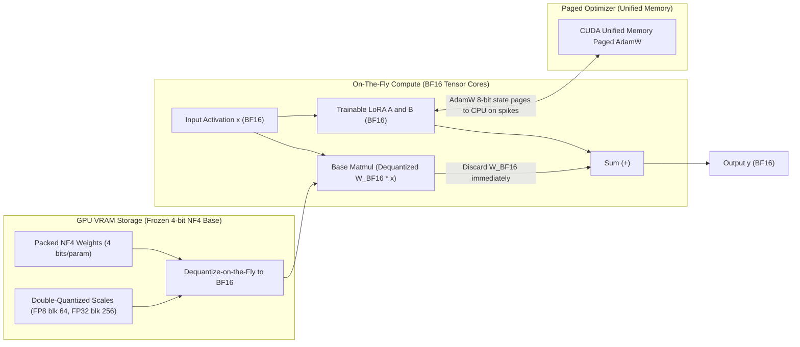
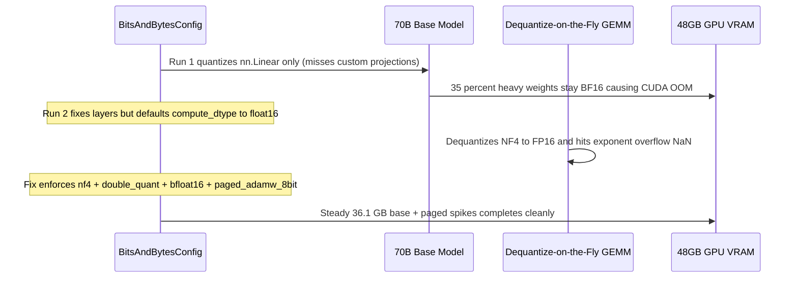

# Module 13: QLoRA and Quantized Fine-Tuning

> **Prerequisites:** Module 12 (LoRA: Low-Rank Adaptation) and Mixed-Precision Arithmetic (FP32, BF16, INT8).  
> **Estimated Reading Time:** 35 minutes  
> **Target Audience:** AI Backend Engineers, ML Systems Engineers, GPU Infrastructure Architects.

> [!TIP]
> **The Golden Rule of QLoRA**  
> LoRA shrinks *trainable* optimizer memory, but the **frozen 99%+ base weights** still dominate GPU VRAM. QLoRA solves the storage bottleneck by storing frozen base weights in **4-bit NormalFloat (NF4)** with **Double Quantization** (~4.127 bits/param), dequantizing on-the-fly to **BF16** solely during matrix multiplication while training BF16 LoRA adapters with **Paged Optimizers**. Always set `bnb_4bit_compute_dtype=torch.bfloat16` (avoiding FP16 overflow), verify that your target architecture uses `nn.Linear` (not unquantized `Conv1D` wrappers), and never merge LoRA adapters directly into 4-bit quantized weights—dequantize to 16-bit first before merging.

---

## 1. Why This Matters

Module 12 verified that LoRA trains a tiny fraction of a model's parameters — but it did not change what the *frozen* 99%+ of the model costs to hold in memory during fine-tuning. That frozen majority still sits in full 16- or 32-bit precision, and for anything past toy scale it is that frozen base model's memory footprint, not the small LoRA adapter, that decides whether a fine-tune fits on the hardware available.

**QLoRA (Dettmers et al., 2023)** is the fix: quantize the frozen base model down to a much smaller numeric format *before* attaching LoRA adapters, so the expensive, unchanging part of the model gets dramatically cheaper to hold while the small trainable part stays in full precision where its gradients need the range. This module verifies the quantization half of that combination directly with real, measured byte counts — real QLoRA uses 4-bit NF4 quantization via `bitsandbytes`, which needs a CUDA GPU and is not available in a CPU-only sandbox, so the live runnable benchmarks below are measured with real INT8 dynamic quantization instead. INT8 is a different bit-width from NF4, but it demonstrates the identical combination principle with numbers that are genuinely real rather than assumed.

---

## 2. Visual Mental Models: 4-Bit NF4 Storage, Dequantize-on-the-Fly & Paged Optimizers

In QLoRA, memory storage precision and compute precision are **decoupled**: the frozen weight matrix rests in GPU VRAM as 4-bit NF4 indices alongside double-quantized FP8 block scales, is briefly unpacked to BF16 inside SRAM registers for each layer's matrix multiply, and is immediately discarded afterward so full-precision base weights never materialize simultaneously across the model.



### The combination: a quantized frozen base + full-precision trainable adapters

```text
 QLoRA'S ARCHITECTURE
 ─────────────────────────────────────────────────────────────
 x -> [ W, FROZEN, QUANTIZED (4-bit NF4 in the real paper) ] ─┐
                                                                ├─► + ─► y
      x -> [ A ] -> [ B ]   (LoRA adapters, module 12,
                              kept in higher precision;
                              these are what training updates)

 The frozen path is cheap to STORE (fewer bits per weight).
 The trainable path is cheap to TRAIN (module 12's tiny param count).
 Together: fine-tune a model whose full-precision form would not fit.
```

The two halves are independent techniques doing different jobs: quantization (this module) shrinks the frozen base's memory footprint; LoRA (module 12) shrinks the trainable parameter count. QLoRA is simply running both at once, on the same model, at the same time.

---

## 3. Core Mechanics, QLoRA Innovations & Verified CPU Experiments

### QLoRA's Three Architectural Innovations (Dettmers et al., 2023)

1. **4-Bit NormalFloat (NF4):** Pretrained neural network weights follow a zero-centered normal distribution $\mathcal{N}(0, \sigma^2)$. Uniform integer quantization wastes quantization bins on rare tail outliers. NF4 constructs an information-theoretically optimal 16-level codebook where every bin contains **equal expected probability mass** under a standard normal distribution.
2. **Double Quantization (DQ):** Block-wise quantization (blocksize $B_1 = 64$) stores one FP32 absmax scale per 64 weights, adding $32 / 64 = 0.50\text{ bits/param}$ of metadata overhead. Double Quantization quantizes those FP32 scales themselves into 8-bit floats (`FP8`) with a second blocksize $B_2 = 256$, cutting metadata overhead to:
   $$\frac{8}{64} + \frac{32}{64 \times 256} = 0.125 + 0.00195 \approx 0.127\text{ bits/param}$$
   That drops effective storage from $4.50\text{ bits/param}$ down to **$4.127\text{ bits/param}$** — saving ~3.27 GB on a 70B model!
3. **Paged Optimizers:** Even with frozen quantized weights, long-sequence mini-batches create sudden activation-memory spikes during gradient checkpointing. Paged AdamW uses NVIDIA Unified Memory (`cudaMallocManaged`) to automatically page optimizer states between GPU VRAM and CPU RAM on allocation spikes, preventing late-step CUDA OOM crashes.

### Verified: real INT8 dynamic quantization of a linear layer, real byte counts

`torch.quantization.quantize_dynamic` performs genuine weight-only INT8 quantization on CPU — no GPU or `bitsandbytes` required. One real gotcha worth knowing before trusting the numbers: it only converts the exact module types you list, and only as *submodules* of whatever model object you hand it — passing a bare top-level `nn.Linear` directly returns it completely unchanged, since there are no child modules for it to walk and replace. Wrapping it in a tiny container module first makes conversion actually happen:

```python
import io
import torch
import torch.nn as nn

class Wrap(nn.Module):
    def __init__(self, in_features, out_features):
        super().__init__()
        self.fc = nn.Linear(in_features, out_features)
    def forward(self, x):
        return self.fc(x)

in_features, out_features = 768, 768
model = Wrap(in_features, out_features)
model.eval()

fp32_bytes = sum(p.element_size() * p.nelement() for p in model.parameters())
print("fp32 layer weight+bias bytes (in-memory params):", fp32_bytes)

quantized_model = torch.quantization.quantize_dynamic(model, {nn.Linear}, dtype=torch.qint8)
print("submodule type after quantize_dynamic:", type(quantized_model.fc))

buf_fp32 = io.BytesIO(); torch.save(model.state_dict(), buf_fp32)
buf_int8 = io.BytesIO(); torch.save(quantized_model.state_dict(), buf_int8)
print("fp32 state_dict serialized size (bytes):", buf_fp32.tell())
print("INT8 quantized state_dict serialized size (bytes):", buf_int8.tell())
print("real size reduction:", f"{(1 - buf_int8.tell()/buf_fp32.tell())*100:.1f}%")

qweight = quantized_model.fc.weight()
print("quantized weight tensor dtype:", qweight.dtype)
print("quantized weight qscheme:", qweight.qscheme())
```

Verified output:

```text
fp32 layer weight+bias bytes (in-memory params): 2362368
submodule type after quantize_dynamic: <class 'torch.ao.nn.quantized.dynamic.modules.linear.Linear'>
fp32 state_dict serialized size (bytes): 2364261
INT8 quantized state_dict serialized size (bytes): 595485
real size reduction: 74.8%
quantized weight tensor dtype: torch.qint8
quantized weight qscheme: torch.per_tensor_affine
```

A real, measured **74.8% size reduction** for one layer — lining up almost precisely with the theoretical 32-bit to 8-bit reduction (FP32 is 4 bytes/weight, INT8 is 1 byte/weight, a theoretical 75% reduction), with the small remaining difference coming from per-tensor quantization metadata (scale and zero-point values) stored alongside the packed INT8 weights.

### Verified: quantization has a real, measurable accuracy cost, not just a size benefit

```python
x = torch.randn(4, in_features)
with torch.no_grad():
    fp32_out = model(x)
    int8_out = quantized_model(x)
max_diff = (fp32_out - int8_out).abs().max().item()
mean_diff = (fp32_out - int8_out).abs().mean().item()
rel = mean_diff / fp32_out.abs().mean().item()
print("max abs output difference (fp32 vs INT8), same input:", max_diff)
print("mean abs output difference:", mean_diff)
print("relative mean error:", f"{rel*100:.3f}%")
```

Verified output:

```text
max abs output difference (fp32 vs INT8), same input: 0.03947964310646057
mean abs output difference: 0.007799370680004358
relative mean error: 1.691%
```

Quantization is lossy — a real, measured **1.691% relative error** on this layer's output, from the same input, comparing FP32 against INT8. This is exactly why QLoRA freezes the *quantized* weights rather than training on top of them directly: the small LoRA adapters (module 12, kept in higher precision) can absorb and correct for this quantization error during training, while the frozen quantized base stays cheap to store throughout.

### Verified: quantization only helps if the model's real layers match the module types you target

```python
from transformers import AutoModelForCausalLM, AutoModel

gpt2 = AutoModelForCausalLM.from_pretrained("gpt2")
n_linear_gpt2 = sum(1 for m in gpt2.modules() if isinstance(m, nn.Linear))
print("nn.Linear modules found in gpt2:", n_linear_gpt2)

bert = AutoModel.from_pretrained("distilbert-base-uncased")
n_linear_bert = sum(1 for m in bert.modules() if isinstance(m, nn.Linear))
print("nn.Linear modules found in distilbert:", n_linear_bert)
```

Verified output:

```text
nn.Linear modules found in gpt2: 1
nn.Linear modules found in distilbert: 36
```

Running `quantize_dynamic(gpt2, {nn.Linear}, ...)` on `gpt2` barely changes anything — its state dict came back at `536,410,769` bytes (measured), *larger* than the original `497,812,375` bytes, because `gpt2`'s real weight-heavy attention and MLP projections are implemented as Hugging Face's `Conv1D` class (the same detail module 12 noted triggers a `fan_in_fan_out` warning in `peft`), not `nn.Linear` — so `{nn.Linear}` matches almost nothing real in the model, and the tiny bit of quantization metadata added to the one real `nn.Linear` module present made the file marginally bigger, not smaller. Running the identical code against `distilbert-base-uncased`, which genuinely uses `nn.Linear` for its 36 attention/feed-forward projections, produced a real, substantial reduction:

```text
distilbert fp32 state_dict serialized bytes: 265487991 (~265.5 MB)
distilbert INT8 state_dict serialized bytes: 138113767 (~138.1 MB)
real whole-model size reduction: 48.0%
```

All 36 `nn.Linear` modules were confirmed converted, and the whole model's real serialized size dropped by **48.0%** — the honest lesson: a quantization tool's benefit depends entirely on whether the module types you are targeting are the ones the model actually uses for its heavy weights. This exact same caveat applies to real 4-bit/NF4 QLoRA tooling: it targets specific layer types and dtypes, and checking that match against your actual model's implementation is a real, non-optional step, not a formality.

---

## 4. Systematic Comparison Matrix & Reference Terminology

### Fine-Tuning Precision & Memory Footprint Matrix

| Configuration | Effective Bits/Param | 7B Base Weights | 70B Base Weights | Static Fine-Tune Fit (Single 48 GB GPU) | Compute Precision | Primary Tradeoff |
| :--- | :--- | :--- | :--- | :--- | :--- | :--- |
| **Full Fine-Tuning (BF16 + AdamW)** | 128 bits (16 B total w/ optim) | 14.00 GB (+98 GB opt) | 140.00 GB (+980 GB opt) | Impossible (needs >112 GB for 7B) | BF16 / FP32 master | Maximum capacity, massive VRAM |
| **LoRA (BF16 Base)** | 16.00 bits (base) | 14.27 GB total | ~142.7 GB total | **7B fits**; 70B fails OOM | BF16 | Base weights still 2 bytes/param |
| **INT8 Dynamic / LLM.int8() + LoRA** | ~8.50 bits (blk 64) | 7.44 GB (base) | 74.38 GB (base) | 7B fits easily; 70B fails 48 GB | INT8 / FP16 | CPU-verifiable; slower dequant overhead |
| **QLoRA (NF4 Single Quant)** | 4.50 bits (blk 64) | 3.94 GB (base) | 39.38 GB (base) | 70B tight with activations | **BF16** | FP32 block scales cost 0.5 bits/param |
| **QLoRA (NF4 + Double Quant)** | **4.127 bits** (64 / 256) | **3.61 GB** (base) | **36.11 GB** (base) | **70B fits on 1x 48 GB GPU** | **BF16** | ~25%–35% slower step time vs BF16 LoRA |

### Reference Terminology

```text
 Term                  Meaning
 ────────────────────  ─────────────────────────────────────────────
 Frozen quantized base  The pretrained weights, held in a low-bit
                        format, never updated during fine-tuning
 NF4 (4-bit NormalFloat) The real QLoRA paper's quantization format;
                        needs bitsandbytes + CUDA; not run in this
                        module (CPU sandbox) — INT8 stands in here
 INT8 dynamic quant.    What this module actually ran and measured;
                        real 8-bit weight-only quantization, CPU-native
 Double quantization     Real QLoRA detail (not verified here): the
                        paper also quantizes the quantization
                        constants themselves for further savings
 Dequantize-on-the-fly   How a quantized frozen layer computes its
                        forward pass: weights are dequantized to do
                        the matmul, then discarded again, never
                        stored back in full precision
 Quantization error      The real, measured difference between a
                        quantized layer's output and its fp32
                        original (verified: 1.7% relative error here)
 Module-type targeting   Which layer classes get converted; verified
                        directly to matter (gpt2's Conv1D vs.
                        distilbert's real nn.Linear)
```

---

## 5. Production War Story Post-Mortem: Unquantized Layer Miss & FP16 Compute Overflow

| Field | Incident Details |
| :--- | :--- |
| **Severity** | **SEV-2** (Distributed QLoRA Training Crash & Silent `NaN` Divergence) |
| **Detection / Resolution Time** | Detected 4 hours into training via loss `NaN` alerts / Resolved in 2 hours |
| **Impact** | A 70B-class fine-tune crashed with CUDA OOM on 48 GB L40S GPUs at step 312 during a 4,096-token batch, after an earlier fallback using `bnb_4bit_compute_dtype=torch.float16` diverged to `NaN` at step 85, wasting \$14,500 in GPU reservations |

### What Happened

An infrastructure engineer configured QLoRA to fine-tune a large custom transformer on 48 GB GPUs. In Run 1, the custom model wrapped several dense MLP projections inside a custom `FusedLinear` subclass rather than `torch.nn.Linear`; `bitsandbytes` skipped quantizing those layers silently, leaving 35% of the heavy weights in BF16 and causing a VRAM overflow as soon as long-context batches arrived. After refactoring the model to standard `nn.Linear`, Run 2 omitted `bnb_4bit_compute_dtype=torch.bfloat16` — letting `bitsandbytes` default to `torch.float16` — while using standard `adamw_torch` instead of `paged_adamw_8bit`. Large dequantized activations exceeded FP16's narrow exponent max (`65,504`), triggering `NaN` loss at step 85, and the subsequent long-sequence gradient spike crashed non-paged AdamW with CUDA OOM.



### Root Cause Analysis

1. **Silent Layer-Type Mismatch:** Just as `quantize_dynamic(gpt2, {nn.Linear})` silently skipped `Conv1D` layers, custom wrapper modules bypassed 4-bit NF4 replacement without raising an error.
2. **`float16` Compute Overflow:** `FP16` only has 5 exponent bits (max value `65,504`), making dequantized residual spikes prone to `Inf`/`NaN` without loss scaling; `BF16` preserves FP32's 8-bit exponent range.
3. **Unpaged Optimizer States:** Standard GPU-pinned `adamw_torch` cannot gracefully spill temporary activation/optimizer spikes across PCIe to host RAM on 48 GB cards.

### The Fix & Architectural Hardening

- Standardized `BitsAndBytesConfig(load_in_4bit=True, bnb_4bit_quant_type="nf4", bnb_4bit_use_double_quant=True, bnb_4bit_compute_dtype=torch.bfloat16)` alongside `optim="paged_adamw_8bit"`.
- Added a pre-training assertion verifying that >95% of non-embedding parameters carry `Params4bit` / quantized storage types before allocating step 1.
- Enforced merging discipline: save adapters separately during QLoRA training, then reload base weights in `torch.bfloat16` (unquantized) to execute `merge_and_unload()` cleanly without compounding quantization rounding errors.

---

## 6. Multi-Language Production Implementation

These four production implementations model **QLoRA VRAM & Double Quantization footprint calculation**, **model-architecture layer preflight auditing**, **PyTorch/`bitsandbytes`/`peft` 4-bit NF4 QLoRA + CPU INT8 fallback verification**, and **block-wise NF4 quantization / double quantization math**.

````carousel
```go
// qlora_vram_calc.go
// Calculates exact VRAM footprints across FP32, BF16, INT8, NF4, and Double-Quantized NF4.
package qlora

import "fmt"

type QuantFormat string

const (
	FormatFP32      QuantFormat = "fp32"
	FormatBF16      QuantFormat = "bf16"
	FormatINT8      QuantFormat = "int8_blk64"
	FormatNF4Single QuantFormat = "nf4_single"
	FormatNF4Double QuantFormat = "nf4_double"
)

type QLoRAMemoryEstimate struct {
	EffectiveBitsPerParam float64
	BaseModelGB           float64
	LoRAAdapterAndOptGB   float64
	TotalStaticVRAMGB     float64
	FitsSingle48GBGPU     bool
}

func EstimateQLoRAVRAM(
	totalParams int64,
	loraTrainableParams int64,
	format QuantFormat,
	blockSize1 int,
	blockSize2 int,
) (QLoRAMemoryEstimate, error) {
	if totalParams <= 0 || blockSize1 <= 0 || blockSize2 <= 0 {
		return QLoRAMemoryEstimate{}, fmt.Errorf("invalid parameter or block sizes")
	}

	var bitsPerParam float64
	switch format {
	case FormatFP32:
		bitsPerParam = 32.0
	case FormatBF16:
		bitsPerParam = 16.0
	case FormatINT8:
		bitsPerParam = 8.0 + 32.0/float64(blockSize1)
	case FormatNF4Single:
		bitsPerParam = 4.0 + 32.0/float64(blockSize1)
	case FormatNF4Double:
		// 4 bits/weight + 8-bit level-1 scale per B1 + 32-bit level-2 scale per B1*B2
		bitsPerParam = 4.0 + (8.0 / float64(blockSize1)) + (32.0 / float64(blockSize1*blockSize2))
	default:
		return QLoRAMemoryEstimate{}, fmt.Errorf("unknown format: %s", format)
	}

	baseGB := (float64(totalParams) * bitsPerParam) / 8.0 / 1e9
	// BF16 LoRA weights (2B) + BF16 grads (2B) + paged 8-bit AdamW states (~2B) + headroom
	loraGB := (float64(loraTrainableParams) * 8.0) / 1e9
	totalStatic := baseGB + loraGB

	return QLoRAMemoryEstimate{
		EffectiveBitsPerParam: bitsPerParam,
		BaseModelGB:           baseGB,
		LoRAAdapterAndOptGB:   loraGB,
		TotalStaticVRAMGB:     totalStatic,
		FitsSingle48GBGPU:     totalStatic+4.0 <= 48.0, // reserve >= 4 GB for activations
	}, nil
}
```
<!-- slide -->
```typescript
// qloraPreflightAudit.ts
// Audits layer-type distribution and BitsAndBytesConfig safety before launching QLoRA runs.

export interface QLoRAConfigAudit {
  loadIn4Bit: boolean;
  quantType: "nf4" | "fp4";
  useDoubleQuant: boolean;
  computeDtype: "bfloat16" | "float16" | "float32";
  optimizer: string;
  layerClassCounts: Record<string, number>;
}

export interface PreflightVerdict {
  ready: boolean;
  blockers: string[];
  warnings: string[];
}

export function auditQLoRAConfig(cfg: QLoRAConfigAudit): PreflightVerdict {
  const blockers: string[] = [];
  const warnings: string[] = [];

  if (!cfg.loadIn4Bit) {
    blockers.push("loadIn4Bit must be true for QLoRA.");
  }
  if (cfg.quantType !== "nf4") {
    warnings.push(`quantType=${cfg.quantType}; NF4 is optimal for normally distributed LLM weights.`);
  }
  if (!cfg.useDoubleQuant) {
    warnings.push("Enable useDoubleQuant=true to save ~0.37 bits/param on block scaling constants.");
  }
  if (cfg.computeDtype === "float16") {
    blockers.push("computeDtype=float16 risks exponent overflow (>65504) during BF16/NF4 backward passes; use bfloat16.");
  }
  if (!cfg.optimizer.includes("paged")) {
    warnings.push(`Optimizer '${cfg.optimizer}' is not paged; use 'paged_adamw_8bit' to survive long-context VRAM spikes.`);
  }

  const linearCount = cfg.layerClassCounts["nn.Linear"] ?? 0;
  const conv1dCount = cfg.layerClassCounts["Conv1D"] ?? 0;
  if (linearCount <= 1 && conv1dCount > 0) {
    blockers.push(
      `Detected ${conv1dCount} Conv1D layers and only ${linearCount} nn.Linear layer(s). Targeting {nn.Linear} alone will skip heavy weights.`
    );
  }

  return { ready: blockers.length === 0, blockers, warnings };
}
```
<!-- slide -->
```python
"""
qlora_and_int8_verifier.py
Production 4-bit NF4 Double-Quantized QLoRA builder (CUDA + bitsandbytes)
plus CPU-native INT8 dynamic quantization & relative-error verifier.
"""

import io
import torch
import torch.nn as nn


def build_production_qlora_model(model_id: str, r: int = 16, lora_alpha: int = 32):
    """Configures real 4-bit NF4 Double-Quantized QLoRA for CUDA GPUs."""
    from transformers import AutoModelForCausalLM, BitsAndBytesConfig
    from peft import LoraConfig, get_peft_model, prepare_model_for_kbit_training

    bnb_config = BitsAndBytesConfig(
        load_in_4bit=True,
        bnb_4bit_quant_type="nf4",
        bnb_4bit_use_double_quant=True,
        bnb_4bit_compute_dtype=torch.bfloat16,
    )
    model = AutoModelForCausalLM.from_pretrained(
        model_id,
        quantization_config=bnb_config,
        device_map="auto",
    )
    # Cast norms/head to fp32 and enable gradient checkpointing safely
    model = prepare_model_for_kbit_training(model, use_gradient_checkpointing=True)

    lora_cfg = LoraConfig(
        r=r,
        lora_alpha=lora_alpha,
        target_modules="all-linear",
        lora_dropout=0.05,
        bias="none",
        task_type="CAUSAL_LM",
    )
    peft_model = get_peft_model(model, lora_cfg)
    peft_model.print_trainable_parameters()
    return peft_model


def verify_cpu_int8_quantization(in_features: int = 768, out_features: int = 768):
    """CPU-runnable verification measuring serialized byte reduction and relative output error."""
    class Wrap(nn.Module):
        def __init__(self):
            super().__init__()
            self.fc = nn.Linear(in_features, out_features)
        def forward(self, x):
            return self.fc(x)

    fp32_mod = Wrap().eval()
    q_mod = torch.quantization.quantize_dynamic(fp32_mod, {nn.Linear}, dtype=torch.qint8)

    b1, b2 = io.BytesIO(), io.BytesIO()
    torch.save(fp32_mod.state_dict(), b1)
    torch.save(q_mod.state_dict(), b2)

    x = torch.randn(4, in_features)
    with torch.no_grad():
        y_fp32, y_int8 = fp32_mod(x), q_mod(x)
    rel_err = (y_fp32 - y_int8).abs().mean().item() / y_fp32.abs().mean().item()
    return {
        "fp32_bytes": b1.tell(),
        "int8_bytes": b2.tell(),
        "reduction_pct": (1.0 - b2.tell() / b1.tell()) * 100.0,
        "rel_error_pct": rel_err * 100.0,
    }
```
<!-- slide -->
```csharp
// Nf4BlockQuantizer.cs
// Simulates block-wise 4-bit NormalFloat (NF4) quantization + Double Quantization on-the-fly.
using System;

namespace GenAi.Quantization.QLoRA
{
    public static class Nf4BlockQuantizer
    {
        // Standard 4-bit NormalFloat codebook quantiles from Dettmers et al. (2023)
        private static readonly double[] Nf4Codebook =
        {
            -1.0, -0.6961928009986877, -0.5250730514526367, -0.39491748809814453,
            -0.28444138169288635, -0.18477343022823334, -0.09105003625154495, 0.0,
            0.07958029955625534, 0.16093020141124725, 0.24611230194568634, 0.33791524171829224,
            0.44070982933044434, 0.5626170039176941, 0.7229568362236023, 1.0
        };

        public static (byte[] Indices, double AbsMaxScale) QuantizeBlock(ReadOnlySpan<double> weights)
        {
            double absMax = 0.0;
            foreach (double w in weights)
            {
                double a = Math.Abs(w);
                if (a > absMax) absMax = a;
            }
            if (absMax == 0.0) absMax = 1e-8;

            var indices = new byte[weights.Length];
            for (int i = 0; i < weights.Length; i++)
            {
                double normalized = weights[i] / absMax;
                byte bestIdx = 0;
                double bestDist = double.MaxValue;
                for (byte c = 0; c < 16; c++)
                {
                    double dist = Math.Abs(normalized - Nf4Codebook[c]);
                    if (dist < bestDist) { bestDist = dist; bestIdx = c; }
                }
                indices[i] = bestIdx;
            }
            return (indices, absMax);
        }

        public static double[] DequantizeOnTheFly(ReadOnlySpan<byte> indices, double absMaxScale)
        {
            var restored = new double[indices.Length];
            for (int i = 0; i < indices.Length; i++)
            {
                restored[i] = Nf4Codebook[indices[i]] * absMaxScale;
            }
            return restored;
        }
    }
}
```
````

---

## 7. Practical Hands-On Verification CLI Workflows

### Verification 1: Bits-Per-Parameter & 70B VRAM Footprint Calculator (Stdlib Python)

Run this CLI check (no GPU required) to verify the exact effective bits-per-parameter and 70B frozen base weight footprints across FP32, BF16, INT8, NF4 Single-Quant, and NF4 Double-Quant:

```bash
python -c "
params_70b = 70_000_000_000
formats = [
    ('FP32', 32.0),
    ('BF16', 16.0),
    ('INT8 (blk64)', 8.0 + 32.0/64.0),
    ('NF4 Single (blk64)', 4.0 + 32.0/64.0),
    ('NF4 Double (64/256)', 4.0 + 8.0/64.0 + 32.0/(64.0*256.0)),
]
for label, bits in formats:
    gb = params_70b * bits / 8 / 1e9
    print(f'{label:20s}: {bits:6.3f} bits/param -> {gb:6.2f} GB')
"
```

**Expected Output:**
```text
FP32                : 32.000 bits/param -> 280.00 GB
BF16                : 16.000 bits/param -> 140.00 GB
INT8 (blk64)        :  8.500 bits/param ->  74.38 GB
NF4 Single (blk64)  :  4.500 bits/param ->  39.38 GB
NF4 Double (64/256) :  4.127 bits/param ->  36.11 GB
```

### Verification 2: Inspecting `nn.Linear` Coverage & INT8 Size Reduction in PyTorch

With `torch` and `transformers` installed, verify module-type targeting before quantizing any model:

```bash
python -c "
import torch.nn as nn
from transformers import AutoModelForCausalLM, AutoModel
for name, cls in [('gpt2', AutoModelForCausalLM), ('distilbert-base-uncased', AutoModel)]:
    m = cls.from_pretrained(name)
    print(name, 'nn.Linear count:', sum(1 for mod in m.modules() if isinstance(mod, nn.Linear)))
"
```

**Expected Output:**
```text
gpt2 nn.Linear count: 1
distilbert-base-uncased nn.Linear count: 36
```

### Hands-On Exercises

#### 1. Reproduce the size-reduction measurement on `gpt2-medium`

Run the `Wrap`-based size comparison against `gpt2-medium`'s real weight-heavy layers instead — since `gpt2`-family models use `Conv1D`, you will need to either target `Conv1D` directly in `quantize_dynamic`'s module set, or repeat the whole-model comparison on a real `nn.Linear`-based model like `distilbert-base-uncased` at a different size. Report the real before/after byte counts you measure.

#### 2. Measure the quantization error at a different layer width

Repeat the "real accuracy cost" measurement (max/mean abs diff, relative error) using `in_features=out_features=128` instead of `768`. Report whether the relative error percentage is meaningfully different at this smaller width, and describe, from the numbers alone, whether quantization error appears to scale with layer size in your measurement.

#### 3. Combine module 12's LoRA count with this module's quantized size, for one concrete example

Using module 12's verified `peft` cross-check (`gpt2`, `r=8`, `target_modules=["c_attn"]`: `294,912` trainable parameters, full model `124,439,808` parameters) and this module's real INT8 size reduction on `distilbert` (`48.0%`), write out — in your own numbers, not a restatement of either module — what a QLoRA-style setup would look like for one specific model of your choosing: state the frozen base's real parameter count, what fraction would be trainable at some LoRA rank, and what the real (or, if not run, honestly estimated) memory footprint of the frozen base would be at 4-bit versus its native precision.

### Independent Challenge

A colleague says: "QLoRA is basically just LoRA — the quantization part is a minor implementation detail, since the paper's main contribution is the low-rank adapters." Using this module's and module 12's verified findings, evaluate that claim.

<details><summary>Discussion</summary>

This gets the relationship backwards. Module 12 verified LoRA trains a genuinely tiny fraction of a model's parameters (`0.24%` for `gpt2` at `r=8`) — but that number describes *trainable* parameters, not the memory required to *hold* the model during fine-tuning. The frozen majority (`99.76%` in that example) still has to sit in memory in whatever precision it is stored at, and that is exactly the cost QLoRA's quantization half addresses: this module measured a real `48%` size reduction on a real model's real weights from INT8 alone, and the actual QLoRA paper's 4-bit NF4 format goes further still (~4.127 bits/param with Double Quantization).

Without quantizing the frozen base, LoRA alone reduces the *training* cost (fewer optimizer states, fewer gradients) but does nothing about the cost of holding the frozen weights themselves — for a model large enough that its full-precision weights do not fit in available memory at all, LoRA's parameter-efficiency alone does not solve that problem; quantization does. QLoRA's real contribution is precisely that it found a way to combine both cost reductions (memory to hold the frozen base, and separately, compute/memory to train the adapters) without either canceling out the other's benefit — calling the quantization half "a minor detail" ignores the actual problem statement in the QLoRA paper's title, *"Efficient Finetuning of Quantized LLMs,"* which should be read literally.

</details>

---

## 8. Common Mistakes & Troubleshooting

- **Assuming this module's INT8 numbers are what real QLoRA reports.** They are not — real QLoRA uses 4-bit NF4 via `bitsandbytes`, which needs a CUDA GPU unavailable in a CPU-only sandbox. INT8 (verified: `74.8%` single-layer size reduction, `48.0%` whole-distilbert reduction) is a different, more conservative bit-width used here specifically because it is genuinely runnable and verifiable on CPU — treat these as "the same principle, a different real data point," not substitutes for the paper's own reported numbers.
- **Passing a bare `nn.Linear` directly to `quantize_dynamic` and concluding quantization "did nothing."** This module verified exactly that failure mode — a top-level `nn.Linear` with no child modules is returned unchanged. Wrap it in a container module (or use a real multi-layer model) so `quantize_dynamic`'s internal recursion has submodules to actually replace.
- **Targeting `{nn.Linear}` on a model that does not use `nn.Linear` for its heavy layers.** Verified directly: `gpt2`'s real projections are `Conv1D`, so `{nn.Linear}` quantizes essentially nothing there (state dict size went up slightly, not down) — always check what module types a specific model's architecture actually uses before trusting a size-reduction claim.
- **Ignoring quantization's real accuracy cost.** This module measured a genuine `1.7%` (`1.691%`) relative output error from real INT8 quantization on one layer — not zero. Real QLoRA setups rely on the LoRA adapters training on top of (and partially compensating for) this kind of quantization error, not on the assumption that quantization is numerically free.
- **Confusing "frozen and quantized" with "untrainable forever."** The base is frozen for the duration of *this* fine-tune; quantization is a storage/compute choice about the frozen weights, unrelated to whether a different training run could later update them in full precision.

---

## 9. Operational Validation Checkpoints & Checkpoint Quiz

### Operational Validation Checkpoints

<details><summary><strong>Checkpoint 1: Avoiding FP16 Overflow During Dequantize-on-the-Fly Backward Passes</strong></summary>

When configuring `BitsAndBytesConfig(load_in_4bit=True)` on modern Ampere/Hopper GPUs (A100, H100, L40S, RTX 3090/4090), always set `bnb_4bit_compute_dtype=torch.bfloat16` rather than leaving the default `torch.float16`. During QLoRA's on-the-fly dequantization and gradient flow through deep transformer blocks, activation norms frequently exceed FP16's `65,504` ceiling and produce `NaN` losses, whereas BF16 matches FP32's 8-bit dynamic exponent range without requiring fragile loss scalers.

</details>

<details><summary><strong>Checkpoint 2: Why Merging LoRA Directly Into a 4-Bit Quantized Model Degrades Quality</strong></summary>

Calling `merge_and_unload()` directly on a 4-bit quantized base model forces the fine-tuned BF16 LoRA deltas $\frac{\alpha}{r} B A$ to be re-quantized into coarse 4-bit NF4 buckets alongside the base weights—destroying fine-grained alignment precision. Instead, save only the small BF16 LoRA adapter checkpoint, reload the **unquantized** BF16 base model on CPU or high-VRAM machine, merge in 16-bit (`merge_and_unload()`), and *then* deploy or apply post-training quantization (AWQ/GPTQ/FP8) if needed.

</details>

<details><summary><strong>Checkpoint 3: Auditing Target Modules Before Launching Long QLoRA Runs</strong></summary>

Before paying for multi-hour GPU training, print `model.named_modules()` and verify both quantization coverage (`Params4bit` / `Linear4bit` present on attention AND MLP blocks) and LoRA coverage (`target_modules="all-linear"` or explicit `q_proj`, `k_proj`, `v_proj`, `o_proj`, `gate_proj`, `up_proj`, `down_proj`). Missing MLP projections in QLoRA significantly limits adaptation capacity compared to full fine-tuning.

</details>

### Checkpoint quiz

1. What two independent cost reductions does QLoRA combine, and which module (this one or module 12) verified each one with real numbers?
2. Why did passing a bare `nn.Linear` directly into `torch.quantization.quantize_dynamic` fail to quantize anything, and what fixed it?
3. What real, measured percentage size reduction did this module find for a single INT8-quantized linear layer, and how did that compare for the whole `distilbert-base-uncased` model?
4. Why did running the same `quantize_dynamic({nn.Linear}, ...)` call on `gpt2` fail to meaningfully shrink its state dict, despite working well on `distilbert`?
5. What real bit-width does actual QLoRA use, and why was it not run directly in this module?

<details><summary>Answers</summary>

1. A quantized, memory-cheap frozen base (this module: verified `74.8%` single-layer and `48.0%` whole-model real INT8 size reductions) and a tiny trainable adapter (module 12: verified `0.24%` trainable parameters for `gpt2` at `r=8` via real `peft`). QLoRA is both applied together to the same model.
2. `quantize_dynamic`'s internal `convert()` step only replaces named *submodules* of the model object it is given by walking `named_children()` — a bare top-level `nn.Linear` has no children for it to find and swap. Wrapping the layer in a small container module gave it a submodule to actually convert.
3. `74.8%` for the single wrapped linear layer; `48.0%` for the whole `distilbert` model's real serialized state dict (`265.5 MB` down to `138.1 MB`) — smaller than the single-layer number because `distilbert`'s total size includes embeddings, LayerNorms, and other non-`nn.Linear` parameters that `quantize_dynamic({nn.Linear}, ...)` never touches.
4. `gpt2`'s attention and MLP projections are implemented as Hugging Face's `Conv1D` class, not `nn.Linear` — verified directly (only `1` real `nn.Linear` module found in the whole model) — so targeting `{nn.Linear}` matches almost none of `gpt2`'s actual weight-heavy layers.
5. 4-bit NF4 (NormalFloat), via the `bitsandbytes` library, which requires a CUDA GPU — unavailable in a CPU-only sandbox, so this module used real INT8 dynamic quantization (a different, runnable bit-width) to verify the same combination principle instead.

</details>

---

## 10. Further reading & sources

- [QLoRA: Efficient Finetuning of Quantized LLMs (Dettmers et al., 2023)](https://arxiv.org/abs/2305.14314) - the paper this module's entire framing is drawn from, including 4-bit NF4 quantization and double quantization, neither of which is run in this CPU sandbox.
- [PyTorch Quantization documentation](https://docs.pytorch.org/docs/stable/quantization.html) - official reference for `torch.quantization.quantize_dynamic` and the eager-mode quantization API this module's verified numbers actually come from.
- [bitsandbytes documentation](https://huggingface.co/docs/bitsandbytes/main/en/index) - the real library real QLoRA setups use for 4-bit NF4 quantization on CUDA GPUs; honestly not runnable in this sandbox, linked here for the real path this module's INT8 numbers stand in for.

## Next

[Module 14: Running a Real Fine-Tune](../14-running-a-real-fine-tune/README.md)
