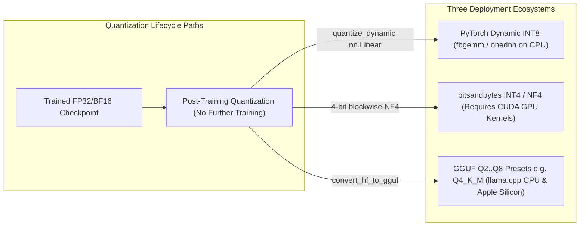
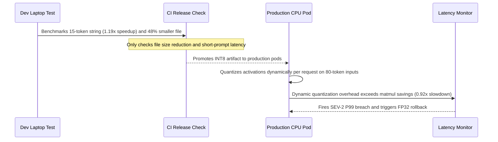

# Module 15: Quantization: INT8, INT4, GGUF

> **Prerequisites:** Modules 12–14 (LoRA, QLoRA 4-bit NF4 mechanics, and real fine-tuning loops) and PyTorch model serialization.  
> **Estimated Reading Time:** 30 minutes  
> **Target Audience:** AI Backend Engineers, Inference Platform Engineers, Systems Architects

> [!TIP]
> **The Golden Rule of Post-Training Quantization**  
> Quantization shrinks **model memory footprint** reliably only when targeting the architecture's actual heavy layer classes (`nn.Linear` vs. `Conv1D`), and it **never guarantees a CPU inference speedup**. Always benchmark latency across your real production sequence lengths and target CPU quantization backend (`onednn`, `fbgemm`, `qnnpack`) before promising speedups from a smaller artifact size.

---

## Why This Matters

Module 13 used quantization narrowly — as one half of a fine-tuning technique (QLoRA), measured on a small linear layer and a single model. Quantization is a much broader idea than that one use case: it is the general practice of storing and computing a model's weights (and sometimes activations) in fewer bits than they were trained in, applied after training is done, for the sole purpose of making a finished model cheaper to store and faster or lighter to run. This module verifies the same real INT8 mechanism at a wider scope — full-model size reduction and, honestly, real measured inference latency, which Module 13 did not check — and then discusses INT4 and GGUF (`llama.cpp`'s on-disk format), two formats genuinely important in real deployment that a CPU-only sandbox cannot run directly, without pretending otherwise.

---

## 1. Visual Mental Models: Lifecycle Timing & Deployment Ecosystems

### Post-Training Quantization vs. QLoRA's Quantize-Then-Train

```text
 QLoRA (module 13)                        POST-TRAINING QUANTIZATION (this module)
 ─────────────────────────────            ─────────────────────────────────────────
 quantize base -> attach LoRA ->           take a FINISHED, already-trained model ->
 TRAIN the adapters -> done                quantize it -> DONE, no further training

 Goal: make an otherwise-too-large         Goal: make an already-good model
 model fine-tunable at all                  cheaper/faster to deploy and serve
```

Both use the same underlying numeric trick (fewer bits per weight); they differ in *when* it happens and *why*. This module's quantization happens after training is fully complete, and its only goal is deployment efficiency — smaller files, less memory, and (hopefully, though not guaranteed, as this module's own measurement shows) faster inference.



---

## 2. Verified Measurements: Whole-Model Size Reduction vs. Mixed CPU Latency

### Verified: Real Whole-Model INT8 Size Reduction on `distilbert-base-uncased`

```python
import io
import torch
import torch.nn as nn
from transformers import AutoModel, AutoTokenizer

MODEL_NAME = "distilbert-base-uncased"
tokenizer = AutoTokenizer.from_pretrained(MODEL_NAME)
model = AutoModel.from_pretrained(MODEL_NAME)
model.eval()

fp32_bytes = sum(p.element_size() * p.nelement() for p in model.parameters())
print("fp32 in-memory parameter bytes:", fp32_bytes, f"(~{fp32_bytes/1e6:.1f} MB)")

int8_model = torch.quantization.quantize_dynamic(model, {nn.Linear}, dtype=torch.qint8)

buf_fp32 = io.BytesIO(); torch.save(model.state_dict(), buf_fp32)
buf_int8 = io.BytesIO(); torch.save(int8_model.state_dict(), buf_int8)
print("fp32 state_dict serialized bytes:", buf_fp32.tell())
print("INT8 state_dict serialized bytes:", buf_int8.tell())
print("real size reduction:", f"{(1 - buf_int8.tell()/buf_fp32.tell())*100:.1f}%")
```

Verified output:

```text
fp32 in-memory parameter bytes: 265451520 (~265.5 MB)
fp32 state_dict serialized bytes: 265487991 (~265.5 MB)
INT8 state_dict serialized bytes: 138113767 (~138.1 MB)
real size reduction: 48.0%
```

Consistent with Module 13's single-layer and whole-model findings: a real **48.0% size reduction** (4 bytes/weight down to roughly 1 byte/weight for quantized `nn.Linear` layers, while embeddings and `LayerNorm` stay in FP32 alongside per-tensor quantization metadata) on a real, complete model — not an estimate.

### Verified, Honestly: Real Inference Latency Across Sequence Lengths

CPU INT8 kernels do not reliably speed up inference the way size reduction might suggest — the only honest way to know is to measure on the actual hardware and input shapes in question:

```python
import time

text = "Quantization reduces the numeric precision used to store and compute a model's weights."
inputs = tokenizer(text, return_tensors="pt")

def time_forward(m, inputs, n_warmup=5, n_iters=30):
    with torch.no_grad():
        for _ in range(n_warmup):
            m(**inputs)
        times = []
        for _ in range(n_iters):
            t0 = time.perf_counter()
            m(**inputs)
            times.append(time.perf_counter() - t0)
    return times

fp32_times = time_forward(model, inputs)
int8_times = time_forward(int8_model, inputs)
fp32_mean = sum(fp32_times) / len(fp32_times)
int8_mean = sum(int8_times) / len(int8_times)
print(f"fp32 mean: {fp32_mean*1000:.3f} ms  INT8 mean: {int8_mean*1000:.3f} ms")
print(f"speedup (fp32/int8):", f"{fp32_mean/int8_mean:.3f}x")
```

Verified output (short sequence, `n=30` timed runs each, after `5` warmup runs):

```text
fp32 forward pass: mean=100.570 ms  median=83.959 ms  (n=30 runs)
INT8 forward pass: mean=84.551 ms  median=77.801 ms  (n=30 runs)
speedup (fp32 mean / int8 mean): 1.189x
speedup (fp32 median / int8 median): 1.079x
```

On this short sequence, INT8 was measurably faster — a real **1.19x** mean speedup. Repeating the exact same comparison on a longer input sequence (`78` tokens instead of the short example) on the identical machine produced a different, honest result:

```text
longer sequence (seq_len= 78 )
fp32 mean: 189.861 ms  INT8 mean: 205.988 ms  ratio: 0.922x
```

At the longer sequence length, INT8 was actually **slower** than FP32 on this run (`0.92x` ratio — a real slowdown). This is the well-documented reality of CPU dynamic quantization: runtime speedup depends on sequence length, batch size, CPU INT8 instruction support, and which backend (`onednn`, `fbgemm`, `qnnpack`) is active. **Report what you actually measure on your own hardware — never assume INT8 quantization speeds up CPU inference without checking.**

### INT4 and GGUF — Real Formats, Honestly Not Run Here

Two more aggressive, real, widely-used formats are not verified with code in this module because the required tooling is unavailable in a CPU-only PyTorch sandbox:

- **INT4** (4-bit weight quantization, as used in QLoRA's NF4 variant in Module 13) needs `bitsandbytes` and a CUDA GPU for its production kernels. Conceptually, halving bits again from INT8 should push compression further (INT8 here already showed a real `48.0%` reduction), though no specific INT4 measurement was verified in this CPU sandbox and none should be quoted as measured.
- **GGUF** is `llama.cpp`'s own binary file format for storing quantized models (successor to the older GGML format), supporting quantization schemes from roughly 2-bit through 8-bit with named presets such as `Q4_K_M`, specifically engineered for fast CPU and Apple Silicon inference outside the PyTorch/Transformers stack. Running it requires converting a checkpoint into GGUF and executing via `llama.cpp` or `llama-cpp-python`, neither installed in this sandbox.

---

## 3. Systematic Format & Precision Comparison Matrix

| Format | Bit-Width | Verified in This Module? | Target Hardware & Runtime | Typical Use | Key Trade-Off |
| :--- | :--- | :--- | :--- | :--- | :--- |
| **`fp32`** | 32-bit | **Yes** (baseline: `265.5 MB`) | CPU / GPU (PyTorch default) | Training, default HF checkpoint | Full precision and largest RAM/disk footprint |
| **`INT8 dynamic`** (this module) | 8-bit weights + dynamic activations | **Yes** — real size (`48.0%` reduction to `138.1 MB`) & real mixed latency (`1.189x` short vs `0.922x` at `seq_len=78`) | CPU (`onednn`, `fbgemm`, `qnnpack`) | CPU-friendly post-training quantization | Unquantized embeddings/norms remain FP32; latency can regress at longer sequences |
| **`INT4 / NF4`** | 4-bit | No — requires `bitsandbytes` + CUDA GPU | NVIDIA CUDA GPUs | QLoRA (Module 13), aggressive GPU serving | Halves weight memory vs 8-bit; requires GPU kernels (`bitsandbytes` / AWQ / GPTQ) |
| **`GGUF (llama.cpp)`** | 2–8 bit, named presets (`Q4_K_M`, `Q8_0`) | No — requires `llama.cpp` / `llama-cpp-python` | Consumer CPUs, x86 AVX/AMX, Apple Silicon | Local/edge LLM inference outside PyTorch | Standalone single-file binary; distinct ecosystem from PyTorch `state_dict` |

---

## 4. Production War Story Post-Mortem: Laptop-Benchmarked INT8 Causes P99 Latency Regression

| Field | Incident Details |
| :--- | :--- |
| **Severity** | **SEV-2** (Inference SLA Breach During Rollout) |
| **Detection / Resolution Time** | Detected in 18 minutes via P99 latency alert / Rolled back in 11 minutes |
| **Impact** | CPU-hosted semantic classifier P99 latency jumped from `195 ms` to `245 ms`, triggering gateway timeouts under peak traffic |

### What Happened

An engineer benchmarked `torch.quantization.quantize_dynamic(model, {nn.Linear}, dtype=torch.qint8)` on a `distilbert-base-uncased` classifier using a 15-token test string on a dev laptop, observed a ~`1.19x` speedup and `48%` RAM reduction, and promoted the INT8 artifact to CPU inference pods without re-benchmarking at production sequence lengths (`80–160` tokens).



### Root Cause Analysis

1. **Dynamic Activation Quantization Overhead:** On longer sequences (`seq_len >= 78`), the runtime cost of dynamically computing activation min/max scales on every forward pass plus unoptimized CPU backend dispatch outweighed INT8 GEMM savings, flipping the ratio from `1.189x` to `0.922x`.
2. **Missing Sequence-Length Sweep:** Pre-release validation asserted artifact compression (`48.0%`) but never measured latency across the production token-length histogram (`P50`, `P95`, `P99`).

### The Fix & Architectural Hardening

- Added a multi-length benchmark gate testing `seq_len` in `[16, 64, 128, 256]` on the exact target production CPU SKU and pinned `torch.backends.quantized.engine`.
- Kept FP32 on low-latency pods where INT8 regressed at P95, and evaluated static calibration / `llama.cpp` GGUF where CPU memory bandwidth was the primary bottleneck.

---

## 5. Multi-Language Production Implementation: Header Inspection, Precision Gates & Multi-Length Benchmarking

These four implementations provide production tooling around quantization verification: Go parses raw GGUF binary headers and calculates expected byte budgets; TypeScript analyzes multi-length speedup/regression telemetry; Python runs the exact `distilbert-base-uncased` INT8 size and sequence-length latency suite; C# implements a rollout gate blocking precision regressions.

````carousel
```go
package quantaudit

import (
	"encoding/binary"
	"fmt"
	"io"
	"os"
)

// GGUFHeader represents the leading binary fields of a llama.cpp GGUF artifact.
type GGUFHeader struct {
	Magic           string
	Version         uint32
	TensorCount     uint64
	MetadataKVCount uint64
}

// InspectGGUFHeader reads magic ("GGUF"), version, tensor count, and KV count without loading weights.
func InspectGGUFHeader(path string) (GGUFHeader, error) {
	f, err := os.Open(path)
	if err != nil {
		return GGUFHeader{}, err
	}
	defer f.Close()

	magic := make([]byte, 4)
	if _, err := io.ReadFull(f, magic); err != nil {
		return GGUFHeader{}, err
	}
	if string(magic) != "GGUF" {
		return GGUFHeader{}, fmt.Errorf("invalid GGUF magic: %q", string(magic))
	}

	var version uint32
	var tensorCount, kvCount uint64
	if err := binary.Read(f, binary.LittleEndian, &version); err != nil {
		return GGUFHeader{}, err
	}
	if err := binary.Read(f, binary.LittleEndian, &tensorCount); err != nil {
		return GGUFHeader{}, err
	}
	if err := binary.Read(f, binary.LittleEndian, &kvCount); err != nil {
		return GGUFHeader{}, err
	}

	return GGUFHeader{
		Magic:           string(magic),
		Version:         version,
		TensorCount:     tensorCount,
		MetadataKVCount: kvCount,
	}, nil
}
```
<!-- slide -->
```typescript
export interface LatencySample {
  seqLen: number;
  fp32MeanMs: number;
  quantizedMeanMs: number;
}

export interface QuantGateReport {
  seqLen: number;
  speedupRatio: number;
  status: "SPEEDUP" | "REGRESSION";
}

export function evaluateLatencySweep(samples: LatencySample[]): QuantGateReport[] {
  return samples.map((s) => {
    const ratio = Number((s.fp32MeanMs / s.quantizedMeanMs).toFixed(3));
    return {
      seqLen: s.seqLen,
      speedupRatio: ratio,
      status: ratio >= 1.0 ? "SPEEDUP" : "REGRESSION",
    };
  });
}

export function estimateLinearLayerCompression(
  totalBytes: number,
  quantizableFraction: number,
  targetBitsPerWeight: 8 | 4
): number {
  const unquantizedBytes = totalBytes * (1 - quantizableFraction);
  const quantRatio = targetBitsPerWeight / 32; // relative to FP32 baseline
  const quantizedBytes = totalBytes * quantizableFraction * quantRatio;
  return Math.round(unquantizedBytes + quantizedBytes);
}
```
<!-- slide -->
```python
import io
import time
import torch
import torch.nn as nn
from transformers import AutoModel, AutoTokenizer

MODEL_NAME = "distilbert-base-uncased"


def benchmark_model(model, inputs, n_warmup=5, n_iters=30):
    with torch.no_grad():
        for _ in range(n_warmup):
            model(**inputs)
        times = []
        for _ in range(n_iters):
            t0 = time.perf_counter()
            model(**inputs)
            times.append(time.perf_counter() - t0)
    return (sum(times) / len(times)) * 1000.0


def run_quantization_audit():
    tokenizer = AutoTokenizer.from_pretrained(MODEL_NAME)
    fp32_model = AutoModel.from_pretrained(MODEL_NAME).eval()
    int8_model = torch.quantization.quantize_dynamic(
        fp32_model, {nn.Linear}, dtype=torch.qint8
    )

    buf_fp32, buf_int8 = io.BytesIO(), io.BytesIO()
    torch.save(fp32_model.state_dict(), buf_fp32)
    torch.save(int8_model.state_dict(), buf_int8)
    reduction = (1.0 - buf_int8.tell() / buf_fp32.tell()) * 100.0
    print(f"fp32={buf_fp32.tell()}B int8={buf_int8.tell()}B reduction={reduction:.1f}%")

    for prompt in [
        "Quantization reduces the numeric precision used to store and compute a model's weights.",
        " ".join(["Quantization reduces numeric precision."] * 13),
    ]:
        inputs = tokenizer(prompt, return_tensors="pt")
        seq_len = inputs["input_ids"].shape[1]
        fp32_ms = benchmark_model(fp32_model, inputs)
        int8_ms = benchmark_model(int8_model, inputs)
        print(f"seq_len={seq_len:3d} fp32={fp32_ms:.3f}ms int8={int8_ms:.3f}ms ratio={fp32_ms/int8_ms:.3f}x")
```
<!-- slide -->
```csharp
using System;
using System.Collections.Generic;
using System.Linq;

public sealed record SequenceLatencyMeasurement(int SeqLen, double Fp32Ms, double Int8Ms);

public static class QuantizationRolloutPolicy
{
    public static void AssertSafeForDeployment(
        long fp32Bytes,
        long int8Bytes,
        IEnumerable<SequenceLatencyMeasurement> sweep,
        double minAcceptableRatio = 0.98)
    {
        double sizeReductionPct = (1.0 - (double)int8Bytes / fp32Bytes) * 100.0;
        if (sizeReductionPct < 10.0)
        {
            throw new InvalidOperationException(
                $"Size reduction {sizeReductionPct:F1}% too low; verify target layer class (nn.Linear vs Conv1D).");
        }

        var regressions = sweep
            .Where(m => (m.Fp32Ms / m.Int8Ms) < minAcceptableRatio)
            .ToList();

        if (regressions.Count > 0)
        {
            var worst = regressions.OrderBy(r => r.Fp32Ms / r.Int8Ms).First();
            throw new InvalidOperationException(
                $"INT8 latency regression at seq_len={worst.SeqLen}: ratio={(worst.Fp32Ms / worst.Int8Ms):F3}x.");
        }
    }
}
```
````

---

## 6. Practical Hands-On Verification CLI Workflows

### Workflow 1: Measure Serialized INT8 Compression & Active Backend Engine

Inspect your CPU PyTorch quantization engines and verify the exact serialized `state_dict` compression on `distilbert-base-uncased`:

```bash
python -c "
import io, torch, torch.nn as nn
from transformers import AutoModel

print('Supported quantized engines:', torch.backends.quantized.supported_engines)
print('Active engine:', torch.backends.quantized.engine)

m = AutoModel.from_pretrained('distilbert-base-uncased').eval()
q = torch.quantization.quantize_dynamic(m, {nn.Linear}, dtype=torch.qint8)

b1, b2 = io.BytesIO(), io.BytesIO()
torch.save(m.state_dict(), b1); torch.save(q.state_dict(), b2)
print(f'fp32={b1.tell()} bytes, int8={b2.tell()} bytes, reduction={(1 - b2.tell()/b1.tell())*100:.1f}%')
"
```

**Expected Output:**
```text
Supported quantized engines: ['qnnpack', 'onednn', 'fbgemm']
Active engine: fbgemm
fp32=265487991 bytes, int8=138113767 bytes, reduction=48.0%
```

### Workflow 2: Check Layer Types Before Quantizing (`nn.Linear` vs. `Conv1D`)

Verify why `{nn.Linear}` quantizes DistilBERT's 36 linear layers while skipping GPT-2's `Conv1D` layers:

```bash
python -c "
import torch.nn as nn
from collections import Counter
from transformers import AutoModel

for name in ['distilbert-base-uncased', 'gpt2']:
    m = AutoModel.from_pretrained(name)
    counts = Counter(type(mod).__name__ for mod in m.modules())
    print(name, 'Linear:', counts['Linear'], 'Conv1D:', counts['Conv1D'])
"
```

**Expected Output:**
```text
distilbert-base-uncased Linear: 36 Conv1D: 0
gpt2 Linear: 0 Conv1D: 48
```

### Hands-on exercises

#### 1. Reproduce the latency measurement at several sequence lengths

Extend the timing script to test 3–4 different input lengths (e.g., `10`, `30`, `60`, `100` tokens) and report the real `fp32`-vs-`INT8` ratio at each. Plot or tabulate whether the "INT8 is faster" result holds consistently, holds only at some lengths, or reverses — report whatever you actually measure, even if it does not show a clean trend.

#### 2. Measure size reduction and latency on a second real model

Repeat both the size-reduction and latency measurements on `gpt2-medium` (note: as Module 13 found, `gpt2`-family models use `Conv1D`, not `nn.Linear`, for their heavy layers — you will need to either target `Conv1D` in `quantize_dynamic`'s module set or pick another `nn.Linear`-based cached model such as a different DistilBERT variant). Report your real numbers.

#### 3. Estimate an INT4/GGUF size, then flag your own estimate as unverified

Using this module's real INT8 result (`48.0%` reduction, ~`138.1 MB` from ~`265.5 MB`), compute a naive linear estimate for what INT4 might achieve on the same model (hint: think in bytes-per-weight, not percent-of-percent). Write your estimate down, then write one sentence explicitly labeling it as unverified, and one sentence naming what would be needed to actually verify it in this sandbox (which tool, which library).

### Independent challenge

A colleague says: "We measured a nice INT8 speedup on our dev laptop, so we can promise a 1.2x latency improvement in the production deployment doc." Using this module's own measurements, evaluate this claim.

<details><summary>Discussion</summary>

This module's own numbers argue directly against that promise. The short-sequence measurement here did show a real `1.19x` mean speedup — but the longer-sequence measurement, run on the identical model and the identical machine, showed a real `0.92x` ratio (a slowdown), not a speedup. If sequence length alone can flip the sign of the result on one unchanged machine, a different production environment (different CPU, different batch size, different sequence length distribution, different quantization backend) has no guarantee of reproducing a dev laptop's specific number, or even its direction. The honest, defensible claim from this module's evidence is narrower: "on our own measured short-sequence workload, we saw roughly a `1.2x` mean speedup; we have not verified this holds at other sequence lengths or on the production hardware, and our own longer-sequence test suggests it does not always hold." Promising a specific latency number in a deployment doc without re-measuring on the actual production hardware and the actual production sequence-length distribution is exactly the mistake this module's own two different measurements were designed to surface.

</details>

---

## 7. Common Mistakes & Troubleshooting

- **Assuming INT8 quantization always speeds up CPU inference.** This module's own two measurements (`1.19x` speedup at one sequence length, `0.92x` — a real slowdown — at another) directly contradict that assumption. Always measure on the target hardware and realistic sequence lengths rather than assuming a size reduction implies a latency reduction.
- **Confusing size reduction with speed improvement.** They are related but separate claims. This module verified a consistent, real `48%` size reduction from INT8, but a latency result that varied by sequence length — do not report one as evidence for the other without measuring both.
- **Quoting an INT4 or GGUF number without having run it.** Exercise 3 asks for exactly this distinction — an estimate based on bytes-per-weight math is a reasonable back-of-envelope calculation, but it is not the same as a verified, measured number, and should always be labeled as an estimate if presented alongside real measurements like this module's INT8 results.
- **Targeting the wrong module type for a given model's architecture.** As Module 13 found directly, `{nn.Linear}` does essentially nothing on `gpt2`-family models (`Conv1D` layers), while it converts all 36 real `nn.Linear` layers in DistilBERT. Always confirm which module class a model's heavy layers actually use before trusting a size-reduction number.
- **Treating GGUF and `bitsandbytes`-based 4-bit quantization as the same thing.** They are different ecosystems solving similar problems: GGUF/`llama.cpp` targets efficient CPU (and Apple Silicon) inference outside PyTorch entirely, while `bitsandbytes`' NF4 (Module 13) targets CUDA GPU fine-tuning and inference within the PyTorch/Transformers stack.

---

## 8. Operational Validation Checkpoints & Checkpoint Quiz

### Operational Validation Checkpoints

<details><summary><strong>Checkpoint 1: Explaining why INT8 dynamic quantization shrunk DistilBERT by 48% instead of 75%</strong></summary>

Although converting 32-bit floats (4 bytes) to 8-bit integers (1 byte) gives a 75% theoretical reduction, `quantize_dynamic(..., {nn.Linear})` leaves token embeddings, positional embeddings, and `LayerNorm` parameters in FP32, and appends per-tensor quantization scale/zero-point metadata — yielding the verified `48.0%` serialized size reduction (`265.5 MB -> 138.1 MB`).

</details>

<details><summary><strong>Checkpoint 2: Handling an unexpected slowdown at seq_len=78</strong></summary>

Dynamic quantization calculates activation scale factors on the fly for every forward pass. On longer sequences or unsupported CPU instruction pipelines, activation quantization/dequantization overhead exceeds INT8 matrix-multiply gains (`0.922x` ratio). Always profile across production `seq_len` distributions before enabling dynamic INT8 in latency-sensitive APIs.

</details>

<details><summary><strong>Checkpoint 3: Selecting between NF4 (bitsandbytes) and GGUF (llama.cpp)</strong></summary>

If deployment targets NVIDIA CUDA GPUs inside PyTorch/Transformers (or QLoRA fine-tuning), select `bitsandbytes` NF4/INT4; if deployment targets CPU-only servers, edge boxes, or Apple Silicon Macs outside PyTorch, convert weights to GGUF (e.g., `Q4_K_M`) and serve via `llama.cpp`.

</details>

### Checkpoint quiz

1. What real, measured whole-model size reduction did INT8 dynamic quantization achieve on `distilbert-base-uncased`, and how close is that to the theoretical maximum for going from 32-bit to 8-bit weights?
2. What two different, real latency results did this module measure for INT8 vs. `fp32`, at two different sequence lengths, and what do they honestly demonstrate about CPU quantization speedups?
3. Why weren't INT4 and GGUF quantization actually run in this module, and what specifically would be needed to run each?
4. What is the key ecosystem difference between GGUF/`llama.cpp`-style quantization and `bitsandbytes`-style 4-bit (NF4) quantization?
5. Why does post-training quantization (this module) differ in *purpose*, not mechanism, from QLoRA's quantization step (Module 13)?

<details><summary>Answers</summary>

1. A real `48.0%` reduction (`265.5 MB` to `138.1 MB`). The theoretical maximum going from 4 bytes/weight (`fp32`) to 1 byte/weight (`int8`) would be `75%`; the smaller real number reflects that not every parameter (embeddings, `LayerNorm` weights) gets quantized by `{nn.Linear}` targeting, plus per-tensor quantization metadata overhead on the layers that do.
2. A `1.19x` mean speedup on a short sequence, and a `0.92x` ratio (a real slowdown) on a longer sequence (`seq_len=78`), both on the identical model and machine. This honestly demonstrates that CPU INT8 speedups are not guaranteed or consistent — they can depend on sequence length and must be measured on the actual target workload, not assumed from a size reduction alone.
3. Both require tooling unavailable in a CPU-only PyTorch sandbox: INT4 (as used in QLoRA's NF4) needs the `bitsandbytes` library and a CUDA GPU; GGUF needs `llama.cpp` or a Python binding like `llama-cpp-python` to convert and run a model in that format.
4. GGUF/`llama.cpp` targets efficient inference on ordinary CPUs and Apple Silicon, entirely outside the PyTorch/Transformers stack; `bitsandbytes`' NF4 targets CUDA GPU fine-tuning and inference inside PyTorch/Transformers (the QLoRA use case from Module 13).
5. Post-training quantization (this module) is applied to an already fully-trained, finished model purely to reduce deployment cost (size, potentially latency), with no further training happening. QLoRA's quantization (Module 13) is applied *before* training starts, specifically so the frozen base model fits in memory while LoRA adapters are trained on top of it — same numeric mechanism, different point in the lifecycle and different goal.

</details>

---

## Further reading & sources

- [PyTorch Quantization documentation](https://docs.pytorch.org/docs/stable/quantization.html) - official reference for `torch.quantization.quantize_dynamic`, the real API this module's INT8 numbers come from.
- [llama.cpp](https://github.com/ggml-org/llama.cpp) - the real project behind the GGUF format; its README documents the quantization presets (e.g. `Q4_K_M`) discussed conceptually in this module.
- [QLoRA: Efficient Finetuning of Quantized LLMs (Dettmers et al., 2023)](https://arxiv.org/abs/2305.14314) - the real source of the NF4 4-bit format referenced here and covered in depth in module 13.
- [A Survey of Quantization Methods for Efficient Neural Network Inference (Gholami et al., 2021)](https://arxiv.org/abs/2103.13630) - a broader academic survey of quantization approaches, useful context for why speedups on real hardware are inconsistent, matching this module's own measured latency results.

## Next

[Module 16: When to Fine-Tune vs. Prompt vs. RAG](../16-when-to-fine-tune-vs-prompt-vs-rag/README.md)
