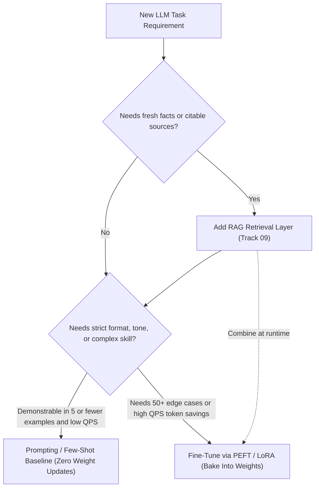
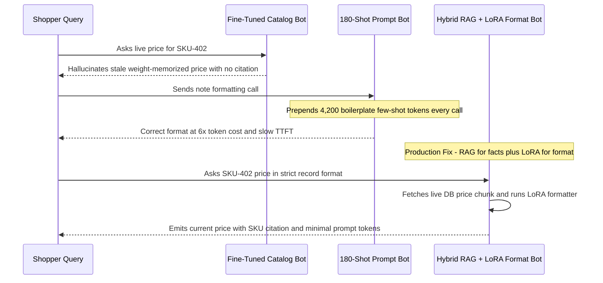

# Module 16: When to Fine-Tune vs. Prompt vs. RAG

> **Prerequisites:** Modules 12–15 (LoRA, QLoRA, real fine-tuning loops, and quantization trade-offs).  
> **Estimated Reading Time:** 30 minutes  
> **Target Audience:** AI Backend Engineers, Solution Architects, Engineering Leads

> [!TIP]
> **The Golden Rule of Adaptation Architecture**  
> Prompting, RAG, and Fine-Tuning solve **orthogonal engineering axes** and are strongest in combination: start with **Prompting** as your zero-training baseline for narrow behaviors, choose **RAG** whenever facts change frequently or demand citable sources, and choose **Fine-Tuning (LoRA/PEFT)** to internalize stable formats, styles, or domain skills when per-call prompt examples exceed latency or token budgets.

---

## Why This Matters

Modules 12–15 built and verified real fine-tuning machinery — LoRA's tiny trainable fraction, quantization's real size trade-offs, and an actual training run with a real loss curve. None of that answers the question a team actually has to answer before writing any training code: *should we fine-tune at all?* Prompting a model with instructions or examples, retrieving relevant documents and stuffing them in context (RAG — Retrieval-Augmented Generation, covered in full in Track 09, referenced here by name and number), and fine-tuning are three genuinely different tools solving different problems, and picking the wrong one wastes real engineering time. This module is a decision framework — opening with one verified, slightly humbling piece of evidence: the exact task Module 14 fine-tuned `gpt2` to solve turns out to also be solvable by prompting alone, with zero weight changes.

---

## 1. Visual Mental Models: Zero-Weight-Change In-Context Learning vs. Weight Adaptation

### Verified: The Same Narrow Task From Module 14, Solved by Prompting Instead

Module 14 fine-tuned `gpt2` on six examples of a note-to-structured-record format conversion, then verified generalization on a held-out seventh note. Here, the identical held-out note is handed to plain, **unmodified** `gpt2` with three of the same examples placed directly in the prompt (in-context learning, zero gradient updates):

```python
FEW_SHOT_PROMPT = """Note: red running shoes, size 10, $59.99, in stock
-> ITEM: running shoes | COLOR: red | SIZE: 10 | PRICE: 59.99 | STOCK: yes
Note: blue backpack, 30L, $45.00, out of stock
-> ITEM: backpack | COLOR: blue | SIZE: 30L | PRICE: 45.00 | STOCK: no
Note: black water bottle, 1L, $12.50, in stock
-> ITEM: water bottle | COLOR: black | SIZE: 1L | PRICE: 12.50 | STOCK: yes
Note: yellow rain boots, size 8, $27.50, in stock
->"""

ids = tokenizer(FEW_SHOT_PROMPT, return_tensors="pt")
out = model.generate(
    **ids,
    max_new_tokens=20,
    do_sample=False,
    pad_token_id=tokenizer.eos_token_id,
)
print(repr(tokenizer.decode(out[0][ids["input_ids"].shape[1]:], skip_special_tokens=True)))

before_hash = sum(p.detach().sum().item() for p in model.parameters())
_ = model.generate(**ids, max_new_tokens=5, do_sample=False, pad_token_id=tokenizer.eos_token_id)
after_hash = sum(p.detach().sum().item() for p in model.parameters())
print("weight checksum equal:", before_hash == after_hash)
```

Verified output:

```text
Few-shot PROMPTED gpt2 (3 examples in context, zero weight updates):
' ITEM: rain boots | COLOR: yellow | SIZE: 8 | PRICE: 27'
weight checksum before: -62119.880418241024  after: -62119.880418241024  equal: True
```

This is the **exact same correct output** Module 14's fine-tuned model produced on the identical held-out note — extracted item, color, size, and price in the right order — from three examples placed in a prompt, with a verified weight checksum confirming zero parameters changed. **A task's suitability for prompting vs. fine-tuning depends on how completely the behavior fits into a handful of in-context examples versus needing to be baked into weights.**

### The Three Tools and What Each One Actually Changes

```text
 PROMPTING                    RAG                          FINE-TUNING (PEFT incl.)
 ──────────────               ──────────────                ──────────────
 Give instructions/            Retrieve relevant              Update model weights
 examples in the                documents at query             (fully, or a small
 context window;                time, insert into               trainable fraction
 ZERO weight change             context; ZERO weight            via LoRA, module 12)
 (verified above)               change to the model             PERMANENT change

 Changes: model's               Changes: what facts             Changes: the model's
 BEHAVIOR for this               are available to                default BEHAVIOR,
 one call, given                reason over, for                FORMAT, or STYLE,
 what's in context               this one call                  without needing it
                                                                  repeated in-context
                                                                  every call
```



Prompting and RAG leave model weights untouched at inference time; fine-tuning changes what the model *is* ahead of time. Production architectures routinely combine all three: **RAG** for dynamic facts, **fine-tuning/PEFT** for deterministic output format/style, and **prompting** for per-call instructions.

---

## 2. Systematic Comparison & Decision Framework Matrices

### Architecture Comparison Matrix

| Dimension | Prompting / In-Context Learning | RAG (Retrieval-Augmented Generation) | PEFT / LoRA Fine-Tuning | Full Fine-Tuning | Hybrid (RAG + LoRA + Prompting) |
| :--- | :--- | :--- | :--- | :--- | :--- |
| **Weight Mutation** | None (`checksum equal: True`) | None | Small adapters (`~0.2%–2%` params) | `100%` of weights | Small LoRA adapters only |
| **Per-Call Token Cost** | High if many examples repeated | Medium–High (retrieved context chunks) | Low (no few-shot boilerplate needed) | Low | Controlled (chunks only, minimal format boilerplate) |
| **Knowledge Freshness** | Static prompt edits | **Real-time** (update vector/doc index) | Stale once trained | Stale once trained | **Real-time** via retrieval |
| **Citable Evidence** | Prompt instructions only | **High** (inspectable source chunks) | Low (opaque weight behavior) | Low | **High** via retrieved docs |
| **Labeled Data Needed** | `0–5` examples | Document corpus (`0` training pairs needed) | Tens to low thousands of pairs | Thousands+ pairs | Document corpus + targeted style pairs |
| **Engineering Overhead** | Minimal | Retrieval index, chunking, reranking | Dataset curation, training, eval pipeline | High GPU cluster cost | Retrieval + adapter lifecycle |

### Decision Framework

| Question | Leans Toward... |
| :--- | :--- |
| **Does the model need NEW FACTS it wasn't trained on, or facts that change often (prices, today's date, this week's docs)?** | **RAG (Track 09)** — facts live outside the model and are retrieved fresh each call with no retraining when facts change. |
| **Does the model need a NEW SKILL, FORMAT, or BEHAVIOR that's hard to specify in a prompt, and you have training examples?** | **Fine-tuning (PEFT/LoRA, Module 12)** — baked into weights, saves prompt tokens on every call, and is more reliable than hoping instructions hold every time. |
| **Is the desired behavior fully demonstrable in a handful of in-context examples (this module's verified case)?** | **Prompting** — cheapest and fastest to iterate, zero training infrastructure, zero weight risk; verified above to genuinely work for a narrow task. |
| **How much labeled data do you actually have?** | A few examples -> prompting or RAG. Tens to low hundreds -> PEFT/LoRA is realistic (Module 14's six-example run). Thousands+ -> full fine-tune or PEFT both become attractive. |
| **What's the latency/cost budget per call, at scale (many calls)?** | Fine-tuning pays a one-time training cost, then no extra prompt tokens per call. Prompting/RAG pay context-length cost on every single call — this compounds at high query volume. |
| **How often does the underlying information change?** | Changes often (daily prices, live docs) -> RAG. Rarely or never (a fixed output format, style, or stable skill) -> fine-tuning is viable without constant retraining. |
| **Do you need to explain WHY the model said something, with a citable source?** | **RAG** — retrieved documents are inspectable, citable evidence. Fine-tuned behavior is opaque — there is no source document for why weights emitted an answer. |

### Reference Terms

| Term | Meaning |
| :--- | :--- |
| **Prompting / in-context learning** | Providing instructions or examples in the input context; verified here to solve Module 14's task with zero weight changes. |
| **RAG** | Retrieval-Augmented Generation: fetching relevant text at query time and inserting it into context so the model reasons over fresh, external information (full coverage: Track 09). |
| **Fine-tuning / PEFT** | Updating some (PEFT/LoRA, Module 12) or all (full fine-tuning) of a model's weights ahead of time so new behavior needs no repeated in-context demonstration at inference time. |
| **New knowledge** | Facts the model does not already know; RAG's strength, since retrieval keeps the model current without retraining. |
| **New behavior/format** | How the model responds (style, structure, task-following); fine-tuning's strength, since it changes the model's defaults directly. |
| **Context-length cost** | Prompting/RAG pay a per-call token cost for instructions, examples, or documents; fine-tuning pays a one-time training cost instead. |
| **Data volume needed** | Roughly: prompting/RAG need few-to-none labeled examples; PEFT is realistic from tens of examples (Module 14); full fine-tuning benefits from much more. |

---

## 3. Production War Story Post-Mortem: Stale Fine-Tuned Prices & Prompt-Bloat Token Overrun

| Field | Incident Details |
| :--- | :--- |
| **Severity** | **SEV-1** (Customer Pricing Misquotes & Budget Exhaustion) |
| **Detection / Resolution Time** | Detected after 48 hours via customer billing disputes / Redesigned in 5 days |
| **Impact** | Model quoted outdated promotional prices (`\$19.00` instead of `\$29.50`) with zero source links, while a separate few-shot workflow burned `\$14,200/month` repeating 180 examples per call |

### What Happened

Two product teams misapplied LLM adaptation patterns on the same e-commerce platform. Team A fine-tuned a 7B model weekly on product catalog prices to avoid building a retrieval index, leaving weights 48–168 hours stale whenever inventory prices changed mid-week. Team B used pure prompting with 180 edge-case formatting examples stuffed into every request, causing latency spikes and an unexpected `\$14,200/month` input-token bill as traffic scaled.



### Root Cause Analysis

1. **Baking Mutable Facts Into Weights (Team A):** Catalog prices change hourly/daily; fine-tuning cannot keep pace with mutable facts and destroys auditability because weights provide no citable source document.
2. **Paying Per-Call Context Tax at High Scale (Team B):** Repeating 180 edge-case demonstrations on every request turned a fixed formatting behavior into a recurring `O(QPS * prompt_tokens)` operational expense.

### The Fix & Architectural Hardening

- Moved all dynamic catalog pricing, stock counts, and return policies into a **RAG** retrieval index with mandatory citation IDs.
- Trained a compact **LoRA** adapter once on the 180 formatting edge cases, reducing system prompt overhead from `4,200` tokens down to `90` tokens per request.

---

## 4. Multi-Language Production Implementation: Strategy Routing, TCO Calculation & Checksum Verification

These four implementations operationalize the adaptation decision framework: Go models token break-even TCO and recommends a strategy; TypeScript orchestrates a hybrid RAG + format-tuned model pipeline with source citations; Python reproduces Module 16's verified few-shot `gpt2` experiment and weight-checksum invariance test; C# enforces enterprise adaptation compliance gates.

````carousel
```go
package adaptation

import "fmt"

type WorkloadProfile struct {
	FactsChangeFrequently bool
	NeedsCitations        bool
	ExamplesRequired      int
	MonthlyRequests       int
	AvgExampleTokens      int
	InputCostPer1MTokens  float64
	OneTimeTrainCostUSD   float64
}

// RecommendStrategy applies the Module 16 decision axes and TCO break-even math.
func RecommendStrategy(w WorkloadProfile) string {
	var layers []string
	if w.FactsChangeFrequently || w.NeedsCitations {
		layers = append(layers, "RAG (fresh/citable facts)")
	}

	monthlyPromptOverheadUSD := (float64(w.MonthlyRequests) * float64(w.AvgExampleTokens) / 1_000_000.0) * w.InputCostPer1MTokens
	if w.ExamplesRequired <= 5 && monthlyPromptOverheadUSD < w.OneTimeTrainCostUSD {
		layers = append(layers, fmt.Sprintf("Few-Shot Prompting (est. $%.2f/mo)", monthlyPromptOverheadUSD))
	} else {
		layers = append(layers, fmt.Sprintf("PEFT/LoRA Fine-Tune (saves $%.2f/mo vs prompting)", monthlyPromptOverheadUSD))
	}

	if len(layers) == 1 {
		return layers[0]
	}
	return layers[0] + " + " + layers[1]
}
```
<!-- slide -->
```typescript
export interface CatalogDoc {
  sku: string;
  title: string;
  livePriceUsd: number;
  inStock: boolean;
}

export interface HybridResponse {
  formattedRecord: string;
  citedSkus: string[];
  promptTokensUsed: number;
}

// Hybrid orchestrator: RAG supplies live mutable facts; LoRA-tuned model handles strict formatting.
export async function answerWithRagAndLora(
  rawNote: string,
  retrieveCatalog: (query: string) => Promise<CatalogDoc[]>,
  callFormatTunedModel: (prompt: string) => Promise<{ text: string; inputTokens: number }>
): Promise<HybridResponse> {
  const docs = await retrieveCatalog(rawNote);
  const factBlock = docs
    .map((d) => `[SKU:${d.sku}] ${d.title} price=${d.livePriceUsd.toFixed(2)} stock=${d.inStock ? "yes" : "no"}`)
    .join("\n");

  // Compact prompt: no 200 few-shot formatting examples needed because LoRA weights already know the schema
  const prompt = `FACTS:\n${factBlock}\nNOTE: ${rawNote}\n->`;
  const result = await callFormatTunedModel(prompt);

  return {
    formattedRecord: result.text,
    citedSkus: docs.map((d) => d.sku),
    promptTokensUsed: result.inputTokens,
  };
}
```
<!-- slide -->
```python
import torch
from transformers import AutoModelForCausalLM, AutoTokenizer

FEW_SHOT_EXAMPLES = [
    ("Note: red running shoes, size 10, $59.99, in stock\n->",
     " ITEM: running shoes | COLOR: red | SIZE: 10 | PRICE: 59.99 | STOCK: yes"),
    ("Note: blue backpack, 30L, $45.00, out of stock\n->",
     " ITEM: backpack | COLOR: blue | SIZE: 30L | PRICE: 45.00 | STOCK: no"),
    ("Note: black water bottle, 1L, $12.50, in stock\n->",
     " ITEM: water bottle | COLOR: black | SIZE: 1L | PRICE: 12.50 | STOCK: yes"),
]
HELD_OUT = "Note: yellow rain boots, size 8, $27.50, in stock\n->"


def run_prompting_ablation():
    tokenizer = AutoTokenizer.from_pretrained("gpt2")
    tokenizer.pad_token = tokenizer.eos_token
    model = AutoModelForCausalLM.from_pretrained("gpt2").eval()

    before_hash = sum(p.detach().sum().item() for p in model.parameters())

    for k in (3, 1, 0):
        prefix = "\n".join(f"{p}{t}" for p, t in FEW_SHOT_EXAMPLES[:k])
        prompt = f"{prefix}\n{HELD_OUT}" if prefix else HELD_OUT
        ids = tokenizer(prompt, return_tensors="pt")
        out = model.generate(
            **ids,
            max_new_tokens=20,
            do_sample=False,
            pad_token_id=tokenizer.eos_token_id,
        )
        gen = tokenizer.decode(out[0][ids["input_ids"].shape[1]:], skip_special_tokens=True)
        print(f"k={k} shots -> {gen!r}")

    after_hash = sum(p.detach().sum().item() for p in model.parameters())
    print("weight checksum before:", before_hash, "after:", after_hash, "equal:", before_hash == after_hash)
```
<!-- slide -->
```csharp
using System;

public sealed record AdaptationProposal(
    bool UsesFineTuningForMutableFacts,
    bool RequiresSourceCitations,
    bool HasRagLayer,
    int PromptExampleTokens,
    int MaxAllowedPromptTokens);

public static class AdaptationArchitectureGate
{
    public static void Validate(AdaptationProposal proposal)
    {
        if (proposal.UsesFineTuningForMutableFacts)
        {
            throw new InvalidOperationException(
                "Reject: Do not bake frequently changing facts (prices, inventory, live docs) into weights; use RAG.");
        }
        if (proposal.RequiresSourceCitations && !proposal.HasRagLayer)
        {
            throw new InvalidOperationException(
                "Reject: Citable provenance requires RAG retrieval chunks; fine-tuned weights are opaque.");
        }
        if (proposal.PromptExampleTokens > proposal.MaxAllowedPromptTokens)
        {
            throw new InvalidOperationException(
                $"Reject: Prompt carries {proposal.PromptExampleTokens} example tokens; bake stable formatting into LoRA weights.");
        }
    }
}
```
````

---

## 5. Practical Hands-On Verification CLI Workflows

### Workflow 1: Verify Zero-Weight-Change Few-Shot Prompting on `gpt2`

Run the Python 3-shot prompt against unmodified `gpt2` and assert bit-exact weight checksum invariance:

```bash
python -c "
from transformers import AutoModelForCausalLM, AutoTokenizer

tok = AutoTokenizer.from_pretrained('gpt2')
m = AutoModelForCausalLM.from_pretrained('gpt2').eval()

FEW_SHOT_PROMPT = '''Note: red running shoes, size 10, \$59.99, in stock
-> ITEM: running shoes | COLOR: red | SIZE: 10 | PRICE: 59.99 | STOCK: yes
Note: blue backpack, 30L, \$45.00, out of stock
-> ITEM: backpack | COLOR: blue | SIZE: 30L | PRICE: 45.00 | STOCK: no
Note: black water bottle, 1L, \$12.50, in stock
-> ITEM: water bottle | COLOR: black | SIZE: 1L | PRICE: 12.50 | STOCK: yes
Note: yellow rain boots, size 8, \$27.50, in stock
->'''

ids = tok(FEW_SHOT_PROMPT, return_tensors='pt')
out = m.generate(**ids, max_new_tokens=20, do_sample=False, pad_token_id=tok.eos_token_id)
print('Few-shot PROMPTED gpt2:', repr(tok.decode(out[0][ids['input_ids'].shape[1]:], skip_special_tokens=True)))

b = sum(p.detach().sum().item() for p in m.parameters())
_ = m.generate(**ids, max_new_tokens=5, do_sample=False, pad_token_id=tok.eos_token_id)
a = sum(p.detach().sum().item() for p in m.parameters())
print('weight checksum before:', b, ' after:', a, ' equal:', b == a)
"
```

**Expected Output:**
```text
Few-shot PROMPTED gpt2: ' ITEM: rain boots | COLOR: yellow | SIZE: 8 | PRICE: 27'
weight checksum before: -62119.880418241024  after: -62119.880418241024  equal: True
```

*(Note: when running inline in bash double quotes, avoid bash `$` variable expansion via single quotes or a script file — e.g. Slide 3's `run_prompting_ablation()`.)*

### Hands-on exercises

#### 1. Find where prompting alone breaks down for this exact task

Using the same `FEW_SHOT_PROMPT` structure from this module, reduce the number of in-context examples from three down to one, and again to zero (a "zero-shot" instruction with no examples at all). Report the real generated output at each level. At what point, if any, does plain `gpt2`'s output stop correctly extracting all four fields from the held-out note?

#### 2. Scale the task past what fits comfortably in a prompt

Suppose the real task needed 200 labeled examples to reliably cover every edge case (multi-word colors, ranges of sizes, unusual price formats) rather than the six this module's examples used. Using the context-length-cost row of the decision framework, explain concretely why 200 examples in every prompt, on every call, is a materially different cost proposition than fine-tuning once on those 200 examples and paying no extra per-call token cost afterward.

#### 3. Design a combined RAG + fine-tuning system for a concrete scenario

Pick a real scenario (e.g., a customer support bot for a product whose catalog changes weekly, but whose expected response *tone and format* should stay consistent). Using the decision framework's rows, write out which parts of the system's needed behavior should come from RAG (what changes) and which should come from fine-tuning or PEFT (what should be baked in), and justify each choice against a specific row of the framework table.

### Independent challenge

A product manager says: "Since fine-tuning worked well in Module 14 and prompting also worked in this module's verified test, they're basically interchangeable — let's always just use whichever is easier to set up, which is prompting." Evaluate this using this module's verified findings and the decision framework.

<details><summary>Discussion</summary>

Both worked on *this specific, narrow, six-example task* — that is a real, verified fact, not an assumption. But "interchangeable in this one case" does not generalize to "always interchangeable," and the decision framework names exactly why: this task's behavior was fully demonstrable in three in-context examples, which is precisely the condition under which prompting is expected to work well. Change any of the framework's other axes and the answer shifts. If the real task needed 200 edge-case examples instead of three, Exercise 2's reasoning applies: every one of those examples would cost real tokens on every single call under prompting, while fine-tuning would pay that cost once. If the task required facts that change weekly, neither prompting-with-examples nor fine-tuning would be the right tool at all — RAG would, since baking today's facts into fixed weights (fine-tuning) or a fixed prompt template makes them stale by next week. If the system needs to run at high query volume, prompting's context-length cost compounds per call in a way a one-time fine-tuning cost does not. The honest lesson from this module's own verified test is narrower than "prompting and fine-tuning are interchangeable" — it is "for a task simple enough to fully demonstrate in a handful of examples, check whether prompting alone already solves it before building fine-tuning infrastructure," which is good, real advice, but a much more specific claim than the PM's generalization.

</details>

---

## 6. Common Mistakes & Troubleshooting

- **Reaching for fine-tuning before checking if prompting already works.** This module's own verified test showed plain, unmodified `gpt2` solving Module 14's exact task correctly with zero weight changes — always check the cheaper option first on a real held-out example before building training infrastructure.
- **Assuming RAG and fine-tuning solve the same problem.** They do not: RAG supplies fresh, external, inspectable facts at inference time; fine-tuning changes the model's default behavior permanently. Using fine-tuning to "teach" a model facts that change weekly means retraining weekly — almost always the wrong tool for that specific problem.
- **Ignoring context-length cost at scale.** A prompting or RAG solution that looks cheap in a demo (a few tokens of instructions or retrieved text) can become the dominant cost at production query volume, since every single call re-pays that token cost — Exercise 2 makes this concrete.
- **Assuming a technique that worked on a small, narrow demo generalizes to a harder version of the same task.** This module's verified prompting success was on a genuinely narrow, three-example task; a version of the task with 200 edge cases is a different problem with a different answer, not a scaled-up version of the same demo.
- **Treating these three tools as mutually exclusive.** Real systems commonly combine all three — RAG for current facts, a fine-tuned or PEFT-tuned model for consistent behavior/format, and careful prompting for per-call instructions on top of both.

---

## 7. Operational Validation Checkpoints & Checkpoint Quiz

### Operational Validation Checkpoints

<details><summary><strong>Checkpoint 1: Deciding when to replace a large few-shot prompt with LoRA</strong></summary>

If your prompt relies on 50–200 edge-case formatting examples across millions of monthly requests, you are paying recurring `input_token * QPS` fees and hurting time-to-first-token (TTFT). Fine-tuning a LoRA adapter once on those examples internalizes the format into weights (`0` extra example tokens per inference call).

</details>

<details><summary><strong>Checkpoint 2: Why fine-tuning fails for compliance & dynamic facts</strong></summary>

Auditors and regulated workflows require knowing *which* policy version or document clause produced an answer. Weight updates distribute statistical correlations across millions of parameters with no traceable citation; RAG returns inspectable source chunks and updates instantaneously without retraining.

</details>

<details><summary><strong>Checkpoint 3: Combining RAG and LoRA cleanly in production</strong></summary>

Keep volatile facts (prices, SLAs, inventory, customer state) exclusively inside the RAG retrieval payload, and restrict LoRA fine-tuning to invariant behavioral properties (output delimiter syntax, tone, refusal patterns, tool-call JSON grammar) so adapters remain valid even as underlying facts change daily.

</details>

### Checkpoint quiz

1. What did this module verify by re-running Module 14's exact held-out example through plain, unmodified `gpt2` with three in-context examples instead of fine-tuning?
2. Name one question from the decision framework that would push a team toward RAG over fine-tuning, and explain why.
3. Why does context-length cost matter more at high query volume for prompting/RAG than for fine-tuning?
4. What did the weight checksum check in this module's verified code confirm, and why does that matter for distinguishing prompting from fine-tuning?
5. Why is "prompting and fine-tuning are interchangeable" too broad a conclusion to draw from this module's single verified test?

<details><summary>Answers</summary>

1. That the identical task and identical held-out note Module 14 used real fine-tuning to solve could also be solved by prompting alone — three in-context examples, zero gradient updates, same correct output (item, color, size, price all correctly extracted).
2. "How often does the underlying information change?" — if facts change often (prices, current events, live documents), RAG keeps the model current without retraining, while fine-tuning would need to be repeated every time the facts changed.
3. Because prompting/RAG pay a token cost for instructions, examples, or retrieved documents on *every single call*, so that cost compounds with query volume; fine-tuning pays its cost once, during training, and then every subsequent call is free of that extra per-call token overhead.
4. It confirmed the model's parameters were bit-for-bit identical (`-62119.880418241024`) before and after the prompted generation — real, direct evidence that prompting changes the model's *output* for one call without changing what the model *is*, unlike fine-tuning which permanently updates weights (Module 14).
5. Because the verified test used a single, narrow, three-example task specifically chosen to be small enough to demonstrate fully in-context — the decision framework's other axes (data volume, how often facts change, per-call cost at scale, need for citable sources) can each independently favor fine-tuning or RAG instead, depending on the actual task, which this one test did not vary.

</details>

---

## Further reading & sources

- [Language Models are Few-Shot Learners (Brown et al., 2020)](https://arxiv.org/abs/2005.14165) - the GPT-3 paper establishing in-context/few-shot learning as a real, general capability, the mechanism this module's verified prompting test relies on.
- [Retrieval-Augmented Generation for Knowledge-Intensive NLP Tasks (Lewis et al., 2020)](https://arxiv.org/abs/2005.11401) - the original RAG paper; full treatment of retrieval-augmented systems is deferred to track 09 of this curriculum, not yet built.
- [PEFT documentation: When to use PEFT](https://huggingface.co/docs/peft/main/en/index) - Hugging Face's own guidance on when parameter-efficient fine-tuning is an appropriate choice, consistent with this module's decision framework.

## Next

[Module 17: Capstone Project](../17-capstone-project/README.md)
