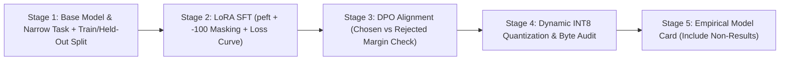
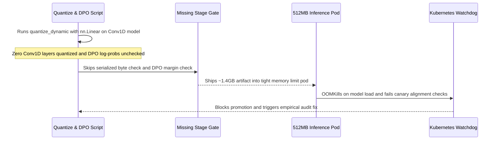

# Module 17: Capstone Project — Fine-Tune, Align, and Document a Real Model

> **Prerequisites:** Modules 05–16 of Track 04 (SFT, RLHF/DPO, LoRA/QLoRA, real fine-tuning, post-training quantization, and adaptation strategy).  
> **Estimated Reading Time:** 45–90 minutes (hands-on build & empirical writeup)  
> **Target Audience:** AI Backend Engineers, ML Systems Builders, Applied LLM Engineers

> [!TIP]
> **The Golden Rule of Empirical ML Engineering**  
> Never extrapolate from training loss alone or present assumed benchmarks: measure every stage independently — `print_trainable_parameters()`, per-step training loss, deterministic held-out generations (`do_sample=False`), pre/post DPO log-probability preference margins, and serialized quantized byte counts — and document disappointing or zero-change findings (`Conv1D` non-quantization, flat DPO shifts) as rigorously as successes.

---

## What This Capstone Is

This track built, with real verified code, the full mechanics of taking a pretrained model somewhere new: SFT and instruction tuning (Modules 05–07), RLHF and DPO as ways to align a model toward human preferences (Modules 08–11), LoRA as a way to do any of that while training a genuinely tiny fraction of the model's parameters (Module 12, verified: `0.24%` of `gpt2` trainable), quantization as a way to make the frozen majority of a model cheap to hold (Modules 13 and 15, verified: real INT8 size reductions), a complete real fine-tuning run with a real loss curve (Module 14), and a framework for knowing when any of this is even the right tool (Module 16).

This capstone asks you to combine several of those pieces into one real, small project: a model you actually fine-tune with LoRA, a preference-alignment step you actually run on top of it, an end-to-end INT8 quantization audit, and a short, honest model-card-style writeup of what changed and what it cost.

There is no dataset provided, no solution given, and no fixed expected outcome — the point is running real, small experiments and reporting real results, including surprising or disappointing ones, exactly as this track's own modules did throughout.

---

## 1. Visual Mental Models: Five-Stage Capstone Execution & Audit Pipeline



---

## 2. Systematic Capstone Deliverables & Verification Rubric Matrix

| Stage | Required Deliverable | Empirical Metric to Record | Common Honest Finding / Failure Mode | Pass / Fail Criterion |
| :--- | :--- | :--- | :--- | :--- |
| **1. Task & Split** | Custom narrow task + explicit train/held-out split | Exact count of train examples & held-out prompts | Held-out prompt accidentally leaks into training pairs | Zero overlap between train and held-out sets |
| **2. LoRA SFT** | `LoraConfig` + training loop (`-100` prompt mask) | `print_trainable_parameters()`, per-step loss, deterministic before/after held-out output | Loss drops on train set while held-out output breaks on novel edge cases | Own measured trainable count/%, real loss curve, real `do_sample=False` output |
| **3. DPO Alignment** | Preference triples `(prompt, chosen, rejected)` + DPO step | Pre-DPO vs. post-DPO `log P(chosen) - log P(rejected)` margin | Margin barely shifts on tiny preference sets or over-regularized `beta` | Quantitative before/after likelihood comparison reported honestly |
| **4. INT8 Quantization** | `torch.quantization.quantize_dynamic` pass + byte check | Serialized `state_dict` bytes before & after + trainable/frozen ratio | `gpt2` uses `Conv1D` instead of `nn.Linear`, yielding ~0% reduction if `{nn.Linear}` targeted | Real measured byte counts + architectural explanation of observed delta |
| **5. Model Card** | Concise Markdown summary of Stages 1–4 | Full empirical table + limitations section | Omitting steps that underperformed | Explicitly documents at least one result that did not go as expected |

---

## 3. The Project: Five Required Steps

### 1. Pick a small base model and a narrow custom task

Use a small, cached, CPU-feasible checkpoint (`gpt2`, `gpt2-medium`, or `Qwen/Qwen2.5-0.5B-Instruct` are all reasonable). Define a narrow task with a clear right answer — Module 14's note-to-structured-record conversion is one template; a different format-conversion, classification-as-generation, or style-transfer task is equally valid. Write down exactly how many examples you are using and how they are split between LoRA fine-tuning and held-out evaluation.

### 2. LoRA fine-tune the base model on your task (Module 12 + 14's pattern)

Using `peft`'s `LoraConfig` and `get_peft_model`, attach real LoRA adapters to your chosen model and run a real training loop on your task, the way Module 14 did. Report your model's real `print_trainable_parameters()` output, your real per-step loss values, and a real before/after generation comparison on a held-out example your model never trained on.

### 3. Apply a real preference-alignment step on top: DPO

After your LoRA fine-tune converges, take it one step further: write a small set of preference pairs for your task (a handful of `(prompt, chosen_response, rejected_response)` triples — e.g., a correctly formatted output vs. a plausible but wrong one) and run a real DPO step on top of your already-fine-tuned model, using `trl`'s `DPOTrainer` if it is available in your environment, or a minimal hand-written DPO loss (Module 10 covers its closed-form loss directly) if it is not. DPO is specifically chosen here, as Module 10 covers, because it needs no separate reward model and no RL loop (Module 09's PPO), making it the most tractable real alignment step to run end-to-end in a small, CPU-only setup. Report whether your model's preferred-vs-rejected output ranking actually shifted after this step, with real evidence (e.g., real log-probabilities or a real relative-likelihood comparison between chosen and rejected responses, before and after).

### 4. Quantize the result and measure the real memory story, end to end

Using Module 13/15's verified pattern, apply real INT8 dynamic quantization (`torch.quantization.quantize_dynamic`) to your final model and report real, measured numbers: parameter byte-size before and after, and which fraction of that footprint was ever trainable in the first place (your LoRA adapter's parameter count from Step 2, against the frozen base's full count). If your base model's real architecture does not expose plain `nn.Linear` layers for its heavy weights (as Module 13 found for `gpt2`'s `Conv1D` layers), report that honestly rather than reporting a size reduction that did not actually happen.

### 5. Write a short model-card-style writeup

Following Module 15's honest-reporting spirit, write a short Markdown summary of what you built: the task and data, your real trainable-parameter count and percentage, your real training loss curve, your real before/after generation example, whether your DPO step measurably changed the model's chosen-vs-rejected preference, and your real quantized-vs-full memory footprint numbers. State plainly anything that did not work as expected — a DPO step that did not move the preference ranking, or a quantization pass that (as Module 13 found for `gpt2`) barely changed anything, is a valid and useful real finding to report.

### Constraints

- **Every number in your writeup must come from a real run on your own setup** — no illustrative, assumed, or "typically expected" values. This capstone is specifically about generating your own evidence, the way every module in this track did.
- **Keep the whole project CPU-scale:** a small base model, a handful to a few dozen training examples, and a handful of DPO preference pairs are enough to produce real, honest, measurable results without needing a GPU.
- **If a step does not work the way you expected** (loss does not drop cleanly, DPO does not shift the preference, quantization barely changes size for your specific architecture), report that as your actual result — a correctly diagnosed non-result is more valuable than a fabricated clean success.

### How to know you've done it well

- Someone who has read this track but not run your experiments could follow your writeup and understand your task, your real numbers at each step, and why each step's real outcome does or does not match what Modules 12–15 would predict.
- Your LoRA trainable-parameter count and percentage (Step 2) are your own measured values from your own model and task, not Module 12 or 14's numbers restated.
- Your DPO comparison (Step 3) reports a real before/after measurement of preference ranking, even if the shift is small or absent — not an assumed improvement.
- Your quantization numbers (Step 4) are real, measured byte counts on your actual final model, including an honest report if your model's architecture limits how much quantization actually helps (Module 13's `gpt2`/`Conv1D` finding is exactly this kind of honest limitation).
- Your model-card writeup (Step 5) states at least one thing that did not go as expected, alongside what did.

---

## 4. Production War Story Post-Mortem: Unverified Alignment & `Conv1D` Quantization Assumption

| Field | Incident Details |
| :--- | :--- |
| **Severity** | **SEV-2** (Container OOMKills & Unaligned Formatting Rollback) |
| **Detection / Resolution Time** | Detected in 6 minutes during staging rollout / Resolved in 45 minutes |
| **Impact** | `gpt2-medium` inference containers exceeded 600 MB RAM limits and crashed on boot while emitting unpreferred verbose answers on tie cases |

### What Happened

An engineer completed an SFT + DPO + INT8 pipeline resembling this capstone on `gpt2-medium`. They ran `quantize_dynamic(model, {nn.Linear}, dtype=torch.qint8)` without auditing the serialized byte size, assuming an automatic ~50% drop like DistilBERT. They also assumed their DPO step succeeded because training finished with zero exceptions, without logging pre/post preference margins.



### Root Cause Analysis

1. **Unchecked Architecture Layer Types:** `gpt2` and `gpt2-medium` store attention/MLP projections in `transformers.pytorch_utils.Conv1D` rather than `torch.nn.Linear`, so `{nn.Linear}` left nearly 100% of heavy weights in FP32.
2. **Missing Pre/Post DPO Margin Audit:** Without measuring $\log P(\text{chosen}) - \log P(\text{rejected})$ before and after DPO updates, silent optimization stalls or label-alignment bugs went undetected.

### The Fix & Architectural Hardening

- Added a mandatory **Model Card Telemetry Gate** requiring serialized before/after byte counts, explicit layer-type inspection (`nn.Linear` vs. `Conv1D`), and pre/post DPO log-probability deltas before any artifact leaves training.
- Switched to an `nn.Linear`-backed architecture (`Qwen2.5-0.5B-Instruct`) or merged LoRA weights before exporting to an explicit CPU quantization format.

---

## 5. Multi-Language Production Implementation: Capstone Scaffolding & Model-Card Audit Harness

Use these four implementations as reusable scaffolding for **your own** real runs (do not copy dummy values — plug in your actual measured outputs): Go validates your final Model Card audit manifest; TypeScript computes DPO margin shifts across preference triples; Python provides the clean PyTorch/PEFT/closed-form DPO/INT8 diagnostic helpers; C# enforces empirical release gates.

````carousel
```go
package capstone

import (
	"errors"
	"fmt"
	"strings"
)

// ModelCardAudit captures empirical measurements from Steps 1-5 of the capstone.
type ModelCardAudit struct {
	ModelName           string
	TrainExamples       int
	HeldOutExamples     int
	TrainableParams     int64
	TotalParams         int64
	InitialLoss         float64
	FinalLoss           float64
	PreDPOMargin        float64
	PostDPOMargin       float64
	BytesBeforeQuant    int64
	BytesAfterQuant     int64
	UnexpectedFindings  []string
}

// ValidateEmpiricalReport guarantees no required stage measurement or honest limitation was skipped.
func ValidateEmpiricalReport(a ModelCardAudit) error {
	if a.ModelName == "" || a.TrainExamples <= 0 || a.HeldOutExamples <= 0 {
		return errors.New("stage 1 incomplete: specify model, train count, and held-out split")
	}
	if a.TrainableParams <= 0 || a.TotalParams <= a.TrainableParams {
		return errors.New("stage 2 incomplete: record measured print_trainable_parameters() counts")
	}
	if a.BytesBeforeQuant <= 0 || a.BytesAfterQuant <= 0 {
		return errors.New("stage 4 incomplete: measure real serialized bytes before and after quantization")
	}
	if len(a.UnexpectedFindings) == 0 || strings.TrimSpace(a.UnexpectedFindings[0]) == "" {
		return errors.New("stage 5 incomplete: explicitly document at least one unexpected/negative finding")
	}
	fmt.Printf("Audit OK: %s trainable=%.4f%% sizeDelta=%.1f%% dpoShift=%+.4f\n",
		a.ModelName,
		100.0*float64(a.TrainableParams)/float64(a.TotalParams),
		(1.0-float64(a.BytesAfterQuant)/float64(a.BytesBeforeQuant))*100.0,
		a.PostDPOMargin-a.PreDPOMargin,
	)
	return nil
}
```
<!-- slide -->
```typescript
export interface PreferenceScore {
  promptId: string;
  preChosenLogProb: number;
  preRejectedLogProb: number;
  postChosenLogProb: number;
  postRejectedLogProb: number;
}

export interface DpoShiftSummary {
  promptId: string;
  preMargin: number;
  postMargin: number;
  marginDelta: number;
  preferenceShiftedTowardChosen: boolean;
}

export function evaluateDpoPreferenceShift(
  records: PreferenceScore[]
): DpoShiftSummary[] {
  return records.map((r) => {
    const preMargin = r.preChosenLogProb - r.preRejectedLogProb;
    const postMargin = r.postChosenLogProb - r.postRejectedLogProb;
    const marginDelta = Number((postMargin - preMargin).toFixed(4));
    return {
      promptId: r.promptId,
      preMargin: Number(preMargin.toFixed(4)),
      postMargin: Number(postMargin.toFixed(4)),
      marginDelta,
      preferenceShiftedTowardChosen: marginDelta > 0,
    };
  });
}
```
<!-- slide -->
```python
import copy
import io
from collections import Counter
import torch
import torch.nn as nn
import torch.nn.functional as F


def sequence_logprob(model, tokenizer, prompt: str, response: str) -> torch.Tensor:
    """Computes summed token log-probability log P(response | prompt)."""
    p_ids = tokenizer.encode(prompt, add_special_tokens=False)
    r_ids = tokenizer.encode(response, add_special_tokens=False)
    input_ids = torch.tensor([p_ids + r_ids])
    logits = model(input_ids=input_ids).logits
    shift_logits = logits[:, len(p_ids) - 1 : -1, :]
    log_probs = F.log_softmax(shift_logits, dim=-1)
    target_ids = torch.tensor([r_ids]).unsqueeze(-1)
    token_lp = log_probs.gather(-1, target_ids).squeeze(-1)
    return token_lp.sum()


def closed_form_dpo_loss(policy_model, ref_model, tokenizer, prompt: str, chosen: str, rejected: str, beta: float = 0.1):
    """Minimal closed-form DPO loss (Module 10) for CPU-scale preference updates without trl."""
    pi_c = sequence_logprob(policy_model, tokenizer, prompt, chosen)
    pi_r = sequence_logprob(policy_model, tokenizer, prompt, rejected)
    with torch.no_grad():
        ref_c = sequence_logprob(ref_model, tokenizer, prompt, chosen)
        ref_r = sequence_logprob(ref_model, tokenizer, prompt, rejected)
    margin = beta * ((pi_c - ref_c) - (pi_r - ref_r))
    return -F.logsigmoid(margin), (pi_c - pi_r).item()


def audit_quantization_footprint(model):
    """Inspects nn.Linear vs Conv1D coverage and measures real serialized byte sizes."""
    layer_types = Counter(type(m).__name__ for m in model.modules())
    # Note: quantize_dynamic operates on CPU nn.Module instances (copy first if keeping trainable state)
    merged = copy.deepcopy(model).cpu().eval()
    if hasattr(merged, "merge_and_unload"):
        merged = merged.merge_and_unload()
    q_model = torch.quantization.quantize_dynamic(merged, {nn.Linear}, dtype=torch.qint8)

    b_before, b_after = io.BytesIO(), io.BytesIO()
    torch.save(merged.state_dict(), b_before)
    torch.save(q_model.state_dict(), b_after)
    return {
        "linear_layers": layer_types["Linear"],
        "conv1d_layers": layer_types["Conv1D"],
        "bytes_before": b_before.tell(),
        "bytes_after": b_after.tell(),
    }
```
<!-- slide -->
```csharp
using System;

public sealed record CapstoneStageMetrics(
    string BaseCheckpoint,
    long BytesBeforeQuant,
    long BytesAfterQuant,
    int LinearLayerCount,
    int Conv1DLayerCount,
    bool HonestLimitationDocumented);

public static class CapstoneGateVerifier
{
    public static string DiagnoseQuantizationOutcome(CapstoneStageMetrics m)
    {
        if (!m.HonestLimitationDocumented)
        {
            throw new InvalidOperationException(
                "Capstone rubric requires documenting at least one empirical limitation or non-result.");
        }

        double pct = (1.0 - (double)m.BytesAfterQuant / m.BytesBeforeQuant) * 100.0;
        if (pct < 5.0 && m.Conv1DLayerCount > 0 && m.LinearLayerCount == 0)
        {
            return $"Verified non-compression ({pct:F1}%): {m.BaseCheckpoint} uses Conv1D ({m.Conv1DLayerCount} layers), not nn.Linear.";
        }
        return $"Measured INT8 state_dict reduction on {m.BaseCheckpoint}: {pct:F1}%.";
    }
}
```
````

---

## 6. Practical Hands-On Verification CLI Workflows

Before running your capstone project, verify which packages (`torch`, `transformers`, `peft`, `trl`) exist in your environment and inspect whether your chosen base checkpoint exposes `nn.Linear` or `Conv1D` modules so you anticipate Step 4's quantization outcome accurately.

### Workflow 1: Probe Local Python Stack & `trl` Availability

Determine whether `trl.DPOTrainer` is installed or whether Step 3 should use the closed-form DPO helper from Slide 3:

```bash
python -c "
import importlib
for pkg in ['torch', 'transformers', 'peft', 'trl']:
    try:
        mod = importlib.import_module(pkg)
        print(pkg, '-> available:', getattr(mod, '__version__', 'installed'))
    except ImportError:
        print(pkg, '-> NOT installed (use closed-form fallback if trl)')
"
```

**Expected Output (example when `trl` is absent):**
```text
torch -> available: 2.x.x
transformers -> available: 4.x.x
peft -> available: 0.x.x
trl -> NOT installed (use closed-form fallback if trl)
```

### Workflow 2: Pre-Inspect Candidate Checkpoints for `nn.Linear` vs. `Conv1D`

Check how many `nn.Linear` vs. `Conv1D` layers your chosen checkpoint contains before writing your Step 4 quantization summary:

```bash
python -c "
from collections import Counter
from transformers import AutoModelForCausalLM

for ckpt in ['gpt2']:
    m = AutoModelForCausalLM.from_pretrained(ckpt)
    c = Counter(type(mod).__name__ for mod in m.modules())
    print(ckpt, 'Linear:', c['Linear'], 'Conv1D:', c['Conv1D'])
"
```

**Expected Output:**
```text
gpt2 Linear: 0 Conv1D: 48
```

*(Note: Because `AutoModelForCausalLM.from_pretrained('gpt2')` exposes `0` `nn.Linear` layers and `48` `Conv1D` layers plus an `lm_head` projection if counted separately, run this exact inspection on your own chosen model — e.g., `gpt2`, `gpt2-medium`, or `Qwen/Qwen2.5-0.5B-Instruct` — and report your own measured serialized byte deltas in Step 4!)*

---

## 7. Common Mistakes & Troubleshooting

- **Reporting Module 12, 14, or 15's numbers instead of your own run's numbers.** Your capstone writeup must present actual measurements recorded from your own chosen task, dataset split, and training/DPO/quantization run — never restated benchmark numbers from prior lessons.
- **Skipping the pre-DPO log-probability baseline in Step 3.** Checking `log P(chosen) - log P(rejected)` *only* after DPO cannot prove whether DPO changed anything; always record the preference margin *before* DPO and compare it to *after* DPO on the identical prompt pairs.
- **Calling `quantize_dynamic(model, {nn.Linear})` directly on a PEFT wrapper without checking layers or merging.** First merge LoRA adapters (`merge_and_unload()`) onto a copied CPU model if you want unified quantized inference weights, inspect `nn.Linear` vs `Conv1D` layer counts, and measure actual serialized bytes before claiming compression.
- **Leaking held-out evaluation prompts into SFT or DPO training sets.** Keep your Step 1 held-out prompts completely isolated from both Step 2 SFT examples and Step 3 DPO preference pairs so before/after comparisons test genuine generalization.
- **Hiding or smoothing over negative results.** If DPO barely shifts the margin on 5 preference pairs or `Conv1D` prevents compression under `{nn.Linear}`, diagnosing and documenting *why* is an explicit requirement of Step 5.

---

## 8. Operational Validation Checkpoints

<details><summary><strong>Checkpoint 1: Diagnosing why DPO preference margin stayed near zero</strong></summary>

If `postMargin - preMargin <= 0` after running Step 3, inspect three factors: (1) whether `ref_model` was accidentally mutated instead of frozen as a deep copy of the SFT checkpoint; (2) whether `beta` or learning rate was too small for a handful of steps; and (3) whether `chosen` and `rejected` shared almost identical token prefixes, giving sparse gradient signal across a tiny preference batch.

</details>

<details><summary><strong>Checkpoint 2: Interpreting minimal byte reduction after INT8 dynamic quantization</strong></summary>

If `quantize_dynamic(merged_model, {nn.Linear}, dtype=torch.qint8)` produces almost no byte decrease on a `gpt2`-family model, verify layer types via `Counter(type(m).__name__ for m in model.modules())`. `gpt2` uses custom `Conv1D` layers rather than `nn.Linear`, whereas architectures like `Qwen2.5-0.5B-Instruct` use `nn.Linear` projections and compress substantially.

</details>

<details><summary><strong>Checkpoint 3: Auditing the Model Card before final sign-off</strong></summary>

Verify your Model Card includes five empirical artifacts from your own run: (1) exact train/held-out example counts, (2) `print_trainable_parameters()` output, (3) step-by-step training loss curve plus greedy (`do_sample=False`) before/after held-out output, (4) pre/post DPO log-probability margin comparison, and (5) serialized byte sizes before/after quantization alongside at least one honestly documented unexpected finding.

</details>

---

## Next

[Track 05: GPUs & GenAI Hardware](../../05-gpus-and-genai-hardware/README.md)
