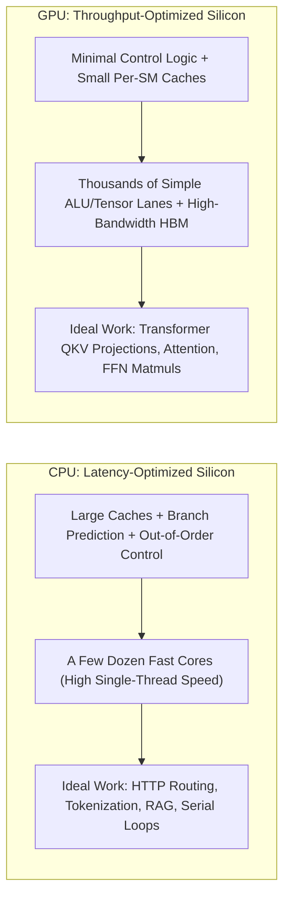
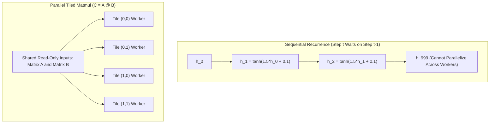
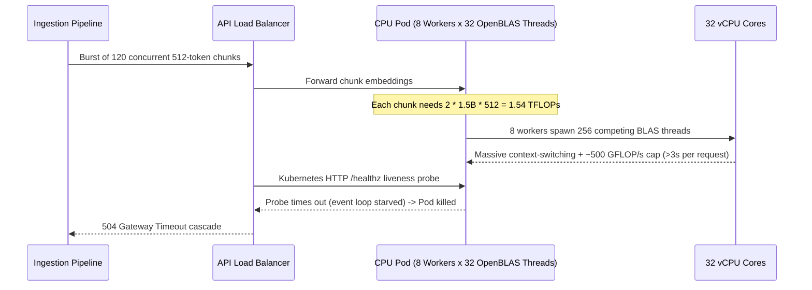

# Module 00: Why GPUs, Not CPUs

> **Prerequisites:** [Track 05: GPUs & GenAI Hardware](../README.md), [Track 02, Module 01: The Math You Actually Need](../../02-transformer-architecture/01-the-math-you-actually-need-vectors-matrices-dot-products/README.md), [Track 02, Module 12: The Feed-Forward Network](../../02-transformer-architecture/12-the-feed-forward-network/README.md), and the `C ≈ 6ND` training-cost rule from [Track 04, Module 04: Compute Budgets and Chinchilla Optimality](../../04-training-fine-tuning-and-alignment/04-compute-budgets-and-chinchilla-optimality/README.md).  
> **Estimated Reading Time:** 30 minutes  
> **Target Audience:** AI Backend Engineers, ML Systems Architects, Platform Engineers

> [!TIP]
> **The Golden Rule of AI Processor Selection:** A CPU minimizes **single-thread latency** by spending silicon on large caches and branch prediction, whereas a GPU maximizes **parallel throughput** by spending silicon on thousands of simple math lanes and high-bandwidth memory. Because transformer models spend virtually all their floating-point operations in order-independent matrix multiplications, always evaluate both **FLOP/s** (compute ceiling) and **GB/s** (memory bandwidth ceiling) before selecting hardware.

---

## Roadmap & Why This Matters

Every earlier track treated a language model as software: tokens go in, matrices get multiplied, tokens come out. This track asks what that costs in hardware, and the answer starts with one question: why are modern LLMs trained and served on GPUs rather than on the processor inside a normal laptop or server?

**After this module** you can:
- explain the difference between a latency-optimized and a throughput-optimized processor in plain words;
- show, with a runnable experiment, why a matrix multiplication is a "do a million independent things" job;
- read the two numbers that bound almost every AI workload (FLOP/s and memory bandwidth) and measure both on your own machine;
- estimate, from those two numbers, why a CPU cannot train an LLM and where it can still run one.

Every later decision in this track (which GPU, how much VRAM, whether a model fits, what a cloud bill looks like) is a consequence of the idea in this module. The GPU internals come next, in [Module 01](../01-gpu-architecture-for-software-engineers/README.md).

---

## 1. Visual Mental Models: Latency Silicon vs. Throughput Silicon

> [!IMPORTANT]
> **Core Concept:** A CPU is built to finish one task as quickly as possible; a GPU is built to finish an enormous number of identical, independent tasks per second. A transformer is almost entirely matrix multiplication, which is exactly that kind of job, so the GPU wins by a margin no clock-speed tweak could close.

"Fast" means two fundamentally different engineering targets:
- **Latency**: how long one task takes from start to finish. Opening a file, handling one web request, or running a `for` loop where each step needs the previous step's answer.
- **Throughput**: how many tasks finish per second, regardless of how long each individual task takes.



> [!NOTE]
> **Analogy — A Sports Car vs. a Freight Train:** The sports car (CPU) gets one person across town in minutes. The freight train (GPU) takes longer to start and is useless for a single passenger, but moves ten thousand tonnes per trip. If your job is "move one parcel", buy the car. If your job is "move a million identical parcels", the train is not slightly better; it is a different order of magnitude.

### Order-Independent Tiled Matmul vs. Sequential Recurrence

Multiplying an $M \times K$ matrix $A$ by a $K \times N$ matrix $B$ produces an $M \times N$ matrix $C$ where:

```text
C[i][j] = A[i][0]*B[0][j] + A[i][1]*B[1][j] + ... + A[i][K-1]*B[K-1][j]
```

Each of the $M \times N$ output cells is its own dot product. No cell needs another cell's result, so you can compute them in any order—or all at once—and get the identical answer. A $4096 \times 4096$ output has about 16.8 million independent cells: the exact "million identical parcels" a throughput machine exists to move.

Contrast that with a recurrence such as $h = \tanh(1.5 h + 0.1)$ repeated 1,000 times: step 1,000 strictly needs step 999's answer. That dependency chain is why older sequence models (RNNs, [Track 00, Module 04](../../00-genai-foundations/04-rnns-lstms-and-the-sequence-problem/README.md)) were awkward to accelerate, and why the original transformer paper notes that attention is "much faster and more space-efficient in practice, since it can be implemented using highly optimized matrix multiplication code."



### Original Silicon & Parallelism Diagrams

Where the silicon goes (schematic, not to scale):

```text
LATENCY-OPTIMIZED (CPU)                   THROUGHPUT-OPTIMIZED (GPU)
finish ONE job as fast as                 finish a MILLION similar jobs
possible                                  per second

┌──────────────────────────────────┐      ┌──────────────────────────────────┐
│ control logic, branch prediction │      │ small control + small caches     │
│ ┌──────────────────────────┐     │      │ ┌──┐┌──┐┌──┐┌──┐┌──┐┌──┐┌──┐┌──┐ │
│ │  large caches            │     │      │ │▒▒││▒▒││▒▒││▒▒││▒▒││▒▒││▒▒││▒▒│ │
│ └──────────────────────────┘     │      │ └──┘└──┘└──┘└──┘└──┘└──┘└──┘└──┘ │
│ ┌────────┐ ┌────────┐            │      │ ┌──┐┌──┐┌──┐┌──┐┌──┐┌──┐┌──┐┌──┐ │
│ │  core  │ │  core  │ ... a few  │      │ │▒▒││▒▒││▒▒││▒▒││▒▒││▒▒││▒▒││▒▒│ │
│ └────────┘ └────────┘     dozen  │      │ └──┘└──┘└──┘└──┘└──┘└──┘└──┘└──┘ │
│                                  │      │ ┌──┐┌──┐┌──┐┌──┐┌──┐┌──┐┌──┐┌──┐ │
│ few threads, each one fast       │      │ │▒▒││▒▒││▒▒││▒▒││▒▒││▒▒││▒▒││▒▒│ │
└──────────────────────────────────┘      │ └──┘└──┘└──┘└──┘└──┘└──┘└──┘└──┘ │
                                          │ thousands of simple lanes        │
                                          │ many threads, each one slower    │
                                          └──────────────────────────────────┘
        ▒▒ = a small math unit (a lane that does one multiply-add at a time)
```

Why a matmul fits the right-hand machine:

```text
 C = A x B      every output cell is its own dot product

 ┌──────┬──────┬──────┬──────┐
 │ w00  │ w01  │ w02  │ w03  │   worker w(i,j) reads row i of A and column j of B,
 ├──────┼──────┼──────┼──────┤   and writes exactly ONE cell of C.
 │ w10  │ w11  │ w12  │ w13  │
 ├──────┼──────┼──────┼──────┤   No worker reads another worker's output, so all
 │ w20  │ w21  │ w22  │ w23  │   M x N of them can run at once, in any order.
 └──────┴──────┴──────┴──────┘
                                A recurrence is the opposite:  h1 ─► h2 ─► h3 ─► ...
                                each step waits for the one before it.
```

---

## 2. Systematic Comparison Matrices & Core Mechanics

### CPU vs. GPU Hardware Trade-Off Matrix

| Dimension | Modern Server CPU (x86 / ARM) | Datacenter GPU (NVIDIA H100 SXM5) | Architectural Consequence |
| :--- | :--- | :--- | :--- |
| **Optimization Goal** | Minimize single-thread latency | Maximize aggregate throughput | CPUs win branchy serial code; GPUs win bulk math |
| **Silicon Allocation** | Large L1/L2/L3 caches, branch predictors, OoO engines | Minimal control, thousands of FP32/Tensor units | NVIDIA CUDA Guide: GPUs trade per-thread speed for mass parallelism |
| **Concurrency Scale** | Tens of heavy threads | Tens of thousands of lightweight threads | GPUs require large matrices/batches to saturate |
| **Arithmetic Peak** | ~0.5–4 TFLOP/s (FP32) | 66.9 TFLOP/s FP32; 989.4 TFLOP/s dense BF16 | ~1,000x+ dense tensor advantage for training/prefill |
| **Memory Bandwidth** | ~50–400 GB/s (DDR5 channels) | 3,352 GB/s (HBM3) | Single-user token decode is ~10–60x faster on GPU HBM |
| **Best GenAI Role** | Tokenization, RAG retrieval, orchestration, batch-1 small CPU inference | LLM training, prompt prefill, batched autoregressive decode | Production stacks pair CPU control planes with GPU workers |

### Why a Transformer Block Is Mostly Matrix Multiplication

Follow one token through one transformer block (Track 02 covers each step in detail):

| Step in a Block | Operation | Matmul? | Hardware Execution Path |
| :--- | :--- | :--- | :--- |
| **Compute queries, keys, values** | `x @ W_q`, `x @ W_k`, `x @ W_v` | **Yes** | Tensor Cores (compute-bound at large batch/prefill) |
| **Attention scores** | `Q @ K.T` | **Yes** | Tensor Cores |
| **Softmax over the scores** | elementwise `exp`, sum, divide | No (cheap FLOPs) | CUDA Cores (memory-bandwidth bound) |
| **Mix the values** | `scores @ V` | **Yes** | Tensor Cores |
| **Output projection** | `... @ W_o` | **Yes** | Tensor Cores |
| **Residual add, layer norm** | elementwise | No (cheap FLOPs) | CUDA Cores (memory-bandwidth bound) |
| **Feed-forward up and down** | `... @ W_1`, `... @ W_2` | **Yes** | Tensor Cores |
| **Activation function** | elementwise | No (cheap FLOPs) | CUDA Cores (memory-bandwidth bound) |

The weight matrices (`W_q` through `W_2`) are where a model's parameters live, and each parameter participates in one multiply and one add per token. The scaling-laws paper (Kaplan et al., 2020) turns that into the core rule of thumb: a forward pass costs about **`2N` FLOPs per token** for a model with `N` non-embedding parameters, and training (forward plus backward) costs about **`6N` FLOPs per token**. Elementwise steps are a rounding error in the FLOP count (though as Module 03 shows, they are not a rounding error in wall-clock time).

### The Two Numbers That Bound Every Workload

Two hardware rates govern AI performance (examined deeply in [Module 03](../03-memory-hierarchy-and-bandwidth/README.md)):
- **FLOP/s** (floating-point operations per second): how much arithmetic the chip can perform per second.
- **Memory bandwidth** (GB/s): how fast bytes move between memory and the math units.

> [!WARNING]
> **Unit & Measurement Pitfalls:**
> 1. **`FLOPs` vs. `FLOP/s` (or `FLOPS`):** `FLOPs` with a lowercase `s` is a **count of work** ("this matmul costs 4.2 million FLOPs"), whereas `FLOP/s` or `FLOPS` is a **speed** ("this chip delivers 989.4 trillion FLOP/s"). Likewise, `GB` is capacity and `GB/s` is bandwidth.
> 2. **Experiment 1 Is NOT a CPU-vs-GPU Benchmark:** The ~1,100x speedup in Experiment 1 below compares a pure Python triple loop against NumPy's OpenBLAS `A @ B` **on the exact same CPU**. It demonstrates how eliminating interpreter overhead, issuing SIMD vector instructions, and utilizing multi-core CPU parallelism unlocks data-parallel speedups; GPUs push that same parallel principle orders of magnitude further.

### Why Training Is Impractical on CPUs—and Where CPUs Still Fit

Putting measured CPU numbers against a hypothetical **7-billion-parameter model** (`N = 7e9`):
- **Training (`6 * N * D` FLOPs):** On `D = 1e12` (1 trillion) tokens, training requires `4.2e22` FLOPs—over **2,400 years** at ~539 GFLOP/s on a single CPU, or decades even across a hundred CPUs with perfect scaling. An H100 SXM5's dense BF16 peak (989.4 TFLOPS) exceeds a laptop CPU's measured FP32 matmul rate by more than three orders of magnitude.
- **Autoregressive generation (inference):** Generating one token at batch size 1 must stream every model weight from memory (`2 * N` bytes in FP16). Memory transfer time dominates arithmetic time by over 20x, capping CPU speed at ~1.6 tokens/s (FP16) or ~6.3 tokens/s (4-bit quantized, [Track 04, Module 15](../../04-training-fine-tuning-and-alignment/15-quantization-int8-int4-gguf/README.md)).

CPUs remain essential and practical for:
- **Single-user, low-concurrency quantized inference** where a few tokens/s is acceptable (see [Module 14: Running Models on CPU and Apple Silicon](../14-running-models-on-cpu-and-apple-silicon/README.md)).
- **The entire non-matmul infrastructure around the model:** tokenization, vector retrieval, HTTP request handling, prompt routing, and orchestration—branchy, latency-sensitive work that belongs on CPUs.

---

## 3. Production War Story Post-Mortem: CPU-Only Embedding Service Collapse

| Field | Incident Details |
| :--- | :--- |
| **Severity** | **SEV-1** (Search & RAG API Complete Timeout Outage) |
| **Detection / Resolution Time** | Detected in 6 minutes via P99 latency alert / Mitigated in 34 minutes |
| **Impact** | 100% of RAG ingestion and semantic query traffic failed with HTTP `504` timeouts (`\$14,200` SLA credit exposure) |

### What Happened

To save roughly `\$2.50/hr` per node on cloud compute, a platform team deployed a 1.5B-parameter bi-encoder embedding model inside FastAPI containers on 32-vCPU compute-optimized CPU instances (`c7i.8xlarge`) rather than GPU nodes. At 1–2 requests/sec with short 64-token queries, latency stayed near 120 ms. During a scheduled enterprise document onboarding batch (120 concurrent 512-token chunks), PyTorch/OpenBLAS workers pinned all 32 vCPUs at 100% while queues backed up beyond the 15-second ingress timeout. Even worse, OpenBLAS spawned 32 worker threads *per* Uvicorn worker process (8 workers x 32 threads = 256 competing threads), starving the asyncio event loop so Kubernetes HTTP liveness probes timed out and restarted healthy pods in a crash loop.



### Root Cause Analysis

1. **Multi-token embedding forward passes are FLOP/s-bound:** Unlike batch-1 single-token decode, encoding a 512-token document multiplies every weight 512 times (`1.54e12` FLOPs per request). Against a ~500 GFLOP/s CPU ceiling, even 100% utilization yields >3 seconds per document.
2. **Thread oversubscription starved latency-sensitive CPU control flow:** Leaving `OPENBLAS_NUM_THREADS` unset across multiple worker processes caused 256 compute threads to preempt the HTTP server's event loop, turning a throughput bottleneck into a control-plane crash loop.

### The Fix & Architectural Hardening

- **Hardware Decoupling:** Moved embedding forward passes onto GPU worker nodes (FP16 tensor cores reduced 512-token inference from >3,000 ms to ~18 ms with dynamic batching), while keeping tokenization, chunking, and HTTP orchestration on smaller CPU pods.
- **Thread Pool Guardrails:** Pinned `OPENBLAS_NUM_THREADS=1` / `OMP_NUM_THREADS=1` inside CPU API gateway containers and enforced pre-deployment FLOP/s + bandwidth roofline budgeting in CI.

---

## 4. Multi-Language Production Implementation: Hardware Roofline & Feasibility Estimator

These four implementations model the exact CPU vs. GPU decision logic from this module: comparing arithmetic time (`ops / FLOP/s`) against memory transfer time (`bytes / bandwidth`) for LLM training, prefill, and batch-1 token decode, with Python providing a live PyTorch/NumPy hardware profiler.

````carousel
```go
package main

import (
	"fmt"
	"math"
)

type ProcessorProfile struct {
	Name        string
	PeakGFLOPs  float64 // Sustained or peak compute rate (GFLOP/s)
	BandwidthGB float64 // Memory bandwidth (GB/s)
}

func EstimateDecodeStep(proc ProcessorProfile, params float64, bytesPerParam float64) {
	// Forward pass costs ~2N FLOPs/token; batch-1 reads all weights once.
	flops := 2.0 * params
	bytesMoved := params * bytesPerParam

	mathSec := flops / (proc.PeakGFLOPs * 1e9)
	memSec := bytesMoved / (proc.BandwidthGB * 1e9)
	stepSec := math.Max(mathSec, memSec)

	bound := "memory-bound"
	if mathSec > memSec {
		bound = "compute-bound"
	}

	fmt.Printf("%-18s | math: %7.2f ms | mem: %7.2f ms | max: %6.1f tok/s (%s)\n",
		proc.Name, mathSec*1e3, memSec*1e3, 1.0/stepSec, bound)
}

func main() {
	cpu := ProcessorProfile{Name: "Server CPU (FP16)", PeakGFLOPs: 539.0, BandwidthGB: 22.0}
	h100 := ProcessorProfile{Name: "H100 SXM5 (BF16)", PeakGFLOPs: 989400.0, BandwidthGB: 3352.0}

	params7B := 7e9
	fmt.Println("=== 7B Model Batch-1 Decode Ceiling (2 bytes/param) ===")
	EstimateDecodeStep(cpu, params7B, 2.0)
	EstimateDecodeStep(h100, params7B, 2.0)

	// Training 7B on 1T tokens = 6 * N * D FLOPs
	trainFlops := 6.0 * params7B * 1e12
	cpuYears := trainFlops / (cpu.PeakGFLOPs * 1e9) / 3.15576e7
	h100Days := trainFlops / (h100.PeakGFLOPs * 1e9) / 86400.0
	fmt.Printf("\nTraining 7B on 1T tokens (4.2e22 FLOPs): CPU ~%.0f years | 1x H100 ~%.1f days (at peak)\n",
		cpuYears, h100Days)
}
```
<!-- slide -->
```typescript
export interface HardwareSpec {
  name: string;
  peakGflops: number;
  bandwidthGBs: number;
}

export interface FeasibilityReport {
  workload: string;
  hardware: string;
  mathTimeMs: number;
  memoryTimeMs: number;
  limitingCeiling: "compute-bound" | "memory-bound";
  maxTokensPerSec: number;
}

export function evaluateInferenceCeiling(
  spec: HardwareSpec,
  numParams: number,
  bytesPerParam: number,
  batchSize: number = 1
): FeasibilityReport {
  const totalFlops = 2 * numParams * batchSize;
  const totalWeightBytes = numParams * bytesPerParam; // weights read once per step

  const mathTimeSec = totalFlops / (spec.peakGflops * 1e9);
  const memoryTimeSec = totalWeightBytes / (spec.bandwidthGBs * 1e9);
  const stepSec = Math.max(mathTimeSec, memoryTimeSec);

  return {
    workload: `${(numParams / 1e9).toFixed(1)}B (${bytesPerParam} B/param, B=${batchSize})`,
    hardware: spec.name,
    mathTimeMs: Number((mathTimeSec * 1e3).toFixed(2)),
    memoryTimeMs: Number((memoryTimeSec * 1e3).toFixed(2)),
    limitingCeiling: mathTimeSec >= memoryTimeSec ? "compute-bound" : "memory-bound",
    maxTokensPerSec: Number((batchSize / stepSec).toFixed(1)),
  };
}

const specs: HardwareSpec[] = [
  { name: "Laptop CPU (22 GB/s)", peakGflops: 539, bandwidthGBs: 22 },
  { name: "H100 SXM5 (3,352 GB/s)", peakGflops: 989_400, bandwidthGBs: 3352 },
];

const reports = specs.flatMap((s) => [
  evaluateInferenceCeiling(s, 7e9, 2.0, 1),   // FP16 batch 1
  evaluateInferenceCeiling(s, 7e9, 0.5, 1),   // 4-bit batch 1
]);
console.table(reports);
```
<!-- slide -->
```python
"""
hardware_probe.py
Measures local matmul FLOP/s and memory copy bandwidth using PyTorch (CUDA if available,
otherwise CPU) or falls back cleanly to NumPy, then computes the 7B LLM ceiling.
"""
import time
import numpy as np

def measure_local_hardware():
    try:
        import torch
        if torch.cuda.is_available():
            device = torch.device("cuda")
            n = 4096
            a = torch.randn((n, n), dtype=torch.bfloat16, device=device)
            b = torch.randn((n, n), dtype=torch.bfloat16, device=device)
            _ = a @ b
            torch.cuda.synchronize()
            t0 = time.perf_counter()
            for _ in range(10):
                _ = a @ b
            torch.cuda.synchronize()
            gflops = (2 * n**3 * 10) / (time.perf_counter() - t0) / 1e9

            m = 64 * 1024 * 1024
            src = torch.ones(m, dtype=torch.float32, device=device)
            dst = torch.empty_like(src)
            dst.copy_(src)
            torch.cuda.synchronize()
            t0 = time.perf_counter()
            for _ in range(10):
                dst.copy_(src)
            torch.cuda.synchronize()
            gbs = (2 * m * 4 * 10) / (time.perf_counter() - t0) / 1e9
            return f"PyTorch CUDA ({torch.cuda.get_device_name(0)})", gflops, gbs
    except ImportError:
        pass

    # Fallback: NumPy CPU measurement
    n = 2048
    rng = np.random.default_rng(0)
    a = rng.standard_normal((n, n), dtype=np.float32)
    b = rng.standard_normal((n, n), dtype=np.float32)
    t0 = time.perf_counter()
    _ = a @ b
    gflops = (2 * n**3) / (time.perf_counter() - t0) / 1e9

    m = 32 * 1024 * 1024
    x, y = np.ones(m, np.float32), np.empty(m, np.float32)
    t0 = time.perf_counter()
    np.copyto(y, x)
    gbs = (2 * m * 4) / (time.perf_counter() - t0) / 1e9
    return "NumPy CPU", gflops, gbs

if __name__ == "__main__":
    backend, gflops, gbs = measure_local_hardware()
    print(f"Backend: {backend} -> {gflops:,.1f} GFLOP/s | {gbs:,.1f} GB/s")
```
<!-- slide -->
```csharp
using System;

public sealed record HardwareProfile(string Name, double PeakGflops, double BandwidthGBs);

public static class WorkloadEstimator
{
    public static void Main()
    {
        var profiles = new[]
        {
            new HardwareProfile("CPU (Measured)", 539.0, 22.0),
            new HardwareProfile("H100 SXM5 (Peak)", 989_400.0, 3352.0),
        };

        const double numParams = 7e9;
        const double bytesPerParam = 2.0; // FP16/BF16

        foreach (var hw in profiles)
        {
            double mathSec = (2.0 * numParams) / (hw.PeakGflops * 1e9);
            double memSec = (numParams * bytesPerParam) / (hw.BandwidthGBs * 1e9);
            string bottleneck = mathSec > memSec ? "Compute-Bound" : "Memory-Bound";
            double maxTokPerSec = 1.0 / Math.Max(mathSec, memSec);

            Console.WriteLine(
                $"{hw.Name,-18} | Math: {mathSec * 1e3,6:F2} ms | Mem: {memSec * 1e3,6:F2} ms | " +
                $"{bottleneck,-13} | Ceiling: {maxTokPerSec,6:F1} tok/s");
        }
    }
}
```
````

---

## 5. Practical Hands-On Verification Workflows & Experiments

All three original Python experiments use only NumPy. They were verified with Python 3.13 and NumPy 2.4.6 on a Windows 11 machine with an Intel CPU exposing 16 logical cores. **Your timings will differ**; run them more than once and treat the ratios, not the absolute values, as the lesson.

### Experiment 1: The Same Matmul, Three Ways (Interpreter vs. Cell Dot vs. Vectorized BLAS)

Predict the ordering before you run it:

```python
import time
import numpy as np

def matmul_triple_loop(A, B):
    """Pure Python: one multiply-add at a time, like a single fast worker."""
    n, k = len(A), len(B)
    m = len(B[0])
    C = [[0.0] * m for _ in range(n)]
    for i in range(n):
        for j in range(m):
            s = 0.0
            for p in range(k):
                s += A[i][p] * B[p][j]
            C[i][j] = s
    return C

def matmul_dot_per_cell(A, B):
    """One numpy dot product per output cell: parallelism inside the dot, none across cells."""
    n, m = A.shape[0], B.shape[1]
    C = np.empty((n, m))
    for i in range(n):
        for j in range(m):
            C[i, j] = np.dot(A[i, :], B[:, j])
    return C

def best_of(fn, repeats):
    best = float("inf")
    for _ in range(repeats):
        t0 = time.perf_counter()
        fn()
        best = min(best, time.perf_counter() - t0)
    return best

n = 128
rng = np.random.default_rng(0)
A = rng.standard_normal((n, n))
B = rng.standard_normal((n, n))
flops = 2 * n**3          # n^3 multiply-adds, each counted as 2 FLOPs

reference = A @ B
A_list, B_list = A.tolist(), B.tolist()

t_loop = best_of(lambda: matmul_triple_loop(A_list, B_list), 1)
t_cell = best_of(lambda: matmul_dot_per_cell(A, B), 3)
t_vec  = best_of(lambda: A @ B, 200)

assert np.allclose(np.array(matmul_triple_loop(A_list, B_list)), reference)
assert np.allclose(matmul_dot_per_cell(A, B), reference)

print(f"n = {n}, FLOPs per matmul = {flops:,}")
print(f"{'method':<28}{'time (ms)':>12}{'GFLOP/s':>12}{'vs loop':>12}")
for name, t in [("pure Python triple loop", t_loop),
                ("np.dot per output cell", t_cell),
                ("vectorized A @ B", t_vec)]:
    print(f"{name:<28}{t*1e3:>12.3f}{flops/t/1e9:>12.3f}{t_loop/t:>11.0f}x")
```

**Expected Output** (from one run; a second run gave 1104x for the last row; yours will differ):

```text
n = 128, FLOPs per matmul = 4,194,304
method                         time (ms)     GFLOP/s     vs loop
pure Python triple loop           59.452       0.071          1x
np.dot per output cell            11.325       0.370          5x
vectorized A @ B                   0.052      79.892       1132x
```

The two `assert` lines confirm all three methods compute the same matrix. Only the *execution strategy* changed.

---

### Experiment 2: Order Independence of Tiled Matmul vs. Sequential Recurrence

Prove the independence claim: compute the output in 16 tiles, in a random order, and get the same answer. Then contrast with a recurrence.

```python
import numpy as np

rng = np.random.default_rng(1)
n = 64
A = rng.standard_normal((n, n))
B = rng.standard_normal((n, n))
reference = A @ B

# Split the output into 16 tiles of 16x16. Each tile needs only a strip of A's rows
# and a strip of B's columns -- no tile needs any other tile's result.
tile = 16
tiles = [(i, j) for i in range(0, n, tile) for j in range(0, n, tile)]

# Compute the tiles in a random order -- the answer cannot depend on the order.
order = rng.permutation(len(tiles))
C = np.zeros((n, n))
for idx in order:
    i, j = tiles[idx]
    C[i:i+tile, j:j+tile] = A[i:i+tile, :] @ B[:, j:j+tile]

print("tiles computed independently:", len(tiles))
print("order used:", order.tolist())
print("matches A @ B:", np.allclose(C, reference))

# Contrast: a recurrence, where step t needs step t-1. Order DOES matter here.
def recurrence(x0, steps):
    h = x0
    for _ in range(steps):
        h = np.tanh(h * 1.5 + 0.1)
    return h
print("recurrence after 10 steps:", round(float(recurrence(0.2, 10)), 6),
      "(cannot start step 10 before step 9 is done)")
```

**Expected Output** (the seeded permutation and the final value reproduce exactly):

```text
tiles computed independently: 16
order used: [7, 1, 11, 13, 6, 9, 12, 10, 0, 8, 14, 3, 2, 15, 4, 5]
matches A @ B: True
recurrence after 10 steps: 0.893812 (cannot start step 10 before step 9 is done)
```

Sixteen workers could each take one tile and never talk to each other. That is the entire principle behind using thousands of GPU lanes for a transformer.

---

### Experiment 3: Measure Your Machine's Two Numbers & Project LLM Jobs

Measure your machine's FLOP/s and GB/s, then project LLM-sized jobs onto them. The `2N` and `6N` rules come from Kaplan et al. (2020); the model size `N = 7e9`, the `1e12` training tokens and the 4-bit "0.5 byte per parameter" figure are illustrative assumptions, not measurements of any real system.

```python
import time
import numpy as np

def best_of(fn, repeats):
    best = float("inf")
    for _ in range(repeats):
        t0 = time.perf_counter()
        fn()
        best = min(best, time.perf_counter() - t0)
    return best

# --- Number 1: FLOP/s -- a big float32 matmul (lots of math per byte) ---
n = 2048
A = np.random.default_rng(0).standard_normal((n, n), dtype=np.float32)
B = np.random.default_rng(1).standard_normal((n, n), dtype=np.float32)
gflops = 2 * n**3 / best_of(lambda: A @ B, 5) / 1e9

# --- Number 2: bytes/s -- adding two big arrays (almost no math per byte moved) ---
m = 32 * 1024 * 1024                      # 32M float32 = 128 MiB per array
x = np.ones(m, dtype=np.float32)
y = np.ones(m, dtype=np.float32)
out = np.empty(m, dtype=np.float32)
gbs = 3 * m * 4 / best_of(lambda: np.add(x, y, out=out), 5) / 1e9   # read x, read y, write out

print(f"measured matmul throughput : {gflops:8.1f} GFLOP/s (float32, {n}x{n})")
print(f"measured memory bandwidth  : {gbs:8.1f} GB/s     (np.add, 3 x {m*4/2**20:.0f} MiB moved)")

# --- Project LLM-sized jobs onto THIS machine (illustrative arithmetic, not a benchmark) ---
N = 7e9                                   # hypothetical 7-billion-parameter model
math_s = 2 * N / (gflops * 1e9)           # forward pass ~ 2N FLOPs per token (Kaplan et al. 2020)
print("\nGenerating ONE token (batch size 1), limited by whichever is slower:")
for label, bytes_per_param in [("fp16 weights (2 B/param)", 2.0), ("4-bit weights (~0.5 B/param)", 0.5)]:
    mem_s = N * bytes_per_param / (gbs * 1e9)    # every weight is read once per token
    print(f"  {label:<30} math {math_s*1e3:6.1f} ms | memory {mem_s*1e3:7.1f} ms "
          f"-> at best {1/max(math_s, mem_s):5.1f} tokens/s")

D = 1e12                                  # hypothetical 1 trillion training tokens
train_flops = 6 * N * D                   # training ~ 6N FLOPs per token (Kaplan et al. 2020)
years = train_flops / (gflops * 1e9) / 3.15576e7
print(f"\nTraining 7B on 1T tokens   : {train_flops:.2e} FLOP -> {years:,.0f} years at this machine's matmul rate")

# The Hopper whitepaper lists 989.4 TFLOPS as the dense BF16 tensor-core PEAK of one H100 SXM5.
# A peak is a ceiling, not what real jobs sustain: compare orders of magnitude only.
print(f"H100 SXM5 dense BF16 peak  : {989.4e12/(gflops*1e9):,.0f}x this machine's measured matmul rate")
```

**Expected Output** (from one run; two runs gave 539 and 607 GFLOP/s and 22.0 and 19.2 GB/s; your hardware will give different numbers):

```text
measured matmul throughput :    539.0 GFLOP/s (float32, 2048x2048)
measured memory bandwidth  :     22.0 GB/s     (np.add, 3 x 128 MiB moved)

Generating ONE token (batch size 1), limited by whichever is slower:
  fp16 weights (2 B/param)       math   26.0 ms | memory   637.1 ms -> at best   1.6 tokens/s
  4-bit weights (~0.5 B/param)   math   26.0 ms | memory   159.3 ms -> at best   6.3 tokens/s

Training 7B on 1T tokens   : 4.20e+22 FLOP -> 2,469 years at this machine's matmul rate
H100 SXM5 dense BF16 peak  : 1,836x this machine's measured matmul rate
```

Read the output carefully, because it contains three separate lessons:
1. **The CPU's matmul rate is respectable; the problem is scale.** Hundreds of GFLOP/s is a lot of arithmetic. Training the hypothetical 7B model on 1T tokens needs `4.2e22` FLOPs.
2. **At batch size 1, memory is the limit, not math.** The memory column is more than twenty times the math column for fp16. Making the weights four times smaller (4-bit) cut the memory time by four, but the job stayed memory-bound.
3. **This is an upper bound.** Real inference also reads the KV cache and pays overheads, so real tokens/s are lower. Also, `np.add` runs on one thread, so its bandwidth number understates what all of the CPU's cores together could pull from memory; treat it as a rough floor for illustration.

---

### CLI Verification Workflows: BLAS Thread Scaling & GPU Hardware Probe

#### CLI Check 1: Sweep BLAS Thread Count & Inspect Backend Library

Compare single-threaded vs. multi-threaded OpenBLAS scaling directly from the terminal:

```bash
python -c "import numpy as np; np.show_config()" | head -n 12
OPENBLAS_NUM_THREADS=1 python -c "import time, numpy as np; a=np.ones((2048,2048),np.float32); t0=time.perf_counter(); _=a@a; print(f'1-thread GFLOP/s: {2*2048**3/(time.perf_counter()-t0)/1e9:.1f}')"
python -c "import time, numpy as np; a=np.ones((2048,2048),np.float32); t0=time.perf_counter(); _=a@a; print(f'default-threads GFLOP/s: {2*2048**3/(time.perf_counter()-t0)/1e9:.1f}')"
```

**Expected Output** (exact values depend on CPU cores and BLAS backend):

```text
Build Dependencies:
  blas:
    detection method: pkgconfig
    found: true
    name: scipy-openblas
1-thread GFLOP/s: 131.4
default-threads GFLOP/s: 548.2
```

#### CLI Check 2: Probe Available GPU Hardware (If Present)

```bash
nvidia-smi --query-gpu=name,memory.total,utilization.gpu,utilization.memory --format=csv
python -c "import torch; print('CUDA:', torch.cuda.is_available(), '| Devices:', torch.cuda.device_count())"
```

**Expected Output** (on a GPU host; without an NVIDIA driver, `CUDA: False | Devices: 0`):

```text
name, memory.total [MiB], utilization.gpu [%], utilization.memory [%]
NVIDIA H100 80GB HBM3, 81559 MiB, 0 %, 0 %
CUDA: True | Devices: 1
```

---

### Practice Exercises

#### 1. Where does vectorized matmul stop scaling?

Run the vectorized `A @ B` for `n` in `16, 64, 256, 1024, 2048` (float32) and print GFLOP/s for each. Then repeat with the environment variable `OPENBLAS_NUM_THREADS=1` set before launching Python. What do you see, and why?

<details><summary>Answer</summary>

On the author's machine:

```text
n=   16      0.001 ms       9.1 GFLOP/s
n=   64      0.006 ms      85.9 GFLOP/s
n=  256      0.158 ms     211.8 GFLOP/s
n= 1024      4.102 ms     523.5 GFLOP/s
n= 2048     29.559 ms     581.2 GFLOP/s
```

With `OPENBLAS_NUM_THREADS=1` the large sizes dropped to about 128–132 GFLOP/s, while `n=16` and `n=64` barely changed. Small matmuls are too small to keep many cores busy (the fixed cost of starting work dominates), so extra threads buy nothing; large ones scale with threads, though here 16 logical cores gave about 4.4x, not 16x (probably because logical cores are not 16 independent full-speed cores, and memory limits creep in; this was not investigated further). The lesson is that parallel hardware needs *enough work* to pay off, which is why GPUs like big matrices. If your NumPy was built with a different BLAS (for example MKL), the variable is different; `np.show_config()` tells you which.

</details>

#### 2. Count FLOPs by hand

(a) How many FLOPs does a `4096 x 4096` weight matrix times a length-4096 vector cost? (b) How many does the `128 x 128` by `128 x 128` matmul in Experiment 1 cost? (c) By the `2N` rule, how many FLOPs does one forward-pass token cost for a 1-billion-parameter model?

<details><summary>Answer</summary>

(a) `2 * 4096 * 4096 = 33,554,432` FLOPs (one multiply and one add per matrix entry).  
(b) `2 * 128**3 = 4,194,304`, which matches the `FLOPs per matmul` line in the output.  
(c) `2 * 1e9 = 2e9` FLOPs, 2 GFLOP.

</details>

#### 3. Predict generation speed from bandwidth alone

Using the 22.0 GB/s from the Experiment 3 output (or your own number), what is the best-case tokens/s for a 1-billion-parameter model stored in fp16, and in 4-bit (~0.5 byte per parameter)? State the assumption that makes this an upper bound.

<details><summary>Answer</summary>

fp16: `2e9 bytes / 22.0e9 B/s = 0.0909 s` per token, so at best about 11 tokens/s. 4-bit: `0.5e9 / 22.0e9 = 0.0227 s`, about 44 tokens/s. The assumption: every weight is read once per token, memory is the only limit, and nothing else (KV cache reads, overheads, math time) adds cost. Real systems are slower than this bound, never faster.

</details>

### Independent Project

**Build a "does it fit on this machine" estimator for your own laptop.** Write a script, with no GPU and no libraries beyond NumPy, that:
1. measures your machine's matmul FLOP/s and memory bandwidth, and sweeps at least four matmul sizes and two thread counts to show where parallelism starts to pay (set the BLAS thread-count environment variable for your build before importing NumPy);
2. takes a model size in parameters and a bytes-per-parameter value as inputs and prints the best-case seconds per generated token, stating which of math or memory is the limit;
3. takes a parameter count and a token count and prints the training FLOPs and the time on your machine;
4. ends with a short written paragraph, in your own words, explaining what you measured and why the result is an upper bound.

There is no provided solution. Run it twice and report how much your numbers moved.

---

## 6. Common Mistakes & Troubleshooting

- **Timings jump around between runs.** The first call can include one-time setup, and other programs share the CPU. Time several repeats and take the best (as `best_of` does), and run on an otherwise idle machine. Expect run-to-run swings of ten percent or more; the ratios are what matter.
- **`A @ B` is far slower than expected.** Check the dtype (`float64` does more work per element than `float32`), whether your arrays are non-contiguous views, and which BLAS your NumPy uses (`np.show_config()`). Also check whether something has pinned it to one thread (`OPENBLAS_NUM_THREADS`, `MKL_NUM_THREADS`).
- **Reading a vendor number as the wrong kind of thing.** A "TFLOPS" figure is a peak rate for a specific precision (and sometimes with a sparsity assumption); it is not the speed your code will see. Module 02 shows how to read those figures properly.
- **Oversubscribing BLAS threads inside multi-worker CPU servers.** Running 8 Gunicorn/Uvicorn workers where each spawns 32 OpenBLAS threads causes heavy thread contention and event-loop starvation; pin BLAS threads per worker or offload matrix math to dedicated GPU workers.

---

## 7. Operational Validation Checkpoints, Quiz & Interview Prep

### Operational Validation Checkpoints

<details><summary><strong>Checkpoint 1: Diagnosing why a quantized 7B CPU deployment is still slow under load</strong></summary>

Quantizing a 7B model from FP16 (14 GB) to 4-bit (~3.5 GB) cuts single-user memory read time by ~4x, lifting a 22 GB/s laptop/server channel from ~1.6 tokens/s to ~6.3 tokens/s. However, once concurrent users force batched prefill or large batches, the workload shifts toward the `2N` FLOP/s ceiling (~500 GFLOP/s on CPU), where CPUs collapse compared to a GPU's tensor cores. Use CPUs for single-user patient inference or orchestration, not multi-tenant LLM serving.

</details>

<details><summary><strong>Checkpoint 2: Why replacing a Bi-LSTM with a Transformer speeds up training despite higher FLOPs</strong></summary>

Although self-attention adds $\mathcal{O}(N^2 \cdot d)$ FLOPs compared to an RNN's $\mathcal{O}(N \cdot d^2)$, the RNN has a strict sequential dependency (`h_t` requires `h_{t-1}`) that forces workers to wait step by step. Transformers express token interactions as large parallel matrix multiplications (`Q @ K.T`, `scores @ V`, `FFN`) whose output tiles are completely independent—saturating thousands of GPU parallel lanes simultaneously.

</details>

<details><summary><strong>Checkpoint 3: Isolating CPU thread contention in RAG/embedding microservices</strong></summary>

When a Python API server runs both async I/O (`uvicorn`/`fastapi`) and NumPy/PyTorch tensor ops on CPU, unrestricted `OPENBLAS_NUM_THREADS` across multiple workers triggers context-switch thrashing. Pinning `OPENBLAS_NUM_THREADS` / `MKL_NUM_THREADS` to `1` per API process (or offloading model forward passes to a GPU worker via gRPC/HTTP) preserves API liveness while maximizing parallel throughput on dedicated accelerators.

</details>

### Checkpoint Quiz

1. In one sentence each, define a latency-optimized and a throughput-optimized processor.
2. Why can the 16 output tiles in Experiment 2 be computed in any order, while the steps of the `tanh` recurrence cannot?
3. By the rules used in this module, roughly how many FLOPs does one forward-pass token cost for an `N`-parameter model, and how many per training token?
4. In the Experiment 3 output, which is larger for fp16 generation at batch size 1, the math time or the memory time? What does that tell you the limit is?
5. Why is the ~1,100x speedup in Experiment 1 not evidence that "GPUs are 1,100x faster than CPUs"?

<details><summary>Answers</summary>

1. A latency-optimized processor finishes one task as quickly as possible (few fast threads, big caches, heavy control logic). A throughput-optimized processor finishes as many tasks per second as possible (thousands of simpler threads, slower each).
2. Each tile is its own set of dot products that reads only inputs, so no tile needs another's result. In the recurrence each step needs the previous step's output.
3. About `2N` for a forward pass and about `6N` for a training step (forward plus backward), per token (Kaplan et al., 2020).
4. The memory time (637 ms versus 26 ms in the pasted run). Generation at batch size 1 is limited by bytes/s, not FLOP/s.
5. Both versions ran on the same CPU. The speedup comes from removing interpreter overhead, using vector instructions and using multiple cores, i.e. from data-parallel execution on CPU hardware. It illustrates the principle, not a GPU measurement.

</details>

### Self-Check

- I can explain latency versus throughput and say which one a CPU and a GPU optimize for.
- I can point to the step in a transformer block that is *not* a matmul and say why it matters less for FLOP count.
- I can state `2N` (forward) and `6N` (training) FLOPs per token and tell a FLOP count from a FLOP/s rate.
- I measured my own FLOP/s and GB/s and can explain why text generation hits the second one first.
- I can say what "practical on a CPU" means and name one job a CPU still cannot do.

### Interview Questions

#### Why are GPUs better than CPUs for deep learning? Avoid "they have more cores".

<details><summary>What a strong answer covers</summary>

- Latency-optimized versus throughput-optimized design, and where each spends its transistors.
- Transformers are dominated by matrix multiplication, whose output cells are independent dot products, so the work is data-parallel.
- Higher arithmetic throughput *and* far higher memory bandwidth, both of which matter.
- The honest caveat: GPUs lose on small, serial or branchy work, and data must be moved to GPU memory first.

</details>

#### A teammate proposes serving a 70-billion-parameter chat model for a hundred concurrent users on a big many-core CPU server because "CPU instances are cheaper". How do you respond?

<details><summary>What a strong answer covers</summary>

- Generation reads every weight for every token step, so it is bandwidth-bound; a CPU's memory bandwidth is typically far lower than GPU HBM (an H100 SXM5 is listed at 3,352 GB/s), so per-token latency is long.
- Concurrent users need batching to amortize weight reads; a CPU runs out of FLOP/s once the batch grows.
- A concrete estimate from weight bytes divided by bandwidth, not a guess.
- Where CPU does make sense: one user, small or quantized model, offline or hobby use (Module 14).

</details>

#### What is the difference between FLOPs and FLOP/s, and between compute-bound and memory-bound?

<details><summary>What a strong answer covers</summary>

- FLOPs is a count of operations (work); FLOP/s is a rate (a chip's capability).
- Time is the larger of math time (`ops / FLOP/s`) and memory time (`bytes / bandwidth`); whichever is larger is the bound.
- Examples: a big matmul is compute-bound; adding two big arrays or generating one token at batch size 1 is memory-bound.
- Mentioning arithmetic intensity (FLOPs per byte) is a bonus; it is the subject of Module 03.

</details>

---

## 8. Further Reading & Sources

- [CUDA Programming Guide, 1.1 Introduction](https://docs.nvidia.com/cuda/cuda-programming-guide/01-introduction/introduction.html) - NVIDIA's own statement of the CPU-versus-GPU design trade-off (few fast threads versus thousands of slower ones, transistors spent on caches versus math units) quoted in this module.
- [Scaling Laws for Neural Language Models (Kaplan et al., 2020)](https://arxiv.org/abs/2001.08361) - source of the `2N` forward and `6N` training FLOPs-per-token estimates used in Experiment 3.
- [Attention Is All You Need (Vaswani et al., 2017)](https://arxiv.org/abs/1706.03762) - the transformer paper; its attention section notes the design maps onto highly optimized matrix multiplication code.
- [NVIDIA Deep Learning Performance: GPU Performance Background](https://docs.nvidia.com/deeplearning/performance/dl-performance-gpu-background/index.html) - vendor guide to FLOP/s, memory bandwidth and why small or low-intensity operations are memory-limited; Module 03 builds on it.
- [NVIDIA H100 Tensor Core GPU Architecture whitepaper (Hopper, v1.04)](https://resources.nvidia.com/en-us-hopper-architecture/nvidia-h100-tensor-c) - the primary source for the 989.4 TFLOPS dense BF16 peak figure compared against the CPU in Experiment 3.
- [NumPy: Linear algebra (numpy.linalg)](https://numpy.org/doc/stable/reference/routines.linalg.html) - official note that NumPy's linear algebra relies on BLAS libraries such as OpenBLAS or MKL, which is where the vectorized speedup in Experiment 1 comes from.

---

## Next

[Module 01: GPU Architecture for Software Engineers](../01-gpu-architecture-for-software-engineers/README.md)
