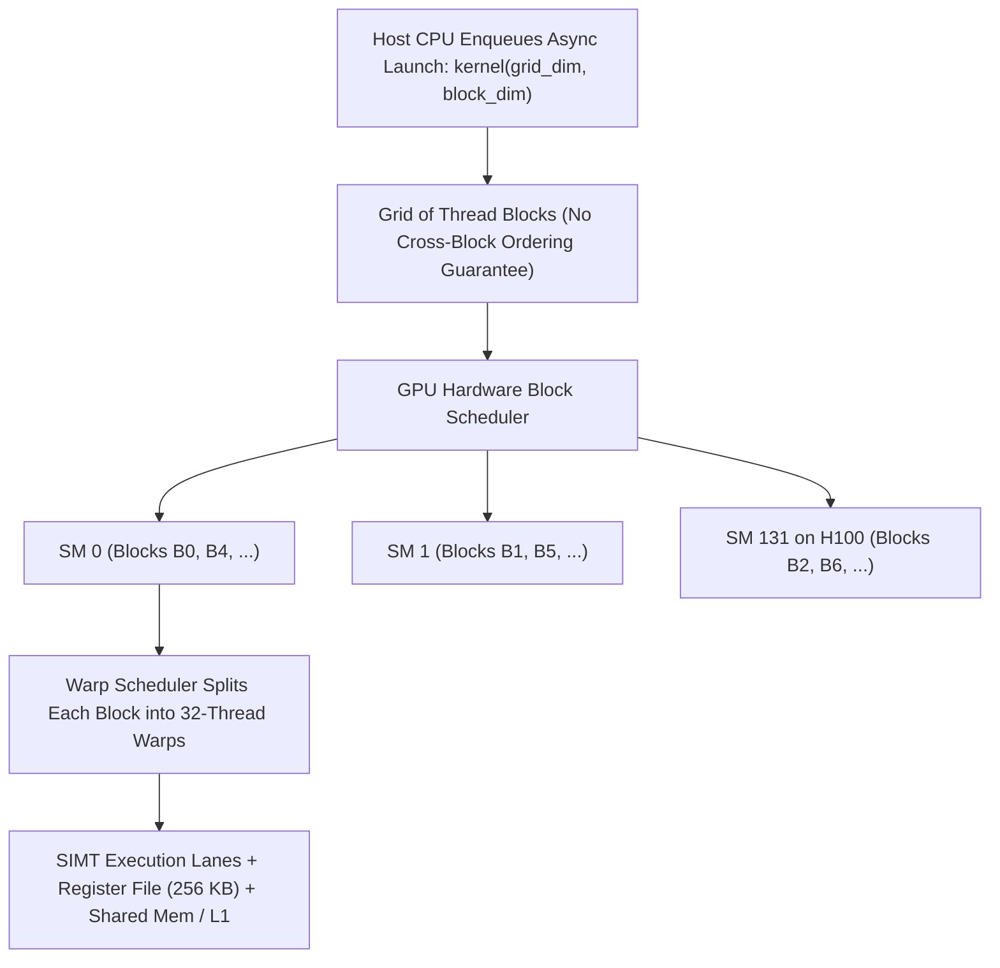
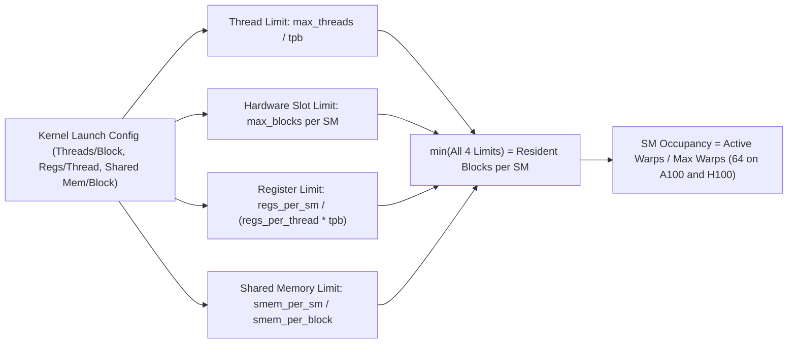
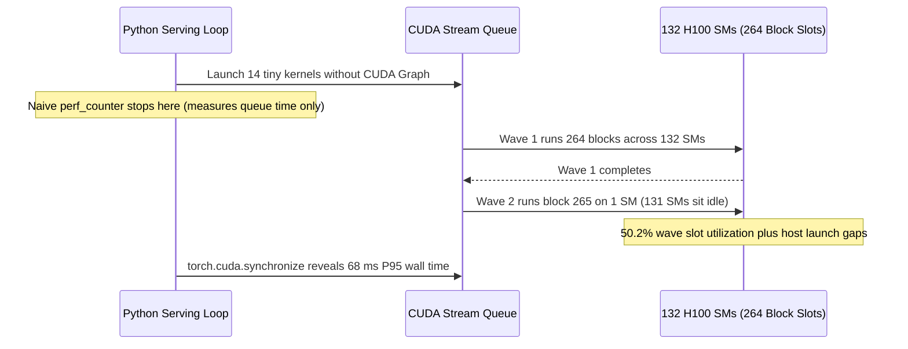

# Module 01: GPU Architecture for Software Engineers

> **Prerequisites:** [Module 00: Why GPUs, Not CPUs](../00-why-gpus-not-cpus/README.md) (latency versus throughput, data-parallel work). No prior CUDA knowledge is assumed.  
> **Estimated Reading Time:** 35 minutes  
> **Target Audience:** AI Systems Engineers, CUDA/Triton Kernel Developers, ML Infrastructure Engineers

> [!TIP]
> **The Golden Rule of GPU Execution:** Launch grids with **several times more thread blocks than SMs** (multiple full waves) to prevent tail-effect stalls, size blocks as **multiples of 32** (commonly 128 or 256) so warps carry zero idle lanes, avoid **intra-warp branch divergence**, and **always synchronize the host** (`torch.cuda.synchronize()`) before measuring GPU timing or relying on kernel completion.

---

## Roadmap & Why This Matters

[Module 00](../00-why-gpus-not-cpus/README.md) argued that a GPU wins by running a huge number of independent operations at once. This module opens the box far enough to see *how*, using the vocabulary a software engineer meets in CUDA docs, profiler output, and library source: streaming multiprocessors (SMs), threads, warps, blocks, grids, occupancy, and kernel launches.

**After this module** you can:
- map a kernel launch (`grid` and `block` sizes) onto the hardware and compute which thread owns which element;
- explain SIMT execution and predict what warp divergence costs, with a number;
- work out an SM's occupancy from a kernel's resource use and name the limiting resource;
- explain why too few blocks, odd-sized blocks, or many tiny kernels waste a GPU.

The same few ideas explain why matmul libraries tile their work, why FlashAttention ([Module 08](../08-flashattention-and-memory-efficient-kernels/README.md)) fuses operations into one kernel, and why a model that "should" be fast sometimes is not. Deliberately left out: the memory hierarchy ([Module 03](../03-memory-hierarchy-and-bandwidth/README.md)) and tensor cores ([Module 02](../02-cuda-cores-vs-tensor-cores/README.md)).

---

## 1. Visual Mental Models: Grid, Block, Warp, SM & Occupancy

> [!IMPORTANT]
> **Core Concept:** A GPU is a farm of independent streaming multiprocessors (SMs). You launch a grid of thread blocks; each block lives on one SM, its threads run in groups of 32 called warps that execute one instruction in lockstep, and the SM hides slow operations by switching among many resident warps.



### Software Model: Kernel, Thread, Block, Grid

A **kernel** is a function that runs on the GPU; **launching** it starts many threads executing that function at once:
- A **thread block** is a group of up to 1,024 threads. All threads of a block run on **one SM**, so they can synchronize and share fast on-chip memory.
- A **grid** is all the blocks of one launch. A grid can hold millions of blocks while the GPU has tens or hundreds of SMs; the hardware hands blocks to SMs as room appears. **There is no guarantee about block order, and a block cannot rely on another block's results.** That rule lets one program run unchanged on a small GPU or a huge one.

Each thread computes its index from built-in variables. The standard 1-D idiom in CUDA C++, from the CUDA guide, is `int workIndex = threadIdx.x + blockDim.x * blockIdx.x;` followed by a bounds check `if (workIndex < vectorLength)`, launched as `vecAdd<<<blocks, threads>>>(...)` with `blocks = (vectorLength + threads - 1) / threads` (a ceiling division). Experiment 2 simulates exactly this.

> [!NOTE]
> **Mental Model — The Parallel Loop:** Think of a launch as a very large `for` loop whose iterations are independent. The grid is the loop, each thread is one iteration, and a block is a chunk of iterations that must stay together because they share an SM. You write the loop *body*; the hardware decides which SM runs which chunk, and in what order.
>
> *(The CUDA Programming Guide, v13.4.2, also describes a tile programming model in which you write per-block code on tiles of data and the compiler maps it to threads, so warp divergence does not arise there. The per-thread SIMT model in this module is still the foundation the hardware is built on, and what most kernel code and documentation use.)*

### Four-Resource Occupancy Limiter Funnel



### Original Hardware Mapping, Divergence & Tail-Effect Diagrams

From the code you write to the silicon that runs it:

```text
┌─────────────────────────────────────────────────────────────────────────────────────┐
│ GRID  = one kernel launch                         runs on: the whole GPU            │
│   blocks run in ANY order; no block may depend on another                           │
│                                                                                     │
│   BLOCK 0        BLOCK 1        BLOCK 2   ...     each block is placed on ONE SM    │
│   ┌─────────┐    ┌─────────┐    ┌─────────┐       and stays there until it finishes │
│   │ warp 0  │    │ warp 0  │    │ warp 0  │       (up to 1024 threads per block)    │
│   │ warp 1  │    │ warp 1  │    │ warp 1  │                                         │
│   │ warp 2  │    │ warp 2  │    │ warp 2  │       WARP = 32 consecutive threads;    │
│   │  ...    │    │  ...    │    │  ...    │       one instruction is issued for     │
│   └─────────┘    └─────────┘    └─────────┘       all 32 lanes at once              │
│                                                                                     │
│          │ the hardware scheduler hands out blocks as SMs have room                 │
│          ▼                                                                          │
│   ┌──────┐ ┌──────┐ ┌──────┐ ┌──────┐ ┌──────┐                                      │
│   │ SM 0 │ │ SM 1 │ │ SM 2 │ │ SM 3 │ │ ...  │   132 SMs on an H100 SXM5            │
│   │ B0 B5│ │ B1 B6│ │ B2 B7│ │ B3 B8│ │      │   (Hopper whitepaper v1.04)          │
│   └──────┘ └──────┘ └──────┘ └──────┘ └──────┘                                      │
│   each SM: register file, shared memory/L1, warp schedulers, math units             │
└─────────────────────────────────────────────────────────────────────────────────────┘
```

What divergence costs:

```text
┌─────────────────────────────────────────────────────────────────────────────────────┐
│ if (x % 2 == 0) { path A } else { path B }        lanes:  0 1 2 3 4 5 6 7 ... 31    │
│                                                                                     │
│ cycles  0-9   issue path A     active lanes:  ■ □ ■ □ ■ □ ■ □ ... □                 │
│ cycles 10-19  issue path B     active lanes:  □ ■ □ ■ □ ■ □ ■ ... ■                 │
│                                                                                     │
│ ■ = lane doing useful work     □ = lane masked off (idle, still occupying its slot) │
│                                                                                     │
│ this warp: 20 cycles, 50% of lane-cycles useful.                                    │
│ If all 32 lanes had agreed on one path: 10 cycles, 100% useful.                     │
└─────────────────────────────────────────────────────────────────────────────────────┘
```

The tail effect (the NVIDIA guide's example: 8 SMs, 12 blocks, one block per SM at a time):

```text
time ─────────────────────────────────────────────►
SM0  │████ block 0  ████│████ block 8  ████│
SM1  │████ block 1  ████│████ block 9  ████│
SM2  │████ block 2  ████│████ block 10 ████│
SM3  │████ block 3  ████│████ block 11 ████│
SM4  │████ block 4  ████│░░░░░ idle ░░░░░░░│
SM5  │████ block 5  ████│░░░░░ idle ░░░░░░░│
SM6  │████ block 6  ████│░░░░░ idle ░░░░░░░│
SM7  │████ block 7  ████│░░░░░ idle ░░░░░░░│
                   wave 1             wave 2
                (8 of 8 SMs busy)  (4 of 8 SMs busy)
```

---

## 2. Systematic Hardware Reference & Execution Matrices

### Per-SM Hardware Facts (Vendor Documents, Checked Oct 2026)

A GPU is a collection of **streaming multiprocessors (SMs)**, grouped into graphics processing clusters, all connected to the GPU's memory. Each SM has a local register file, a unified data cache, and functional units that perform computation.

| Per-SM Specification | A100 (Ampere, CC 8.0) | H100 SXM5 (Hopper, CC 9.0) | Source Reference |
| :--- | :--- | :--- | :--- |
| **SMs on the GPU** | 108 | 132 | Hopper whitepaper (v1.04), Table 3 |
| **FP32 "CUDA cores" per SM** | 64 | 128 | Hopper whitepaper (v1.04), Table 3 |
| **Register file per SM** | 256 KB (65,536 32-bit regs) | 256 KB (65,536 32-bit regs) | Hopper whitepaper (v1.04), Table 3 |
| **Shared memory per SM (configurable max)** | 164 KB | 228 KB | Hopper whitepaper (v1.04), Table 3 |
| **Max resident threads / warps / blocks per SM** | 2048 / 64 / 32 | 2048 / 64 / 32 | CUDA Programming Guide (v13.4.2), CC 8.0 & 9.0 |

Other GPUs differ (for example, compute capability 8.6 allows 1,536 resident threads and 16 resident blocks per SM), so treat the table as orders of magnitude and inspect your target device programmatically.

### Execution Granularity Comparison Matrix

| Level | Scope | Hardware Mapping | Size Cap | Synchronization & Shared State |
| :--- | :--- | :--- | :--- | :--- |
| **Grid** | Entire kernel launch | Whole GPU across all SMs | Millions of blocks | No cross-block sync inside standard kernel; shares global HBM |
| **Thread Block** | Programmer-chosen tile/chunk | Pinned to **1 SM** until completion | Up to 1,024 threads | `__syncthreads()`; shares per-SM Shared Memory / L1 |
| **Warp** | Hardware scheduling unit | 32 consecutive threads on SM | Fixed at **32 lanes** | Executes one SIMT instruction; warp-level primitives / mask |
| **Thread** | Single loop iteration (`workIndex`) | 1 SIMT lane | 1 thread | Private registers; computes one or more elements |

### Occupancy Limit Formulas (Per SM)

**Occupancy** is active warps divided by the maximum an SM supports. How many blocks fit on an SM is the smallest of four hardware ceilings:

| Resource Limit | Formula (Per SM) | Controlled By |
| :--- | :--- | :--- |
| **Threads** | `max_threads // threads_per_block` | Launch `blockDim` |
| **Block slots** | Hardware cap on resident blocks (e.g., 32 on A100/H100) | Hardware architecture |
| **Registers** | `registers // (registers_per_thread * threads_per_block)` | Compiler (`--maxrregcount` / kernel complexity) |
| **Shared memory** | `shared_memory // shared_memory_per_block` | Kernel shared memory allocation |

### Warps, SIMT Divergence, Waves & Host Launches

- **Block sizes should be multiples of 32.** A 100-thread block still occupies 4 warps and leaves 28 lanes of the last warp idle for the whole kernel (Experiment 2 prints this).
- **Warp divergence:** If some lanes take the `if` path and others the `else` path, the warp runs one path with the other lanes **masked off**, then runs the other. Even 1 lane disagreeing out of 32 pays the sum of both paths (same cost as a 16/16 split). If each lane independently hits a rare branch with probability $p$, a warp issues that branch with probability $1 - (1 - p)^{32}$ (~47% of warps at $p = 2\%$). Group neighboring threads by branch, make conditions warp/block-uniform, or use predication to eliminate divergence.
- **Waves & tail effect:** Blocks run in waves across SM slots. If you launch 12 blocks on an 8-SM GPU at 1 block/SM, wave 1 runs 8 blocks and wave 2 runs 4 blocks with 4 SMs idle. NVIDIA's rule of thumb is to launch **at least ~4x as many blocks as SMs** with a few hundred threads each.
- **Asynchronous kernel launches:** From Python/host CPU, kernel launches return immediately after queuing onto a CUDA stream. Consequently: (1) timing requires `torch.cuda.synchronize()` before reading the clock; (2) asynchronous kernel errors surface on later calls unless debugging with `CUDA_LAUNCH_BLOCKING=1`; (3) every launch pays host dispatch overhead, which CUDA Graphs and kernel fusion amortize.

> [!WARNING]
> **Critical Hardware Caveats:**
> 1. **"32 lanes in lockstep" is a performance model, not a correctness guarantee.** NVIDIA's guide notes newer GPUs have independent thread scheduling and discourages assuming implicit warp lockstep without explicit synchronization.
> 2. **Occupancy is a means, not a score.** Higher occupancy helps hide memory latency, but a 100%-occupancy kernel can still be memory-bandwidth bound (Module 03), and a tuned kernel at lower occupancy using more registers per thread can run faster. Always measure with a profiler.

---

## 3. Production War Story Post-Mortem: Tail-Effect & Launch-Overhead Latency Spike

| Field | Incident Details |
| :--- | :--- |
| **Severity** | **SEV-2** (P95 Inference Latency Tripled on H100 Serving Fleet) |
| **Detection / Resolution Time** | Detected in 18 minutes by GPU SM utilization & P95 alerts / Resolved in 45 minutes |
| **Impact** | Custom post-processing & top-k filtering dropped H100 utilization below 19%, raising P95 latency from 22 ms to 68 ms (`\$6,800` excess GPU compute burn) |

### What Happened

An inference team replaced a monolithic PyTorch logits post-processor with 14 separate custom CUDA/Triton micro-kernels executed inside a Python loop per active request, alongside a custom reduction kernel configured at 96 registers/thread (`2 blocks/SM` on 132-SM H100s = 264 slots) and launched with `grid = 265` blocks. Local developer benchmarks using `time.perf_counter()` without `torch.cuda.synchronize()` reported "0.08 ms" per step, masking the regression until production load arrived. In production, launching 14 tiny kernels synchronously from Python incurred ~8 microseconds of host launch overhead per kernel while 265 blocks triggered a brutal **2-wave tail cliff** (wave 1 used 264 slots at 100%, wave 2 ran just 1 block leaving 99.6% of slots idle, yielding **50.2% total slot utilization**).



### Root Cause Analysis

1. **Un-synchronized micro-benchmarking hid kernel execution latency:** Timing only captured host enqueue latency (`~0.08 ms`) rather than GPU execution + wave stalls.
2. **Wave-boundary cliff & register-limited occupancy:** Using 96 registers/thread capped occupancy at 25% (2 blocks/SM = 264 slots). Launching 265 blocks barely spilled into a nearly empty second wave.
3. **Host launch overhead on un-fused small kernels:** 14 separate Python-dispatched kernels starved the SM pipeline between short passes.

### The Fix & Architectural Hardening

- **Kernel Fusion & CUDA Graphs:** Fused the 14 post-processing ops via `torch.compile` and captured steady-state decode steps in a CUDA Graph to remove host dispatch overhead.
- **Occupancy & Grid Sizing Discipline:** Lowered register pressure below 64 registers/thread (doubling resident blocks/SM to 4 = 528 slots) and adjusted tiling to launch `>= 2,000` smaller blocks (`>15x` SM count), eliminating the single-wave cliff.
- **Synchronized CI Timing Gate:** Mandated `torch.cuda.Event(enable_timing=True)` + `torch.cuda.synchronize()` in all performance regression tests.

---

## 4. Multi-Language Production Implementation: Occupancy, Warp & Wave Planners

These four production utilities model CUDA kernel launch geometry (`blocks`, surplus threads, warp idle lanes), SM resource occupancy limits, warp divergence probability, and host/device asynchronous synchronization.

````carousel
```go
package main

import (
	"fmt"
	"math"
)

type SMDeviceLimits struct {
	Name        string
	NumSMs      int
	MaxThreads  int
	MaxBlocks   int
	Registers   int
	SharedMemKB int
}

type OccupancyReport struct {
	BlocksPerSM      int
	OccupancyPct     float64
	LimitingResource string
	Waves            int
	WaveUtilization  float64
}

func AnalyzeLaunch(dev SMDeviceLimits, tpb, regsPerThread, smemKB, totalBlocks int) OccupancyReport {
	caps := []struct {
		name string
		val  int
	}{
		{"threads", dev.MaxThreads / tpb},
		{"block slots", dev.MaxBlocks},
		{"registers", dev.Registers / (regsPerThread * tpb)},
	}
	if smemKB > 0 {
		caps = append(caps, struct {
			name string
			val  int
		}{"shared memory", dev.SharedMemKB / smemKB})
	}

	best := caps[0]
	for _, c := range caps[1:] {
		if c.val < best.val {
			best = c
		}
	}

	warpsPerBlock := int(math.Ceil(float64(tpb) / 32.0))
	activeWarps := best.val * warpsPerBlock
	maxWarps := dev.MaxThreads / 32
	slots := dev.NumSMs * best.val
	waves := int(math.Ceil(float64(totalBlocks) / float64(slots)))
	waveUtil := float64(totalBlocks) / float64(waves*slots) * 100.0

	return OccupancyReport{
		BlocksPerSM:      best.val,
		OccupancyPct:     float64(activeWarps) / float64(maxWarps) * 100.0,
		LimitingResource: best.name,
		Waves:            waves,
		WaveUtilization:  waveUtil,
	}
}

func main() {
	h100 := SMDeviceLimits{Name: "H100 SXM5", NumSMs: 132, MaxThreads: 2048, MaxBlocks: 32, Registers: 65536, SharedMemKB: 228}
	for _, blocks := range []int{264, 265, 1000, 4800} {
		rep := AnalyzeLaunch(h100, 256, 96, 0, blocks)
		fmt.Printf("Blocks=%4d | %d blk/SM (occ=%.1f%%, limit=%s) | %2d waves | slot util=%.1f%%\n",
			blocks, rep.BlocksPerSM, rep.OccupancyPct, rep.LimitingResource, rep.Waves, rep.WaveUtilization)
	}
}
```
<!-- slide -->
```typescript
export interface KernelGridPlan {
  elements: number;
  threadsPerBlock: number;
  gridBlocks: number;
  surplusThreads: number;
  warpsPerBlock: number;
  idleLanesInLastWarp: number;
  warpDivergenceProbAt2Pct: number;
}

export function planKernelLaunch(elements: number, threadsPerBlock: number): KernelGridPlan {
  if (threadsPerBlock <= 0 || threadsPerBlock > 1024) {
    throw new Error(`Invalid threadsPerBlock=${threadsPerBlock}; CUDA limit is 1..1024`);
  }

  const gridBlocks = Math.ceil(elements / threadsPerBlock);
  const surplusThreads = gridBlocks * threadsPerBlock - elements;
  const warpsPerBlock = Math.ceil(threadsPerBlock / 32);
  const idleLanesInLastWarp = warpsPerBlock * 32 - threadsPerBlock;

  // Probability at least 1 of 32 lanes hits an independent 2% branch: 1 - (1 - p)^32
  const warpDivergenceProbAt2Pct = Number(((1 - Math.pow(1 - 0.02, 32)) * 100).toFixed(1));

  return {
    elements,
    threadsPerBlock,
    gridBlocks,
    surplusThreads,
    warpsPerBlock,
    idleLanesInLastWarp,
    warpDivergenceProbAt2Pct,
  };
}

console.table([
  planKernelLaunch(1000, 100),
  planKernelLaunch(1000, 128),
  planKernelLaunch(1000, 256),
]);
```
<!-- slide -->
```python
"""
cuda_sync_profiler.py
Demonstrates proper asynchronous GPU kernel timing using torch.cuda.synchronize()
and CUDA Events, plus SM hardware introspection when a CUDA GPU is attached.
"""
import time


def profile_gpu_matmul(size: int = 4096) -> None:
    try:
        import torch
    except ImportError:
        print("PyTorch not installed; install torch to run CUDA device profiling.")
        return

    if not torch.cuda.is_available():
        print("No CUDA GPU detected; skipping asynchronous CUDA Event measurement.")
        return

    props = torch.cuda.get_device_properties(0)
    print(f"Device: {props.name} | SMs: {props.multi_processor_count} | CC: {props.major}.{props.minor}")

    x = torch.randn(size, size, device="cuda", dtype=torch.float16)
    _ = x @ x  # Warmup allocation/cuBLAS handle initialization
    torch.cuda.synchronize()

    # Wrong way: measures enqueue time only
    t0 = time.perf_counter()
    _ = x @ x
    t_async_only_ms = (time.perf_counter() - t0) * 1e3

    # Correct way: synchronize or measure with CUDA Events
    start_evt = torch.cuda.Event(enable_timing=True)
    end_evt = torch.cuda.Event(enable_timing=True)
    start_evt.record()
    _ = x @ x
    end_evt.record()
    torch.cuda.synchronize()
    t_gpu_ms = start_evt.elapsed_time(end_evt)

    print(f"Naive async launch return: {t_async_only_ms:.3f} ms (WRONG: queue time only)")
    print(f"Actual synchronized GPU time: {t_gpu_ms:.3f} ms")


if __name__ == "__main__":
    profile_gpu_matmul()
```
<!-- slide -->
```csharp
using System;
using System.Collections.Generic;

public sealed record SmLimits(string Name, int Sms, int MaxThreads, int MaxBlocks, int Registers, int SharedMemBytes);

public static class OccupancyAdvisor
{
    public static (int BlocksPerSm, double Occupancy, string Limiter) Compute(
        SmLimits dev, int threadsPerBlock, int regsPerThread, int sharedMemPerBlock)
    {
        var limits = new Dictionary<string, int>
        {
            ["threads"] = dev.MaxThreads / threadsPerBlock,
            ["block slots"] = dev.MaxBlocks,
            ["registers"] = dev.Registers / (regsPerThread * threadsPerBlock),
            ["shared memory"] = sharedMemPerBlock > 0 ? dev.SharedMemBytes / sharedMemPerBlock : int.MaxValue
        };

        string limiter = "threads";
        int blocksPerSm = int.MaxValue;
        foreach (var kv in limits)
        {
            if (kv.Value < blocksPerSm)
            {
                blocksPerSm = kv.Value;
                limiter = kv.Key;
            }
        }

        int warps = blocksPerSm * ((threadsPerBlock + 31) / 32);
        double occupancy = (double)warps / (dev.MaxThreads / 32);
        return (blocksPerSm, occupancy, limiter);
    }

    public static void Main()
    {
        var guideDevice = new SmLimits("CUDA Guide CC 9.0", 132, 2048, 32, 65536, 233472);
        foreach (var (tpb, regs, smem) in new[] { (768, 32, 0), (32, 32, 0), (256, 32, 100 * 1024), (256, 96, 0) })
        {
            var (b, occ, why) = Compute(guideDevice, tpb, regs, smem);
            Console.WriteLine($"tpb={tpb,3}, regs={regs,2}, smem={smem / 1024,3}KB -> {b,2} blk/SM, occ={occ,6:P1}, limit={why}");
        }
    }
}
```
````

---

## 5. Practical Hands-On Verification Workflows & Experiments

Everything below is pure Python and NumPy (Python 3.13, NumPy 2.4.6). These are **simulations** of the execution model, not GPU measurements: cycle counts are made-up units that make the effect visible, and the hardware limits are the documented ones named in the comments.

### Experiment 1: Warp Divergence & Grouping Simulation

A warp runs both sides of a branch. The simulator checks its masked-lockstep result against what 32 independent scalar threads compute, then scales up to 4,096 warps with a rare expensive branch.

```python
import numpy as np

WARP = 32

def run_warp(x, pred, then_fn, else_fn, then_cost=10, else_cost=10):
    """One warp in lockstep: if ANY lane wants a path, the whole warp spends that path's cycles."""
    mask = pred(x)
    out = np.empty_like(x)
    cycles = busy = 0
    for take, fn, cost in ((mask, then_fn, then_cost), (~mask, else_fn, else_cost)):
        if take.any():
            out[take] = fn(x[take])          # only the lanes in `take` are active; the rest are masked off
            cycles += cost
            busy += cost * int(take.sum())
    return out, cycles, busy / (cycles * len(x))

pred, then_fn, else_fn = (lambda v: v % 2 == 0), (lambda v: v * 3), (lambda v: v + 100)
lanes = np.arange(WARP)
cases = {"all lanes agree (all even)":   lanes * 2,
         "even/odd split (16 vs 16)":    lanes,
         "one lane disagrees (31 vs 1)": np.where(lanes == 5, 1, lanes * 2)}
print(f"{'case':<30}{'cycles':>7}{'lane utilization':>19}")
for name, x in cases.items():
    out, cycles, util = run_warp(x, pred, then_fn, else_fn)
    assert np.array_equal(out, np.array([then_fn(v) if pred(v) else else_fn(v) for v in x]))  # same answer as 32 scalar threads
    print(f"{name:<30}{cycles:>7}{util:>19.1%}")

# Scale up: 4096 warps; 2% of elements need an expensive path (40 cycles), the rest a cheap one (5).
THEN_COST, ELSE_COST = 40, 5
def kernel_cycles(takes_then):               # element i runs on lane i % 32 of warp i // 32
    w = takes_then.reshape(-1, WARP)
    any_then, any_else = w.any(axis=1), (~w).any(axis=1)
    return int((any_then * THEN_COST + any_else * ELSE_COST).sum()), any_then.mean()

rng = np.random.default_rng(0)
takes_then = rng.random(WARP * 4096) < 0.02
for label, data in (("random order", takes_then), ("grouped by branch", np.sort(takes_then)[::-1].copy())):
    cycles, frac = kernel_cycles(data)
    print(f"{label:<18} warps issuing the expensive path: {frac:5.1%}   total warp-cycles: {cycles:,}")

print("\nP(at least 1 of 32 lanes takes a path that each lane takes with probability p) = 1 - (1 - p)^32")
for p in (0.01, 0.02, 0.10):
    sim = (rng.random((20000, WARP)) < p).any(axis=1).mean()
    print(f"  p={p:.2f}: formula {1 - (1 - p) ** WARP:6.1%}   simulated {sim:6.1%}")
```

**Expected Output** (seeded, reproduces exactly):

```text
case                           cycles   lane utilization
all lanes agree (all even)         10             100.0%
even/odd split (16 vs 16)          20              50.0%
one lane disagrees (31 vs 1)       20              50.0%
random order       warps issuing the expensive path: 47.0%   total warp-cycles: 97,520
grouped by branch  warps issuing the expensive path:  2.0%   total warp-cycles: 23,320

P(at least 1 of 32 lanes takes a path that each lane takes with probability p) = 1 - (1 - p)^32
  p=0.01: formula  27.5%   simulated  27.4%
  p=0.02: formula  47.6%   simulated  48.0%
  p=0.10: formula  96.6%   simulated  96.9%
```

One odd lane out of 32 costs as much as sixteen. The `assert` passes in every case: masking changes the *time*, never the *answer*. Only 2% of elements want the expensive path, yet 47% of warps must issue it; grouping the same data cuts the total to about a quarter. The formula matches simulation to within sampling noise.

---

### Experiment 2: Simulate `kernel<<<grid, block>>>`, Index Arithmetic & Too-Small Grids

Simulate `kernel<<<grid, block>>>`: the index arithmetic, the bounds check, block-order independence, and a too-small grid.

```python
import numpy as np

def launch(kernel, grid_dim, block_dim, *args, block_order=None):
    """Simulate kernel<<<grid_dim, block_dim>>>(*args). Real GPUs give no block-order guarantee."""
    for block_idx in (range(grid_dim) if block_order is None else block_order):
        for thread_idx in range(block_dim):
            kernel(thread_idx, block_idx, block_dim, *args)

def vec_add(threadIdx, blockIdx, blockDim, A, B, C, n, touched):
    i = threadIdx + blockDim * blockIdx        # the CUDA guide's `workIndex`
    if i < n:                                  # bounds check: surplus threads do nothing
        C[i] = A[i] + B[i]
        touched[i] += 1

n, threads = 1000, 256
rng = np.random.default_rng(0)
A, B = rng.standard_normal(n), rng.standard_normal(n)
blocks = (n + threads - 1) // threads          # ceiling division, as in the CUDA guide
print(f"{n} elements, {threads} threads/block -> {blocks} blocks, {blocks * threads - n} surplus threads")

def run(grid, order=None):
    C, touched = np.zeros(n), np.zeros(n, dtype=int)
    launch(vec_add, grid, threads, A, B, C, n, touched, block_order=order)
    return C, touched

C, touched = run(blocks)
print("in-order blocks :", "correct" if np.array_equal(C, A + B) else "WRONG", "| every element touched once:", bool((touched == 1).all()))
order = rng.permutation(blocks).tolist()
C, _ = run(blocks, order)
print(f"blocks as {order}:", "correct" if np.array_equal(C, A + B) else "WRONG")
_, touched = run(blocks - 1)                   # classic off-by-one in the grid size
print(f"grid of {blocks - 1} blocks: {int((touched == 0).sum())} elements never computed, first at index {int(np.argmax(touched == 0))}")

for tpb in (100, 128):                         # block sizes that are / are not multiples of 32
    warps = -(-tpb // 32)
    print(f"{tpb} threads/block -> {warps} warps, {warps * 32 - tpb} idle lanes in the last warp")
```

**Expected Output** (seeded):

```text
1000 elements, 256 threads/block -> 4 blocks, 24 surplus threads
in-order blocks : correct | every element touched once: True
blocks as [1, 2, 0, 3]: correct
grid of 3 blocks: 232 elements never computed, first at index 768
100 threads/block -> 4 warps, 28 idle lanes in the last warp
128 threads/block -> 4 warps, 0 idle lanes in the last warp
```

A too-small grid fails *silently* on a real GPU too: nothing errors, the tail of the output simply stays untouched.

---

### Experiment 3: Occupancy & Wave Calculator (Reproducing CUDA Guide Worked Examples)

The limits are the device used in the CUDA Programming Guide's own worked example (v13.4.2, checked Oct 2026); the first three lines reproduce that example.

```python
from math import ceil

# Per-SM limits from the CUDA Programming Guide (v13.4.2): the guide's own worked-example device.
GUIDE = dict(max_threads=2048, max_blocks=32, regs=65536, smem=233472)

def occupancy(threads_per_block, regs_per_thread, smem_per_block, lim=GUIDE):
    """Blocks that fit on one SM, the fraction of warp slots they fill, and the limiting resource.
    Simplified: ignores the hardware's register/shared-memory allocation granularity."""
    caps = {"threads":       lim["max_threads"] // threads_per_block,
            "block slots":   lim["max_blocks"],
            "registers":     lim["regs"] // (regs_per_thread * threads_per_block),
            "shared memory": lim["smem"] // smem_per_block if smem_per_block else 10**9}
    limiter = min(caps, key=caps.get)
    blocks = caps[limiter]
    warps = blocks * ceil(threads_per_block / 32)
    return blocks, warps / (lim["max_threads"] // 32), limiter

print("Checks against the CUDA guide's worked examples:")
for tpb, regs, smem, expect in [(768, 32, 0, "2 blocks, 75%"), (32, 32, 0, "32 blocks, 50%"), (256, 32, 100 * 1024, "2 blocks")]:
    b, occ, why = occupancy(tpb, regs, smem)
    print(f"  {tpb:>3} threads/block, {smem // 1024:>3} KB smem -> blocks/SM = {b:>2}, occupancy {occ:4.0%}, limited by {why:<13} (guide: {expect})")

print("\n256 threads/block, rising register use:")
for regs in (32, 64, 96, 128, 255):
    b, occ, why = occupancy(256, regs, 0)
    print(f"  {regs:>3} regs/thread -> blocks/SM = {b}, occupancy {occ:5.1%}, limited by {why}")

def waves(num_blocks, num_sms, blocks_per_sm):
    slots = num_sms * blocks_per_sm
    w = ceil(num_blocks / slots)
    return w, num_blocks / (w * slots)

print("\nWaves (guide's 8-SM example, then 132 SMs at an assumed 2 blocks/SM):")
w, u = waves(12, 8, 1)
print(f"  {12:>7} blocks on   8 SMs: {w:>3} wave(s), {u:5.1%} of slots used")
for nb in (264, 265, 1000, 100_000):
    w, u = waves(nb, 132, 2)
    print(f"  {nb:>7} blocks on 132 SMs: {w:>3} wave(s), {u:5.1%} of slots used")
```

**Expected Output** (deterministic):

```text
Checks against the CUDA guide's worked examples:
  768 threads/block,   0 KB smem -> blocks/SM =  2, occupancy  75%, limited by threads       (guide: 2 blocks, 75%)
   32 threads/block,   0 KB smem -> blocks/SM = 32, occupancy  50%, limited by block slots   (guide: 32 blocks, 50%)
  256 threads/block, 100 KB smem -> blocks/SM =  2, occupancy  25%, limited by shared memory (guide: 2 blocks)

256 threads/block, rising register use:
   32 regs/thread -> blocks/SM = 8, occupancy 100.0%, limited by threads
   64 regs/thread -> blocks/SM = 4, occupancy 50.0%, limited by registers
   96 regs/thread -> blocks/SM = 2, occupancy 25.0%, limited by registers
  128 regs/thread -> blocks/SM = 2, occupancy 25.0%, limited by registers
  255 regs/thread -> blocks/SM = 1, occupancy 12.5%, limited by registers

Waves (guide's 8-SM example, then 132 SMs at an assumed 2 blocks/SM):
       12 blocks on   8 SMs:   2 wave(s), 75.0% of slots used
      264 blocks on 132 SMs:   1 wave(s), 100.0% of slots used
      265 blocks on 132 SMs:   2 wave(s), 50.2% of slots used
     1000 blocks on 132 SMs:   4 wave(s), 94.7% of slots used
   100000 blocks on 132 SMs: 379 wave(s), 99.9% of slots used
```

At 32 registers per thread the register and thread limits tie at 8 blocks; the code reports the first one it finds. The "2 blocks per SM" in the wave rows is an assumption for illustration; the real figure depends on the kernel.

The real thing in PyTorch follows. **Not executed in this module's verification (needs an NVIDIA GPU and a CUDA build of PyTorch).** No output is shown because none was produced.

```python
import time
import torch

x = torch.randn(4096, 4096, device="cuda")
torch.cuda.synchronize()                 # make sure setup is finished before timing

t0 = time.perf_counter()
y = x @ x                                # returns almost immediately: the kernel is only queued
t_launch = time.perf_counter() - t0

torch.cuda.synchronize()                 # wait for the kernel to actually finish
t_total = time.perf_counter() - t0
print(f"launch returned after {t_launch*1e3:.2f} ms; finished after {t_total*1e3:.2f} ms")
```

---

### CLI Verification Workflows: Device SM Inspection & Async Debugging

#### CLI Check 1: Inspect GPU SM Count & Compute Capability

```bash
python -c "import torch; p=torch.cuda.get_device_properties(0); print(p.name, '| SMs:', p.multi_processor_count, '| CC:', f'{p.major}.{p.minor}', '| Max threads/SM:', p.max_threads_per_multi_processor)"
```

**Expected Output** (on an H100 host; requires CUDA PyTorch):

```text
NVIDIA H100 80GB HBM3 | SMs: 132 | CC: 9.0 | Max threads/SM: 2048
```

#### CLI Check 2: Force Synchronous Error Localization with `CUDA_LAUNCH_BLOCKING=1`

When a CUDA illegal-memory-access error surfaces lines after the broken kernel, force synchronous kernel execution to pinpoint the offending line:

```bash
CUDA_LAUNCH_BLOCKING=1 python your_kernel_script.py
```

**Expected Output** (behavior when an out-of-bounds index triggers):

```text
RuntimeError: CUDA error: device-side assert triggered
Compile with `TORCH_USE_CUDA_DSA` to enable device-side assertions.
(Traceback points directly to the exact kernel line instead of a downstream synchronize call.)
```

---

### Practice Exercises

#### 1. Find the limiting resource

A kernel runs with 192 threads per block, 40 registers per thread, and 16 KB of shared memory per block. With `occupancy()` from Experiment 3, how many blocks fit per SM, what is the occupancy, and which resource limits it? What happens if the compiler gets the kernel down to 32 registers per thread?

<details><summary>Answer</summary>

`occupancy(192, 40, 16 * 1024)` returns `(8, 0.75, 'registers')`. The limits are: threads `2048 // 192 = 10`, block slots `32`, registers `65536 // (40 * 192) = 8`, shared memory `233472 // 16384 = 14`. The smallest is 8 (registers), so `8 * 6 = 48` of 64 warp slots fill: **75%**. At 32 registers the register limit becomes 10, tying with the thread limit: `occupancy(192, 32, 16 * 1024)` returns `(10, 0.9375, 'threads')`, about 94%.

</details>

#### 2. Make the branch warp-uniform

In Experiment 1, replace `takes_then` with a condition that is true for every element of every 50th *warp*, i.e. `(np.arange(32 * 4096) // 32) % 50 == 0` (again about 2% of elements). What does `kernel_cycles` return, and how does it compare to the ideal?

<details><summary>Answer</summary>

Because the decision depends on the warp index and never on the lane, no warp diverges. `kernel_cycles` returns `23,350` warp-cycles, exactly equal to the ideal count for that data (`sum(then) / 32 * 40 + sum(else) / 32 * 5 = 23,350`), versus `97,520` for the random layout at the same 2%. A branch that is uniform across each warp is free.

</details>

#### 3. How many blocks are enough?

For a 132-SM GPU at 2 blocks per SM (264 slots), above what block count does overall slot utilization never fall below 95%? Use `waves()`.

<details><summary>Answer</summary>

Looping `n` upward and recording the last `n` whose utilization is under 95% gives `4,765`, so from `4,766` blocks upward utilization is always at least 95%. The worst case is always "one block more than a full wave". That is about 18 waves, comfortably above the "several times the SM count" guidance.

</details>

### Independent Project

**Build an occupancy and launch advisor.** Without copying this module's code, write a small tool that takes a kernel description (registers per thread, shared memory per block, number of elements) and a device-limits dictionary, and then:
1. for each block size in `{32, 64, 96, 128, 192, 256, 384, 512, 768, 1024}`, reports blocks per SM, occupancy, and the limiting resource;
2. for the same block sizes, computes how many blocks the launch needs and the wave utilization on a GPU with a given SM count;
3. recommends a block size using a rule you state explicitly (for example highest occupancy, ties broken by fewest idle lanes and best wave utilization), and prints where your rule disagrees with "highest occupancy wins";
4. checks your numbers against the worked occupancy examples in the CUDA Programming Guide.

No solution is provided. Test with at least two different device-limit dictionaries and write down one case where the highest-occupancy block size is not the one you would pick, and why.

---

## 6. Common Mistakes & Troubleshooting

- **Some output elements are zero or stale.** The grid is too small or the bounds check is missing or wrong. Compute `blocks` with a ceiling division and compare against a CPU reference (Experiment 2 shows both failure shapes).
- **Slow kernel, low occupancy in the profiler.** Check registers per thread and shared memory per block against the SM limits, then reduce either or change the block size. Experiment 3's register sweep shows how fast occupancy falls.
- **Performance cliff when the input grows a few percent.** You may have crossed a wave boundary (`264` to `265` blocks in the example). Prefer launches with many waves.
- **Measured GPU time is near zero.** You timed a launch, not its completion; synchronize first (`torch.cuda.synchronize()`).
- **An error is reported on a line that looks fine.** Asynchronous error reporting; rerun with `CUDA_LAUNCH_BLOCKING=1` to localize it.

---

## 7. Operational Validation Checkpoints, Quiz & Interview Prep

### Operational Validation Checkpoints

<details><summary><strong>Checkpoint 1: Choosing block size 100 vs. 128 threads for a 10,000-element vector kernel</strong></summary>

Although 100 threads per block covers 10,000 elements cleanly in 100 blocks, hardware executes in warps of 32. Each 100-thread block occupies 4 warps (128 lanes) and permanently leaves 28 lanes idle across every warp cycle. Choosing 128 threads/block allocates the same 4 warps per block with zero idle warp lanes and requires only 79 blocks instead of 100.

</details>

<details><summary><strong>Checkpoint 2: Diagnosing why a kernel drops from 100% to 50% occupancy after adding local variables</strong></summary>

Adding local accumulator arrays or unrolled variables raises the compiler's register allocation per thread (for example from 32 to 64 registers/thread at `tpb=256`). Because an H100/A100 SM holds 65,536 32-bit registers total, doubling registers per thread cuts resident blocks per SM from `8` (`2048` threads = 100% occupancy) to `4` (`1024` threads = 50% occupancy). Verify register count in Nsight Compute or constrain registers only after benchmarking actual latency hiding.

</details>

<details><summary><strong>Checkpoint 3: Replacing hundreds of tiny elementwise PyTorch launches with CUDA Graphs</strong></summary>

During token-by-token LLM decode at small batch size, each transformer block launches many brief kernels (RMSNorm, RoPE, residual adds). Because host CPU enqueue overhead (~5–10 microseconds) can rival or exceed a short kernel's GPU execution time, SMs go idle between launches. Capturing the static sequence of launches into a **CUDA Graph** replays the entire chain on the GPU in a single host submission.

</details>

### Checkpoint Quiz

1. What is the difference between a thread block and a warp, and which one is guaranteed to run on a single SM?
2. A warp's lanes split 31 versus 1 across an `if/else`. Why does that cost almost as much as a 16/16 split?
3. If each element has a 1% chance of needing a rare path, about what fraction of warps issue it?
4. Name the four resources that cap how many blocks an SM can hold at once.
5. Why does `y = x @ x` followed immediately by `time.perf_counter()` under-report the time of a GPU matmul?

<details><summary>Answers</summary>

1. A block is a programmer-chosen group of up to 1,024 threads placed on one SM (so its threads can share memory and synchronize). A warp is the hardware's group of 32 consecutive threads that execute one instruction together. The block is guaranteed to stay on one SM.
2. The warp still issues both paths one after the other, with the other lanes masked off; the cost is the sum of both paths however the lanes split.
3. `1 - 0.99^32`, about 27.5% (Experiment 1 simulates 27.4%).
4. Threads per SM, block slots per SM, registers per SM, and shared memory per SM.
5. The launch is asynchronous: it only queues the kernel and returns. Without `torch.cuda.synchronize()` the clock stops before the GPU finishes.

</details>

### Self-Check

- I can compute `workIndex` from `threadIdx`, `blockIdx`, and `blockDim`, and write the ceiling division for the grid size.
- I can explain why one divergent lane costs a whole warp both paths, and name two ways to avoid it.
- I can compute occupancy from threads, registers, and shared memory per block and say which limit bites.
- I can explain waves and why a grid of "just over a full wave" wastes the GPU.
- I can say why GPU timing needs a synchronize and why many tiny kernels are slow.

### Interview Questions

#### Explain warp divergence. When does it cost performance, and how would you restructure code to avoid it?

<details><summary>What a strong answer covers</summary>

- A warp is 32 threads issuing one instruction at a time; divergent branches execute serially with lanes masked off, so the cost is the sum of the paths.
- Divergence is only among lanes of one warp; different warps branching differently is free.
- The rare-branch effect: probability `p` per thread becomes `1 - (1 - p)^32` per warp.
- Fixes: group or sort data so neighbors agree, make conditions warp- or block-uniform, use predication for short paths.
- A caveat: lockstep is a performance model; newer hardware has independent thread scheduling, so correctness needs explicit synchronization.

</details>

#### What is occupancy, what limits it, and is higher always better?

<details><summary>What a strong answer covers</summary>

- Active warps divided by the maximum an SM supports.
- Limits: threads, block slots, registers, shared memory; the minimum wins.
- It helps hide latency by giving the scheduler other warps, but it is a means, not a goal: memory-bound or already-saturated kernels may not speed up, and sometimes trading occupancy for more registers or shared memory per thread makes a kernel faster.
- Good answers mention measuring with a profiler rather than assuming.

</details>

#### You launch a CUDA kernel from Python and time it with `time.time()`. The result looks implausibly fast. What happened, and how do you fix it?

<details><summary>What a strong answer covers</summary>

- Kernel launches are asynchronous; the host returns once work is queued.
- Synchronize before reading the clock (`torch.cuda.synchronize()`) or use CUDA events.
- Related: errors surface at a later call, and `CUDA_LAUNCH_BLOCKING=1` helps when debugging.
- A bonus point: also warm up, since the first call includes one-time setup.

</details>

---

## 8. Further Reading & Sources

- [CUDA Programming Guide, 1.2 Programming Model](https://docs.nvidia.com/cuda/cuda-programming-guide/01-introduction/programming-model.html) - NVIDIA's definition of SMs, thread blocks, grids, warps and SIMT, including the masking behaviour behind divergence and the "no ordering between blocks" rule.
- [CUDA Programming Guide, 2.1 Intro to CUDA C++](https://docs.nvidia.com/cuda/cuda-programming-guide/02-basics/intro-to-cuda-cpp.html) - the `vecAdd` kernel, `<<<grid, block>>>` launch syntax, `workIndex` arithmetic and ceiling-division idiom that Experiment 2 simulates.
- [CUDA Programming Guide, 2.3 Writing SIMT Kernels](https://docs.nvidia.com/cuda/cuda-programming-guide/02-basics/writing-cuda-kernels.html) - defines occupancy and works the examples that Experiment 3 reproduces.
- [CUDA Programming Guide, 5.1 Compute Capabilities](https://docs.nvidia.com/cuda/cuda-programming-guide/05-appendices/compute-capabilities.html) - the per-SM limits (resident threads, warps, blocks, registers, shared memory) used in the occupancy table.
- [NVIDIA Deep Learning Performance: GPU Performance Background](https://docs.nvidia.com/deeplearning/performance/dl-performance-gpu-background/index.html) - the wave and tail-effect explanation and the "several times more blocks than SMs" guidance.
- [CUDA Programming Guide, 4.2 CUDA Graphs](https://docs.nvidia.com/cuda/cuda-programming-guide/04-special-topics/cuda-graphs.html) - states that per-kernel launch overhead can be a significant fraction of short kernels' time and how graphs amortize it.
- [PyTorch notes: CUDA semantics](https://docs.pytorch.org/docs/stable/notes/cuda.html) - documents that GPU operations are asynchronous, why timing needs `torch.cuda.synchronize()`, and `CUDA_LAUNCH_BLOCKING=1`.
- [NVIDIA H100 Tensor Core GPU Architecture whitepaper (Hopper, v1.04)](https://resources.nvidia.com/en-us-hopper-architecture/nvidia-h100-tensor-c) - source of the A100 and H100 SM counts, FP32 cores per SM, register file and shared memory sizes in the table above.

---

## Next

[Module 02: CUDA Cores vs. Tensor Cores](../02-cuda-cores-vs-tensor-cores/README.md)
