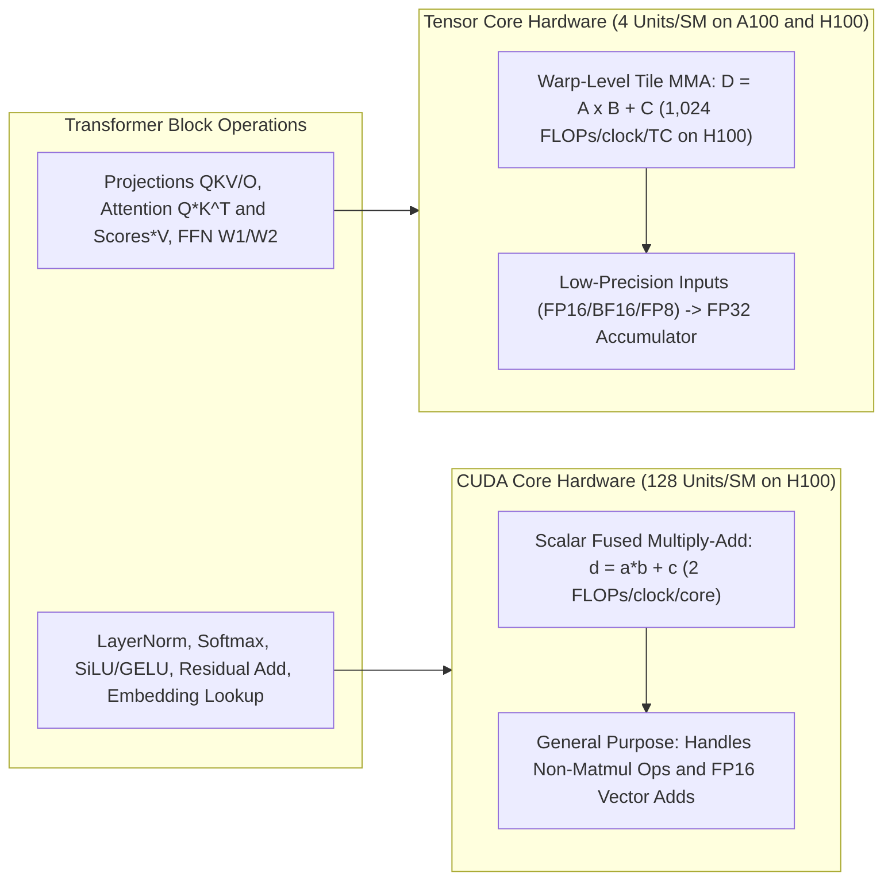
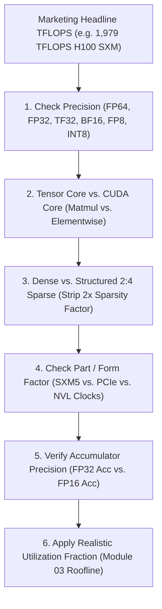
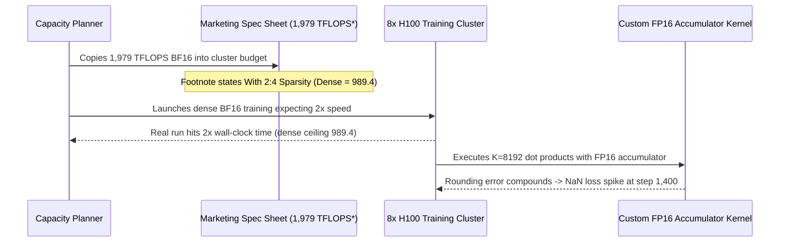

# Module 02: CUDA Cores vs. Tensor Cores

> **Prerequisites:** [Module 00: Why GPUs, Not CPUs](../00-why-gpus-not-cpus/README.md) (FLOP/s, matmul as the core workload) and [Module 01: GPU Architecture for Software Engineers](../01-gpu-architecture-for-software-engineers/README.md) (SMs, warps).  
> **Estimated Reading Time:** 30 minutes  
> **Target Audience:** AI Systems Engineers, ML Performance Engineers, GPU Capacity Planners

> [!TIP]
> **The Golden Rule of Tensor Core Capacity & Precision:** Never plan dense workloads from **sparse** headline TFLOPS (which require 2:4 structured weight pruning and overstate dense compute by **2x**); always pair **low-precision matrix inputs** (FP16, BF16, FP8) with **FP32 accumulation** for long transformer dot products, align matrix dimensions to **multiples of 8/16/64** elements, and explicitly set `torch.set_float32_matmul_precision` when executing FP32 workloads.

---

## Roadmap & Why This Matters

[Module 01](../01-gpu-architecture-for-software-engineers/README.md) showed how an SM schedules warps onto "math units". This module specifies what those units are. A modern NVIDIA GPU contains two distinct kinds of arithmetic hardware, and the gap between them is the largest single factor in how fast a transformer runs.

**After this module** you can:
- say what a CUDA core does per clock and what a tensor core does per instruction;
- explain why tensor cores are what make transformer matmuls fast, and why inputs are low precision while the running sum is higher precision;
- read a datasheet's peak-throughput table correctly: precision, tensor versus CUDA core, **dense versus sparse**, form factor;
- do the arithmetic that connects "cores x clock" to the headline TFLOPS figure.

Headline TFLOPS numbers drive purchasing, capacity planning, and cost estimates (Tracks 05 and 06). Reading them wrong—for example by taking the sparse figure for the dense one—overstates a GPU's real capability by 2x before anything else goes wrong. Numeric formats themselves (FP16, BF16, FP8) get their own module ([Module 06](../06-numeric-formats-fp32-fp16-bf16/README.md)); here we focus on the hardware math units.

---

## 1. Visual Mental Models: Scalar CUDA Cores vs. Tile Tensor Cores

> [!IMPORTANT]
> **Core Concept:** A CUDA core performs one scalar multiply-add per clock (`d = a*b + c`). A tensor core performs an entire small matrix multiply-accumulate (`D = A x B + C` on a tile) in one operation, and transformer layers are built almost entirely from that operation—so tensor cores deliver roughly an order of magnitude more throughput than FP32 CUDA cores on the work that matters.



> [!NOTE]
> **Analogy — Calculator vs. Printing Press:** A CUDA core is a person with a calculator doing one sum at a time. A tensor core is a person with a printing press that stamps out a whole `16 x 16` page of sums at once, provided you hand it pages in the right format and alignment. Matmul is made of pages; softmax and layer norm are single sums, so they stay on the calculators.

### Six-Gate Datasheet Audit Pipeline

Peak datasheet figures are **theoretical ceilings**: unit count x operations per clock x boost clock, assuming perfect data delivery and zero stalls. Filter every marketing figure through six gates before putting it into a capacity spreadsheet:



### Original Diagrams: Hardware Units, Tiled Matmul Loop & Six Questions

One multiply-add versus one tile operation:

```text
CUDA core (one lane)                Tensor core (one tile operation)
┌──────────────────────────────┐    ┌────────────────────────────────────────────────────┐
│ a ──┐                        │    │ A tile 16x16     B tile 16x16     C tile 16x16     │
│     ├─► × ──► + ──► d        │    │ ┌──────────┐       ┌──────────┐       ┌──────────┐ │
│ b ──┘          ▲             │    │ │ ■ ■ ■ ■  │   ×   │ ■ ■ ■ ■  │   +   │ ■ ■ ■ ■  │ │
│ c ─────────────┘             │    │ │ ■ ■ ■ ■  │       │ ■ ■ ■ ■  │       │ ■ ■ ■ ■  │ │
│                              │    │ └──────────┘       └──────────┘       └──────────┘ │
│ d = a*b + c                  │    │                                                    │
│ 1 multiply-add per clock     │    │ D = A × B + C                                      │
│ = 2 FLOPs                    │    │ 16 x 16 x 16 = 4096 multiply-adds,                 │
│                              │    │ issued as one warp-level operation                 │
│ inputs: scalar               │    │                                                    │
└──────────────────────────────┘    │ inputs: FP16 / BF16 / FP8 / INT8 ...               │
                                    │ accumulator: typically FP32                        │
                                    └────────────────────────────────────────────────────┘
```

A matmul as a loop of tile operations (what Experiment 2 runs):

```text
┌─────────────────────────────────────────────────────────────────────────────────────┐
│ for each output tile (i, j):                                                        │
│     acc = 0                                   # accumulator tile stays in registers │
│     for k in range(K // 16):                                                        │
│         acc = MMA(A[i, k], B[k, j], acc)      # one tensor-core operation per step  │
│     C[i, j] = acc                                                                   │
│                                                                                     │
│ 64x64 @ 64x64 with 16x16x16 tiles:  4 x 4 output tiles x 4 k-steps = 64 MMAs        │
│ same product on scalar CUDA cores:  64 x 64 x 64 = 262,144 multiply-adds            │
└─────────────────────────────────────────────────────────────────────────────────────┘
```

The six questions to ask of any peak-TFLOPS number:

```text
┌─────────────────────────┬──────────────────────────────────────────────────┐
│ 1. Which precision?     │ FP64 / FP32 / TF32 / BF16 / FP16 / FP8 / INT8    │
│ 2. Tensor or CUDA core? │ tensor cores only help matmul-shaped work        │
│ 3. Dense or sparse?     │ sparse = 2x dense; needs pruned weights          │
│ 4. Which part?          │ SXM vs PCIe/NVL: different clocks and power      │
│ 5. Which accumulator?   │ FP16 vs FP32 accumulate                          │
│ 6. Peak or achieved?    │ peak = ideal, boost clock, data always ready     │
└─────────────────────────┴──────────────────────────────────────────────────┘
```

---

## 2. Systematic Comparison Matrices & Datasheet Verification

### CUDA Core vs. Tensor Core Architectural Matrix

| Dimension | CUDA Core (FP32 Lane) | Tensor Core (MMA Engine) | Practical Impact |
| :--- | :--- | :--- | :--- |
| **Instruction Granularity** | Scalar FMA: `d = a * b + c` (2 FLOPs/clock) | Matrix Multiply-Accumulate: `D = A x B + C` on tile | Tensor cores amortize instruction fetch/register reads |
| **Peak Formula** | `cores * 2 * clock_hz` | `tensor_cores * flops_per_clock * tc_clock_hz` | Matches A100 (19.5 TFLOPS) and H100 (66.9 TFLOPS) FP32 exactly |
| **H100 SM Output / Clock** | 128 cores x 2 = **256 FLOPs/clock** | 4 TCs x 1,024 = **4,096 dense FP16 FLOPs/clock** | 16x per-clock SM advantage for matrix tiles |
| **Transformer Workloads** | Activations, LayerNorm, Softmax, residual adds, FP16 vector adds | QKV/O projections, `Q @ K.T`, `scores @ V`, FFN GEMMs | NVIDIA Performance Guide: adding two FP16 tensors still uses CUDA cores |
| **Accumulation Pattern** | Same precision (FP32 -> FP32) | Low-precision inputs (FP16/BF16/FP8) -> FP32 sum | Prevents catastrophic rounding drift over long `K` |
| **Shape / Alignment Rule** | Any vector length | Best when dims align to 16 B (8 FP16) or 128 B (64 on A100) | Unaligned odd shapes under-utilize tensor cores |

### Why Low-Precision Inputs + FP32 Accumulation Matter

A tensor core was first introduced in Volta (`4x4x4` matrix MMA = 64 FMAs/clock, driven at the warp level as `16x16x16` tiles via the CUDA WMMA API). Later generations expanded tile sizes and formats, keeping the same contract: one instruction executes thousands of multiply-adds. Multiplying two `64 x 64` matrices takes `262,144` scalar multiply-adds, or just `64` tile operations of `4,096` multiply-adds each.

Working backwards from NVIDIA datasheets gives the dense FP16 rate per tensor core: **512 FLOPs/clock on A100** and **1,024 FLOPs/clock on H100** (matching the Hopper whitepaper's statement that H100 delivers double the A100's matrix math per SM, clock for clock).

Crucially, inputs can be stored and multiplied in low precision (FP16, BF16, FP8) because products accumulate in higher precision (FP32). In Experiment 2 below, summing `4,096` FP16 products in FP16 yields a mean absolute error of ~`0.46` on results around `52`, whereas accumulating those exact same FP16 products in FP32 drops the error to `5.33e-05`—nearly four orders of magnitude cleaner!

### Supported Precisions & Datasheet Peak Throughput Table

The CUDA Programming Guide (v13.4.2, Table 33, checked Oct 2026) lists tensor-core input types by compute capability:
- **Compute Capability 8.0 (A100):** FP64, TF32, BF16, FP16, INT8, INT4.
- **Compute Capability 9.0 (H100):** FP64, TF32, BF16, FP16, FP8 (`E4M3` and `E5M2` variants, halving storage and doubling throughput vs. FP16/BF16), INT8. Newer compute capabilities add FP6 and FP4.

On every generation, **each step to a narrower format roughly doubles the peak** (on H100 SXM5: TF32 is `7.4x` FP32 CUDA-core peak, BF16/FP16 is `14.8x`, and FP8 is `29.6x`):

| Peak throughput (TFLOPS; TOPS for INT8), checked Oct 2026 | A100 SXM dense | A100 sparse | H100 SXM5 dense | H100 SXM5 sparse |
| :--- | :--- | :--- | :--- | :--- |
| **FP64 (CUDA cores)** | 9.7 | n/a | 33.5 | n/a |
| **FP64 tensor core** | 19.5 | n/a | 66.9 | n/a |
| **FP32 (CUDA cores)** | 19.5 | n/a | 66.9 | n/a |
| **FP16 (CUDA cores)** | 78 | n/a | 133.8 | n/a |
| **TF32 tensor core** | 156 | 312 | 494.7 | 989.4 |
| **BF16 tensor core** | 312 | 624 | 989.4 | 1,978.9 |
| **FP16 tensor core** | 312 | 624 | 989.4 | 1,978.9 |
| **FP8 tensor core** | not supported | - | 1,978.9 | 3,957.8 |
| **INT8 tensor core** | 624 | 1,248 | 1,978.9 | 3,957.8 |

*Sources: A100 columns from the [NVIDIA A100 Tensor Core GPU datasheet](https://www.nvidia.com/content/dam/en-zz/Solutions/Data-Center/a100/pdf/nvidia-a100-datasheet-us-nvidia-1758950-r4-web.pdf) (Jun21 edition, SXM4 column; the FP16 CUDA-core row is from the Hopper whitepaper's comparison table); H100 SXM5 columns from the NVIDIA H100 Tensor Core GPU Architecture whitepaper v1.04, Tables 1 and 3. Newer GPUs have newer datasheets; the reading method does not change, but the numbers do.*

> [!WARNING]
> **The Sparse Headline Trap:** Never copy a marketing headline number straight into a capacity plan. NVIDIA's H100 product page (fetched 26 Oct 2026) lists BFLOAT16 Tensor Core at **1,979 teraFLOPS** for the H100 SXM, with an asterisk pointing to the footnote *"With sparsity"*. The Hopper whitepaper's Table 1 shows both numbers for the same chip: **989.4 dense**, **1,978.9 with sparsity**. Fine-grained 2:4 structured sparsity requires pruned weights in a fixed zero pattern and specialized sparse kernels; an ordinary dense training or inference run can **never** exceed **989.4 TFLOPS**, and will sustain a fraction of that due to memory delivery limits (Module 03).

---

## 3. Production War Story Post-Mortem: Sparse Capacity Miscalculation & FP16 Accumulation Drift

| Field | Incident Details |
| :--- | :--- |
| **Severity** | **SEV-1** (Training Cluster Deadline Miss + Divergent Loss Curves) |
| **Detection / Resolution Time** | Detected 6 hours into fine-tuning run via epoch telemetry & NaN loss alert / Resolved in 2 hours |
| **Impact** | Unbudgeted `\$28,000` cluster reservation extension required to hit customer model delivery SLA after 2x throughput overestimation |

### What Happened

An ML platform team budgeted an 8x H100 fine-tuning cluster assuming **1,979 TFLOPS BF16 per GPU** copied directly from a vendor summary table without inspecting the `* With sparsity` footnote. Simultaneously, while prototyping a custom long-context (`K=8192`) attention kernel in FP16, the engineer used an FP16 accumulator instead of an FP32 accumulator to shave register pressure. Six hours into the run, throughput telemetry showed the dense BF16 training run tracking at half the budgeted token rate (~46% of **989.4** dense peak, not 1,979), while the custom FP16 kernel suffered compounding rounding drift across `K=8192` dot products and exploded to `NaN` loss at step 1,400.



### Root Cause Analysis

1. **Sparse peak copied as dense budget:** The cluster was sized against the 2x structured-sparsity peak (`1,978.9 TFLOPS`) while training dense unpruned weights (capped at `989.4 TFLOPS`).
2. **FP16 accumulator error over long `K`:** Accumulating 8,192 FP16 products into a 16-bit running sum caused severe precision loss (analogous to Experiment 2's `0.46` mean error at `K=4096`), destabilizing gradients.
3. **Unaligned custom tensor shapes:** One vocabulary projection used an unpadded prime vocabulary size (`50,257`), preventing cuBLAS from hitting fast 16-byte/128-byte aligned Tensor Core kernels.

### The Fix & Architectural Hardening

- **Dense-Only Capacity Gate:** Required all training/serving sizing sheets to explicitly record `precision`, `form_factor` (SXM vs PCIe), and `dense_peak_tflops` verified against the architecture whitepaper.
- **FP32 Accumulation & Precision Policy:** Switched all custom GEMMs and PyTorch training configs to BF16/FP16 inputs with **FP32 accumulation** (`torch.amp.autocast(dtype=torch.bfloat16)` and explicit `torch.set_float32_matmul_precision("high")` for FP32 paths).
- **Shape Padding:** Padded vocabulary/projection dimensions to multiples of 64 (satisfying both FP16 `8`-element and A100 `64`-element Tensor Core alignment recommendations).

---

## 4. Multi-Language Production Implementation: Datasheet Auditor, Alignment Checker & Precision Profiler

These four implementations verify GPU datasheet consistency (`cores * 2 * clock` and `2x` sparse/dense checks), enforce Tensor Core matrix dimension alignment, benchmark PyTorch `set_float32_matmul_precision` dispatch, and demonstrate FP16 vs. FP32 accumulator numerical error.

````carousel
```go
package main

import (
	"fmt"
	"math"
)

type TensorMode struct {
	Precision string
	Dense     float64
	Sparse    float64
}

type GPUArchitecture struct {
	Name        string
	FP32Cores   int
	TensorCores int
	FP32GHz     float64
	TCGHz       float64
	FP32Peak    float64
	Modes       []TensorMode
}

func AuditDatasheet(gpu GPUArchitecture) {
	calcFP32 := float64(gpu.FP32Cores) * 2.0 * gpu.FP32GHz * 1e9 / 1e12
	fmt.Printf("=== %s ===\n", gpu.Name)
	fmt.Printf("FP32 CUDA Check: cores*2*clock = %.1f TFLOPS | datasheet = %.1f TFLOPS\n", calcFP32, gpu.FP32Peak)

	for _, m := range gpu.Modes {
		ratio := m.Sparse / m.Dense
		if math.Abs(ratio-2.0) > 0.02 {
			panic(fmt.Sprintf("unexpected sparse/dense ratio for %s: %.2f", m.Precision, ratio))
		}
		if m.Precision == "FP16" {
			perTC := m.Dense * 1e12 / (float64(gpu.TensorCores) * gpu.TCGHz * 1e9)
			fmt.Printf("FP16 Implied Rate: %.0f FLOPs/clock/TC (%.0f FMAs)\n", perTC, perTC/2.0)
		}
		fmt.Printf("  %-5s | Dense: %7.1f | Sparse: %7.1f | vs FP32 CUDA: %5.1fx\n",
			m.Precision, m.Dense, m.Sparse, m.Dense/gpu.FP32Peak)
	}
}

func main() {
	AuditDatasheet(GPUArchitecture{
		Name: "H100 SXM5", FP32Cores: 16896, TensorCores: 528, FP32GHz: 1.98, TCGHz: 1.83, FP32Peak: 66.9,
		Modes: []TensorMode{
			{"TF32", 494.7, 989.4},
			{"BF16", 989.4, 1978.9},
			{"FP16", 989.4, 1978.9},
			{"FP8", 1978.9, 3957.8},
		},
	})
}
```
<!-- slide -->
```typescript
export interface TensorCoreAlignmentReport {
  shape: [number, number, number];
  dtype: "FP16" | "BF16" | "FP8";
  targetArch: "A100" | "H100";
  requiredMultiple: number;
  isAligned: boolean;
  recommendedPaddedShape: [number, number, number];
}

const alignUp = (val: number, multiple: number): number =>
  Math.ceil(val / multiple) * multiple;

export function checkTensorCoreAlignment(
  m: number,
  k: number,
  n: number,
  dtype: "FP16" | "BF16" | "FP8" = "FP16",
  targetArch: "A100" | "H100" = "H100"
): TensorCoreAlignmentReport {
  // NVIDIA Matrix Multiplication Guide: 16B alignment (8 elements for FP16/BF16, 16 for FP8);
  // 128B (64 elements for FP16/BF16) gives best A100 Tensor Core efficiency.
  const requiredMultiple = targetArch === "A100" && dtype !== "FP8" ? 64 : dtype === "FP8" ? 16 : 8;
  const isAligned = m % requiredMultiple === 0 && k % requiredMultiple === 0 && n % requiredMultiple === 0;

  return {
    shape: [m, k, n],
    dtype,
    targetArch,
    requiredMultiple,
    isAligned,
    recommendedPaddedShape: [
      alignUp(m, requiredMultiple),
      alignUp(k, requiredMultiple),
      alignUp(n, requiredMultiple),
    ],
  };
}

console.log(checkTensorCoreAlignment(4096, 4096, 50257, "FP16", "A100"));
console.log(checkTensorCoreAlignment(4096, 4096, 50304, "FP16", "A100"));
```
<!-- slide -->
```python
"""
tensor_core_precision_check.py
Demonstrates how PyTorch routes float32 matmuls between CUDA cores ('highest')
and Tensor Core TF32/BF16 paths ('high' or autocast) and measures shape alignment impact.
"""
import time


def benchmark_matmul_modes() -> None:
    try:
        import torch
    except ImportError:
        print("PyTorch not installed.")
        return

    if not torch.cuda.is_available():
        print("No CUDA GPU detected; skipping Tensor Core precision benchmark.")
        return

    n = 4096
    a = torch.randn(n, n, device="cuda", dtype=torch.float32)
    b = torch.randn(n, n, device="cuda", dtype=torch.float32)

    for mode in ("highest", "high"):
        torch.set_float32_matmul_precision(mode)
        _ = a @ b
        torch.cuda.synchronize()
        t0 = time.perf_counter()
        for _ in range(10):
            _ = a @ b
        torch.cuda.synchronize()
        ms = (time.perf_counter() - t0) * 100.0
        tflops = (2 * n**3) / (ms * 1e-3) / 1e12
        print(f"FP32 mode={mode:<8} -> {ms:6.2f} ms | {tflops:6.1f} TFLOPS")

    a16, b16 = a.bfloat16(), b.bfloat16()
    _ = a16 @ b16
    torch.cuda.synchronize()
    t0 = time.perf_counter()
    for _ in range(10):
        _ = a16 @ b16
    torch.cuda.synchronize()
    ms16 = (time.perf_counter() - t0) * 100.0
    print(f"BF16 Tensor Core    -> {ms16:6.2f} ms | {(2 * n**3) / (ms16 * 1e-3) / 1e12:6.1f} TFLOPS")


if __name__ == "__main__":
    benchmark_matmul_modes()
```
<!-- slide -->
```csharp
using System;

public static class AccumulatorDriftDemo
{
    // Demonstrates why Tensor Cores multiply narrow inputs (e.g. Half / FP16)
    // into a wider FP32 (float) accumulator across long dot products.
    public static void Main()
    {
        var rng = new Random(0);
        foreach (int k in new[] { 64, 512, 4096 })
        {
            double fp16ErrSum = 0.0;
            double fp32ErrSum = 0.0;
            const int trials = 256;

            for (int t = 0; t < trials; t++)
            {
                Half acc16 = (Half)0.0f;
                float acc32 = 0.0f;
                double exact = 0.0;

                for (int i = 0; i < k; i++)
                {
                    Half a = (Half)(rng.NextDouble() * 2.0 - 1.0);
                    Half b = (Half)(rng.NextDouble() * 2.0 - 1.0);
                    double prodExact = (double)(float)a * (double)(float)b;

                    exact += prodExact;
                    acc32 += (float)a * (float)b;
                    acc16 = (Half)((float)acc16 + (float)(Half)prodExact);
                }
                fp16ErrSum += Math.Abs((double)(float)acc16 - exact);
                fp32ErrSum += Math.Abs((double)acc32 - exact);
            }
            Console.WriteLine($"K={k,4} | Mean Abs Err FP16 Acc: {fp16ErrSum / trials:E2} | FP32 Acc: {fp32ErrSum / trials:E2}");
        }
    }
}
```
````

---

## 5. Practical Hands-On Verification Workflows & Experiments

The code runs on any machine with NumPy (Python 3.13, NumPy 2.4.6). It does **not** use a GPU: Experiment 1 is arithmetic on transcribed datasheet values, and Experiment 2 is a software illustration of tile-based multiply-accumulate, not a model of any specific chip's circuitry.

### Experiment 1: Datasheet Consistency Audit (CUDA Cores, Tensor Cores, Dense vs. Sparse)

Datasheet numbers as data, with consistency checks: `peak = cores * 2 * clock`, implied FLOPs per clock per tensor core, `sparse = 2x dense`, and the speedup of tensor cores over CUDA cores. Values are per NVIDIA documents, checked Oct 2026 (sources named in the comments).

```python
# Peak throughput in TFLOPS (TOPS for INT8), transcribed from NVIDIA documents, checked Oct 2026:
#   H100 SXM5: "NVIDIA H100 Tensor Core GPU Architecture" whitepaper v1.04, Tables 1 and 3
#   A100:      "NVIDIA A100 Tensor Core GPU" datasheet (Jun21), SXM column; core counts and clocks from the
#              same Hopper whitepaper's Table 3.  Tuples are (dense, with-sparsity).
GPUS = {
    "A100 SXM":  dict(fp32_cores=6912,  tensor_cores=432, fp32_ghz=1.41, tc_ghz=1.41,
                      fp32=19.5, fp16_cuda=78.0,
                      tc={"TF32": (156, 312), "BF16": (312, 624), "FP16": (312, 624), "INT8": (624, 1248)}),
    "H100 SXM5": dict(fp32_cores=16896, tensor_cores=528, fp32_ghz=1.98, tc_ghz=1.83,
                      fp32=66.9, fp16_cuda=133.8,
                      tc={"TF32": (494.7, 989.4), "BF16": (989.4, 1978.9), "FP16": (989.4, 1978.9),
                          "FP8": (1978.9, 3957.8), "INT8": (1978.9, 3957.8)}),
}

for name, g in GPUS.items():
    print(f"== {name}")
    # 1) A CUDA core does one fused multiply-add (2 FLOPs) per clock, so peak = cores * 2 * clock.
    calc_fp32 = g["fp32_cores"] * 2 * g["fp32_ghz"] * 1e9 / 1e12
    print(f"  FP32 (CUDA cores): cores*2*clock = {calc_fp32:6.1f} TFLOPS   datasheet = {g['fp32']}")
    # 2) Work backwards from the datasheet: FLOPs per clock per tensor core (dense FP16).
    dense16 = g["tc"]["FP16"][0]
    per_tc = dense16 * 1e12 / (g["tensor_cores"] * g["tc_ghz"] * 1e9)
    print(f"  FP16 tensor core : implied {per_tc:6.0f} FLOPs/clock/tensor core ({per_tc/2:.0f} FMAs)")
    # 3) The sparse figure is exactly 2x the dense figure in every row.
    assert all(abs(s - 2 * d) / s < 0.01 for d, s in g["tc"].values())
    print(f"  FP16 on CUDA cores: {g['fp16_cuda']} TFLOPS vs {dense16} on tensor cores = {dense16 / g['fp16_cuda']:.1f}x")
    # 4) How much faster is the best dense tensor-core mode than the FP32 CUDA cores?
    for fmt, (dense, sparse) in g["tc"].items():
        print(f"  {fmt:>5}: dense {dense:7.1f} | sparse {sparse:7.1f} TFLOPS | dense = {dense / g['fp32']:5.1f}x the FP32 CUDA-core peak")
```

**Expected Output** (deterministic):

```text
== A100 SXM
  FP32 (CUDA cores): cores*2*clock =   19.5 TFLOPS   datasheet = 19.5
  FP16 tensor core : implied    512 FLOPs/clock/tensor core (256 FMAs)
  FP16 on CUDA cores: 78.0 TFLOPS vs 312 on tensor cores = 4.0x
   TF32: dense   156.0 | sparse   312.0 TFLOPS | dense =   8.0x the FP32 CUDA-core peak
   BF16: dense   312.0 | sparse   624.0 TFLOPS | dense =  16.0x the FP32 CUDA-core peak
   FP16: dense   312.0 | sparse   624.0 TFLOPS | dense =  16.0x the FP32 CUDA-core peak
   INT8: dense   624.0 | sparse  1248.0 TFLOPS | dense =  32.0x the FP32 CUDA-core peak
== H100 SXM5
  FP32 (CUDA cores): cores*2*clock =   66.9 TFLOPS   datasheet = 66.9
  FP16 tensor core : implied   1024 FLOPs/clock/tensor core (512 FMAs)
  FP16 on CUDA cores: 133.8 TFLOPS vs 989.4 on tensor cores = 7.4x
   TF32: dense   494.7 | sparse   989.4 TFLOPS | dense =   7.4x the FP32 CUDA-core peak
   BF16: dense   989.4 | sparse  1978.9 TFLOPS | dense =  14.8x the FP32 CUDA-core peak
   FP16: dense   989.4 | sparse  1978.9 TFLOPS | dense =  14.8x the FP32 CUDA-core peak
    FP8: dense  1978.9 | sparse  3957.8 TFLOPS | dense =  29.6x the FP32 CUDA-core peak
   INT8: dense  1978.9 | sparse  3957.8 TFLOPS | dense =  29.6x the FP32 CUDA-core peak
```

Every internal check passes: the formula reproduces both FP32 peaks; the implied per-clock rates (512 versus 1,024 FLOPs per tensor core) match the whitepaper's "double per SM, clock for clock"; and the `assert` confirms every sparse figure is 2x its dense figure. INT8 is in TOPS (integer operations), not TFLOPS, so the INT8 "x FP32" ratio compares operation counts of different kinds.

---

### Experiment 2: Tile-Based MMA & FP16 vs. FP32 Accumulation Precision

A tile-based multiply-accumulate in NumPy: FP16 tiles in, FP32 accumulator, a tiled matmul built from it and checked against `np.matmul`, then the FP16-versus-FP32 accumulator comparison.

```python
import numpy as np

TILE = 16   # CUDA's WMMA API exposes 16x16x16 tiles to a warp (NVIDIA, "Programming Tensor Cores in CUDA 9")

def mma(a_tile, b_tile, c_tile):
    """One 'tensor core operation': D = A @ B + C on small tiles.
    A and B are float16; each product is exact in float32; the running sum is float32."""
    return a_tile.astype(np.float32) @ b_tile.astype(np.float32) + c_tile

def tiled_matmul(A16, B16, tile=TILE):
    (M, K), (K2, N) = A16.shape, B16.shape
    assert K == K2 and M % tile == 0 and N % tile == 0 and K % tile == 0
    C = np.zeros((M, N), dtype=np.float32)
    n_mma = 0
    for i in range(0, M, tile):
        for j in range(0, N, tile):
            acc = np.zeros((tile, tile), dtype=np.float32)       # the accumulator tile stays in registers
            for k in range(0, K, tile):
                acc = mma(A16[i:i+tile, k:k+tile], B16[k:k+tile, j:j+tile], acc)
                n_mma += 1
            C[i:i+tile, j:j+tile] = acc
    return C, n_mma

rng = np.random.default_rng(0)
M = N = K = 64
A16 = rng.standard_normal((M, K)).astype(np.float16)
B16 = rng.standard_normal((K, N)).astype(np.float16)

C_tiled, n_mma = tiled_matmul(A16, B16)
C_fp32 = np.matmul(A16.astype(np.float32), B16.astype(np.float32))
C_exact = np.matmul(A16.astype(np.float64), B16.astype(np.float64))   # high-precision reference

print("tiled result == np.matmul on float32 copies:", np.allclose(C_tiled, C_fp32, rtol=1e-5, atol=1e-5))
print(f"max |tiled - float64 reference| = {np.abs(C_tiled - C_exact).max():.2e}")
print(f"tensor-core-style ops: {n_mma} tile operations of {TILE}x{TILE}x{TILE} = {TILE**3} multiply-adds each")
print(f"scalar CUDA-core-style ops: {M*N*K:,} multiply-adds  ({M*N*K // n_mma} per tile operation)")

# Why accumulate in float32? Same fp16 inputs, long dot products, two accumulator precisions.
def dot_accumulate(a16, b16, acc_dtype):
    acc = np.zeros(a16.shape[0], dtype=acc_dtype)
    for k in range(a16.shape[1]):
        prod = a16[:, k].astype(acc_dtype) * b16[:, k].astype(acc_dtype)   # product rounded to acc precision
        acc = (acc + prod).astype(acc_dtype)                                 # sum rounded to acc precision
    return acc

print(f"\n{'K':>6}{'typical |result|':>18}{'mean abs err, fp16 acc':>24}{'fp32 acc':>12}")
for K in (64, 512, 4096):
    a = rng.standard_normal((256, K)).astype(np.float16)
    b = rng.standard_normal((256, K)).astype(np.float16)
    exact = (a.astype(np.float64) * b.astype(np.float64)).sum(axis=1)
    err = lambda r: float(np.mean(np.abs(r.astype(np.float64) - exact)))
    print(f"{K:>6}{np.abs(exact).mean():>18.2f}{err(dot_accumulate(a, b, np.float16)):>24.2e}{err(dot_accumulate(a, b, np.float32)):>12.2e}")
```

**Expected Output** (seeded, reproduces exactly):

```text
tiled result == np.matmul on float32 copies: True
max |tiled - float64 reference| = 3.21e-06
tensor-core-style ops: 64 tile operations of 16x16x16 = 4096 multiply-adds each
scalar CUDA-core-style ops: 262,144 multiply-adds  (4096 per tile operation)

     K  typical |result|  mean abs err, fp16 acc    fp32 acc
    64              6.32                6.25e-03    7.98e-07
   512             19.99                5.92e-02    7.35e-06
  4096             51.70                4.62e-01    5.33e-05
```

The tile loop agrees with `np.matmul` (to float32 rounding) and with a float64 reference to about `3e-6`. With 4096-long dot products, FP16 accumulation is off by about `0.46` on results near `52`, while FP32 accumulation is off by `5e-5`: about four orders of magnitude better for the same FP16 inputs. (The FP16-accumulate loop rounds the product and the sum separately, a deliberately simple emulation.)

---

### CLI Verification Workflows: Precision Gate & Alignment Inspection

#### CLI Check 1: Inspect PyTorch Float32 Matmul Precision Default

```bash
python -c "import torch; print('Default float32 precision:', torch.get_float32_matmul_precision()); torch.set_float32_matmul_precision('high'); print('Updated:', torch.get_float32_matmul_precision())"
```

**Expected Output:**

```text
Default float32 precision: highest
Updated: high
```

#### CLI Check 2: Verify Matrix Dimension Alignment Against Tensor Core Rules

```bash
python -c "
for name, shape in [('GPT-2 vocab (unaligned)', (4096, 50257)), ('GPT-2 vocab (64-padded)', (4096, 50304))]:
    print(name, '-> mod 8:', [d % 8 for d in shape], '| mod 64:', [d % 64 for d in shape])
"
```

**Expected Output:**

```text
GPT-2 vocab (unaligned) -> mod 8: [0, 1] | mod 64: [0, 17]
GPT-2 vocab (64-padded) -> mod 8: [0, 0] | mod 64: [0, 0]
```

---

### Practice Exercises

#### 1. Peak from first principles

A hypothetical GPU has 100 SMs with 4 tensor cores each, every tensor core does 512 FLOPs per clock in dense FP16, and the tensor clock is 1.5 GHz. What is its peak dense FP16 throughput? Then reproduce the H100 SXM5's 989.4 TFLOPS from its tensor-core count (528) and clock (1.83 GHz).

<details><summary>Answer</summary>

`100 * 4 * 512 * 1.5e9 = 3.072e14` FLOP/s, i.e. **307.2 TFLOPS**. For the H100 SXM5, `528 * 1024 * 1.83e9` is about `9.894e14`, i.e. 989.4 TFLOPS dense (the 1,024 FLOPs per clock per tensor core is the implied figure Experiment 1 prints).

</details>

#### 2. Spot the sparse number

A vendor page says "up to 1,979 TFLOPS BF16" for an H100 SXM. You plan to train a dense model. What is the most you can hope the tensor cores to deliver, and what fraction of your plan's budget does the headline number overstate?

<details><summary>Answer</summary>

1,979 is the with-sparsity figure; the dense ceiling is 989.4 TFLOPS (half). The headline overstates the ceiling by 2x, and real utilization will be a fraction of even 989.4. A plan built on 1,979 would underestimate the time by at least half.

</details>

#### 3. Change the tile size

In Experiment 2, change `TILE` to 8 and then 32 (keeping `64 x 64` matrices). How many tile operations does each use, and does the result still match `np.matmul`?

<details><summary>Answer</summary>

Calling `tiled_matmul(A16, B16, tile)` with tile 8, 16, and 32 gives `512`, `64`, and `8` tile operations respectively, and `np.allclose` against the float32 reference is `True` in all three cases. Bigger tiles mean fewer, larger operations; the total multiply-adds (`262,144`) is unchanged, and the answer does not depend on the tile size.

</details>

### Independent Project

**Audit a datasheet you did not read in this module.** Pick one NVIDIA data-center GPU datasheet or whitepaper other than the A100 and H100 SXM5 (for example, a different generation or a PCIe variant), download it, and record its peak-throughput table in a Python dictionary with the document title, version/date, and page. Then write a short script, with no GPU needed, that:
1. normalizes every row to dense TFLOPS/TOPS and flags rows the datasheet reports only with sparsity;
2. computes each tensor-core format's ratio to the FP32 CUDA-core peak;
3. if core counts and clocks are available, checks `cores x 2 x clock` against the FP32 figure and reports the implied FLOPs per clock per tensor core;
4. runs consistency checks (sparse = 2x dense? narrower format = 2x wider format?) and prints any row that fails, with your best explanation.

Finish with five sentences describing what surprised you. No solution is provided.

---

## 6. Common Mistakes & Troubleshooting

- **Planning with the sparse number.** Re-read the footnotes; use the dense figure unless your model is pruned to the supported structured-sparsity pattern.
- **FP32 matmuls run far below the tensor-core numbers.** Plain FP32 arithmetic runs at the FP32 rate; the big tensor-core figures need a lower-precision path. Frameworks gate that behind a setting. PyTorch documents it as `torch.set_float32_matmul_precision`: `"highest"` uses full float32 internally, while `"high"` and `"medium"` allow faster, lower-precision internal arithmetic. Use it knowingly, and check your version's default.
- **Tensor cores seem idle for odd shapes.** Pad matrix dimensions to multiples of 8 for FP16 (64 on A100) as NVIDIA's guide recommends.
- **Datasheet numbers do not match between sources.** Check that they are the same part (SXM versus PCIe versus NVL), the same precision, and the same dense/sparse basis, and note the document version and date.

---

## 7. Operational Validation Checkpoints, Quiz & Interview Prep

### Operational Validation Checkpoints

<details><summary><strong>Checkpoint 1: Why migrating a PyTorch FP32 model to H100 barely speeds up matmuls by default</strong></summary>

PyTorch defaults `torch.get_float32_matmul_precision()` to `"highest"`, which executes strict IEEE FP32 matrix multiplications on scalar CUDA cores (capped at 66.9 TFLOPS on H100 SXM5) rather than Tensor Cores. Switching to `torch.set_float32_matmul_precision("high")` enables TF32 Tensor Cores (494.7 TFLOPS dense, 7.4x faster), or wrapping forward passes in `torch.amp.autocast("cuda", dtype=torch.bfloat16)` unlocks the full 989.4 TFLOPS BF16 ceiling.

</details>

<details><summary><strong>Checkpoint 2: Why Tensor Core throughput stalls on a 50,257-dimension LM head</strong></summary>

When output projection dimensions like GPT-2's `50,257` vocabulary size are not multiples of 8 (16 bytes for FP16) or 64 (128 bytes on A100), Tensor Core MMA tile loads fall off aligned fast paths into uncoalesced/scalar fallback kernels. Padding the embedding/output table to the next multiple of 64 (`50,304`) with dummy zero rows restores full Tensor Core utilization without changing valid logits.

</details>

<details><summary><strong>Checkpoint 3: Auditing a cloud instance quote claiming 3,958 TFLOPS FP8</strong></summary>

On an H100 SXM5, `3,957.8 TFLOPS` FP8 is the **with-sparsity** figure assuming 2:4 structured pruning (`2` zeros out of every `4` weights). For an unpruned dense FP8 model, the theoretical peak is half (`1,978.9 TFLOPS`), and real training/serving throughput will sit lower due to memory-bound ops, communication, and activation overhead.

</details>

### Checkpoint Quiz

1. How many FLOPs does one CUDA core perform per clock when it executes a fused multiply-add?
2. What operation does a tensor core perform, and on what kind of object?
3. Why do tensor cores take FP16/BF16 inputs but accumulate in FP32?
4. A datasheet row reads "BF16 Tensor Core 1,979 TFLOPS" with a footnote "With sparsity". What is the dense figure?
5. Name two operations in a transformer layer that tensor cores cannot accelerate.

<details><summary>Answers</summary>

1. Two (one multiply and one add per clock).
2. A matrix multiply-accumulate, `D = A x B + C`, on a small tile (for example `16 x 16 x 16` at the warp level).
3. Low-precision inputs save memory bandwidth and allow higher throughput; accumulating many products in FP32 prevents the rounding drift that FP16 accumulation causes (Experiment 2: error about `0.46` versus `5e-5`).
4. Half of it, about `989` TFLOPS (the whitepaper lists `989.4`).
5. Elementwise operations such as activations, residual adds, layer norm, and softmax, which run on CUDA cores.

</details>

### Self-Check

- I can state what a CUDA core and a tensor core each do per clock or per instruction.
- I can derive a peak FLOP/s figure from unit count, operations per clock, and clock speed.
- I can explain why FP16 inputs are paired with an FP32 accumulator.
- I can find the dense figure on a datasheet and say when the sparse one applies.
- I can list the questions to ask before trusting a headline TFLOPS number.

### Interview Questions

#### What is the difference between a CUDA core and a tensor core, and why do transformers care?

<details><summary>What a strong answer covers</summary>

- CUDA core: scalar FP32 fused multiply-add per clock (2 FLOPs), general purpose; tensor core: a matrix multiply-accumulate on a tile per operation, specialized.
- Transformers are dominated by matmuls, which decompose into tile MMAs, so the tensor-core path delivers roughly an order of magnitude more throughput than CUDA cores on the same chip.
- Elementwise and reduction ops do not use tensor cores, so they stay on CUDA cores and are usually memory-bound.
- Mention low-precision inputs with higher-precision accumulation.

</details>

#### A vendor claims 1,979 TFLOPS for a GPU, but your training job sustains 300. Is something wrong?

<details><summary>What a strong answer covers</summary>

- Check precision, dense versus sparse (`1,979` is the sparse BF16 figure; dense is about `989`), and form factor.
- Peak assumes boost clock, perfect data delivery, and no stalls; real jobs spend time on memory-bound ops, communication, and launch overhead.
- Define utilization as achieved divided by dense peak and say what range counts as healthy for the workload, without inventing a number.
- Point to profiling rather than guessing.

</details>

#### Why is accumulation done in FP32 when the inputs are FP16 or BF16?

<details><summary>What a strong answer covers</summary>

- A matmul sums many products; each FP16 addition rounds, and rounding errors grow with the length of the sum.
- Products of two FP16 values fit exactly in FP32, so the multiply loses nothing and only the sum needs the wider format.
- Evidence: a quantitative example such as Experiment 2's four-orders-of-magnitude gap at `K = 4096`.
- It gets the bandwidth and throughput benefits of 16-bit storage without the accuracy loss.

</details>

---

## 8. Further Reading & Sources

- [NVIDIA H100 Tensor Core GPU Architecture whitepaper (Hopper, v1.04)](https://resources.nvidia.com/en-us-hopper-architecture/nvidia-h100-tensor-c) - primary source for the H100 SXM5 and A100 dense/sparse peak tables (Tables 1 and 3), core counts, clocks, the FP8 formats and the sparsity statement.
- [NVIDIA A100 Tensor Core GPU datasheet](https://www.nvidia.com/content/dam/en-zz/Solutions/Data-Center/a100/pdf/nvidia-a100-datasheet-us-nvidia-1758950-r4-web.pdf) - the A100 specification table with dense and `*` with-sparsity columns, memory sizes and bandwidth (Jun21 edition).
- [NVIDIA H100 GPU product page](https://www.nvidia.com/en-us/data-center/h100/) - the web version of the H100 specification table, which prints the with-sparsity figures under a `* With sparsity` footnote; the pitfall example in this module.
- [Programming Tensor Cores in CUDA 9 (NVIDIA Technical Blog)](https://developer.nvidia.com/blog/programming-tensor-cores-cuda-9/) - NVIDIA's description of the Volta tensor core (4x4x4 multiply-accumulate, 64 FMAs per clock, FP16 inputs with FP32 accumulation) and the 16x16x16 warp-level WMMA tile.
- [CUDA Programming Guide, 5.1 Compute Capabilities](https://docs.nvidia.com/cuda/cuda-programming-guide/05-appendices/compute-capabilities.html) - Table 33, the tensor-core input data types supported by each compute capability.
- [NVIDIA Deep Learning Performance: Matrix Multiplication Background](https://docs.nvidia.com/deeplearning/performance/dl-performance-matrix-multiplication/index.html) - the tensor-core alignment guidance (multiples of 8 for FP16, 64 on A100) cited in the pitfall notes.
- [PyTorch: torch.set_float32_matmul_precision](https://docs.pytorch.org/docs/stable/generated/torch.set_float32_matmul_precision.html) - documents how frameworks trade float32 matmul precision for speed using lower-precision internal arithmetic.

---

## Next

[Module 03: Memory Hierarchy and Bandwidth](../03-memory-hierarchy-and-bandwidth/README.md)
