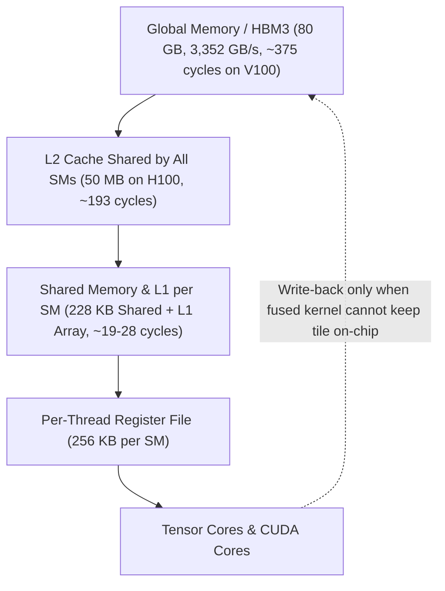
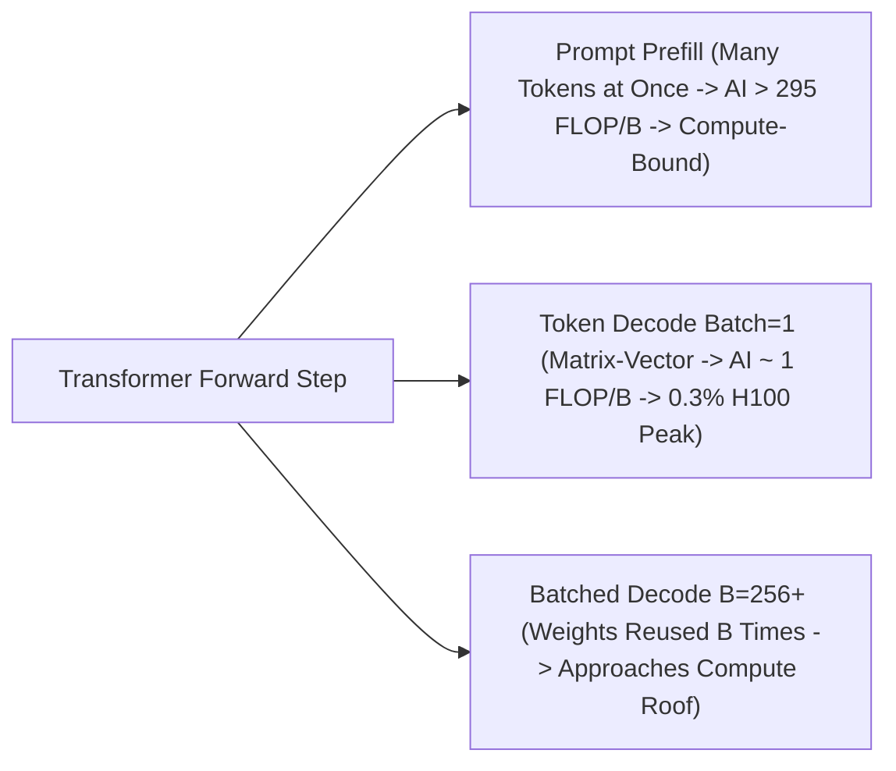
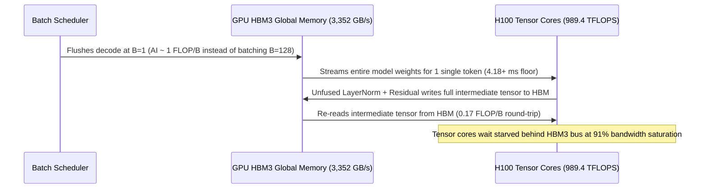

# Module 03: Memory Hierarchy and Bandwidth

> **Prerequisites:** Modules 00–02 ([Module 00](../00-why-gpus-not-cpus/README.md), [Module 01](../01-gpu-architecture-for-software-engineers/README.md), [Module 02: CUDA Cores vs. Tensor Cores](../02-cuda-cores-vs-tensor-cores/README.md): FLOP/s, SMs and warps, tensor cores and peak-throughput tables).  
> **Estimated Reading Time:** 35 minutes  
> **Target Audience:** AI Systems Engineers, Inference Serving Architects (vLLM/TRT-LLM), Kernel Developers

> [!TIP]
> **The Golden Rule of GPU Memory & Roofline Tuning:** Never buy faster FLOP/s to accelerate a **memory-bound** kernel—if an operation's **arithmetic intensity** (`FLOPs / bytes moved`) sits below the GPU's **ridge point** (`peak FLOP/s / bandwidth`, ~295 FLOP/byte on an H100 SXM5), wall-clock speed is capped strictly by HBM bandwidth. To go faster below the ridge, you must **move fewer bytes** (quantization, operator fusion, FlashAttention) or **reuse every weight byte across more tokens** (continuous batching).

---

## Roadmap & Why This Matters

[Module 02](../02-cuda-cores-vs-tensor-cores/README.md) ended with a warning: tensor cores are so fast that feeding them becomes the problem. This module is about that problem. It is the third and final "hardware mechanics" module in this track before capacity sizing begins ([Module 04](../04-vram-the-real-constraint/README.md) onwards).

**After this module** you can:
- name the levels of the GPU memory hierarchy and say how capacity, bandwidth, and latency trade off between them;
- compute the **arithmetic intensity** of an operation (FLOPs per byte moved) and the **ridge point** of a GPU;
- use the **roofline model** to decide whether an operation is memory-bound or compute-bound, in a few lines of NumPy;
- explain, with numbers, why generating text token by token (decode) is memory-bound and why batching helps.

This is the foundational idea behind most LLM inference engineering: quantization, batching, KV caches, FlashAttention ([Module 08](../08-flashattention-and-memory-efficient-kernels/README.md)), and the serving systems of [Track 14](../../14-inference-and-serving-vllm/README.md) are all ways of moving fewer bytes or reusing the ones already moved. What this module leaves out: how much memory a whole model needs (Modules 04–05).

---

## 1. Visual Mental Models: Memory Pyramid & Roofline Regimes

> [!IMPORTANT]
> **Core Concept:** Every number a GPU computes on has to travel from big, slow memory to small, fast memory. An operation's arithmetic intensity (FLOPs per byte moved) decides which side limits it: below the GPU's ridge point it is memory-bound, above it compute-bound. LLM token generation does about 1 FLOP per byte of weights, far below the ridge, so it is memory-bound.



> [!NOTE]
> **Analogy — The Workshop:** Registers are the tools in your hands, shared memory/L1 is the bench in front of you, L2 is the shelves in the room, and global memory (HBM) is the warehouse across the road. You can only work at the speed the warehouse trucks deliver, unless you reuse what is already on the bench. Most of GPU performance engineering is arranging to touch the warehouse as rarely as possible.

### Roofline Regime Split: Prefill vs. Unbatched Decode vs. Batched Decode



### Original Diagrams: Hierarchy, Log-Log Roofline & Batching Streaming

The hierarchy:

```text
            ┌──────────────────────┐
            │      registers       │   private to one thread; 256 KB per SM (H100)
         ┌──┴──────────────────────┴──┐
         │     shared memory / L1     │   shared by one block; up to 228 KB per SM (H100)
     ┌───┴────────────────────────────┴───┐
     │              L2 cache              │   shared by all SMs; 50 MB (H100)
┌────┴────────────────────────────────────┴────┐
│             global memory (HBM)              │   whole GPU; 80 GB at 3.35 TB/s (H100 SXM5)
└──────────────────────────────────────────────┘
 smaller, faster, closer to the math units  ▲                      ▼  bigger, slower, shared by everything
```

The roofline for an H100 SXM5 (dense 16-bit; schematic from Experiment 1's numbers, log-log):

```text
 1000 │                                          ╱╱d───────────e───────
      │                                       ╱╱╱                      
      │                                   ╱╱c╱                         
      │                                ╱╱╱                             
  100 │                            ╱╱╱╱                                
      │                        ╱╱╱╱                                    
      │                     ╱╱╱                                        
   10 │                 ╱╱╱╱                                           
      │              ╱╱╱                                               
      │          ╱╱╱b                                                  
    1 │      ╱╱╱╱                                                      
      │   a╱╱                                                          
      │╱╱╱                                                             
      │                                                                
  0.1 │                                                                
      └────────────────────────────────────────────────────────────────►
       0.1          1           10           100         1000         10000
                                        arithmetic intensity, FLOP/byte (log scale)

 a = elementwise add (0.17)      b = matrix-vector / decode at batch 1 (1.0)    c = 256^3 matmul (85)
 d = ridge point (295)           e = 8192^3 matmul (2,731)
 ╱ rising line = memory-bound: speed = intensity x bandwidth        ─ flat line = compute-bound: speed = peak
```

Decode step, batch 1 versus batch 256 (H100 numbers from Experiment 1):

```text
┌──────────────────────────────────────────────────────────────────────────────┐
│ batch size 1: 4.18 ms per step, waiting for bytes                            │
│                                                                              │
│ HBM ═══ 14 GB of weights ═══►  tensor cores  ░░░░░░░░░░░░░░ almost idle      │
└──────────────────────────────────────────────────────────────────────────────┘
┌──────────────────────────────────────────────────────────────────────────────┐
│ batch size 256: still 4.18 ms per step, same bytes, 256x the work            │
│                                                                              │
│ HBM ═══ the SAME 14 GB ═══►  tensor cores  ▓▓▓▓▓▓▓▓▓▓▓▓ (256 tokens of math) │
└──────────────────────────────────────────────────────────────────────────────┘
```

---

## 2. Systematic Hardware Hierarchy & Roofline Matrices

### GPU Memory Hierarchy (Capacity, Visibility, Latency & Bandwidth)

A GPU has several kinds of memory, trading **capacity** against **bandwidth** (bytes per second) and **latency** (time to the first byte). Each SM has its own register file and shared memory; an L1 cache shares a unified data array with shared memory; an L2 cache is shared by all SMs; and **global memory** (DRAM/HBM) is accessible across the entire GPU.

| Level | Who Can See It | Size on H100 SXM5 (Hopper whitepaper v1.04) | Measured on V100 (Jia et al., 2018) |
| :--- | :--- | :--- | :--- |
| **Registers** | One thread | 256 KB register file per SM | Not a memory access |
| **Shared memory** | One thread block (or cluster) | Up to 228 KB per SM (in 256 KB array shared with L1) | 19 cycles (no bank conflicts); 12,080 GiB/s chip-wide |
| **L1 data cache** | One SM | Remainder of that 256 KB array | 28-cycle hit |
| **L2 cache** | All SMs | 50 MB | 193-cycle hit |
| **Global memory (HBM)** | Whole GPU | 80 GB, 3,352 GB/s | 375 cycles (L2 miss, TLB hit); 750 GiB/s measured of 900 GiB/s peak |

Read this as orders of magnitude, not a universal spec sheet: the V100 column is an older chip measured by micro-benchmarks, so the *ratios* transfer. Global memory took ~13x more cycles to reach than L1 (375 vs. 28 cycles) and delivered ~16x less bandwidth than shared memory (750 vs. 12,080 GiB/s). Datacenter GPUs like the A100 and H100 use **HBM** (high-bandwidth memory) packaged beside the die, whereas consumer/edge cards use **GDDR** (graphics DRAM; in Jia et al., a GDDR5 P4 delivered 162 GiB/s vs. V100's 750 GiB/s—see [Module 12](../12-choosing-gpus-consumer-vs-datacenter/README.md)).

### Latency Is Hidden, Bandwidth Is Not

- **Latency** (hundreds of cycles to reach global memory) is hidden by keeping many warps in flight (Module 01). By **Little's law** ($\text{bytes in flight} = \text{bandwidth} \times \text{latency}$), Experiment 1 computes that a V100 required ~214 KiB of memory requests in flight across 80 SMs (~2.7 KiB/SM) to saturate HBM.
- **Bandwidth** is a hard physical ceiling that no amount of warp concurrency can bypass. Even well-tuned benchmarks reach a fraction of datasheet theoretical bandwidth (Jia et al. measured 83% on V100 and 70% on P100).

### Arithmetic Intensity & the Roofline Model

Define **arithmetic intensity** (also called operational intensity):

$$\text{arithmetic intensity} = \frac{\text{FLOPs performed}}{\text{bytes moved to and from memory}}$$

Assuming each input is read once and the output written once (a **lower bound** on memory traffic), for 16-bit data (`2` bytes per value):

| Operation | FLOPs | Bytes Moved (16-bit) | Arithmetic Intensity |
| :--- | :--- | :--- | :--- |
| **Elementwise add of `n` values** | `n` | `3 * 2n` (2 reads, 1 write) | **0.17 FLOP/B** |
| **Matrix (`m x k`) x vector** | `2mk` | ~`2mk` (matrix dominates) | **~1 FLOP/B** |
| **Matmul `(m x k)(k x n)`** | `2mkn` | `2(mk + kn + mn)` | Grows with size (`n/3` for square `n x n`) |

Williams, Waterman, and Patterson's **roofline model** bounds attainable speed by two ceilings:

$$\text{attainable FLOP/s} = \min(\text{peak FLOP/s},\; \text{arithmetic intensity} \times \text{peak memory bandwidth})$$

The **ridge point** is $\text{peak FLOP/s} / \text{bandwidth}$ (in FLOP/byte; NVIDIA calls this the *ops:byte ratio*):
- **H100 SXM5** (dense 16-bit 989.4 TFLOPS / 3,352 GB/s): ridge point $\approx \mathbf{295\text{ FLOP/B}}$.
- **A100 80GB SXM** (dense 16-bit 312 TFLOPS / 2,039 GB/s): ridge point $\approx \mathbf{153\text{ FLOP/B}}$.

Notice that between A100 and H100, peak tensor-core FLOP/s grew ~3.2x (`989.4 / 312`) while bandwidth grew ~1.6x (`3,352 / 2,039`), pushing the ridge point up nearly 2x: modern chips demand higher arithmetic intensity per byte moved.

> [!WARNING]
> **Two Critical Roofline & Unit Pitfalls:**
> 1. **A roofline is an upper bound, not a prediction.** Launch overhead, poor data reuse, non-aligned tile shapes, and shared-memory bank conflicts push real kernels below the roofline (Experiment 2 shows an 8-column skinny matmul hitting only ~0.3 of its CPU roofline).
> 2. **Mixing `GB/s` vs. `GiB/s` or bits vs. bytes.** Datasheets quote **GB/s** ($10^9$ bytes/s), while micro-benchmark papers often quote **GiB/s** ($2^{30}$ bytes/s), and interface specs sometimes use bits. A silent 7% GB-vs-GiB error breaks tight capacity budgets.

### Why Decode Is Memory-Bound (and How Inference Systems Fix It)

Generating text produces one token per forward pass ([Track 00, Module 08](../../00-genai-foundations/08-how-llms-actually-generate-text/README.md)). At **batch size 1**, every weight matrix executes a matrix-vector product: each 2-byte weight is read from HBM once for 2 FLOPs (`~1 FLOP/B`, reaching just **0.3%** of H100 SXM5 peak!). Thus:

$$\text{time per token} \ge \frac{\text{bytes of weights read}}{\text{memory bandwidth}}$$

For an illustrative 14 GB 16-bit weight footprint, the H100 HBM floor is `4.18 ms/token` (~239 tokens/s ceiling for one user).

| LLM Workload Phase / Op | Typical Arithmetic Intensity | Regime on H100 (Ridge 295) | Primary Optimization Lever |
| :--- | :--- | :--- | :--- |
| **LayerNorm / Softmax / ReLU** | `0.25 – <10` FLOP/B | **Memory-bound** | Operator fusion (keep intermediates in registers/SMEM) |
| **Attention (`Q*K^T` intermediate)** | Low if materialized to HBM | **Memory-bound** (naive) | FlashAttention ([Module 08](../08-flashattention-and-memory-efficient-kernels/README.md)) avoids HBM round-trips |
| **Autoregressive Decode (`B = 1`)** | `~1` FLOP/B | **Memory-bound** (0.3% peak) | Weight quantization ([Track 04, Module 15](../../04-training-fine-tuning-and-alignment/15-quantization-int8-int4-gguf/README.md)) + KV-cache reduction (MQA/GQA) |
| **Batched Decode (`B = 256–512`)** | `228 – 410` FLOP/B | Crosses ridge at `B = 345` (`4096x4096`) | Continuous batching ([Track 14](../../14-inference-and-serving-vllm/README.md)) amortizes weight reads |
| **Long Prompt Prefill** | `> 300` FLOP/B | **Compute-bound** | Tensor cores, FP8/BF16 mixed precision |

Note that the simple weight-only decode model leaves out the **KV cache** (stored keys and values of prior tokens), whose traffic scales with context length—the exact reason Shazeer (2019) introduced Multi-Query Attention.

---

## 3. Production War Story Post-Mortem: Unbatched Decode & HBM Activation Round-Trips

| Field | Incident Details |
| :--- | :--- |
| **Severity** | **SEV-2** (Inference Throughput Collapse & HBM3 Saturation) |
| **Detection / Resolution Time** | Detected in 12 minutes via TPOT P99 alert / Resolved in 40 minutes |
| **Impact** | Custom 8x H100 serving fleet stalled at 38 tokens/s per user (12% Tensor Core utilization, 91% HBM3 bandwidth saturation), forcing `\$9,500` emergency node scale-out |

### What Happened

An AI serving team rolled out a custom PyTorch attention post-processing hook alongside a batching scheduler refactor. Two bugs landed simultaneously: (1) a queue-timeout regression caused the continuous batcher to flush every request immediately at **`batch_size = 1`** instead of accumulating concurrent decode steps; (2) an unfused residual-dropout-layernorm block materialized `[B, S, D]` intermediate tensors back to HBM3 global memory three times per transformer layer instead of holding them in SM shared memory/registers. Despite NVIDIA's Tensor Cores sitting nearly idle (~12% FLOP utilization), Nsight Systems showed HBM3 memory bandwidth pinned at 91%, cutting cluster throughput by 6x.



### Root Cause Analysis

1. **Batch-size-1 decode pinned the workload in the memory-bound regime:** Streaming full model weights once per generated token gave `~1 FLOP/B` intensity, capping Tensor Core utilization under 1% on dense projections.
2. **Unfused elementwise ops tripled global HBM traffic:** Writing and re-reading intermediate activations (`0.17–1.0 FLOP/B`) consumed scarce HBM3 bandwidth needed for weights and KV cache.

### The Fix & Architectural Hardening

- **Restored Continuous Batching (`B = 64–256`):** Raised decode arithmetic intensity across the memory-bandwidth flat floor, scaling total tokens/s nearly linearly without hurting per-step weight read latency.
- **Kernel Fusion (`torch.compile` / Triton) + Quantization:** Fused RMSNorm + residual add + activation into single-pass SRAM/register kernels and quantized weights from FP16 to FP8, cutting HBM bytes transferred per decode step by >50%.

---

## 4. Multi-Language Production Implementation: Roofline & Decode Simulators

These four implementations compute arithmetic intensity, GPU ridge points (`peak / bandwidth`), memory-vs-compute bounds, Little's Law concurrency requirements, and include a live PyTorch CUDA/NumPy roofline microbenchmark comparing elementwise, matrix-vector, and batched GEMM operations.

````carousel
```go
package main

import (
	"fmt"
	"math"
)

type GPURoofline struct {
	Name        string
	PeakTFLOPS  float64 // Dense 16-bit Tensor Core peak
	BandwidthGB float64 // HBM bandwidth in GB/s (10^9 B/s)
}

func (g GPURoofline) RidgePoint() float64 {
	return (g.PeakTFLOPS * 1e12) / (g.BandwidthGB * 1e9)
}

func MatmulIntensity(m, k, n, bytesPerElem int) float64 {
	flops := 2.0 * float64(m) * float64(k) * float64(n)
	bytes := float64(bytesPerElem) * float64(m*k+k*n+m*n)
	return flops / bytes
}

func main() {
	h100 := GPURoofline{Name: "H100 SXM5", PeakTFLOPS: 989.4, BandwidthGB: 3352.0}
	fmt.Printf("%s | Ridge Point = %.0f FLOP/byte\n", h100.Name, h100.RidgePoint())

	for _, batch := range []int{1, 32, 256, 345, 512} {
		ai := MatmulIntensity(batch, 4096, 4096, 2)
		attainable := math.Min(h100.PeakTFLOPS, (ai*h100.BandwidthGB)/1e3) // TFLOPS
		bound := "memory"
		if ai >= h100.RidgePoint() {
			bound = "compute"
		}
		fmt.Printf("Batch=%3d | AI=%6.1f FLOP/B | Roof=%6.1f TFLOPS (%5.1f%% peak) | %s\n",
			batch, ai, attainable, (attainable/h100.PeakTFLOPS)*100, bound)
	}

	// Little's Law: bytes in flight = bandwidth * latency (V100 example)
	latencySec := 375.0 / 1380e6
	inFlightKiB := (750.0 * math.Pow(2, 30) * latencySec) / 1024.0
	fmt.Printf("V100 Little's Law in-flight demand: ~%.0f KiB across 80 SMs\n", inFlightKiB)
}
```
<!-- slide -->
```typescript
export interface DecodeSimulation {
  batchSize: number;
  weightBytesGB: number;
  kvCacheBytesGB: number;
  stepTimeMs: number;
  totalTokensPerSec: number;
  perUserTokensPerSec: number;
  regime: "memory-bound" | "compute-bound";
}

export function simulateDecodeStep(
  weightGB: number,
  paramsCount: number,
  kvBytesPerToken: number,
  batchSize: number,
  peakTflops: number = 989.4,
  bandwidthGBs: number = 3352.0
): DecodeSimulation {
  const totalWeightBytes = weightGB * 1e9;
  const totalKvBytes = kvBytesPerToken * batchSize;
  const memTimeSec = (totalWeightBytes + totalKvBytes) / (bandwidthGBs * 1e9);
  const mathTimeSec = (2 * paramsCount * batchSize) / (peakTflops * 1e12);
  const stepSec = Math.max(memTimeSec, mathTimeSec);

  return {
    batchSize,
    weightBytesGB: Number(weightGB.toFixed(2)),
    kvCacheBytesGB: Number((totalKvBytes / 1e9).toFixed(4)),
    stepTimeMs: Number((stepSec * 1e3).toFixed(2)),
    totalTokensPerSec: Math.round(batchSize / stepSec),
    perUserTokensPerSec: Math.round(1 / stepSec),
    regime: mathTimeSec >= memTimeSec ? "compute-bound" : "memory-bound",
  };
}

// Compare 7B model (14 GB FP16 vs 7 GB INT8) on H100 SXM5 across batch sizes
console.table([
  simulateDecodeStep(14.0, 7e9, 512 * 1024, 1),
  simulateDecodeStep(14.0, 7e9, 512 * 1024, 64),
  simulateDecodeStep(14.0, 7e9, 512 * 1024, 512),
  simulateDecodeStep(7.0, 7e9, 256 * 1024, 1),
]);
```
<!-- slide -->
```python
"""
roofline_microbench.py
Profiles elementwise add (memory-bound), matrix-vector (decode B=1), and large matmul
(compute-bound) on CUDA PyTorch when available, reporting achieved GB/s and TFLOPS.
"""
import time


def benchmark_roofline() -> None:
    try:
        import torch
    except ImportError:
        print("PyTorch not installed.")
        return

    if not torch.cuda.is_available():
        print("No CUDA GPU detected; run Experiment 2 in Section 5 for CPU roofline validation.")
        return

    device = torch.device("cuda")
    m = 32 * 1024 * 1024
    x = torch.ones(m, dtype=torch.float16, device=device)
    y = torch.ones(m, dtype=torch.float16, device=device)
    out = torch.empty_like(x)

    def time_op(fn, repeats: int = 20) -> float:
        fn()
        torch.cuda.synchronize()
        t0 = time.perf_counter()
        for _ in range(repeats):
            fn()
        torch.cuda.synchronize()
        return (time.perf_counter() - t0) / repeats

    t_add = time_op(lambda: torch.add(x, y, out=out))
    print(f"Elementwise add (AI=0.17) : {3 * m * 2 / t_add / 1e9:7.1f} GB/s | {m / t_add / 1e12:6.3f} TFLOPS")

    w = torch.randn(4096, 4096, dtype=torch.float16, device=device)
    for b in (1, 16, 256, 512):
        inp = torch.randn(b, 4096, dtype=torch.float16, device=device)
        t_mm = time_op(lambda: inp @ w)
        flops = 2 * b * 4096 * 4096
        nbytes = 2 * (b * 4096 + 4096 * 4096 + b * 4096)
        print(f"Linear 4096x4096 (B={b:>3}, AI={flops/nbytes:5.1f}): {nbytes/t_mm/1e9:7.1f} GB/s | {flops/t_mm/1e12:6.2f} TFLOPS")


if __name__ == "__main__":
    benchmark_roofline()
```
<!-- slide -->
```csharp
using System;

public static class RooflineClassifier
{
    public sealed record DeviceSpec(string Name, double PeakTflops, double BandwidthGBs)
    {
        public double RidgeFlopPerByte => (PeakTflops * 1e12) / (BandwidthGBs * 1e9);
    }

    public static void Evaluate(DeviceSpec dev, string opName, double flops, double bytesMoved)
    {
        double ai = flops / bytesMoved;
        double memCapTflops = (ai * dev.BandwidthGBs * 1e9) / 1e12;
        double attainable = Math.Min(dev.PeakTflops, memCapTflops);
        string bound = ai >= dev.RidgeFlopPerByte ? "Compute-Bound" : "Memory-Bound";

        Console.WriteLine(
            $"{dev.Name,-14} | {opName,-22} | AI={ai,7:F2} FLOP/B | " +
            $"Ceiling={attainable,6:F2} TFLOPS ({attainable / dev.PeakTflops,5:P1}) | {bound}");
    }

    public static void Main()
    {
        var a100 = new DeviceSpec("A100 80GB SXM", 312.0, 2039.0);
        var h100 = new DeviceSpec("H100 SXM5", 989.4, 3352.0);
        // Unit conversion check: 750 GiB/s == ~805.3 GB/s (7.4% difference!)
        Console.WriteLine($"Unit guard: 750 GiB/s = {750.0 * Math.Pow(1024, 3) / 1e9:F1} GB/s\n");

        foreach (var gpu in new[] { a100, h100 })
        {
            Evaluate(gpu, "Elementwise Add", 1.0, 6.0);
            Evaluate(gpu, "MatVec 4096^2 (B=1)", 2.0 * 4096 * 4096, 2.0 * (4096 * 4096 + 8192));
            Evaluate(gpu, "Matmul 1024^3", 2.0 * Math.Pow(1024, 3), 2.0 * 3 * Math.Pow(1024, 2));
        }
    }
}
```
````

---

## 5. Practical Hands-On Verification Workflows & Experiments

Everything uses NumPy only (Python 3.13, NumPy 2.4.6). Experiment 1 is arithmetic on datasheet values and is deterministic. Experiment 2 measures **your CPU** and will give different numbers on every machine and run.

### Experiment 1: Arithmetic Intensity, GPU Rooflines, Decode Batch Sweep & Little's Law

```python
import numpy as np

# --- Arithmetic intensity = FLOPs / bytes moved. Assume every operand is read once and the result written once. ---
def ai_elementwise(n, b):        return n / (3 * n * b)                       # c = a + b : 1 FLOP, 3 values moved
def ai_matmul(m, k, n, b):       return 2 * m * k * n / (b * (m * k + k * n + m * n))
def ai_matvec(m, k, b):          return ai_matmul(m, k, 1, b)

# Check against NVIDIA's table (FP16, b=2 bytes): linear layers 315 and 1 FLOP/B, ReLU 0.25 FLOP/B.
print("NVIDIA table check (FP16):  batch 512 ->", round(ai_matmul(512, 1024, 4096, 2), 1),
      "| batch 1 ->", round(ai_matmul(1, 1024, 4096, 2), 2), "| ReLU ->", 1 / (2 * 2))

# --- Roofline: attainable FLOP/s = min(peak, intensity x bandwidth).  Dense BF16/FP16 tensor-core peaks. ---
# H100 SXM5: 989.4 TFLOPS (Hopper whitepaper v1.04, Table 1), 3352 GB/s (same, Table 3; product page: 3.35 TB/s)
# A100 80GB SXM: 312 TFLOPS, 2039 GB/s (A100 datasheet, Jun21).   Checked Oct 2026.
GPUS = {"H100 SXM5": (989.4e12, 3352e9), "A100 80GB SXM": (312e12, 2039e9)}
ops = {"elementwise add":            ai_elementwise(1, 2),
       "matrix-vector (4096x4096)":  ai_matvec(4096, 4096, 2),
       "matmul 256^3":               ai_matmul(256, 256, 256, 2),
       "matmul 1024^3":              ai_matmul(1024, 1024, 1024, 2),
       "matmul 8192^3":              ai_matmul(8192, 8192, 8192, 2)}
for gpu, (peak, bw) in GPUS.items():
    print(f"\n{gpu}: peak {peak/1e12:.1f} TFLOPS, bandwidth {bw/1e9:,.0f} GB/s, ridge point = {peak/bw:.0f} FLOP/byte")
    print(f"  {'operation (16-bit data)':<28}{'FLOP/byte':>10}{'attainable TFLOPS':>19}{'% of peak':>11}  bound")
    for name, ai in ops.items():
        att = min(peak, ai * bw)
        print(f"  {name:<28}{ai:>10.2f}{att/1e12:>19.2f}{att/peak:>11.1%}  {'compute' if ai * bw >= peak else 'memory'}")

# --- Decode: one weight matrix (4096 x 4096), B tokens processed together, 16-bit weights. ---
peak, bw = GPUS["H100 SXM5"]
print("\nH100 SXM5, one 4096x4096 layer, B tokens per step:")
print(f"  {'B':>5}{'FLOP/byte':>11}{'% of peak':>11}  bound")
for B in (1, 2, 8, 32, 128, 256, 512, 1024):
    ai = ai_matmul(B, 4096, 4096, 2)
    print(f"  {B:>5}{ai:>11.1f}{min(peak, ai * bw) / peak:>11.1%}  {'compute' if ai * bw >= peak else 'memory'}")
first = next(B for B in range(1, 5000) if ai_matmul(B, 4096, 4096, 2) * bw >= peak)
print(f"  -> first batch size that is compute-bound: {first}")

# --- A weights-dominated decode step: 14 GB of weights (7e9 parameters x 2 bytes), KV cache and activations ignored. ---
W, N = 14e9, 7e9
print(f"\nStep time = max(weights / bandwidth, 2*N*B / peak) on the H100:  memory floor {W / bw * 1e3:.2f} ms")
for B in (1, 8, 64, 256, 512):
    step = max(W / bw, 2 * N * B / peak)
    print(f"  B={B:>3}: step {step*1e3:6.2f} ms -> {B / step:8.0f} tokens/s total, {1 / step:6.0f} tokens/s per user")

# --- Latency hiding by Little's law: bytes in flight = bandwidth x latency (Volta V100 numbers, Jia et al. 2018) ---
lat_s = 375 / 1380e6                       # 375-cycle global-memory latency at the 1380 MHz max clock
in_flight = 750 * 2**30 * lat_s            # 750 GiB/s measured global bandwidth
print(f"\nV100: to keep 750 GiB/s flowing with a {lat_s*1e9:.0f} ns latency, ~{in_flight/1024:.0f} KiB must be in flight "
      f"(~{in_flight/80/1024:.1f} KiB per SM across 80 SMs)")
```

**Expected Output** (deterministic):

```text
NVIDIA table check (FP16):  batch 512 -> 315.1 | batch 1 -> 1.0 | ReLU -> 0.25

H100 SXM5: peak 989.4 TFLOPS, bandwidth 3,352 GB/s, ridge point = 295 FLOP/byte
  operation (16-bit data)      FLOP/byte  attainable TFLOPS  % of peak  bound
  elementwise add                   0.17               0.56       0.1%  memory
  matrix-vector (4096x4096)         1.00               3.35       0.3%  memory
  matmul 256^3                     85.33             286.04      28.9%  memory
  matmul 1024^3                   341.33             989.40     100.0%  compute
  matmul 8192^3                  2730.67             989.40     100.0%  compute

A100 80GB SXM: peak 312.0 TFLOPS, bandwidth 2,039 GB/s, ridge point = 153 FLOP/byte
  operation (16-bit data)      FLOP/byte  attainable TFLOPS  % of peak  bound
  elementwise add                   0.17               0.34       0.1%  memory
  matrix-vector (4096x4096)         1.00               2.04       0.7%  memory
  matmul 256^3                     85.33             173.99      55.8%  memory
  matmul 1024^3                   341.33             312.00     100.0%  compute
  matmul 8192^3                  2730.67             312.00     100.0%  compute

H100 SXM5, one 4096x4096 layer, B tokens per step:
      B  FLOP/byte  % of peak  bound
      1        1.0       0.3%  memory
      2        2.0       0.7%  memory
      8        8.0       2.7%  memory
     32       31.5      10.7%  memory
    128      120.5      40.8%  memory
    256      227.6      77.1%  memory
    512      409.6     100.0%  compute
   1024      682.7     100.0%  compute
  -> first batch size that is compute-bound: 345

Step time = max(weights / bandwidth, 2*N*B / peak) on the H100:  memory floor 4.18 ms
  B=  1: step   4.18 ms ->      239 tokens/s total,    239 tokens/s per user
  B=  8: step   4.18 ms ->     1915 tokens/s total,    239 tokens/s per user
  B= 64: step   4.18 ms ->    15323 tokens/s total,    239 tokens/s per user
  B=256: step   4.18 ms ->    61294 tokens/s total,    239 tokens/s per user
  B=512: step   7.24 ms ->    70671 tokens/s total,    138 tokens/s per user

V100: to keep 750 GiB/s flowing with a 272 ns latency, ~214 KiB must be in flight (~2.7 KiB per SM across 80 SMs)
```

What to notice:
- The first line reproduces NVIDIA's published intensities (`315`, `1`, `0.25`), so the formulas are right.
- On the H100, the element-wise add and the matrix-vector product reach `0.1%` and `0.3%` of the dense 16-bit peak: memory-bound by two to three orders of magnitude. Even the `256^3` matmul is below the ridge (`85` versus `295` FLOP/B), so its roofline is only `29%` of peak; the large matmuls sit on the flat roof.
- The batch sweep shows intensity climbing with `B`; the `4096 x 4096` layer first becomes compute-bound at `B = 345` on the H100.
- In the decode table, step time is flat at `4.18 ms` for `B` up to `256`, which means total throughput scales linearly with users for free, then flattens once the math takes over (`B = 512`). This ignores the KV cache, so real systems saturate sooner.
- Little's law: about `214 KiB` must be in flight on a V100 to keep its HBM busy, which is why Module 01's occupancy matters.

---

### Experiment 2: Test the Roofline on Real Local Hardware (Single-Core CPU)

One CPU core (BLAS limited to one thread), roofs measured with operations that are *not* among those tested, then the predicted ceiling compared with the measured rate for six operations.

```python
import os
os.environ["OPENBLAS_NUM_THREADS"] = "1"       # must be set before importing numpy: one core keeps this simple
import time
import numpy as np

def best_of(fn, repeats):
    best = float("inf")
    for _ in range(repeats):
        t0 = time.perf_counter(); fn(); best = min(best, time.perf_counter() - t0)
    return best

rng = np.random.default_rng(0)

# The two roofs, each measured with an operation that is NOT one of the operations tested below.
m = 32 * 1024 * 1024                                                       # 128 MiB per float32 array
src, dst = np.ones(m, np.float32), np.empty(m, np.float32)
bw = 2 * m * 4 / best_of(lambda: np.copyto(dst, src), 7)                   # bytes/s: read + write
big = rng.standard_normal((1536, 1536), dtype=np.float32)
peak = 2 * 1536**3 / best_of(lambda: big @ big, 5)                         # FLOP/s
print(f"roofs: peak {peak/1e9:.0f} GFLOP/s, bandwidth {bw/1e9:.1f} GB/s, ridge point {peak/bw:.1f} FLOP/byte\n")

print(f"{'operation':<24}{'FLOP/byte':>10}{'roof GFLOP/s':>14}{'measured':>10}{'measured/roof':>15}")
def run(name, flops, nbytes, fn, repeats=5):
    t = best_of(fn, repeats)
    ai = flops / nbytes                                                    # bytes assume each operand moves once
    roof = min(peak, ai * bw)
    print(f"{name:<24}{ai:>10.3f}{roof/1e9:>14.1f}{flops/t/1e9:>10.1f}{flops/t/roof:>15.2f}")

x, y, out = np.ones(m, np.float32), np.ones(m, np.float32), np.empty(m, np.float32)
run("elementwise add 32M", m, 3 * m * 4, lambda: np.add(x, y, out=out))
n = 6144
A = rng.standard_normal((n, n), dtype=np.float32)
v = rng.standard_normal(n, dtype=np.float32)
run("matrix-vector 6144^2", 2 * n * n, 4 * (n * n + 2 * n), lambda: A @ v)
for cols in (8, 64):
    Bm = rng.standard_normal((n, cols), dtype=np.float32)
    run(f"matrix @ {cols} columns", 2 * n * n * cols, 4 * (n * n + 2 * n * cols), lambda: A @ Bm)
for k in (128, 512, 2048):
    a = rng.standard_normal((k, k), dtype=np.float32)
    run(f"matmul {k}^3", 2 * k**3, 4 * 3 * k * k, lambda: a @ a, repeats=7 if k < 1024 else 5)
```

**Expected Output** (from one run; your numbers will differ; a second run on the same machine moved individual ratios by up to about 0.2):

```text
roofs: peak 128 GFLOP/s, bandwidth 25.1 GB/s, ridge point 5.1 FLOP/byte

operation                FLOP/byte  roof GFLOP/s  measured  measured/roof
elementwise add 32M          0.083           2.1       1.7           0.82
matrix-vector 6144^2         0.500          12.5      11.5           0.92
matrix @ 8 columns           3.990         100.0      32.0           0.32
matrix @ 64 columns         31.347         127.9      98.9           0.77
matmul 128^3                21.333         127.9     112.4           0.88
matmul 512^3                85.333         127.9     133.4           1.04
matmul 2048^3              341.333         127.9     131.1           1.02
```

The low-intensity operations (add, matrix-vector) sit at roughly `0.7` to `0.9` of their bandwidth-set ceiling across runs, and the large matmuls sit on the compute roof, as the model says. The `measured/roof` ratio exceeds 1 slightly for the large matmuls because the roof itself is a noisy measurement of the same kind of operation. The skinny `matrix @ 8 columns` case reaches only about `0.3`: the roofline says it *could* run near 100 GFLOP/s, and this BLAS call does not. An upper bound promises no more than that (this module did not investigate why).

---

### CLI Verification Workflows: Memory Clocks & GB-vs-GiB Guard

#### CLI Check 1: Inspect GPU Memory Clocks & Utilization with `nvidia-smi`

```bash
nvidia-smi --query-gpu=name,clocks.current.memory,clocks.max.memory,utilization.memory,memory.used,memory.total --format=csv
```

**Expected Output** (on a datacenter GPU host):

```text
name, clocks.current.memory [MHz], clocks.max.memory [MHz], utilization.memory [%], memory.used [MiB], memory.total [MiB]
NVIDIA H100 80GB HBM3, 2619 MHz, 2619 MHz, 0 %, 412 MiB, 81559 MiB
```

#### CLI Check 2: Verify GB vs. GiB Drift & Decode Bandwidth Floor

```bash
python -c "
bw_gb = 3352e9
weights_14gb = 14e9
weights_14gib = 14 * (1024**3)
print(f'14 GB  / 3352 GB/s = {weights_14gb / bw_gb * 1e3:.2f} ms ({bw_gb / weights_14gb:.1f} tok/s)')
print(f'14 GiB / 3352 GB/s = {weights_14gib / bw_gb * 1e3:.2f} ms ({bw_gb / weights_14gib:.1f} tok/s)')
print(f'Unit mismatch error: {(weights_14gib / weights_14gb - 1)*100:.2f}%')
"
```

**Expected Output:**

```text
14 GB  / 3352 GB/s = 4.18 ms (239.4 tok/s)
14 GiB / 3352 GB/s = 4.49 ms (222.9 tok/s)
Unit mismatch error: 7.37%
```

---

### Practice Exercises

#### 1. Compute intensities by hand

(a) What is the arithmetic intensity of adding two `float32` vectors? (b) What is it for an FP16 matmul of two `3072 x 3072` matrices? (c) Which one is memory-bound on an H100 (ridge about 295)?

<details><summary>Answer</summary>

(a) 1 FLOP per element over 3 values of 4 bytes: `1 / 12`, about `0.083` FLOP/B.  
(b) `2n^3 / (2 * 3n^2) = n / 3`, so `3072 / 3 = 1024` FLOP/B (the code gives exactly `1024.0`).  
(c) The add is memory-bound by a huge margin; the matmul, at `1024` FLOP/B, is above the `295` ridge and compute-bound.

</details>

#### 2. Where does the batch cross the ridge on an A100?

Using `ai_matmul` from Experiment 1 and the A100 80GB SXM numbers (312 TFLOPS dense, 2,039 GB/s), find the smallest batch size `B` for which the `4096 x 4096` layer is compute-bound. Why is it smaller than on the H100?

<details><summary>Answer</summary>

Searching `B` upward with `ai_matmul(B, 4096, 4096, 2) * bw >= peak` gives **B = 166** (versus `345` on the H100). The A100's ridge point is lower (`153` versus `295` FLOP/B) because its peak is lower relative to its bandwidth, so less reuse per byte is needed to saturate its math units.

</details>

#### 3. Bound the tokens per second

A model has 14 GB of weights in 16-bit. What is the best-case single-user tokens per second on an A100 80GB SXM (2,039 GB/s)? What does halving the weight bytes (8-bit quantization) do to the bound?

<details><summary>Answer</summary>

`14e9 / 2039e9 = 6.87 ms` per token, about **146 tokens/s**. Halving the bytes to 7 GB halves the memory time to about `3.43 ms`, doubling the bound to about `291 tokens/s`. The bound ignores the KV cache and overheads, so real systems land below it.

</details>

### Independent Project

**Build a roofline calculator and plot for any device.** Write a script, NumPy only, that:
1. takes a device description (peak FLOP/s, memory bandwidth) as input, with presets for the A100 and H100 numbers in this module and a "measure my machine" mode;
2. takes a list of operations (elementwise, matrix-vector, matmul with arbitrary shapes and data types) and prints intensity, attainable FLOP/s, percent of peak, and the bound for each;
3. draws a text roofline (like the one above) with your operations marked on it;
4. includes a decode simulator: given weight bytes, parameter count, and batch size, print step time, per-user and total tokens per second, and the batch at which the step becomes compute-bound.

Validate against the NVIDIA numbers from Experiment 1 and against at least one measurement you make yourself. No solution is provided. Add a paragraph on one thing your model ignores and how it would change the answer (the KV cache is a good candidate).

---

## 6. Common Mistakes & Troubleshooting

- **Quoting sparse or low-precision peaks against full-precision data.** The ridge point must use the peak for the precision and path (dense, tensor core) you actually run. Using the sparse figure doubles the ridge and misclassifies operations.
- **Forgetting write traffic.** A result written back counts as bytes moved (`3n` values for an add, not `2n`).
- **Mixing GB and GiB, or bits and bytes** (see the pitfall above).
- **Measured ratio above 1.** Your roof was measured with a different, noisier operation; repeat, take the best of several runs, and check the byte count.
- **Reading a decode bound as a prediction.** Tokens per second from `bytes / bandwidth` is a ceiling; the KV cache, overheads, and imperfect bandwidth all push real numbers lower.

---

## 7. Operational Validation Checkpoints, Quiz & Interview Prep

### Operational Validation Checkpoints

<details><summary><strong>Checkpoint 1: Upgrading from A100 to H100 barely speeds up batch-size-1 decode</strong></summary>

Even though an H100 SXM5 delivers `3.17x` more dense BF16 compute than an A100 (`989.4` vs. `312` TFLOPS), its HBM bandwidth only grew `1.64x` (`3,352` vs. `2,039` GB/s). At `batch_size = 1`, autoregressive decode sits at ~1 FLOP/byte—deep inside the memory-bound slope—so speedup tracks the `1.64x` bandwidth increase rather than the `3.17x` FLOP increase.

</details>

<details><summary><strong>Checkpoint 2: Explaining why FlashAttention speeds up attention without changing FLOPs</strong></summary>

Standard attention writes the huge $N \times N$ score matrix out to HBM global memory and re-reads it for softmax and value mixing (`O(N^2)` HBM round-trips at very low arithmetic intensity). FlashAttention tiles $Q$, $K$, and $V$ inside fast SM shared memory/SRAM (~228 KB/SM, >12 TB/s chip-wide equivalent) and runs online softmax before writing only the final output back to HBM—dramatically raising effective arithmetic intensity without cutting mathematical FLOPs.

</details>

<details><summary><strong>Checkpoint 3: Diagnosing a GPU profiler trace showing 2% TFLOPS and 88% HBM bandwidth</strong></summary>

That kernel is **not** "broken" or idle—it is pinned against its memory-bandwidth roof (`88%` of theoretical HBM ceiling is healthy utilization). Buying a GPU with higher compute TFLOPS at identical HBM bandwidth will produce zero improvement; you must lower bytes transferred (FP8/INT4 quantization, kernel fusion) or increase batch size to reuse weights.

</details>

### Checkpoint Quiz

1. What does the roofline formula `min(peak, intensity x bandwidth)` say, and what is the ridge point?
2. Why is a matrix-vector product memory-bound regardless of how many tensor cores the GPU has?
3. Why does batching tokens barely change the step time of a decode step until the batch is large?
4. Name two reasons a measured kernel can sit below its roofline.
5. Why is processing a prompt compute-bound while generating tokens is memory-bound?

<details><summary>Answers</summary>

1. Attainable speed is the smaller of the compute ceiling and the memory ceiling (intensity times bandwidth). The ridge point is the intensity where the two are equal, `peak / bandwidth`; above it an operation is compute-bound, below it memory-bound.
2. Each matrix element is read once and used for one multiply-add, so intensity is about 1 FLOP/B, far below any ridge; speed is set by how fast the matrix streams in, not by the math units.
3. The weights are read once per step whatever the batch size, so memory time is constant, while the extra tokens' math is small compared with the available compute until the intensity reaches the ridge.
4. For example launch overhead, poor data reuse, bank conflicts, tile shapes that do not fit the problem, latency not hidden by enough parallelism.
5. A prompt contains many tokens processed in one pass, so each weight is reused many times (high intensity); generation handles one new token per pass per user, reusing each weight only once.

</details>

### Self-Check

- I can name the four levels from registers to global memory and say which are per-thread, per-block, and per-GPU.
- I can compute arithmetic intensity for an add, a matrix-vector product, and a matmul.
- I can compute a ridge point from a datasheet and classify an operation as memory- or compute-bound.
- I can explain why decode at batch size 1 uses a tiny fraction of peak FLOP/s.
- I can state what a roofline does and does not tell me.

### Interview Questions

#### Why is LLM token generation memory-bound? What would you change to make it faster?

<details><summary>What a strong answer covers</summary>

- At batch size 1 each weight is used for one multiply-add per token, so arithmetic intensity is about 1 FLOP/B, far under the GPU's ridge point (hundreds of FLOP/B).
- Time per token is bounded below by weight bytes divided by memory bandwidth; extra FLOP/s does not help.
- Levers: quantize weights (fewer bytes), batch requests (reuse each weight read), use hardware with more bandwidth, reduce KV-cache traffic.
- Bonus: prefill is compute-bound; the two phases need different treatment.

</details>

#### Explain arithmetic intensity and the roofline model. How do you use them to decide where to optimize?

<details><summary>What a strong answer covers</summary>

- Intensity = FLOPs per byte moved; ridge point = peak FLOP/s divided by bandwidth.
- Attainable speed is `min(peak, intensity x bandwidth)`; classify each operation as memory- or compute-bound.
- Memory-bound: move fewer bytes (fuse kernels, quantize, tile for reuse). Compute-bound: better tensor-core use, lower precision.
- Caveat: it is an upper bound; confirm with a profiler.

</details>

#### A profiler shows your decode kernels reaching 2% of the GPU's peak FLOP/s but 85% of its peak memory bandwidth. Is the GPU underused, and what would you do?

<details><summary>What a strong answer covers</summary>

- No: the kernels are memory-bound and close to the bandwidth roof, so the GPU is nearly as fast as this workload allows at this intensity.
- Adding FLOP/s (a "faster" chip with the same bandwidth) would not help; reducing bytes per token (quantization), reusing each weight read (bigger batches), or buying more bandwidth would.
- Use the roofline to confirm: intensity far below the ridge point and achieved bytes/s near the bandwidth ceiling.
- Mention the KV cache and prefill/decode difference as refinements.

</details>

---

## 8. Further Reading & Sources

- [Roofline: An Insightful Visual Performance Model for Floating-Point Programs and Multicore Architectures (Williams, Waterman, Patterson)](https://www2.eecs.berkeley.edu/Pubs/TechRpts/2008/EECS-2008-134.html) - the original roofline report; source of the `min(peak, bandwidth x intensity)` formula and the ridge point.
- [NVIDIA Deep Learning Performance: GPU Performance Background](https://docs.nvidia.com/deeplearning/performance/dl-performance-gpu-background/index.html) - NVIDIA's version (arithmetic intensity, ops:byte ratio) and the table of intensities checked in Experiment 1; states that batch-size-1 fully connected layers are memory-limited.
- [NVIDIA H100 Tensor Core GPU Architecture whitepaper (Hopper, v1.04)](https://resources.nvidia.com/en-us-hopper-architecture/nvidia-h100-tensor-c) - source of the H100 SXM5 peak, memory bandwidth, L2 size, shared memory and register file sizes used here.
- [NVIDIA A100 Tensor Core GPU datasheet](https://www.nvidia.com/content/dam/en-zz/Solutions/Data-Center/a100/pdf/nvidia-a100-datasheet-us-nvidia-1758950-r4-web.pdf) - source of the A100 80GB SXM peak (312 TFLOPS dense) and 2,039 GB/s bandwidth.
- [Dissecting the NVIDIA Volta GPU Architecture via Microbenchmarking (Jia et al., 2018)](https://arxiv.org/abs/1804.06826) - measured latencies and bandwidths of each memory level on a V100, the source of the hierarchy table's right-hand column.
- [CUDA Programming Guide, 1.2 Programming Model](https://docs.nvidia.com/cuda/cuda-programming-guide/01-introduction/programming-model.html) - the official description of registers, shared memory, L1/L2 caches and global memory (section 1.2.3).
- [Fast Transformer Decoding: One Write-Head is All You Need (Shazeer, 2019)](https://arxiv.org/abs/1911.02150) - states that incremental decoding is slow because of the memory-bandwidth cost of repeatedly loading keys and values; the KV-cache traffic this module's decode model leaves out.

---

## Next

[Module 04: VRAM: The Real Constraint](../04-vram-the-real-constraint/README.md)
