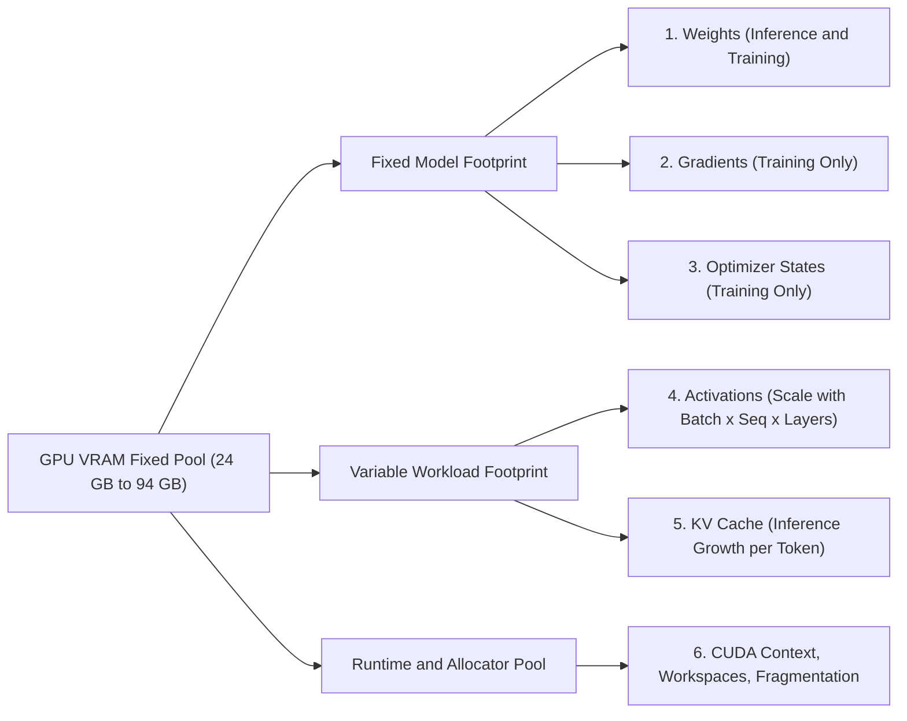
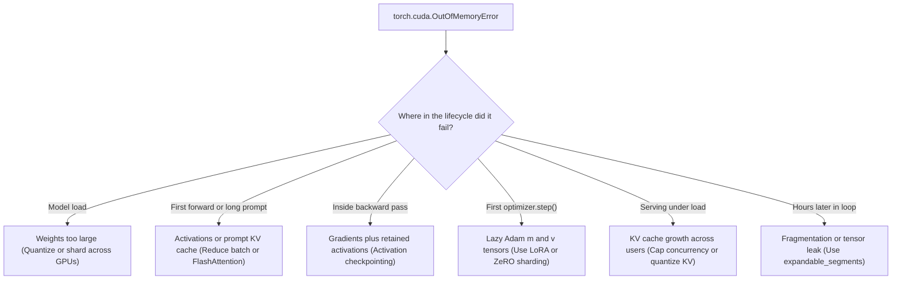
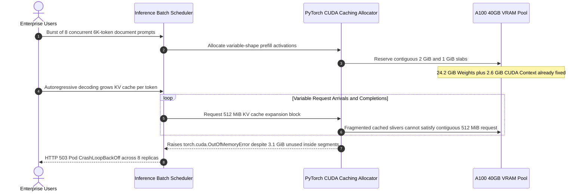

# Module 04: VRAM: The Real Constraint

> **Prerequisites:** [Module 03: Memory Hierarchy and Bandwidth](../03-memory-hierarchy-and-bandwidth/README.md), [Track 02: Transformer Architecture](../../02-transformer-architecture/README.md)  
> **Estimated Reading Time:** 25 minutes  
> **Target Audience:** AI Backend Engineers, ML Infrastructure Engineers, Systems Architects

> [!TIP]
> **The Golden Rule of GPU Memory Capacity**  
> Running out of compute makes a GPU job slower; running out of VRAM makes it fail. Everything that must be resident at the same moment (weights, plus gradients and optimizer states in training, plus activations or the KV cache, plus runtime overhead) has to fit inside one fixed-size pool, so capacity is almost always the first hardware wall you hit.

---

## 1. Visual Mental Models & Architecture

Every later hardware decision (which GPU, how many cards, whether to quantize, how many users one GPU can serve) is a memory capacity decision first and a speed decision second. You are in Track 05, GPUs & GenAI Hardware: [Module 03](../03-memory-hierarchy-and-bandwidth/README.md) explained how *fast* data moves between a GPU's memory levels; this module is about how *much* fits, and the next module turns these categories into exact formulas.

After this module, you will be able to:
- Name the six things that occupy GPU memory and identify which exist in inference, which in training, and which grow with batch size and sequence length.
- Explain why running out of VRAM kills a job instead of slowing it down.
- Read an out-of-memory (OOM) error as a forensic clue about *which* memory category ran out.
- Pick an optimization lever (precision, batch, context, checkpointing, offload, parallelism) and state what it costs.



When an out-of-memory crash occurs, the phase where the process died pinpoints the exact pool that overflowed:



### Capacity Ledger Across Workloads (ASCII Reference)

The same 7B-class model under four workloads, drawn from Listing 1 below. One character is about 2 GiB (`W` weights, `G` gradients, `O` optimizer states, `K` KV cache, `H` overhead). Activations are omitted because they depend on batch and sequence length.

```text
                      24 GiB card                 80 GiB card
                                ▼                           ▼
                    ············│···························│···············
 serve x1,  FP16    WWWWWWKH   17.6 GiB
 serve x16, FP16    WWWWWWKKKKKKKKKKKKKKKKH   47.6 GiB
 serve x16, INT4    WWKKKKKKKKKKKKKKKKH   35.9 GiB
 train, mixed Adam  WWWWWWGGGGGGOOOOOOOOOOOOOOOOOOOOOOOOOOOOOOOOOOOOOOO   104.3 GiB + activations
```

And the forensic triage map when an OOM appears:

```text
 where did it die?                         most likely category
 ─────────────────────────────────────     ─────────────────────────────────
 while loading the model             ───►  weights (too big, or loaded in a wider format)
 first forward / first long prompt   ───►  activations or prompt KV cache
 inside backward()                   ───►  gradients + activations held so far
 at the first optimizer.step()       ───►  optimizer states
 in a server, only under load        ───►  KV cache growing with users x length
 later, after hours, in a loop       ───►  fragmentation / memory leak (steady growth in memory_reserved)
```

---

## 2. Core Mechanics & Systematic Reference Matrices

### Why You Hit the Memory Wall Before the Compute Wall

A compute shortage is a *soft* limit. If a GPU has half the arithmetic throughput you wanted, the same program runs in twice the time. A memory shortage is a *hard* limit. If the program asks for one more byte than the card has, the allocation fails and the process stops. There is no "run at half memory" mode.

Three facts make the hard limit bite early:

1. **Weights must be resident.** Every forward pass reads every weight. Parking them in CPU RAM and fetching on demand crosses a far slower link than the GPU's own memory (the numbers are in Module 03), so in practice the weights live on the card.
2. **Memory per model grows faster than memory per card.** A 7-billion-parameter model in 16-bit numbers is about 13 GiB of weights alone (Module 05 does the arithmetic). The cards below hold between 24 and 94 GB.
3. **Training multiplies the footprint.** Gradients, optimizer states, and activations come on top of the weights (Listing 1 below puts a number on it).

| Card | GPU Memory | Source (Checked Oct 2026) |
| :--- | :--- | :--- |
| **GeForce RTX 4090** | 24 GB GDDR6X | [NVIDIA product page](https://www.nvidia.com/en-us/geforce/graphics-cards/40-series/rtx-4090/) |
| **A100** | 40 GB (HBM2) or 80 GB (HBM2e) | [NVIDIA A100 datasheet](https://www.nvidia.com/content/dam/en-zz/Solutions/Data-Center/a100/pdf/nvidia-a100-datasheet-us-nvidia-1758950-r4-web.pdf) |
| **H100** | 80 GB (SXM) or 94 GB (NVL) | [NVIDIA H100 page](https://www.nvidia.com/en-us/data-center/h100/) |

These are marketed capacities; the usable amount on a real card is a little lower because the driver and runtime take their share first. Specs change with each hardware generation, so treat the table as an illustration of scale and check the vendor page before you buy or rent.

### The Six Things That Live in VRAM

1. **Weights.** The model's parameters. Always present. Size = number of parameters $\times$ bytes per parameter. Does not change with batch size or sequence length.
2. **Gradients.** Training only. One gradient per trainable parameter, produced by the backward pass and consumed by the optimizer. Frozen parameters (for example, the base model under [LoRA](../../04-training-fine-tuning-and-alignment/12-lora-low-rank-adaptation/README.md)) have none.
3. **Optimizer states.** Training only. The Adam optimizer keeps two extra numbers per parameter (a running average of the gradient and of its square), and mixed-precision training adds a full-precision master copy of the weights (Module 07). The ZeRO paper observes that, among the parameter-sized tensors, the optimizer states usually consume the most memory.
4. **Activations.** Training: the intermediate results of the forward pass that the backward pass needs, kept for *every layer* until backward reaches them. They scale with $\text{batch} \times \text{sequence length} \times \text{layers}$. Inference: nothing needs to be kept, so only a couple of working buffers are alive at once (Listing 2 measures the difference).
5. **KV cache.** Inference of autoregressive models. To produce each new token the model needs the attention keys and values of all earlier tokens; storing them avoids recomputing them. The cache scales with $\text{batch} \times \text{sequence length} \times \text{layers}$ and *grows while the model generates*. In the vLLM paper's example (a 13B model on a 40 GB A100), roughly 65% of memory is weights and close to 30% is this dynamic request state.
6. **Runtime overhead and fragmentation.** The CUDA context, temporary workspace buffers for kernels, and the framework's caching allocator, which holds on to freed blocks and can leave unusable gaps between live ones. This category is the hardest to predict, which is why capacity planning always adds a margin.

> [!NOTE]
> **Fixed Cost vs. Variable Cost**  
> Weights, gradients, and optimizer states are *fixed* by the model: they decide whether the model fits at all. Activations and the KV cache are *variable* with the work: $\text{batch} \times \text{tokens}$ decides how much you can do per GPU. When someone says "it fits but I can't raise the batch size," the fixed costs are eating the pool and leaving no room for the variable ones.

| Category | Inference | Training | Grows With |
| :--- | :--- | :--- | :--- |
| **Weights** | Yes | Yes | Parameters $\times$ bytes per parameter |
| **Gradients** | No | Yes | Trainable parameters |
| **Optimizer states** | No | Yes | Trainable parameters |
| **Activations** | Transient only | Yes, all layers kept | Batch $\times$ sequence $\times$ layers |
| **KV cache** | Yes | No | Batch $\times$ sequence $\times$ layers (and KV width) |
| **Overhead / fragmentation** | Yes | Yes | Roughly fixed, plus allocator behavior |

### What "Out of Memory" Actually Means

PyTorch raises `torch.cuda.OutOfMemoryError` when its allocator asks CUDA for a block and cannot get one. Three things are worth knowing about that moment:

- **The failing request is the last straw, not the culprit.** The error names the allocation that did not fit, but the memory was already taken by everything allocated earlier. *When* it fails is the clue:
  - During model load: the weights themselves are too big (check the precision they are loaded in).
  - On the first forward pass or the first larger batch: activations (training) or the prompt's KV cache (inference).
  - In the backward pass: gradients plus the activations still held.
  - At the first optimizer step: optimizer states. PyTorch's built-in optimizers typically create their state tensors lazily on the first `step()`, so a job that survives forward and backward and then dies there is often a sign that optimizer states did not fit.
  - In a server, after minutes or hours of fine behavior: the KV cache grew as requests arrived or lengthened.
- **"Free" and "reserved" are different.** PyTorch uses a caching allocator: memory it has finished with stays reserved so the next allocation is fast. The PyTorch documentation notes that this unused-but-cached memory still shows as used in `nvidia-smi`; `memory_allocated()` reports bytes occupied by tensors and `memory_reserved()` reports what the allocator is holding.
- **Fragmentation can fail an allocation that "should" fit.** The PyTorch documentation describes how a workload whose batch size changes slightly from step to step leaves slivers of unusable free memory inside existing segments; its `expandable_segments` allocator option exists to reduce this. Some GPU memory is also taken outside PyTorch's allocator entirely (the docs name NCCL, the multi-GPU communication library, as an example), so PyTorch's own counters can sit below what `nvidia-smi` reports.

> [!WARNING]
> **"The model is 14 GB and the card has 24 GB, so it fits."**  
> Weights are the floor, not the total. Add the KV cache for the number of users and context length you want, add overhead, and for training multiply by roughly 8 or more (Module 05 derives the exact 16-byte-per-parameter factor).

### The Optimization Levers & Trade-Off Matrix

Once you know which category is too big, you know which lever to pull. Every lever trades memory against another resource:

| Lever | What It Shrinks | What It Costs |
| :--- | :--- | :--- |
| **Lower-precision weights (FP16 to INT8 to INT4)** | Weights (and the KV cache, if quantized too) | Some accuracy; needs kernel support. See [Module 06](../06-numeric-formats-fp32-fp16-bf16/README.md) and [Track 04 quantization](../../04-training-fine-tuning-and-alignment/15-quantization-int8-int4-gguf/README.md) |
| **Smaller batch** | Activations, KV cache | Fewer sequences processed at once, so lower throughput |
| **Shorter context** | KV cache, activations | Less history the model can attend to |
| **Activation checkpointing** | Activations | Recomputes part of the forward pass (the ZeRO paper cites about 33% extra compute); see Module 05 |
| **Freeze most parameters (LoRA)** | Gradients, optimizer states | Limits what can be learned; see [Module 12](../../04-training-fine-tuning-and-alignment/12-lora-low-rank-adaptation/README.md) of Track 04 |
| **Memory-efficient attention kernels** | Attention-score activations | None in the result; see [Module 08](../08-flashattention-and-memory-efficient-kernels/README.md) |
| **Offload to CPU RAM or disk** | Weights, optimizer states | Much slower, because data now crosses a slower link (Module 03) |
| **Parallelism across GPUs** | Each GPU's share of everything | More GPUs plus communication; see Modules 09 to 11 |
| **A bigger or more numerous GPU** | Everything | Money; see Modules 12 and 13 |

The cheapest levers (in quality and in money) are the ones that remove waste: a lower-precision format that does not hurt accuracy, or a kernel that computes the same result with less scratch memory. The expensive ones change what the system can do: shorter context, smaller batch, or slower CPU offload.

---

## 3. Production War Story: Incident Post-Mortem

### Silent KV Cache & Allocator Fragmentation Cascade in Multi-Tenant Chat Serving

- **Severity:** SEV-1 (Complete Multi-Tenant Inference Outage)
- **Time to Detect:** 3 hours 40 minutes (gradual tail latency spike followed by full pod crash-loop)
- **Time to Resolve:** 52 minutes
- **Impact:** All 8 enterprise inference replicas running on A100-40GB GPUs entered `CrashLoopBackOff` during peak business hours, dropping 14,200 active chat sessions and incurring ~\$18,500 in SLA credits and emergency cluster failover costs.

#### What Happened

An AI backend team deployed a 13B-parameter FP16 chat model (~24.2 GiB of weights) onto A100-40GB nodes. Load testing in staging had passed cleanly with `batch=1` and short 512-token prompts, showing ~28 GiB used in `nvidia-smi` and leaving ~12 GiB untouched.

During afternoon traffic, enterprise users uploaded long 4K–6K token documents simultaneously (`batch=8` concurrent requests of mixed sequence lengths). The dynamic KV cache expanded by ~11 GiB while variable-shape prefill attention buffers allocated and freed uneven tensor slabs inside PyTorch's CUDA caching allocator. Even though `nvidia-smi` reported 39.2 GiB used out of 40 GB (seemingly leaving ~800 MiB "free") and `torch.cuda.memory_allocated()` showed only 35.4 GiB live, a 640 MiB KV allocation threw `torch.cuda.OutOfMemoryError` because the remaining cached segments were fragmented into slivers smaller than 640 MiB.

#### The Failure Sequence Diagram



#### Root Cause Analysis

1. **Weights-Only Sizing Fallacy:** Capacity planning checked only `weights < 40 GB` (24.2 GiB < 40 GB) without budgeting variable KV cache (`concurrency * seq_len`) or PyTorch/NCCL runtime overhead.
2. **Unbounded Concurrency & Variable Tensor Shapes:** Varying prompt lengths allocated non-uniform prefill scratch buffers, fragmenting the caching allocator's segment pool until contiguous allocations failed.

#### The Fix & Architectural Hardening

1. **Paged KV Cache & Fixed Block Sizing:** Migrated serving to a PagedAttention engine ([Kwon et al., 2023](https://arxiv.org/abs/2309.06180)) that allocates KV cache in uniform fixed-size blocks, eliminating external fragmentation.
2. **Expandable Segments Allocator:** Enabled `PYTORCH_CUDA_ALLOC_CONF=expandable_segments:True` for custom PyTorch workers so virtual address reservations map non-contiguous physical pages cleanly.
3. **Admission Control From Exact KV Budget:** Enforced hard max concurrent token limits computed from `(VRAM_usable - weights * 1.2) / kv_bytes_per_token`, leaving a mandatory 15% safety margin for CUDA workspaces and NCCL buffers.

---

## 4. Verified Python Experiments

All numbers below come from running the listings with Python 3.13 and numpy 2.4. No GPU is involved: a byte is a byte whether it sits in VRAM or in CPU RAM, so counting bytes on the CPU shows the same accounting.

### Listing 1: A Ledger of the Six Categories

This is a table of byte counts. The KV-cache-per-token figure (`512 * 1024`) is the value for a Llama-2-7B-shaped model in FP16, taken as given here; Module 05 derives it. The overhead line uses a rule of thumb from the Hugging Face Accelerate documentation (inference needs up to about 20% more than the loaded weights, a figure they attribute to EleutherAI). Activations are marked `n/a` because they depend on $\text{batch} \times \text{sequence}$ and are measured in Listing 2.

```python
import numpy as np

GIB = 1024 ** 3
P = 7e9                          # a "7B-class" model; the exact count does not change the picture
KV_PER_TOKEN = 512 * 1024        # bytes of KV cache per token: Llama-2-7B-shaped, FP16 (module 05 derives it)
OVERHEAD = 0.20                  # runtime overhead as a fraction of the weights: a rule of thumb, see text

categories = ["weights", "gradients", "optimizer states", "KV cache", "activations", "runtime overhead"]
scenarios = ["serve x1", "serve x16", "serve x16", "train"]
details   = ["FP16", "FP16", "INT4", "mixed Adam"]
nan = np.nan

# rows = categories, columns = scenarios, bytes. NaN = depends on batch x sequence; not counted here.
table = np.array([
    [2 * P,            2 * P,             0.5 * P,           2 * P ],   # weights: 2 B (FP16), 0.5 B (INT4), 16-bit copy in training
    [0,                0,                 0,                 2 * P ],   # gradients, 16-bit
    [0,                0,                 0,                 12 * P],   # fp32 master copy + Adam m + Adam v = 4 + 4 + 4 B
    [KV_PER_TOKEN * 4096 * 1, KV_PER_TOKEN * 4096 * 16, KV_PER_TOKEN * 4096 * 16, 0],   # 4096-token contexts
    [nan,              nan,               nan,               nan   ],   # activations: measured in the next listing
    [OVERHEAD * 2 * P, OVERHEAD * 2 * P,  OVERHEAD * 0.5 * P, nan  ],
])
total = np.nansum(table, axis=0)

print(f"{'GiB':18s}" + "".join(f"{s:>12s}" for s in scenarios))
print(f"{'':18s}" + "".join(f"{d:>12s}" for d in details))
for name, row in zip(categories, table / GIB):
    print(f"{name:18s}" + "".join(f"{'n/a' if np.isnan(v) else f'{v:.1f}':>12s}" for v in row))
print(f"{'counted total':18s}" + "".join(f"{v / GIB:12.1f}" for v in total))
for budget in (24, 80):
    print(f"{f'fits in {budget} GiB?':18s}" + "".join(f"{'yes' if v / GIB <= budget else 'NO':>12s}" for v in total))
```

**Output:**

```text
GiB                   serve x1   serve x16   serve x16       train
                          FP16        FP16        INT4  mixed Adam
weights                   13.0        13.0         3.3        13.0
gradients                  0.0         0.0         0.0        13.0
optimizer states           0.0         0.0         0.0        78.2
KV cache                   2.0        32.0        32.0         0.0
activations                n/a         n/a         n/a         n/a
runtime overhead           2.6         2.6         0.7         n/a
counted total             17.6        47.6        35.9       104.3
fits in 24 GiB?            yes          NO          NO          NO
fits in 80 GiB?            yes         yes         yes          NO
```

> [!NOTE]
> **Read the table column by column:** One user on a 24 GiB card fits with room to spare. Sixteen users: the weights did not change, but the KV cache went from 2 GiB to 32 GiB and the 24 GiB card is out. Quantizing the weights to INT4 (third column) saved about 10 GiB but did nothing for the 32 GiB cache, so it still does not fit. Training the same model: gradients and optimizer states add up to seven times the 16-bit weights, bringing the total to 104 GiB before a single activation is counted, which does not fit even an 80 GiB card.

The INT4 column uses 0.5 bytes per parameter. Real 4-bit formats also store scale factors, so their true size is a little larger; Track 04's quantization module covers that.

### Listing 2: Activations Scale With the Work, Weights Do Not

A toy stack of 8 dense layers (width 512, FP32) run on `tokens` rows. "Train" keeps each layer's input for the backward pass, as training must. "Infer" keeps only what the current layer needs: its input and its output. The sizes are the real `nbytes` of the real arrays.

```python
import numpy as np

rng = np.random.default_rng(0)
D, LAYERS = 512, 8                                   # width and depth of a toy stack of dense layers
weights = [(rng.normal(size=(D, D)) / np.sqrt(D)).astype(np.float32) for _ in range(LAYERS)]
weight_bytes = sum(w.nbytes for w in weights)

def forward(x, keep_for_backward):
    """Run the stack. Training must keep every layer's input for the backward pass; inference may drop it."""
    saved, peak_live = [], 0
    for w in weights:
        if keep_for_backward:
            saved.append(x)                          # held until backward runs
        y = np.maximum(x @ w, 0)
        peak_live = max(peak_live, x.nbytes + y.nbytes)   # input and output are alive together
        x = y
    return sum(a.nbytes for a in saved), peak_live

MIB = 1024 ** 2
print(f"weights: {weight_bytes / MIB:.1f} MiB (same in every row)")
print(f"{'tokens':>8s} {'train: saved acts':>19s} {'infer: peak live':>18s} {'saved / weights':>16s}")
for tokens in (128, 1024, 4096, 16384):
    x = rng.normal(size=(tokens, D)).astype(np.float32)
    saved, _ = forward(x, keep_for_backward=True)
    _, live = forward(x, keep_for_backward=False)
    print(f"{tokens:8d} {saved / MIB:16.1f} MiB {live / MIB:15.1f} MiB {saved / weight_bytes:15.1f}x")
```

**Output:**

```text
weights: 8.0 MiB (same in every row)
  tokens   train: saved acts   infer: peak live  saved / weights
     128              2.0 MiB             0.5 MiB             0.2x
    1024             16.0 MiB             4.0 MiB             2.0x
    4096             64.0 MiB            16.0 MiB             8.0x
   16384            256.0 MiB            64.0 MiB            32.0x
```

The weights stay at 8 MiB. Training's saved activations grow in lockstep with `tokens` and pass the weights' size around 512 tokens; here they reach 32 times the weights at 16,384 tokens. The inference working set also grows with tokens, but it does not grow with the number of layers: it is two buffers, not eight. A real transformer layer stores several tensors per layer rather than one, so real activation memory is larger than this toy's; Module 05 gives a published estimate.

### Listing 3: Inspect Real GPU Memory in PyTorch (Reference Pattern)

This listing needs PyTorch and a CUDA GPU, neither of which was available in the CPU verification environment, so it was **not executed** here and no output is shown. The function names were checked against the PyTorch documentation index.

```python
import torch

free, total = torch.cuda.mem_get_info()                  # bytes the driver reports for the current GPU
print(f"driver: {free / 2**30:.1f} GiB free of {total / 2**30:.1f} GiB")

x = torch.empty(1024, 1024, 256, device="cuda")          # 1 GiB of float32
print("allocated by tensors :", torch.cuda.memory_allocated() / 2**30, "GiB")
print("reserved by allocator:", torch.cuda.memory_reserved() / 2**30, "GiB")

del x
print("after del, allocated :", torch.cuda.memory_allocated() / 2**30, "GiB")
print("after del, reserved  :", torch.cuda.memory_reserved() / 2**30, "GiB   (cached, still shows in nvidia-smi)")

torch.cuda.reset_peak_memory_stats()
# ... run one training step or one generation here ...
print("peak allocated       :", torch.cuda.max_memory_allocated() / 2**30, "GiB")
```

For a timeline of what held memory when, the PyTorch guide "Understanding CUDA Memory Usage" (linked in Further Reading) shows how to record a snapshot with `torch.cuda.memory._record_memory_history()` and view it.

---

## 5. Multi-Language Production Implementation

````carousel
### Go: VRAM Preflight Admission Controller

```go
// vram_preflight.go
// Evaluates the six GPU VRAM categories before scheduling a training or serving pod.
package main

import (
	"fmt"
	"math"
)

const GiB = 1024.0 * 1024.0 * 1024.0

type WorkloadConfig struct {
	Name              string
	Mode              string // "infer" or "train"
	Params            float64
	WeightBytes       float64
	KVBytesPerToken   float64
	SeqLen            int
	BatchSize         int
	OverheadFraction  float64
	GpuVramGiB        float64
	TrainableFraction float64 // 1.0 for full fine-tune, ~0.002 for LoRA
}

type VramLedger struct {
	WeightsGiB        float64
	GradientsGiB      float64
	OptimizerGiB      float64
	KVCacheGiB        float64
	OverheadGiB       float64
	TotalCountedGiB   float64
	HeadroomGiB       float64
	Fits              bool
}

func EvaluatePreflight(cfg WorkloadConfig) VramLedger {
	weights := cfg.Params * cfg.WeightBytes
	var grads, opt, kv float64

	if cfg.Mode == "train" {
		trainable := cfg.Params * cfg.TrainableFraction
		grads = trainable * 2.0  // 16-bit gradients
		opt = trainable * 12.0   // FP32 master copy (4B) + Adam m (4B) + Adam v (4B)
	} else {
		kv = cfg.KVBytesPerToken * float64(cfg.SeqLen) * float64(cfg.BatchSize)
	}

	overhead := weights * cfg.OverheadFraction
	total := (weights + grads + opt + kv + overhead) / GiB
	headroom := cfg.GpuVramGiB - total

	return VramLedger{
		WeightsGiB:      weights / GiB,
		GradientsGiB:    grads / GiB,
		OptimizerGiB:    opt / GiB,
		KVCacheGiB:      kv / GiB,
		OverheadGiB:     overhead / GiB,
		TotalCountedGiB: total,
		HeadroomGiB:     math.Round(headroom*100) / 100,
		Fits:            headroom >= 0,
	}
}

func main() {
	configs := []WorkloadConfig{
		{"Serve 7B FP16 x1", "infer", 7e9, 2.0, 512 * 1024, 4096, 1, 0.20, 24, 0},
		{"Serve 7B INT4 x16", "infer", 7e9, 0.5, 512 * 1024, 4096, 16, 0.20, 24, 0},
		{"LoRA 7B 80GiB", "train", 7e9, 2.0, 0, 4096, 1, 0.15, 80, 0.002},
	}

	for _, c := range configs {
		res := EvaluatePreflight(c)
		fmt.Printf("%-20s | Total: %6.2f GiB | Headroom: %+6.2f GiB | Fits: %v\n",
			c.Name, res.TotalCountedGiB, res.HeadroomGiB, res.Fits)
	}
}
```
<!-- slide -->
### TypeScript: OOM Forensic Classifier & Allocator Telemetry

```typescript
// oomClassifier.ts
// Maps OOM crash timing and PyTorch allocator metrics to root cause and remediation levers.

export type CrashPhase =
  | "model_load"
  | "first_forward_prefill"
  | "backward_pass"
  | "first_optimizer_step"
  | "steady_serving_under_load"
  | "long_running_loop";

export interface CudaMemorySnapshot {
  crashPhase: CrashPhase;
  allocatedGiB: number;
  reservedGiB: number;
  driverUsedGiB: number;
  totalVramGiB: number;
}

export interface ForensicDiagnosis {
  suspectedCategory: string;
  fragmentationRatio: number;
  externalOverheadGiB: number;
  recommendedLevers: string[];
}

export function diagnoseOom(snap: CudaMemorySnapshot): ForensicDiagnosis {
  const fragRatio =
    snap.reservedGiB > 0
      ? Number((snap.reservedGiB / Math.max(snap.allocatedGiB, 0.01)).toFixed(2))
      : 1.0;
  const externalOverheadGiB = Number(
    Math.max(0, snap.driverUsedGiB - snap.reservedGiB).toFixed(2)
  );

  const leverMap: Record<CrashPhase, { cat: string; levers: string[] }> = {
    model_load: {
      cat: "Weights",
      levers: ["Load in BF16/FP16 instead of FP32", "Quantize weights to INT8/INT4", "Shard with Tensor Parallelism"],
    },
    first_forward_prefill: {
      cat: "Activations or Prompt KV Cache",
      levers: ["Enable FlashAttention kernels", "Reduce micro-batch size or max prompt length"],
    },
    backward_pass: {
      cat: "Gradients + Retained Activations",
      levers: ["Enable activation checkpointing", "Reduce micro-batch and use gradient accumulation"],
    },
    first_optimizer_step: {
      cat: "Lazy Optimizer States (Adam m, v)",
      levers: ["Freeze base weights with LoRA", "Shard optimizer states with ZeRO/FSDP"],
    },
    steady_serving_under_load: {
      cat: "Growing Dynamic KV Cache",
      levers: ["Cap max concurrent sequences", "Use PagedAttention", "Quantize KV cache to INT8/FP8"],
    },
    long_running_loop: {
      cat: "Allocator Fragmentation or Tensor Leak",
      levers: ["Set PYTORCH_CUDA_ALLOC_CONF=expandable_segments:True", "Audit python lists/globals retaining graphs"],
    },
  };

  const match = leverMap[snap.crashPhase];
  const levers = [...match.levers];
  if (fragRatio > 1.25 && !levers.some((l) => l.includes("expandable_segments"))) {
    levers.push(`High fragmentation ratio (${fragRatio}x reserved/allocated): enable expandable_segments:True`);
  }

  return {
    suspectedCategory: match.cat,
    fragmentationRatio: fragRatio,
    externalOverheadGiB,
    recommendedLevers: levers,
  };
}

console.log(
  diagnoseOom({
    crashPhase: "steady_serving_under_load",
    allocatedGiB: 31.2,
    reservedGiB: 37.8,
    driverUsedGiB: 39.4,
    totalVramGiB: 40.0,
  })
);
```
<!-- slide -->
### Python: PyTorch VRAM & Allocator Fragmentation Profiler

```python
"""
cuda_vram_profiler.py
Audits PyTorch CUDA allocated vs. reserved vs. driver memory and tracks
peak VRAM across forward/backward or inference steps, with a CPU dry-run fallback.
"""
import os


def inspect_vram_state(tag: str) -> None:
    try:
        import torch
    except ImportError:
        print(f"[{tag}] PyTorch not installed; install torch with CUDA for live allocator telemetry.")
        return

    if not torch.cuda.is_available():
        print(f"[{tag}] CUDA GPU unavailable; analytical byte accounting applies identically on CPU.")
        return

    gib = 1024 ** 3
    free_drv, total_drv = torch.cuda.mem_get_info()
    used_drv = total_drv - free_drv
    alloc = torch.cuda.memory_allocated()
    reserved = torch.cuda.memory_reserved()
    peak = torch.cuda.max_memory_allocated()

    frag_gap = max(0, reserved - alloc)
    external = max(0, used_drv - reserved)

    print(f"=== VRAM Telemetry [{tag}] ===")
    print(f"  Driver Total / Used   : {total_drv / gib:6.2f} GiB / {used_drv / gib:6.2f} GiB")
    print(f"  PyTorch Reserved      : {reserved / gib:6.2f} GiB")
    print(f"  PyTorch Allocated     : {alloc / gib:6.2f} GiB (Peak: {peak / gib:6.2f} GiB)")
    print(f"  Allocator Cached Gap  : {frag_gap / gib:6.2f} GiB (freed blocks held for reuse)")
    print(f"  External (CUDA/NCCL)  : {external / gib:6.2f} GiB")
    print(f"  PYTORCH_CUDA_ALLOC_CONF: {os.getenv('PYTORCH_CUDA_ALLOC_CONF', 'default')}")


if __name__ == "__main__":
    inspect_vram_state("preflight")
```
<!-- slide -->
### C#: GPU Cluster Capacity & Lever Cost Ranker

```csharp
// VramCapacityPlanner.cs
// Models fixed vs. variable VRAM pools and ranks optimization levers by operational cost.
using System;
using System.Collections.Generic;
using System.Linq;

public record VramBudget(
    double WeightsGiB,
    double GradientsGiB,
    double OptimizerStatesGiB,
    double KvCacheGiB,
    double ActivationsGiB,
    double OverheadGiB,
    double CardCapacityGiB)
{
    public double TotalGiB =>
        WeightsGiB + GradientsGiB + OptimizerStatesGiB + KvCacheGiB + ActivationsGiB + OverheadGiB;
    public double ShortfallGiB => Math.Max(0, TotalGiB - CardCapacityGiB);
    public bool Fits => TotalGiB <= CardCapacityGiB;
}

public record MitigationLever(string Name, int CostRank, Func<VramBudget, VramBudget> Apply);

public static class VramCapacityPlanner
{
    public static void Main()
    {
        // 7B FP16 model serving 16 concurrent 4K contexts on a 24 GiB card
        var baseline = new VramBudget(
            WeightsGiB: 13.0, GradientsGiB: 0, OptimizerStatesGiB: 0,
            KvCacheGiB: 32.0, ActivationsGiB: 0.2, OverheadGiB: 2.6, CardCapacityGiB: 24.0);

        var levers = new List<MitigationLever>
        {
            new("Quantize Weights (FP16 -> INT4)", 1, b => b with { WeightsGiB = b.WeightsGiB * 0.25, OverheadGiB = b.OverheadGiB * 0.25 }),
            new("Quantize KV Cache (FP16 -> INT8)", 2, b => b with { KvCacheGiB = b.KvCacheGiB * 0.50 }),
            new("Halve Concurrent Batch (16 -> 8)", 3, b => b with { KvCacheGiB = b.KvCacheGiB * 0.50 }),
            new("Halve Context Length (4K -> 2K)", 4, b => b with { KvCacheGiB = b.KvCacheGiB * 0.50 })
        };

        Console.WriteLine($"Baseline: {baseline.TotalGiB:F1} GiB / {baseline.CardCapacityGiB:F1} GiB (Fits: {baseline.Fits})");
        foreach (var lever in levers.OrderBy(l => l.CostRank))
        {
            var next = lever.Apply(baseline);
            Console.WriteLine($"[Rank {lever.CostRank}] {lever.Name,-36} -> {next.TotalGiB,5:F1} GiB (Fits: {next.Fits})");
        }
    }
}
```
````

---

## 6. Practical Hands-On Verification Workflows & Exercises

### Verification Workflow 1: Run the 6-Category VRAM Ledger (Python)

Verify the exact difference between weight quantization alone and combined weight + KV cache quantization on a 24 GiB card:

```bash
python -c "
GIB = 1024**3; P = 7e9; KV_TOK = 512*1024
w_int4 = 0.5 * P; ov_int4 = 0.20 * w_int4
kv_fp16 = KV_TOK * 4096 * 16
kv_int8 = (KV_TOK // 2) * 4096 * 16
print(f'INT4 weights + FP16 KV (x16): {(w_int4 + kv_fp16 + ov_int4)/GIB:.1f} GiB')
print(f'INT4 weights + INT8 KV (x16): {(w_int4 + kv_int8 + ov_int4)/GIB:.1f} GiB')
"
```

**Expected Output:**

```text
INT4 weights + FP16 KV (x16): 35.9 GiB
INT4 weights + INT8 KV (x16): 19.9 GiB
```

### Verification Workflow 2: GPU Allocator Fragmentation Check (`nvidia-smi` + Env Config)

On any CUDA host, launch training or serving with expandable allocator segments and monitor driver-level memory alongside PyTorch's caching pool:

```bash
PYTORCH_CUDA_ALLOC_CONF=expandable_segments:True python cuda_vram_profiler.py
nvidia-smi --query-gpu=index,name,memory.total,memory.used,memory.free --format=csv,noheader
```

**Expected Output (Sample on an 80 GB A100 Node):**

```text
=== VRAM Telemetry [preflight] ===
  Driver Total / Used   :  79.15 GiB /   0.42 GiB
  PyTorch Reserved      :   0.00 GiB
  PyTorch Allocated     :   0.00 GiB (Peak:   0.00 GiB)
  Allocator Cached Gap  :   0.00 GiB (freed blocks held for reuse)
  External (CUDA/NCCL)  :   0.42 GiB
  PYTORCH_CUDA_ALLOC_CONF: expandable_segments:True
0, NVIDIA A100-SXM4-80GB, 81920 MiB, 430 MiB, 81490 MiB
```

---

### Hands-On Practice Exercises

#### 1. Classify the Footprint (No Code)

For each situation, list which of the six categories are present and which one will grow if you double the batch size: (a) chatting with a model through a local server, one user; (b) full fine-tuning of a 1B-parameter model; (c) LoRA fine-tuning of the same model; (d) running a model's forward pass once to compute embeddings, with no generation.

<details><summary><strong>Answer</strong></summary>

(a) Weights, KV cache, overhead. Doubling the batch (more simultaneous users) doubles the KV cache. (b) All six: weights, gradients, optimizer states, activations, overhead; no KV cache. Doubling the batch doubles activations. (c) Weights (all of them, frozen), plus gradients and optimizer states for the small adapter only, activations (still needed to backpropagate through the frozen layers), overhead. Doubling the batch still doubles activations; the adapter's gradient and optimizer memory is tiny. (d) Weights, overhead, and a couple of transient working buffers. There is no KV cache because nothing is generated token by token, and no gradients because nothing is trained. Doubling the batch doubles only the transient buffers.

</details>

#### 2. Predict, Then Run

In Listing 2, change `D` from 512 to 1024 and predict two things before running: the weight size, and the `saved / weights` ratio at 4096 tokens. Then run it.

<details><summary><strong>Answer</strong></summary>

Each weight matrix is $D \times D$, so weights grow 4x: $8 \text{ layers} \times 1024 \times 1024 \times 4 \text{ bytes} = 32 \text{ MiB}$. Saved activations are $\text{tokens} \times D \times 4 \text{ bytes}$ per layer, so they grow only 2x (64 MiB becomes 128 MiB at 4096 tokens). The ratio therefore halves, from `8.0x` to `4.0x`. Running the modified listing gave exactly this: `weights: 32.0 MiB`, and at 4096 tokens `128.0 MiB` saved, ratio `4.0x`. The lesson: wider models put proportionally more memory into weights and less into activations per token; more tokens push the other way.

</details>

#### 3. Diagnose From the Symptom

(a) A fine-tuning script runs at batch size 1 but dies inside `backward()` at batch size 8. (b) A chat server starts fine and serves one request after another happily, then dies when many users connect at once. (c) A job survives forward and backward and dies on the first `optimizer.step()`. Name the category for each and one lever.

<details><summary><strong>Answer</strong></summary>

(a) Activations: they scale with batch, and backward is where they are all held at once. Levers: smaller batch (use gradient accumulation to keep the effective batch), activation checkpointing. (b) KV cache: it scales with concurrent users $\times$ context length. Levers: cap concurrent sequences or context length, quantize or page the cache, use a model with fewer KV heads (Module 05). (c) Optimizer states, which are typically allocated on the first step. Levers: freeze most parameters (LoRA), lower-memory optimizer variants, shard the states across GPUs (Module 11).

</details>

#### 4. Add a Scenario to the Ledger

Add a fifth column to Listing 1: "serve x16 with INT4 weights and an INT8 KV cache" (the cache needs half the bytes per token). Does it fit in 24 GiB?

<details><summary><strong>Answer</strong></summary>

Weights $0.5 \times 7\times 10^9 \text{ bytes} = 3.26 \text{ GiB}$; KV cache: half of 512 KiB per token is 256 KiB, $\times 4096 \text{ tokens} \times 16 \text{ users} = 16.0 \text{ GiB}$; overhead 20% of the weights $= 0.65 \text{ GiB}$. Total $= 19.9 \text{ GiB}$ (computed with Python), which fits in 24 GiB, though with little spare room. The point: weight quantization alone did not rescue the 16-user case, but quantizing weights *and* the cache did.

</details>

### Independent Challenge: `vram_ledger.py`

Write `vram_ledger.py`, a small command-line tool that takes a scenario and prints a memory ledger in the style of Listing 1, then helps you fix a scenario that does not fit.

Requirements:
- Input (command-line flags or a small JSON file): parameter count, bytes per parameter for the weights, mode (`infer` or `train`), batch size, context length, KV bytes per token, and the GPU's memory in GiB.
- Output: a ledger with the six categories. Categories you cannot compute from the inputs must print as `not counted`, never as zero. End with `fits` or `does not fit` and the headroom or shortfall in GiB.
- If the scenario does not fit, try each lever from the table in this module (lower weight precision, halve the batch, halve the context, quantize the KV cache, freeze 99% of parameters) one at a time, recompute, and print the levers that make it fit, cheapest first by your own judgement of cost. Say what you ranked by.
- Stretch: add a `--gpus N` flag that divides weights, gradients, and optimizer states perfectly across $N$ GPUs and report the smallest $N$ that fits. State clearly in the output that real sharding is never perfect.

There is no reference solution. Test it on the four columns of Listing 1 and check that your totals match.

<details><summary><strong>Discussion: Design Notes & Sanity Checks for vram_ledger.py</strong></summary>

1. **Distinguish `0` from `not counted`:** Inference genuinely has `0.0 GiB` gradients, `0.0 GiB` optimizer states, and `0.0 GiB` retained training activations, whereas training without an activation formula should print `not counted` (or `n/a`) for activations rather than pretending they cost `0.0`.
2. **Cheapest-first lever ranking:** A sensible default cost hierarchy is: (1) memory-efficient kernels / KV quantization (little or no model swap), (2) smaller micro-batch + gradient accumulation (trades throughput, preserves math), (3) activation checkpointing (~33% compute overhead), (4) weight quantization or LoRA (changes trainable capacity / accuracy), (5) shorter context or CPU offload (degrades capability or severe latency hit).
3. **Sharding caveats:** Even with `--gpus N`, CUDA context (~0.5–1.5 GiB per GPU) and NCCL communication buffers are *replicated* on every GPU rather than divided by $N$, which is why real multi-GPU headroom is always tighter than $1/N$ arithmetic.

</details>

---

## 7. Operational Validation Checkpoints & Quizzes

### Operational Validation Scenarios

<details><summary><strong>Scenario 1: The "Unexplained" 3 GB Discrepancy Between PyTorch and nvidia-smi</strong></summary>

**Question:** A teammate checks `torch.cuda.memory_allocated()` inside a distributed 4-GPU training job and sees 69.5 GiB on an 80 GB A100, yet the job crashes with `OutOfMemoryError` and `nvidia-smi` reports 79.1 GiB used. How do you explain the 9.6 GiB gap?

**Answer:** Two independent pools sit between `memory_allocated()` and physical VRAM exhaustion:
1. **Caching Allocator Reserved Slabs:** PyTorch retains freed blocks in its caching pool (`memory_reserved()`), which `nvidia-smi` counts as used VRAM even when no live tensor points to them. If varying tensor shapes cause fragmentation, a new large contiguous allocation fails even with gigabytes cached.
2. **External Allocations Outside PyTorch:** The CUDA driver context (~0.5–1.0 GiB per process) and **NCCL** communication ring buffers for multi-GPU all-reduce live outside PyTorch's caching allocator completely, inflating `nvidia-smi` above `memory_reserved()`.

</details>

<details><summary><strong>Scenario 2: Why Quantizing Weights to INT4 Didn't Unblock Concurrent Users</strong></summary>

**Question:** You deploy a 7B model in FP16 on a 24 GB RTX 4090. One user works cleanly, but at 16 concurrent 4096-token sessions it crashes with OOM. Your colleague suggests quantizing weights from FP16 to INT4 (saving ~10 GiB). Will that make 16 users fit?

**Answer:** No. From Listing 1, 7B weights drop from `13.0 GiB` (FP16) to `3.3 GiB` (INT4), saving ~9.7 GiB plus ~1.9 GiB overhead—totaling ~35.9 GiB because the FP16 KV cache for 16 users at 4096 tokens still consumes **`32.0 GiB`** by itself! To fit 16 users in 24 GiB, you must target the **KV cache** category directly (e.g., INT8 KV cache brings the total down to `19.9 GiB`, or switch to a GQA model with 4x–8x fewer KV heads).

</details>

<details><summary><strong>Scenario 3: Post-Warmup Crash at Step 1 `optimizer.step()`</strong></summary>

**Question:** A full fine-tuning script successfully loads the 7B model, completes the forward pass, computes the loss, and finishes `loss.backward()` without error—then immediately throws `torch.cuda.OutOfMemoryError` on `optimizer.step()`. Why did it fail *there* instead of during `forward()`?

**Answer:** PyTorch optimizers like `torch.optim.AdamW` allocate their state tensors (`exp_avg` first moment `m` and `exp_avg_sq` second moment `v`, 8 bytes/param in FP32) **lazily on the very first call to `optimizer.step()`**. Before `step()` executes, only weights, gradients, and activations are resident; on step 1, Adam suddenly demands another `~52+ GiB` for a 7B model, pushing VRAM past the hard limit. Fixes: LoRA/QLoRA (only tiny adapters allocate optimizer states) or ZeRO/FSDP optimizer state sharding.

</details>

### Checkpoint Quiz

1. Why does running out of VRAM end a job while running out of compute only slows it?
2. Which categories exist in inference but not in training, and the reverse?
3. A server's memory climbs steadily as users arrive. Which category is growing, and with what?
4. `nvidia-smi` shows the card full after you `del` a large model in a notebook. Is that necessarily a leak?
5. Name two levers that shrink activations and say what each costs.

<details><summary><strong>Answers</strong></summary>

1. Compute is a rate: less of it means the same work takes longer. Memory is a capacity: the data must all be resident, and an allocation beyond the capacity fails.
2. Inference only: the KV cache. Training only: gradients, optimizer states, and the full set of saved activations. Weights and overhead exist in both.
3. The KV cache, growing with the number of concurrent sequences times their lengths.
4. No. PyTorch's caching allocator keeps freed memory reserved for reuse, and `nvidia-smi` shows reserved memory as used. `memory_allocated()` shows what tensors really hold; `torch.cuda.empty_cache()` releases the unused cache.
5. A smaller batch (costs throughput) and activation checkpointing (costs recomputation, roughly an extra forward pass); memory-efficient attention kernels (cost nothing in the result, Module 08) are a third.

</details>

> [!TIP]
> **Self-Check Before Moving On**  
> - I can name the six categories of GPU memory and say which exist in inference, in training, or both.
> - I can say which categories grow with batch size and sequence length and which do not.
> - I can explain why an OOM is a hard failure and why `nvidia-smi` can overstate real use.
> - I can map "where did it die" to the likely category.
> - I can name a lever for each category and what it costs.

### Interview Questions

**Question 1:** A 7B-parameter model needs about 14 GB in 16-bit weights. A team tries to fine-tune it fully on a 24 GB GPU and gets an out-of-memory error. Explain why, using the categories of GPU memory, and propose two fixes.

<details><summary><strong>What a strong answer covers</strong></summary>

Weights are only the floor. Training also needs gradients (same size as the trainable weights), optimizer states (Adam keeps two more values per parameter, plus a full-precision master copy in mixed precision), and activations (scaling with $\text{batch} \times \text{sequence} \times \text{layers}$). The standard accounting is about 16 bytes per parameter for the first three, which is more than 100 GiB for 7B parameters before activations. Fixes: freeze most parameters with LoRA or QLoRA so gradients and optimizer states cover a tiny adapter; shard states across several GPUs; shrink activations with checkpointing and a smaller micro-batch; or move to a bigger card. A strong answer names what each fix costs.

</details>

**Question 2:** An inference server works in testing but runs out of memory in production under load. What do you suspect first, and how do you confirm and mitigate it?

<details><summary><strong>What a strong answer covers</strong></summary>

Suspect the KV cache: it grows with concurrent requests and with context length, while the weights are constant. Confirm by logging allocated versus reserved memory and the number of active sequences over time; steady growth that tracks load points to the cache, and growth in reserved-but-unallocated memory points to fragmentation. Mitigate with a cap on concurrent sequences or context, a cache-aware scheduler or paged cache (the vLLM paper's subject; Track 14), a model with grouped-query attention, a quantized cache, or more/larger GPUs. Mentioning that weights quantization alone does not shrink the cache is a good sign.

</details>

**Question 3:** People say "LLMs are memory-bound, not compute-bound." Is that precise? What are the two different senses of "memory" in that claim?

<details><summary><strong>What a strong answer covers</strong></summary>

Two separate constraints: capacity (does everything fit in VRAM at all, the subject of this module) and bandwidth (how fast data moves between memory and the compute units, Module 03, which limits token-by-token generation speed). They are related but different: you can fit a model and still be slow because every token reads all the weights, and you can be bandwidth-rich and still OOM. A strong answer also notes that capacity is a hard cliff while bandwidth and compute are soft limits that set speed.

</details>

---

## 8. Common Mistakes & Troubleshooting

| Symptom | Likely Cause | What to Do |
| :--- | :--- | :--- |
| **`nvidia-smi` still shows many GiB used after `del model`** | The caching allocator keeps freed blocks reserved | Compare `memory_allocated()` with `memory_reserved()`; call `torch.cuda.empty_cache()` if another process needs the memory |
| **Works at batch 1, fails at batch 2** | Activations or KV cache scale with batch | Lower the batch, use gradient accumulation (training), or cap concurrent sequences (serving) |
| **OOM appears at step 300, not step 1** | Variable sequence lengths grew a batch; or fragmentation from changing shapes | Pad or bucket to a fixed maximum length; try the allocator option `expandable_segments` described in the PyTorch CUDA notes |
| **OOM message says plenty of memory is free** | Free memory is scattered in pieces too small for the request | Same as above; also check memory used outside PyTorch's allocator (for example NCCL buffers) |
| **Total memory in `nvidia-smi` is higher than PyTorch's `memory_reserved()`** | Some libraries allocate GPU memory outside PyTorch's allocator | Expect a gap; leave headroom |
| **Server dies after a few hours** | KV cache growth under load, or a reference that keeps tensors alive | Log memory against active sequences; look for tensors stored in lists or globals |

---

## Further Reading & Sources

- [ZeRO: Memory Optimizations Toward Training Trillion Parameter Models](https://arxiv.org/abs/1910.02054) — the clearest published accounting of training memory (weights, gradients, optimizer states, activations, buffers, fragmentation); this module's categories and the "optimizer states dominate" observation come from it.
- [Efficient Memory Management for Large Language Model Serving with PagedAttention](https://arxiv.org/abs/2309.06180) — quantifies the KV cache's share of serving memory and the waste from fragmentation; cited for the 65% / 30% split.
- [PyTorch notes: CUDA semantics, memory management](https://docs.pytorch.org/docs/stable/notes/cuda.html) — official description of the caching allocator, allocated versus reserved memory, and the `expandable_segments` option.
- [PyTorch: Understanding CUDA Memory Usage](https://docs.pytorch.org/docs/stable/torch_cuda_memory.html) — how to record and visualize a memory snapshot, including OOM events; the tool to reach for in the Code Listing 3 scenario.
- [Hugging Face Accelerate: Model memory estimator](https://huggingface.co/docs/accelerate/usage_guides/model_size_estimator) — a practical estimator and the source of the "up to 20% more for inference" rule of thumb used in Listing 1.
- [NVIDIA A100 datasheet](https://www.nvidia.com/content/dam/en-zz/Solutions/Data-Center/a100/pdf/nvidia-a100-datasheet-us-nvidia-1758950-r4-web.pdf) — source for the A100 memory capacities in the table.
- [NVIDIA H100 Tensor Core GPU](https://www.nvidia.com/en-us/data-center/h100/) — source for the H100 SXM and NVL capacities.
- [NVIDIA GeForce RTX 4090](https://www.nvidia.com/en-us/geforce/graphics-cards/40-series/rtx-4090/) — source for the 24 GB consumer-card figure.

## Next

[Module 05: Calculating a Model's Memory Requirements](../05-calculating-a-models-memory-requirements/README.md)
