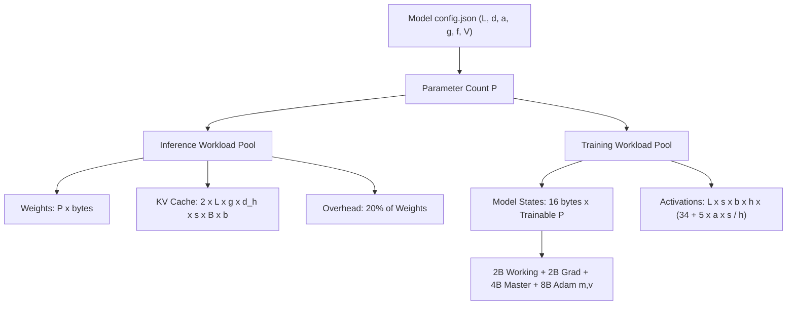
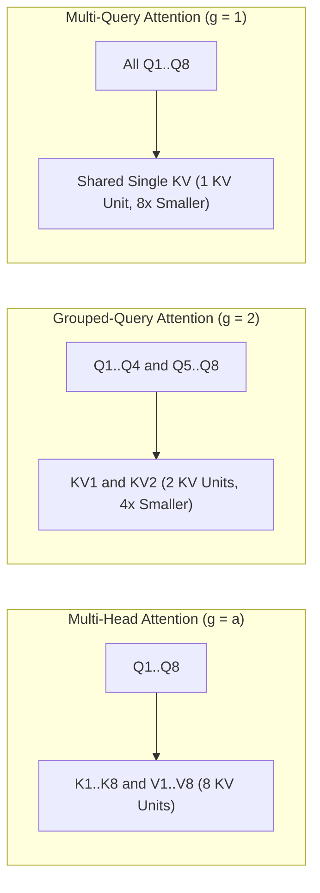
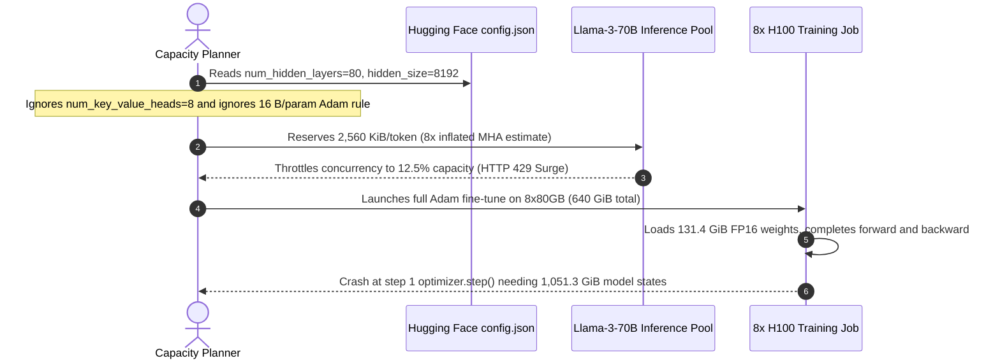

# Module 05: Calculating a Model's Memory Requirements

> **Prerequisites:** [Module 04: VRAM: The Real Constraint](../04-vram-the-real-constraint/README.md), [Track 02: Transformer Architecture](../../02-transformer-architecture/README.md)  
> **Estimated Reading Time:** 30 minutes  
> **Target Audience:** AI Backend Engineers, ML Systems Engineers, Capacity Planners

> [!TIP]
> **The Golden Rule of Model Memory Accounting**  
> Memory is arithmetic on a handful of `config.json` dimensions. Weights = $\text{parameters} \times \text{bytes per parameter}$. KV cache = $2 \times L \times g \times d_h \times s \times B \times b$. Mixed-precision Adam training requires $2 + 2 + 4 + 4 + 4 = 16\text{ bytes per trainable parameter}$ before activations. Treat these formulas as order-of-magnitude planning tools that tell you which term dominates—then measure real peak VRAM on hardware.

---

## 1. Visual Mental Models & Architecture

You are in Track 05, GPUs & GenAI Hardware. [Module 04](../04-vram-the-real-constraint/README.md) named the six categories of GPU memory (weights, gradients, optimizer states, activations, KV cache, overhead) and identified which grow with batch size and sequence length. This module turns each category into an explicit formula, builds a reusable standard-library calculator, and validates it against published numbers from real model architectures. [Module 06](../06-numeric-formats-fp32-fp16-bf16/README.md) then unpacks the floating-point bit layouts behind "bytes per parameter," and [Module 07](../07-mixed-precision-training/README.md) explains why training keeps multiple precision copies of the weights.

After this module, you will be able to:
- Compute a model's weight memory from its parameter count and precision, and count parameters directly from its `config.json`.
- Derive and apply the KV-cache formula, including the compression factor of grouped-query attention (GQA).
- Derive the 16 bytes per parameter rule for mixed-precision Adam training rather than memorizing it.
- Estimate activation memory and state what activation checkpointing trades for it.
- Run a memory calculator against any model card's config and articulate where real hardware diverges from the estimate.



Grouped-Query Attention (GQA) and Multi-Query Attention (MQA) decouple query head count (`a`) from key/value head count (`g`), shrinking the KV cache by a factor of `a / g`:



### Formula & Layout Reference (ASCII Diagrams)

Where each factor of the KV-cache formula comes from, and how MHA, GQA, and MQA compare:

```text
 KV cache bytes = 2  x  L  x  g  x  d_h  x  s  x  B  x  b
                  │     │     │     │      │     │     │
                  │     │     │     │      │     │     └ bytes per number: 2 (FP16/BF16), 1 (INT8)
                  │     │     │     │      │     └ sequences served at the same time
                  │     │     │     │      └ tokens so far (prompt + generated)
                  │     │     │     └ numbers per head: 128 in every model above
                  │     │     └ KV heads: the GQA/MQA knob
                  │     └ layers (each keeps its own cache)
                  └ one key and one value per token

 8 query heads Q1..Q8, three attention designs:

  MHA, g = 8             GQA, g = 2              MQA, g = 1
  Q1 Q2 Q3 Q4 Q5 Q6 Q7 Q8   Q1 Q2 Q3 Q4 Q5 Q6 Q7 Q8   Q1 Q2 Q3 Q4 Q5 Q6 Q7 Q8
  │  │  │  │  │  │  │  │    └──┴──┴──┘  └──┴──┴──┘    └──┴──┴──┴──┴──┴──┴──┘
  K  K  K  K  K  K  K  K        KV1         KV2                  KV
  V  V  V  V  V  V  V  V
  cache: 8 units            cache: 2 units (4x less)   cache: 1 unit (8x less)
```

Bytes per parameter during mixed-precision Adam training, and how the pieces group:

```text
 one parameter
 ┌────────┬────────┬────────────────┬────────────────┬────────────────┐
 │ weight │  grad  │ master weight  │   Adam m       │   Adam v       │
 │  2 B   │  2 B   │  4 B (FP32)    │   4 B (FP32)   │   4 B (FP32)   │
 └────────┴────────┴────────────────┴────────────────┴────────────────┘
 └──── 2 + 2 = 4 B ───┘└────────── K = 12 B (ZeRO paper) ──────────┘     total 16 B

 model-state memory = 16 B x P         (activations are extra, and scale with batch x sequence)
```

---

## 2. Core Equations & Systematic Comparison Matrices

### The Numbers You Need From a Model's `config.json`

Almost every formula below uses the same handful of values, all found in a model's `config.json` or in its paper's architecture table:

| Symbol | Meaning | Typical `config.json` Field |
| :--- | :--- | :--- |
| `L` | Number of transformer layers | `num_hidden_layers` |
| `d` | Hidden size (width of the residual stream) | `hidden_size` |
| `a` | Number of query heads | `num_attention_heads` |
| `g` | Number of key/value heads | `num_key_value_heads` (absent means `g = a`) |
| `d_h` | Head dimension, normally `d / a` | `head_dim`, or derived |
| `f` | Width of the MLP's inner layer | `intermediate_size` |
| `V` | Vocabulary size | `vocab_size` |

### Weights: Parameters $\times$ Bytes per Parameter

$$\text{Weight Bytes} = P \times \text{bytes per parameter}$$

Bytes per parameter: FP32 is 4, FP16 and BF16 are 2, INT8 is 1, INT4 is 0.5 (plus a little extra for scale factors that real 4-bit formats store; see the [quantization module](../../04-training-fine-tuning-and-alignment/15-quantization-int8-int4-gguf/README.md) in Track 04). Module 06 explains why FP16 and BF16 both take 2 bytes.

> [!WARNING]
> **GB vs. GiB**  
> A 7-billion-parameter model in 16-bit numbers is $7 \times 10^9 \times 2 = 14 \times 10^9\text{ bytes} = 14\text{ GB}$ (decimal) $= 13.04\text{ GiB}$ (binary, $1\text{ GiB} = 2^{30}\text{ bytes}$). Tools disagree about which unit they print ($1\text{ GiB} = 1.0737\text{ GB}$). This module uses GiB for memory because that is what operating systems and GPU tools usually report.

**Counting parameters from the config.** For a Llama-style decoder (no bias terms, a three-matrix gated MLP called SwiGLU, RMSNorm layers), one transformer layer holds:
- **Attention:** $W_q$ is $d \times (a \cdot d_h) = d \times d$; $W_k$ and $W_v$ are each $d \times (g \cdot d_h)$; $W_o$ is $(a \cdot d_h) \times d = d \times d$. Together: $2d^2 + 2d \cdot g \cdot d_h$.
- **MLP:** Three matrices of shape $d \times f$ (gate, up) and $f \times d$ (down): $3df$.
- **Two norm weight vectors:** $2d$.

Add the token embedding table ($Vd$), the output projection ($Vd$ again, unless `tie_word_embeddings` is true), and a final norm ($d$):

$$P = L \cdot (2d^2 + 2d \cdot g \cdot d_h + 3df + 2d) + 2Vd + d$$

Models differ in details (some add bias terms to the attention projections, some tie embeddings, mixture-of-experts models multiply the MLP), so treat the result as a sanity check against the published size, not as gospel.

### Inference: Weights + KV Cache + Overhead

An autoregressive model generates one token at a time. To produce token $t$, attention in every layer needs the keys and values of all earlier tokens $1 \dots t-1$. Those do not change once computed, so the engine stores them in the **KV cache** instead of recomputing the whole prefix on every step.

Build the KV-cache formula from the inside out:
1. In one layer, one token produces one key vector and one value vector per KV head, each $d_h$ numbers long: $2 \cdot g \cdot d_h$ numbers.
2. Every layer keeps its own: multiply by $L$.
3. Each number takes $b$ bytes (2 for FP16/BF16, 1 for INT8).
4. The cache holds every token so far, $s$ tokens (prompt plus generated), for each of $B$ sequences served concurrently:

$$\text{KV Cache Bytes} = 2 \times L \times g \times d_h \times s \times B \times b$$

For ordinary multi-head attention ($g \cdot d_h = a \cdot d_h = d$), the cost per token is $2 \cdot L \cdot d \cdot b$, which matches the vLLM paper's OPT-13B example: $2 \text{ (K and V)} \times 5120 \text{ (hidden size)} \times 40 \text{ (layers)} \times 2 \text{ (bytes/FP16)} = 800\text{ KiB/token}$ (loosely written as 800 KB in the paper).

In standard MHA, every query head has its own KV head ($g = a$). Multi-query attention (MQA, Shazeer 2019) shares one KV head across all query heads ($g = 1$). Grouped-query attention (GQA, Ainslie et al. 2023) splits query heads into $g$ groups, shrinking the cache by $a / g$ while keeping quality close to MHA. Llama 2 uses GQA with 8 KV heads for its 34B/70B models, and Llama 3 uses 8 KV heads at both 8B and 70B.

> [!NOTE]
> **Linear Scaling Law**  
> Every term in these formulas is a count multiplied by a byte width, so each lever scales its term linearly: halve the bytes and that term halves, halve $g$ and the KV cache halves, double the context and it doubles. When unsure which lever matters, compute each term at your target and look for the one that dominates.

**Overhead and concurrency budget.** Activations during generation are small, but the CUDA context, kernel workspaces, and allocator slack are not zero. The calculator below adds a flat 20% of the weights as a stand-in, following the "up to about 20% more for inference" rule of thumb in the Hugging Face Accelerate documentation (attributed to EleutherAI). Once weights and overhead are subtracted, the remainder is KV budget:

$$\text{Sequences That Fit} = \left\lfloor \frac{\text{GPU Memory} - \text{Weights} \times (1 + \text{Overhead})}{\text{KV Bytes per Sequence}} \right\rfloor$$

### Training: Where 16 Bytes per Parameter Comes From

Training with the Adam optimizer in mixed precision keeps five parameter-sized tensors:

| Tensor | Precision | Bytes / Param | Why It Exists |
| :--- | :--- | :--- | :--- |
| **Working weights** | 16-bit | 2 | What the forward and backward passes actually multiply |
| **Gradients** | 16-bit | 2 | Output of the backward pass |
| **Master weights** | FP32 | 4 | The accurate copy the optimizer updates (Module 07 explains why) |
| **Adam first moment `m`** | FP32 | 4 | Running average of the gradient |
| **Adam second moment `v`** | FP32 | 4 | Running average of the squared gradient |

$2 + 2 + 4 + 4 + 4 = 16\text{ bytes per parameter}$. The ZeRO paper writes this as $(2 + 2 + K) \times P$ with $K = 12$ for mixed-precision Adam, explaining why a 1.5B-parameter GPT-2 requires at least 24 GB for model states even though its 16-bit weights are only 3 GB.

Two crucial consequences:
- **Mixed precision does not shrink model-state memory.** Plain FP32 Adam is $4 + 4 + 4 + 4 = 16$ bytes too (which is why Accelerate's "training using Adam" for `bert-base-cased` is $413.18\text{ MB} \times 4 = 1.61\text{ GB}$). Mixed precision saves *activation* memory and time, not model states (Module 07). Note that PyTorch's `autocast` keeps parameters in FP32, yielding 4B FP32 weights + 4B FP32 grads + 8B Adam + temporary 16-bit casts.
- **Only trainable parameters pay 16 bytes.** Frozen parameters cost only their weight bytes. With LoRA (Track 04), the base model is frozen and only the small adapter pays 16 bytes/param (measured in Listing 4).

### Activations & Checkpointing Trade-Offs

Korthikanti et al. (2022) derive the 16-bit activation footprint of a standard GPT-style transformer layer with sequence length $s$, micro-batch $b$, hidden size $h$, and query heads $a$:
- Attention block: $11sbh + 5as^2b$ bytes (softmax output 2B, dropout mask 1B, dropout output 2B for each of $as^2b$ scores).
- MLP block: $19sbh$ bytes; Layer norms: $4sbh$ bytes.

Summing per layer:

$$\text{Activation Bytes per Layer} = s \cdot b \cdot h \cdot \left(34 + \frac{5 \cdot a \cdot s}{h}\right)$$

Multiply by $L$ layers and add embeddings plus FP32 cross-entropy logits ($4sbV$ bytes). Two insights stand out:
- **Quadratic sequence scaling:** The $34$ term is linear in $s$, whereas $5as/h$ is quadratic because attention compares every token with every other. Memory-efficient attention kernels such as FlashAttention avoid storing the $N \times N$ score matrix, dropping the quadratic term (Module 08).
- **Activation checkpointing (recomputation):** Instead of storing every layer's intermediates, save only each layer's input ($2sbh$ bytes per layer) and recompute the forward pass during backward. [Chen et al. (2016)](https://arxiv.org/abs/1604.06174) show this reduces memory of an $n$-layer network to roughly $\mathcal{O}(\sqrt{n})$ at the cost of one extra forward pass (~33% extra compute in the ZeRO paper).

> [!WARNING]
> **Block Design Caveat**  
> The activation formula is derived for a specific block design (GeLU MLP, dropout, standard MHA). Llama-style blocks (SwiGLU, no dropout, GQA) store somewhat different amounts. Use the formula to understand scaling shape and ballpark magnitude, then measure real peak usage with `torch.cuda.max_memory_allocated()`.

### Where the Estimate Is Wrong

The calculator does not model: CUDA context and kernel workspaces (folded into flat overhead), allocator fragmentation, peak prefill activations on long prompts, speculative-decoding draft models, serving engines that pre-allocate fixed memory pools, Mixture-of-Experts (MoE) models (all experts must reside in VRAM even if few are active per token—use *total* parameters), or sliding-window attention (the Mistral 7B paper uses a rolling-buffer cache capped at the window size).

### Systematic Reference: Real Published Model Architectures

| Model | `L` | `d` | `a` | `g` | `f` | `V` | Params (Calc) | FP16 Weights | FP16 KV / Tok | GQA Factor | 16B Train States | Source |
| :--- | :--- | :--- | :--- | :--- | :--- | :--- | :--- | :--- | :--- | :--- | :--- | :--- |
| **Llama-2-7B** | 32 | 4096 | 32 | 32 | 11008 | 32000 | 6.74B | 12.55 GiB | 512 KiB | 1x (MHA) | 100.4 GiB | `L`, `d`, `a`: [LLaMA paper](https://arxiv.org/abs/2302.13971) Table 2; `g`: [Llama 2 paper](https://arxiv.org/abs/2307.09288) (GQA only on 34B/70B); `f`: derived from [official `llama/model.py`](https://github.com/meta-llama/llama/blob/main/llama/model.py) |
| **Mistral-7B-v0.1** | 32 | 4096 | 32 | 8 | 14336 | 32000 | 7.24B | 13.49 GiB | 128 KiB | 4x | 107.9 GiB | [Mistral 7B paper](https://arxiv.org/abs/2310.06825) Table 1; identical in [config.json](https://huggingface.co/mistralai/Mistral-7B-v0.1/blob/main/config.json) |
| **Llama-3-8B** | 32 | 4096 | 32 | 8 | 14336 | 128000* | 8.03B | 14.95 GiB | 128 KiB | 4x | 119.6 GiB | [Llama 3 paper](https://arxiv.org/abs/2407.21783) Table 3 |
| **Llama-3-70B** | 80 | 8192 | 64 | 8 | 28672 | 128000* | 70.55B | 131.41 GiB | 320 KiB | 8x | 1051.3 GiB | [Llama 3 paper](https://arxiv.org/abs/2407.21783) Table 3 |

The Llama 2 checkpoints' own `config.json` files are gated on Hugging Face, so Llama-2-7B's MLP width `f` is derived from Meta's [official `llama/model.py`](https://github.com/meta-llama/llama/blob/main/llama/model.py): `hidden_dim = 4*d` shrinks to `int(2*hidden_dim/3)` = 10,922, then rounds up to a multiple of `multiple_of` (256), giving 11,008. The resulting 6.74B total agrees with 6.7B in the LLaMA paper.

\* The Llama 3 paper lists a vocabulary of 128,000. A difference of a few hundred tokens changes an 8B model's parameter count by about 2 million (0.03%).

---

## 3. Production War Story: Incident Post-Mortem

### The Missing GQA Factor & 7.3x Capacity Miscalculation on Llama-3-70B Launch

- **Severity:** SEV-1 (Cluster Capacity Exhaustion & Training OOM Failure)
- **Time to Detect:** 18 minutes post-rollout
- **Time to Resolve:** 1 hour 15 minutes
- **Impact:** A 320-GPU production rollout suffered two simultaneous sizing failures: (1) an inference router provisioned for Llama-3-70B with MHA assumptions ($g=64$ instead of GQA $g=8$) overestimated KV cache by 8x (2,560 KiB/token vs. 320 KiB/token), capping concurrency to 1/8th of capacity and rejecting 87% of API requests with HTTP 429; (2) a parallel full-parameter fine-tuning job tried to fit Llama-3-70B on a single 8x H100-80GB node (640 GiB total VRAM) assuming FP16 weights alone (~131 GiB) left plenty of space, immediately crashing at `optimizer.step()` because 16 B/param Adam states alone require **1,051.3 GiB**. Combined wasted GPU cluster reservations cost ~\$24,000.

#### What Happened

The platform team wrote a quick sizing spreadsheet before launching two workloads on H100-80GB nodes. For serving, the spreadsheet skipped `num_key_value_heads` in `config.json` and computed KV cache from `hidden_size` (`2 * 80 * 8192 * 2 = 2,560 KiB/tok`), throttling each 4-GPU node (320 GiB total) to only 4 concurrent 8K requests instead of >30. Meanwhile, the fine-tuning team budgeted `70B * 2 bytes = 140 GB` for weights on one 8x80GB node (640 GiB total) and ignored the `K = 12` optimizer state bytes per parameter, crashing before step 2.

#### The Failure Sequence Diagram



#### Root Cause Analysis

1. **Ignoring `num_key_value_heads` (`g` vs `a`):** Assuming `g = a` on GQA models inflates KV cache estimates by 4x (Mistral-7B / Llama-3-8B) to 8x (Llama-3-70B).
2. **Confusing Weight Bytes With Training State Bytes:** Full mixed-precision Adam costs $8\times$ the FP16 weight footprint ($16\text{ B}$ vs $2\text{ B}$ per parameter), requiring at least 14x 80 GiB cards under ideal sharding—never 8 cards.

#### The Fix & Architectural Hardening

1. **Automated `config.json` CI Gate:** Replaced manual spreadsheets with a strict preflight parser reading `num_key_value_heads`, `head_dim`, and `tie_word_embeddings` directly from model artifacts.
2. **LoRA & Multi-Node FSDP Routing:** Enforced an automated admission rule: full fine-tuning requires $\ge 1.3 \times (16P + \text{activations})$ VRAM across nodes (2 nodes / 16x H100s for 70B), while single-node 8x H100 jobs are automatically routed to LoRA/QLoRA adapters.

---

## 4. Verified Python Experiments

Save the first listing as `memcalc.py`; the other listings import it. Everything uses only the Python standard library. All outputs below were produced by running these listings with Python 3.13.

### Listing 1: The Calculator (`memcalc.py`)

```python
"""memcalc.py - back-of-envelope GPU memory calculator for decoder-only transformers.

Estimates, not measurements. Standard library only.
"""
from dataclasses import dataclass

GIB = 1024 ** 3
BYTES = {"fp32": 4.0, "fp16": 2.0, "bf16": 2.0, "int8": 1.0, "int4": 0.5}


@dataclass(frozen=True)
class Cfg:
    """The handful of architecture numbers that decide memory."""
    name: str
    layers: int
    hidden: int
    heads: int           # query heads
    kv_heads: int        # key/value heads (== heads for MHA, 1 for MQA, in between for GQA)
    ffn: int             # SwiGLU intermediate size
    vocab: int
    tied_embeddings: bool = False

    @property
    def head_dim(self) -> int:
        return self.hidden // self.heads


def param_count(c: Cfg) -> int:
    """Llama-style block: no biases, SwiGLU MLP (3 matrices), RMSNorm weights."""
    attn = (c.hidden * c.heads * c.head_dim              # W_q
            + 2 * c.hidden * c.kv_heads * c.head_dim     # W_k and W_v
            + c.heads * c.head_dim * c.hidden)           # W_o
    mlp = 3 * c.hidden * c.ffn                           # gate, up, down
    norms = 2 * c.hidden                                 # two RMSNorms per layer
    per_layer = attn + mlp + norms
    embed = c.vocab * c.hidden
    lm_head = 0 if c.tied_embeddings else c.vocab * c.hidden
    return c.layers * per_layer + embed + lm_head + c.hidden   # + final norm


def weights_bytes(n_params: float, dtype: str = "fp16") -> float:
    return n_params * BYTES[dtype]


def kv_bytes_per_token(c: Cfg, dtype: str = "fp16") -> float:
    # 2 (K and V) x layers x kv_heads x head_dim x bytes
    return 2 * c.layers * c.kv_heads * c.head_dim * BYTES[dtype]


def kv_cache_bytes(c: Cfg, seq_len: int, batch: int = 1, dtype: str = "fp16") -> float:
    return kv_bytes_per_token(c, dtype) * seq_len * batch


def inference_bytes(c: Cfg, weight_dtype="fp16", kv_dtype="fp16",
                    seq_len=4096, batch=1, overhead_frac=0.20) -> dict:
    """weights + KV cache + a flat overhead (activations workspace, CUDA context,
    fragmentation) taken as a fraction of the weights."""
    w = weights_bytes(param_count(c), weight_dtype)
    kv = kv_cache_bytes(c, seq_len, batch, kv_dtype)
    ov = overhead_frac * w
    return {"weights": w, "kv_cache": kv, "overhead": ov, "total": w + kv + ov}


def training_state_bytes(n_params: float, mode="mixed_adam") -> dict:
    """Bytes for the parameter-sized tensors (no activations)."""
    if mode == "mixed_adam":      # 16-bit working copy + grads, fp32 master copy + Adam m, v
        parts = {"weights_16bit": 2, "grads_16bit": 2,
                 "master_weights_fp32": 4, "adam_m_fp32": 4, "adam_v_fp32": 4}
    elif mode == "fp32_adam":     # everything fp32
        parts = {"weights_fp32": 4, "grads_fp32": 4, "adam_m_fp32": 4, "adam_v_fp32": 4}
    else:
        raise ValueError(mode)
    out = {k: v * n_params for k, v in parts.items()}
    out["total"] = sum(parts.values()) * n_params
    return out


def activation_bytes(c: Cfg, seq_len: int, batch: int,
                     flash: bool = False, recompute: str = "none") -> float:
    """Rough training-activation estimate after Korthikanti et al. 2022 (16-bit activations, no
    tensor/pipeline parallelism). Per layer: s*b*h*(34 + 5*a*s/h) bytes; flash=True drops the
    5*a*s/h attention-score term. recompute='full' keeps only each layer's input (2*s*b*h) plus one
    layer re-materialised during backward. Written for GPT-style blocks: a ballpark for Llama-style."""
    s, b, h, a, L, v = seq_len, batch, c.hidden, c.heads, c.layers, c.vocab
    one_layer = s * b * h * (34 + (0 if flash else 5 * a * s / h))
    body = L * 2 * s * b * h + one_layer if recompute == "full" else L * one_layer
    extra = s * b * (5 * h + 4 * v)    # embedding dropout, last norm, output layer, fp32 logits
    return body + extra


def max_concurrent_seqs(c: Cfg, gpu_gib: float, seq_len: int, weight_dtype="fp16",
                        kv_dtype="fp16", overhead_frac=0.20) -> int:
    w = weights_bytes(param_count(c), weight_dtype) * (1 + overhead_frac)
    free = gpu_gib * GIB - w
    return max(0, int(free // kv_cache_bytes(c, seq_len, 1, kv_dtype)))


def gib(n_bytes: float) -> str:
    return f"{n_bytes / GIB:8.2f} GiB"
```

### Listing 2: Check the Calculator Against Hand Arithmetic and Published Numbers

Three hand checks first. For Llama-2-7B (`d=4096`, `L=32`, `f=11008`, `V=32000`, MHA): attention is `4 x 4096 x 4096` = 67,108,864; the MLP is `3 x 4096 x 11008` = 135,266,304; two norms add 8,192; one layer is 202,383,360. Times 32 layers is 6,476,267,520; the embedding and the output head add `2 x 32000 x 4096` = 262,144,000; the final norm adds 4,096. Total 6,738,415,616 parameters, so 13,476,831,232 bytes in FP16, which is 12.55 GiB. Mistral-7B's KV cache per token is `2 x 32 x 8 x 128 x 2` = 131,072 bytes = 128 KiB. Llama-3-70B's mixed-precision Adam states are `P x 16` bytes. The listing redoes these in plain arithmetic, asserts the calculator agrees, then compares with figures published in papers.

```python
from memcalc import *

l2_7b = Cfg("Llama-2-7B", layers=32, hidden=4096, heads=32, kv_heads=32, ffn=11008, vocab=32000)
mistral = Cfg("Mistral-7B", layers=32, hidden=4096, heads=32, kv_heads=8, ffn=14336, vocab=32000)
l3_70 = Cfg("Llama-3-70B", layers=80, hidden=8192, heads=64, kv_heads=8, ffn=28672, vocab=128000)

print("== Hand checks (plain arithmetic, no calculator code) ==")
# 1. Llama-2-7B parameters and FP16 weight bytes
d, L, f, V = 4096, 32, 11008, 32000
attn = 4 * d * d                        # W_q, W_k, W_v, W_o are all d x d when kv_heads == heads
mlp = 3 * d * f                         # gate, up, down
per_layer = attn + mlp + 2 * d          # + two norm weight vectors
total = L * per_layer + 2 * V * d + d   # + input embedding + untied output head + final norm
print(f"per layer {per_layer:,}  x {L} layers + embeddings/head/norm = {total:,} parameters")
assert total == param_count(l2_7b)
print(f"FP16 weights = {total * 2:,} bytes = {total * 2 / GIB:.2f} GiB")

# 2. Mistral-7B KV cache: 2 * 32 layers * 8 kv heads * 128 head_dim * 2 bytes
per_token = 2 * 32 * 8 * 128 * 2
assert per_token == kv_bytes_per_token(mistral)
print(f"Mistral-7B KV cache = {per_token:,} bytes/token = {per_token // 1024} KiB; at 4096 tokens = {per_token * 4096 / GIB:.2f} GiB")

# 3. Llama-3-70B training states: 16 bytes per parameter
P = param_count(l3_70)
print(f"Llama-3-70B: {P:,} parameters x 16 bytes = {P * 16 / GIB:.1f} GiB")
assert abs(P * 16 - training_state_bytes(P)["total"]) < 1

print()
print("== Published numbers the calculator should reproduce ==")
opt13 = Cfg("OPT-13B", layers=40, hidden=5120, heads=40, kv_heads=40, ffn=0, vocab=0)
per_tok = kv_bytes_per_token(opt13)
print(f"OPT-13B KV per token : {per_tok:,.0f} bytes = {per_tok / 1024:.0f} KiB      (vLLM paper: 800 KB)")
print(f"OPT-13B 2048 tokens  : {kv_cache_bytes(opt13, 2048) / GIB:.2f} GiB            (vLLM paper: 1.6 GB)")
st = training_state_bytes(1.5e9)
print(f"GPT-2 1.5B 16-bit weights: {st['weights_16bit'] / 1e9:.1f} GB, all training states: {st['total'] / 1e9:.1f} GB   (ZeRO paper: 3 GB, 24 GB)")
for cfg, published in ((l2_7b, "6.7B (LLaMA paper, Table 2)"),
                       (Cfg("Qwen2.5-7B", 28, 3584, 28, 4, 18944, 152064), "7.61B (Qwen2.5-7B model card)")):
    print(f"{cfg.name:11s} computed {param_count(cfg) / 1e9:.3f}B parameters    (published: {published})")
```

**Output:**

```text
== Hand checks (plain arithmetic, no calculator code) ==
per layer 202,383,360  x 32 layers + embeddings/head/norm = 6,738,415,616 parameters
FP16 weights = 13,476,831,232 bytes = 12.55 GiB
Mistral-7B KV cache = 131,072 bytes/token = 128 KiB; at 4096 tokens = 0.50 GiB
Llama-3-70B: 70,549,512,192 parameters x 16 bytes = 1051.3 GiB

== Published numbers the calculator should reproduce ==
OPT-13B KV per token : 819,200 bytes = 800 KiB      (vLLM paper: 800 KB)
OPT-13B 2048 tokens  : 1.56 GiB            (vLLM paper: 1.6 GB)
GPT-2 1.5B 16-bit weights: 3.0 GB, all training states: 24.0 GB   (ZeRO paper: 3 GB, 24 GB)
Llama-2-7B  computed 6.738B parameters    (published: 6.7B (LLaMA paper, Table 2))
Qwen2.5-7B  computed 7.615B parameters    (published: 7.61B (Qwen2.5-7B model card))
```

The hand arithmetic matches the calculator (`assert` lines passed), and the calculator reproduces the three published figures. Note the unit: the vLLM paper's "800 KB" is $800 \times 1024$ bytes, and its "1.6 GB" for 2,048 tokens is 1.56 GiB, so the paper uses binary units loosely.

### Listing 3: Run It on Real Architectures

```python
from dataclasses import replace
from memcalc import *

MODELS = [
    Cfg("Llama-2-7B",  layers=32, hidden=4096, heads=32, kv_heads=32, ffn=11008, vocab=32000),
    Cfg("Mistral-7B",  layers=32, hidden=4096, heads=32, kv_heads=8,  ffn=14336, vocab=32000),
    Cfg("Llama-3-8B",  layers=32, hidden=4096, heads=32, kv_heads=8,  ffn=14336, vocab=128000),
    Cfg("Llama-3-70B", layers=80, hidden=8192, heads=64, kv_heads=8,  ffn=28672, vocab=128000),
]

print("A. Weights")
print(f"{'model':12s} {'params':>8s} | {'FP16/BF16':>10s} {'INT8':>10s} {'INT4':>10s}")
for c in MODELS:
    n = param_count(c)
    print(f"{c.name:12s} {n / 1e9:7.2f}B | " + " ".join(f"{gib(weights_bytes(n, dt)):>10s}" for dt in ("fp16", "int8", "int4")))

print("\nB. KV cache (FP16)")
print(f"{'model':12s} {'kv heads':>8s} {'KiB/token':>10s} {'if MHA':>8s} {'saving':>7s} | {'4K x 1':>10s} {'32K x 8':>11s}")
for c in MODELS:
    mha = replace(c, kv_heads=c.heads)
    print(f"{c.name:12s} {c.kv_heads:>3d}/{c.heads:<4d} {kv_bytes_per_token(c) / 1024:10.0f} {kv_bytes_per_token(mha) / 1024:8.0f} "
          f"{c.heads // c.kv_heads:6d}x | {gib(kv_cache_bytes(c, 4096, 1)):>10s} {gib(kv_cache_bytes(c, 32768, 8)):>11s}")

print("\nC. Inference totals, 4096-token context, batch 1: FP16 weights + FP16 KV cache + 20% of weights as overhead")
for c in MODELS:
    t = inference_bytes(c, seq_len=4096, batch=1)
    print(f"  {c.name:12s} weights {t['weights'] / GIB:7.2f}  kv {t['kv_cache'] / GIB:6.2f}  "
          f"overhead {t['overhead'] / GIB:6.2f}  TOTAL {t['total'] / GIB:8.2f} GiB")

print("\nD. Training states, mixed-precision Adam (16 bytes/param). Activations NOT included.")
for c in MODELS:
    st = training_state_bytes(param_count(c))["total"]
    print(f"  {c.name:12s} {st / GIB:9.1f} GiB = {st / GIB / 80:5.1f} x 80 GiB")
```

**Output:**

```text
A. Weights
model          params |  FP16/BF16       INT8       INT4
Llama-2-7B      6.74B |    12.55 GiB     6.28 GiB     3.14 GiB
Mistral-7B      7.24B |    13.49 GiB     6.74 GiB     3.37 GiB
Llama-3-8B      8.03B |    14.95 GiB     7.48 GiB     3.74 GiB
Llama-3-70B    70.55B |   131.41 GiB    65.70 GiB    32.85 GiB

B. KV cache (FP16)
model        kv heads  KiB/token   if MHA  saving |     4K x 1     32K x 8
Llama-2-7B    32/32          512      512      1x |     2.00 GiB   128.00 GiB
Mistral-7B     8/32          128      512      4x |     0.50 GiB    32.00 GiB
Llama-3-8B     8/32          128      512      4x |     0.50 GiB    32.00 GiB
Llama-3-70B    8/64          320     2560      8x |     1.25 GiB    80.00 GiB

C. Inference totals, 4096-token context, batch 1: FP16 weights + FP16 KV cache + 20% of weights as overhead
  Llama-2-7B   weights   12.55  kv   2.00  overhead   2.51  TOTAL    17.06 GiB
  Mistral-7B   weights   13.49  kv   0.50  overhead   2.70  TOTAL    16.69 GiB
  Llama-3-8B   weights   14.95  kv   0.50  overhead   2.99  TOTAL    18.44 GiB
  Llama-3-70B  weights  131.41  kv   1.25  overhead  26.28  TOTAL   158.94 GiB

D. Training states, mixed-precision Adam (16 bytes/param). Activations NOT included.
  Llama-2-7B       100.4 GiB =   1.3 x 80 GiB
  Mistral-7B       107.9 GiB =   1.3 x 80 GiB
  Llama-3-8B       119.6 GiB =   1.5 x 80 GiB
  Llama-3-70B     1051.3 GiB =  13.1 x 80 GiB
```

> [!NOTE]
> **Reading the Tables:** Llama-2-7B and Mistral-7B have the same width, depth, and head size; the only big difference for the cache is `g`, 32 versus 8, and the cache per token drops from 512 KiB to 128 KiB. At eight 32K-token sequences that is 128 GiB versus 32 GiB: one fits on a data-center card next to the weights, the other does not. Llama-3-70B has 8 KV heads against 64 query heads, so its cache is 8x smaller than plain MHA (320 KiB versus 2,560 KiB per token). In FP16 the 70B model's weights alone (131 GiB) exceed one 80 GB card; INT4 brings them to about 33 GiB. Mistral-7B-v0.1 uses a sliding window of 4,096 tokens, so a stack with a rolling-buffer cache would hold less than the 32K row shows: that cell is an upper bound.

### Listing 4: Activations, Concurrency, and LoRA

```python
from memcalc import *

l2_7b = Cfg("Llama-2-7B", layers=32, hidden=4096, heads=32, kv_heads=32, ffn=11008, vocab=32000)
mistral = Cfg("Mistral-7B", layers=32, hidden=4096, heads=32, kv_heads=8, ffn=14336, vocab=32000)
l3_70 = Cfg("Llama-3-70B", layers=80, hidden=8192, heads=64, kv_heads=8, ffn=28672, vocab=128000)

print("1. Activation estimate, Llama-2-7B shape, sequence length 4096 (GiB):")
print(f"{'batch':>5s} {'stored (naive)':>15s} {'flash attn':>11s} {'recompute':>10s} {'both':>6s}")
for b in (1, 2, 4):
    cols = [activation_bytes(l2_7b, 4096, b, flash=fl, recompute=rc) / GIB
            for fl, rc in ((False, "none"), (True, "none"), (False, "full"), (True, "full"))]
    print(f"{b:5d} {cols[0]:15.1f} {cols[1]:11.1f} {cols[2]:10.1f} {cols[3]:6.1f}")

print("\n2. How many 4096-token sequences fit next to the weights on one 80 GiB card?")
for c, wd in ((l2_7b, "fp16"), (mistral, "fp16"), (l3_70, "int4")):
    n = max_concurrent_seqs(c, 80, 4096, weight_dtype=wd)
    print(f"  {c.name:12s} weights={wd:5s} kv_heads={c.kv_heads:2d} -> {n} sequences")

print("\n3. Fine-tuning Llama-2-7B: full versus LoRA (rank 8 on W_q, W_k, W_v, W_o), states only:")
P = param_count(l2_7b)
full = training_state_bytes(P)["total"]
r, d = 8, l2_7b.hidden
adapter = l2_7b.layers * 4 * r * (d + d)           # LoRA adds r*(d_in + d_out) parameters per adapted matrix
lora = 2 * P + 16 * adapter                          # frozen 16-bit base weights + full 16 B/param on the adapter only
print(f"  full fine-tune : {full / GIB:7.2f} GiB")
print(f"  LoRA r=8       : {lora / GIB:7.2f} GiB   ({adapter:,} adapter parameters = {100 * adapter / P:.2f}% of the model)")
```

**Output:**

```text
1. Activation estimate, Llama-2-7B shape, sequence length 4096 (GiB):
batch  stored (naive)  flash attn  recompute   both
    1            97.6        17.6        4.6    2.1
    2           195.1        35.1        9.2    4.2
    4           390.3        70.3       18.4    8.4

2. How many 4096-token sequences fit next to the weights on one 80 GiB card?
  Llama-2-7B   weights=fp16  kv_heads=32 -> 32 sequences
  Mistral-7B   weights=fp16  kv_heads= 8 -> 127 sequences
  Llama-3-70B  weights=int4  kv_heads= 8 -> 32 sequences

3. Fine-tuning Llama-2-7B: full versus LoRA (rank 8 on W_q, W_k, W_v, W_o), states only:
  full fine-tune :  100.41 GiB
  LoRA r=8       :   12.68 GiB   (8,388,608 adapter parameters = 0.12% of the model)
```

The first block is the whole story of why FlashAttention and checkpointing exist. Taken literally, the naive column says one 4096-token sequence of a 7B model needs about 98 GiB of activations: the quadratic score term is most of it. Dropping it (`flash`) leaves 17.6 GiB, and recomputing layers instead of storing them drops it to 4.6 GiB (2.1 GiB with both). Block 2 is the GQA payoff in users: 4x fewer KV heads is 4x more concurrent sequences (127 versus 32, since the 7B weights are almost the same size). Block 3 is the LoRA payoff: 100 GiB of states becomes under 13 GiB.

---

## 5. Multi-Language Production Implementation

````carousel
### Go: Config-Driven Model Sizing & GiB/GB Converter

```go
// model_sizing.go
// Calculates exact parameter count, KV cache per token, and 16 B/param Adam training states.
package main

import "fmt"

const GiB = 1024.0 * 1024.0 * 1024.0

type ModelConfig struct {
	Name           string
	Layers         int
	Hidden         int
	Heads          int
	KvHeads        int
	Ffn            int
	Vocab          int
	TiedEmbeddings bool
}

func (c ModelConfig) HeadDim() int { return c.Hidden / c.Heads }

func (c ModelConfig) ParamCount() int64 {
	hd := int64(c.HeadDim())
	h := int64(c.Hidden)
	attn := h*int64(c.Heads)*hd + 2*h*int64(c.KvHeads)*hd + int64(c.Heads)*hd*h
	mlp := 3 * h * int64(c.Ffn)
	norms := 2 * h
	embed := int64(c.Vocab) * h
	lmHead := embed
	if c.TiedEmbeddings {
		lmHead = 0
	}
	return int64(c.Layers)*(attn+mlp+norms) + embed + lmHead + h
}

func (c ModelConfig) KvBytesPerToken(bytesPerNum float64) float64 {
	return 2.0 * float64(c.Layers) * float64(c.KvHeads) * float64(c.HeadDim()) * bytesPerNum
}

func main() {
	models := []ModelConfig{
		{"Llama-2-7B", 32, 4096, 32, 32, 11008, 32000, false},
		{"Mistral-7B", 32, 4096, 32, 8, 14336, 32000, false},
		{"Llama-3-70B", 80, 8192, 64, 8, 28672, 128000, false},
	}

	for _, m := range models {
		p := float64(m.ParamCount())
		wGiB := (p * 2.0) / GiB
		kvKiB := m.KvBytesPerToken(2.0) / 1024.0
		trainGiB := (p * 16.0) / GiB
		fmt.Printf("%-12s | Params: %5.2fB | FP16 Weights: %6.2f GiB | KV: %4.0f KiB/tok | Adam States: %7.1f GiB\n",
			m.Name, p/1e9, wGiB, kvKiB, trainGiB)
	}
}
```
<!-- slide -->
### TypeScript: Hugging Face `config.json` Memory Estimator

```typescript
// capacityEstimator.ts
// Parses Hugging Face config.json fields to compute serving concurrency and LoRA footprints.

export interface HfModelConfig {
  num_hidden_layers: number;
  hidden_size: number;
  num_attention_heads: number;
  num_key_value_heads?: number;
  head_dim?: number;
  intermediate_size: number;
  vocab_size: number;
  tie_word_embeddings?: boolean;
}

const GIB = 1024 ** 3;

export function estimateCapacity(
  cfg: HfModelConfig,
  gpuVramGiB: number,
  seqLen: number,
  weightBytes: number = 2,
  kvBytes: number = 2,
  overheadFrac: number = 0.2
) {
  const L = cfg.num_hidden_layers;
  const d = cfg.hidden_size;
  const a = cfg.num_attention_heads;
  const g = cfg.num_key_value_heads ?? a; // Absent means standard MHA
  const dh = cfg.head_dim ?? Math.floor(d / a);
  const f = cfg.intermediate_size;
  const V = cfg.vocab_size;

  const perLayer = 2 * d * a * dh + 2 * d * g * dh + 3 * d * f + 2 * d;
  const embedAndHead = cfg.tie_word_embeddings ? V * d : 2 * V * d;
  const params = L * perLayer + embedAndHead + d;

  const weightGiB = (params * weightBytes) / GIB;
  const kvPerSeqGiB = (2 * L * g * dh * seqLen * kvBytes) / GIB;
  const freeForKvGiB = gpuVramGiB - weightGiB * (1 + overheadFrac);
  const maxSequences = Math.max(0, Math.floor(freeForKvGiB / kvPerSeqGiB));

  return {
    paramsBillions: Number((params / 1e9).toFixed(3)),
    gqaFactor: Number((a / g).toFixed(1)),
    weightGiB: Number(weightGiB.toFixed(2)),
    kvPerSeqGiB: Number(kvPerSeqGiB.toFixed(2)),
    maxConcurrentSeqs: maxSequences,
  };
}

const qwen25_7b: HfModelConfig = {
  num_hidden_layers: 28,
  hidden_size: 3584,
  num_attention_heads: 28,
  num_key_value_heads: 4,
  intermediate_size: 18944,
  vocab_size: 152064,
  tie_word_embeddings: false,
};

console.log(estimateCapacity(qwen25_7b, 80, 32768));
```
<!-- slide -->
### Python: PyTorch Activation Checkpointing & Peak VRAM Verifier

```python
"""
torch_memory_audit.py
Measures actual peak activation VRAM in PyTorch with and without
activation checkpointing (torch.utils.checkpoint) on a Transformer-like block.
Falls back to analytical calculation if PyTorch/CUDA is unavailable.
"""

def audit_checkpointing(layers: int = 8, seq_len: int = 2048, batch: int = 4, hidden: int = 1024) -> None:
    try:
        import torch
        import torch.nn as nn
        from torch.utils.checkpoint import checkpoint
    except ImportError:
        est_no_ckpt = layers * seq_len * batch * hidden * 34 / (1024 ** 2)
        est_ckpt = (layers * 2 + 34) * seq_len * batch * hidden / (1024 ** 2)
        print(f"PyTorch unavailable. Analytical 16-bit activation estimate:")
        print(f"  Standard backward : {est_no_ckpt:.1f} MiB")
        print(f"  Full checkpointing: {est_ckpt:.1f} MiB")
        return

    if not torch.cuda.is_available():
        print("CUDA unavailable; analytical scaling applies identically to VRAM.")
        return

    device = torch.device("cuda")
    blocks = nn.ModuleList([nn.Sequential(nn.Linear(hidden, hidden * 4), nn.GELU(), nn.Linear(hidden * 4, hidden)) for _ in range(layers)]).to(device, dtype=torch.bfloat16)

    for use_ckpt in (False, True):
        torch.cuda.reset_peak_memory_stats()
        x = torch.randn(batch, seq_len, hidden, device=device, dtype=torch.bfloat16, requires_grad=True)
        for blk in blocks:
            x = checkpoint(blk, x, use_reentrant=False) if use_ckpt else blk(x)
        x.sum().backward()
        peak_mib = torch.cuda.max_memory_allocated() / (1024 ** 2)
        print(f"Checkpoint={str(use_ckpt):5s} | Peak Allocated VRAM: {peak_mib:8.2f} MiB")


if __name__ == "__main__":
    audit_checkpointing()
```
<!-- slide -->
### C#: Multi-GPU Sharding & Concurrency Capacity Planner

```csharp
// TransformerMemoryCalculator.cs
// Computes exact 16 B/param training cluster requirements and serving KV concurrency.
using System;

public sealed record ModelSpec(
    string Name, int Layers, int Hidden, int Heads, int KvHeads, int Ffn, int Vocab, bool Tied = false)
{
    public int HeadDim => Hidden / Heads;

    public long ParameterCount()
    {
        long h = Hidden, hd = HeadDim;
        long attn = h * Heads * hd + 2L * h * KvHeads * hd + Heads * hd * h;
        long mlp = 3L * h * Ffn;
        long norms = 2L * h;
        long embed = (long)Vocab * h;
        long head = Tied ? 0L : embed;
        return Layers * (attn + mlp + norms) + embed + head + h;
    }

    public double KvCacheGiB(int seqLen, int batch, int bytesPerNum = 2)
    {
        double bytes = 2.0 * Layers * KvHeads * HeadDim * seqLen * batch * bytesPerNum;
        return bytes / Math.Pow(1024, 3);
    }
}

public static class TransformerMemoryCalculator
{
    public static void Main()
    {
        var llama70b = new ModelSpec("Llama-3-70B", 80, 8192, 64, 8, 28672, 128000);
        long paramsCount = llama70b.ParameterCount();
        double statesGiB = (paramsCount * 16.0) / Math.Pow(1024, 3);
        int minH100Cards = (int)Math.Ceiling(statesGiB / 80.0);

        Console.WriteLine($"{llama70b.Name}: {paramsCount / 1e9:F2}B params");
        Console.WriteLine($"Mixed-Precision Adam States: {statesGiB:F1} GiB -> Min ideal 80 GiB cards: {minH100Cards}");
        Console.WriteLine($"FP16 KV Cache (8K x 10 users): {llama70b.KvCacheGiB(8192, 10):F2} GiB");
    }
}
```
````

---

## 6. Practical Hands-On Verification Workflows & Exercises

### Verification Workflow 1: Reproduce Published Benchmarks via `memcalc.py`

Run the hand checks and published paper validations (OPT-13B vLLM, GPT-2 1.5B ZeRO, Llama-2-7B, Qwen2.5-7B) directly from the terminal:

```bash
python -c "
from dataclasses import dataclass
GIB = 1024**3
# Verify OPT-13B (L=40, d=5120, MHA, FP16) & Qwen2.5-7B KV cache
opt_per_tok = 2 * 40 * 5120 * 2
qwen_per_tok = 2 * 28 * 4 * (3584 // 28) * 2
print(f'OPT-13B KV/token: {opt_per_tok:,} B ({opt_per_tok//1024} KiB), 2048 tok: {opt_per_tok*2048/GIB:.2f} GiB')
print(f'Qwen2.5-7B KV/token: {qwen_per_tok:,} B ({qwen_per_tok//1024} KiB), 32768 tok: {qwen_per_tok*32768/GIB:.2f} GiB')
"
```

**Expected Output:**

```text
OPT-13B KV/token: 819,200 B (800 KiB), 2048 tok: 1.56 GiB
Qwen2.5-7B KV/token: 57,344 B (56 KiB), 32768 tok: 1.75 GiB
```

### Verification Workflow 2: Inspect a Live Hugging Face `config.json`

Fetch a public model's `config.json` (e.g., `mistralai/Mistral-7B-v0.1`) with Python's standard library and extract the exact fields needed for memory calculation:

```bash
python -c "
import json, urllib.request
url = 'https://huggingface.co/mistralai/Mistral-7B-v0.1/raw/main/config.json'
cfg = json.loads(urllib.request.urlopen(url, timeout=10).read())
L, d, a = cfg['num_hidden_layers'], cfg['hidden_size'], cfg['num_attention_heads']
g = cfg.get('num_key_value_heads', a)
dh = cfg.get('head_dim', d // a)
print(f'L={L}, d={d}, a={a}, g={g}, d_h={dh}, KV/tok(FP16)={2*L*g*dh*2//1024} KiB')
"
```

**Expected Output:**

```text
L=32, d=4096, a=32, g=8, d_h=128, KV/tok(FP16)=128 KiB
```

---

### Hands-On Practice Exercises

#### 1. Size a Model From Its Config

Qwen2.5-7B's [config.json](https://huggingface.co/Qwen/Qwen2.5-7B/blob/main/config.json) reads: `hidden_size` 3584, `intermediate_size` 18944, `num_attention_heads` 28, `num_hidden_layers` 28, `num_key_value_heads` 4, `vocab_size` 152064, `tie_word_embeddings` false. Using the calculator: (a) how many parameters and how many GiB in BF16? (b) KV bytes per token and the cache for one 32,768-token sequence? (c) how much larger would the per-token cache be if it used plain MHA?

<details><summary><strong>Answer</strong></summary>

Build `Cfg("Qwen2.5-7B", 28, 3584, 28, 4, 18944, 152064)`. (a) 7,615,487,488 parameters (the model card says 7.61B; the small difference from bias terms is far below rounding), so 14.18 GiB in BF16. (b) The head dimension is $3584 / 28 = 128$, so $2 \times 28 \times 4 \times 128 \times 2 = 57,344\text{ bytes} = 56\text{ KiB}$ per token, and 32,768 tokens is 1.75 GiB. (c) With 28 KV heads instead of 4 the cache would be $28 / 4 = 7$ times larger: 392 KiB per token. (All three computed with the calculator.)

</details>

#### 2. Training States and the Number of Cards

A 13-billion-parameter model is fine-tuned with mixed-precision Adam. How much memory do the model states need, and what is the smallest number of 80 GiB cards if they could be split perfectly (ignoring activations and overhead)?

<details><summary><strong>Answer</strong></summary>

$13 \times 10^9 \times 16\text{ bytes} = 193.7\text{ GiB}$. Divided by 80 GiB gives 2.42, so at least 3 cards, and that is a lower bound: real sharding is never perfect and activations and overhead come on top (Modules 09 to 11).

</details>

#### 3. How Many Users Fit?

On a 24 GiB card, how many 8,192-token sequences of Llama-3-8B (FP16 weights, FP16 cache, 20% overhead) can be served at once?

<details><summary><strong>Answer</strong></summary>

Weights $\times 1.2 = 14.95 \times 1.2 = 17.94\text{ GiB}$, leaving 6.06 GiB. One sequence's cache is $128\text{ KiB} \times 8,192 = 1.0\text{ GiB}$. So `max_concurrent_seqs(l3_8b, 24, 8192)` returns 6 sequences. With INT8 weights the answer would be larger; with MHA instead of GQA far smaller.

</details>

#### 4. How Much Batch Can Checkpointing Buy?

For the Llama-2-7B shape at sequence length 2,048, what is the largest micro-batch whose estimated activations fit in 20 GiB under (a) naive storage, (b) flash-style attention, (c) full recomputation, (d) both? Use `activation_bytes`.

<details><summary><strong>Answer</strong></summary>

Loop `b` upward until the estimate exceeds 20 GiB: (a) not even batch 1 fits (28.8 GiB), (b) 2, (c) 11, (d) 19. As always these are estimates from a formula for a different block design; the ordering and the size of the gaps are the useful result.

</details>

### Independent Challenge: `fit.py`

Turn the calculator into a tool that works from a model card. Write `fit.py` that takes a Hugging Face model id and a GPU size, downloads that repository's public `config.json` with the standard library (`urllib`), and prints a report: parameter count (and how it compares with any size stated on the model card), weight memory at FP16/BF16, INT8 and INT4, KV cache per token and for a context length you pass in, and the number of concurrent sequences that fit.

Requirements: handle configs with no `num_key_value_heads` (it means MHA), configs that state `head_dim` explicitly, and tied embeddings; refuse politely on gated repositories rather than crashing; print which assumptions the model violates (bias terms, mixture-of-experts fields such as an expert count). Stretch: add a training mode that reports the 16-byte states and the minimum number of cards under perfect sharding. There is no reference solution. Test it on the four architectures in Listing 3 and on one model you pick yourself, and compare against the published size.

<details><summary><strong>Discussion: Handling Real-World config.json Edge Cases</strong></summary>

1. **Missing `num_key_value_heads`:** Older models (e.g., Llama 1, Llama-2-7B, GPT-NeoX) omit `num_key_value_heads`, which strictly defaults to `num_attention_heads` (MHA).
2. **Explicit `head_dim`:** Newer models (like Gemma 2 and Qwen 3 variants) sometimes have `head_dim * num_attention_heads != hidden_size`. Always prefer `cfg.get("head_dim", hidden_size // num_attention_heads)`.
3. **MoE & Gated Repos:** Catch HTTP 401/403 from Hugging Face gracefully, and check for `num_local_experts` or `n_routed_experts` so you flag that the MLP matrix count is multiplied across all experts.

</details>

---

## 7. Operational Validation Checkpoints & Quizzes

### Operational Validation Scenarios

<details><summary><strong>Scenario 1: The Mixture-of-Experts (MoE) Active vs. Total Parameter Trap</strong></summary>

**Question:** A team plans to serve Mixtral-8x7B (`46.7B` total parameters, `12.9B` active parameters per token) in BF16 on a single 48 GB L40S GPU, reasoning that only 12.9B parameters run on each token (`12.9B * 2 = 24.0 GiB`). Will the model even load?

**Answer:** No—it will crash with OOM during model load. Every single one of the 8 expert MLPs must stay resident in GPU VRAM simultaneously because routing chooses different experts per token and per batch element; fetching inactive experts over PCIe would destroy latency. Memory capacity ALWAYS scales with **total parameters** (`46.7B * 2 bytes = 87.0 GiB`), requiring either INT4 quantization or at least two 80 GB GPUs.

</details>

<details><summary><strong>Scenario 2: Why Training Memory Still Blows Up at Sequence Length 8,192</strong></summary>

**Question:** You fine-tune Llama-2-7B with FlashAttention enabled and plenty of model-state headroom, yet increasing sequence length from 1,024 to 8,192 causes OOM inside `forward()`. Why did FlashAttention not completely eliminate sequence scaling?

**Answer:** FlashAttention eliminates the **quadratic** $5as^2b$ attention-score matrix term, NOT the **linear** $34sbh$ per-layer activation term (MLP intermediate tensors, layer norms, linear inputs) or the $4sbV$ FP32 cross-entropy logits! Multiplying sequence length by 8x still scales those retained layer activations and vocabulary logits by 8x. Combining FlashAttention *with* activation checkpointing reduces layer activations from $34sbh \cdot L$ down to $2sbh \cdot L + \text{one layer}$.

</details>

<details><summary><strong>Scenario 3: Reconciling GB vs. GiB and `tie_word_embeddings` Discrepancies</strong></summary>

**Question:** You calculate parameters for a 1B-class model with `vocab_size = 128,256` and `hidden_size = 2,048` and get `1.50B` parameters, whereas the model card says `1.24B`. Also, your weight memory estimate in GiB is 7% smaller than the vendor's GB number. What caused both discrepancies?

**Answer:**
1. **`tie_word_embeddings: true`:** Small models with massive vocabularies (like Llama-3.2-1B with `V = 128,256` and `d = 2,048`) tie the input embedding matrix and the LM output projection (`V * d = 262.7M` parameters), removing $0.26\text{B}$ parameters from the total ($1.50\text{B} - 0.26\text{B} = 1.24\text{B}$).
2. **Decimal GB vs. Binary GiB:** $1\text{ GiB} = 1024^3 = 1.0737 \times 10^9\text{ bytes}$, which is ~7.4% larger per unit than $1\text{ GB} = 10^9\text{ bytes}$, making GiB counts read ~6.9% numerically lower than GB counts for the exact same byte total.

</details>

### Checkpoint Quiz

1. Compute the KV cache per token for Llama-3-70B (`L=80`, `g=8`, `d_h=128`, FP16). How much would 8,192 tokens take?
2. List the five tensors behind "16 bytes per parameter."
3. Which term of the activation formula is quadratic in sequence length, and which technique removes it?
4. Weights of a 7B-parameter model in INT4, ignoring metadata?
5. Name three reasons the calculator's total will not exactly match `nvidia-smi`.

<details><summary><strong>Answers</strong></summary>

1. $2 \times 80 \times 8 \times 128 \times 2 = 327,680\text{ bytes} = 320\text{ KiB}$ per token; 8,192 tokens $= 2.5\text{ GiB}$.
2. 16-bit working weights (2), 16-bit gradients (2), FP32 master weights (4), Adam first moment (4), Adam second moment (4).
3. The $5as/h$ term, from the attention score matrices; memory-efficient attention such as FlashAttention (Module 08).
4. $7 \times 10^9 \times 0.5 = 3.5 \times 10^9\text{ bytes} = 3.26\text{ GiB}$.
5. Any three of: the flat overhead is a guess; the CUDA context and kernel workspaces; allocator caching and fragmentation (`nvidia-smi` shows reserved, not used); the activation formula is for a different block design; GB versus GiB; memory held outside the framework's allocator.

</details>

> [!TIP]
> **Self-Check Before Moving On**  
> - I can compute weight memory from a parameter count and a precision, and count parameters from a config.
> - I can derive the KV-cache formula and explain what GQA and MQA change.
> - I can derive $2 + 2 + 4 + 4 + 4 = 16$ bytes per parameter and say which parameters pay it.
> - I can say what the activation estimate depends on and what checkpointing trades.
> - I can run the calculator on a new config and state its limits.

### Interview Questions

**Question 1:** Estimate whether a 70B-parameter model can serve 10 concurrent 8K-context users on a single 80 GB GPU. Walk through the arithmetic and say what you would change.

<details><summary><strong>What a strong answer covers</strong></summary>

Weights: $70 \times 10^9 \times 2\text{ bytes} = 140\text{ GB}$ in FP16, far over 80 GB, so it does not fit as is. Options: INT4 weights (about 35 GB) or more than one GPU. KV cache: use the formula $2 \times L \times g \times d_h \times s \times B \times b$; with a GQA model such as one with 80 layers, 8 KV heads, and head dimension 128 it is about 320 KiB per token, so 8K tokens $\times$ 10 users is roughly 25 GiB in FP16. A candidate who forgets GQA and uses MHA gets an 8x larger, wrong number. Add 10 to 20% overhead. With INT4 weights (about 33 GiB) the total is roughly 58 to 65 GiB: tight but plausible on one 80 GB card; with FP16 weights you need at least two cards. A strong answer states assumptions, units, and that you would measure.

</details>

**Question 2:** Derive the KV-cache size formula and explain how grouped-query attention changes it, and what it does not change.

<details><summary><strong>What a strong answer covers</strong></summary>

Per token per layer, store one key and one value vector per KV head, each of head dimension $d_h$: $2 \times g \times d_h$ numbers; multiply by layers, bytes per number, tokens, and batch. GQA reduces $g$ below the number of query heads $a$, shrinking the cache by $a / g$ (MQA is $g = 1$). It does not change the number of query heads, so attention compute is similar, and it does not change the weights much (the K and V projections shrink a little). Quality is close to full multi-head attention when models are trained or uptrained that way. Also mention the second benefit: less cache to read per generated token.

</details>

**Question 3:** Why does fine-tuning a 7B model in mixed precision with Adam need around 100+ GiB, and how does LoRA change that?

<details><summary><strong>What a strong answer covers</strong></summary>

16 bytes per trainable parameter: 2 (working weights) + 2 (gradients) + 4 (FP32 master weights) + 4 + 4 (Adam moments), so about $7 \times 10^9 \times 16 = 112 \times 10^9\text{ bytes}$. Activations come on top. LoRA freezes the base weights, so they cost only their 2 bytes each, and only the small adapter pays 16 bytes per parameter. For rank 8 on the four attention projections that is about 8.4M adapter parameters, bringing the states to roughly 12.7 GiB. Activations are still needed to backpropagate through frozen layers, so they remain, and checkpointing still helps.

</details>

---

## 8. Common Mistakes & Troubleshooting

| Symptom | Likely Cause | What to Do |
| :--- | :--- | :--- |
| **Calculator says it fits, real run runs out of memory** | Overhead, prefill activations, fragmentation, or a serving engine reserving its own pool | Leave 10 to 20% headroom and measure `torch.cuda.max_memory_allocated()` and `memory_reserved()` |
| **Computed parameter count is far from the published size** | Wrong `intermediate_size`, MoE model, tied embeddings, extra bias terms, or `head_dim` that is not `hidden / heads` | Compare per component against the model card; set `tied_embeddings`; for MoE count all experts |
| **Numbers are about 7% off from another tool** | GB versus GiB | Check which unit each tool prints ($1\text{ GiB} = 1.0737\text{ GB}$) |
| **KV cache estimate is 4x to 8x too large** | Config has fewer KV heads than query heads and you used `g = a` | Read `num_key_value_heads`; if absent, `g = a` |
| **Activation estimate is wildly high** | Formula assumes the attention score matrices are stored | Check whether your attention implementation is memory-efficient (Module 08); recompute estimate with `flash=True` |
| **Quantized model file is larger than `params x bits / 8`** | Scale factors and layers kept at higher precision | Use the file size as the truth; see the quantization module |

---

## Further Reading & Sources

- [ZeRO: Memory Optimizations Toward Training Trillion Parameter Models](https://arxiv.org/abs/1910.02054) — source of the $(2 + 2 + K) \times P$ accounting with $K = 12$ for mixed-precision Adam and the 1.5B GPT-2 example (24 GB versus 3 GB).
- [Reducing Activation Recomputation in Large Transformer Models](https://arxiv.org/abs/2205.05198) — derives the per-layer activation formula $s \cdot b \cdot h \cdot (34 + 5as/h)$ and the full and selective recomputation variants used in Listing 1.
- [Efficient Memory Management for Large Language Model Serving with PagedAttention](https://arxiv.org/abs/2309.06180) — gives the worked KV-cache example (OPT-13B, 800 KB per token) the calculator is checked against.
- [GQA: Training Generalized Multi-Query Transformer Models from Multi-Head Checkpoints](https://arxiv.org/abs/2305.13245) — defines grouped-query attention and its quality/speed trade-off against MHA and MQA.
- [Fast Transformer Decoding: One Write-Head is All You Need](https://arxiv.org/abs/1911.02150) — the multi-query attention paper: one shared key/value head and why it speeds up incremental decoding.
- [The Llama 3 Herd of Models](https://arxiv.org/abs/2407.21783) — Table 3 provides the layers, widths, heads, and KV heads used for the 8B and 70B rows.
- [Mistral 7B](https://arxiv.org/abs/2310.06825) — Table 1 gives the architecture used here and describes the sliding-window rolling-buffer cache.
- [Hugging Face Accelerate: Model memory estimator](https://huggingface.co/docs/accelerate/usage_guides/model_size_estimator) — a ready-made estimator and the source of the "up to 20% more for inference" rule of thumb; useful as a cross-check against this module's calculator.

## Next

[Module 06: Numeric Formats: FP32, FP16, BF16](../06-numeric-formats-fp32-fp16-bf16/README.md)
