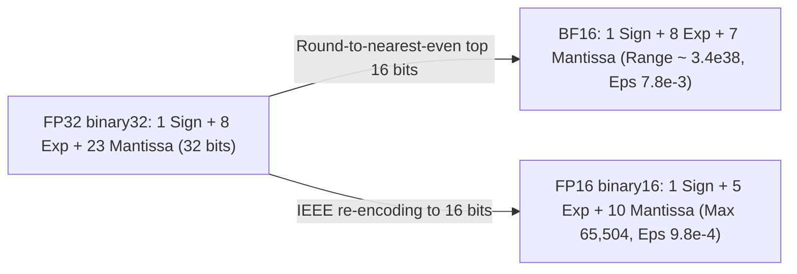
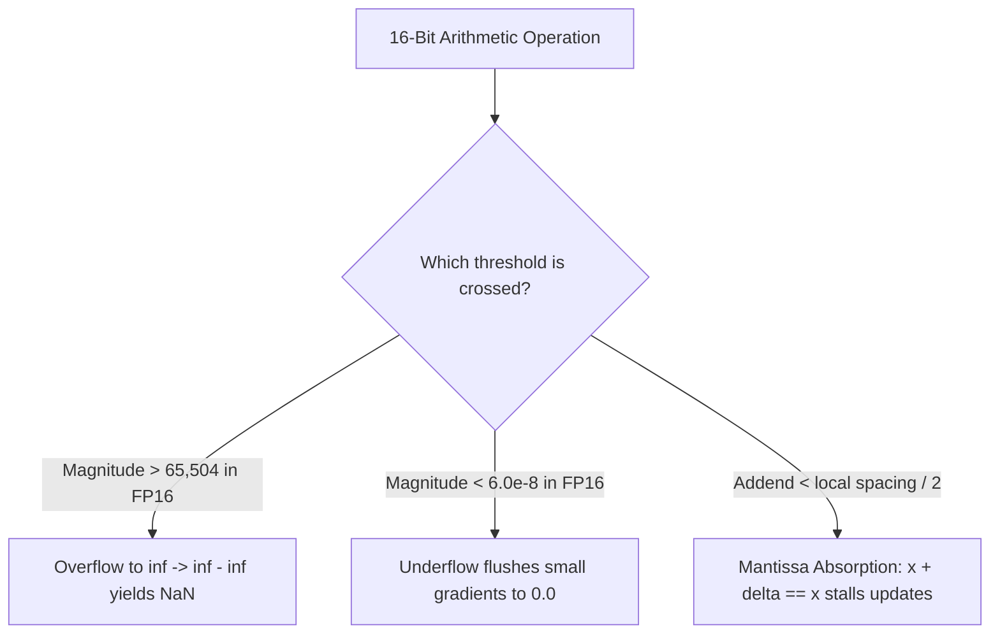
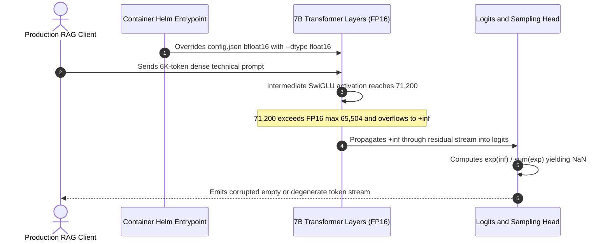

# Module 06: Numeric Formats: FP32, FP16, BF16

> **Prerequisites:** [Module 05: Calculating a Model's Memory Requirements](../05-calculating-a-models-memory-requirements/README.md), comfort with binary numbers and powers of two  
> **Estimated Reading Time:** 25 minutes  
> **Target Audience:** AI Backend Engineers, ML Systems Engineers, Kernel & Quantization Engineers

> [!TIP]
> **The Golden Rule of Floating-Point Formats**  
> A floating-point number packs a sign, an exponent, and a mantissa into fixed bits. Exponent bits buy **range** (how huge or tiny a number can get); mantissa bits buy **precision** (how finely numbers between two powers of two are spaced). FP16 uses 5 exponent and 10 mantissa bits; BF16 keeps FP32's 8 exponent bits and cuts the mantissa to 7. **FP16 is more precise, whereas BF16 matches FP32's range**—and in deep learning, running out of range causes far more crashes than coarse mantissa rounding.

---

## 1. Visual Mental Models & Architecture

You are in Track 05, GPUs & GenAI Hardware. [Module 05](../05-calculating-a-models-memory-requirements/README.md) multiplied parameter counts by "bytes per parameter" (4, 2, 1, 0.5) without opening up what those bytes actually contain. This module inspects the bit layouts of 32-bit and 16-bit floating-point numbers, what each bit field buys, and what breaks at the numerical edges. [Module 07](../07-mixed-precision-training/README.md) uses these properties to explain why modern training mixes formats.

Most "mysterious" `NaN`s and stalled training losses in GPU code come from one of three layout behaviors: overflow, underflow, or a small update absorbed next to a large value.

After this module, you will be able to:
- Read the sign, exponent, and mantissa fields of an FP32, FP16, or BF16 value and rebuild the decimal number from them.
- Explain the core bit-budget trade-off: exponent bits buy range, mantissa bits buy precision.
- Predict overflow, underflow, and rounding absorption—including why FP16 turns a harmless intermediate value into `inf` while BF16 does not.
- Emulate BF16 with plain NumPy and explain machine epsilon and binade spacing.



Every numerical failure in 16-bit neural-network workloads routes cleanly to one of three boundaries:



### Bit Layouts, Range, and Binade Spacing (ASCII Reference)

Layouts, with BF16 as the top half of an FP32:

```text
  FP32  ┌─┬──────────┬───────────────────────────┐
        │S│ EEEEEEEE │ MMMMMMM MMMMMMMMMMMMMMMM  │   1 + 8 + 23 = 32 bits
        └─┴──────────┴────────┬──────────────────┘
        └──── BF16 keeps ─────┘└──── dropped ────┘

  BF16  ┌─┬──────────┬─────────┐
        │S│ EEEEEEEE │ MMMMMMM │                        1 + 8 + 7  = 16 bits   (same range as FP32)
        └─┴──────────┴─────────┘

  FP16  ┌─┬───────┬────────────┐
        │S│ EEEEE │ MMMMMMMMMM │                        1 + 5 + 10 = 16 bits   (more precise, much shorter range)
        └─┴───────┴────────────┘
```

Range (the span of positive values each format can represent, log scale):

```text
 value 1e-45     1e-25     1e-5      1e15      1e35
       │         │         │         │         │
 FP32  ├───┼─────────────────────────────────────┤    1.4e-45 .. 3.4e38
 BF16    ├─┼─────────────────────────────────────┤    9.2e-41 .. 3.4e38
 FP16                     ├┼────┤                     6.0e-8 .. 65,504
```

One character is two powers of ten. `├` and `┤` mark the smallest and largest positive value; `┼` marks where normal numbers begin (to its left are subnormals). FP16 tops out at 65,504, so `x * x` already overflows to `inf` for any `x` above 255.

Precision (the spacing of representable values just above 1.0):

```text
             1.0                                     1.0078125 (= 1 + 2^-7)
 BF16 ticks  │                                       │   gap 2^-7  = 0.0078
 FP16 ticks  │    │    │    │    │    │    │    │    │   gap 2^-10 = 0.00098  (8 per BF16 gap)
 FP32 ticks  │││││││││││││││││││││││││││││││││││││││││   gap 2^-23 = 1.2e-7   (65,536 per BF16 gap)
```

---

## 2. Core Mechanics & Systematic Comparison Matrices

### A Float Is Scientific Notation in Binary

Scientific notation writes a number as $1.234 \times 10^5$. A binary float does the same with powers of two. Each normal number's value is:

$$\text{value} = (-1)^{\text{sign}} \times 1.\text{mantissa}_2 \times 2^{\text{exponent} - \text{bias}}$$

The stored fields are a **sign bit**, an **exponent** (stored with an offset called the *bias* so it can represent negative powers), and a **mantissa** (fraction or significand): the digits after the binary point. For a normal number, the leading `1.` is *implicit* (not stored), giving one free bit of precision.

Two exponent patterns are reserved:
- **All zeros:** *zero or a subnormal number*—there is no implicit `1.`, so values fade gently toward zero instead of dropping off a cliff (gradual underflow).
- **All ones:** *infinity* (mantissa zero) or *NaN* (not a number, mantissa non-zero).

**BF16 is the top half of an FP32.** Same sign, same 8 exponent bits, and the first 7 of FP32's 23 mantissa bits. Converting FP32 to BF16 drops the low 16 bits (ideally with round-to-nearest-even), which makes hardware conversion trivial and guarantees identical exponent range.

### Systematic Format Comparison Matrix

| Format | Sign / Exp / Mantissa | Bias | Bytes | Max Finite | Min Normal | Min Subnormal | Machine Epsilon ($\epsilon$) | Max Consecutive Exact Int ($2^{m+1}$) | Defined By / Primary GenAI Role |
| :--- | :--- | :--- | :--- | :--- | :--- | :--- | :--- | :--- | :--- |
| **FP32 (`binary32`)** | 1 / 8 / 23 | 127 | 4 | $3.4028 \times 10^{38}$ | $1.1755 \times 10^{-38}$ | $1.4013 \times 10^{-45}$ | $2^{-23} \approx 1.19 \times 10^{-7}$ (~6.9 digits) | $16,777,216$ | IEEE 754; master weights, reductions, softmax, Adam states |
| **FP16 (`binary16`)** | 1 / 5 / 10 | 15 | 2 | $65,504$ | $6.1035 \times 10^{-5}$ | $5.9605 \times 10^{-8}$ | $2^{-10} \approx 9.77 \times 10^{-4}$ (~3.0 digits) | $2,048$ | IEEE 754; inference, training with dynamic `GradScaler` |
| **BF16 ("brain float")** | 1 / 8 / 7 | 127 | 2 | $3.3895 \times 10^{38}$ | $1.1755 \times 10^{-38}$ | $9.1835 \times 10^{-41}$ | $2^{-7} \approx 7.81 \times 10^{-3}$ (~2.1 digits) | $256$ | Industry format ([BF16 paper](https://arxiv.org/abs/1905.12322)); standard LLM training & serving |
| **FP8 E4M3** *(signpost)* | 1 / 4 / 3 | 7 | 1 | $448$ | $2^{-6} \approx 1.56 \times 10^{-2}$ | $2^{-9} \approx 1.95 \times 10^{-3}$ | $2^{-3} = 0.125$ | $16$ | [FP8 paper](https://arxiv.org/abs/2209.05433); forward weights & activations |
| **FP8 E5M2** *(signpost)* | 1 / 5 / 2 | 15 | 1 | $57,344$ | $6.1035 \times 10^{-5}$ | $1.5259 \times 10^{-5}$ | $2^{-2} = 0.25$ | $8$ | [FP8 paper](https://arxiv.org/abs/2209.05433); backward gradients |

### Range vs. Precision

- **Range** comes from the exponent. FP16's 5-bit exponent covers ~30 binary orders of magnitude (30 normal binades): max finite $65,504$, smallest normal $\approx 6.1 \times 10^{-5}$ (subnormals reach $6.0 \times 10^{-8}$). FP32 and BF16 cover 254 normal binades up to $\approx 3.4 \times 10^{38}$ and down to $\approx 1.2 \times 10^{-38}$.
- **Precision** comes from the mantissa. Between any two neighboring powers of two (a *binade*), every format has the exact same number of evenly spaced ticks: $2^{10} = 1,024$ for FP16, $2^7 = 128$ for BF16, and $2^{23} = 8,388,608$ for FP32. Within $[1, 2)$, the spacing is $2^{-\text{mantissa\_bits}}$, known as **machine epsilon**. Because epsilon is the gap, adding less than $\epsilon / 2$ to $1.0$ rounds back to $1.0$ (exact ties round to the even last bit).
- **Relative spacing:** In $[2^k, 2^{k+1})$, spacing is $2^{k - m}$, doubling whenever magnitude doubles. FP16 values near $2,048$ are $2$ apart ($2,049$ cannot be stored); BF16 values near $256$ are $2$ apart ($257$ cannot be stored).

> [!NOTE]
> **Mental Model: The Elastic Ruler**  
> Picture a ruler whose tick marks grow sparser as you move away from zero, keeping the same count of ticks between every consecutive pair of powers of two. Exponent bits decide how many powers of two the ruler spans; mantissa bits decide how many ticks sit between them. FP16 is a short ruler with fine ticks; BF16 is a long ruler with coarse ticks; FP32 is a long ruler with fine ticks.

### Overflow, Underflow, Rounding, and Accumulation

- **Overflow:** A result above the format's max becomes `inf`, and arithmetic on `inf` quickly yields `NaN` (`inf - inf`, `0 * inf`, `inf / inf`). Because FP16 caps at $65,504$, `300 * 300` overflows and `exp(12)` overflows (`162,754.78`). This is why softmax subtracts `max(logits)` before exponentiating (Listing 4) and stays in FP32 during mixed precision (Module 07).
- **Underflow:** A result smaller than the smallest subnormal flushes to `0.0`. FP16 subnormals reach $\approx 6.0 \times 10^{-8}$ with degraded precision below $6.1 \times 10^{-5}$. Tiny gradients underflow first, motivating loss scaling (Module 07).

> [!WARNING]
> **BF16 Does Not Have "More Accuracy"**  
> BF16 has *less* precision than FP16 (7 mantissa bits vs. 10) and the *same* range as FP32. Whether that trade is favorable depends on what fails first—and in neural-network training, range breaks long before precision. The [BF16 study](https://arxiv.org/abs/1905.12322) confirms BF16 eliminates the loss scaling required by FP16 mixed precision.

- **Absorption:** Adding a small number to a large sum changes nothing if the increment is under half the local spacing. Adding `1.0` repeatedly stalls completely at **2,048** in FP16 and at **256** in BF16 (Listing 4).
- **Conversion mode:** Converting FP32 to BF16 by truncation (zeroing the low 16 bits) biases all values toward zero, whereas round-to-nearest-even is unbiased. The BF16 study reports rounded BF16 essentially matching FP32 accuracy while truncation lost ~0.02% in its recommendation-model experiments (Listing 5). This is why reductions, softmax denominators, and optimizer updates accumulate in FP32.

### FP8, INT8, and Choosing a Format

- **FP8 & INT8 (Signpost):** FP8 defines two 8-bit layouts ([FP8 Formats for Deep Learning](https://arxiv.org/abs/2209.05433)): E4M3 (max 448) for weights/activations and E5M2 (max 57,344) for gradients. **INT8** is uniformly spaced and requires per-tensor or per-group scale factors; see the [quantization module](../../04-training-fine-tuning-and-alignment/15-quantization-int8-int4-gguf/README.md) in Track 04.
- **Training choice:** Prefer **BF16** where hardware supports it (the [NVIDIA A100 datasheet](https://www.nvidia.com/content/dam/en-zz/Solutions/Data-Center/a100/pdf/nvidia-a100-datasheet-us-nvidia-1758950-r4-web.pdf) lists equal BF16 and FP16 Tensor Core peak throughput), avoiding loss-scale tuning. Use FP16 with dynamic loss scaling on older GPUs lacking BF16 Tensor Cores.
- **Inference choice:** Both FP16 and BF16 use 2 bytes per parameter (interchangeable in Module 05's VRAM sizing formulas), but checkpoints specify what they were trained in (e.g., Mistral-7B-v0.1 and Qwen2.5-7B set `"torch_dtype": "bfloat16"` in `config.json`). Forcing a BF16-trained model into FP16 risks overflow to `inf`.

---

## 3. Production War Story: Incident Post-Mortem

### Silent `NaN` Cascade Serving a BF16-Trained Model in Forced FP16

- **Severity:** SEV-2 (Partial Inference Output Corruption)
- **Time to Detect:** 42 minutes (customer support tickets reporting blank/gibberish completions)
- **Time to Resolve:** 28 minutes
- **Impact:** 18% of long-context inference completions on a 24-GPU serving cluster emitted corrupted repetition/empty strings because intermediate MLP activations exceeded FP16's `65,504` ceiling and turned into `NaN` logits.

#### What Happened

A model-serving migration moved a BF16-trained 7B model (`"torch_dtype": "bfloat16"` in `config.json`) onto a new inference container template whose Helm chart hard-coded `--dtype float16` for legacy compatibility. Short smoke-test prompts passed cleanly because intermediate activations stayed below ~15,000.

In production, adversarial/long RAG inputs drove down-projection inputs in two specific attention-MLP residual layers above `71,200`—completely normal inside BF16's $3.4 \times 10^{38}$ range, but strictly above FP16's `65,504` maximum. Those activations clamped to `+inf`, propagated into the residual stream and LayerNorm/Softmax (`inf / inf -> NaN`), and emitted invalid token IDs without throwing any Python exception.

#### The Failure Sequence Diagram



#### Root Cause Analysis

1. **Precision Override Violating Training Range:** The container ignored `"torch_dtype": "bfloat16"` in `config.json` and cast BF16 weights whose residual magnitudes relied on BF16's 8-bit exponent into 5-bit-exponent FP16.
2. **Lack of Logit Finity Telemetry:** Inference serving had no assertion or metric counter checking `torch.isfinite(logits)` before sampling.

#### The Fix & Architectural Hardening

1. **Auto-Dtype Respecting `config.json`:** Removed the hard-coded `--dtype float16` flag and configured the loader to honor `torch_dtype: auto` (`bfloat16` on Ampere/Ada/Hopper GPUs).
2. **FP32 Reductions & Finity Alerting:** Pinned softmax and normalization statistics to FP32 and added Prometheus counters alerting immediately if any non-finite logit occurs during canary evals.

---

## 4. Verified Python Experiments

Everything here uses NumPy only (NumPy has no native BF16 dtype, so BF16 is emulated accurately). Outputs were produced by running the listings with Python 3.13 and NumPy 2.4. Save Listing 1 as `floatbits.py`; the rest import it.

### Listing 1: A Small Bit-Level Toolkit (`floatbits.py`)

`to_bf16` keeps the float32 sign, exponent, and top 7 mantissa bits, rounding to nearest even by adding half of the dropped part before clearing the low 16 bits. `fields` pulls the three bit fields out of a value. `decode` rebuilds a value from the fields with the textbook formula, verifying understanding.

```python
"""floatbits.py - look inside FP32 / FP16 / BF16 (BF16 is emulated on top of float32)."""
import numpy as np


def to_bf16(x, mode="nearest"):
    """Round float32 values to bfloat16 precision, returned as float32.
    mode='nearest': round-to-nearest-even on the dropped 16 bits; mode='truncate': just zero them."""
    a = np.array(x, dtype=np.float32)                  # copy, so the caller's data is untouched
    u = a.view(np.uint32).astype(np.uint64)
    if mode == "nearest":
        u = u + 0x7FFF + ((u >> 16) & 1)               # add half an ULP; ties go to even
    out = ((u >> 16) << 16).astype(np.uint32).view(np.float32)
    out = np.where(np.isnan(a), np.float32("nan"), out)
    return out.astype(np.float32)


def fields(x, fmt):
    """Return (sign, exponent bits, mantissa bits) as strings."""
    if fmt == "fp32":
        s = f"{int(np.float32(x).view(np.uint32)):032b}"
        return s[0], s[1:9], s[9:]
    if fmt == "fp16":
        s = f"{int(np.float16(x).view(np.uint16)):016b}"
        return s[0], s[1:6], s[6:]
    if fmt == "bf16":
        s = f"{int(to_bf16(x).view(np.uint32)):032b}"[:16]
        return s[0], s[1:9], s[9:]
    raise ValueError(fmt)


SPEC = {"fp32": (8, 23), "fp16": (5, 10), "bf16": (8, 7)}   # (exponent bits, mantissa bits)


def decode(sign, exp, man, fmt):
    """Rebuild the value from the three bit fields using the textbook formula."""
    ebits, mbits = SPEC[fmt]
    bias = 2 ** (ebits - 1) - 1
    e, m = int(exp, 2), int(man, 2)
    sgn = -1.0 if sign == "1" else 1.0
    if e == 2 ** ebits - 1:                            # all-ones exponent: inf or NaN
        return sgn * float("inf") if m == 0 else float("nan")
    if e == 0:                                         # subnormal: no implicit leading 1
        return sgn * (m / 2 ** mbits) * 2.0 ** (1 - bias)
    return sgn * (1 + m / 2 ** mbits) * 2.0 ** (e - bias)
```

### Listing 2: The Bit Fields & Exhaustive 65,536-Pattern Check

Four values in all three formats, rebuilt from their fields. Then the decoder is compared against NumPy for all 65,536 FP16 bit patterns, and against a float32 reading of the top-16-bit pattern for all 65,536 BF16 patterns.

```python
import numpy as np
from floatbits import *

print("value        fmt   sign exponent  mantissa                 decoded by the formula")
for x in (1.0, -2.5, 0.1, 65504.0):
    for fmt in ("fp32", "fp16", "bf16"):
        s, e, m = fields(x, fmt)
        print(f"{x:<12} {fmt}   {s}    {e:<9} {m:<23}  {decode(s, e, m, fmt)!r}")
    print()

# Exhaustive check of the decoder against numpy: every one of the 65,536 FP16 bit patterns
bad = 0
for pattern in range(2 ** 16):
    s = f"{pattern:016b}"
    mine = decode(s[0], s[1:6], s[6:], "fp16")
    ref = float(np.array([pattern], dtype=np.uint16).view(np.float16)[0])
    if not (mine == ref or (np.isnan(mine) and np.isnan(ref))):
        bad += 1
print("fp16: patterns where decoder disagrees with numpy:", bad, "of 65536")

# Same for bf16: a bf16 pattern is the top 16 bits of a float32
bad = 0
for pattern in range(2 ** 16):
    s = f"{pattern:016b}"
    mine = decode(s[0], s[1:9], s[9:], "bf16")
    ref = float(np.array([pattern << 16], dtype=np.uint32).view(np.float32)[0])
    if not (mine == ref or (np.isnan(mine) and np.isnan(ref))):
        bad += 1
print("bf16: patterns where decoder disagrees with float32 reading:", bad, "of 65536")
```

**Output:**

```text
value        fmt   sign exponent  mantissa                 decoded by the formula
1.0          fp32   0    01111111  00000000000000000000000  1.0
1.0          fp16   0    01111     0000000000               1.0
1.0          bf16   0    01111111  0000000                  1.0

-2.5         fp32   1    10000000  01000000000000000000000  -2.5
-2.5         fp16   1    10000     0100000000               -2.5
-2.5         bf16   1    10000000  0100000                  -2.5

0.1          fp32   0    01111011  10011001100110011001101  0.10000000149011612
0.1          fp16   0    01011     1001100110               0.0999755859375
0.1          bf16   0    01111011  1001101                  0.10009765625

65504.0      fp32   0    10001110  11111111110000000000000  65504.0
65504.0      fp16   0    11110     1111111111               65504.0
65504.0      bf16   0    10001111  0000000                  65536.0

fp16: patterns where decoder disagrees with numpy: 0 of 65536
bf16: patterns where decoder disagrees with float32 reading: 0 of 65536
```

> [!NOTE]
> **Read the rows:** `1.0` is exponent `01111111` (127, which is the bias, so $2^0$) with an all-zero mantissa. `0.1` is not exactly representable in any of them: FP32 gives `0.10000000149`, FP16 `0.09997559`, BF16 `0.10009766`. And `65504`, the largest finite FP16 value, rounds *up* to `65536` in BF16 because BF16 has only 7 mantissa bits. Zero disagreements out of 65,536 patterns confirm the formula matches IEEE/hardware behavior exactly.

### Listing 3: The Format Table (`numpy.finfo` Verification)

BF16's numbers are derived from its layout (NumPy has no BF16 `finfo`); the FP32 and FP16 rows come from `numpy.finfo`.

```python
import numpy as np

f32, f16 = np.finfo(np.float32), np.finfo(np.float16)
# numpy has no bfloat16 dtype, so derive its numbers from the layout: 8 exponent bits, 7 mantissa bits
bf = {"max": (2 - 2 ** -7) * 2.0 ** 127, "min_normal": 2.0 ** -126,
      "min_subnormal": 2.0 ** -133, "eps": 2.0 ** -7}

rows = [
    ("FP32", "1/8/23", float(f32.max), float(f32.tiny), float(f32.smallest_subnormal), float(f32.eps)),
    ("FP16", "1/5/10", float(f16.max), float(f16.tiny), float(f16.smallest_subnormal), float(f16.eps)),
    ("BF16", "1/8/7",  bf["max"], bf["min_normal"], bf["min_subnormal"], bf["eps"]),
]
print(f"{'fmt':5s} {'s/e/m':8s} {'max':>10s} {'min normal':>11s} {'min subnormal':>14s} {'epsilon':>10s}  {'~decimal digits':>16s}")
for name, bits, mx, mn, sub, eps in rows:
    digits = np.log10(1 / eps)
    print(f"{name:5s} {bits:8s} {mx:10.4e} {mn:11.4e} {sub:14.4e} {eps:10.4e}  {digits:16.1f}")

print()
print("positive finite values per power-of-two interval (binade):")
for name, (e, m) in (("FP32", (8, 23)), ("FP16", (5, 10)), ("BF16", (8, 7))):
    print(f"  {name}: 2^{m} = {2**m:>9,}   normal binades: {2**e - 2}")
```

**Output:**

```text
fmt   s/e/m           max  min normal  min subnormal    epsilon   ~decimal digits
FP32  1/8/23   3.4028e+38  1.1755e-38     1.4013e-45 1.1921e-07               6.9
FP16  1/5/10   6.5504e+04  6.1035e-05     5.9605e-08 9.7656e-04               3.0
BF16  1/8/7    3.3895e+38  1.1755e-38     9.1835e-41 7.8125e-03               2.1

positive finite values per power-of-two interval (binade):
  FP32: 2^23 = 8,388,608   normal binades: 254
  FP16: 2^10 =     1,024   normal binades: 30
  BF16: 2^7 =       128   normal binades: 254
```

These agree with Table 1 of "A Study of BFLOAT16 for Deep Learning Training" to within the rounding the paper uses (FP32 `3.40e38 / 1.17e-38 / 1.40e-45`; FP16 `6.55e4 / 6.10e-5 / 5.96e-8`; BF16 about `3.4e38` and `1.17e-38`; the paper prints `3.38e38` where the exact BF16 maximum is `3.3895e38`). The paper's table lists no subnormal value for BF16, while the figure above is what the bit layout allows; hardware differs on whether it honors subnormals.

### Listing 4: Overflow, Underflow, Precision, and Accumulation

```python
import numpy as np
from floatbits import to_bf16

np.seterr(all="ignore")          # we WANT to see inf/NaN, not warnings

print("--- overflow: 300 squared (true value 90,000) ---")
x = 300.0
print("fp32:", np.float32(x) * np.float32(x))
print("fp16:", np.float16(x) * np.float16(x), "   (max finite fp16 = 65504)")
print("bf16:", to_bf16(np.float32(x) * np.float32(x)), "  (finite, but only ~3 significant digits: 90000 -> 90112)")

print("\n--- overflow inside softmax: logits [10, 11, 12] ---")
logits32 = np.array([10, 11, 12], dtype=np.float32)
for name, z in (("fp32", logits32), ("fp16", logits32.astype(np.float16))):
    e = np.exp(z)
    print(f"{name}: exp = {e},  naive softmax = {e / e.sum()}")
z16 = logits32.astype(np.float16)
e = np.exp(z16 - z16.max())
print("fp16 with max subtracted:", e / e.sum())

print("\n--- underflow: tiny positive numbers ---")
for v in (1e-4, 1e-5, 1e-7, 1e-8):
    print(f"{v:8.0e} -> fp16 {float(np.float16(v)):.4e}   bf16 {float(to_bf16(np.float32(v))):.4e}   fp32 {float(np.float32(v)):.4e}")

print("\n--- precision: epsilon and spacing ---")
for name, eps, add in (("fp32", 2.0 ** -23, lambda d: np.float32(1) + np.float32(d)),
                       ("fp16", 2.0 ** -10, lambda d: np.float16(1) + np.float16(d)),
                       ("bf16", 2.0 ** -7,  lambda d: to_bf16(np.float32(1) + np.float32(d)))):
    print(f"{name}  epsilon = 2^{int(np.log2(eps))}:  1+eps == 1 ? {bool(add(eps) == 1)}    1+eps/2 == 1 ? {bool(add(eps / 2) == 1)}")
print("fp16 spacing near 2048:", np.spacing(np.float16(2048)), "  -> np.float16(2049) =", float(np.float16(2049)))
print("fp16 spacing near 1   :", np.spacing(np.float16(1)))

print("\n--- accumulation: add 1.0 over and over (true answer: 20000) ---")
a32, a16, abf = np.float32(0), np.float16(0), np.float32(0)
for _ in range(20000):
    a32 = a32 + np.float32(1)
    a16 = np.float16(a16 + np.float16(1))
    abf = to_bf16(abf + np.float32(1))
print("fp32:", float(a32), "  fp16:", float(a16), "  bf16:", float(abf))

print("\n--- accumulation: sum of 10,000 copies of 0.1 (true answer: 1000) ---")
vals = np.full(10000, 0.1, dtype=np.float32)
acc16 = np.float16(0)
for v in vals.astype(np.float16):
    acc16 = np.float16(acc16 + v)
print("fp16 running sum        :", float(acc16))
print("fp16 inputs, fp32 accum :", float(vals.astype(np.float16).astype(np.float32).sum()))
```

**Output:**

```text
--- overflow: 300 squared (true value 90,000) ---
fp32: 90000.0
fp16: inf    (max finite fp16 = 65504)
bf16: 90112.0   (finite, but only ~3 significant digits: 90000 -> 90112)

--- overflow inside softmax: logits [10, 11, 12] ---
fp32: exp = [ 22026.467  59874.14  162754.78 ],  naive softmax = [0.09003058 0.24472848 0.66524094]
fp16: exp = [2.203e+04 5.987e+04       inf],  naive softmax = [ 0.  0. nan]
fp16 with max subtracted: [0.0901 0.2448 0.6655]

--- underflow: tiny positive numbers ---
   1e-04 -> fp16 1.0002e-04   bf16 1.0014e-04   fp32 1.0000e-04
   1e-05 -> fp16 1.0014e-05   bf16 1.0014e-05   fp32 1.0000e-05
   1e-07 -> fp16 1.1921e-07   bf16 1.0012e-07   fp32 1.0000e-07
   1e-08 -> fp16 0.0000e+00   bf16 1.0012e-08   fp32 1.0000e-08

--- precision: epsilon and spacing ---
fp32  epsilon = 2^-23:  1+eps == 1 ? False    1+eps/2 == 1 ? True
fp16  epsilon = 2^-10:  1+eps == 1 ? False    1+eps/2 == 1 ? True
bf16  epsilon = 2^-7:  1+eps == 1 ? False    1+eps/2 == 1 ? True
fp16 spacing near 2048: 2.0   -> np.float16(2049) = 2048.0
fp16 spacing near 1   : 0.000977

--- accumulation: add 1.0 over and over (true answer: 20000) ---
fp32: 20000.0   fp16: 2048.0   bf16: 256.0

--- accumulation: sum of 10,000 copies of 0.1 (true answer: 1000) ---
fp16 running sum        : 256.0
fp16 inputs, fp32 accum : 999.755859375
```

> [!NOTE]
> **Softmax & Absorption in Miniature:** In FP16, `exp(12)` (`162,754`) exceeds `65,504`, producing `inf` and `inf / inf = NaN`. Subtracting the maximum keeps every exponent $\le \exp(0) = 1$, restoring accuracy to ~3 digits. At the low end, `1e-7` survives FP16 only as a subnormal with 19% error (`1.19e-7`) and `1e-8` flushes to zero, while BF16 preserves both at coarse precision. Meanwhile, summing `0.1` ten thousand times in FP16 stalls at `256.0`, whereas FP32 accumulation yields `999.756` (the remaining `0.244` error comes from quantizing each `0.1` input to FP16 first).

### Listing 5: BF16 Conversion, Truncation vs. Rounding

```python
import numpy as np
from floatbits import to_bf16

x = np.array([3.14159265, 1.0 + 2.0 ** -8, 1.0 + 3 * 2.0 ** -8, 65504.0, 3.0e38], dtype=np.float32)
print("x            :", x)
print("bf16 nearest :", to_bf16(x))
print("bf16 truncate:", to_bf16(x, "truncate"))

rng = np.random.default_rng(0)
data = rng.uniform(1.0, 2.0, 1_000_000).astype(np.float32)
for mode in ("nearest", "truncate"):
    err = to_bf16(data, mode) - data
    print(f"{mode:9s} mean error = {err.mean():+.6f}   mean |error| = {np.abs(err).mean():.6f}   max |error| = {np.abs(err).max():.6f}")
```

**Output:**

```text
x            : [3.1415927e+00 1.0039062e+00 1.0117188e+00 6.5504000e+04 3.0000000e+38]
bf16 nearest : [3.1406250e+00 1.0000000e+00 1.0156250e+00 6.5536000e+04 3.0040553e+38]
bf16 truncate: [3.1406250e+00 1.0000000e+00 1.0078125e+00 6.5280000e+04 2.9907630e+38]
nearest   mean error = -0.000003   mean |error| = 0.001952   max |error| = 0.003906
truncate  mean error = -0.003903   mean |error| = 0.003903   max |error| = 0.007812
```

Rounding to nearest is unbiased (mean error near zero) and halves average and worst-case error compared with truncation, which always rounds toward zero and carries a systematic bias of `-0.0039`. The second input, $1 + 2^{-8}$, lies halfway between two BF16 values; ties round to the even neighbor, `1.0`.

---

## 5. Multi-Language Production Implementation

````carousel
### Go: Bit-Exact BF16 Round-to-Nearest-Even & FP16 Decoder

```go
// float_codec.go
// Implements IEEE 754 binary32 -> BF16 round-to-nearest-even and binary16 bit decoding.
package main

import (
	"fmt"
	"math"
)

func Float32ToBF16Bits(f float32) uint16 {
	u := math.Float32bits(f)
	if math.IsNaN(float64(f)) {
		return uint16((u >> 16) | 0x0040)
	}
	roundingBias := uint32(0x7FFF) + ((u >> 16) & 1)
	return uint16((u + roundingBias) >> 16)
}

func BF16BitsToFloat32(b uint16) float32 {
	return math.Float32frombits(uint32(b) << 16)
}

func DecodeFP16Bits(h uint16) float64 {
	sign := 1.0
	if (h >> 15) == 1 {
		sign = -1.0
	}
	exp := int((h >> 10) & 0x1F)
	man := int(h & 0x03FF)
	if exp == 31 {
		if man == 0 {
			return sign * math.Inf(1)
		}
		return math.NaN()
	}
	if exp == 0 {
		return sign * (float64(man) / 1024.0) * math.Pow(2, -14)
	}
	return sign * (1.0 + float64(man)/1024.0) * math.Pow(2, float64(exp-15))
}

func main() {
	for _, v := range []float32{1.0, 0.1, 65504.0, 90000.0} {
		bfBits := Float32ToBF16Bits(v)
		fmt.Printf("Input: %9.3f -> BF16 Hex: 0x%04X -> Decoded: %g\n",
			v, bfBits, BF16BitsToFloat32(bfBits))
	}
	fmt.Printf("FP16 0x4680 -> %.2f\n", DecodeFP16Bits(0x4680))
}
```
<!-- slide -->
### TypeScript: IEEE 754 Bit Inspector & Binade Spacing Analyzer

```typescript
// ieee754Inspector.ts
// Inspects FP32 bit fields, computes BF16 nearest rounding, and detects FP16 overflow/absorption.

export interface FloatInspection {
  input: number;
  fp32Hex: string;
  bf16Value: number;
  fp16Overflow: boolean;
  fp16UnderflowToZero: boolean;
  localSpacingFp16: number;
  localSpacingBf16: number;
}

export function inspectFloat(value: number): FloatInspection {
  const buf = new ArrayBuffer(4);
  const view = new DataView(buf);
  view.setFloat32(0, value, false);
  const u32 = view.getUint32(0, false);

  // Round-to-nearest-even to BF16
  const bias = 0x7fff + ((u32 >>> 16) & 1);
  const bfU32 = ((u32 + bias) >>> 16) << 16;
  view.setUint32(0, bfU32, false);
  const bf16Value = Number.isNaN(value) ? NaN : view.getFloat32(0, false);

  const absVal = Math.abs(value);
  const binade = absVal === 0 ? 0 : Math.floor(Math.log2(absVal));
  const localSpacingFp16 = absVal === 0 ? 2 ** -24 : 2 ** (binade - 10);
  const localSpacingBf16 = absVal === 0 ? 2 ** -133 : 2 ** (binade - 7);

  return {
    input: value,
    fp32Hex: "0x" + u32.toString(16).padStart(8, "0"),
    bf16Value,
    fp16Overflow: absVal > 65504,
    fp16UnderflowToZero: absVal > 0 && absVal < 2 ** -25,
    localSpacingFp16,
    localSpacingBf16,
  };
}

console.table([1.0, 2048.0, 65504.0, 71200.0, 1e-8].map(inspectFloat));
```
<!-- slide -->
### Python: PyTorch `torch.finfo` & Tensor Core Boundary Diagnostics

```python
"""
torch_dtype_diagnostics.py
Probes PyTorch dtype limits (float32, float16, bfloat16), softmax overflow,
and accumulation absorption, falling back gracefully to NumPy if torch is absent.
"""

def run_dtype_diagnostics() -> None:
    try:
        import torch
    except ImportError:
        import numpy as np
        print("PyTorch unavailable; demonstrating NumPy float16 limits:")
        f16 = np.finfo(np.float16)
        print(f"float16 max={f16.max}, tiny={f16.tiny}, eps={f16.eps}")
        print(f"float16(2048) + float16(1) = {float(np.float16(2048) + np.float16(1))}")
        return

    for dt in (torch.float32, torch.float16, torch.bfloat16):
        info = torch.finfo(dt)
        print(f"{str(dt):15s} | max={info.max:.4e} | tiny={info.tiny:.4e} | eps={info.eps:.4e}")

    logits = torch.tensor([10.0, 11.0, 12.0])
    print("Naive FP16 softmax :", torch.exp(logits.half()) / torch.exp(logits.half()).sum())
    print("FP32 softmax       :", torch.softmax(logits, dim=0))
    print("BF16 256 + 1       :", (torch.tensor(256.0, dtype=torch.bfloat16) + 1.0).item())


if __name__ == "__main__":
    run_dtype_diagnostics()
```
<!-- slide -->
### C#: .NET `System.Half` & Bit-Level Precision Analyzer

```csharp
// HalfBFloat16Analyzer.cs
// Inspects IEEE 754 Half (FP16) and BF16 bit fields and tests integer representability limits.
using System;

public static class HalfBFloat16Analyzer
{
    public static float RoundToBFloat16(float value)
    {
        if (float.IsNaN(value)) return float.NaN;
        uint bits = BitConverter.SingleToUInt32Bits(value);
        uint roundingBias = 0x7FFFu + ((bits >> 16) & 1u);
        uint bfBits = (bits + roundingBias) & 0xFFFF0000u;
        return BitConverter.UInt32BitsToSingle(bfBits);
    }

    public static void Main()
    {
        Console.WriteLine($"Half.MaxValue = {(double)Half.MaxValue:F0}, Half.Epsilon (min subnormal) = {(double)Half.Epsilon:E3}");
        Console.WriteLine($"FP16 (Half) 2048 + 1 = {(double)((Half)2048 + (Half)1)} (stalled at 2^(10+1))");
        Console.WriteLine($"BF16 256 + 1         = {RoundToBFloat16(256f + 1f)} (stalled at 2^(7+1))");

        Half expInput = (Half)12.0;
        Half overflowCheck = (Half)Math.Exp((double)expInput);
        Console.WriteLine($"exp(12) in FP16      = {overflowCheck}");
    }
}
```
````

---

## 6. Practical Hands-On Verification Workflows & Exercises

### Verification Workflow 1: Reproduce Softmax Overflow & Mantissa Absorption Limits

Verify in a single terminal command how FP16 overflows at `exp(12)` and stalls at `2,048`, while FP32 accumulation rescues the sum:

```bash
python -c "
import numpy as np; np.seterr(all='ignore')
z16 = np.array([10, 11, 12], dtype=np.float16)
print('Naive FP16 softmax:', np.exp(z16) / np.exp(z16).sum())
print('Safe FP16 softmax :', np.exp(z16 - z16.max()) / np.exp(z16 - z16.max()).sum())
print('First unrepresentable int in FP16:', next(i for i in range(1, 5000) if float(np.float16(i)) != i))
"
```

**Expected Output:**

```text
Naive FP16 softmax: [ 0.  0. nan]
Safe FP16 softmax : [0.0901 0.2448 0.6655]
First unrepresentable int in FP16: 2049
```

### Verification Workflow 2: Verify `numpy.finfo` Machine Limits & Exact BF16 Bit Conversion

Verify `float32(pi)` bit truncation vs. round-to-nearest-even (`0x40490FDB` $\to$ `0x4049`):

```bash
python -c "
import numpy as np
pi32 = np.float32(np.pi)
u = int(pi32.view(np.uint32))
bf_u = ((u + 0x7FFF + ((u >> 16) & 1)) >> 16) << 16
bf_pi = float(np.array([bf_u], dtype=np.uint32).view(np.float32)[0])
print(f'FP32 pi hex: 0x{u:08X} -> BF16 hex: 0x{bf_u >> 16:04X} -> value: {bf_pi}')
"
```

**Expected Output:**

```text
FP32 pi hex: 0x40490FDB -> BF16 hex: 0x4049 -> value: 3.140625
```

---

### Hands-On Practice Exercises

#### 1. Decode by Hand

An FP16 value has the bits `0 10001 1010000000` (sign, exponent, mantissa). What number is it? Check with `decode` from Listing 1.

<details><summary><strong>Answer</strong></summary>

The exponent field `10001` is 17; subtract the bias 15 to get 2. The mantissa `1010000000` after the implicit `1.` is `1.101` in binary, which is $1 + 1/2 + 1/8 = 1.625$. Value $= 1.625 \times 2^2 = 6.5$. Running `decode("0", "10001", "1010000000", "fp16")` returns `6.5`, and the 16-bit pattern is `0x4680`.

</details>

#### 2. Convert FP32 $\pi$ to BF16

`float32(pi)` has the bit pattern `0x40490FDB`. By hand, what is its BF16 value, and what is the error? Verify with `to_bf16`.

<details><summary><strong>Answer</strong></summary>

BF16 keeps the top 16 bits, `0x4049`, and the dropped part `0x0FDB` (4,059) is less than half of `0x10000` (32,768), so rounding goes down: the result is `0x4049`, which is `3.140625`. The error is $\pi - 3.140625 = 0.000968$, a relative error of about $3.1 \times 10^{-4}$, below the $2^{-8}$ ($\approx 3.9 \times 10^{-3}$) half-spacing bound. `to_bf16(np.float32(np.pi))` prints `3.140625`.

</details>

#### 3. Predict Overflow and Underflow

What do you get for: (a) 70,000 stored in FP16, (b) 70,000 in BF16, (c) `1e-9` in FP16, (d) `1e-9` in BF16, (e) `3e38 * 2` in FP32 and in BF16?

<details><summary><strong>Answer</strong></summary>

(a) `inf`: above `65,504`. (b) `70,144`: representable in BF16's range, rounded to 7 mantissa bits. (c) `0.0`: below half the smallest subnormal (about `3e-8`). (d) about `9.97e-10`: BF16 has FP32's range, with 7 bits of precision. (e) `inf` in both: `6e38` exceeds `3.4e38`, and BF16's range equals FP32's. All five confirmed by running them with NumPy and `to_bf16`.

</details>

#### 4. Find the Largest Exactly-Stored Integer Range

For each format, what is the largest `N` such that every integer from 1 to `N` is exactly representable? Find it by search with NumPy and `to_bf16`, then explain the pattern from the mantissa width.

<details><summary><strong>Answer</strong></summary>

FP16: `2,048` (`2,049` rounds to `2,048`). BF16: `256` (`257` is missing). FP32: `16,777,216` $= 2^{24}$ (`16,777,217` rounds to `16,777,216`). In each case it is $2^{\text{mantissa\_bits} + 1}$: with $m$ stored mantissa bits plus the implicit 1 you have $m + 1$ bits of integer precision, so spacing reaches 2 at $2^{m+1}$. Verified by running: the first missing integers found were `2,049` (FP16), `257` (BF16), and `16,777,217` (FP32).

</details>

### Independent Challenge: `float_explorer.py`

Write `float_explorer.py`, a NumPy-only program that treats FP16 and BF16 as complete sets of 65,536 bit patterns.

Requirements:
- For each format, enumerate every 16-bit pattern and classify it: zero, subnormal, normal, infinity, or NaN. Print the counts. Before you run it, derive from the layouts what each count should be, and check the program agrees. (Hint: the NaN patterns are every combination of sign, an all-ones exponent, and a non-zero mantissa.)
- Histogram the finite positive values by binade (power-of-two interval). Print how many values sit in each, and confirm the "same count per binade" claim from the explanation.
- Draw a text plot of the *gap to the next value* against magnitude on a log scale for both formats, showing the ruler getting sparser.
- Given any decimal number, report for each format the nearest representable value, the absolute and relative error, and whether it overflowed or underflowed.
- Stretch: add a function that lists all the integers below 4,096 that FP16 cannot represent exactly, and explain the pattern.

There is no reference solution.

<details><summary><strong>Discussion: Expected Bit-Pattern Enumeration Counts</strong></summary>

For any IEEE-like format with 1 sign bit, $e$ exponent bits, and $m$ mantissa bits ($2^{1+e+m} = 65,536$ total patterns for 16-bit floats):
- **Zeros:** $2$ (`+0.0` and `-0.0`, exponent `0` and mantissa `0`).
- **Infinities:** $2$ (`+inf` and `-inf`, exponent all-1s and mantissa `0`).
- **NaNs:** $2 \times (2^m - 1)$ (FP16: $2 \times 1,023 = 2,046$; BF16: $2 \times 127 = 254$).
- **Subnormals:** $2 \times (2^m - 1)$ (exponent `0`, non-zero mantissa).
- **Normals:** $2 \times (2^e - 2) \times 2^m$ (FP16: $2 \times 30 \times 1,024 = 61,440$; BF16: $2 \times 254 \times 128 = 65,024$).
- Between $2,048$ and $4,096$, FP16 spacing is 2, so *every odd integer* in $[2049, 4095]$ is unrepresentable ($1,024$ missing integers!).

</details>

---

## 7. Operational Validation Checkpoints & Quizzes

### Operational Validation Scenarios

<details><summary><strong>Scenario 1: Why Long-Sum Token Losses Diverge in BF16</strong></summary>

**Question:** An engineer computes a custom cross-entropy reduction across 65,536 tokens directly in `bfloat16` without upcasting to `float32`. Why does the sum stop increasing accurately well before reaching 65,536 even though `bfloat16` can represent numbers up to $3.4 \times 10^{38}$?

**Answer:** Range is not the problem—**mantissa absorption** is. With 7 mantissa bits ($\epsilon = 2^{-7}$), once a running BF16 sum reaches `256.0`, the spacing between adjacent representable numbers becomes `2.0`, so adding `1.0` (or any per-token loss near `0.5–1.0`) rounds straight back down to the even neighbor `256.0` on every subsequent iteration. Always pass `dtype=torch.float32` inside reductions (`tensor.sum(dtype=torch.float32)`).

</details>

<details><summary><strong>Scenario 2: Why BF16 Rounding Mode Matters During Weight Quantization</strong></summary>

**Question:** A custom C++ inference kernel downcasts an FP32 model checkpoint to BF16 by simply bit-shifting right by 16 (`u32 >> 16`) instead of adding round-to-nearest-even bias (`+ 0x7FFF + ((u32 >> 16) & 1)`). How does this show up in evaluation metrics?

**Answer:** Bit-shifting truncates toward zero, introducing a systematic negative bias on positive values and positive bias on negative values—shrinking the magnitude of every weight slightly by ~0.5 ULP on average (`mean error = -0.0039` in `[1, 2)` from Listing 5). Over billions of matrix-multiply accumulations, this systematic bias shrinks output logit variance and degrades accuracy (~0.02%+ in published BF16 studies), whereas round-to-nearest-even keeps the mean error near zero (`-0.000003`).

</details>

<details><summary><strong>Scenario 3: Detecting FP16 Attention Score Overflow on Long Contexts</strong></summary>

**Question:** A service running in `float16` works cleanly on short questions, but crashes with `NaN` probability vectors whenever a user enters a repetitive prompt that drives raw pre-softmax attention logits $QK^T / \sqrt{d_k}$ above `11.5`. Explain the exact chain of events.

**Answer:** Computing $\exp(11.5) \approx 98,715$ exceeds FP16's hard finite ceiling of `65,504`, producing `+inf` in the numerator and `+inf` in the denominator sum $\sum \exp(z_i)$. Dividing `inf / inf` yields `NaN` for that token's probability and `0.0` for all finite logits, poisoning downstream layers. Subtracting `max(z)` before `exp` *and* casting softmax computations to `float32` eliminates the overflow.

</details>

### Checkpoint Quiz

1. Which field of a float sets its range, and which sets its precision?
2. Why do FP32 and BF16 have the same range, and how is BF16 made from FP32?
3. What is machine epsilon, and why does `1 + eps/2 == 1`?
4. Name the two failure modes FP16 hits that BF16 mostly avoids, and the price BF16 pays.
5. Why does a running sum of `1.0`s stop growing in FP16?

<details><summary><strong>Answers</strong></summary>

1. The exponent sets the range; the mantissa sets the precision.
2. Both have an 8-bit exponent. BF16 is the top 16 bits of an FP32 (sign, exponent, first 7 mantissa bits), with the low 16 bits rounded away.
3. The gap between `1.0` and the next representable number, $2^{-m}$ for $m$ mantissa bits. Half of it is a tie between `1.0` and the next value, and ties go to the even neighbor, which is `1.0`.
4. Overflow (above `65,504`) and underflow (below about `6e-8`, with precision already degraded below `6.1e-5`). BF16 pays with precision: 7 mantissa bits, about 2 decimal digits.
5. Once the sum reaches `2,048` the spacing between FP16 numbers is `2`, so adding `1` is exactly a tie that rounds back to the even neighbor, `2,048`.

</details>

> [!TIP]
> **Self-Check Before Moving On**  
> - I can read the sign, exponent, and mantissa of an FP32, FP16, or BF16 value and rebuild the number.
> - I can say which fields control range and which control precision, and what machine epsilon is.
> - I can predict whether a value overflows, underflows, or loses precision in each format.
> - I can emulate BF16 in NumPy and explain truncation versus rounding.
> - I can explain why sums are accumulated in a wider format than their inputs.

### Interview Questions

**Question 1:** Why do large-model training runs prefer BF16 over FP16 on hardware that supports both, even though FP16 has more precision?

<details><summary><strong>What a strong answer covers</strong></summary>

BF16 has FP32's exponent range, so activations and especially small gradients do not overflow or underflow the way they do in FP16, which means no loss scaling and fewer `NaN` incidents. Neural-network training is tolerant of low mantissa precision (noise from rounding averages out), but not of out-of-range values. The cost is fewer significant digits, which is why master weights and accumulations stay in FP32. A strong answer notes FP16 can work with loss scaling and that hardware support matters.

</details>

**Question 2:** Define machine epsilon and explain, with an example, why adding a small number to a large one can have no effect.

<details><summary><strong>What a strong answer covers</strong></summary>

Epsilon is the gap between `1.0` and the next float, $2^{-m}$. Spacing scales with magnitude, so near a number $x$ the gap is about $x \cdot \epsilon$; an addend smaller than half that gap rounds away. Example: in FP16, `2048 + 1` stays `2048`, so a loop adding `1.0` stalls at `2,048` (`256` in BF16). Consequences: accumulate sums and optimizer updates in FP32, sum small values first or use pairwise or Kahan summation, and keep a high-precision master copy of weights.

</details>

**Question 3:** A model that runs fine in BF16 produces NaNs when you load it in FP16. What is probably happening and how would you confirm and fix it?

<details><summary><strong>What a strong answer covers</strong></summary>

Some intermediate values exceed `65,504` and overflow to `inf`, then `NaN` through `inf - inf` or `0 * inf`. The model was trained and validated in BF16, whose range does not have this limit. Confirm by hooking activations (or logits) and checking maxima against the FP16 limit, or by running in BF16 and seeing the NaNs disappear. Fixes: run in BF16 or FP32; keep the overflowing operations (often softmax, norms, or specific projections) in FP32; rescale the offending weights if the architecture allows it.

</details>

---

## 8. Common Mistakes & Troubleshooting

| Symptom | Likely Cause | What to Do |
| :--- | :--- | :--- |
| **Loss becomes `nan` after a few hundred steps in FP16** | An intermediate overflowed to `inf` | Check maxima of activations and gradients; use loss scaling and keep softmax and norms in FP32 (Module 07), or switch to BF16 |
| **Loss plateaus oddly early; weights seem frozen** | Updates are smaller than the local spacing and round away | Keep FP32 master weights (Module 07) |
| **Softmax output is `NaN` or all zeros** | `exp` of a large logit overflowed | Subtract the maximum before `exp` and compute softmax in FP32 |
| **A sum comes out far too small** | Accumulating in a 16-bit type, so small terms are absorbed | Accumulate in FP32 (`dtype=np.float32` in NumPy, or autocast's FP32 reductions) |
| **Results differ by tiny amounts between runs or devices** | Addition is not associative in floating point; order of reduction changes the rounding | Compare with a tolerance, never `==`; fix the reduction order if bitwise reproducibility is required |
| **`np.float16(2049) == 2049` is `False`** | `2,049` is not representable; it rounded to `2,048` | Expected: integers above $2^{m+1}$ are not all exact |
| **Emulated BF16 values look slightly different from a GPU's** | Conversion mode (truncate versus round) or subnormal handling differs | Match the rounding mode; compare with a tolerance |

---

## Further Reading & Sources

- [A Study of BFLOAT16 for Deep Learning Training](https://arxiv.org/abs/1905.12322) — defines BF16 (1 sign, 8 exponent, 7 mantissa bits), compares it with FP32 and FP16 in its Table 1, and reports the rounding-versus-truncation result cited here.
- [Mixed Precision Training](https://arxiv.org/abs/1710.03740) — the paper that established FP16 training with FP32 master weights and loss scaling; the source of the "values below $2^{-24}$ become zero in FP16" statement and the motivation for Module 07.
- [FP8 Formats for Deep Learning](https://arxiv.org/abs/2209.05433) — defines the E4M3 and E5M2 FP8 encodings whose largest values (448 and 57,344) are quoted in the signpost section.
- [What Every Computer Scientist Should Know About Floating-Point Arithmetic](https://docs.oracle.com/cd/E19957-01/806-3568/ncg_goldberg.html) — David Goldberg's classic on rounding, machine epsilon, and why floating-point addition surprises people.
- [numpy.finfo](https://numpy.org/doc/stable/reference/generated/numpy.finfo.html) — documentation of the machine-limit attributes (`max`, `tiny`, `eps`, `smallest_subnormal`) used in Listing 3.
- [NVIDIA A100 datasheet](https://www.nvidia.com/content/dam/en-zz/Solutions/Data-Center/a100/pdf/nvidia-a100-datasheet-us-nvidia-1758950-r4-web.pdf) — lists BF16 and FP16 Tensor Core throughput side by side (checked Oct 2026), the basis for the hardware-support statement.

## Next

[Module 07: Mixed Precision Training](../07-mixed-precision-training/README.md)
