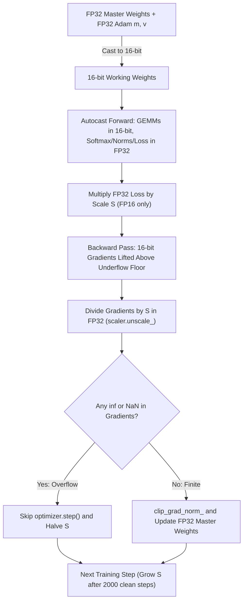
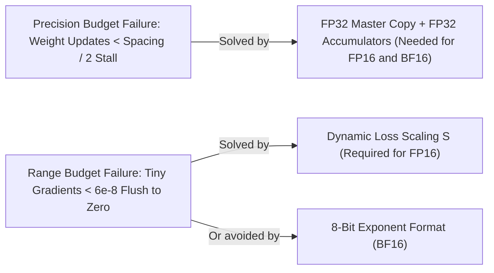
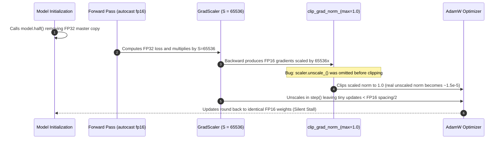

# Module 07: Mixed Precision Training

> **Prerequisites:** [Module 05: Calculating a Model's Memory Requirements](../05-calculating-a-models-memory-requirements/README.md), [Module 06: Numeric Formats: FP32, FP16, BF16](../06-numeric-formats-fp32-fp16-bf16/README.md)  
> **Estimated Reading Time:** 30 minutes  
> **Target Audience:** AI Backend Engineers, ML Systems Engineers, Distributed Training Engineers

> [!TIP]
> **The Golden Rule of Mixed-Precision Training**  
> Mixed-precision training executes heavy matrix multiplications in a fast 16-bit format while pinning numerically fragile steps to FP32: an FP32 **master copy** of the weights so tiny updates are not rounded away, **FP32 reductions** for softmax, norms, and loss, and (for FP16 only) a **loss scale** that lifts tiny gradients above FP16's underflow floor. BF16 inherits FP32's exponent range, eliminating loss scaling while still requiring FP32 master weights and accumulation.

---

## 1. Visual Mental Models & Architecture

You are in Track 05, GPUs & GenAI Hardware. [Module 05](../05-calculating-a-models-memory-requirements/README.md) showed that training needs about 16 bytes per parameter—including an FP32 "master" copy of the weights—and promised an explanation. [Module 06](../06-numeric-formats-fp32-fp16-bf16/README.md) unpacked what FP16 and BF16 can and cannot represent. This module combines both: why training mixes precisions, what the three canonical techniques do (FP32 master weights, loss scaling, FP32 for sensitive operations), and how PyTorch's `autocast` orchestrates them. [Module 08](../08-flashattention-and-memory-efficient-kernels/README.md) then tackles the other major training memory cost: attention activations.

After this module, you will be able to:
- Explain why mixed precision exists, and state clearly what memory it saves (activations) and what it does not save (16 B/param model states).
- Demonstrate numerically why a pure-FP16 weight update stalls and why small FP16 gradients flush to zero.
- Explain static and dynamic loss scaling, and why BF16 usually skips loss scaling.
- Identify which operations stay in FP32 under `torch.autocast` and why.
- Write a bug-free PyTorch `autocast` training step for both FP16 (with `GradScaler` and `unscale_` before clipping) and BF16.



Precision and range are separate numerical budgets solved by orthogonal mechanisms:



### FP16 Training Loop & Gradient Range Positioning (ASCII Reference)

One FP16 mixed-precision training step. Boxes marked `FP32` stay wide; the 16-bit lane is where the speed comes from:

```text
   FP32 master weights ───── cast ─────► 16-bit weights
          ▲                                   │
          │                                   ▼  forward (autocast)
          │                      matmuls in 16 bits; softmax / norms / loss in FP32
          │                                   │
          │                                   ▼
          │                          loss (FP32)  ──►  × S  (loss scale)
          │                                   │
          │                                   ▼  backward: every gradient is × S
          │                         16-bit gradients, now lifted above the underflow floor
          │                                   │
          │                                   ▼
          │                  ÷ S in FP32 ("unscale")  ──►  any inf / NaN ?
          │                                                 │            │
          │                                       no: clip, step      yes: skip step,
          └────── optimizer updates FP32 weights ◄──────────┘          S ← S / 2
                  (Adam m, v also FP32)
                                                every N clean steps:  S ← S × 2
```

Where gradient magnitudes sit relative to FP16's range (one character is one power of two; Listing 2's late-training per-row gradients sit around $2^{-26}$ and its largest weight-gradient entries around $2^{-7}$):

```text
 power of two          -32     -24     -16     -8      0       8       16
                       │       │       │       │       │       │       │
 FP16 can store        0000000sssssssssssnnnnnnnnnnnnnnnnnnnnnnnnnnnnnn!!!
                       0 flushed to zero · s subnormal (few bits) · n normal · ! overflow to inf

 per-row dy, S = 1       ▓▓▓▓▓▓▓▓▓
 per-row dy, S = 2^10              ▓▓▓▓▓▓▓▓▓
 biggest weight-grad                           ███
  entry, S = 2^22 (ok)                                               ███
  entry, S = 2^23 (inf)                                               ███
```

---

## 2. Core Mechanics & Systematic Comparison Matrices

### Why Mixed Precision Exists: Two Payoffs, One Real Cost

- **Speed:** GPU Tensor Cores execute 16-bit matrix multiplies dramatically faster than FP32 ones. The [NVIDIA A100 datasheet](https://www.nvidia.com/content/dam/en-zz/Solutions/Data-Center/a100/pdf/nvidia-a100-datasheet-us-nvidia-1758950-r4-web.pdf) (checked Oct 2026) lists **19.5 TFLOPS** for FP32 versus **312 TFLOPS** for FP16 and BF16 Tensor Core math (dense): a peak ratio of $16\times$. Real end-to-end speedups are smaller because non-matmul ops and memory bandwidth still consume time.
- **Memory and bandwidth:** Activations stored in 16 bits take half the VRAM and half the HBM bandwidth. The [original mixed-precision paper](https://arxiv.org/abs/1710.03740) notes that training memory is dominated by activations, so the overall footprint is roughly halved.
- **The cost—it does not shrink model states:** From Module 05, mixed-precision Adam needs $2 + 2 + 4 + 4 + 4 = 16\text{ bytes per parameter}$, the exact same 16 bytes as plain FP32 Adam ($4 + 4 + 4 + 4$). Adding a 16-bit working copy actually raises weight storage by 50% compared with FP32-only weights, though activation savings easily outweigh it.

Why not train entirely in FP16? Because three things fail, and each technique below fixes one.

### Trick 1: An FP32 Master Copy of the Weights

Training updates weights by tiny steps: $w \leftarrow w - \eta \cdot g$. A weight near $1.0$ stored in FP16 has adjacent representable values $\approx 0.00049$ apart (below $1.0$), so any update smaller than half that spacing rounds away completely. The mixed-precision paper highlights two ways this breaks: updates can fall below FP16's smallest representable magnitude (anything under $2^{-24}$ becomes zero), and whenever a weight is $\ge 2,048$ times larger than its update, the update shifts completely out of the 10-bit mantissa.

The fix is keeping the authoritative weights in FP32. Each step casts the FP32 master weights to 16 bits for forward and backward math, then applies the optimizer update to the FP32 master copy. In the paper's Mandarin speech experiment, updating FP16 weights directly lost **80% relative accuracy**, whereas keeping an FP32 master copy matched FP32 training exactly.

### Trick 2: Loss Scaling (for FP16)

During backpropagation, per-token gradients are frequently tiny—below FP16's smallest normal ($6.1 \times 10^{-5}$) and often below its smallest subnormal ($6.0 \times 10^{-8}$), flushing to zero. The mixed-precision paper notes that gradient values in the range $2^{-27}$ to $2^{-24}$ were essential for convergence in the networks it studied.

**Loss scaling** multiplies the loss by a scale factor $S$ before calling `.backward()`. By the chain rule, every backward gradient is scaled by $S$, sliding the entire gradient distribution up into FP16's normal range. Before optimizer updates or gradient clipping, gradients are divided by $S$ in FP32 (using a power of two makes multiplication and division exact exponent shifts).

Too large an $S$ overflows to `inf` above `65,504`:
- **Static scaling:** Pick a constant $S$ (the paper used 8 to 32K) so $S \cdot \max |g| < 65,504$.
- **Dynamic scaling (`GradScaler`):** Start high, inspect every step for `inf`/`NaN`, and on overflow skip `optimizer.step()` and halve $S$; after a streak of clean steps, double $S$. PyTorch's `torch.amp.GradScaler` defaults to `init_scale=65536`, `growth_factor=2.0`, `backoff_factor=0.5`, and `growth_interval=2000`. NVIDIA's guide notes that most skipped steps occur right at the beginning of training (typically fewer than ten).

### Why BF16 Usually Does Not Need Loss Scaling

BF16 keeps FP32's 8-bit exponent, spanning down to $\approx 10^{-38}$. Gradients that flush to zero in FP16 remain completely normal values in BF16. The [BF16 study](https://arxiv.org/abs/1905.12322) reports FP32-equivalent convergence across image, speech, language, and recommendation workloads with zero hyperparameter changes and no loss scaling.

However, because BF16 has only **7 mantissa bits** (even coarser than FP16's 10 bits), you **still require FP32 master weights and FP32 accumulation**: absorbing small updates is a precision failure, not a range failure.

> [!NOTE]
> **Range vs. Precision Budgets**  
> Loss scaling solves a *range* problem (tiny gradients below FP16's floor) by shifting exponents, costing nothing in precision. Master weights solve a *precision* problem (tiny updates absorbed next to larger weights) by executing updates in FP32. FP16 suffers from both problems; BF16 suffers only from the precision problem.

### `torch.autocast`: Per-Operation Dtype Policy

In practice, you never manually cast layer by layer. PyTorch's `torch.autocast` acts as a context manager that selects a dtype *per operation* while leaving model parameters in FP32 (the PyTorch docs explicitly warn against calling `.half()` or `.bfloat16()` on the model when using `autocast`):

| Operation Category | Autocast Dtype | Why |
| :--- | :--- | :--- |
| **`linear`, `matmul`, `mm`, `bmm`, `addmm`, convolutions** | **16-bit (FP16 / BF16)** | Matrix-multiply shaped; dominates FLOPs and triggers Tensor Core acceleration |
| **Master weights, optimizer states (Adam `m` and `v`)** | **FP32** | Tiny parameter updates must not be absorbed into coarse mantissas |
| **Matmul accumulators** | **FP32** | Hardware Tensor Cores accumulate 16-bit products into FP32 across long dot products |
| **`softmax`, `log_softmax`, `cross_entropy`, `nll_loss`, loss value** | **FP32** | `exp` overflow risk and long reduction sums |
| **`layer_norm`, `group_norm`, `sum`, `prod`, `cumsum`, `norm`, `mse_loss`** | **FP32** | Mean, variance, and long sums lose precision in 16 bits |
| **Loss scale & `inf`/`NaN` checks** | **FP32** | Scale factors (e.g., `65536`) exceed FP16's finite ceiling |

Backward operations automatically execute in the same dtype `autocast` selected during the corresponding forward operation. PyTorch recommends wrapping *only* the forward pass and loss computation inside `autocast`, running `backward()` outside the context block.

> [!WARNING]
> **Four Classic Mixed-Precision Traps**  
> 1. **Clipping before unscaling:** Gradients are still multiplied by $S$, so calling `clip_grad_norm_` before `scaler.unscale_(optimizer)` clips $S\times$ too aggressively.  
> 2. **Calling `.half()` on the model under `autocast`:** Converts weights to 16-bit, destroying FP32 master-weight protection.  
> 3. **Using `binary_cross_entropy` inside `autocast`:** PyTorch raises a runtime error because its backward pass can overflow/underflow in FP16; always use `binary_cross_entropy_with_logits`.  
> 4. **Expecting `GradScaler` to rescue a forward overflow:** Loss scaling multiplies the *loss* after forward finishes, so forward `inf`s still require FP32 op promotion or BF16.

### Systematic Precision Strategy Comparison Matrix

| Training Configuration | Tensor Core Speedup | Activation VRAM | Model State Bytes / Param | Loss Scale Required? | Primary Failure Mode | Recommended Hardware |
| :--- | :--- | :--- | :--- | :--- | :--- | :--- |
| **Full FP32** | Baseline ($1\times$, 19.5 TFLOPS on A100) | $1\times$ | 16 B (`4+4+4+4`) | No | Slow throughput & high activation OOM risk | Legacy / numerical debugging baseline |
| **Pure FP16 (No Master, No Scaler)** | High (312 TFLOPS on A100) | $0.5\times$ | 12 B (unstable) | Yes (missing) | Weight updates stall + small gradients flush to `0` | **Broken — never use for training** |
| **FP16 + FP32 Master + `GradScaler`** | High ($16\times$ peak on A100) | $0.5\times$ | 16 B (`2+2+4+4+4`) | **Yes (Dynamic)** | Forward `exp()` overflow above `65,504` | Volta (V100), Turing (T4), older GPUs |
| **BF16 + FP32 Master (Autocast Only)** | High ($16\times$ peak on A100) | $0.5\times$ | 16 B (`2+2+4+4+4`) | **No** | Coarser 7-bit mantissa if reductions aren't FP32 | Ampere (A100), Ada (L40S), Hopper (H100+) |

---

## 3. Production War Story: Incident Post-Mortem

### Silent Divergence From Pre-Unscale Gradient Clipping & Accidental `.half()` Cast

- **Severity:** SEV-1 (Silent Training Convergence Failure)
- **Time to Detect:** 6 days (discovered during mid-run downstream eval benchmark)
- **Time to Resolve:** 4 hours
- **Impact:** \$42,000 of multi-node GPU compute burned on an FP16 mixed-precision pre-training run whose validation loss stalled at a degraded plateau after step 4,000, yielding an unusable checkpoint.

#### What Happened

An engineer refactored an older V100 FP16 training loop to add gradient norm clipping (`max_norm = 1.0`) and memory cleanup. Two subtle bugs were introduced simultaneously:
1. `torch.nn.utils.clip_grad_norm_(model.parameters(), 1.0)` was placed *above* `scaler.step(optimizer)` without calling `scaler.unscale_(optimizer)` first. Because `GradScaler` had grown the loss scale $S$ to `65,536`, every gradient norm was measured at $65,536\times$ its true magnitude—causing `clip_grad_norm_` to scale genuine gradients down by $\sim 1/65536$ on every single step.
2. Meanwhile, a model-loading utility still invoked `model.half()` before entering `torch.autocast`, wiping out the FP32 master parameters so AdamW updated FP16 weights directly.

Once the learning rate decayed slightly around step 4,000, the doubly shrunk updates fell below half the FP16 ULP spacing near the weights, freezing parameter updates completely while the training logs kept printing clean, non-NaN steps!

#### The Failure Sequence Diagram



#### Root Cause Analysis

1. **Inverted `unscale_` / Clip Ordering:** Clipping scaled gradients enforces an effective max norm of `max_norm / S`, starving optimization as $S$ grows.
2. **Double-Casting via `model.half()`:** Calling `.half()` strips FP32 master parameters, leaving optimizer updates vulnerable to mantissa absorption even when `GradScaler` succeeds.

#### The Fix & Architectural Hardening

1. **Strict AMP Lifecycle Assertion:** Enforced a CI training-loop test asserting `all(p.dtype == torch.float32 for p in model.parameters())` when using `autocast`, and enforced `scaler.unscale_(optimizer)` strictly before `clip_grad_norm_`.
2. **Migration to BF16 on A100/H100:** Migrated Ampere+ training pipelines to `torch.autocast("cuda", dtype=torch.bfloat16)` without `GradScaler`, eliminating loss-scale coupling bugs entirely.

---

## 4. Verified Python Experiments

Listings 1 and 2 use NumPy only and import `floatbits.py` from [Module 06, Listing 1](../06-numeric-formats-fp32-fp16-bf16/README.md). Outputs were produced by running them with Python 3.13 and NumPy 2.4. Listing 3 needs `torch` and a CUDA GPU and was **not executed**.

### Listing 1: Why FP16 Weights Need an FP32 Master Copy

A weight of `1.0` receives 1,000 updates of `1e-4` each; the ideal result is `0.9`.

```python
import numpy as np
from floatbits import to_bf16

update = 1e-4          # what one optimizer step wants to subtract from a weight of 1.0
steps = 1000           # ideal result: 1.0 - 1000 * 1e-4 = 0.9

w32 = np.float32(1.0)
w16 = np.float16(1.0)
wbf = np.float32(1.0)  # holds a value that is always rounded to bf16 precision
for _ in range(steps):
    w32 = w32 - np.float32(update)
    w16 = np.float16(w16 - np.float16(update))
    wbf = to_bf16(wbf - np.float32(update))

print("ideal result      : 0.9")
print("fp32 weight       :", float(w32))
print("fp16 weight       :", float(w16), "  <- stuck: each update is below half the fp16 spacing near 1")
print("bf16 weight       :", float(wbf), "  <- stuck too: bf16 spacing near 1 is even coarser")
print("fp16 spacing below 1.0:", float(np.float16(1.0) - np.nextafter(np.float16(1.0), np.float16(0))))
```

**Output:**

```text
ideal result      : 0.9
fp32 weight       : 0.8999834060668945
fp16 weight       : 1.0   <- stuck: each update is below half the fp16 spacing near 1
bf16 weight       : 1.0   <- stuck too: bf16 spacing near 1 is even coarser
fp16 spacing below 1.0: 0.00048828125
```

> [!NOTE]
> **Master Weight Takeaway:** The FP32 weight reaches about `0.9` (the `1.7e-5` shortfall is FP32's own rounding over 1,000 steps). The FP16 and BF16 weights never move: the `1e-4` update is below half the spacing (`0.00049` for FP16) and rounds back to `1.0` every time. Keeping the master copy in FP32 removes the stall.

### Listing 2: Gradient Underflow, Loss Scaling, and a Dynamic Scaler

The setup: linear regression $y = Xw$ on $2^{20}$ rows, with a loss that is the *mean* over all rows, so each row's gradient $dL/dy = 2 \cdot \text{residual} / N$ is tiny (about `1e-8` late in training). This mimics why per-token gradients are tiny in LLM training, where one step averages over a huge batch of tokens. FP16 and BF16 matrix products accumulate in FP32 and round their results to 16 bits, like Tensor Cores. Part 1 isolates the backward pass; Part 2 trains for 60 steps with FP32 master weights in every row (takes ~20 seconds).

```python
import numpy as np
from floatbits import to_bf16

np.seterr(all="ignore")                       # inf/NaN are part of the story; don't print warnings
f16, f32 = np.float16, np.float32

# Linear regression y = X @ w on 2**20 rows. The loss is a MEAN over all rows, so each row's
# gradient dL/dy = 2*residual/N is tiny: the same reason per-token gradients are tiny in LLM training.
N, D = 2 ** 20, 8
rng = np.random.default_rng(0)
X = rng.normal(size=(N, D)).astype(f32)
w_true = rng.normal(size=D).astype(f32)
T = X @ w_true
X16, Xbf = X.astype(f16), to_bf16(X)


def backward(w, scale, fmt):
    """One forward+backward. Returns (loss, gradient in fp32 after unscaling, all finite?)."""
    if fmt == "fp32":
        r = X @ w - T
        return float((r ** 2).mean()), X.T @ (2 * r / N), True
    if fmt == "fp16":                                       # fp16 storage, fp32 accumulation
        y = (X16.astype(f32) @ w.astype(f16).astype(f32)).astype(f16)
        r = y.astype(f32) - T                               # loss math stays in fp32
        dy = (2 * r / N * scale).astype(f16)                # scale first, THEN squeeze into fp16
        g = (X16.astype(f32).T @ dy.astype(f32)).astype(f16).astype(f32)
    else:                                                   # emulated bf16
        y = to_bf16(Xbf @ to_bf16(w))
        r = y - T
        dy = to_bf16(2 * r / N * scale)
        g = to_bf16(Xbf.T @ dy)
    return float((r ** 2).mean()), g / scale, bool(np.isfinite(g).all())


# ---- Part 1: one late-training snapshot, many loss scales -----------------------------------
# To isolate the BACKWARD pass, the forward residual r is computed exactly (fp32); only the
# gradient tensors are squeezed into the low-precision format.
w = (w_true + 0.003 * rng.normal(size=D)).astype(f32)       # weights already close to the answer
r = X @ w - T
g_ref = X.T @ (2 * r / N)
print("Part 1: gradient quality at one snapshot (relative error vs the fp32 gradient)")
print(f"{'format':>6s} {'scale':>6s} {'dy == 0':>9s} {'finite?':>8s} {'rel. error':>11s}")
for fmt, ks in (("fp16", (0, 4, 8, 10, 16, 20, 24)), ("bf16", (0, 24))):
    for k in ks:
        s = 2.0 ** k
        if fmt == "fp16":
            dy = (2 * r / N * s).astype(f16)
            g = (X16.astype(f32).T @ dy.astype(f32)).astype(f16).astype(f32)
        else:
            dy = to_bf16(2 * r / N * s)
            g = to_bf16(Xbf.T @ dy)
        ok = bool(np.isfinite(g).all())
        err = np.linalg.norm(g / s - g_ref) / np.linalg.norm(g_ref) if ok else float("nan")
        print(f"{fmt:>6s} {'2^' + str(k):>6s} {100 * (dy == 0).mean():8.1f}% {str(ok):>8s} {err:11.4f}")


# ---- Part 2: full training runs, with a dynamic loss scaler ---------------------------------
class DynamicLossScaler:
    """Same idea as torch.amp.GradScaler: back off on inf/NaN (skip the step), grow after a streak
    of clean steps. torch's defaults are init_scale=65536, growth_interval=2000; this toy uses
    2**24 and 10 so that both behaviours are visible in 60 steps."""
    def __init__(self, init_scale=2.0 ** 24, growth_factor=2.0, backoff_factor=0.5, growth_interval=10):
        self.scale, self.gf, self.bf, self.interval = init_scale, growth_factor, backoff_factor, growth_interval
        self.good, self.skipped = 0, 0

    def update(self, grads_finite):
        if not grads_finite:
            self.scale *= self.bf; self.good = 0; self.skipped += 1
        else:
            self.good += 1
            if self.good == self.interval:
                self.scale *= self.gf; self.good = 0


def train(fmt, scaling, steps=60, lr=0.25):
    w = np.zeros(D, dtype=f32)                              # these ARE the fp32 master weights
    scaler = DynamicLossScaler() if scaling == "dynamic" else None
    scale = {"none": 1.0, "static": 1024.0}.get(scaling)
    losses = []
    for _ in range(steps):
        s = scaler.scale if scaler else scale
        loss, g, ok = backward(w, s, fmt)
        losses.append(loss)
        if scaler:
            scaler.update(ok)
        if ok:
            w -= lr * g                                     # update happens in fp32
    skipped = scaler.skipped if scaler else 0
    return losses, skipped, float(np.abs(w - w_true).max())


print()
print("Part 2: 60 SGD steps from w = 0 (fp32 master weights in every row)")
print(f"{'format':>6s} {'loss scaling':>13s} {'loss@10':>10s} {'loss@30':>10s} {'loss@59':>10s} {'skipped':>8s} {'max|w-w*|':>10s}")
for fmt, scaling in (("fp32", "none"), ("fp16", "none"), ("fp16", "static"), ("fp16", "dynamic"), ("bf16", "none")):
    L, skipped, err = train(fmt, scaling)
    print(f"{fmt:>6s} {scaling:>13s} {L[10]:10.2e} {L[30]:10.2e} {L[59]:10.2e} {skipped:8d} {err:10.2e}")
```

**Output:**

```text
Part 1: gradient quality at one snapshot (relative error vs the fp32 gradient)
format  scale   dy == 0  finite?  rel. error
  fp16    2^0     94.8%     True      0.5327
  fp16    2^4      9.7%     True      0.0002
  fp16    2^8      0.6%     True      0.0002
  fp16   2^10      0.2%     True      0.0002
  fp16   2^16      0.0%     True      0.0002
  fp16   2^20      0.0%     True      0.0002
  fp16   2^24      0.0%    False         nan
  bf16    2^0      0.0%     True      0.0011
  bf16   2^24      0.0%     True      0.0011

Part 2: 60 SGD steps from w = 0 (fp32 master weights in every row)
format  loss scaling    loss@10    loss@30    loss@59  skipped  max|w-w*|
  fp32          none   1.19e-05   1.74e-13   1.74e-13        0   2.38e-07
  fp16          none   3.91e-05   1.26e-05   1.26e-05        0   2.47e-03
  fp16        static   1.99e-05   2.23e-06   3.51e-06        0   3.20e-04
  fp16       dynamic   1.20e+01   2.23e-06   2.23e-06       11   3.21e-04
  bf16          none   1.05e-04   1.22e-04   1.20e-04        0   5.44e-03
```

How to read it:
- **Underflow (Part 1, `dy == 0`):** With no scaling, 94.8% of the per-row gradients are exactly zero in FP16, and the gradient the optimizer sees is 53% wrong. A scale of $2^4$ drops zeros to 9.7% and error to `0.0002`.
- **Overflow (Part 1, last FP16 row):** At $2^{24}$ the scaled weight gradient exceeds `65,504` and becomes `inf`. Back-of-envelope check: largest reference gradient entry is `0.0085`, and $65,504 / 0.0085 \approx 7.7 \times 10^6$, between $2^{22}$ and $2^{23}$ (rerunning gave finite at $2^{22}$ and `inf` at $2^{23}$).
- **BF16 (Part 1):** Zero flushed gradients at scale `1`, and $2^{24}$ changes nothing because a power-of-two scale shifts only the exponent. Its relative error (`0.0011`) exceeds well-scaled FP16 (`0.0002`) because of 7 vs. 10 mantissa bits.
- **Training (Part 2):** Without scaling, FP16 stalls at loss `1.3e-5` (`2.5e-3` from true weights). Static (`1024`) and dynamic reach `2e-6–4e-6`. Dynamic skipped 11 initial steps backing down from $2^{24}$, then converged cleanly. BF16 required no scaler and settled around `1.2e-4` due to coarser forward rounding on this noise-free toy problem.

### Listing 3: The Same Patterns in PyTorch (Reference Pattern)

This listing needs `torch` and a CUDA GPU. Neither was available in the CPU verification environment, so it was **not executed** and no output is shown. It follows the patterns in the official PyTorch AMP documentation (checked Oct 2026).

```python
import torch

model = MyModel().cuda()                          # parameters stay in FP32: these are the master weights
optimizer = torch.optim.AdamW(model.parameters(), lr=1e-4)
scaler = torch.amp.GradScaler("cuda")             # defaults: init_scale=65536, growth_interval=2000

for inputs, targets in loader:
    optimizer.zero_grad()
    with torch.autocast(device_type="cuda", dtype=torch.float16):
        outputs = model(inputs)                   # matmuls in FP16; softmax, norms and loss in FP32
        loss = loss_fn(outputs, targets)
    scaler.scale(loss).backward()                 # backward is called outside the autocast block
    scaler.unscale_(optimizer)                    # gradients back to real units, in place
    torch.nn.utils.clip_grad_norm_(model.parameters(), 1.0)   # now the clip threshold means what you think
    scaler.step(optimizer)                        # skips optimizer.step() if any gradient is inf/NaN
    scaler.update()                               # lower or raise the scale for the next step

# BF16 variant: no scaler is needed. The loop body becomes
#   with torch.autocast(device_type="cuda", dtype=torch.bfloat16):
#       loss = loss_fn(model(inputs), targets)
#   loss.backward()
#   optimizer.step()
```

---

## 5. Multi-Language Production Implementation

````carousel
### Go: Dynamic Loss Scaler State Machine

```go
// dynamic_scaler.go
// Mirrors PyTorch torch.amp.GradScaler backoff/growth state machine for FP16 training.
package main

import (
	"fmt"
	"math"
)

type DynamicLossScaler struct {
	Scale          float64
	GrowthFactor   float64
	BackoffFactor  float64
	GrowthInterval int
	CleanStreak    int
	SkippedSteps   int
}

func NewDefaultGradScaler() *DynamicLossScaler {
	return &DynamicLossScaler{
		Scale:          65536.0, // PyTorch default 2^16
		GrowthFactor:   2.0,
		BackoffFactor:  0.5,
		GrowthInterval: 2000,
	}
}

func (s *DynamicLossScaler) StepAndUpdate(grads []float64) bool {
	for _, g := range grads {
		if math.IsInf(g, 0) || math.IsNaN(g) {
			s.Scale *= s.BackoffFactor
			s.CleanStreak = 0
			s.SkippedSteps++
			return false // Skipped optimizer step
		}
	}
	s.CleanStreak++
	if s.CleanStreak >= s.GrowthInterval {
		s.Scale *= s.GrowthFactor
		s.CleanStreak = 0
	}
	return true
}

func main() {
	scaler := NewDefaultGradScaler()
	scaler.GrowthInterval = 5 // Shortened for demo
	events := [][]float64{{math.Inf(1)}, {math.NaN()}, {0.42}, {0.15}, {0.09}, {0.04}, {0.02}}

	for step, g := range events {
		applied := scaler.StepAndUpdate(g)
		fmt.Printf("Step %d | Applied: %-5v | Next Scale: %8.1f | Streak: %d | Skipped: %d\n",
			step, applied, scaler.Scale, scaler.CleanStreak, scaler.SkippedSteps)
	}
}
```
<!-- slide -->
### TypeScript: `autocast` Per-Op Dtype Policy & Safety Validator

```typescript
// autocastPolicy.ts
// Models PyTorch CUDA autocast operator precision rules and catches common AMP bugs.

export type PrecisionDtype = "fp32" | "fp16" | "bf16";

const LOW_PRECISION_OPS = new Set(["linear", "matmul", "mm", "bmm", "addmm", "conv2d"]);
const FP32_REQUIRED_OPS = new Set([
  "softmax", "log_softmax", "cross_entropy", "nll_loss",
  "layer_norm", "group_norm", "exp", "log", "pow", "sum", "mse_loss",
]);
const BANNED_AUTOCAST_OPS = new Set(["binary_cross_entropy"]);

export function resolveAutocastOpDtype(
  opName: string,
  target16Bit: "fp16" | "bf16",
  inputDtypes: PrecisionDtype[]
): PrecisionDtype {
  if (BANNED_AUTOCAST_OPS.has(opName)) {
    throw new Error(`Unsafe under autocast: replace '${opName}' with 'binary_cross_entropy_with_logits'.`);
  }
  if (FP32_REQUIRED_OPS.has(opName)) {
    return "fp32"; // Range- or reduction-sensitive operations always promote to FP32
  }
  if (LOW_PRECISION_OPS.has(opName)) {
    return target16Bit; // Tensor Core GEMMs run in 16-bit
  }
  // Multi-input promotion rule: promote to widest input dtype
  return inputDtypes.includes("fp32") ? "fp32" : target16Bit;
}

for (const op of ["matmul", "softmax", "layer_norm", "cross_entropy"]) {
  console.log(`${op.padEnd(15)} -> ${resolveAutocastOpDtype(op, "fp16", ["fp16"])}`);
}
```
<!-- slide -->
### Python: PyTorch AMP Training Step Harness (FP16 & BF16)

```python
"""
torch_amp_train_step.py
Production-safe PyTorch mixed-precision training step supporting CUDA FP16 (with
unscale_ before clip_grad_norm_) and CUDA/CPU BF16, plus parameter dtype checks.
"""

def run_amp_step(use_bf16: bool = True) -> None:
    try:
        import torch
        import torch.nn as nn
    except ImportError:
        print("PyTorch not installed; install torch to execute live AMP step.")
        return

    device = "cuda" if torch.cuda.is_available() else "cpu"
    if device == "cpu" and not use_bf16:
        print("FP16 autocast + GradScaler targets CUDA; switching to CPU bfloat16 demo.")
        use_bf16 = True

    amp_dtype = torch.bfloat16 if use_bf16 else torch.float16
    model = nn.Sequential(nn.Linear(64, 128), nn.GELU(), nn.Linear(128, 10)).to(device)
    assert all(p.dtype == torch.float32 for p in model.parameters()), "Master weights must stay FP32!"

    optimizer = torch.optim.AdamW(model.parameters(), lr=1e-3)
    scaler = torch.amp.GradScaler("cuda", enabled=(device == "cuda" and not use_bf16))

    x = torch.randn(16, 64, device=device)
    targets = torch.randint(0, 10, (16,), device=device)
    loss_fn = nn.CrossEntropyLoss()

    optimizer.zero_grad(set_to_none=True)
    with torch.autocast(device_type=device, dtype=amp_dtype):
        loss = loss_fn(model(x), targets)

    scaler.scale(loss).backward()
    if scaler.is_enabled():
        scaler.unscale_(optimizer)  # Always unscale BEFORE gradient clipping!
    torch.nn.utils.clip_grad_norm_(model.parameters(), max_norm=1.0)
    scaler.step(optimizer)
    scaler.update()
    print(f"Step complete on {device} ({amp_dtype}): loss={loss.item():.4f}, master_dtype={next(model.parameters()).dtype}")


if __name__ == "__main__":
    run_amp_step(use_bf16=True)
```
<!-- slide -->
### C#: FP32 Master Weight vs. FP16 Direct Update Simulator

```csharp
// MasterWeightOptimizer.cs
// Demonstrates why maintaining FP32 master weights prevents update absorption stalling in FP16.
using System;

public static class MasterWeightOptimizer
{
    public static void Main()
    {
        const float update = 1e-4f;
        const int steps = 1000;

        Half directFp16Weight = (Half)1.0f;
        float masterFp32Weight = 1.0f;
        Half workingFp16View = (Half)masterFp32Weight;

        for (int i = 0; i < steps; i++)
        {
            // Broken: update directly in FP16
            directFp16Weight = (Half)((float)directFp16Weight - (float)(Half)update);

            // Correct: accumulate update in FP32 master copy, cast to FP16 for next forward pass
            masterFp32Weight -= update;
            workingFp16View = (Half)masterFp32Weight;
        }

        Console.WriteLine($"Ideal Result        : 0.9000");
        Console.WriteLine($"Direct FP16 Weight  : {(float)directFp16Weight:F4} (Stalled by mantissa spacing!)");
        Console.WriteLine($"FP32 Master Weight  : {masterFp32Weight:F4} (Working FP16 view: {(float)workingFp16View:F4})");
    }
}
```
````

---

## 6. Practical Hands-On Verification Workflows & Exercises

### Verification Workflow 1: Reproduce FP16 Master-Weight Update Stall

Run this CLI snippet to verify the exact FP16 spacing near `1.0` and watch pure-FP16 updates freeze at `1.0` while FP32 master weights converge to `~0.9`:

```bash
python -c "
import numpy as np
w32, w16, upd = np.float32(1.0), np.float16(1.0), 1e-4
for _ in range(1000):
    w32 = w32 - np.float32(upd)
    w16 = np.float16(w16 - np.float16(upd))
print('fp32:', float(w32), '| fp16:', float(w16), '| spacing below 1:', float(np.float16(1.0) - np.nextafter(np.float16(1.0), np.float16(0))))
"
```

**Expected Output:**

```text
fp32: 0.8999834060668945 | fp16: 1.0 | spacing below 1: 0.00048828125
```

### Verification Workflow 2: Verify `DynamicLossScaler` Backoff Across Initial Scales

Compare skipped-step counts for initial scales $2^{10}$, $2^{16}$ (PyTorch's default), and $2^{24}$ when the maximum initial weight gradient requires $S \le 2^{22}$ or overflows:

```bash
python -c "
for init_exp in (10, 16, 24):
    scale = 2.0**init_exp; skips = 0
    # Simulate early-step large gradient (max_g = 2.0 -> safe scale <= 32752 < 2^15)
    for step in range(60):
        grad_max = 2.0 if step < 15 else 0.0085
        if grad_max * scale > 65504.0:
            scale *= 0.5; skips += 1
    print(f'init=2^{init_exp:<2d} -> skipped={skips:2d}, final_scale={scale:.1f}')
"
```

**Expected Output:**

```text
init=2^10 -> skipped= 0, final_scale=1024.0
init=2^16 -> skipped= 2, final_scale=16384.0
init=2^24 -> skipped=10, final_scale=16384.0
```

---

### Hands-On Practice Exercises

#### 1. A Bigger Update

In Listing 1, change `update` to `1e-3` and `steps` to `500` (ideal result `0.5`). Predict first: does the FP16 weight still get stuck? Then run it.

<details><summary><strong>Answer</strong></summary>

It does not get stuck: `1e-3` is larger than half the FP16 spacing near 1 (`0.00049 / 2`), so each update registers, but it is rounded to a multiple of the spacing, so the result drifts. Running it gave an FP16 weight of `0.5117` against `0.5000` in FP32 (ideal `0.5`): a `2.3%` error that accumulates. Stalling happens when updates are under half the spacing; rounding error appears when they are merely close to it. A master copy avoids both.

</details>

#### 2. Pick a Constant Loss Scale

The largest entry of the FP32 weight gradient in Listing 2's snapshot is `0.0085`. Using the rule "choose `S` so that `S` times the largest gradient stays below 65,504," what is the largest power-of-two scale? Confirm against Listing 2.

<details><summary><strong>Answer</strong></summary>

$65,504 / 0.0085$ is about $7.7 \times 10^6$. Powers of two: $2^{22} = 4.19 \times 10^6$ is below that and $2^{23} = 8.39 \times 10^6$ is above, so the largest safe power of two is $2^{22}$. Re-running Part 1's gradient computation at $2^{21}$, $2^{22}$, and $2^{23}$ gave a largest scaled gradient entry of about `17,800`, `35,600`, and `71,200`: finite for the first two and over the FP16 limit (`inf`) at $2^{23}$. In practice you stay well below this edge because gradients change during training, which is why dynamic scaling exists.

</details>

#### 3. Starting Scale of the Dynamic Scaler

Run the dynamic scaler from Listing 2 with initial scales $2^{10}$, $2^{16}$ (PyTorch's default), and $2^{24}$, and count the skipped steps in 60 steps. Why do the counts differ and why do skips happen early?

<details><summary><strong>Answer</strong></summary>

Observed: initial $2^{10}$ skips `0` steps; $2^{16}$ skips `3` (steps 0, 1, 2); $2^{24}$ skips `11` (steps 0 to 10). Early in training the residuals, and so the gradients, are largest (the loss is about 12 at the start), so a high scale overflows immediately; each skip halves the scale until it fits. Later the gradients shrink, and the scaler grows `S` again after every 10 clean steps. NVIDIA's guide makes the same point in a TensorFlow FAQ entry: skips mostly happen at the start. A skipped step does not update the weights, so a few skips are harmless; a scale that never stops collapsing indicates a real problem (see troubleshooting).

</details>

#### 4. Which Ops Run in FP32?

Under CUDA autocast, which of these run in 16 bits and which in FP32: `linear`, `softmax`, `matmul`, `layer_norm`, `conv2d`, `cross_entropy`, `sum`, `exp`?

<details><summary><strong>Answer</strong></summary>

16 bits: `linear`, `matmul`, `conv2d` (matrix-multiply-shaped, benefit most). FP32: `softmax`, `layer_norm`, `cross_entropy`, `sum`, `exp` (range- or accumulation-sensitive). This follows the op lists in the PyTorch autocast documentation, which are version-specific, so check them for your release.

</details>

### Independent Challenge: Mixed-Precision Ablation Trainer

Build a small mixed-precision trainer in NumPy that makes each trick visible by breaking it.

Requirements:
- A model of your choice (a two-layer MLP on a synthetic classification or regression task is enough), written with explicit forward and backward passes, using `floatbits.to_bf16` and `np.float16` to emulate 16-bit storage with FP32 accumulation.
- Four ablations, reported in one table of final loss: (a) full FP32; (b) FP16 compute with FP32 master weights and dynamic loss scaling; (c) the same but with the loss scale fixed at 1; (d) FP16 weights updated directly with no master copy. Add BF16 with no scaler as a fifth row.
- A `DynamicLossScaler` you write yourself that logs every skipped step, with the scale before and after.
- An experiment that injects an overflow (for example a large input in a single batch) and shows the scaler skipping that step and recovering.
- Choose sizes and learning rates so that the ablations *differ*; if (c) and (b) give the same loss, your gradients are not small enough to underflow, and you should explain how you changed that.

There is no reference solution.

<details><summary><strong>Discussion: Making Gradient Underflow & Update Stalling Reproducible</strong></summary>

1. **Triggering underflow in (c):** Average your loss over a large row count (e.g., $N \ge 2^{18}$ samples) or include a deep linear chain whose output gradients are scaled by $1 / N$, pushing $dL/dy$ below $6 \times 10^{-8}$ when `scale = 1`.
2. **Triggering update stalling in (d):** Use a small learning rate (e.g., `lr = 1e-3` or `1e-4`) so `lr * grad` near weights of magnitude $\sim 1.0$ falls below $2^{-11} \approx 0.00049$.
3. **Validating overflow recovery:** Inject a single spiked batch (`X[0] *= 500`) at step 25; verify `DynamicLossScaler` catches `inf`, skips that step cleanly without corrupting the FP32 master weights, halves `scale`, and resumes decreasing loss on step 26.

</details>

---

## 7. Operational Validation Checkpoints & Quizzes

### Operational Validation Scenarios

<details><summary><strong>Scenario 1: Diagnosing a Collapsing `GradScaler` Scale Factor</strong></summary>

**Question:** During an FP16 training job with `torch.amp.GradScaler`, you log `scaler.get_scale()` every 100 steps and watch it drop monotonically from `65536` down to `1.0`, `0.5`, `0.25`, and then `0.0`—while `loss` stays completely flat. What is happening and how do you isolate the cause?

**Answer:** A collapsing scale means *every* training step is hitting `inf` or `NaN` in the backward gradients, forcing `GradScaler` to skip `optimizer.step()` and halve `S` continuously. Remember: `GradScaler` only scales the backward pass; if a **forward pass** op (like an unguarded `exp()`, division by near-zero variance, or huge attention logit) overflows FP16's `65,504` ceiling, lowering `S` cannot fix it! Isolate by wrapping the forward pass with finiteness hooks (`torch.isfinite(out).all()`) per module, checking for corrupted `inf`/`NaN` input batches, or switching the offending layer/run to `bfloat16` or FP32.

</details>

<details><summary><strong>Scenario 2: Why `scaler.unscale_()` Must Run Only Once Per Optimizer Step</strong></summary>

**Question:** An engineer implements 4-step gradient accumulation with FP16 `GradScaler` and puts `scaler.unscale_(optimizer)` + `clip_grad_norm_` inside the inner micro-batch loop before `scaler.step(optimizer)`. On micro-batch 2, PyTorch crashes with `RuntimeError: unscale_() has already been called on this optimizer since the last update()`. Why?

**Answer:** `scaler.scale(loss).backward()` multiplies each micro-batch's accumulated gradients by the same scale `S`. Calling `unscale_(optimizer)` divides the *entire* accumulated `.grad` buffer by `S` in place and flags the optimizer as already unscaled. Therefore, `scaler.unscale_(optimizer)`, `clip_grad_norm_`, `scaler.step(optimizer)`, and `scaler.update()` must execute **once per optimizer step** (after all 4 micro-batches have finished accumulating gradients).

</details>

<details><summary><strong>Scenario 3: Mixing BF16 Autocast With `GradScaler`</strong></summary>

**Question:** You migrate a pipeline from V100 (`float16`) to H100 (`bfloat16`) by changing `dtype=torch.bfloat16` in `torch.autocast`, while leaving `scaler = torch.amp.GradScaler("cuda")` active. Is `GradScaler` helping, harmless, or wasteful?

**Answer:** It is unnecessary machinery (and adds overhead scanning every gradient tensor for `inf`/`NaN` plus extra scaling kernels on every step). Because BF16 has FP32's 8-bit exponent, gradients do not underflow at $6 \times 10^{-8}$, so scaling up and down buys nothing. Pass `enabled=False` to `GradScaler` or remove it entirely for BF16 (`loss.backward()`, `clip_grad_norm_`, `optimizer.step()`).

</details>

### Checkpoint Quiz

1. Why does a pure-FP16 weight update stall, and what is the fix?
2. What does loss scaling do mathematically, and why must gradients be unscaled before the optimizer and before clipping?
3. What does a dynamic loss scaler do on an overflow, and after a streak of clean steps?
4. Why does BF16 usually not need loss scaling, and what does it give up?
5. Does mixed precision reduce the 16 bytes per parameter of model states? What does it reduce?

<details><summary><strong>Answers</strong></summary>

1. Updates smaller than half the spacing between FP16 values near the weight round away. Keep FP32 master weights, update those, and cast to 16 bits for the forward and backward passes.
2. It multiplies the loss by `S`; by the chain rule every gradient is multiplied by `S`, lifting small gradients above FP16's underflow floor. The optimizer and clipping must see true-scale gradients, so divide by `S` first (in FP32) or learning rates, weight decay, and clip thresholds are all off by a factor of `S`.
3. On overflow (`inf` or `NaN` in the gradients) it skips the weight update and lowers the scale (by `0.5` in PyTorch by default); after a streak of clean steps (`2,000` by default) it raises it (by `2`).
4. BF16 has FP32's exponent range, so small gradients do not underflow. It gives up mantissa precision (7 bits versus 10), so FP32 master weights and accumulation are still used.
5. No: 16 bytes per parameter either way (Module 05). It reduces activation memory (16-bit storage) and speeds up matrix math.

</details>

> [!TIP]
> **Self-Check Before Moving On**  
> - I can explain why FP16 training needs master weights and loss scaling, and which problem each fixes.
> - I can describe how dynamic loss scaling reacts to overflow and to a clean streak.
> - I can explain why BF16 usually needs no scaler, and what it costs.
> - I can name the operations `autocast` keeps in FP32 and say why.
> - I can write the PyTorch loop for FP16 (`autocast` plus `GradScaler`, with `unscale_` before clipping) and for BF16.

### Interview Questions

**Question 1:** Walk through one iteration of FP16 mixed-precision training. Say where the loss scale and the master weights appear.

<details><summary><strong>What a strong answer covers</strong></summary>

Cast the FP32 master weights to FP16 and run the forward pass under `autocast` (matmuls in FP16; softmax, norms, and loss in FP32). Multiply the loss by the scale `S` and run backward, so FP16 gradients are lifted above the underflow floor. Unscale (divide by `S`, in FP32), check for `inf` or `NaN`; if found, skip the update and lower `S`. Otherwise clip if desired and apply the optimizer step to the FP32 master weights, whose Adam state is also FP32. Every so often raise `S`. A strong answer says why each step exists, not just what it is.

</details>

**Question 2:** Why does FP16 training need loss scaling while BF16 training usually does not?

<details><summary><strong>What a strong answer covers</strong></summary>

It is a range problem. FP16's 5-bit exponent puts its floor near `6e-8` (subnormal) and `6e-5` (normal); gradients are often smaller, so they flush to zero. Multiplying the loss shifts them up. BF16 shares FP32's 8-bit exponent, so those gradients are representable as they are. BF16's cost is precision, which is why master weights and FP32 accumulation remain. A strong answer also mentions the limit on the other side: too large a scale overflows to `inf`, hence the dynamic scheme.

</details>

**Question 3:** Mixed precision "halves memory," yet people say training still needs about 16 bytes per parameter. Reconcile the two.

<details><summary><strong>What a strong answer covers</strong></summary>

Mixed precision halves *activation* memory and the cost of 16-bit tensors, but it adds a master copy of the weights. The parameter-sized tensors still add up to `2` (16-bit weights) + `2` (gradients) + `4` (master) + `4 + 4` (Adam) = `16` bytes, the same as FP32 Adam's `4 + 4 + 4 + 4`. So the saving is in activations (large at big batch and sequence length) and in speed, not in model states; reducing those needs sharding, freezing parameters, or lower-memory optimizers.

</details>

---

## 8. Common Mistakes & Troubleshooting

| Symptom | Likely Cause | What to Do |
| :--- | :--- | :--- |
| **Loss is `NaN` from the first steps in FP16 but fine in FP32** | A forward-pass overflow; loss scaling does not rescale the forward pass | Find the op that produces `inf` (check activation maxima), keep it in FP32, or use BF16 |
| **The loss scale keeps shrinking toward 1 and almost every step is skipped** | A persistent source of `inf` or `NaN` in the gradients or inputs (bad batch, exploding activations, learning rate too high) | Inspect the first skipped step; check the data and the learning rate; a handful of skips at the start is normal |
| **Loss stalls in FP16 but not in FP32** | Gradients underflowing (scale too small or no scaler) or weights updated in 16 bits | Enable or raise the loss scale; make sure the optimizer updates FP32 master weights |
| **Gradient clipping seems to do nothing, or too much** | Clipping scaled gradients | Call `scaler.unscale_(optimizer)` before `clip_grad_norm_` |
| **`RuntimeError` mentioning `unscale_` called twice** | `unscale_` called more than once per optimizer step | Call it once, after all gradients are accumulated |
| **`binary_cross_entropy` raises an error inside autocast** | Its backward can produce gradients FP16 cannot represent | Use `binary_cross_entropy_with_logits` |
| **Training with BF16 and a `GradScaler`** | Unnecessary machinery | For BF16 use `autocast` alone, as the PyTorch docs' CPU bfloat16 example does |
| **Little or no speedup from autocast** | The model is small or dominated by memory-bound operations, not large matrix multiplies | Profile; `autocast` speeds up Tensor Core matmuls, not everything |

---

## Further Reading & Sources

- [Mixed Precision Training](https://arxiv.org/abs/1710.03740) — the original FP16 recipe: FP32 master weights, loss scaling, FP32 accumulation; the source of the update-underflow and gradient-histogram arguments used throughout.
- [A Study of BFLOAT16 for Deep Learning Training](https://arxiv.org/abs/1905.12322) — the evidence that BF16 trains to FP32 accuracy with no loss scaling and no hyperparameter changes.
- [Train With Mixed Precision (NVIDIA Deep Learning Performance guide)](https://docs.nvidia.com/deeplearning/performance/mixed-precision-training/index.html) — NVIDIA's practical guide, including constant and dynamic loss scaling and the FAQ on skipped steps.
- [PyTorch: Automatic Mixed Precision package, torch.amp](https://docs.pytorch.org/docs/stable/amp.html) — official reference for `autocast` and `GradScaler`, including the op lists by precision and the `GradScaler` defaults.
- [PyTorch: Automatic Mixed Precision examples](https://docs.pytorch.org/docs/stable/notes/amp_examples.html) — official training-loop patterns, including `unscale_` before gradient clipping, which Listing 3 follows.
- [ZeRO: Memory Optimizations Toward Training Trillion Parameter Models](https://arxiv.org/abs/1910.02054) — the $2 + 2 + K$ accounting that shows mixed precision leaves model-state memory at 16 bytes per parameter.
- [NVIDIA A100 datasheet](https://www.nvidia.com/content/dam/en-zz/Solutions/Data-Center/a100/pdf/nvidia-a100-datasheet-us-nvidia-1758950-r4-web.pdf) — source of the FP32 versus FP16 and BF16 Tensor Core peak figures quoted in the speed paragraph.

## Next

[Module 08: FlashAttention and Memory-Efficient Kernels](../08-flashattention-and-memory-efficient-kernels/README.md)
