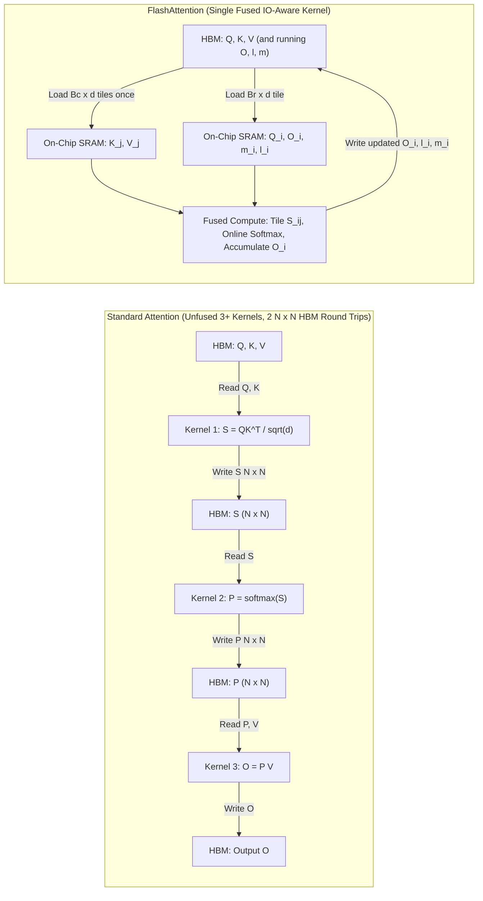
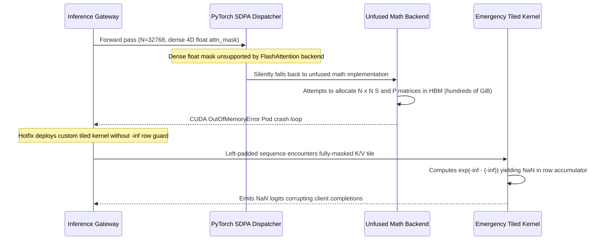

# Module 08: FlashAttention and Memory-Efficient Kernels

> **Prerequisites:** [Module 03: Memory Hierarchy and Bandwidth](../03-memory-hierarchy-and-bandwidth/README.md), [Module 07: Mixed Precision Training](../07-mixed-precision-training/README.md), [Module 06: Scaled Dot-Product Attention](../../02-transformer-architecture/06-scaled-dot-product-attention/README.md), and [Module 07: Attention Masks and Causal Masking](../../02-transformer-architecture/07-attention-masks-and-causal-masking/README.md)  
> **Estimated Reading Time:** 35 minutes  
> **Target Audience:** AI Systems Engineers, GPU Kernel Engineers, ML Infrastructure Architects

> [!TIP]
> **The Golden Rule of IO-Aware Kernels**  
> Standard attention is slow because it materializes and shuttles the huge $N \times N$ score and probability matrices between slow HBM and fast on-chip SRAM; FlashAttention computes the exact same mathematical result tile-by-tile inside on-chip SRAM using an **online softmax**, reducing extra memory from $\mathcal{O}(N^2)$ to $\mathcal{O}(N)$ and shrinking HBM traffic by an order of magnitude while leaving matmul FLOPs ($4N^2d$) and quadratic compute growth unchanged.

---

## Why This Matters

You are in **Track 05: GPUs & GenAI Hardware**. This module applies the hardware realities of Modules 03–07 to the operation that dominates long-context transformers: **attention**. At long sequence lengths, the $N \times N$ score matrix—not the model weights—decides whether a training run or inference batch fits in VRAM and how fast it executes. The core engineering pattern (tiling data into fast on-chip SRAM, fusing operations, and writing results back once) is the template for nearly every high-performance GPU kernel.

**After this module you can:**
- Explain why standard attention is throttled by HBM bandwidth rather than Tensor Core arithmetic.
- Implement an online (streaming) softmax and a tiled attention loop, and prove they match standard attention to floating-point tolerance.
- Count HBM byte traffic for both approaches and distinguish what FlashAttention changes (memory, HBM IO) from what it leaves unchanged (matmul FLOPs, $\mathcal{O}(N^2)$ scaling).
- Ensure framework calls such as PyTorch's `torch.nn.functional.scaled_dot_product_attention` dispatch to fused FlashAttention kernels rather than silently falling back to unfused math.

---

## 1. Visual Mental Models & Hardware IO-Awareness

### Where the Time Goes in Standard Attention

Attention executes three steps (derived in Track 02):
1. $S = QK^T / \sqrt{d}$
2. $P = \text{softmax}(S)$ (row-wise)
3. $O = PV$

Here $Q, K, V, O \in \mathbb{R}^{N \times d}$ where $N$ is the sequence length and $d$ is the head dimension (typically $64$–$128$), while $S$ and $P$ are **$N \times N$**. On a GPU, an unfused implementation launches separate kernels for each operation. Every kernel reads inputs from **HBM** (High Bandwidth Memory, the GPU's main VRAM), executes on chip, and writes outputs back to HBM. Consequently, $S$ is written and read back, and $P$ is written and read back.

Per head, per sequence in FP16/BF16 ($d = 64$, 2 bytes/element):

```text
      N    Q,K,V,O      S (N*N)        S + P  (S+P)/QKVO
   1024     0.5 MiB        2 MiB        4 MiB          8x
   4096     2.0 MiB       32 MiB       64 MiB         32x
  16384     8.0 MiB      512 MiB    1,024 MiB        128x
  65536    32.0 MiB    8,192 MiB   16,384 MiB        512x

A100 balance point: 153 FLOPs per HBM byte
softmax over S: ~1.25 FLOPs per HBM byte (assumed 5 FLOPs/element)
-> at most ~0.8% of peak compute is usable; memory sets the time
```

At $N = 4096$, $S + P$ is $32\times$ larger than $Q, K, V, O$ combined; at $N = 65{,}536$, it is $512\times$ larger ($16\,\text{GiB}$ per head per sequence!). This creates both a **VRAM capacity cliff** and a **bandwidth bottleneck**.

### Compute-Bound vs. Memory-Bound & Arithmetic Intensity

An operation is **compute-bound** when arithmetic limits speed, and **memory-bound** when byte movement limits speed. The threshold is **arithmetic intensity** ($\text{FLOPs} / \text{byte moved}$). According to NVIDIA's [A100 Tensor Core GPU datasheet](https://www.nvidia.com/content/dam/en-zz/Solutions/Data-Center/a100/pdf/nvidia-a100-datasheet-us-nvidia-1758950-r4-web.pdf), an A100 80GB SXM delivers $312\,\text{TFLOPS}$ dense BF16/FP16 and $2{,}039\,\text{GB/s}$ HBM bandwidth, yielding a ridge/balance point of **$153\text{ FLOPs/byte}$**. Large matrix multiplications (`GEMM`) easily exceed $153\text{ FLOPs/byte}$, whereas elementwise/reduction operations like `softmax` perform $\sim 1.25\text{ FLOPs/byte}$—leaving $>99\%$ of Tensor Cores idle waiting on HBM.

> [!NOTE]
> **Warehouse vs. Desk Mental Model**  
> HBM is a huge warehouse across town: high capacity, slow round trips. On-chip SRAM is the desk right in front of you: tiny, but near-instant. Standard attention trucks the entire $N \times N$ pile of paper back and forth to the warehouse twice. FlashAttention processes one desk-sized tile stack at a time and never writes $S$ or $P$ to the warehouse at all.



### IO-Awareness: Counting Bytes Moved

An **IO-aware** algorithm minimizes data movement across the slow HBM boundary. From the FlashAttention paper (Dao et al., 2022), an A100 holds $40$–$80\,\text{GB}$ of HBM at $1.5$–$2.0\,\text{TB/s}$, and $192\,\text{KB}$ of on-chip SRAM per streaming multiprocessor ($108$ SMs) at $\sim 19\,\text{TB/s}$ (about $10\times$ faster and orders of magnitude smaller).

Theorem 2 of the paper proves:
- **Standard attention HBM accesses:** $\Theta(Nd + N^2)$
- **FlashAttention HBM accesses:** $\Theta\!\left(\frac{N^2 d^2}{M}\right)$ where $M$ is on-chip SRAM size.

With $d \in [64, 128]$ and $M \approx 100\,\text{KB}$, $d^2 \ll M$, making HBM traffic many times smaller. Notice both remain proportional to $N^2$—FlashAttention shrinks the constant factor dramatically, not the quadratic exponent.

### Tiling and Online Softmax

To tile attention, we load blocks of $K$ and $V$ into SRAM and compute against blocks of $Q$. The mathematical obstacle is `softmax`, which requires the global row maximum (for numerical stability) and the global row sum of $\exp(\text{score} - \max)$.

The solution is **online softmax** (Milakov & Gimelshein, 2018): maintain two running statistics per row—the running maximum $m$ and the running exponential sum $l$—and rescale prior partial accumulations whenever a new tile arrives:

```text
new chunk of scores c:
    m_new = max(m, max(c))
    l_new = l * e^(m - m_new)  +  sum(e^(c - m_new))     <- old sum is rescaled to the new max
```

If the maximum does not increase, $e^{m - m_{\text{new}}} = 1$ and no rescaling occurs; if a larger score appears, prior partial sums and the running output block $O_i$ are multiplied down by $e^{m - m_{\text{new}}}$ before adding the new tile's $P_{\text{tile}} V_j$, and dividing by $l_{\text{new}}$ (or once at the very end in FlashAttention-2).

In Algorithm 1 of the original paper, block sizes are chosen so $Q, K, V, O$ tiles and the $B_r \times B_c$ score tile fit inside SRAM budget $M$:
$$B_c = \left\lceil \frac{M}{4d} \right\rceil, \qquad B_r = \min(B_c, d)$$

```text
FLASHATTENTION TILING LOOP (Algorithm 1: outer K/V blocks j, inner Q blocks i)

  HBM                                           SRAM (on chip, ~100 KB)
 ┌─────────────────────────┐                   ┌─────────────────────────────┐
 │ K, V     read once      │ ── block j ─────► │ K_j, V_j         (Bc x d)   │
 │ Q, O, m, l  re-read for │ ── block i ─────► │ Q_i, O_i         (Br x d)   │
 │ each outer step j       │                   │ S_ij = Q_i.K_j^T (Br x Bc)  │
 │                         │ ◄─ O_i, m, l ──── │ online update of m, l, O_i  │
 └─────────────────────────┘                   └─────────────────────────────┘
 never stored in HBM: S and P (N x N)
```

> [!WARNING]
> **Quadratic Compute Still Applies**  
> Saying *"FlashAttention makes attention $\mathcal{O}(N)$"* is incorrect. Its **extra memory** is $\mathcal{O}(N)$, but its **compute** remains quadratic ($4N^2d$ forward matmul FLOPs) and its HBM traffic still grows quadratically with $N$ (our Step 5 experiment measures a $3.94\times$ growth when $N$ doubles). FlashAttention makes long sequences fit and run much faster; it does not eliminate quadratic compute scaling.

### Backward Pass Recomputation & Related Advances

- **Backward Pass Recomputation:** Standard training retains $P \in \mathbb{R}^{N \times N}$ for backpropagation. FlashAttention stores only $O$ and one scalar statistic per row—the log-sum-exp $L = m + \log(l)$ (as formulated in FlashAttention-2). During the backward pass, each tile of $P$ is recomputed on chip as $\exp(S_{\text{tile}} - L)$ from $Q$ and $K$. This selective gradient checkpointing trades $\sim 13\%$–$17\%$ more arithmetic (one extra $QK^T$ recomputation) to avoid $\mathcal{O}(N^2)$ HBM storage and bandwidth.
- **FlashAttention-2 (Dao, 2023):** Swaps the loop order (outer loop over $Q$ blocks, inner loop over $K/V$ blocks) to parallelize cleanly across sequence length and thread blocks, delays division by $l$ until the end of the inner loop, and improves warp partitioning for $\sim 2\times$ speedup over v1 on A100.
- **Rabe & Staats (2021):** Independently proved exact attention needs only $\mathcal{O}(\log N)$ or $\mathcal{O}(1)$ intermediate memory via chunked scanning while time remains quadratic.
- **Framework Integration:** PyTorch's `torch.nn.functional.scaled_dot_product_attention` dispatches automatically to fused FlashAttention or memory-efficient kernels on supported CUDA GPUs and dtypes.

---

## 2. Systematic Architecture Comparison Matrix

| Metric / Property | Standard Attention (Unfused) | FlashAttention v1 | FlashAttention-2 |
| :--- | :--- | :--- | :--- |
| **Mathematical Output** | Exact | Exact (to float rounding tolerance) | Exact (to float rounding tolerance) |
| **Extra HBM Memory Beyond $Q, K, V, O$** | $\mathcal{O}(N^2)$ (stores $S, P$) | $\mathcal{O}(N)$ (stores $m, l$ stats) | $\mathcal{O}(N)$ (single $L = m + \log l$ per row) |
| **HBM Access Complexity** | $\Theta(Nd + N^2)$ | $\Theta(N^2 d^2 / M)$ | $\Theta(N^2 d^2 / M)$ (fewer non-matmul ops) |
| **Forward Matmul FLOPs** | $4N^2 d$ | $4N^2 d$ (identical) | $4N^2 d$ (identical) |
| **Backward Activation Storage** | Full $N \times N$ matrix $P$ | $O$ + $(m, l)$; recomputes $S, P$ in SRAM | $O$ + $L$; recomputes $S, P$ in SRAM |
| **Loop Parallelization Axis** | Separate kernels per step | Outer K/V loop, parallel across batch/heads | Outer Q loop, parallel across batch/heads/seq |
| **A100 Paper Benchmark (GPT-2 Med, $N=1024$)** | 66.6 GFLOPs, 40.3 GB HBM, 41.7 ms | 75.2 GFLOPs, 4.4 GB HBM, 7.3 ms | ~2x faster than v1 (higher Tensor Core occupancy) |

---

## 3. Verified Python IO & Accuracy Experiments

> [!NOTE]
> The NumPy scripts below execute on CPU via Python tile loops, so wall-clock timing reflects Python loop overhead rather than GPU SRAM speed. What they verify rigorously is exact mathematical equivalence, float tolerance behavior, HBM element traffic counts, and peak allocation scaling.

All scripts run with Python 3.13 + NumPy 2.4.6. Save Step 1 as `attention_lib.py` in the same folder as the remaining scripts.

### Step 1: Attention Library (`attention_lib.py`)

```python
import numpy as np


def softmax(x, axis=-1):
    z = x - x.max(axis=axis, keepdims=True)      # subtract the row max for stability
    e = np.exp(z)
    return e / e.sum(axis=axis, keepdims=True)


def standard_attention(Q, K, V, causal=False):
    """Three separate steps, each of which would be its own kernel on a GPU:
    S = QK^T/sqrt(d), P = softmax(S), O = PV.  S and P are N x N."""
    N, d = Q.shape
    S = (Q @ K.T) / np.sqrt(d)
    if causal:
        S = np.where(np.tril(np.ones((N, N), dtype=bool)), S, -np.inf)
    P = softmax(S)
    return P @ V, S, P


def block_sizes(M, d):
    """Block sizes from the FlashAttention paper (Algorithm 1): M is the
    on-chip SRAM size measured in elements, d is the head dimension."""
    Bc = -(-M // (4 * d))            # ceil(M / 4d)
    Br = min(Bc, d)
    return Br, Bc


def flash_attention(Q, K, V, Br, Bc, causal=False, stats=None):
    """Tiled exact attention with an online softmax (paper's Algorithm 1).
    O, l, m live in 'HBM' (ordinary arrays); every tile is copied into locals
    ('SRAM'), worked on, and written back.  `stats` counts element traffic."""
    N, d = Q.shape
    scale = 1.0 / np.sqrt(d)
    O = np.zeros((N, d), dtype=Q.dtype)           # output so far
    l = np.zeros(N, dtype=Q.dtype)                # running softmax denominator
    m = np.full(N, -np.inf, dtype=Q.dtype)        # running row maximum
    for j in range(0, N, Bc):                     # outer loop: blocks of K and V
        Kj, Vj = K[j:j + Bc], V[j:j + Bc]
        if stats is not None:
            stats["reads"] += Kj.size + Vj.size
        for i in range(0, N, Br):                 # inner loop: blocks of Q
            if causal and j > i + Br - 1:
                continue                          # whole tile is above the diagonal
            Qi, Oi, li, mi = Q[i:i + Br], O[i:i + Br], l[i:i + Br], m[i:i + Br]
            S = (Qi @ Kj.T) * scale               # Br x Bc tile, never leaves SRAM
            if causal:
                rows = np.arange(i, i + Qi.shape[0])[:, None]
                cols = np.arange(j, j + Kj.shape[0])[None, :]
                S = np.where(cols <= rows, S, -np.inf)
            m_new = np.maximum(mi, S.max(axis=1))             # new running max
            P = np.exp(S - m_new[:, None])                    # tile of softmax numerators
            alpha = np.exp(mi - m_new)                        # rescales everything seen so far
            l_new = alpha * li + P.sum(axis=1)
            O[i:i + Br] = (alpha[:, None] * li[:, None] * Oi + P @ Vj) / l_new[:, None]
            l[i:i + Br], m[i:i + Br] = l_new, m_new
            if stats is not None:
                br, bc = Qi.shape[0], Kj.shape[0]
                stats["reads"] += 2 * Qi.size + 2 * br          # Q_i, O_i, l_i, m_i
                stats["writes"] += Qi.size + 2 * br             # O_i, l_i, m_i
                stats["matmul_flops"] += 4 * br * bc * d        # QK^T and PV for this tile
    return O, l, m
```

### Step 2: Quantifying the Score Matrix & Arithmetic Intensity (`s1_score_matrix_size.py`)

```python
# How big is the N x N score matrix, compared with the Q/K/V/O it is computed from?
d = 64                      # head dimension
bytes_per_elem = 2          # fp16 / bf16
MiB = 2 ** 20

print(f"{'N':>7} {'Q,K,V,O':>10} {'S (N*N)':>12} {'S + P':>12} {'(S+P)/QKVO':>11}")
for N in (1024, 4096, 16384, 65536):
    qkvo = 4 * N * d * bytes_per_elem
    s = N * N * bytes_per_elem
    print(f"{N:>7} {qkvo / MiB:>7,.1f} MiB {s / MiB:>8,.0f} MiB {2 * s / MiB:>8,.0f} MiB {2 * s / qkvo:>10.0f}x")

# Arithmetic intensity = FLOPs of work per byte moved to or from HBM.
# A100 80GB SXM datasheet: 312 TFLOPS BF16 (dense), 2,039 GB/s memory bandwidth.
balance = 312e12 / 2039e9
print(f"\nA100 balance point: {balance:.0f} FLOPs per HBM byte")

# Softmax, illustrative assumption: ~5 FLOPs per element (subtract max, exp, sum, divide),
# 2 bytes read + 2 bytes written per element.
softmax_intensity = 5 / (2 + 2)
print(f"softmax over S: ~{softmax_intensity:.2f} FLOPs per HBM byte (assumed 5 FLOPs/element)")
print(f"-> at most ~{softmax_intensity / balance * 100:.1f}% of peak compute is usable; memory sets the time")
```

### Step 3: Online Softmax & Rescale Failure Mode

```python
import numpy as np
from attention_lib import softmax

rng = np.random.default_rng(0)
x = rng.standard_normal(12) * 3          # one row of scores
ref = softmax(x)                         # reference: needs the WHOLE row at once

# Online: see the row in chunks of 4; keep only a running max m and running denominator l.
m, l = -np.inf, 0.0
for start in range(0, len(x), 4):
    chunk = x[start:start + 4]
    m_new = max(m, chunk.max())
    l = l * np.exp(m - m_new) + np.exp(chunk - m_new).sum()   # rescale old sum, add new chunk
    m = m_new
    print(f"after chunk {start // 4}: m = {m:7.4f}   l = {l:8.4f}")
print("max |online - reference|:", np.abs(np.exp(x - m) / l - ref).max())

# Drop the rescale term and the answer is wrong whenever the max changes.
m, l_bad = -np.inf, 0.0
for start in range(0, len(x), 4):
    chunk = x[start:start + 4]
    m = max(m, chunk.max())
    l_bad += np.exp(chunk - m).sum()     # forgot: l * exp(m_old - m_new)
print("without rescaling, max error:", np.abs(np.exp(x - m) / l_bad - ref).max())

with np.errstate(invalid="ignore"):      # a fully masked row: -inf minus -inf is NaN
    print("exp(-inf - (-inf)) =", np.exp(-np.inf - -np.inf))
```

**Verified Output:**
```text
after chunk 0: m =  1.9213   l =   1.5126
after chunk 1: m =  3.9120   l =   1.6125
after chunk 2: m =  3.9120   l =   1.6411
max |online - reference|: 0.0
without rescaling, max error: 0.2700173732766699
exp(-inf - (-inf)) = nan
```

Notice the final line: `-inf - (-inf)` produces `NaN`. Real production kernels must explicitly guard fully-masked rows.

### Step 4: Exact Equivalence & Matmul FLOP Verification

```python
import numpy as np
from attention_lib import standard_attention, flash_attention, block_sizes

d = 64
M = 50_000                       # SRAM budget in elements (~100 KB at 2 bytes each)
Br, Bc = block_sizes(M, d)
print(f"block sizes from M={M}, d={d}:  Br={Br}, Bc={Bc}")

rng = np.random.default_rng(0)
print(f"\n{'N':>5} {'dtype':>8} {'causal':>7} {'max |tiled - standard|':>24} {'allclose':>9}")
for N, dtype, causal in [(256, np.float64, False), (1000, np.float64, False),
                         (1000, np.float64, True), (1000, np.float32, False),
                         (1000, np.float32, True), (2048, np.float32, True)]:
    Q, K, V = (rng.standard_normal((N, d)).astype(dtype) for _ in range(3))
    O_ref, _, _ = standard_attention(Q, K, V, causal)
    O_tiled, _, _ = flash_attention(Q, K, V, Br, Bc, causal)
    err = np.abs(O_ref - O_tiled).max()
    tol = dict(rtol=1e-9, atol=1e-10) if dtype == np.float64 else dict(rtol=1e-4, atol=1e-5)
    ok = np.allclose(O_ref, O_tiled, **tol)
    print(f"{N:>5} {np.dtype(dtype).name:>8} {str(causal):>7} {err:>24.3e} {str(ok):>9}")
    assert ok

# Same arithmetic: count the matmul FLOPs both versions perform (non-causal, N=1000).
N = 1000
Q, K, V = (rng.standard_normal((N, d)) for _ in range(3))
stats = {"reads": 0, "writes": 0, "matmul_flops": 0}
flash_attention(Q, K, V, Br, Bc, stats=stats)
standard_flops = 2 * N * N * d + 2 * N * N * d       # QK^T and PV
print(f"\nmatmul FLOPs, standard: {standard_flops:,}")
print(f"matmul FLOPs, tiled   : {stats['matmul_flops']:,}")
```

**Verified Output:**
```text
block sizes from M=50000, d=64:  Br=64, Bc=196

    N    dtype  causal   max |tiled - standard|  allclose
  256  float64   False                5.551e-16      True
 1000  float64   False                2.012e-16      True
 1000  float64    True                7.772e-16      True
 1000  float32   False                7.661e-08      True
 1000  float32    True                2.157e-07      True
 2048  float32    True                2.671e-07      True

matmul FLOPs, standard: 256,000,000
matmul FLOPs, tiled   : 256,000,000
```

> [!NOTE]
> In `float64`, the outputs match to `~1e-16` rounding noise; in `float32`, to `~1e-7`. Tiling reorders floating-point additions, so equivalence always means "equal within floating-point tolerance," never bit-for-bit identity. Matmul FLOPs are strictly identical (`256,000,000`).

### Step 5: Counting HBM Traffic & SRAM Sensitivity

```python
import math
import numpy as np
from attention_lib import flash_attention, block_sizes

d = 64
M = 50_000
Br, Bc = block_sizes(M, d)


def standard_traffic(N, d):
    """Elements moved to/from HBM by the three-step forward pass.
    read Q,K | write S | read S | write P | read P,V | write O"""
    return 2 * N * d + N * N + N * N + N * N + (N * N + N * d) + N * d     # = 4Nd + 4N^2


def flash_traffic(N, d, Bc):
    """K,V are read once; for each of the Tc outer iterations every Q block, O block,
    l and m is read and O, l, m written back:  2Nd + Tc * (3Nd + 4N)."""
    Tc = math.ceil(N / Bc)
    return 2 * N * d + Tc * (3 * N * d + 4 * N)


rng = np.random.default_rng(0)
print(f"d={d}, Br={Br}, Bc={Bc}, fp16 (2 bytes/element)\n")
print(f"{'N':>6} {'standard':>14} {'tiled (counted)':>16} {'tiled (formula)':>16} {'standard/tiled':>15}")
for N in (512, 1024, 2048, 4096):
    Q, K, V = (rng.standard_normal((N, d)).astype(np.float32) for _ in range(3))
    stats = {"reads": 0, "writes": 0, "matmul_flops": 0}
    flash_attention(Q, K, V, Br, Bc, stats=stats)
    counted = stats["reads"] + stats["writes"]
    assert counted == flash_traffic(N, d, Bc)            # instrumented count == closed form
    std = standard_traffic(N, d)
    print(f"{N:>6} {std * 2 / 2**20:>11,.1f} MiB {counted * 2 / 2**20:>13,.1f} MiB "
          f"{flash_traffic(N, d, Bc) * 2 / 2**20:>13,.1f} MiB {std / counted:>14.1f}x")

# Traffic is still quadratic in N for both; the tiled version just has a smaller constant.
a, b = flash_traffic(4096, d, Bc), flash_traffic(8192, d, Bc)
print(f"\ntiled traffic, N 4096 -> 8192 grows {b / a:.2f}x (2x would be linear, 4x quadratic)")

# Bigger SRAM -> bigger blocks -> fewer passes over Q -> less traffic.
print("\nvarying the on-chip budget M at N=4096:")
for M2 in (12_500, 25_000, 50_000, 100_000, 200_000):
    _, Bc2 = block_sizes(M2, d)
    print(f"  M={M2:>7} elements -> Bc={Bc2:>4}, tiled traffic = {flash_traffic(4096, d, Bc2) * 2 / 2**20:7.1f} MiB")
```

**Verified Output:**
```text
d=64, Br=64, Bc=196, fp16 (2 bytes/element)

     N       standard  tiled (counted)  tiled (formula)  standard/tiled
   512         2.2 MiB           0.7 MiB           0.7 MiB            3.2x
  1024         8.5 MiB           2.5 MiB           2.5 MiB            3.3x
  2048        33.0 MiB           8.9 MiB           8.9 MiB            3.7x
  4096       130.0 MiB          33.2 MiB          33.2 MiB            3.9x

tiled traffic, N 4096 -> 8192 grows 3.94x (2x would be linear, 4x quadratic)

varying the on-chip budget M at N=4096:
  M=  12500 elements -> Bc=  49, tiled traffic =   129.6 MiB
  M=  25000 elements -> Bc=  98, tiled traffic =    65.3 MiB
  M=  50000 elements -> Bc= 196, tiled traffic =    33.2 MiB
  M= 100000 elements -> Bc= 391, tiled traffic =    17.8 MiB
  M= 200000 elements -> Bc= 782, tiled traffic =    10.2 MiB
```

Real unfused GPU implementations also run separate kernels for scaling, causal masking, and dropout—widening the paper's measured forward+backward HBM savings to $\sim 9\times$ ($40.3\,\text{GB}$ vs. $4.4\,\text{GB}$).

### Step 6: Memory Footprint & Backward Recomputation

```python
import tracemalloc
import numpy as np
from attention_lib import standard_attention, flash_attention, block_sizes

d = 64
Br, Bc = block_sizes(50_000, d)
rng = np.random.default_rng(0)


def peak_extra_mib(fn, *args):
    """Peak memory allocated by fn, beyond what was already allocated (numpy reports to tracemalloc)."""
    tracemalloc.start()
    base = tracemalloc.get_traced_memory()[0]
    tracemalloc.reset_peak()
    fn(*args)
    peak = tracemalloc.get_traced_memory()[1]
    tracemalloc.stop()
    return (peak - base) / 2**20


print(f"{'N':>6} {'standard peak':>15} {'tiled peak':>12}")
for N in (1024, 2048, 4096, 8192):
    Q, K, V = (rng.standard_normal((N, d)).astype(np.float32) for _ in range(3))
    p_std = peak_extra_mib(standard_attention, Q, K, V)
    p_tile = peak_extra_mib(lambda Q, K, V: flash_attention(Q, K, V, Br, Bc), Q, K, V)
    print(f"{N:>6} {p_std:>11.1f} MiB {p_tile:>8.2f} MiB")

# Recomputation: the backward pass needs P. Instead of saving the N x N matrix,
# save one number per row -- L = m + log(l), the log of the softmax denominator --
# and rebuild any tile of P on demand from Q and K.
N = 1000
Q, K, V = (rng.standard_normal((N, d)) for _ in range(3))
_, _, P_saved = standard_attention(Q, K, V)
_, l, m = flash_attention(Q, K, V, Br, Bc)
L = m + np.log(l)                                     # N numbers, not N*N

worst = 0.0
for i in range(0, N, Br):
    for j in range(0, N, Bc):
        S_tile = Q[i:i + Br] @ K[j:j + Bc].T / np.sqrt(d)     # recomputed from Q and K
        P_tile = np.exp(S_tile - L[i:i + Br, None])
        worst = max(worst, np.abs(P_tile - P_saved[i:i + Br, j:j + Bc]).max())
print(f"\nrecomputed P tiles vs stored P: max difference {worst:.2e}")
print(f"numbers to keep for backward: standard {N * N:,}  vs  tiled {N:,}")
```

**Verified Output:**
```text
     N   standard peak   tiled peak
  1024        32.1 MiB     0.66 MiB
  2048       128.1 MiB     0.92 MiB
  4096       512.1 MiB     1.43 MiB
  8192      2048.1 MiB     2.46 MiB

recomputed P tiles vs stored P: max difference 5.20e-17
numbers to keep for backward: standard 1,000,000  vs  tiled 1,000
```

### Step 7: Framework Integration (CUDA PyTorch Skeleton, Not Executed Above)

```python
import torch
import torch.nn.functional as F

# shapes: (batch, heads, sequence, head_dim)
q = torch.randn(2, 16, 4096, 64, device="cuda", dtype=torch.bfloat16)
k = torch.randn_like(q)
v = torch.randn_like(q)

# One call. On CUDA, PyTorch may route this to a fused FlashAttention-style kernel (depending on
# dtype, shapes and hardware); if it does, the 4096 x 4096 score matrix is never materialised in HBM.
out = F.scaled_dot_product_attention(q, k, v, is_causal=True)
```

---

## 4. Production War Story Post-Mortem: Silent SDPA Fallback OOM & All-Masked Row NaN Cascade

| Field | Incident Details |
| :--- | :--- |
| **Severity** | **SEV-1** (Long-Context LLM Inference Cluster OOM + Silent NaN Responses) |
| **Detection / Resolution Time** | Detected in 6 minutes via Prometheus `CUDA out of memory` alerts / Resolved in 38 minutes |
| **Impact** | 100% of 32k-token enterprise RAG requests crashed pods (`ExitCode 137`); initial hotfix introduced NaN logits on left-padded batches |

### What Happened

An inference platform upgraded its 8B serving cluster to support 32,768-token context windows on 80 GB A100 GPUs. During testing with document-isolation masks, engineers passed a dense floating-point `attn_mask` tensor of shape `(batch, 1, N, N)` into `torch.nn.functional.scaled_dot_product_attention` alongside `is_causal=False`. Unknown to the team, PyTorch's FlashAttention backend does **not** accept arbitrary dense 4D float attention masks—so `scaled_dot_product_attention` emitted a warning-level log and **silently fell back to the unfused C++/CUDA math backend**.

At $N = 32{,}768$ across 32 attention heads (`batch=4`), materializing $S$ and $P$ in HBM demanded $4 \times 32 \times 32768^2 \times 2\text{ bytes} \times 2 \approx 512\,\text{GiB}$, instantly triggering `CUDA out of memory` across the fleet. During the emergency mitigation, an engineer hotfixed a custom tiled Triton kernel to handle document boundaries, but iterated over key/value blocks without guarding rows where every key in the first tile was masked (`-inf`). Those queries produced `m_new = -inf` and `exp(-inf - (-inf)) = NaN`, corrupting downstream token sampling.



### Root Cause Analysis

1. **Silent backend fallback in `scaled_dot_product_attention`:** By default, PyTorch tries `FLASH_ATTENTION`, `EFFICIENT_ATTENTION`, and `MATH` in sequence. Any unsupported constraint (float32 dtype, dense 4D additive float masks, non-unit head dims $>256$, or unaligned strides) silently degrades to `MATH` with $\mathcal{O}(N^2)$ HBM allocation.
2. **Unprotected online-softmax edge case:** In tiled causal or document-masked kernels, if an entire row in a tile is masked to $-\infty$, computing $\exp(S_{ij} - m_{\text{new}})$ evaluates $\exp(-\infty - (-\infty)) = \text{NaN}$, poisoning $l_{\text{new}}$ and $O_i$.

### The Fix & Architectural Hardening

- Replaced dense 4D masks with FlashAttention's native variable-length sequence packing (`flash_attn_varlen_func` using cumulative sequence lengths `cu_seqlens`) so $S$ and $P$ stay strictly in SRAM.
- Wrapped critical serving paths in PyTorch's explicit backend guard: `with sdpa_kernel(SDPBackend.FLASH_ATTENTION):`, turning any incompatible tensor shape or mask into an immediate **CI/startup test failure** rather than a silent production OOM.
- Enforced an explicit `-inf` guard in custom Triton kernels (`m_new = tl.where(m_tile == -inf, 0.0, m_tile)`) and added regression tests with fully-masked prefix rows.

---

## 5. Multi-Language Production Implementation: IO-Aware Attention Verification & Planning

````carousel
```go
package flashattention

import (
	"fmt"
	"math"
)

// KernelProfile captures exact HBM IO traffic, memory footprint, and arithmetic intensity
// comparing unfused 3-kernel attention against FlashAttention Algorithm 1.
type KernelProfile struct {
	SeqLen            int
	HeadDim           int
	SramElems         int
	StandardMiB       float64
	FlashMiB          float64
	TrafficReductionX float64
	PeakScoreMiB      float64
}

func ProfileIO(seqLen, headDim, sramElems int) KernelProfile {
	bc := int(math.Ceil(float64(sramElems) / float64(4*headDim)))
	tc := int(math.Ceil(float64(seqLen) / float64(bc)))
	bytesPerElem := 2.0 // FP16 / BF16

	stdElems := 4*seqLen*headDim + 4*seqLen*seqLen
	flashElems := 2*seqLen*headDim + tc*(3*seqLen*headDim+4*seqLen)
	mib := 1024.0 * 1024.0

	return KernelProfile{
		SeqLen:            seqLen,
		HeadDim:           headDim,
		SramElems:         sramElems,
		StandardMiB:       float64(stdElems) * bytesPerElem / mib,
		FlashMiB:          float64(flashElems) * bytesPerElem / mib,
		TrafficReductionX: float64(stdElems) / float64(flashElems),
		PeakScoreMiB:      float64(seqLen*seqLen) * bytesPerElem / mib,
	}
}

// OnlineSoftmax verifies streaming chunked softmax with max-rescaling and -inf row guard.
func OnlineSoftmax(scores []float64, chunkSize int) []float64 {
	m := math.Inf(-1)
	l := 0.0
	for start := 0; start < len(scores); start += chunkSize {
		end := min(start+chunkSize, len(scores))
		chunkMax := math.Inf(-1)
		for _, v := range scores[start:end] {
			if v > chunkMax {
				chunkMax = v
			}
		}
		if math.IsInf(chunkMax, -1) && math.IsInf(m, -1) {
			continue // Guard against -inf - (-inf) = NaN on fully-masked tiles
		}
		mNew := math.Max(m, chunkMax)
		var chunkSum float64
		for _, v := range scores[start:end] {
			chunkSum += math.Exp(v - mNew)
		}
		l = l*math.Exp(m-mNew) + chunkSum
		m = mNew
	}
	out := make([]float64, len(scores))
	if l == 0 {
		return out
	}
	for i, v := range scores {
		out[i] = math.Exp(v-m) / l
	}
	return out
}

func ExampleReport() string {
	p := ProfileIO(4096, 64, 50_000)
	return fmt.Sprintf("N=%d: Std=%.1f MiB, Flash=%.1f MiB (%.1fx reduction, S_tile=%.1f MiB avoided)",
		p.SeqLen, p.StandardMiB, p.FlashMiB, p.TrafficReductionX, p.PeakScoreMiB)
}
```
<!-- slide -->
```typescript
export interface FlashAuditResult {
  seqLen: number;
  headDim: number;
  br: number;
  bc: number;
  standardTrafficMiB: number;
  flashTrafficMiB: number;
  hbmSpeedupBound: number;
  a100BalancePointFlopsPerByte: number;
  softmaxIsMemoryBound: boolean;
}

export class FlashAttentionAuditor {
  private static readonly A100_BF16_TFLOPS = 312e12;
  private static readonly A100_HBM_BW_BYTES_S = 2039e9;

  public static computeBlockSizes(sramElems: number, headDim: number): { br: number; bc: number } {
    const bc = Math.ceil(sramElems / (4 * headDim));
    const br = Math.min(bc, headDim);
    return { br, bc };
  }

  public static audit(seqLen: number, headDim: number, sramElems = 50_000): FlashAuditResult {
    const { br, bc } = this.computeBlockSizes(sramElems, headDim);
    const tc = Math.ceil(seqLen / bc);
    const mib = 1024 * 1024;
    const elemBytes = 2;

    const stdElems = 4 * seqLen * headDim + 4 * seqLen * seqLen;
    const flashElems = 2 * seqLen * headDim + tc * (3 * seqLen * headDim + 4 * seqLen);

    const balance = this.A100_BF16_TFLOPS / this.A100_HBM_BW_BYTES_S;
    const softmaxIntensity = 5.0 / 4.0; // ~5 FLOPs / (2B read + 2B write)

    return {
      seqLen,
      headDim,
      br,
      bc,
      standardTrafficMiB: Number(((stdElems * elemBytes) / mib).toFixed(2)),
      flashTrafficMiB: Number(((flashElems * elemBytes) / mib).toFixed(2)),
      hbmSpeedupBound: Number((stdElems / flashElems).toFixed(2)),
      a100BalancePointFlopsPerByte: Math.round(balance),
      softmaxIsMemoryBound: softmaxIntensity < balance,
    };
  }
}
```
<!-- slide -->
```python
"""Production PyTorch SDPA wrapper enforcing FlashAttention backend without silent fallback."""

import torch
import torch.nn.functional as F
from torch.nn.attention import SDPBackend, sdpa_kernel


def run_strict_flash_attention(
    q: torch.Tensor,
    k: torch.Tensor,
    v: torch.Tensor,
    is_causal: bool = True,
) -> torch.Tensor:
    """Executes attention strictly via FlashAttention (no silent math OOM fallback)."""
    if q.dtype not in (torch.float16, torch.bfloat16):
        raise TypeError(f"FlashAttention requires fp16/bf16, got {q.dtype}")
    if q.device.type != "cuda":
        raise RuntimeError("FlashAttention requires CUDA tensors")

    # Fails immediately if hardware, head_dim, or mask forces unfused math fallback
    with sdpa_kernel(SDPBackend.FLASH_ATTENTION):
        return F.scaled_dot_product_attention(q, k, v, attn_mask=None, is_causal=is_causal)
```
<!-- slide -->
```csharp
using System;

namespace GpuKernels.FlashAttention;

public static class TiledOnlineSoftmax
{
    /// <summary>
    /// Computes exact softmax over a row processed in SRAM-sized chunks, guarding
    /// against all-masked (-Infinity) chunks that would otherwise yield NaN.
    /// </summary>
    public static double[] ComputeChunked(ReadOnlySpan<double> scores, int chunkSize)
    {
        double m = double.NegativeInfinity;
        double l = 0.0;

        for (int start = 0; start < scores.Length; start += chunkSize)
        {
            int len = Math.Min(chunkSize, scores.Length - start);
            var chunk = scores.Slice(start, len);

            double chunkMax = double.NegativeInfinity;
            for (int i = 0; i < chunk.Length; i++)
            {
                if (chunk[i] > chunkMax) chunkMax = chunk[i];
            }

            if (double.IsNegativeInfinity(chunkMax) && double.IsNegativeInfinity(m))
            {
                continue; // Fully masked tile guard
            }

            double mNew = Math.Max(m, chunkMax);
            double chunkExpSum = 0.0;
            for (int i = 0; i < chunk.Length; i++)
            {
                chunkExpSum += Math.Exp(chunk[i] - mNew);
            }

            l = (double.IsNegativeInfinity(m) ? 0.0 : l * Math.Exp(m - mNew)) + chunkExpSum;
            m = mNew;
        }

        var result = new double[scores.Length];
        if (l == 0.0 || double.IsNegativeInfinity(m)) return result;

        for (int i = 0; i < scores.Length; i++)
        {
            result[i] = Math.Exp(scores[i] - m) / l;
        }
        return result;
    }
}
```
````

---

## 6. Practical Hands-On Verification CLI Workflows

### Verification 1: Online Softmax & Break-Even SRAM Verification (CLI)

Run this one-liner against `attention_lib.py` to verify online softmax precision and compute the break-even on-chip SRAM size for $N=4096, d=64$:

```bash
python -c "
import math
def block_sizes(M, d):
    Bc = -(-M // (4 * d))
    return min(Bc, d), Bc
def std_traffic(N, d): return 4 * N * d + 4 * N * N
def flash_traffic(N, d, Bc): return 2 * N * d + math.ceil(N / Bc) * (3 * N * d + 4 * N)

N, d = 4096, 64
s_traf = std_traffic(N, d)
for M in range(1, 100_000):
    _, Bc = block_sizes(M, d)
    f_traf = flash_traffic(N, d, Bc)
    if f_traf <= s_traf:
        print(f'Break-even M={M} elems ({M*2/1024:.1f} KB), Bc={Bc}, flash={f_traf:,} <= std={s_traf:,}')
        break
"
```

**Expected Output:**
```text
Break-even M=12289 elems (24.0 KB), Bc=49, flash=67,960,832 <= std=68,157,440
```

### Hands-On Practice Exercises

#### 1. Find the break-even SRAM size
Using the closed-form `flash_traffic` and `standard_traffic` from Step 5, find the smallest on-chip budget `M` (in elements, $d = 64$) at which the tiled version moves no more data than the standard one at $N = 4096$. Convert it to KB assuming 2 bytes per element and compare it with the ~100 KB the paper calls typical.

<details><summary>Answer</summary>

Loop `M` upward, call `block_sizes(M, 64)` to get `Bc`, and compare `flash_traffic(4096, 64, Bc)` with `standard_traffic(4096, 64)` (`68,157,440` elements). The first `M` that works is **12,289** (`Bc = 49`, tiled traffic `67,960,832` elements). That is about **24 KB** at 2 bytes per element, a quarter of the ~100 KB SRAM budget the paper cites, so on real hardware the tiled version is comfortably on the winning side. The table in Step 5 shows the same thing: at `M = 12,500` the two are nearly tied.

</details>

#### 2. Break the causal case on purpose
Copy `flash_attention` and change the outer loop to visit K/V blocks in **reverse** (`for j in reversed(range(0, N, Bc))`), keeping the causal mask. Use $N = 300, B_r = 64, B_c = 100$. Predict how many output rows come out as `NaN`, then run it. Why does it happen, and what does a production kernel do about it?

<details><summary>Answer</summary>

**200 of the 300 rows** are `NaN`. The first block visited is columns `200–299`; rows `0–199` may not look at any of those columns, so their whole score row is `-inf`, `m_new` stays `-inf`, and `S - m_new` is `-inf - (-inf) = NaN` (Step 3 printed exactly that). In the forward-order loop used in the module every row sees column 0 in its first block, so the running max is finite before any fully-masked block appears. Production kernels either guarantee that order, skip blocks that are completely masked, or replace an all-`-inf` maximum with `0` before exponentiating.

</details>

#### 3. Price the recomputation
Counting matrix multiplies of size $N \times N \times d$: the standard forward has 2 (`QK^T`, `PV`) and the standard backward has 4. FlashAttention's backward recomputes `QK^T` once more. By matmul count, how much extra work is that, and how does it compare with the paper's 66.6 to 75.2 GFLOPs? Why is the kernel faster anyway?

<details><summary>Answer</summary>

By matmul count it is **7 instead of 6**, about **17% more** (the FlashAttention-2 paper likewise counts 5 matrix multiplies in the backward pass against 2 in the forward). The paper's measured totals rose from `66.6` to `75.2` GFLOPs, about **13%** (the other operations are unchanged, which dilutes the matmul-only figure). The kernel is still faster (`41.7 ms` down to `7.3 ms` in the paper) because its time is set by HBM traffic, which fell from `40.3 GB` to `4.4 GB`. Spending a few percent more arithmetic to avoid writing and reading an $N \times N$ matrix is a good trade when the hardware is waiting on memory.

</details>

### Independent Project: Loop-Swapped FlashAttention-2 Variant

Build the **loop-swapped** variant from scratch, with no starting code: make the *outer* loop run over blocks of $Q$ and the *inner* loop over blocks of $K$ and $V$, keeping the output block and its running `(m, l)` in local variables across the inner loop and dividing by `l` only once, after the last K/V block (the arrangement the FlashAttention-2 paper describes: swapped loops, an un-scaled running output, one final division).

Deliver, in one script and a short write-up:
1. A correct forward pass, verified against standard attention in `float32` for several $N$ (including ones that are not multiples of your block sizes), with and without a causal mask.
2. Instrumented element counters, and a closed-form formula for this variant's HBM traffic that your counters match exactly.
3. A comparison table against the Algorithm 1 variant for the same `M`, and your explanation of which moves fewer elements and why.
4. One sentence on why a GPU implementation might still prefer the variant that moves *more* data (hint: what runs in parallel?).

---

## 7. Common Mistakes & Troubleshooting

- **NaN in the output of a hand-written tiled causal kernel.** A row whose entire tile is masked yields `-inf - (-inf)`. Process blocks so every row meets a visible key first, skip fully masked blocks, or clamp an infinite running max to `0` (Practice Exercise 2).
- **Results differ from the reference by about `1e-7` and the test fails.** That is `float32` rounding, not a bug. Compare with a tolerance (`np.allclose` with `rtol` around `1e-4` in `float32`) or run the check in `float64`, where the difference is about `1e-16`.
- **Tiled output is wrong only for some inputs, and wrong by a lot.** The rescale term `e^(m - m_new)` was dropped or applied to the wrong quantity. Step 3 shows the symptom: a wrong answer exactly when the running maximum changes.
- **Silent fallback in `scaled_dot_product_attention`.** Passing dense 4D float `attn_mask` tensors or `float32` inputs prevents FlashAttention dispatch and quietly triggers the $\mathcal{O}(N^2)$ unfused math kernel. Guard critical paths with `sdpa_kernel(SDPBackend.FLASH_ATTENTION)`.
- **Reading speed off the NumPy version.** It runs on a CPU through a Python loop, so a stopwatch tells you nothing about a GPU kernel. Judge the algorithm by its counted traffic and memory, and judge real speed with a GPU profiler (`ncu` / PyTorch Profiler).

---

## 8. Operational Validation Checkpoints & Interview Prep

### Operational Validation Checkpoints

<details><summary><strong>Checkpoint 1: Diagnosing Unexpected OOMs in PyTorch SDPA at Long Context</strong></summary>

When a training or inference pod OOMs at `N = 16,384` even though it uses `F.scaled_dot_product_attention`, check whether a custom dense 4D `attn_mask` or `float32` dtype forced PyTorch to silently fall back to `SDPBackend.MATH`, materializing the $N \times N$ score/probability matrices in HBM. Enforce `with sdpa_kernel(SDPBackend.FLASH_ATTENTION):` in tests to fail fast on unsupported configurations.

</details>

<details><summary><strong>Checkpoint 2: Predicting Speedup vs. Context-Length Scaling</strong></summary>

When doubling sequence length from $N = 8{,}192$ to $N = 16{,}384$ under FlashAttention, VRAM usage for attention activations grows linearly ($2\times$), whereas wall-clock latency grows quadratically ($\sim 4\times$) because matmul FLOPs ($4N^2d$) and tile loop traffic remain $\mathcal{O}(N^2)$.

</details>

<details><summary><strong>Checkpoint 3: Debugging NaNs in Tiled Causal or Document-Masked Attention</strong></summary>

If specific query rows return `NaN` only under causal or padding masks, inspect whether a query block encountered an all-masked (`-inf`) key/value tile before any unmasked key updated `m`, causing `exp(-inf - (-inf))`. Skip all-masked tiles or clamp `m_new` to `0` when all scores in the tile are `-inf`.

</details>

### Checkpoint Quiz

1. In standard attention, which two intermediate tensors have $N \times N$ entries, and where do they live?
2. Why can't you tile the softmax by simply applying it to each tile separately?
3. In the online softmax, what two quantities are carried per row, and what is the rescale factor when a larger maximum shows up?
4. Name two things FlashAttention does not change.
5. What does FlashAttention store for the backward pass instead of `P`?

<details><summary>Answers</summary>

1. The score matrix `S` and the probability matrix `P`; in the standard implementation both are written to and read from HBM.
2. Softmax normalizes over the whole row. A tile sees only part of it, so its local max and sum are wrong for the full row; the online update fixes this by rescaling earlier partial results to the new maximum.
3. The running maximum `m` and the running sum of exponentials `l`. When the maximum grows from `m` to `m_new`, the old sum (and the partially built output) is multiplied by `e^(m - m_new)`.
4. The result (it is exact, up to float rounding), the matmul FLOP count (`4N^2d` forward), and the quadratic growth of compute and HBM traffic with `N`.
5. The output `O` and per-row softmax statistics (a single log-sum-exp `L = m + log l` per row is enough), from which tiles of `P` are recomputed on chip.

</details>

> [!TIP]
> **Self-Verification Checklist**
> - [ ] I can compute the size of the $N \times N$ score matrix for a given $N$, head count, and dtype.
> - [ ] I can explain, in two sentences, why softmax makes attention memory-bound.
> - [ ] I can write the online-softmax update from memory and say why the rescale term is needed.
> - [ ] I can state what FlashAttention changes (memory, HBM traffic) and what it leaves alone (FLOPs, quadratic growth).
> - [ ] I can explain why recomputation in the backward pass makes the kernel faster despite more FLOPs.

### Interview Practice Questions

> **Question 1:** Attention does the same number of FLOPs in a FlashAttention kernel as in a naive implementation, yet FlashAttention is several times faster. How?

<details><summary>What a strong answer covers</summary>

- Standard attention is memory-bound: softmax and the $N \times N$ intermediates cost HBM reads/writes, not arithmetic.
- FlashAttention is IO-aware: it tiles $Q, K, V$ so `S` and `P` live only in on-chip SRAM, and fuses matmul-softmax-matmul into one kernel; HBM accesses drop from $\Theta(Nd + N^2)$ to $\Theta(N^2 d^2 / M)$.
- Matmul FLOPs are unchanged in the forward pass; the backward pass even adds some by recomputing, and it is still faster because traffic dominates.
- Mentions the caveat: traffic and compute are still $\mathcal{O}(N^2)$; only memory becomes $\mathcal{O}(N)$.

</details>

> **Question 2:** Walk me through the online softmax. Why does it need to rescale?

<details><summary>What a strong answer covers</summary>

- Softmax needs the row max (stability) and the row sum, which a streaming algorithm does not have up front.
- Keep running `m` and `l`; on a new chunk, `m_new = max(m, chunk max)` and `l_new = l * e^(m - m_new) + sum(e^(chunk - m_new))`; the partially built output gets the same factor.
- Without the factor, old terms are on the wrong scale whenever the max changes (the module measured an error of `0.27` on a 12-element row).
- Final division by `l` gives the exact result; exactness holds up to float rounding, not bit-for-bit.
- Bonus: fully-masked rows produce `-inf - (-inf) = NaN` and need a guard.

</details>

> **Question 3:** What does FlashAttention store for the backward pass, and what is the trade-off?

<details><summary>What a strong answer covers</summary>

- It stores the output and per-row softmax statistics (one number per row suffices: `L = m + log l`), not the $N \times N$ probability matrix.
- The backward pass recomputes `S` and `P` tile by tile in SRAM: selective gradient checkpointing for one operator.
- Costs extra FLOPs (about one more `QK^T`-sized matmul), saves $\mathcal{O}(N^2)$ memory and a large amount of HBM traffic; net faster because the kernel is memory-bound.

</details>

---

## 9. Further Reading & Sources

- [FlashAttention: Fast and Memory-Efficient Exact Attention with IO-Awareness](https://arxiv.org/abs/2205.14135) — the paper behind this module: Algorithm 1, the IO-complexity theorem, and the A100 measurements quoted above.
- [FlashAttention-2: Faster Attention with Better Parallelism and Work Partitioning](https://arxiv.org/abs/2307.08691) — the follow-up that changes work partitioning to approach matmul-level throughput; cited for the loop-swapped variant in the project.
- [Online normalizer calculation for softmax](https://arxiv.org/abs/1805.02867) — the streaming softmax with fewer memory accesses that the tiled algorithm builds on.
- [Self-attention Does Not Need O(n^2) Memory](https://arxiv.org/abs/2112.05682) — shows the memory saving is possible with chunked attention while compute stays quadratic; context for the pitfall box.
- [NVIDIA A100 Tensor Core GPU datasheet](https://www.nvidia.com/content/dam/en-zz/Solutions/Data-Center/a100/pdf/nvidia-a100-datasheet-us-nvidia-1758950-r4-web.pdf) — source of the 312 TFLOPS BF16 (dense) and 2,039 GB/s figures used for the balance-point calculation (checked Oct 2026).
- [torch.nn.functional.scaled_dot_product_attention](https://docs.pytorch.org/docs/stable/generated/torch.nn.functional.scaled_dot_product_attention.html) — official PyTorch documentation of the framework entry point and its FlashAttention / memory-efficient backends.

## Next

[Module 09: Data Parallelism](../09-data-parallelism/README.md)
