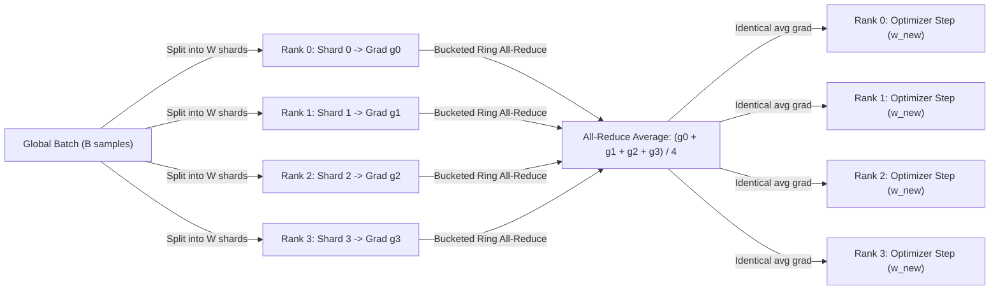
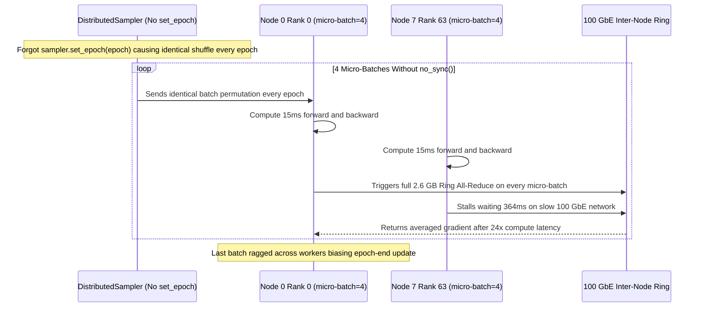

# Module 09: Data Parallelism

> **Prerequisites:** [Module 04: VRAM: The Real Constraint](../04-vram-the-real-constraint/README.md), [Module 05: Calculating a Model's Memory Requirements](../05-calculating-a-models-memory-requirements/README.md), [Module 07: Mixed Precision Training](../07-mixed-precision-training/README.md), and [Module 08: FlashAttention and Memory-Efficient Kernels](../08-flashattention-and-memory-efficient-kernels/README.md)  
> **Estimated Reading Time:** 35 minutes  
> **Target Audience:** ML Systems Engineers, Distributed Training Engineers, AI Platform Architects

> [!TIP]
> **The Golden Rule of Data Parallelism**  
> Data parallelism gives every GPU a **full replica of the model** and a disjoint shard of the global batch, then averages local gradients via a bandwidth-optimal **Ring All-Reduce** ($2\frac{W-1}{W}S$ bytes per worker) so every replica takes the exact same optimizer step; it scales linearly until communication time overtakes per-GPU compute or until a single replica's states exceed one GPU's VRAM.

---

## Why This Matters

You are in **Track 05: GPUs & GenAI Hardware**. Modules 00–08 focused on squeezing peak throughput and memory efficiency out of a single GPU; Modules 09–11 tackle multi-GPU scaling. Data parallelism is the simplest, most universally deployed multi-GPU pattern because model code stays largely unchanged. Every advanced parallelism strategy (Tensor Parallelism, Pipeline Parallelism, ZeRO/FSDP) either wraps around Data Parallelism or exists specifically to fix its single-GPU memory bottleneck.

**After this module you can:**
- Trace all four phases of a data-parallel training step and pinpoint the exact buffer communicated.
- Prove mathematically and numerically why averaging shard gradients equals the full-batch gradient—and detect when unequal shard sizes silently corrupt it.
- Calculate effective global batch size and per-GPU ring all-reduce communication traffic.
- Model weak vs. strong scaling plateaus across NVLink, PCIe Gen4, and 100 GbE, and configure PyTorch `DistributedDataParallel` (`DDP`) correctly in production.

---

## 1. Visual Mental Models & Collective Architecture

### One Data-Parallel Training Step

Take $W$ GPUs ("workers" or "ranks"). Each rank starts with identical model parameters and optimizer states:

1. **Shard the batch:** Cut the global batch into $W$ disjoint shards, one per GPU.
2. **Local forward & backward:** Each GPU computes forward loss and backward gradients independently on its shard alone (zero communication yet).
3. **All-Reduce gradients:** An **all-reduce** sums the $W$ local gradient buffers and divides by $W$, leaving every GPU with the identical averaged gradient.
4. **Identical optimizer step:** Same starting weights + same averaged gradient + same optimizer = identical updated weights. Replicas never drift apart without ever exchanging weight tensors directly (Step 1 below measures `0.00e+00` divergence after 100 steps).



### Why Averaging Shard Gradients Reproduces Full-Batch Training

Most training losses take the **mean** over per-example losses. Because differentiation is linear, the gradient of the mean over $64$ examples equals the mean of four shard gradients each averaged over $16$ examples. Data parallelism is **mathematically exact** large-batch training—not an approximation.

> [!WARNING]
> **Ragged Shards Break Exactness**  
> Exact equality requires **equal shard sizes**. If four shards contain 10, 14, 20, and 20 examples (e.g., a ragged final batch without `drop_last=True`), taking a naive arithmetic mean of shard gradients over-weights the smaller shards and introduces real numerical bias (`1.22e-01` error measured in Step 1). Weighting each shard by $n_i / N_{\text{total}}$ (or ensuring equal shards) restores exact equivalence (`2.22e-16`). Also verify whether your loss reduces by `mean` or `sum`, as that dictates the all-reduce divisor.

### Effective Batch Size & Gradient Accumulation

$$\text{Effective (Global) Batch} = \text{per-GPU micro-batch} \times \text{gradient accumulation steps} \times W$$

Gradient accumulation executes multiple micro-batches locally, summing gradients inside each GPU before triggering a single all-reduce per optimizer step (using `model.no_sync()` in PyTorch DDP). Remember that increasing $W$ while holding per-GPU micro-batch constant **changes the effective global batch size**, which alters optimization dynamics and typically requires retuning learning rate and warm-up schedules.

### Ring All-Reduce: Bandwidth-Optimal Collective Communication

An **all-reduce** combines one vector per rank via an associative operator (e.g., sum) and writes the result to every rank (the standard collective in NVIDIA's [NCCL collectives specification](https://docs.nvidia.com/deeplearning/nccl/user-guide/docs/usage/collectives.html)).

A naive single-root parameter server collects $(W - 1)$ copies at Rank 0 and broadcasts $(W - 1)$ copies back—creating a $2(W - 1)S$ bottleneck at the root link. **Ring All-Reduce** eliminates the bottleneck by splitting a buffer of size $S$ into $W$ chunks of size $S/W$ and arranging ranks in a logical ring:

1. **Reduce-Scatter ($W - 1$ steps):** Every rank sends one chunk to its right neighbor `(r + 1) % W` and adds the chunk received from its left neighbor. After $W - 1$ steps, rank $r$ owns the fully summed chunk `(r + 1) % W`.
2. **All-Gather ($W - 1$ steps):** The finalized chunks circulate once more around the ring, with receivers overwriting rather than adding.

Each worker transmits:
$$\text{Bytes Sent per Worker} = 2 \cdot \frac{W - 1}{W} \cdot S < 2S \quad \text{for all } W$$

All links operate concurrently, making ring all-reduce **bandwidth-optimal** (Patarasuk & Yuan; Horovod). Its trade-off is $2(W - 1)$ sequential latency hops—so for tiny tensors, latency dominates, which is why DDP fuses gradients into large buckets (25 MB by default) or selects tree algorithms.

```text
RING ALL-REDUCE, 4 workers, buffer cut into 4 chunks (A B C D)

  worker 0 ──► worker 1 ──► worker 2 ──► worker 3 ──┐      every step: each worker sends
      ▲                                              │      ONE chunk (S/4) to its right
      └──────────────────────────────────────────────┘      neighbour, all at the same time

  reduce-scatter (3 steps)         all-gather (3 steps)
  receiver ADDS the chunk          receiver OVERWRITES with the finished chunk
  end: worker r owns the           end: every worker has every finished chunk
       summed chunk (r+1) mod 4

  data sent per worker = 2 x 3 steps x S/4 = 1.5 S      general: 2(W-1)/W x S  (< 2S for any W)
```

### Why Scaling Plateaus & How DDP Overlaps Communication

A step takes roughly `compute + all-reduce`. Since ring traffic per GPU stays fixed near $2S$ regardless of $W$, adding GPUs never shortens communication time, and the **slowest link in the cluster** dictates the ceiling. Under **strong scaling** (fixed global batch split $W$ ways), compute shrinks as $1/W$ while communication stays constant, causing speedups to flatten rapidly over slow links. Under **weak scaling** (fixed per-GPU batch), efficiency stabilizes at $\frac{T_{\text{compute}}}{T_{\text{compute}} + T_{\text{allreduce}}}$, which improves with larger micro-batches or gradient accumulation.

In production, PyTorch **DistributedDataParallel (DDP)** hides much of this wait time by grouping gradients into buckets (25 MB default) and launching each bucket's all-reduce asynchronously in reverse layer order while earlier layers are still running backpropagation:

```text
STEP TIME

  no overlap :  |=========== backward compute ===========|=== all-reduce ===|
  with buckets: |=========== backward compute ===========|
                         |= b1 =|   |= b2 =|   |= b3 =|-|      <- each bucket's all-reduce starts as soon
                                                                  as its gradients are ready; most of it is hidden
  efficiency = compute / step time; a bigger per-GPU batch makes the compute bar longer
```

> [!NOTE]
> **Eight Cooks Mental Model**  
> Eight cooks each receive a different order ticket (data shard) and identical recipe books (model weights). After preparing their dish, they meet briefly to average their recipe adjustments (all-reduce) and update their books identically. More cooks produce more dishes per hour, but the meeting takes just as long—and if every recipe book is already too huge for one kitchen (GPU VRAM), adding more identical kitchens still fails to fit the model.

---

## 2. Systematic Scaling & Collective Comparison Matrix

### Collective Communication Topologies

| Topology / Algorithm | Traffic on Busiest Link (Buffer $S$, Workers $W$) | Sequential Latency Hops | Bandwidth Optimality | Best Operational Regime |
| :--- | :--- | :--- | :--- | :--- |
| **Single-Root / Parameter Server** | $2(W - 1)S$ | $2$ | Poor ($O(W)$ bottleneck at root) | Tiny clusters only ($W = 2$) |
| **Ring All-Reduce** | $2\frac{W - 1}{W}S$ ($< 2S$) | $2(W - 1)$ | Optimal for large buffers | Large gradient buckets ($> 10\,\text{MB}$) |
| **Double Binary Tree All-Reduce** | $\sim 2S$ | $\mathcal{O}(\log W)$ | High + low latency | Very large $W$ or small tensors |

### Interconnect Impact on Data-Parallel Scaling ($1.3\text{B}$ Model, $2.6\text{ GB}$ BF16 Grads, $T_{\text{compute}} = 400\text{ ms}$)

Hardware bandwidth figures taken from the [NVIDIA A100 Tensor Core GPU datasheet](https://www.nvidia.com/content/dam/en-zz/Solutions/Data-Center/a100/pdf/nvidia-a100-datasheet-us-nvidia-1758950-r4-web.pdf) (checked Oct 2026) and standard 100 GbE conversion ($12.5\text{ GB/s}$):

| Interconnect | Usable One-Way BW | $W=8$ All-Reduce Time | Weak Scaling Efficiency ($W=64$) | Strong Scaling Speedup ($W=64$) | Scaling Constraint |
| :--- | :--- | :--- | :--- | :--- | :--- |
| **NVLink (A100 SXM)** | $600\text{ GB/s}$ | $7.6\text{ ms}$ | $98\%$ | $27.1\times$ | Compute-dominated intra-node |
| **PCIe Gen4** | $64\text{ GB/s}$ | $71.1\text{ ms}$ | $83\%$ | $4.6\times$ | Saturates on fixed global batch |
| **100 GbE Ethernet** | $12.5\text{ GB/s}$ | $364.0\text{ ms}$ | $49\%$ | $1.0\times$ (zero speedup) | Communication-bound cross-node |

---

## 3. Verified Python Distributed Simulation Experiments

All scripts run with Python 3.13 + NumPy 2.4.6 on CPU.

### Step 1: Gradient Equivalence, Unequal Shard Error & 100-Step Replica Lock

```python
import numpy as np

rng = np.random.default_rng(0)
D_IN, D_H = 8, 16


def init_params():
    return {"W1": rng.standard_normal((D_IN, D_H)) * 0.5, "b1": np.zeros(D_H),
            "W2": rng.standard_normal((D_H, 1)) * 0.5, "b2": np.zeros(1)}


def loss_and_grads(p, X, y):
    """Tiny 2-layer MLP, mean-squared-error loss, hand-written backprop.
    The loss and gradients are AVERAGES over the examples passed in."""
    n = len(X)
    h = np.tanh(X @ p["W1"] + p["b1"])
    err = (h @ p["W2"] + p["b2"]) - y
    loss = (err ** 2).mean()
    dpred = 2 * err / n
    dh = dpred @ p["W2"].T
    dz1 = dh * (1 - h ** 2)
    return loss, {"W1": X.T @ dz1, "b1": dz1.sum(0), "W2": h.T @ dpred, "b2": dpred.sum(0)}


def max_diff(a, b):
    return max(np.abs(a[k] - b[k]).max() for k in a)


params = init_params()
X = rng.standard_normal((64, D_IN))
y = rng.standard_normal((64, 1))

# 1) One big batch on one "GPU"  vs  4 equal shards, gradients averaged ("all-reduce, then / 4").
_, g_full = loss_and_grads(params, X, y)
shard_grads = [loss_and_grads(params, Xs, ys)[1] for Xs, ys in zip(np.split(X, 4), np.split(y, 4))]
g_avg = {k: sum(g[k] for g in shard_grads) / 4 for k in g_full}
print("equal shards (16 each): max |mean of shard grads - full-batch grad| =", f"{max_diff(g_avg, g_full):.2e}")

# 2) Unequal shards: a plain mean of shard means is NOT the full-batch mean.
sizes = [10, 14, 20, 20]
cuts = np.cumsum(sizes)[:-1]
grads_u = [loss_and_grads(params, Xs, ys)[1] for Xs, ys in zip(np.split(X, cuts), np.split(y, cuts))]
plain = {k: sum(g[k] for g in grads_u) / 4 for k in g_full}
weighted = {k: sum(n * g[k] for n, g in zip(sizes, grads_u)) / 64 for k in g_full}
print("unequal shards, plain mean    :", f"{max_diff(plain, g_full):.2e}   <- wrong")
print("unequal shards, size-weighted :", f"{max_diff(weighted, g_full):.2e}   <- correct")

# 3) Whole training runs: 4 replicas averaging gradients every step vs one process on the full batch.
POOL_X = rng.standard_normal((512, D_IN))
POOL_Y = np.sin(POOL_X.sum(1, keepdims=True))
WORLD, GLOBAL_B, LR, STEPS = 4, 64, 0.05, 100

single = {k: v.copy() for k, v in params.items()}
replicas = [{k: v.copy() for k, v in params.items()} for _ in range(WORLD)]     # same init everywhere
batch_rng = np.random.default_rng(123)
for step in range(STEPS):
    idx = batch_rng.choice(len(POOL_X), GLOBAL_B, replace=False)                 # the global batch
    Xb, yb = POOL_X[idx], POOL_Y[idx]
    loss_s, g = loss_and_grads(single, Xb, yb)                                   # single process
    for k in single:
        single[k] -= LR * g[k]
    local = [loss_and_grads(r, Xs, ys)[1]                                        # data parallel
             for r, Xs, ys in zip(replicas, np.split(Xb, WORLD), np.split(yb, WORLD))]
    for k in single:
        avg = sum(g_r[k] for g_r in local) / WORLD                               # the all-reduce
        for r in replicas:
            r[k] -= LR * avg
    if step in (0, STEPS - 1):
        print(f"step {step:>3}: loss (single process) = {loss_s:.6f}")

print("replica 0 vs replica 3 after training :", f"{max_diff(replicas[0], replicas[3]):.2e}")
print("data parallel vs single process       :", f"{max_diff(replicas[0], single):.2e}")

# 4) Effective batch size
per_gpu_micro_batch, accumulation_steps = 8, 4
print("\neffective batch =", per_gpu_micro_batch, "x", accumulation_steps, "x", WORLD, "GPUs =",
      per_gpu_micro_batch * accumulation_steps * WORLD)
```

**Verified Output:**
```text
equal shards (16 each): max |mean of shard grads - full-batch grad| = 4.44e-16
unequal shards, plain mean    : 1.22e-01   <- wrong
unequal shards, size-weighted : 2.22e-16   <- correct
step   0: loss (single process) = 3.128060
step  99: loss (single process) = 0.525819
replica 0 vs replica 3 after training : 0.00e+00
data parallel vs single process       : 3.33e-16

effective batch = 8 x 4 x 4 GPUs = 128
```

> [!NOTE]
> `4.44e-16` is `float64` addition-order noise, whereas `replica 0 vs replica 3` is `0.00e+00` bit-for-bit identical because all four replicas perform the exact same operations on identical averaged gradients.

### Step 2: Step-by-Step Ring All-Reduce Simulation & Traffic Accounting

```python
import numpy as np


def ring_allreduce(buffers, trace=None):
    """Simulate ring all-reduce (sum). buffers[r] is worker r's vector.
    Phase 1 (reduce-scatter): n-1 steps; afterwards worker r owns the fully summed chunk (r+1) % n.
    Phase 2 (all-gather)    : n-1 steps; the finished chunks travel around the ring.
    In every step each worker sends exactly one chunk to its right neighbour (r+1) % n."""
    n = len(buffers)
    chunks = [np.array_split(b.astype(float).copy(), n) for b in buffers]
    sent = [0] * n                                         # elements each worker has sent
    for phase in ("reduce-scatter", "all-gather"):
        for step in range(n - 1):
            if phase == "reduce-scatter":
                send = [(r, (r - step) % n) for r in range(n)]
            else:
                send = [(r, (r + 1 - step) % n) for r in range(n)]
            msgs = [(r, c, chunks[r][c].copy()) for r, c in send]      # all sends happen "at once"
            for r, c, data in msgs:
                dst = (r + 1) % n
                if phase == "reduce-scatter":
                    chunks[dst][c] = chunks[dst][c] + data             # receiver adds
                else:
                    chunks[dst][c] = data                              # receiver overwrites
                sent[r] += data.size
            if trace is not None:
                trace.append((phase, step, [[int(ch[0]) for ch in worker] for worker in chunks]))
    return [np.concatenate(c) for c in chunks], sent


# --- A traceable example: 4 workers, buffers of 4 chunks with 1 element each. Worker r holds the value
# 10**r in every chunk, so a cell reading 110 means "workers 1 and 2 have been added into this chunk".
n = 4
bufs = [np.full(n, 10 ** r) for r in range(n)]
trace = []
out, _ = ring_allreduce(bufs, trace)


def row(label, state):                                   # state[w] = worker w's four chunks
    return f"{label:<7}" + " ".join("[" + " ".join(f"{v:4d}" for v in w) + "]" for w in state)


print(f"{'':<7}" + " ".join(f"{'worker ' + str(w):<21}" for w in range(n)))
print(row("start", [b.astype(int).tolist() for b in bufs]))
for phase, step, state in trace:
    print(row(("rs " if phase == "reduce-scatter" else "ag ") + str(step + 1), state))

# --- Correctness: random vectors, several worker counts, sizes that do and do not divide evenly.
rng = np.random.default_rng(0)
print("\nworkers  length  max |ring - sum|   all workers equal")
for n, length in [(2, 10), (3, 1000), (4, 1000), (5, 1003), (8, 4096), (16, 4096)]:
    bufs = [rng.standard_normal(length) for _ in range(n)]
    out, sent = ring_allreduce(bufs)
    ref = np.sum(bufs, axis=0)
    same = all(np.array_equal(out[0], o) for o in out)
    print(f"{n:>7} {length:>7} {np.abs(out[0] - ref).max():>14.2e} {str(same):>18}")
    assert np.allclose(out[0], ref) and same

# --- Traffic: each worker sends 2(n-1)/n of the buffer, however many workers there are.
S = 1200
print("\nworkers  elements sent per worker  expected 2(n-1)/n * S  as multiple of S")
for n in (2, 3, 4, 6, 8):
    _, sent = ring_allreduce([rng.standard_normal(S) for _ in range(n)])
    expected = 2 * (n - 1) * S // n
    assert all(s == expected for s in sent)
    print(f"{n:>7} {sent[0]:>25,} {expected:>22,} {sent[0] / S:>16.3f}")

# --- Versus "everyone sends to worker 0, which adds and sends the result back".
print("\nbusiest worker's traffic, in multiples of the buffer size S:")
print(f"{'workers':>8} {'ring (any worker)':>18} {'via worker 0 (root)':>20}")
for n in (2, 4, 8, 64, 1024):
    print(f"{n:>8} {2 * (n - 1) / n:>18.3f} {2 * (n - 1):>20.0f}")
```

**Verified Output:**
```text
       worker 0              worker 1              worker 2              worker 3
start  [   1    1    1    1] [  10   10   10   10] [ 100  100  100  100] [1000 1000 1000 1000]
rs 1   [   1    1    1 1001] [  11   10   10   10] [ 100  110  100  100] [1000 1000 1100 1000]
rs 2   [   1    1 1101 1001] [  11   10   10 1011] [ 111  110  100  100] [1000 1110 1100 1000]
rs 3   [   1 1111 1101 1001] [  11   10 1111 1011] [ 111  110  100 1111] [1111 1110 1100 1000]
ag 1   [1111 1111 1101 1001] [  11 1111 1111 1011] [ 111  110 1111 1111] [1111 1110 1100 1111]
ag 2   [1111 1111 1101 1111] [1111 1111 1111 1011] [ 111 1111 1111 1111] [1111 1110 1111 1111]
ag 3   [1111 1111 1111 1111] [1111 1111 1111 1111] [1111 1111 1111 1111] [1111 1111 1111 1111]

workers  length  max |ring - sum|   all workers equal
      2      10       0.00e+00               True
      3    1000       8.88e-16               True
      4    1000       8.88e-16               True
      5    1003       8.88e-16               True
      8    4096       1.78e-15               True
     16    4096       3.55e-15               True

workers  elements sent per worker  expected 2(n-1)/n * S  as multiple of S
      2                     1,200                  1,200            1.000
      3                     1,600                  1,600            1.333
      4                     1,800                  1,800            1.500
      6                     2,000                  2,000            1.667
      8                     2,100                  2,100            1.750

busiest worker's traffic, in multiples of the buffer size S:
 workers  ring (any worker)  via worker 0 (root)
       2              1.000                    2
       4              1.500                    6
       8              1.750                   14
      64              1.969                  126
    1024              1.998                 2046
```

### Step 3: Weak & Strong Scaling Step-Time Model (`s3_scaling_model.py`)

```python
# A back-of-the-envelope model of data-parallel step time. Every input is an ASSUMPTION
# you can change; the point is the shape of the curves, not the absolute numbers.
PARAMS = 1.3e9               # model size (assumed)
GRAD_BYTES = PARAMS * 2      # bf16 gradients -> 2 bytes per parameter (assumed)
T_COMPUTE = 0.40             # seconds of forward+backward per GPU per step (assumed)

LINKS = {                    # bytes/second, treated as the usable one-way bandwidth (optimistic)
    "NVLink  600 GB/s": 600e9,     # A100 SXM datasheet figure
    "PCIe4    64 GB/s": 64e9,      # A100 datasheet figure for PCIe Gen4
    "100 GbE  12.5 GB/s": 12.5e9,  # 100 gigabit/s Ethernet = 12.5 GB/s (unit conversion)
}


def allreduce_seconds(world, bandwidth):
    """Bandwidth term of ring all-reduce only: 2(W-1)/W * S / bandwidth. Latency ignored."""
    return 0.0 if world == 1 else 2 * (world - 1) / world * GRAD_BYTES / bandwidth


worlds = (1, 2, 4, 8, 16, 32, 64)
print(f"gradient buffer = {GRAD_BYTES / 1e9:.1f} GB, compute per step = {T_COMPUTE * 1000:.0f} ms")

print("\nWEAK scaling (batch per GPU fixed): efficiency = compute / (compute + all-reduce)")
print(f"{'link':<20}" + "".join(f"{w:>7}" for w in worlds))
for name, bw in LINKS.items():
    row = [T_COMPUTE / (T_COMPUTE + allreduce_seconds(w, bw)) for w in worlds]
    print(f"{name:<20}" + "".join(f"{e * 100:>6.0f}%" for e in row))

print("\nSTRONG scaling (global batch fixed, split W ways): speedup over 1 GPU")
print(f"{'link':<20}" + "".join(f"{w:>7}" for w in worlds))
for name, bw in LINKS.items():
    row = [T_COMPUTE / (T_COMPUTE / w + allreduce_seconds(w, bw)) for w in worlds]
    print(f"{name:<20}" + "".join(f"{s:>7.1f}" for s in row))

print("\nall-reduce time per step at W=8:")
for name, bw in LINKS.items():
    print(f"  {name:<20} {allreduce_seconds(8, bw) * 1000:7.1f} ms")
```

**Verified Output:**
```text
gradient buffer = 2.6 GB, compute per step = 400 ms

WEAK scaling (batch per GPU fixed): efficiency = compute / (compute + all-reduce)
link                      1      2      4      8     16     32     64
NVLink  600 GB/s       100%    99%    98%    98%    98%    98%    98%
PCIe4    64 GB/s       100%    91%    87%    85%    84%    84%    83%
100 GbE  12.5 GB/s     100%    66%    56%    52%    51%    50%    49%

STRONG scaling (global batch fixed, split W ways): speedup over 1 GPU
link                      1      2      4      8     16     32     64
NVLink  600 GB/s        1.0    2.0    3.8    6.9   12.1   19.1   27.1
PCIe4    64 GB/s        1.0    1.7    2.5    3.3    4.0    4.4    4.6
100 GbE  12.5 GB/s      1.0    1.0    1.0    1.0    1.0    1.0    1.0

all-reduce time per step at W=8:
  NVLink  600 GB/s         7.6 ms
  PCIe4    64 GB/s        71.1 ms
  100 GbE  12.5 GB/s     364.0 ms
```

### Step 4: PyTorch `DistributedDataParallel` Skeleton (Multi-GPU CUDA, Not Executed Above)

```python
# train_ddp.py - launch with:  torchrun --nproc_per_node=8 train_ddp.py
import os
import torch
import torch.distributed as dist
from torch.nn.parallel import DistributedDataParallel as DDP
from torch.utils.data import DataLoader, DistributedSampler

dist.init_process_group("nccl")                    # torchrun supplies RANK, WORLD_SIZE, LOCAL_RANK
local_rank = int(os.environ["LOCAL_RANK"])
torch.cuda.set_device(local_rank)

model = MyModel().cuda(local_rank)
model = DDP(model, device_ids=[local_rank])        # broadcasts rank 0's weights; hooks all-reduce into backward

sampler = DistributedSampler(dataset)              # each rank reads a different 1/W of the data
loader = DataLoader(dataset, batch_size=32, sampler=sampler)   # batch_size is PER PROCESS
opt = torch.optim.AdamW(model.parameters(), lr=3e-4)

for epoch in range(3):
    sampler.set_epoch(epoch)                       # new shuffle each epoch
    for x, y in loader:
        loss = loss_fn(model(x.cuda(local_rank)), y.cuda(local_rank))
        loss.backward()                            # bucketed all-reduce (average) overlaps with this
        opt.step()
        opt.zero_grad()
```

---

## 4. Production War Story Post-Mortem: 64-GPU Scale-Out Throughput Collapse & Silent Epoch Repeat

| Field | Incident Details |
| :--- | :--- |
| **Severity** | **SEV-1** (Multi-Node 64-GPU Fine-Tuning Stall + Wasted Compute Budget) |
| **Detection / Resolution Time** | Detected after 4 hours via GPU utilization dashboards (`~38%` MFU) and flat validation curve / Resolved in 45 minutes |
| **Impact** | Scaling from 8 GPUs (1 node) to 64 GPUs (8 nodes) delivered only $2.9\times$ speedup instead of $\sim 7.5\times$, wasting over $\$12{,}000$ in cloud GPU hours while overfit validation metrics stalled |

### What Happened

A training team scaled a 1.3B embedding/encoder model from a single 8-GPU NVLink node ($600\text{ GB/s}$) to an 8-node cluster ($64$ GPUs) connected by $100\text{ GbE}$ Ethernet ($12.5\text{ GB/s}$). To keep the global batch size identical to their validated recipe ($256$), they dropped per-GPU `batch_size` from `32` down to `4` (**strong scaling**), and enabled `gradient_accumulation_steps=4`—**without** wrapping intermediate micro-batches in `model.no_sync()`.

As a result, every single micro-batch fired a full $2.6\text{ GB}$ gradient all-reduce across the $100\text{ GbE}$ inter-node fabric ($364\text{ ms}$ per sync) while GPU compute lasted under $15\text{ ms}$, pinning nodes at $<5\%$ efficiency. Compounding the issue, the training script forgot `sampler.set_epoch(epoch)` on `DistributedSampler`, repeating the exact same shuffled shard order across 12 epochs, and omitted `drop_last=True`, causing ragged end-of-epoch shards on uneven dataset partitions.



### Root Cause Analysis

1. **Missing `model.no_sync()` during gradient accumulation:** PyTorch DDP runs backward all-reduce hooks on *every* `.backward()` call unless explicitly suppressed via `with model.no_sync():` on the first $K - 1$ micro-batches. Firing 4 inter-node all-reduces per optimizer step multiplied network wait time by $4\times$.
2. **Strong scaling over a slow inter-node fabric:** Shrinking per-GPU compute ($32 \to 4$ samples) while holding gradient size constant ($2.6\text{ GB}$) over $12.5\text{ GB/s}$ Ethernet turned the cluster completely network-bound.
3. **Missing `sampler.set_epoch(epoch)` and ragged final shards:** Without `set_epoch`, `DistributedSampler` seeded every epoch identically; without `drop_last=True` or size-weighted averaging, ragged final batches skewed gradients.

### The Fix & Architectural Hardening

- Raised per-GPU micro-batch size back to the VRAM ceiling (`32`) and accumulated gradients under `with model.no_sync():` for $K - 1$ steps, syncing strictly on the final micro-batch—raising weak-scaling efficiency above $85\%$.
- Enforced `sampler.set_epoch(epoch)` and `drop_last=True` in the shared training harness, plus automated NCCL profiler CI assertions verifying `comm_time < 0.20 * step_time` before full cluster dispatch.

---

## 5. Multi-Language Production Implementation: Ring All-Reduce & DDP Scaling Planners

````carousel
```go
package dataparallel

import (
	"fmt"
	"math"
)

type ScalingMetrics struct {
	WorldSize         int
	RingTrafficFactor float64
	AllReduceMs       float64
	WeakEfficiency    float64
	StrongSpeedup     float64
}

// EvaluateScaling computes ring all-reduce communication volume (2*(W-1)/W * S)
// and predicts weak/strong scaling curves given gradient buffer bytes and link BW.
func EvaluateScaling(world int, gradBytes, linkBytesPerSec, singleGpuComputeSec float64) ScalingMetrics {
	if world <= 1 {
		return ScalingMetrics{WorldSize: 1, WeakEfficiency: 1.0, StrongSpeedup: 1.0}
	}
	factor := 2.0 * float64(world-1) / float64(world)
	allReduceSec := (factor * gradBytes) / linkBytesPerSec
	weakEff := singleGpuComputeSec / (singleGpuComputeSec + allReduceSec)
	strongSpeedup := singleGpuComputeSec / ((singleGpuComputeSec / float64(world)) + allReduceSec)

	return ScalingMetrics{
		WorldSize:         world,
		RingTrafficFactor: math.Round(factor*1000) / 1000,
		AllReduceMs:       allReduceSec * 1000.0,
		WeakEfficiency:    weakEff,
		StrongSpeedup:     strongSpeedup,
	}
}

func FormatReport(world int) string {
	m := EvaluateScaling(world, 2.6e9, 12.5e9, 0.40)
	return fmt.Sprintf("W=%d (100GbE): allreduce=%.1fms, weak_eff=%.0f%%, strong=%.1fx",
		m.WorldSize, m.AllReduceMs, m.WeakEfficiency*100, m.StrongSpeedup)
}
```
<!-- slide -->
```typescript
export interface ShardGradient {
  sampleCount: number;
  grad: number[];
}

export interface EffectiveBatchConfig {
  microBatchPerGpu: number;
  gradAccumSteps: number;
  worldSize: number;
}

export class DistributedBatchPlanner {
  public static computeEffectiveBatch(cfg: EffectiveBatchConfig): number {
    return cfg.microBatchPerGpu * cfg.gradAccumSteps * cfg.worldSize;
  }

  /**
   * Computes size-weighted average gradient across shards. If shards are ragged,
   * an unweighted arithmetic mean introduces bias; weighting by n_i / total restores exactness.
   */
  public static aggregateShardsExact(shards: ShardGradient[]): {
    weighted: number[];
    unweightedBiasWarning: boolean;
  } {
    const totalSamples = shards.reduce((acc, s) => acc + s.sampleCount, 0);
    const dim = shards[0]?.grad.length ?? 0;
    const weighted = new Array<number>(dim).fill(0);

    const isUnequal = shards.some((s) => s.sampleCount !== shards[0].sampleCount);
    for (const shard of shards) {
      const weight = shard.sampleCount / totalSamples;
      for (let i = 0; i < dim; i++) {
        weighted[i] += weight * shard.grad[i];
      }
    }
    return { weighted, unweightedBiasWarning: isUnequal };
  }
}
```
<!-- slide -->
```python
"""Production PyTorch DDP training step with gradient accumulation via no_sync()."""

import contextlib
import os
import torch
import torch.distributed as dist
from torch.nn.parallel import DistributedDataParallel as DDP
from torch.utils.data import DataLoader, DistributedSampler


def run_ddp_epoch(
    model: torch.nn.Module,
    dataset: torch.utils.data.Dataset,
    loss_fn,
    epoch: int,
    micro_batch_size: int = 32,
    grad_accum_steps: int = 4,
) -> None:
    local_rank = int(os.environ["LOCAL_RANK"])
    torch.cuda.set_device(local_rank)
    ddp_model = DDP(model.cuda(local_rank), device_ids=[local_rank], bucket_cap_mb=25)

    # drop_last=True guarantees equal shard sizes so all-reduce mean == global-batch mean
    sampler = DistributedSampler(dataset, shuffle=True, drop_last=True)
    sampler.set_epoch(epoch)
    loader = DataLoader(dataset, batch_size=micro_batch_size, sampler=sampler, pin_memory=True)
    opt = torch.optim.AdamW(ddp_model.parameters(), lr=3e-4)

    opt.zero_grad(set_to_none=True)
    for step, (x, y) in enumerate(loader):
        is_sync_step = ((step + 1) % grad_accum_steps == 0) or ((step + 1) == len(loader))
        sync_ctx = contextlib.nullcontext() if is_sync_step else ddp_model.no_sync()

        with sync_ctx:
            loss = loss_fn(ddp_model(x.cuda(local_rank)), y.cuda(local_rank)) / grad_accum_steps
            loss.backward()

        if is_sync_step:
            opt.step()
            opt.zero_grad(set_to_none=True)
```
<!-- slide -->
```csharp
using System;

namespace DistributedTraining;

public static class RingAllReduceSimulator
{
    public static (double[] Reduced, long[] ElementsSentPerRank) Run(double[][] workerBuffers)
    {
        int n = workerBuffers.Length;
        int len = workerBuffers[0].Length;
        var chunks = new double[n][][];
        long[] sent = new long[n];

        // Partition each worker's buffer into N roughly equal chunks
        for (int r = 0; r < n; r++)
        {
            chunks[r] = new double[n][];
            int offset = 0;
            for (int c = 0; c < n; c++)
            {
                int sz = len / n + (c < (len % n) ? 1 : 0);
                chunks[r][c] = new double[sz];
                Array.Copy(workerBuffers[r], offset, chunks[r][c], 0, sz);
                offset += sz;
            }
        }

        for (int phase = 0; phase < 2; phase++)
        {
            for (int step = 0; step < n - 1; step++)
            {
                var transit = new (int dst, int chunkIdx, double[] payload)[n];
                for (int r = 0; r < n; r++)
                {
                    int chunkIdx = phase == 0 ? ((r - step) % n + n) % n : ((r + 1 - step) % n + n) % n;
                    var copy = (double[])chunks[r][chunkIdx].Clone();
                    transit[r] = ((r + 1) % n, chunkIdx, copy);
                    sent[r] += copy.Length;
                }

                foreach (var (dst, chunkIdx, payload) in transit)
                {
                    if (phase == 0)
                    {
                        for (int i = 0; i < payload.Length; i++) chunks[dst][chunkIdx][i] += payload[i];
                    }
                    else
                    {
                        chunks[dst][chunkIdx] = payload;
                    }
                }
            }
        }

        var result = new double[len];
        int pos = 0;
        for (int c = 0; c < n; c++)
        {
            Array.Copy(chunks[0][c], 0, result, pos, chunks[0][c].Length);
            pos += chunks[0][c].Length;
        }
        return (result, sent);
    }
}
```
````

---

## 6. Practical Hands-On Verification CLI Workflows

### Verification 1: Ring Traffic & Latency Crossover Calculator (CLI)

Run this one-liner to verify ring traffic per rank for non-divisible buffer length `1003` across $W=5$ ranks and inspect latency vs. bandwidth crossover:

```bash
python -c "
import numpy as np
def ring_sent(W, S):
    chunks = [len(c) for c in np.array_split(np.zeros(S), W)]
    sent = [0]*W
    for phase in (0, 1):
        for step in range(W-1):
            for r in range(W):
                c = (r - step) % W if phase == 0 else (r + 1 - step) % W
                sent[r] += chunks[c]
    return sent
print('W=5, S=1003 sent per worker:', ring_sent(5, 1003), 'formula:', 2*(5-1)/5*1003)
for W in (8, 64):
    lat = 2*(W-1)*10e-6
    bw = 2*(W-1)/W*1e6/1e11
    print(f'W={W}: latency={lat*1e6:.0f}us, bw={bw*1e6:.1f}us, total={(lat+bw)*1e6:.1f}us')
"
```

**Expected Output:**
```text
W=5, S=1003 sent per worker: [1604, 1605, 1606, 1605, 1604] formula: 1604.8
W=8: latency=140us, bw=17.5us, total=157.5us
W=64: latency=1260us, bw=19.7us, total=1279.7us
```

### Hands-On Practice Exercises

#### 1. Buy back efficiency with gradient accumulation
In `s3_scaling_model.py` keep the `100 GbE` link and $W = 8$, but raise `T_COMPUTE` from `0.4 s` to `1.6 s` (a per-GPU batch four times larger, via gradient accumulation, still one all-reduce per step). What weak-scaling efficiency do you get, and why does it improve?

<details><summary>Answer</summary>

The all-reduce still takes `364 ms` (it depends on the gradient size, not the batch), so efficiency becomes `1.6 / (1.6 + 0.364) =` **81%**, up from `52%` at `0.4 s`. Four times more compute is amortized over the same communication. The price is a four times larger effective batch, which can change optimization behavior.

</details>

#### 2. Does every worker send exactly $2(W-1)/W \times S$?
Run `ring_allreduce` with $W = 5$ and a buffer of length `1003`, and print `sent`. Compare with the formula. Is the algorithm still correct?

<details><summary>Answer</summary>

`sent` is `[1604, 1605, 1606, 1605, 1604]`, while the formula gives `1604.8`. `1003` does not divide by `5`, so `np.array_split` makes chunks of `201` or `200` elements, and different workers happen to send different chunks at different steps. The totals differ by a couple of elements, which is negligible; the result is still the exact sum (the correctness table in Step 2 includes this case).

</details>

#### 3. When does ring latency matter?
Add a per-step latency term: ring time is `2(W-1) x alpha + 2(W-1)/W x S / bandwidth`. For a `1 MB` buffer, `100 GB/s` links and an assumed `alpha = 10 microseconds`, compute the time at $W = 8$ and $W = 64$ and say which term dominates.

<details><summary>Answer</summary>

$W = 8$: latency term `2 x 7 x 10 us = 140 us`; bandwidth term `2 x (7/8) x 1e6 / 1e11 = 17.5 us`; total `157.5 us`. $W = 64$: `1,260 us + 19.7 us =` about `1,280 us`. For small messages the latency term dominates and grows linearly with $W$, which is why gradient all-reduces are done on large fused buckets rather than per tensor, and is one reason alternatives to the ring exist.

</details>

#### 4. Choose the accumulation steps
You have `8 GPUs`, each fits a micro-batch of `4`, and your recipe calls for a global batch of `256`. How many accumulation steps per optimizer step? How many all-reduces per optimizer step if you accumulate under `no_sync()` and only synchronize on the last micro-batch?

<details><summary>Answer</summary>

`256 / (4 x 8) = 8` accumulation steps. With synchronization only on the final micro-batch there is **1 all-reduce** per optimizer step (instead of 8).

</details>

### Independent Project: Mini Data-Parallel Trainer

Build a **mini data-parallel trainer** in NumPy, with no starting code. Train logistic regression (or a small network) on synthetic data with $W$ simulated workers, using your *own* ring all-reduce to average gradients, and show your trainer matches single-process training on the same batches.

Deliver:
1. Correct handling of a dataset size that does not divide evenly into shards (use size-weighted averaging) and a demonstration of the error if you do not.
2. A check that final parameters equal single-process full-batch training to float tolerance, and that all replicas are identical.
3. A counter for the elements each worker sends per step, matching $2(W-1)/W \times S$.
4. A table of modeled step time for $W = 1$ to $64$ under a link model you define, with your assumptions written out, comparing no-overlap against an overlap bound.

---

## 7. Common Mistakes & Troubleshooting

- **Averaging shard gradients with unequal shards.** Measured error `0.12` in Step 1, versus `2e-16` when weighted. A ragged last batch is the usual cause—use `drop_last=True` or weight by shard size.
- **Treating `batch_size` as global.** In DDP the DataLoader batch size is per process, so the optimizer sees `batch_size x world_size`. Changing the GPU count silently changes the global batch and often the best learning rate.
- **Replicas that disagree.** If workers start from different weights, or one skips an update (e.g., conditional branching causing a rank to bypass `backward()`), they diverge or deadlock NCCL. DDP broadcasts rank 0's state at construction; custom loops must do the equivalent.
- **Forgetting `sampler.set_epoch(epoch)`.** `DistributedSampler` uses the epoch to seed its shuffle; without it every epoch repeats the same order.
- **Extrapolating the toy scaling model.** Step 3 assumes one uniform link and no overlap. Measure on your own hardware before planning a run.

---

## 8. Operational Validation Checkpoints & Interview Prep

### Operational Validation Checkpoints

<details><summary><strong>Checkpoint 1: Detecting Unbalanced Gradient Accumulation in DDP</strong></summary>

If profiling a multi-node DDP training run with `grad_accum_steps=8` shows 8 separate `ncclKernel_AllReduce` events per optimizer step rather than 1, the training loop is missing `with model.no_sync():` on the first 7 micro-batches—paying 8x network latency and bandwidth unnecessarily.

</details>

<details><summary><strong>Checkpoint 2: Why Adding GPUs Cannot Fix a Single-GPU OOM</strong></summary>

If a model's weights, gradients, and Adam optimizer states take 96 GB and you launch DDP across 8 x 80 GB GPUs, every GPU still immediately fails with `CUDA out of memory`. Plain DDP replicates 100% of model states on every rank; you must switch to ZeRO/FSDP (Module 11) or Model/Tensor Parallelism (Module 10).

</details>

<details><summary><strong>Checkpoint 3: Diagnosing Convergence Regression When Scaling From 8 to 32 GPUs</strong></summary>

If scaling from 8 to 32 GPUs with `batch_size=32` keeps validation loss higher after the same number of steps, recognize that the effective global batch jumped $4\times$ ($256 \to 1024$), reducing the number of optimizer updates per epoch by $4\times$ and changing gradient variance—requiring learning-rate scaling/warm-up tuning or reduced gradient accumulation.

</details>

### Checkpoint Quiz

1. What is exchanged between GPUs in data parallelism, and how often?
2. Why do the replicas stay identical without ever exchanging weights?
3. Per-worker traffic for a ring all-reduce of $S$ bytes with $W$ workers?
4. Name two reasons adding GPUs gives diminishing returns.
5. Why does data parallelism not let you train a model that does not fit on one GPU?

<details><summary>Answers</summary>

1. Gradients, via one all-reduce per optimizer step (per bucket, overlapped with backward in DDP).
2. They start from identical weights and apply an identical update (the averaged gradient with the same optimizer), so their weights stay identical; DDP broadcasts rank 0's weights at start-up to guarantee the identical start.
3. $2(W-1)/W \times S$ sent and the same received: under $2S$ for any $W$.
4. Communication per GPU does not shrink as $W$ grows; the slowest link (often between servers) sets its speed; with a fixed global batch the per-GPU compute shrinks; ring latency grows with $W$; the global batch grows and may need tuning.
5. Each GPU holds the full parameters, gradients and optimizer state, so per-GPU memory does not drop as $W$ grows.

</details>

> [!TIP]
> **Self-Verification Checklist**
> - [ ] I can list the four stages of a data-parallel step and name the one that communicates.
> - [ ] I can explain why shard-mean-of-means equals the full-batch mean, and when it does not.
> - [ ] I can compute effective batch size from micro-batch, accumulation steps, and GPU count.
> - [ ] I can derive the ring all-reduce traffic $2(W-1)/W \times S$ and explain why it beats a single-root scheme.
> - [ ] I can say why a bigger per-GPU batch improves scaling efficiency.

### Interview Practice Questions

> **Question 1:** Explain how data parallelism works and what a training step communicates.

<details><summary>What a strong answer covers</summary>

- Full model replica per GPU, different data shard per GPU, local forward/backward, all-reduce average of gradients, identical optimizer step.
- Mathematically equal to large-batch training because the loss is a mean (equal-size shards; weight otherwise).
- One collective per step on a buffer the size of the gradients; DDP buckets it and overlaps it with backward.
- Replicas are kept consistent by identical initial weights plus identical updates, not by exchanging weights.

</details>

> **Question 2:** Why is ring all-reduce used instead of having every GPU send its gradients to one GPU?

<details><summary>What a strong answer covers</summary>

- A single root must receive and send $(W-1)$ buffers, so it is a bottleneck that grows with $W$; a ring spreads the load evenly.
- Ring all-reduce = reduce-scatter + all-gather; each worker sends $2(W-1)/W \times S$, nearly independent of $W$, and all links work at once, which is bandwidth-optimal.
- Honest trade-off: $2(W-1)$ sequential steps means latency grows with $W$, so small messages can favour other algorithms such as tree-based all-reduce.

</details>

> **Question 3:** Your job scales from 8 to 64 GPUs but runs only about 3x faster. How do you diagnose it?

<details><summary>What a strong answer covers</summary>

- Check whether the added GPUs sit across a slower link (servers over a network) than the original 8.
- Compare time in compute vs. communication in a profiler; look at whether all-reduce overlaps with backward and at bucket sizes.
- Per-GPU batch may have shrunk (strong scaling), cutting compute but not communication; try gradient accumulation (with `no_sync()`).
- Check stragglers and data loading, and that the larger global batch has not changed convergence.
- Remember the model-size limit: if the model is large, communication volume (about 2x gradient size per step) is large too.

</details>

---

## 9. Further Reading & Sources

- [PyTorch Distributed: Experiences on Accelerating Data Parallel Training](https://arxiv.org/abs/2006.15704) — the DDP paper: gradient bucketing (25 MB default), overlap of communication with backward, rank-0 broadcast, `no_sync`.
- [Horovod: fast and easy distributed deep learning in TensorFlow](https://arxiv.org/abs/1802.05799) — clear description of ring all-reduce (2(N-1) exchanges, bandwidth-optimal) and why it replaced parameter servers.
- [NCCL documentation: Collective Operations](https://docs.nvidia.com/deeplearning/nccl/user-guide/docs/usage/collectives.html) — the definitions of AllReduce, ReduceScatter and AllGather used throughout this module.
- [PyTorch notes: Distributed Data Parallel](https://docs.pytorch.org/docs/stable/notes/ddp.html) — official explanation of how DDP buckets and reduces gradients.
- [Getting Started with Distributed Data Parallel (PyTorch tutorial)](https://docs.pytorch.org/tutorials/intermediate/ddp_tutorial.html) — the runnable DDP / `torchrun` pattern the skeleton above follows.
- [NVIDIA A100 Tensor Core GPU datasheet](https://www.nvidia.com/content/dam/en-zz/Solutions/Data-Center/a100/pdf/nvidia-a100-datasheet-us-nvidia-1758950-r4-web.pdf) — source of the 600 GB/s NVLink and 64 GB/s PCIe Gen4 figures in the step-time model (checked Oct 2026).

## Next

[Module 10: Model and Tensor Parallelism](../10-model-and-tensor-parallelism/README.md)
