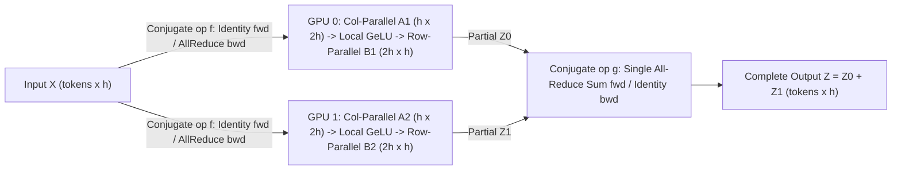
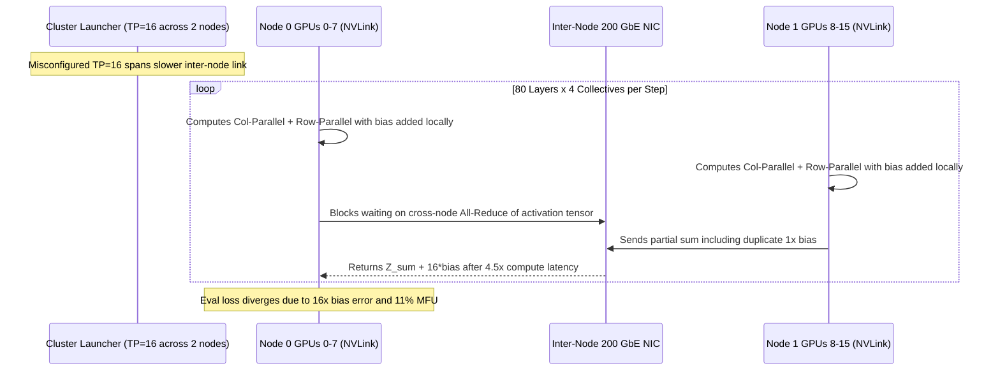

# Module 10: Model and Tensor Parallelism

> **Prerequisites:** [Module 05: Calculating a Model's Memory Requirements](../05-calculating-a-models-memory-requirements/README.md), [Module 04: VRAM: The Real Constraint](../04-vram-the-real-constraint/README.md), [Module 09: Data Parallelism](../09-data-parallelism/README.md), [Module 08: Multi-Head Attention](../../02-transformer-architecture/08-multi-head-attention/README.md), and [Module 12: The Feed-Forward Network](../../02-transformer-architecture/12-the-feed-forward-network/README.md)  
> **Estimated Reading Time:** 35 minutes  
> **Target Audience:** Large-Scale ML Engineers, Distributed Systems Architects, LLM Infrastructure Engineers

> [!TIP]
> **The Golden Rule of Tensor Parallelism**  
> Split each Transformer MLP **column-parallel first ($h \to 4h$), execute GeLU locally, then row-parallel second ($4h \to h$)** so each block pays only **one** forward activation All-Reduce (moving $\text{tokens} \times h$ instead of $4h$), and **strictly confine Tensor Parallel groups inside a single NVLink/NVSwitch node**—never across slower inter-node PCIe or Ethernet links.

---

## Why This Matters

You are in **Track 05: GPUs & GenAI Hardware**. [Module 09](../09-data-parallelism/README.md) replicated the entire model on every GPU, which stops working the moment one copy's training states exceed a single card's VRAM. Models with billions of parameters cannot fit on one GPU; Tensor Parallelism splits the matrix multiplications *inside every layer* across GPUs, and is the core architectural reason high-end AI servers integrate ultra-high-bandwidth NVLink/NVSwitch fabrics.

**After this module you can:**
- Calculate when mixed-precision training states exceed single-GPU VRAM and explain why naive layer-wise splitting wastes up to $(G-1)/G$ of GPU time.
- Shard linear layers by **columns** vs. **rows** and state which requires an all-reduce synchronization.
- Lay out Megatron-style MLP and Multi-Head Attention blocks using exactly one forward and one backward all-reduce per block, and verify numerical equivalence against the unsplit reference.
- Justify confining Tensor Parallelism inside a single NVLink node using hardware bandwidth ratios.

---

## 1. Visual Mental Models & Sharded Layer Architecture

### When the Model Does Not Fit on One GPU

Mixed-precision training with Adam keeps **16 bytes per parameter** of model state (per the [ZeRO paper](https://arxiv.org/abs/1910.02054), section 3.1, revisited in Module 11): $2\text{ bytes}$ FP16/BF16 weights + $2\text{ bytes}$ gradients + $12\text{ bytes}$ optimizer state (FP32 master weights, Adam momentum, Adam variance). Activations, temporary buffers, and memory fragmentation come on top:

```text
model states = 16 bytes/parameter; one GPU has 80 GB

  params   model states  fits on 1 GPU?   min GPUs (states only)
    1.3B          21 GB            True                        1
      7B         112 GB           False                        2
     13B         208 GB           False                        3
     70B       1,120 GB           False                       14

(activations, buffers and fragmentation come on top of this, so the real minimum is higher)
```

Even a 7B model's states alone ($112\,\text{GB}$) exceed an 80 GB A100 card, making model-sharding mandatory.

### Naive Layer-Wise Model Parallelism (The Bubble Problem)

The simplest split puts layers `0–7` on GPU 0, `8–15` on GPU 1, and so on. Memory fits, but one batch cascades serially across GPUs so only one GPU works at any instant ($1/G$ utilization: $25\%$ on 4 GPUs, $6.2\%$ on 16 GPUs):

```text
4 GPUs, one batch (F = forward, B = backward, . = idle):
  GPU 0: F.........BB
  GPU 1: .F......BB..
  GPU 2: ..F...BB....
  GPU 3: ...FBB......

 GPUs  busy ticks / GPU  total ticks  utilization
    1                 3            3      100.0%
    2                 3            6       50.0%
    4                 3           12       25.0%
    8                 3           24       12.5%
   16                 3           48        6.2%
```

Streaming micro-batches fixes much of that idling (Pipeline Parallelism in Module 11); Tensor Parallelism fixes it differently by keeping *all* GPUs active inside *every* layer simultaneously.

### Column-Parallel vs. Row-Parallel Linear Layers

For a linear projection $Y = XA$, there are two ways to shard weight matrix $A$ across $t$ GPUs:

- **Column-Parallel:** Split $A$ vertically by columns: $A = [A_1 \mid A_2 \mid \dots \mid A_t]$. Every GPU receives full input $X$, computes $Y_i = X A_i$, and holds a disjoint slice of output columns. Concatenating $[Y_1 \mid Y_2 \mid \dots]$ reconstructs $Y$. **No summation is needed.**
- **Row-Parallel:** Split $A$ horizontally by rows and split input $X$ along its matching column axis: $Y = X_1 A_1 + X_2 A_2 + \dots + X_t A_t$. Each GPU produces a full-shape but *incomplete partial sum*. **An All-Reduce sum is mandatory.**

### The Megatron-LM MLP & Attention Block

A Transformer MLP computes $Z = \text{GeLU}(X A) B$ with $A \in \mathbb{R}^{h \times 4h}$ and $B \in \mathbb{R}^{4h \times h}$. The [Megatron-LM](https://arxiv.org/abs/1909.08053) layout pairs column-parallel then row-parallel:

1. **Column-parallel $A$:** Each GPU computes $X A_i$ and applies elementwise $\text{GeLU}(X A_i)$ locally with **zero communication**.
2. **Row-parallel $B$:** Each GPU's $\text{GeLU}$ output slice already matches its row slice $B_i$, producing partial output $Z_i$.
3. **Single All-Reduce:** One `all_reduce` sums $Z = \sum_i Z_i$.



```text
MEGATRON MLP ON 2 GPUs:   Z = GeLU(X A) B      A (h x 4h) split by COLUMNS,  B (4h x h) split by ROWS

                 column-parallel        local        row-parallel
                 (slices, no sum)       GeLU         (partial sums)
  GPU 0:  X ──►  [ A1  h x 2h ]  ──►  GeLU  ──►  [ B1  2h x h ]  ──►  Z0 ──┐
                                                                            ├─► all-reduce ─► Z = Z0 + Z1
  GPU 1:  X ──►  [ A2  h x 2h ]  ──►  GeLU  ──►  [ B2  2h x h ]  ──►  Z1 ──┘

  every GPU gets the same X; nothing is communicated between the two matmuls;
  forward cost: ONE all-reduce of a (tokens x h) tensor
```

> [!WARNING]
> **Order Is NOT Interchangeable**  
> GeLU is nonlinear: $\text{GeLU}(X_1 A_1 + X_2 A_2) \ne \text{GeLU}(X_1 A_1) + \text{GeLU}(X_2 A_2)$. Splitting $A$ by rows first forces an all-reduce *before* GeLU on the $4h$-wide hidden tensor—$4\times$ larger than the $h$-wide output tensor of Megatron's layout (Step 3 measures a `1.231` error if you skip the pre-GeLU sum, and `768` vs `192` communicated elements).

In backpropagation, Megatron defines two conjugate autograd operators: `f` (identity forward, all-reduce backward) before the column-parallel layer, and `g` (all-reduce forward, identity backward) after the row-parallel layer.

**Attention Head Sharding:** Multi-head attention heads operate independently until the output projection. Column-sharding $W_Q, W_K, W_V$ assigns $H / t$ complete heads per GPU with zero cross-GPU communication during $QK^T$ and $PV$, followed by row-sharding $W_O$ ending in **one** all-reduce. Thus, a full Transformer layer performs **2 forward all-reduces** and **2 backward all-reduces** (4 per training step), requiring both `num_heads` and `4h` to be divisible by $t$.

### Communication Cost & Why TP Stays Inside One Server

Unlike Data Parallelism (which communicates gradients once per step in overlapped buckets), Tensor Parallelism communicates **activations inside every layer directly on the critical path**—the next operation cannot begin until the all-reduce finishes. From NVIDIA's [A100 datasheet](https://www.nvidia.com/content/dam/en-zz/Solutions/Data-Center/a100/pdf/nvidia-a100-datasheet-us-nvidia-1758950-r4-web.pdf), NVLink provides $600\text{ GB/s}$ vs. PCIe Gen4's $64\text{ GB/s}$ ($9.4\times$ gap).

```text
WHERE TENSOR PARALLELISM BELONGS

  ┌───────────── server A ─────────────┐                  ┌───────────── server B ─────────────┐
  │ GPU0 ═ GPU1 ═ GPU2 ... GPU7        │                  │ GPU0 ═ GPU1 ═ GPU2 ... GPU7        │
  │ NVLink / NVSwitch (fast)           │ ══ network ══    │ NVLink / NVSwitch (fast)           │
  │ tensor-parallel group of 8         │  (much slower)   │ tensor-parallel group of 8         │
  └────────────────────────────────────┘                  └────────────────────────────────────┘
   tensor parallelism INSIDE a server;   data parallelism (same weights) ACROSS servers
   A100 datasheet: NVLink 600 GB/s vs PCIe Gen4 64 GB/s (about 9.4x apart)
```

> [!WARNING]
> **Never Span Tensor Parallelism Across Slow Server Links**  
> Step 5 models an 8-way TP group: on PCIe Gen4 ($64\text{ GB/s}$), communication consumes **$128\%$ of compute time** (spending more time talking than computing!), whereas on NVLink ($600\text{ GB/s}$) it consumes only **$14\%$**. In practice: **Tensor Parallelism inside a node (NVLink/NVSwitch), Pipeline/Data Parallelism across nodes (InfiniBand/RoCE)**—the exact 3D hybrid architecture Megatron-LM used to reach $76\%$ scaling efficiency across 512 GPUs (8.3B model).

> [!NOTE]
> **Cooks at One Counter Mental Model**  
> Imagine $t$ cooks splitting one gigantic recipe step. They chop simultaneously, then must pour their bowls together before anyone can start the next step. If they share one kitchen counter (NVLink), combining takes milliseconds; if they work in separate buildings across town (PCIe or Ethernet), courier transit dwarfs cooking time.

---

## 2. Systematic Parallelism & Interconnect Comparison Matrix

### Model-Splitting Strategies

| Dimension | Data Parallelism (DDP) | Naive Layer-Wise Model Parallelism | Tensor Parallelism (Megatron TP) |
| :--- | :--- | :--- | :--- |
| **What Is Sharded** | Batch samples across GPUs | Consecutive layers across GPUs | Individual weight matrices inside every layer |
| **Per-GPU Model State Memory** | $16\Psi$ (full replica; no savings) | $16\Psi / G$ | $\approx 16\Psi / t$ for sharded weights/states |
| **Hardware Utilization (1 batch)** | $\sim 100\%$ compute overlap | $1/G$ ($25\%$ at $G=4$, $6.2\%$ at $G=16$) | $\sim 100\%$ all GPUs work together on every layer |
| **Communication Frequency** | 1 gradient all-reduce per step | Point-to-point activation send at stage cuts | **4 activation all-reduces per layer per step** |
| **Critical-Path Sensitivity** | Low (overlapped via 25 MB buckets) | High unless micro-batched (Pipeline) | **Extreme** (blocks layer progression) |
| **Required Interconnect** | Ethernet / InfiniBand / NVLink | Ethernet / InfiniBand | **NVLink / NVSwitch strictly intra-node** |

### Per-Layer TP Communication Overhead (`batch=4, seq=2048, hidden=4096`, 64 MiB activation tensor)

| TP Degree ($t$) | Compute / GPU | NVLink ($600\text{ GB/s}$) Comm | NVLink Comm / Compute | PCIe Gen4 ($64\text{ GB/s}$) Comm | PCIe4 Comm / Compute |
| :--- | :--- | :--- | :--- | :--- | :--- |
| **2** | $11.45\text{ ms}$ | $0.22\text{ ms}$ | **$2\%$** | $2.10\text{ ms}$ | $18\%$ |
| **4** | $5.73\text{ ms}$ | $0.34\text{ ms}$ | **$6\%$** | $3.15\text{ ms}$ | $55\%$ |
| **8** | $2.86\text{ ms}$ | $0.39\text{ ms}$ | **$14\%$** | $3.67\text{ ms}$ | **$128\%$ (comm > compute)** |

---

## 3. Verified Python Sharding & Bandwidth Experiments

All scripts run with Python 3.13 + NumPy 2.4.6 on CPU (`sum` stands in for NCCL `all_reduce`).

### Step 1: Model-State Capacity Check (`s0_does_it_fit.py`)

```python
import math

# Mixed-precision training with Adam keeps, per parameter (ZeRO paper, section 3.1):
#   2 bytes fp16/bf16 weights + 2 bytes gradients + 12 bytes optimizer state (fp32 weights, momentum, variance)
BYTES_PER_PARAM = 2 + 2 + 12
GPU_MEMORY_GB = 80            # A100 80GB, per NVIDIA's datasheet

print(f"model states = {BYTES_PER_PARAM} bytes/parameter; one GPU has {GPU_MEMORY_GB} GB\n")
print(f"{'params':>8} {'model states':>14} {'fits on 1 GPU?':>15} {'min GPUs (states only)':>24}")
for billions in (1.3, 7, 13, 70):
    gb = billions * 1e9 * BYTES_PER_PARAM / 1e9
    print(f"{billions:>7}B {gb:>11,.0f} GB {str(gb <= GPU_MEMORY_GB):>15} {math.ceil(gb / GPU_MEMORY_GB):>24}")
print("\n(activations, buffers and fragmentation come on top of this, so the real minimum is higher)")
```

### Step 2: Naive Layer-Wise Idling Simulation (`s3_naive_layerwise.py`)

```python
# Naive layer-wise model parallelism: GPU g owns layers g*L/G .. (g+1)*L/G - 1, one batch flows
# through GPU 0 -> 1 -> ... -> G-1 (forward), then the gradients flow back G-1 -> ... -> 0.
# Time unit: one forward pass through one GPU's layers = 1 tick; its backward = 2 ticks.
T_F, T_B = 1, 2


def timeline(G):
    width = G * T_F + G * T_B
    grid = [["."] * width for _ in range(G)]
    for g in range(G):                                  # forward ripples down the GPUs
        for t in range(g * T_F, (g + 1) * T_F):
            grid[g][t] = "F"
    start = G * T_F                                     # backward starts after the last forward
    for g in reversed(range(G)):                        # ... and ripples back up
        for t in range(start, start + T_B):
            grid[g][t] = "B"
        start += T_B
    return grid


print("4 GPUs, one batch (F = forward, B = backward, . = idle):")
for g, row in enumerate(timeline(4)):
    print(f"  GPU {g}: {''.join(row)}")

print(f"\n{'GPUs':>5} {'busy ticks / GPU':>17} {'total ticks':>12} {'utilization':>12}")
for G in (1, 2, 4, 8, 16):
    grid = timeline(G)
    busy = sum(c != "." for c in grid[0])
    total = len(grid[0])
    print(f"{G:>5} {busy:>17} {total:>12} {busy / total:>11.1%}")
```

### Step 3: Column-Parallel, Row-Parallel & Megatron MLP Verification (`s1_column_row_parallel.py`)

```python
import numpy as np

rng = np.random.default_rng(0)


def gelu(x):                                    # tanh approximation used by GPT-2 / Megatron
    return 0.5 * x * (1 + np.tanh(np.sqrt(2 / np.pi) * (x + 0.044715 * x ** 3)))


def all_reduce_sum(partials):                   # what NCCL would do across GPUs: sum, give everyone the result
    return sum(partials)


batch, h, k = 6, 32, 128                        # hidden size h, MLP inner size k = 4h
X = rng.standard_normal((batch, h))
A = rng.standard_normal((h, k)) / np.sqrt(h)    # first MLP weight  (h x 4h)
B = rng.standard_normal((k, h)) / np.sqrt(k)    # second MLP weight (4h x h)

# 1) Column-parallel: split A by COLUMNS. Each "GPU" computes its slice of the output; no summing.
t = 4
A_cols = np.split(A, t, axis=1)
Y_parts = [X @ A_i for A_i in A_cols]                              # each (batch, k/t)
print("column-parallel, concat == X@A :", np.allclose(np.concatenate(Y_parts, axis=1), X @ A))

# 2) Row-parallel: split B by ROWS and the input by columns. Each GPU produces a PARTIAL SUM.
B_rows = np.split(B, t, axis=0)
Y = X @ A
Y_cols = np.split(Y, t, axis=1)
Z_parts = [Y_i @ B_i for Y_i, B_i in zip(Y_cols, B_rows)]          # each (batch, h), incomplete
print("row-parallel, sum == Y@B       :", np.allclose(all_reduce_sum(Z_parts), Y @ B))
print("one partial alone is wrong     :", not np.allclose(Z_parts[0], Y @ B))

# 3) Megatron MLP: column-parallel -> GeLU (local) -> row-parallel -> ONE all-reduce.
full = gelu(X @ A) @ B
print("\nMLP  t  max |sharded - full|")
for t in (1, 2, 4, 8, 16):
    A_cols, B_rows = np.split(A, t, axis=1), np.split(B, t, axis=0)
    partials = [gelu(X @ A_i) @ B_i for A_i, B_i in zip(A_cols, B_rows)]   # runs independently per GPU
    out = all_reduce_sum(partials)                                          # the single communication
    print(f"     {t:>2}  {np.abs(out - full).max():.2e}")
    assert np.allclose(out, full)

# 4) Why column FIRST: GeLU is nonlinear, so you cannot apply it to partial sums.
t = 2
X_cols, A_rows = np.split(X, t, axis=1), np.split(A, t, axis=0)             # row-parallel first matmul
wrong = sum(gelu(X_i @ A_i) for X_i, A_i in zip(X_cols, A_rows))            # GeLU on each partial sum
print("\nGeLU(X1A1) + GeLU(X2A2) vs GeLU(X1A1 + X2A2): max diff =", f"{np.abs(wrong - gelu(X @ A)).max():.3f}")

# 5) How much data the single all-reduce moves, vs the alternative that must sum BEFORE GeLU.
print(f"all-reduce after the row-parallel layer: {batch * h} numbers (batch x h)")
print(f"all-reduce before GeLU instead         : {batch * k} numbers (batch x 4h) -> {k // h}x more")
```

**Verified Output:**
```text
column-parallel, concat == X@A : True
row-parallel, sum == Y@B       : True
one partial alone is wrong     : True

MLP  t  max |sharded - full|
      1  0.00e+00
      2  6.66e-16
      4  8.88e-16
      8  6.66e-16
     16  8.88e-16

GeLU(X1A1) + GeLU(X2A2) vs GeLU(X1A1 + X2A2): max diff = 1.231
all-reduce after the row-parallel layer: 192 numbers (batch x h)
all-reduce before GeLU instead         : 768 numbers (batch x 4h) -> 4x more
```

> [!NOTE]
> The `1e-16`-level residuals reflect `float64` addition-order rounding, so always assert with `np.allclose`. Notice `one partial alone is wrong: True`—the all-reduce is an integral part of the linear layer output, and placing it after the row-parallel projection moves `4x` fewer elements (`192` vs `768`).

### Step 4: Causal Multi-Head Attention Sharded Across Heads

```python
import numpy as np

rng = np.random.default_rng(1)
n_heads, d_head, seq = 8, 8, 10
d_model = n_heads * d_head
X = rng.standard_normal((seq, d_model))
Wq, Wk, Wv, Wo = (rng.standard_normal((d_model, d_model)) / np.sqrt(d_model) for _ in range(4))
causal = np.triu(np.full((seq, seq), -np.inf), k=1)


def attention_heads(X, Wq, Wk, Wv, heads):
    """Causal attention for `heads` heads whose weights are the given column slices; returns (seq, heads*d_head)."""
    outs = []
    for hd in range(heads):
        sl = slice(hd * d_head, (hd + 1) * d_head)
        q, k, v = X @ Wq[:, sl], X @ Wk[:, sl], X @ Wv[:, sl]
        s = q @ k.T / np.sqrt(d_head) + causal
        p = np.exp(s - s.max(-1, keepdims=True))
        p /= p.sum(-1, keepdims=True)
        outs.append(p @ v)
    return np.concatenate(outs, axis=1)


full = attention_heads(X, Wq, Wk, Wv, n_heads) @ Wo                   # all heads on one GPU

print("GPUs  heads/GPU  max |tensor-parallel - full|")
for t in (1, 2, 4, 8):
    hp = n_heads // t                                                  # heads per GPU
    partials = []
    for g in range(t):                                                 # each loop pass = one GPU
        cols = slice(g * hp * d_head, (g + 1) * hp * d_head)
        local = attention_heads(X, Wq[:, cols], Wk[:, cols], Wv[:, cols], hp)   # column-parallel Q,K,V
        partials.append(local @ Wo[cols, :])                           # row-parallel output projection
    out = sum(partials)                                                # the one all-reduce
    print(f"{t:>4} {hp:>10}  {np.abs(out - full).max():.2e}")
    assert np.allclose(out, full)
```

**Verified Output:**
```text
GPUs  heads/GPU  max |tensor-parallel - full|
   1          8  0.00e+00
   2          4  8.88e-16
   4          2  8.88e-16
   8          1  8.88e-16
```

### Step 5: Communication vs. Compute per Layer (`s4_tp_communication_cost.py`)

```python
# How much does tensor parallelism communicate, and how long does that take on each link?
# All sizes are ASSUMED illustrative values; hardware figures come from NVIDIA's A100 datasheet.
batch, seq, hidden = 4, 2048, 4096          # tokens per step = batch * seq
BYTES = 2                                   # bf16 activations
PEAK_FLOPS = 312e12                         # A100 BF16 dense peak (datasheet)
ACHIEVED = 0.5 * PEAK_FLOPS                 # assume the matmuls reach 50% of peak
LINKS = {"NVLink 600 GB/s": 600e9, "PCIe4 64 GB/s": 64e9}

tokens = batch * seq
msg_bytes = tokens * hidden * BYTES                              # one activation tensor: (tokens, hidden)
# Forward FLOPs of one transformer layer, counted from the matmul shapes:
#   QKV 3h^2 + out-proj h^2 + MLP 8h^2 = 12 h^2 weights, 2 FLOPs per weight per token,
#   plus attention scores/values 4 * batch * seq^2 * hidden.
layer_flops = 2 * tokens * 12 * hidden ** 2 + 4 * batch * seq ** 2 * hidden
print(f"activation tensor to all-reduce: {msg_bytes / 2**20:.0f} MiB;  layer forward = {layer_flops / 1e12:.2f} TFLOP")

print("\nForward pass of ONE layer: 2 all-reduces (attention output, MLP output), per Megatron-LM")
print(f"{'t':>3} {'compute/GPU':>12} " + " ".join(f"{name + ' comm':>22} {'comm/compute':>13}" for name in LINKS))
for t in (2, 4, 8):
    compute = layer_flops / t / ACHIEVED
    volume = 2 * (t - 1) / t * msg_bytes * 2                      # ring volume per GPU, two all-reduces
    cells = []
    for bw in LINKS.values():
        comm = volume / bw
        cells.append(f"{comm * 1000:>19.2f} ms {comm / compute:>12.0%}")
    print(f"{t:>3} {compute * 1000:>9.2f} ms " + " ".join(cells))
print(f"\nbandwidth ratio NVLink / PCIe = {600 / 64:.1f}x")
```

**Verified Output:**
```text
activation tensor to all-reduce: 64 MiB;  layer forward = 3.57 TFLOP

Forward pass of ONE layer: 2 all-reduces (attention output, MLP output), per Megatron-LM
  t  compute/GPU   NVLink 600 GB/s comm  comm/compute     PCIe4 64 GB/s comm  comm/compute
  2     11.45 ms                0.22 ms           2%                2.10 ms          18%
  4      5.73 ms                0.34 ms           6%                3.15 ms          55%
  8      2.86 ms                0.39 ms          14%                3.67 ms         128%

bandwidth ratio NVLink / PCIe = 9.4x
```

### Step 6: Conjugate `F` and `G` Operators in PyTorch (Multi-GPU CUDA Skeleton, Not Executed Above)

```python
import torch
import torch.distributed as dist

class F(torch.autograd.Function):          # Megatron "f": identity forward, all-reduce backward
    @staticmethod
    def forward(ctx, x):
        return x
    @staticmethod
    def backward(ctx, grad):
        dist.all_reduce(grad)               # sum the gradients of X coming from every shard
        return grad

class G(torch.autograd.Function):          # Megatron "g": all-reduce forward, identity backward
    @staticmethod
    def forward(ctx, x):
        dist.all_reduce(x)                  # sum the partial outputs of the row-parallel layer
        return x
    @staticmethod
    def backward(ctx, grad):
        return grad
```

---

## 4. Production War Story Post-Mortem: Cross-Node `TP=16` Throughput Collapse & Row-Parallel Bias Drift

| Field | Incident Details |
| :--- | :--- |
| **Severity** | **SEV-1** (16-GPU Multi-Node 70B Fine-Tuning Run Crawled at $11\%$ MFU + Corrupted Checkpoints) |
| **Detection / Resolution Time** | Detected in 22 minutes via Nsight Systems NCCL trace and diverging eval perplexity / Resolved in 55 minutes |
| **Impact** | Extending Tensor Parallelism across two 8-GPU servers made network All-Reduces take $4.5\times$ longer than compute; custom `RowParallelLinear` added bias before `all_reduce`, silently multiplying bias by `16x` |

### What Happened

An engineer provisioned two 8-GPU A100 nodes connected over 200 GbE RoCE ($25\text{ GB/s}$) to fine-tune an 80-layer 70B model. Rather than setting `TP=8` inside each NVSwitch server and `PP=2` across servers, they launched `tensor_parallel_size=16`, stretching every layer's critical-path `dist.all_reduce` across the inter-node NICs. Across 80 layers $\times$ 4 all-reduces per step ($320$ blocking cross-node collectives per step), training stalled at $11\%$ MFU.

Simultaneously, validation loss exploded because a newly refactored `RowParallelLinear` class added its `bias` parameter *inside* `F.linear(x_shard, w_row, self.bias)` on all 16 ranks before calling `G.apply(partial)`. The subsequent `all_reduce` summed `self.bias` 16 times (`out = sum(partials) + 16 * bias`), poisoning layer outputs on every residual block.



### Root Cause Analysis

1. **Tensor Parallelism spanned inter-node fabric:** Each layer executes 4 blocking activation all-reduces on the critical path; pushing TP past one server's NVLink boundary turns every single layer into a cross-node network bottleneck.
2. **Row-parallel bias added before `all_reduce`:** Only the linear matmul distributes linearly over sums ($X_1 W_1 + X_2 W_2$). An unsharded output bias $b$ must be added **once after** the `all_reduce` (or on rank 0 only before reducing), never inside every rank's partial sum.

### The Fix & Architectural Hardening

- Reconfigured topology to **`TP=8` intra-node (NVSwitch) + `PP=2` inter-node** (covered in Module 11), eliminating inter-node all-reduces on the layer critical path and restoring MFU to $49\%$.
- Fixed `RowParallelLinear` to pass `bias=None` to `F.linear`, call `G.apply(partial)` first, and add `self.bias` strictly **after** `all_reduce`.
- Added unit tests comparing `MegatronMLP` (`bias=True`) across `t in [1, 2, 4, 8]` against an unsharded `nn.Linear` reference with `torch.allclose`.

---

## 5. Multi-Language Production Implementation: TP Topology Validation & Megatron Sharding

````carousel
```go
package tensorparallel

import (
	"errors"
	"fmt"
)

type TopologySpec struct {
	TPDegree          int
	GPUsPerNVLinkNode int
	NumHeads          int
	MLPInnerDim       int
	HiddenDim         int
	BatchTokens       int
}

// ValidateAndPrice checks structural divisibility and enforces intra-node NVLink placement.
func ValidateAndPrice(spec TopologySpec, nvlinkBWBytes, pcieBWBytes float64) (string, error) {
	if spec.TPDegree > spec.GPUsPerNVLinkNode {
		return "", fmt.Errorf("TP=%d exceeds NVLink node size (%d): cross-node TP stalls on slow fabric",
			spec.TPDegree, spec.GPUsPerNVLinkNode)
	}
	if spec.NumHeads%spec.TPDegree != 0 {
		return "", errors.New("num_heads must be divisible by TP degree")
	}
	if spec.MLPInnerDim%spec.TPDegree != 0 {
		return "", errors.New("MLP inner dimension (4h) must be divisible by TP degree")
	}

	actBytes := float64(spec.BatchTokens * spec.HiddenDim * 2) // BF16
	// 2 forward all-reduces per transformer layer (Attention out + MLP out)
	ringVol := 2.0 * float64(spec.TPDegree-1) / float64(spec.TPDegree) * actBytes * 2.0
	return fmt.Sprintf("Valid intra-node TP=%d: layer fwd ring volume=%.2f MiB (NVLink=%.3f ms, PCIe4=%.3f ms)",
		spec.TPDegree, ringVol/(1024*1024), (ringVol/nvlinkBWBytes)*1000, (ringVol/pcieBWBytes)*1000), nil
}
```
<!-- slide -->
```typescript
export interface ModelStateEstimate {
  paramsBillions: number;
  totalStateGB: number;
  perGpuStateGB: number;
  fits80GBWithMargin: boolean;
}

export class TensorParallelPlanner {
  // Mixed-precision Adam: 2B weights + 2B grads + 12B optimizer state = 16 bytes/param
  private static readonly BYTES_PER_PARAM = 16;

  public static estimateModelState(paramsBillions: number, tpDegree: number): ModelStateEstimate {
    const totalStateGB = (paramsBillions * 1e9 * this.BYTES_PER_PARAM) / 1e9;
    const perGpuStateGB = totalStateGB / tpDegree;
    return {
      paramsBillions,
      totalStateGB: Number(totalStateGB.toFixed(1)),
      perGpuStateGB: Number(perGpuStateGB.toFixed(1)),
      fits80GBWithMargin: perGpuStateGB <= 60.0, // leaves 20 GB headroom for activations/KV buffers
    };
  }

  public static legalTPDegrees(numHeads: number, mlpWidth: number, gpusPerNode = 8): number[] {
    const valid: number[] = [];
    for (let t = 1; t <= gpusPerNode; t++) {
      if (numHeads % t === 0 && mlpWidth % t === 0) {
        valid.push(t);
      }
    }
    return valid;
  }
}
```
<!-- slide -->
```python
"""Megatron-LM style ColumnParallelLinear, RowParallelLinear, and MLP in PyTorch."""

import torch
import torch.nn as nn
import torch.nn.functional as F
import torch.distributed as dist


class _CopyToModelParallelRegion(torch.autograd.Function):
    """Conjugate operator f: identity forward, all-reduce backward."""
    @staticmethod
    def forward(ctx, x: torch.Tensor) -> torch.Tensor:
        return x

    @staticmethod
    def backward(ctx, grad_output: torch.Tensor) -> torch.Tensor:
        dist.all_reduce(grad_output)
        return grad_output


class _ReduceFromModelParallelRegion(torch.autograd.Function):
    """Conjugate operator g: all-reduce forward, identity backward."""
    @staticmethod
    def forward(ctx, x: torch.Tensor) -> torch.Tensor:
        dist.all_reduce(x)
        return x

    @staticmethod
    def backward(ctx, grad_output: torch.Tensor) -> torch.Tensor:
        return grad_output


class ColumnParallelLinear(nn.Module):
    def __init__(self, in_features: int, out_features: int, tp_size: int):
        super().__init__()
        assert out_features % tp_size == 0
        self.weight = nn.Parameter(torch.empty(out_features // tp_size, in_features))
        self.bias = nn.Parameter(torch.zeros(out_features // tp_size))

    def forward(self, x: torch.Tensor) -> torch.Tensor:
        x_parallel = _CopyToModelParallelRegion.apply(x)
        return F.linear(x_parallel, self.weight, self.bias)


class RowParallelLinear(nn.Module):
    def __init__(self, in_features: int, out_features: int, tp_size: int):
        super().__init__()
        assert in_features % tp_size == 0
        self.weight = nn.Parameter(torch.empty(out_features, in_features // tp_size))
        self.bias = nn.Parameter(torch.zeros(out_features))

    def forward(self, x_shard: torch.Tensor) -> torch.Tensor:
        # CRITICAL: pass bias=None into F.linear, reduce partials first, THEN add bias once
        partial = F.linear(x_shard, self.weight, bias=None)
        reduced = _ReduceFromModelParallelRegion.apply(partial)
        return reduced + self.bias
```
<!-- slide -->
```csharp
using System;

namespace DistributedModels;

public static class TensorParallelVerifier
{
    /// <summary>
    /// Demonstrates why row-parallel bias must be added AFTER all-reduce,
    /// measuring the exact (tp - 1) * bias drift when added prematurely on every rank.
    /// </summary>
    public static (double[] CorrectOut, double[] BrokenOut, double MaxBiasDrift) VerifyBiasRule(
        double[] partialPerRankSum,
        double[] bias,
        int tpDegree)
    {
        int h = bias.Length;
        var correct = new double[h];
        var broken = new double[h];

        // Broken: each rank adds bias BEFORE all-reduce -> summed tpDegree times
        for (int i = 0; i < h; i++)
        {
            broken[i] = partialPerRankSum[i] + tpDegree * bias[i];
            // Correct: all-reduce partials first, then add bias exactly once
            correct[i] = partialPerRankSum[i] + bias[i];
        }

        double maxDiff = 0.0;
        for (int i = 0; i < h; i++)
        {
            maxDiff = Math.Max(maxDiff, Math.Abs(broken[i] - correct[i]));
        }
        return (correct, broken, maxDiff);
    }
}
```
````

---

## 6. Practical Hands-On Verification CLI Workflows

### Verification 1: Bias-After-AllReduce & Hidden-Dim Layer Pricing (CLI)

Run this CLI check to verify the row-parallel bias trap and reproduce the hidden=8192, t=4 NVLink vs. PCIe cost model:

```bash
python -c "
import numpy as np
rng = np.random.default_rng(0)
X, A, B = rng.standard_normal((4, 16)), rng.standard_normal((16, 64)), rng.standard_normal((64, 16))
bA, bB = rng.standard_normal(64), rng.standard_normal(16)
ref = np.tanh(X @ A + bA) @ B + bB
t = 4
partials_wrong = [np.tanh(X @ Ai + bAi) @ Bi + bB for Ai, bAi, Bi in zip(np.split(A, t, 1), np.split(bA, t), np.split(B, t, 0))]
partials_ok    = [np.tanh(X @ Ai + bAi) @ Bi      for Ai, bAi, Bi in zip(np.split(A, t, 1), np.split(bA, t), np.split(B, t, 0))]
print('wrong (bias before reduce) diff :', round(np.abs(sum(partials_wrong) - ref).max(), 4), 'expected (t-1)*max|bB|:', round((t-1)*np.abs(bB).max(), 4))
print('right (bias after reduce)  diff :', f'{np.abs(sum(partials_ok) + bB - ref).max():.2e}')

tokens, hidden, t = 2048, 8192, 4
act_bytes = tokens * hidden * 2
ring_bytes = 2 * (t - 1) / t * act_bytes * 2
print(f'hidden=8192, t=4: tensor={act_bytes/2**20:.0f} MiB, 2x ring vol={ring_bytes/1e6:.1f} MB, NVLink={ring_bytes/600e9*1000:.2f}ms, PCIe4={ring_bytes/64e9*1000:.2f}ms')
"
```

**Expected Output:**
```text
wrong (bias before reduce) diff : 6.8093 expected (t-1)*max|bB|: 6.8093
right (bias after reduce)  diff : 8.88e-16
hidden=8192, t=4: tensor=32 MiB, 2x ring vol=100.7 MB, NVLink=0.17ms, PCIe4=1.57ms
```

### Hands-On Practice Exercises

#### 1. Which tensor-parallel degrees are legal?
In `s1_column_row_parallel.py` the inner width is `128`. Try `t = 3`. What happens, and which values of $t$ work for an MLP with $h = 32$ and a $4h = 128$ inner width?

<details><summary>Answer</summary>

`np.split` raises `ValueError: array split does not result in an equal division`: 128 columns cannot be cut into 3 equal slices. Equal slices need $t$ to divide `128`, so $t \in \{1, 2, 4, 8, 16, 32, 64, 128\}$. Real implementations also need the number of attention heads to be divisible by $t$, so the usable degrees are the common divisors of both; in practice $t$ is a small power of two, bounded by the GPUs in one server.

</details>

#### 2. Where does the bias go?
Add bias vectors to the Megatron MLP: `Z = GeLU(X A + bA) B + bB`. Shard `bA` with the columns of `A`. Try adding `bB` on every GPU before the all-reduce, then try adding it once after. What goes wrong with the first?

<details><summary>Answer</summary>

`bA` splits with the columns of `A` (each GPU's slice of the pre-activation gets its slice of the bias), but `bB` belongs to the *summed* output. Adding it on every GPU before the all-reduce counts it $t$ times: with $t = 2$ and $t = 4$ the measured output is off by **exactly `(t - 1) x bB`** (to `1e-15`). Adding `bB` once after the all-reduce (or on one GPU only) matches the unsplit result to `1e-15`.

</details>

#### 3. Price a layer on your own shapes
Change the assumptions in `s4_tp_communication_cost.py` to `hidden = 8192`, `batch x seq = 2048` tokens (set `batch = 1, seq = 2048`). For $t = 4$, what is the activation tensor, the ring volume per GPU for the two forward all-reduces of one layer, and the time on NVLink versus PCIe?

<details><summary>Answer</summary>

Activation tensor: `2048 x 8192 x 2 bytes = 32 MiB (33.55 MB)`. Each ring all-reduce moves `2(t-1)/t = 1.5` times that per GPU, and there are two per forward layer: `2 x 1.5 x 33.55 MB = 100.7 MB`. At `600 GB/s` that is about **`0.17 ms`**; at `64 GB/s` about **`1.57 ms`**. The script prints the layer's compute time next to it: `5.51 ms` per GPU at $t = 4$, so communication is **`3%`** of compute on NVLink and **`29%`** on PCIe.

</details>

### Independent Project: Tensor-Parallel Transformer Block Simulator

Simulate a **tensor-parallel transformer block** in NumPy, with no starting code. One block = layer norm, multi-head causal attention, residual, layer norm, MLP, residual, with weights initialized randomly.

Deliver:
1. An unsplit reference block and a version where the weights are sharded across $t$ simulated GPUs (heads split, MLP column-then-row) and every cross-GPU sum is an explicit all-reduce function.
2. A check that the outputs agree to float tolerance for $t = 1, 2, 4, 8$, and a count of how many all-reduce calls and how many bytes each GPU moves per forward pass (confirm it matches 2 per block).
3. A deliberately broken variant (for example, GeLU on partial sums, or the output-projection bias added on every shard) with the measured error.
4. A short cost model showing, for your block's shapes, at what $t$ the communication time on a `64 GB/s` link exceeds the compute time but not on a `600 GB/s` link, with all assumptions written down.

---

## 7. Common Mistakes & Troubleshooting

- **Applying the activation to partial sums.** Symptom: outputs differ from the single-GPU model by $\mathcal{O}(1)$ (`1.23` in Step 3) even though every shape matches. The nonlinearity must run on complete values: column-parallel first matrix, or all-reduce before it.
- **Bias added once per GPU.** Symptom: output off by exactly `(t - 1) x bias` (Practice Exercise 2). Add row-parallel biases strictly **after** the all-reduce.
- **`ValueError: array split does not result in an equal division`** (or equivalent shape mismatch). $t$ does not divide the sharded dimension or the head count. Pick a degree that divides both.
- **Tensor-parallel group spanning servers, and throughput collapsing.** Communication exceeds compute (Step 5 shows `128%` at 8-way over a PCIe-class link). Keep the group within a single NVLink domain.
- **Verifying with exact equality.** Sums in a different order differ at `1e-16`; always verify with `np.allclose`.

---

## 8. Operational Validation Checkpoints & Interview Prep

### Operational Validation Checkpoints

<details><summary><strong>Checkpoint 1: Selecting Intra-Node TP vs. Inter-Node Parallelism for a 70B Model</strong></summary>

For a 70B model ($1{,}120\text{ GB}$ states) across four 8-GPU NVSwitch nodes ($32 \times 80\text{ GB}$ GPUs), you must set `TP = 8` strictly within each node (where NVLink provides $600\text{ GB/s}$) and never `TP = 16` across nodes; the remaining `4x` factor across nodes uses Pipeline Parallelism (`PP = 4`) or FSDP/Data Parallelism.

</details>

<details><summary><strong>Checkpoint 2: Why Grouped-Query Attention (GQA) Constrains TP Degree</strong></summary>

If a 70B model uses 64 query heads and only **8 key/value heads** (GQA), `TP = 16` cannot evenly split the 8 K/V heads without replicating K/V heads across pairs of GPUs—which is another reason `TP = 8` (matching both NVLink node size and K/V head divisibility) is the standard industry boundary.

</details>

<details><summary><strong>Checkpoint 3: Diagnosing Divergence in a Custom Row-Parallel Linear Layer</strong></summary>

If `tp=1` trains cleanly while `tp=4` diverges silently from step 1, verify two places immediately: (1) nonlinearities (`GeLU` / `SiLU` / `LayerNorm`) are never applied to unreduced row-parallel partial sums, and (2) `RowParallelLinear` adds its output bias **after** `all_reduce`, not inside every rank's matmul.

</details>

### Checkpoint Quiz

1. Why can't plain data parallelism train a model whose states exceed one GPU?
2. In the Megatron MLP, which matrix is split by columns, which by rows, and where is the single forward all-reduce?
3. Why can't the first MLP matrix be split by rows?
4. Why does naive layer-wise parallelism keep GPUs idle?
5. Why is tensor parallelism normally confined to one server?

<details><summary>Answers</summary>

1. Every data-parallel GPU holds a full copy of parameters, gradients and optimizer state, so the per-GPU requirement does not shrink as GPUs are added.
2. The first matrix ($h \times 4h$) by columns, the second ($4h \times h$) by rows; the all-reduce sums the second layer's partial outputs. Nothing is communicated between the two matmuls.
3. A row split yields partial sums that must be added before the nonlinear GeLU (GeLU of a sum is not the sum of GeLUs), forcing an all-reduce on the $4h$-wide tensor instead of the $h$-wide one.
4. One batch passes through the stages sequentially, so only one stage is active at a time: utilization $1/G$.
5. It all-reduces activations four times per layer per step on the critical path, which needs NVLink-class bandwidth; across servers the link is far slower and communication would exceed compute.

</details>

> [!TIP]
> **Self-Verification Checklist**
> - [ ] I can compute `16 bytes per parameter x model size` and compare it with one GPU's memory.
> - [ ] I can say which of column-parallel and row-parallel needs an all-reduce, and why.
> - [ ] I can draw the Megatron MLP and mark the one forward all-reduce.
> - [ ] I can explain why attention heads split naturally across GPUs.
> - [ ] I can justify "tensor parallelism inside a node" using bandwidth numbers.

### Interview Practice Questions

> **Question 1:** Explain column-parallel and row-parallel linear layers and how Megatron composes them in an MLP.

<details><summary>What a strong answer covers</summary>

- Column-parallel: each GPU gets all of $X$ and a slice of the output columns; no sum needed. Row-parallel: each GPU gets a slice of $X$'s columns and the matching rows of the weights; outputs are partial sums that need an all-reduce.
- MLP: first matrix column-parallel, GeLU applied locally, second matrix row-parallel, one all-reduce at the end; the conjugate `f`/`g` operators give one all-reduce in the backward pass too.
- Why not the other order: GeLU is nonlinear and would need the sum first, on a 4x wider tensor.
- Constraint: $t$ must divide the matrix width and the head count.

</details>

> **Question 2:** Why is tensor parallelism usually kept within a single node?

<details><summary>What a strong answer covers</summary>

- Four activation all-reduces per layer per step, on the critical path; volume scales with `tokens x hidden`.
- NVLink-class links (hundreds of GB/s) versus PCIe or network links (tens of GB/s or less): the communication share of a layer grows with $t$ and with a slower link.
- Typical layout: tensor parallel inside a server, data and pipeline parallel across servers; cites Megatron-LM's 8-way-in-a-server design.

</details>

> **Question 3:** How is tensor parallelism different from naive model parallelism, and when would you use neither?

<details><summary>What a strong answer covers</summary>

- Naive (layer-wise) places different layers on different GPUs: little communication, but one GPU active at a time ($1/G$ utilization) unless micro-batching (pipeline) is added.
- Tensor parallelism splits every layer: all GPUs busy together, but with frequent collectives.
- If the model fits on one GPU, plain data parallelism is simpler and has far less communication; also mention ZeRO/FSDP as the alternative that shards states while keeping the model code unsplit (Module 11).

</details>

---

## 9. Further Reading & Sources

- [Megatron-LM: Training Multi-Billion Parameter Language Models Using Model Parallelism](https://arxiv.org/abs/1909.08053) — the paper that defines the column-then-row MLP split, the head-split attention, the `f`/`g` operators and the 8-way-in-a-server scaling results quoted here.
- [Efficient Large-Scale Language Model Training on GPU Clusters Using Megatron-LM](https://arxiv.org/abs/2104.04473) — how tensor, pipeline and data parallelism are combined across servers; read it after Module 11.
- [ZeRO: Memory Optimizations Toward Training Trillion Parameter Models](https://arxiv.org/abs/1910.02054) — source of the 2 + 2 + 12 = 16 bytes-per-parameter accounting for mixed-precision Adam (section 3.1).
- [NVIDIA A100 Tensor Core GPU datasheet](https://www.nvidia.com/content/dam/en-zz/Solutions/Data-Center/a100/pdf/nvidia-a100-datasheet-us-nvidia-1758950-r4-web.pdf) — source of the 80 GB memory, 312 TFLOPS BF16, NVLink 600 GB/s and PCIe Gen4 64 GB/s figures (checked Oct 2026).
- [NCCL documentation: Collective Operations](https://docs.nvidia.com/deeplearning/nccl/user-guide/docs/usage/collectives.html) — definitions of the all-reduce and related collectives that tensor parallelism is built on.

## Next

[Module 11: Pipeline Parallelism and ZeRO](../11-pipeline-parallelism-and-zero/README.md)
