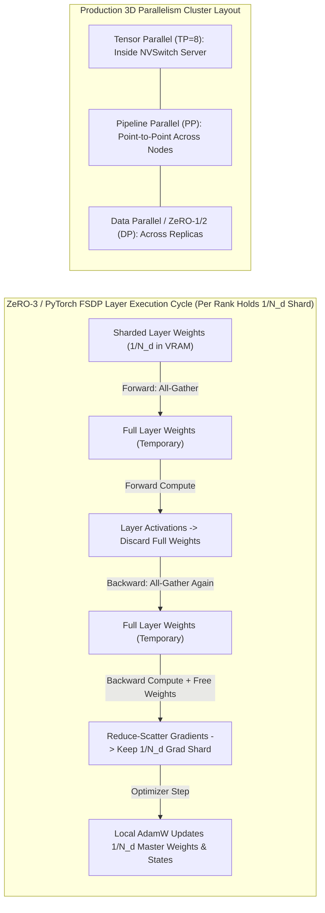
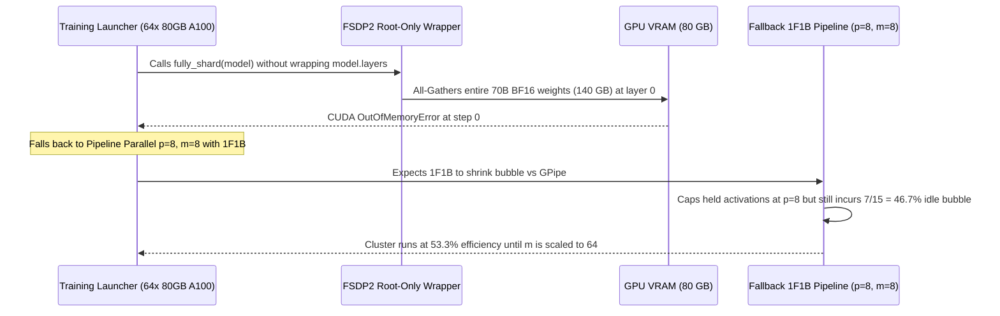

# Module 11: Pipeline Parallelism and ZeRO

> **Prerequisites:** [Module 09: Data Parallelism](../09-data-parallelism/README.md), [Module 10: Model and Tensor Parallelism](../10-model-and-tensor-parallelism/README.md), and [Module 07: Mixed Precision Training](../07-mixed-precision-training/README.md)  
> **Estimated Reading Time:** 40 minutes  
> **Target Audience:** Distributed Training Engineers, Foundation Model Architects, GPU Cluster Engineers

> [!TIP]
> **The Golden Rule of 3D Parallelism & ZeRO**  
> Pipeline parallelism cuts idle bubble time to $\frac{p-1}{m+p-1}$ only when micro-batches satisfy $m \gg p$ (and **1F1B** lowers activation memory from $m$ to $p$ without shrinking the bubble); meanwhile, **ZeRO-1 and ZeRO-2** eliminate optimizer and gradient redundancy across $N_d$ data-parallel ranks at **zero extra communication** ($2\Psi$), while **ZeRO-3 / PyTorch FSDP** shards parameters too—eliminating single-GPU parameter floors at a $1.5\times$ ($3\Psi$) communication cost.

---

## Why This Matters

You are in **Track 05: GPUs & GenAI Hardware**, at the culmination of the distributed training arc. [Module 09](../09-data-parallelism/README.md) replicated the full model across GPUs; [Module 10](../10-model-and-tensor-parallelism/README.md) split individual layers inside fast NVLink servers. This module completes the toolkit with the remaining two pillars: slicing consecutive layers into stages fed by micro-batches (**Pipeline Parallelism**), and removing redundant model-state storage from Data Parallelism (**ZeRO** and **PyTorch FSDP**). Understanding how 3D parallelism (TP + PP + DP/ZeRO) interacts lets you configure large runs cleanly and catch VRAM OOMs before renting a multi-node GPU cluster.

**After this module you can:**
- Derive the pipeline bubble fraction $(p-1)/(m+p-1)$, verify it with a discrete event simulator, and distinguish GPipe from 1F1B (and interleaved) schedules.
- Calculate per-GPU model-state memory across ZeRO stages 1, 2, and 3 and reproduce the ZeRO paper's 7.5B-parameter benchmark table.
- Contrast the $2\Psi$ vs. $3\Psi$ communication budgets of ZeRO-1/2 vs. ZeRO-3 / FSDP.
- Design a sound first-pass 3D parallelism configuration for any cluster size and interconnect topology.

---

## 1. Visual Mental Models & Execution Cycles

### Pipeline Parallelism: Stages, Micro-Batches & the Bubble

Assign consecutive model layers to **$p$ stages** (typically one GPU or TP group per stage). To prevent $p-1$ stages from sitting idle (Module 10's naive $1/G$ bottleneck), split the batch into **$m$ micro-batches** and stream them sequentially: while stage 1 processes micro-batch 0, stage 0 starts micro-batch 1.

The classic **GPipe** schedule runs all $m$ forward passes, then all $m$ backward passes, followed by a **pipeline flush** (one optimizer step once all micro-batches finish, preserving exact synchronous gradient semantics). The unavoidable empty slots at pipeline fill and drain form the **pipeline bubble**.

#### Deriving the Bubble Fraction

Assume balanced stages with per-micro-batch forward duration $t_f$ and backward duration $t_b$:
- The first micro-batch takes $p$ stage-slots to traverse the forward path; each remaining $m-1$ micro-batch finishes one slot behind. Forward takes $(m + p - 1)t_f$; backward takes $(m + p - 1)t_b$.
- Total wall-clock makespan: $(m + p - 1)(t_f + t_b)$.
- Useful work per stage: $m(t_f + t_b)$. Idle time per stage: $(p - 1)(t_f + t_b)$.

$$\text{Bubble Fraction (idle share of timeline)} = \frac{p - 1}{m + p - 1}, \qquad \text{Pipeline Efficiency} = \frac{m}{m + p - 1}$$

Notice $t_f$ and $t_b$ cancel completely—the ratio of backward to forward compute does not affect the bubble fraction (verified across three ratios in Step 2). Watch out for a second naming convention: the [Megatron-LM scaling paper](https://arxiv.org/abs/2104.04473) defines the bubble relative to *ideal* compute time as $(p - 1)/m$, whereas [GPipe](https://arxiv.org/abs/1811.06965) writes $\mathcal{O}\!\left(\frac{K-1}{M+K-1}\right)$. Converting $(p - 1)/m = x$ to timeline idle fraction yields $x / (1 + x)$.

To keep the bubble under $5\%$, you need **$m \ge 4p$ to $19p$** ($m \ge 58$ at $p=4$, $m \ge 134$ at $p=8$!). The costs of large $m$ are smaller micro-batches (which can under-utilize GPU Tensor Cores) and, under GPipe, holding all $m$ micro-batches' activations simultaneously.

```text
GPipe SCHEDULE, p = 4 stages, m = 4 micro-batches (forward: digits, backward: letters, . = idle)

  stage 0: 0123.........aabbccdd
  stage 1: .0123......aabbccdd..          bubble = the dots
  stage 2: ..0123...aabbccdd....          idle share = (p-1)/(m+p-1) = 3/7 = 43%
  stage 3: ...0123aabbccdd......
           (output of this simulation: forward = 1 tick, backward = 2 ticks)
```

### 1F1B Schedule: Identical Bubble, Far Less Activation Memory

In the **1F1B** schedule (*PipeDream-Flush* in Megatron-LM), each stage completes a short warm-up of forward passes and then strictly alternates **one forward, one backward**, freeing each micro-batch's activations immediately upon completing its backward pass:

```text
1F1B, p = 4, m = 8: same bubble, but a stage never holds more than p micro-batches

  stage 0: 0123......aa4bb5cc6dd7ee.ff.gg.hh      warm-up forwards, then alternate F/B
  stage 1: .012....aa3bb4cc5dd6ee7ff.gg.hh..
  stage 2: ..01..aa2bb3cc4dd5ee6ff7gg.hh....       GPipe would hold all 8 micro-batches at once;
  stage 3: ...0aa1bb2cc3dd4ee5ff6gg7hh......       1F1B holds at most 4
```

> [!WARNING]
> **1F1B Does NOT Shrink the Pipeline Bubble**  
> 1F1B produces the **exact same makespan and idle fraction** as GPipe (`0.2727` for `p=4, m=8`). Its sole win is capping peak in-flight activation memory at $p$ micro-batches instead of $m$. To actually shrink the bubble itself, *interleaved 1F1B* assigns multiple non-contiguous layer chunks per GPU—dividing the bubble by the chunk count $v$ while multiplying inter-stage point-to-point communication by $v$.

### ZeRO: Eliminating Replication in Data Parallelism

In plain Data Parallelism with mixed-precision Adam and $\Psi$ parameters, every GPU stores: $2\Psi$ bytes of FP16/BF16 weights + $2\Psi$ bytes of gradients + $K\Psi$ bytes of optimizer states ($K = 12$ for FP32 master weights, momentum, variance) = **$16\Psi$ bytes**. The [ZeRO paper](https://arxiv.org/abs/1910.02054) (Rajbhandari et al.) partitions these states cumulatively across $N_d$ data-parallel ranks:

- **ZeRO-1 ($P_{\text{os}}$):** Shards only **optimizer states** ($12\Psi / N_d$). Each rank updates $1/N_d$ of parameters, then an all-gather shares updated parameters. Same $2\Psi$ communication as baseline DP!
- **ZeRO-2 ($P_{\text{os+g}}$):** Also shards **gradients**. Instead of an all-reduce, ranks execute a **reduce-scatter** so each keeps only gradients for its owned shard and drops the rest. Still $2\Psi$ communication!
- **ZeRO-3 ($P_{\text{os+g+p}}$) & PyTorch FSDP:** Shards **parameters** as well. Before each layer runs forward or backward, an **all-gather** temporarily reconstructs that layer's weights, computes, and frees them; backward gradients are **reduce-scattered**. Per-GPU state shrinks cleanly by $1/N_d$ with no floor, at a $1.5\times$ communication cost ($3\Psi$).



```text
PER-GPU MODEL-STATE MEMORY, 7.5B parameters, N_d = 64   (one # = 1 byte per parameter; slivers rounded up to one #)

                params 2Ψ   grads 2Ψ   optimizer state KΨ = 12Ψ
  baseline DP   [##]        [##]       [############]                    120 GB
  ZeRO-1        [##]        [##]       [#]   (12Ψ/64)                     31.4 GB
  ZeRO-2        [##]        [#]        [#]   (grads and optimizer / 64)   16.6 GB
  ZeRO-3        [.]         [.]        [.]   (everything / 64)             1.88 GB
                                                                         (paper, Fig. 1)

COMMUNICATION PER STEP     2Ψ  (DP)  ->  2Ψ  (ZeRO-1)  ->  2Ψ  (ZeRO-2)  ->  3Ψ  (ZeRO-3)
```

> [!WARNING]
> **ZeRO Numbers Are Model-State Floors Only**  
> The $16\Psi$ and $16\Psi/N_d$ formulas ignore **activations, temporary buffers, and fragmentation**. As the ZeRO paper highlights, a 1.5B GPT-2 at sequence length 1K and batch 32 consumes ~60 GB of activations before checkpointing. Always budget activation memory separately.

> [!NOTE]
> **Eight Students & Textbooks Mental Model**  
> Eight students share one curriculum. Plain DP buys 8 full sets of textbooks, answer keys, and scratchpads. ZeRO-1 rips the answer key (optimizer state) into eighths; ZeRO-2 also splits the scratchpads (gradients); ZeRO-3 splits the textbooks themselves (parameters)—each student borrows a chapter right before reading it and hands it back immediately, trading shelf space for extra hallway traffic.

---

## 2. Systematic Parallelism Comparison Matrices

### ZeRO Stages & Memory/Communication Accounting ($\Psi$ params, $K=12$ Adam bytes, $N_d$ DP ranks)

| Stage / Strategy | What Is Sharded | Per-GPU Model-State Memory | Asymptotic Reduction Floor | 7.5B @ $N_d=64$ | 70B @ $N_d=64$ (80 GB card?) | Step Comm Volume |
| :--- | :--- | :--- | :--- | :--- | :--- | :--- |
| **Baseline DP** | Nothing (full replica) | $(2 + 2 + K)\Psi = 16\Psi$ | $1\times$ ($16\Psi$) | $120.0\text{ GB}$ | $1{,}120.0\text{ GB}$ (No) | $2\Psi$ |
| **ZeRO-1 ($P_{\text{os}}$)** | Optimizer states | $(2 + 2 + K/N_d)\Psi$ | $4\times$ ($4\Psi$ floor) | $31.4\text{ GB}$ | $293.1\text{ GB}$ (No) | $2\Psi$ (same) |
| **ZeRO-2 ($P_{\text{os+g}}$)** | + Gradients | $(2 + (2 + K)/N_d)\Psi$ | $8\times$ ($2\Psi$ floor) | $16.6\text{ GB}$ | $155.3\text{ GB}$ (No) | $2\Psi$ (same) |
| **ZeRO-3 / FSDP ($P_{\text{os+g+p}}$)** | + Parameters | $(2 + 2 + K)\Psi / N_d$ | Unbounded ($N_d\times$) | $1.88\text{ GB}$ | **$17.5\text{ GB}$ (Yes)** | $3\Psi$ ($1.5\times$) |

### Pipeline Schedules Comparison

| Schedule | Bubble Fraction (Idle Share) | Peak In-Flight Micro-Batches Held | Inter-Stage P2P Communication | Best Use Case |
| :--- | :--- | :--- | :--- | :--- |
| **Naive Layer-Wise ($m=1$)** | $(p-1)/p$ (e.g., $75\%$ at $p=4$) | $1$ | $1\times$ | Never for training |
| **GPipe (All-F then All-B)** | $(p-1)/(m+p-1)$ | $m$ (grows linearly with micro-batches) | $1\times$ | Small $m$ only |
| **1F1B (PipeDream-Flush)** | $(p-1)/(m+p-1)$ (identical to GPipe) | **$p$** (independent of $m$) | $1\times$ | Standard production PP |
| **Interleaved 1F1B ($v$ chunks)** | $(p-1)/(v \cdot m + p - 1)$ | $\sim p$ (slightly higher warm-up) | $v\times$ | Huge clusters with fast inter-node links |

### Practical Parallelism Selection Guide (First-Guess Rules)

| Cluster & Model Situation | Reasonable First Choice |
| :--- | :--- |
| **Model and states fit on one GPU** | Data parallelism (optionally ZeRO-1/2 to free optimizer memory for larger micro-batches) |
| **States do not fit on one GPU, but a node's GPUs share fast links** | ZeRO-3 / PyTorch FSDP, and/or Tensor Parallelism inside the node |
| **Model too large for one node, or slow links between nodes** | Pipeline stages across nodes (with TP inside nodes) and DP/ZeRO-1 over replicas |

---

## 3. Verified Python Pipeline & ZeRO Experiments

All scripts run with Python 3.13 + NumPy 2.4.6 on CPU. Save Step 1 as `pipeline_sim.py` in the same folder.

### Step 1: Discrete Event Pipeline Simulator (`pipeline_sim.py`)

```python
def schedule_ops(p, m, kind):
    """Per-stage ordered list of ops. ('F', i) = forward of micro-batch i, ('B', i) = backward."""
    ops = []
    for s in range(p):
        if kind == "gpipe":                       # all forwards, then all backwards
            ops.append([("F", i) for i in range(m)] + [("B", i) for i in range(m)])
        else:                                     # "1f1b": warm-up, alternate 1F/1B, cool-down
            warm = min(p - s - 1, m)
            seq = [("F", i) for i in range(warm)]
            f, b = warm, 0
            while b < m:
                if f < m:
                    seq.append(("F", f)); f += 1
                seq.append(("B", b)); b += 1
            ops.append(seq)
    return ops


def simulate(p, m, kind="gpipe", t_f=1, t_b=2):
    """Event simulation: an op starts when its stage is free AND its input has arrived.
    F(i,s) needs F(i,s-1);  B(i,s) needs B(i,s+1) (last stage: needs its own F)."""
    ops = schedule_ops(p, m, kind)
    end, free, nxt, timeline = {}, [0] * p, [0] * p, [[] for _ in range(p)]
    remaining = sum(len(o) for o in ops)
    while remaining:
        progressed = False
        for s in range(p):
            while nxt[s] < len(ops[s]):
                op, i = ops[s][nxt[s]]
                dep = ((op, i, s - 1) if s > 0 else None) if op == "F" else \
                      ((op, i, s + 1) if s < p - 1 else ("F", i, s))
                if dep is not None and dep not in end:
                    break                                            # input not ready yet
                start = max(free[s], end[dep] if dep else 0)
                dur = t_f if op == "F" else t_b
                end[(op, i, s)] = free[s] = start + dur
                timeline[s].append((op, i, start, start + dur))
                nxt[s] += 1; remaining -= 1; progressed = True
        assert progressed, "deadlock"
    makespan = max(free)
    busy = p * m * (t_f + t_b)
    # peak number of micro-batches whose forward is done but backward is not (activations held), per stage
    peak = 0
    for s in range(p):
        live = 0
        for op, i, a, b in timeline[s]:
            live += 1 if op == "F" else -1
            peak = max(peak, live)
    return makespan, 1 - busy / (p * makespan), peak, timeline


def draw(timeline, makespan):
    rows = []
    for s, ops in enumerate(timeline):
        line = ["."] * makespan
        for op, i, a, b in ops:
            for t in range(a, b):
                line[t] = str(i % 10) if op == "F" else chr(ord("a") + i % 26)
        rows.append(f"  stage {s}: {''.join(line)}")
    return "\n".join(rows)
```

### Step 2: Bubble Formula Validation Across 84 Combinations

```python
from pipeline_sim import simulate, draw


def bubble_formula(p, m):
    """Idle fraction of the whole timeline for a flushed pipeline: (p-1) / (m+p-1)."""
    return (p - 1) / (m + p - 1)


print("tiny schedule, p=4 stages, m=4 micro-batches (digits = forward of micro-batch i, letters = backward;")
print("forward takes 1 tick, backward 2 ticks, '.' = idle):")
makespan, bubble, peak, tl = simulate(4, 4, "gpipe")
print(draw(tl, makespan))
print(f"makespan = {makespan} ticks, ideal = {4 * (1 + 2)} ticks, idle fraction = {bubble:.4f}, "
      f"formula = {bubble_formula(4, 4):.4f}")

print(f"\n{'p':>3} {'m':>4} {'formula (p-1)/(m+p-1)':>22} {'simulated':>10} {'(p-1)/m':>9}")
worst, checked = 0.0, 0
for p in (2, 4, 8, 16):
    for m in (1, 4, 8, 16, 32, 64, 128):
        sim = simulate(p, m, "gpipe")[1]
        if p in (4, 8) and m in (1, 4, 16, 64):
            print(f"{p:>3} {m:>4} {bubble_formula(p, m):>22.4f} {sim:>10.4f} {(p - 1) / m:>9.4f}")
        for t_f, t_b in ((1, 2), (1, 1), (2, 3)):       # the backward/forward time ratio should not matter
            sim = simulate(p, m, "gpipe", t_f, t_b)[1]
            worst = max(worst, abs(sim - bubble_formula(p, m)))
            checked += 1
print(f"\nlargest |simulated - formula| over {checked} (p, m, t_f, t_b) combinations: {worst:.1e}")

# How many micro-batches does it take to get the idle fraction under 5%?
for p in (4, 8, 16):
    m = next(m for m in range(1, 10_000) if bubble_formula(p, m) < 0.05)
    print(f"p={p:>2}: need m >= {m} micro-batches for < 5% idle")
```

**Verified Output:**
```text
tiny schedule, p=4 stages, m=4 micro-batches (digits = forward of micro-batch i, letters = backward;
forward takes 1 tick, backward 2 ticks, '.' = idle):
  stage 0: 0123.........aabbccdd
  stage 1: .0123......aabbccdd..
  stage 2: ..0123...aabbccdd....
  stage 3: ...0123aabbccdd......
makespan = 21 ticks, ideal = 12 ticks, idle fraction = 0.4286, formula = 0.4286

  p    m  formula (p-1)/(m+p-1)  simulated   (p-1)/m
  4    1                 0.7500     0.7500    3.0000
  4    4                 0.4286     0.4286    0.7500
  4   16                 0.1579     0.1579    0.1875
  4   64                 0.0448     0.0448    0.0469
  8    1                 0.8750     0.8750    7.0000
  8    4                 0.6364     0.6364    1.7500
  8   16                 0.3043     0.3043    0.4375
  8   64                 0.0986     0.0986    0.1094

largest |simulated - formula| over 84 (p, m, t_f, t_b) combinations: 5.6e-17
p= 4: need m >= 58 micro-batches for < 5% idle
p= 8: need m >= 134 micro-batches for < 5% idle
p=16: need m >= 286 micro-batches for < 5% idle
```

### Step 3: 1F1B vs. GPipe Schedule & Peak Held Micro-Batches

```python
from pipeline_sim import simulate, draw

p, m = 4, 8
for kind in ("gpipe", "1f1b"):
    makespan, bubble, peak, tl = simulate(p, m, kind)
    print(f"{kind}: p={p}, m={m}  (digits = forward, letters = backward)")
    print(draw(tl, makespan))
    print(f"  makespan {makespan} ticks, idle fraction {bubble:.4f}, "
          f"max micro-batches held at once on one stage: {peak}\n")

print(f"{'p':>3} {'m':>4} | {'GPipe idle':>10} {'held':>5} | {'1F1B idle':>10} {'held':>5}")
for p in (4, 8):
    for m in (8, 16, 32, 64):
        _, b_g, held_g, _ = simulate(p, m, "gpipe")
        _, b_o, held_o, _ = simulate(p, m, "1f1b")
        print(f"{p:>3} {m:>4} | {b_g:>10.4f} {held_g:>5} | {b_o:>10.4f} {held_o:>5}")
```

**Verified Output:**
```text
gpipe: p=4, m=8  (digits = forward, letters = backward)
  stage 0: 01234567.........aabbccddeeffgghh
  stage 1: .01234567......aabbccddeeffgghh..
  stage 2: ..01234567...aabbccddeeffgghh....
  stage 3: ...01234567aabbccddeeffgghh......
  makespan 33 ticks, idle fraction 0.2727, max micro-batches held at once on one stage: 8

1f1b: p=4, m=8  (digits = forward, letters = backward)
  stage 0: 0123......aa4bb5cc6dd7ee.ff.gg.hh
  stage 1: .012....aa3bb4cc5dd6ee7ff.gg.hh..
  stage 2: ..01..aa2bb3cc4dd5ee6ff7gg.hh....
  stage 3: ...0aa1bb2cc3dd4ee5ff6gg7hh......
  makespan 33 ticks, idle fraction 0.2727, max micro-batches held at once on one stage: 4

  p    m | GPipe idle  held |  1F1B idle  held
  4    8 |     0.2727     8 |     0.2727     4
  4   16 |     0.1579    16 |     0.1579     4
  4   32 |     0.0857    32 |     0.0857     4
  4   64 |     0.0448    64 |     0.0448     4
  8    8 |     0.4667     8 |     0.4667     8
  8   16 |     0.3043    16 |     0.3043     8
  8   32 |     0.1795    32 |     0.1795     8
  8   64 |     0.0986    64 |     0.0986     8
```

### Step 4: ZeRO Per-GPU Memory Verified Against Paper Table 1

```python
# Per-GPU memory for model states (parameters, gradients, optimizer states) under ZeRO-DP.
# Formulas are from the ZeRO paper (Rajbhandari et al., 2019), section 5 / Figure 1:
#   psi = number of parameters, K = optimizer-state bytes per parameter (12 for mixed-precision Adam),
#   nd  = data-parallel degree.  2 bytes/param fp16 weights, 2 bytes/param fp16 gradients.
PSI = 7.5e9
K = 12


def baseline(psi, nd):  return (2 + 2 + K) * psi                 # everything replicated
def stage1(psi, nd):    return (2 + 2 + K / nd) * psi            # P_os:     optimizer states sharded
def stage2(psi, nd):    return (2 + (2 + K) / nd) * psi          # P_os+g:   + gradients sharded
def stage3(psi, nd):    return (2 + 2 + K) / nd * psi            # P_os+g+p: + parameters sharded


# Table 1 of the paper, 7.5B-parameter column (GB): (P_os, P_os+g, P_os+g+p) per DP degree.
paper = {1: (120, 120, 120), 4: (52.5, 41.3, 30), 16: (35.6, 21.6, 7.5),
         64: (31.4, 16.6, 1.88), 256: (30.4, 15.4, 0.47), 1024: (30.1, 15.1, 0.12)}

print(f"psi = {PSI / 1e9:.1f}B parameters, K = {K}  (GB = 10^9 bytes)\n")
print(f"{'Nd':>5} | {'baseline DP':>11} | {'stage 1':>8} {'stage 2':>8} {'stage 3':>8} | within 0.06 GB of the paper's Table 1?")
for nd, expected in paper.items():
    row = (stage1(PSI, nd) / 1e9, stage2(PSI, nd) / 1e9, stage3(PSI, nd) / 1e9)
    ok = all(abs(a - b) < 0.06 for a, b in zip(row, expected)) and abs(baseline(PSI, nd) / 1e9 - 120) < 1e-9
    print(f"{nd:>5} | {baseline(PSI, nd) / 1e9:>8.1f} GB | {row[0]:>6.2f}GB {row[1]:>6.2f}GB {row[2]:>6.2f}GB | {ok}")

print("\nreduction vs baseline at Nd = 64:",
      f"stage 1 {baseline(PSI, 64) / stage1(PSI, 64):.1f}x,",
      f"stage 2 {baseline(PSI, 64) / stage2(PSI, 64):.1f}x,",
      f"stage 3 {baseline(PSI, 64) / stage3(PSI, 64):.1f}x")
print("limits as Nd -> infinity: stage 1 -> 4x, stage 2 -> 8x, stage 3 -> unbounded (it scales with Nd)")
print(f"  check with Nd=10^9: stage 1 {baseline(PSI, 1e9) / stage1(PSI, 1e9):.2f}x, stage 2 {baseline(PSI, 1e9) / stage2(PSI, 1e9):.2f}x")

# Communication per training step, in multiples of psi (ZeRO paper, section 7)
print("\ncommunication volume per step (multiples of psi): baseline DP 2, stage 1 2, stage 2 2, stage 3 3")

# Another model: does it fit on 80 GB cards?
print("\n70B parameters on 64 x 80 GB GPUs (states only):")
for name, f in (("baseline DP", baseline), ("stage 1", stage1), ("stage 2", stage2), ("stage 3", stage3)):
    gb = f(70e9, 64) / 1e9
    print(f"  {name:<12} {gb:>8.1f} GB per GPU  fits in 80 GB: {gb <= 80}")
```

**Verified Output:**
```text
psi = 7.5B parameters, K = 12  (GB = 10^9 bytes)

   Nd | baseline DP |  stage 1  stage 2  stage 3 | within 0.06 GB of the paper's Table 1?
    1 |    120.0 GB | 120.00GB 120.00GB 120.00GB | True
    4 |    120.0 GB |  52.50GB  41.25GB  30.00GB | True
    16 |    120.0 GB |  35.62GB  21.56GB   7.50GB | True
    64 |    120.0 GB |  31.41GB  16.64GB   1.88GB | True
   256 |    120.0 GB |  30.35GB  15.41GB   0.47GB | True
  1024 |    120.0 GB |  30.09GB  15.10GB   0.12GB | True

reduction vs baseline at Nd = 64: stage 1 3.8x, stage 2 7.2x, stage 3 64.0x
limits as Nd -> infinity: stage 1 -> 4x, stage 2 -> 8x, stage 3 -> unbounded (it scales with Nd)
  check with Nd=10^9: stage 1 4.00x, stage 2 8.00x

communication volume per step (multiples of psi): baseline DP 2, stage 1 2, stage 2 2, stage 3 3

70B parameters on 64 x 80 GB GPUs (states only):
  baseline DP    1120.0 GB per GPU  fits in 80 GB: False
  stage 1         293.1 GB per GPU  fits in 80 GB: False
  stage 2         155.3 GB per GPU  fits in 80 GB: False
  stage 3          17.5 GB per GPU  fits in 80 GB: True
```

> [!NOTE]
> The $N_d = 64$ row matches the paper's Figure 1 example (`120 GB` $\to$ `31.4 GB` $\to$ `16.6 GB` $\to$ `1.88 GB`, rounded to `1.9 GB` in running text). On `64 x 80 GB` GPUs for a `70B` model, only ZeRO-3 (`17.5 GB`) fits even for states alone.

### Step 5: Sharding the Optimizer Leaves Math Bit-for-Bit Unchanged

```python
import numpy as np

rng = np.random.default_rng(0)
N_PARAMS, WORLD, STEPS = 1000, 4, 50
LR, B1, B2, EPS = 0.05, 0.9, 0.999, 1e-8
target = rng.standard_normal(N_PARAMS)
theta0 = np.zeros(N_PARAMS)
noise = rng.standard_normal((STEPS, WORLD, N_PARAMS)) * 0.1      # each rank sees different data -> different gradient


def local_gradient(theta, step, rank):                           # gradient of 0.5*|theta-target|^2 plus per-rank noise
    return (theta - target) + noise[step, rank]


def adam_update(theta, g, m, v, t):                              # element-wise Adam; works on any slice
    m[:] = B1 * m + (1 - B1) * g
    v[:] = B2 * v + (1 - B2) * g * g
    return theta - LR * (m / (1 - B1 ** t)) / (np.sqrt(v / (1 - B2 ** t)) + EPS)


# --- Plain data parallelism: every rank keeps full theta, full m, full v; gradients all-reduced (averaged).
theta_dp = [theta0.copy() for _ in range(WORLD)]
m_dp = [np.zeros(N_PARAMS) for _ in range(WORLD)]
v_dp = [np.zeros(N_PARAMS) for _ in range(WORLD)]
for step in range(STEPS):
    g_avg = np.mean([local_gradient(theta_dp[r], step, r) for r in range(WORLD)], axis=0)
    for r in range(WORLD):
        theta_dp[r] = adam_update(theta_dp[r], g_avg, m_dp[r], v_dp[r], step + 1)

# --- ZeRO stage 1/2 style: rank r owns shard r of the optimizer state (m, v) and of the gradient.
shards = np.array_split(np.arange(N_PARAMS), WORLD)
theta_z = [theta0.copy() for _ in range(WORLD)]                  # parameters still replicated (stage 1/2)
m_z = [np.zeros(len(s)) for s in shards]                         # only 1/WORLD of the Adam state per rank
v_z = [np.zeros(len(s)) for s in shards]
for step in range(STEPS):
    grads = [local_gradient(theta_z[r], step, r) for r in range(WORLD)]
    new_shards = []
    for r, idx in enumerate(shards):
        g_shard = np.mean([g[idx] for g in grads], axis=0)       # reduce-scatter: rank r gets ONLY its shard, averaged
        new_shards.append(adam_update(theta_z[r][idx], g_shard, m_z[r], v_z[r], step + 1))
    full = np.empty(N_PARAMS)
    for idx, piece in zip(shards, new_shards):                   # all-gather: everyone receives every updated shard
        full[idx] = piece
    theta_z = [full.copy() for _ in range(WORLD)]

print("plain DP: all ranks identical      :", all(np.array_equal(theta_dp[0], t) for t in theta_dp))
print("ZeRO-style: all ranks identical    :", all(np.array_equal(theta_z[0], t) for t in theta_z))
print("max |ZeRO-style - plain DP|        :", f"{np.abs(theta_z[0] - theta_dp[0]).max():.2e}")
print("mean |theta - target|, start -> end :", f"{np.abs(theta0 - target).mean():.3f} -> {np.abs(theta_dp[0] - target).mean():.3f}")
print(f"Adam state per rank (m + v), plain DP : {m_dp[0].size + v_dp[0].size:,} numbers")
print(f"Adam state per rank (m + v), ZeRO-style: {m_z[0].size + v_z[0].size:,} numbers")
```

**Verified Output:**
```text
plain DP: all ranks identical      : True
ZeRO-style: all ranks identical    : True
max |ZeRO-style - plain DP|        : 0.00e+00
mean |theta - target|, start -> end : 0.777 -> 0.056
Adam state per rank (m + v), plain DP : 2,000 numbers
Adam state per rank (m + v), ZeRO-style: 500 numbers
```

Final parameters match bit-for-bit (`0.00e+00`) because Adam acts elementwise. Global cross-tensor operations like global gradient-norm clipping need one small scalar all-reduce across shards.

### Step 6: DeepSpeed ZeRO & PyTorch FSDP2 Production Skeleton (Not Executed Above)

```python
# DeepSpeed: ZeRO is a config switch.  ds_config.json fragment (the stage field is the one
# used in DeepSpeed's ZeRO tutorial):
#   { "zero_optimization": { "stage": 2 } }          # 1, 2 or 3

# PyTorch FSDP2, following PyTorch's FSDP tutorial.  Launch: torchrun --nproc_per_node=8 train.py
import torch
import torch.distributed as dist
from torch.distributed.fsdp import fully_shard

dist.init_process_group("nccl")
model = Transformer(...)                 # placeholder: any model with a list of blocks, model.layers
for layer in model.layers:
    fully_shard(layer)                   # shard each block: gathered just before it runs, freed after
fully_shard(model)                       # then the root, which covers the remaining parameters
opt = torch.optim.AdamW(model.parameters(), lr=3e-4)    # the optimizer sees only this rank's shards
# the training loop is the ordinary one: loss.backward(); opt.step(); opt.zero_grad()
```

---

## 4. Production War Story Post-Mortem: 70B Root-Only FSDP OOM & 46.7% Pipeline Bubble Stall

| Field | Incident Details |
| :--- | :--- |
| **Severity** | **SEV-1** (70B Pre-Training Job Crash-Looping on Startup + $46.7\%$ Idle GPU Cluster) |
| **Detection / Resolution Time** | Immediate crash on FSDP run / Fixed root-wrapping in 20 minutes, resolved 1F1B bubble misconfiguration in 1 hour |
| **Impact** | 64x 80 GB A100 GPUs ($\$150/\text{hr}$) failed at step 0 with `CUDA out of memory`; fallback PP=8 run left nearly half the GPUs idle due to $m=8$ |

### What Happened

An infrastructure team attempted to launch a 70B parameter training run across 64 x 80 GB A100 GPUs ($N_d = 64$). First, they chose PyTorch FSDP2 (`fully_shard`) expecting the model states to take `17.5 GB/GPU`. However, a refactor wrapped **only the top-level root module** (`fully_shard(model)`) and skipped wrapping individual `model.layers` transformer blocks. On the very first forward pass, FSDP all-gathered all 70B BF16 parameters (`140 GB`) simultaneously into every GPU's 80 GB VRAM, crashing immediately.

While debugging FSDP, they fell back to a 3D setup with `TP=1, PP=8, DP=8` using 1F1B pipelining and `m = 8` micro-batches. Engineers assumed switching from GPipe to 1F1B would cut the pipeline bubble, only to watch GPU utilization sit near $53\%$—matching $(p-1)/(m+p-1) = 7/15 = 46.7\%$ idle bubble.



### Root Cause Analysis

1. **Root-only FSDP wrapping defeats layer-by-layer freeing:** When `fully_shard` is applied only to the root `model`, FSDP treats all 80 Transformer layers as one monolithic unit—all-gathering all `140 GB` of parameters before layer 0 and holding them until the end of the backward pass.
2. **Misunderstanding 1F1B vs. bubble size:** Switching GPipe to 1F1B caps peak held activations at $p$ micro-batches instead of $m$, leaving the pipeline idle fraction $\frac{p-1}{m+p-1}$ completely unchanged. With $p=8$ and $m=8$, $46.7\%$ of GPU cycles were guaranteed to sit empty.

### The Fix & Architectural Hardening

- Applied `fully_shard(layer)` to every `TransformerBlock` **before** calling `fully_shard(model)` on the root, keeping transient full-weight materialization to a single block (~`1.75 GB` instead of `140 GB`) and total per-GPU states near `17.5 GB`.
- For the hybrid 3D run (`TP=8, PP=4, DP=2` or `PP=8`), enforced a pre-flight validation rule requiring $m \ge 8p$ (e.g., `m = 64` at `p = 8`, dropping the bubble under $10\%$) alongside activation checkpointing and 1F1B to bound activation memory.

---

## 5. Multi-Language Production Implementation: 3D Parallelism, Bubble & ZeRO Planners

````carousel
```go
package parallelism

import "fmt"

type ZeroMemoryReport struct {
	BaselineGB float64
	Zero1GB    float64
	Zero2GB    float64
	Zero3GB    float64
	BubbleFrac float64
}

// Plan3D computes per-GPU model-state memory (GB = 10^9 bytes) across ZeRO stages
// and the flushed pipeline bubble fraction (p-1)/(m+p-1).
func Plan3D(params float64, tp, pp, dp, microBatches int) ZeroMemoryReport {
	// Effective parameters owned per stage-and-TP slice
	localPsi := params / float64(tp*pp)
	k := 12.0 // FP32 master weights + Adam momentum + Adam variance
	nd := float64(dp)
	gb := 1e9

	return ZeroMemoryReport{
		BaselineGB: (4.0 + k) * localPsi / gb,
		Zero1GB:    (4.0 + k/nd) * localPsi / gb,
		Zero2GB:    (2.0 + (2.0+k)/nd) * localPsi / gb,
		Zero3GB:    ((4.0 + k) / nd) * localPsi / gb,
		BubbleFrac: float64(pp-1) / float64(microBatches+pp-1),
	}
}

func Example70B() string {
	r := Plan3D(70e9, 1, 1, 64, 1)
	return fmt.Sprintf("70B DP=64 -> DP=%.1fGB, Z1=%.1fGB, Z2=%.1fGB, Z3=%.1fGB",
		r.BaselineGB, r.Zero1GB, r.Zero2GB, r.Zero3GB)
}
```
<!-- slide -->
```typescript
export interface ScheduleSummary {
  kind: "gpipe" | "1f1b";
  stages: number;
  microBatches: number;
  bubbleFraction: number;
  peakHeldMicroBatches: number;
  needsMoreMicroBatchesWarning: boolean;
}

export class PipelinePlanner {
  public static analyze(
    kind: "gpipe" | "1f1b",
    stages: number,
    microBatches: number
  ): ScheduleSummary {
    const bubbleFraction = (stages - 1) / (microBatches + stages - 1);
    const peakHeldMicroBatches =
      kind === "gpipe" ? microBatches : Math.min(stages, microBatches);

    return {
      kind,
      stages,
      microBatches,
      bubbleFraction: Number(bubbleFraction.toFixed(4)),
      peakHeldMicroBatches,
      needsMoreMicroBatchesWarning: microBatches < 4 * stages,
    };
  }

  public static minMicroBatchesForMaxBubble(stages: number, maxBubble: number): number {
    // Solve (p - 1) / (m + p - 1) <= maxBubble  =>  m >= (p - 1)*(1 - maxBubble)/maxBubble
    return Math.ceil(((stages - 1) * (1 - maxBubble)) / maxBubble);
  }
}
```
<!-- slide -->
```python
"""Production PyTorch FSDP2 (fully_shard per block + root) and DeepSpeed config builder."""

import torch
import torch.nn as nn
from torch.distributed.fsdp import MixedPrecisionPolicy, fully_shard


def wrap_model_fsdp2(model: nn.Module) -> nn.Module:
    """Wraps every transformer block individually BEFORE root wrapping so FSDP2
    all-gathers and frees weights one block at a time instead of OOMing."""
    mp_policy = MixedPrecisionPolicy(
        param_dtype=torch.bfloat16,
        reduce_dtype=torch.float32,
    )
    if not hasattr(model, "layers"):
        raise AttributeError("Expected model.layers sequence of transformer blocks")

    for block in model.layers:
        fully_shard(block, mp_policy=mp_policy)

    # Root module wraps remaining embeddings / LM head parameters
    fully_shard(model, mp_policy=mp_policy)
    return model


def build_deepspeed_zero_config(stage: int, micro_batch: int, grad_accum: int) -> dict:
    assert stage in (1, 2, 3)
    return {
        "train_micro_batch_size_per_gpu": micro_batch,
        "gradient_accumulation_steps": grad_accum,
        "bf16": {"enabled": True},
        "zero_optimization": {"stage": stage},
    }
```
<!-- slide -->
```csharp
using System;

namespace DistributedTraining;

public static class ZeroMemoryEstimator
{
    public record ZeroBreakdown(double BaselineGb, double Stage1Gb, double Stage2Gb, double Stage3Gb);

    /// <summary>
    /// Computes per-GPU model-state memory (GB = 10^9 bytes) under ZeRO stages 1-3
    /// for mixed-precision Adam (2B weights, 2B grads, 12B optimizer states).
    /// </summary>
    public static ZeroBreakdown Compute(double numParams, int dpDegree)
    {
        const double k = 12.0;
        const double gb = 1e9;

        double baseline = (2.0 + 2.0 + k) * numParams / gb;
        double stage1 = (2.0 + 2.0 + k / dpDegree) * numParams / gb;
        double stage2 = (2.0 + (2.0 + k) / dpDegree) * numParams / gb;
        double stage3 = ((2.0 + 2.0 + k) / dpDegree) * numParams / gb;

        return new ZeroBreakdown(
            Math.Round(baseline, 2),
            Math.Round(stage1, 2),
            Math.Round(stage2, 2),
            Math.Round(stage3, 2));
    }
}
```
````

---

## 6. Practical Hands-On Verification CLI Workflows

### Verification 1: ZeRO Table 1 Parity & Pipeline Bubble Solver (CLI)

Run this one-liner to verify the exact ZeRO-3 minimum $N_d$ for 70B on 80 GB GPUs, the 7.5B Table 1 row at $N_d=64$, and the 10%-bubble micro-batch threshold for $p=8$:

```bash
python -c "
psi_7_5, psi_70, k, nd = 7.5e9, 70e9, 12, 64
print('7.5B @ Nd=64 (GB):',
      round((4+k)*psi_7_5/1e9, 2),
      round((4+k/nd)*psi_7_5/1e9, 2),
      round((2+(2+k)/nd)*psi_7_5/1e9, 2),
      round((4+k)/nd*psi_7_5/1e9, 2))
min_nd_70b = next(n for n in range(1, 256) if (4+k)*psi_70/n/1e9 <= 80)
print('70B ZeRO-3 min Nd for <= 80 GB:', min_nd_70b, '-> GB/GPU:', round((4+k)*psi_70/min_nd_70b/1e9, 2))
p = 8
m_10pct = next(m for m in range(1, 1000) if (p-1)/(m+p-1) <= 0.10)
print(f'p={p}: min m for <=10% bubble is {m_10pct} (bubble={(p-1)/(m_10pct+p-1):.4f})')
"
```

**Expected Output:**
```text
7.5B @ Nd=64 (GB): 120.0 31.41 16.64 1.88
70B ZeRO-3 min Nd for <= 80 GB: 14 -> GB/GPU: 80.0
p=8: min m for <=10% bubble is 63 (bubble=0.1000)
```

### Hands-On Practice Exercises

#### 1. How many micro-batches for a 10% bubble?
With $p = 8$ stages, how many micro-batches does the GPipe schedule need for at most $10\%$ idle time? Check it with `simulate` from Step 1.

<details><summary>Answer</summary>

$(p-1)/(m+p-1) \le 0.1$ gives $7 / (m + 7) \le 0.1$, so **$m \ge 63$**. At $m = 63$ the idle share is exactly `7/70 = 10%`. Call `simulate(8, 63, "gpipe")[1]` to confirm (`0.1000`). Compare Step 2's output: even $m = 64$ leaves about `9.9%` at $p = 8$.

</details>

#### 2. Which ZeRO stage can ever fit a 70B model on 80 GB cards?
Using the formulas in Step 4: for a 70B-parameter model, what is the smallest data-parallel degree at which ZeRO-3 fits the model states in `80 GB`? Can ZeRO-2 ever fit, however many GPUs you use?

<details><summary>Answer</summary>

ZeRO-3 needs `16 x 70 GB / N_d <= 80 GB`, so **$N_d \ge 1120 / 80 = 14$**. (At $N_d = 64$ the script gives `17.5 GB`.) ZeRO-2 keeps the 16-bit parameters on every GPU: $2\Psi = 140\,\text{GB}$, which already exceeds `80 GB`, so **no number of GPUs can make ZeRO-2 fit**. ZeRO-1 is worse still (its floor is $4\Psi = 280\,\text{GB}$). Only stage 3 (or combining with tensor/pipeline parallelism) reduces the parameter term. States only: activations are extra.

</details>

#### 3. Price the memory saving of 1F1B
At $p = 4$ and $m = 16$, suppose one micro-batch's activations on one stage take `1 GB`. What does stage 0 hold at its peak under GPipe versus 1F1B, and what happens to the idle fraction?

<details><summary>Answer</summary>

Step 3's table gives `held = 16` for GPipe and `held = 4` for 1F1B, so **`16 GB` versus `4 GB`**, with the **same idle fraction (`0.1579`)** in both. 1F1B is a memory optimization, not a speed one.

</details>

#### 4. Convert between bubble definitions
A paper says the bubble is `(p - 1) / m` of ideal time. For $p = 4$ and $m = 16$, what idle share of the whole timeline is that? Compare with the table in Step 2.

<details><summary>Answer</summary>

$x = 3/16 = 0.1875$; as a share of the timeline it is $x / (1 + x) = 0.1875 / 1.1875 = 0.1579$, which equals `3/19` and matches the `p = 4, m = 16` row (`0.1579`).

</details>

### Independent Project: 3D Parallelism Cluster Planner

Build a **parallelism planner** in Python, with no starting code. Inputs: parameter count, number of layers, hidden size, number of GPUs $G$, GPU memory, and a global batch size. Enumerate every factorization $G = t \times p \times d$ (tensor, pipeline, data degrees) and, for each, report:

1. Per-GPU model-state memory under each ZeRO stage applied across the data-parallel dimension (state your assumption about how tensor and pipeline parallelism divide the parameters), and whether it fits.
2. The micro-batch count $m$ implied by your global batch and per-GPU micro-batch size, and the pipeline bubble $(p-1)/(m+p-1)$.
3. A tensor-parallel communication-to-compute estimate from [Module 10](../10-model-and-tensor-parallelism/README.md)'s method, flagging configurations whose tensor-parallel group is larger than one server.

Validate the planner by reproducing the ZeRO paper's `7.5B / N_d = 64` numbers, and by checking its bubble numbers against the simulator from Step 1. Finish with a short written recommendation for one model size of your choice, listing every assumption.

---

## 7. Common Mistakes & Troubleshooting

- **Too few micro-batches and a pipeline that sits idle.** Symptom: throughput far below the single-stage rate. Check $m$ against $p$; Step 2 shows $m = 4, p = 8$ idles `64%` of the time.
- **Expecting 1F1B to be faster.** It has the exact same idle fraction; the benefit is lower activation memory (`p` held instead of `m`, Step 3).
- **Reading ZeRO memory as total memory and still hitting out-of-memory errors.** The numbers cover parameters, gradients, and optimizer states only; activations and buffers come on top.
- **Choosing ZeRO-2 for a model whose 16-bit weights alone exceed GPU memory.** Stage 2 keeps full parameters on every GPU ($2\Psi$ floor); you need ZeRO-3 / FSDP or model splitting.
- **Wrapping only the root module in FSDP.** Apply `fully_shard` to each submodule (`model.layers`) *before* wrapping the root `model`, so parameters are gathered layer by layer rather than all at once.
- **Mixing up bubble definitions.** `(p - 1)/m` and `(p - 1)/(m + p - 1)` are both valid conventions; verify whether the denominator is ideal time or total timeline makespan.

---

## 8. Operational Validation Checkpoints & Interview Prep

### Operational Validation Checkpoints

<details><summary><strong>Checkpoint 1: Diagnosing Why FSDP2 OOMs Immediately on Layer 0</strong></summary>

If `fully_shard(model)` uses near-identical VRAM to plain DDP on the first forward pass, inspect whether submodules (`model.layers`) were individually wrapped prior to wrapping the root module; root-only wrapping forces FSDP to all-gather 100% of weights simultaneously instead of streaming one block at a time.

</details>

<details><summary><strong>Checkpoint 2: Why Doubling Micro-Batches Helped Pipeline Efficiency Only Under 1F1B</strong></summary>

Increasing micro-batches from `m=8` to `m=32` at `p=8` shrinks the bubble from `46.7%` to `17.95%`, but under GPipe it quadruples activation VRAM (`32x` held micro-batches) and triggers OOM; 1F1B keeps peak held activations flat at `p=8` micro-batches regardless of how large `m` grows.

</details>

<details><summary><strong>Checkpoint 3: Choosing Between ZeRO-2 and ZeRO-3 for a 13B Model on 8 x 80 GB GPUs</strong></summary>

For a 13B model ($208\text{ GB}$ states, $26\text{ GB}$ BF16 parameters) on $8 \times 80\text{ GB}$ GPUs ($N_d=8$): ZeRO-2 takes $26 + (26 + 156)/8 = 48.75\text{ GB/GPU}$ for states (leaving tight room for activations), whereas ZeRO-3 drops states to $208/8 = 26.0\text{ GB/GPU}$ at $1.5\times$ communication (`3*psi` vs `2*psi`). Choosing ZeRO-2 + activation checkpointing avoids the extra parameter all-gathers if activations fit; otherwise ZeRO-3/FSDP wins.

</details>

### Checkpoint Quiz

1. In the GPipe schedule with $p$ stages and $m$ micro-batches, how many time slots does the forward phase take, and why?
2. Why does increasing $m$ shrink the bubble, and what does it cost?
3. What does 1F1B change and what does it leave alone?
4. What is sharded at ZeRO stages 1, 2, and 3?
5. Why does stage 3 cost 1.5x the communication while stages 1 and 2 cost nothing extra?

<details><summary>Answers</summary>

1. `m + p - 1`: the first micro-batch needs $p$ slots to traverse the stages and each of the other $m-1$ follows one slot behind.
2. The fixed `p - 1` slots of fill and drain are spread over more useful work (idle share `(p - 1) / (m + p - 1)`); costs are smaller micro-batches and, in the all-forward schedule, more activations held at once.
3. It changes the order so at most $p$ micro-batches are in flight (lower activation memory); the bubble and the total time are unchanged.
4. Optimizer states; plus gradients; plus parameters (cumulative).
5. Baseline DP moves $2\Psi$ (reduce-scatter plus all-gather inside the all-reduce). Stages 1–2 replace that with a reduce-scatter of gradients plus an all-gather of updated parameters: also $2\Psi$. Stage 3 adds a parameter all-gather in the forward and another in the backward pass: $3\Psi$ in total.

</details>

> [!TIP]
> **Self-Verification Checklist**
> - [ ] I can derive `(p - 1)/(m + p - 1)` and state what each term means.
> - [ ] I can say what 1F1B changes and what it does not.
> - [ ] I can compute per-GPU model-state memory for ZeRO stages 1, 2, and 3 from $\Psi$, $K$, and $N_d$.
> - [ ] I can state the communication volume of each stage relative to plain data parallelism.
> - [ ] I can explain FSDP as PyTorch's ZeRO-3-style sharding and say what it gathers and when.

### Interview Practice Questions

> **Question 1:** Derive the pipeline bubble. What can you do about it?

<details><summary>What a strong answer covers</summary>

- $p$ stages, $m$ micro-batches: fill and drain cost `p - 1` slots each way, total `(m + p - 1)(t_f + t_b)`, useful `m(t_f + t_b)`, idle share `(p - 1)/(m + p - 1)`; independent of `t_b / t_f`.
- Remedies: more micro-batches ($m \gg p$; mention the smaller-micro-batch efficiency and activation-memory costs), interleaved stages (divides the bubble by chunks per GPU, more communication), fewer stages.
- 1F1B reduces activation memory, not the bubble. Mentions the `(p - 1)/m` convention difference.

</details>

> **Question 2:** Explain ZeRO stages 1, 2 and 3: what is sharded, what is the memory per GPU, and what does it cost?

<details><summary>What a strong answer covers</summary>

- Cumulative sharding of optimizer states, then gradients, then parameters across data-parallel ranks; formulas `(4 + K/N_d) * psi`, `2 * psi + (2 + K) * psi / N_d`, `(2 + 2 + K) * psi / N_d` with $K = 12$ for mixed-precision Adam.
- Worked example: 7.5B at $N_d = 64$ gives `120 -> 31.4 -> 16.6 -> 1.88 GB`.
- Communication: stages 1–2 equal baseline DP ($2\Psi$), stage 3 is 1.5x ($3\Psi$).
- Caveats: model states only (activations separate); the maths is unchanged (same updates).

</details>

> **Question 3:** When would you choose FSDP/ZeRO-3 over tensor plus pipeline parallelism?

<details><summary>What a strong answer covers</summary>

- FSDP/ZeRO-3 needs no model rewrite and works with data parallelism's simple structure, but communicates parameters every step (about 1.5x DP) and relies on good interconnect.
- Tensor parallelism needs fast intra-node links and model-code changes; pipeline needs micro-batching and tolerates slower inter-node links with a bubble to manage.
- For moderately large models inside one well-connected node FSDP is often the simplest; at the largest scales these are combined. A good answer states this as a trade-off and says to measure.

</details>

---

## 9. Further Reading & Sources

- [ZeRO: Memory Optimizations Toward Training Trillion Parameter Models](https://arxiv.org/abs/1910.02054) — the source of the stage definitions, the memory formulas, Table 1 (the 7.5B example reproduced above) and the $2\Psi$ / $3\Psi$ communication analysis.
- [GPipe: Efficient Training of Giant Neural Networks using Pipeline Parallelism](https://arxiv.org/abs/1811.06965) — micro-batch pipelining with a flush, and the $\mathcal{O}((K-1)/(M+K-1))$ bubble overhead.
- [Efficient Large-Scale Language Model Training on GPU Clusters Using Megatron-LM](https://arxiv.org/abs/2104.04473) — the 1F1B (PipeDream-Flush) and interleaved schedules, the `(p - 1)/m` bubble convention, and combining tensor, pipeline and data parallelism.
- [PyTorch FSDP: Experiences on Scaling Fully Sharded Data Parallel](https://arxiv.org/abs/2304.11277) — the FSDP paper, which credits ZeRO as an inspiration and describes the all-gather / reduce-scatter design.
- [Getting Started with Fully Sharded Data Parallel (FSDP2)](https://docs.pytorch.org/tutorials/intermediate/FSDP_tutorial.html) — official tutorial for the `fully_shard` API and the gather / reduce-scatter cycle used in the skeleton above.
- [DeepSpeed ZeRO tutorial](https://www.deepspeed.ai/tutorials/zero/) — official description of ZeRO stages 1–3 and the `zero_optimization` / `stage` configuration.

## Next

[Module 12: Choosing GPUs: Consumer vs. Datacenter](../12-choosing-gpus-consumer-vs-datacenter/README.md)
