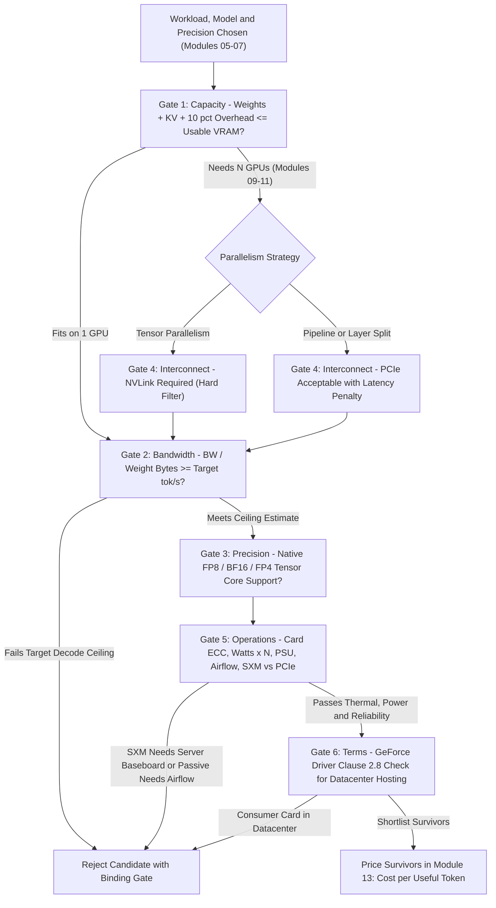
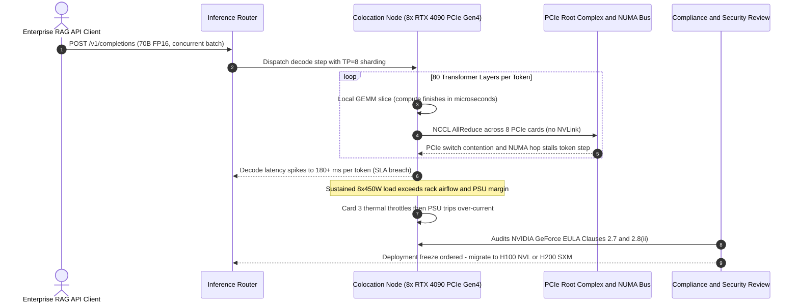

# Module 12: Choosing GPUs: Consumer vs. Datacenter

> **Prerequisites:** [Module 01: GPU Architecture](../01-gpu-architecture-for-software-engineers/README.md), [Module 02: CUDA Cores vs. Tensor Cores](../02-cuda-cores-vs-tensor-cores/README.md), [Module 03: Memory Hierarchy and Bandwidth](../03-memory-hierarchy-and-bandwidth/README.md), [Module 04: VRAM](../04-vram-the-real-constraint/README.md), [Module 05: Model Memory Requirements](../05-calculating-a-models-memory-requirements/README.md), [Module 06: Numeric Formats](../06-numeric-formats-fp32-fp16-bf16/README.md), [Module 09: Data Parallelism](../09-data-parallelism/README.md), [Module 10: Model and Tensor Parallelism](../10-model-and-tensor-parallelism/README.md), [Module 11: Pipeline Parallelism and ZeRO](../11-pipeline-parallelism-and-zero/README.md)  
> **Estimated Reading Time:** 30 minutes  
> **Target Audience:** AI Infrastructure Engineers, ML Systems Architects, Backend Engineers

> [!TIP]
> **The Golden Rule of Hardware Qualification**  
> Choose a GPU by passing six gates in strict order: **Capacity** (VRAM), **Bandwidth** (streaming rate), **Precision** (Tensor Core number formats), **Interconnect** (NVLink vs. PCIe when sharding), **Operations** (ECC, power, cooling, form factor), and **Terms** (driver licence permissions). Price is the final gate, never the first—a card that fails an early gate cannot be rescued by winning a column later.

---

## 1. Visual Mental Models & Six-Gate Qualification Architecture

**Where this sits.** Track 05 so far taught you to *size* a workload: what a GPU is
([Module 01](../01-gpu-architecture-for-software-engineers/README.md), [Module 02](../02-cuda-cores-vs-tensor-cores/README.md)),
why bandwidth and VRAM bind ([Module 03](../03-memory-hierarchy-and-bandwidth/README.md),
[Module 04](../04-vram-the-real-constraint/README.md)), how to compute a model's memory
([Module 05](../05-calculating-a-models-memory-requirements/README.md)), which number formats shrink it
([Module 06](../06-numeric-formats-fp32-fp16-bf16/README.md)), and how to split what still does not fit
([Module 09](../09-data-parallelism/README.md), [Module 10](../10-model-and-tensor-parallelism/README.md),
[Module 11: Pipeline Parallelism and ZeRO](../11-pipeline-parallelism-and-zero/README.md)).
This module turns "I need $N$ GB and $M$ GB/s" into "which card, and am I allowed to run it there?".
[Module 13](../13-cloud-gpu-economics/README.md) prices the answer;
[Module 14](../14-running-models-on-cpu-and-apple-silicon/README.md) covers hardware that is not a discrete GPU.

**After this module you can** read a GPU datasheet for the rows that matter, run a checklist that rejects candidates with a stated reason, explain why two cards of the same architecture generation can suit different jobs, and quote the licence term that separates a consumer card from a datacenter card.

**Why it matters.** A wrong choice fails in one of two ways: it cannot run the workload (not enough VRAM, no fast link between cards), or it runs and you learn later you were not permitted to run it there. Both are cheaper to catch on paper than on an invoice.



### Gate 1: Capacity, and Why the Datasheet Number Is Not Your Budget

Module 05 owns the full memory sizing. This module restates only its first line:

$$\text{weight\_bytes} = \text{parameters} \times \text{bytes\_per\_parameter}$$

A 32-billion-parameter model at one byte per weight occupies 32 GB before storing a single token of KV cache. The qualification scorer adds the KV-cache budget brought from Module 05 and a flat 10% overhead for activations and runtime buffers.

> [!WARNING]
> **Datasheet Capacity Is an Upper Bound**  
> Vendors print "24 GB" or "96 GB", and the H100 NVL product brief defines "GiB" as power-of-two notation yet prints its own memory size as "94 GB", making the exact unit ambiguous. Part of memory also goes to the CUDA context and driver. The scorer below takes the conservative reading (decimal GB) and reserves 1 GB per card, both labelled assumptions. Running `nvidia-smi` on the physical card is the final arbiter.

### Gate 2: Bandwidth Sets the Decode Ceiling

Generating one token at batch size 1 reads every weight once (Module 03; Module 14 derives the consequence). A model of $W$ bytes on a card with memory bandwidth $B$ cannot exceed:

$$\text{decode\_ceiling\_tok\_s} = \frac{B}{W}$$

regardless of what the headline TFLOPS row advertises. Bandwidth-to-capacity ratios differ sharply across cards, so a large-VRAM card is not automatically a fast-decoding card.

### Gate 3: Which Number Formats Tensor Cores Accelerate

Tensor Core precision support depends on architecture generation, and vendor datasheets explicitly enumerate supported rows (checked Oct 2026):

- The [A100 page](https://www.nvidia.com/en-us/data-center/a100/) lists FP64, TF32, BF16, FP16, and INT8 Tensor Core rows, with no FP8 row. The H100 page lists TF32, BF16, FP16, FP8, and INT8; the L40S page adds INT4.
- The RTX Blackwell whitepaper states: *"The RTX Blackwell Tensor Cores support FP16, BF16, TF32, INT8, and Hopper's FP8 Transformer Engine. RTX Blackwell adds new support for FP4 and FP6 Tensor Core operations."*

A format the hardware lacks is not forbidden: weights are stored compactly in memory and dequantized to a supported format before matrix multiplication (see [Track 04, Module 15](../../04-training-fine-tuning-and-alignment/15-quantization-int8-int4-gguf/README.md)). You retain the VRAM savings but lose the arithmetic speed-up. Always verify whether your serving engine actually dispatches the hardware format; chip support is necessary, not sufficient.

### Gate 4: Interconnect, the Difference Between "Fits" and "Fast"

When a model exceeds one GPU, sharded weights and activations must cross card-to-card links. Vendor documents report the following paths (where the L40S page labels PCIe as bidirectional and the [NVLink page](https://www.nvidia.com/en-us/data-center/nvlink/) labels sixth-generation NVLink as "3 TB/s bidirectional"; we treat the H100 PCIe 128 GB/s and NVLink 4 900 GB/s figures under the same bidirectional convention):

- **PCIe Gen4 x16:** 64 GB/s (L40S page). **PCIe Gen5 x16:** 128 GB/s (H100 page).
- **NVLink 4 (Hopper):** 900 GB/s per GPU—roughly $7\times$ the 128 GB/s PCIe Gen5 figure.
- **Absence of NVLink:** The L40S page explicitly states `"NVIDIA NVLink Support: No"`. The GeForce and RTX PRO sources fetched list PCIe only and never mention NVLink, so the comparison table marks them `"not listed"` rather than `"no"`.

How severely interconnect binds depends on the parallelism mode:
- **Tensor Parallelism** ([Module 10](../10-model-and-tensor-parallelism/README.md)) performs two all-reduce collectives inside *every transformer layer*, placing link bandwidth directly on the critical path of every generated token.
- **Pipeline Parallelism** ([Module 11](../11-pipeline-parallelism-and-zero/README.md)) passes activations only across stage boundaries.
- **Independent Replicas** share zero inter-GPU traffic, scaling throughput cleanly at $N\times$ when the model fits on one GPU.

### Gate 5: Operations (ECC, Power, Cooling, Form Factor)

- **ECC Memory:** The L40S and RTX PRO 6000 sources list `"ECC"`; the H100 NVL brief lists `"ECC support: Enabled"`. For GeForce GDDR7 cards, the Blackwell whitepaper specifies narrower coverage: *"ECC (Error Correction Code) capability is built into the DRAM die itself and is always enabled ... Single-bit error correction (SEC) is supported."* On-die DRAM ECC is not identical to full card-level ECC guarantees, which matters most for multi-week unattended training runs where bit flips accumulate.
- **Power Envelope:** RTX 4090 specifies 450 W total graphics power (850 W required system PSU); RTX 5090 specifies 575 W (1000 W system PSU); RTX PRO 6000 datasheet specifies 600 W total board power; H100 SXM specifies up to 700 W (configurable). Eight 700 W cards require a datacenter power-distribution and liquid/high-CFM cooling budget, not just a shopping cart.
- **Cooling & Form Factor:** L40S lists `"Thermal: Passive"`; H100 NVL's passive heat sink *"requires system airflow to operate the card properly"*. SXM modules bolt directly onto proprietary server baseboards (HGX/DGX), not desktop PCIe slots.

### Gate 6: Software Driver Licence Terms (Quoted Verbatim)

NVIDIA publishes the GeForce driver licence at [nvidia.com/en-us/drivers/geforce-license](https://www.nvidia.com/en-us/drivers/geforce-license/) (page title *"License for Customer use of GeForce Software"*, agreement headed *"NVIDIA Driver License Agreement"*, version *"v. February 25, 2025"*, fetched Oct 2026). Under *"2. Limitations"*, verbatim:

> 2.7 Except as expressly granted in this Agreement, you may not sell, rent, sublicense, distribute or transfer the SOFTWARE or provide commercial hosting services with the SOFTWARE. 2.8 You agree that GeForce or Titan SOFTWARE: (i) is licensed for use only on GeForce or Titan hardware products you own, and (ii) is not licensed for datacenter deployment.

- **Contractual, Not Hardware Enforcement:** The card still boots and runs CUDA workloads; exposure is legal, compliance, and support eligibility.
- **Scope Caveat:** The fetched text does not legally define *"datacenter deployment"* (whether an office closet, colocation cage, or rented server qualifies is a legal question for counsel, not engineering guesswork).
- **Other Product Lines:** Workstation and datacenter parts install drivers under separate agreements not fetched here, so the qualification scorer marks them `None` (*"not checked here"*), never blindly `"allowed"`.

> [!WARNING]
> **Marketing Pages Are Not Contracts**  
> Do not interpret `"not licensed for datacenter deployment"` as `"will not execute"`, and do not interpret silence on a product page as permission. Always check the driver agreement version bundled with your target deployment image and re-verify on driver upgrades.

---

## 2. Systematic Comparison Matrix: The Six Gates & GPU Datasheets

### The Six Qualification Gates

| Gate | Engineering Question | Datasheet Row | Reference Module |
| :--- | :--- | :--- | :--- |
| **1. Capacity** | Do weights + KV cache + 10% overhead fit in usable VRAM? | GPU memory | [Module 05](../05-calculating-a-models-memory-requirements/README.md) |
| **2. Bandwidth** | How fast can memory stream weights per token? | Memory bandwidth | [Module 03](../03-memory-hierarchy-and-bandwidth/README.md) |
| **3. Precision** | Do Tensor Cores natively accelerate the weight/compute dtype? | Tensor Core specs (FP8, FP4, BF16) | [Module 06](../06-numeric-formats-fp32-fp16-bf16/README.md) |
| **4. Interconnect** | If sharded across GPUs, how fast is card-to-card traffic? | NVLink / PCIe generation | [Module 10](../10-model-and-tensor-parallelism/README.md) |
| **5. Operations** | Will it survive power, cooling, physical slot, and reliability SLA? | ECC, TDP/TGP, thermal, form factor | This module |
| **6. Terms** | Does the software driver licence permit this deployment setting? | Driver EULA (not on datasheet) | This module |

### Vendor Specification Comparison Matrix (Checked Oct 2026)

Figures below are reproduced as printed by the vendor (`"not listed"` means the fetched source pages omitted it, not that the feature is absent; newer SKUs exist).

| Card (Class) | Memory | Memory Bandwidth | ECC | Card-to-Card Link on Source | Board Power | Cooling / Form Factor |
| :--- | :--- | :--- | :--- | :--- | :--- | :--- |
| **GeForce RTX 4090** (consumer) | 24 GB GDDR6X | 1,008 GB/s | not listed | PCIe Gen 4; NVLink not listed | 450 W TGP | Page: 850 W system power |
| **GeForce RTX 5090** (consumer) | 32 GB GDDR7 | 1,792 GB/s | on-die, always on | PCIe Gen 5; NVLink not listed | 575 W TGP | Page: 1,000 W system power |
| **RTX PRO 6000 Blackwell Workstation** | 96 GB GDDR7 | 1,792 GB/s | ECC | PCIe 5.0 x16; NVLink not listed | 600 W | Dual slot, double-flow-through |
| **L40S** (datacenter, PCIe) | 48 GB GDDR6 | 864 GB/s | ECC | PCIe Gen4 x16; NVLink: No | 350 W | Dual slot, passive |
| **H100 NVL** (datacenter, PCIe) | 94 GB | 3.9 TB/s | ECC enabled | NVLink bridge 600 GB/s; PCIe Gen5 128 GB/s | 350–400 W | Dual slot, passive heat sink |
| **H100 SXM** (datacenter) | 80 GB | 3.35 TB/s | not listed | NVLink 900 GB/s; PCIe Gen5 128 GB/s | up to 700 W | SXM module |
| **H200 SXM** (datacenter) | 141 GB | 4.8 TB/s | not listed | NVLink 900 GB/s; PCIe Gen5 128 GB/s | up to 700 W | SXM module |

**Primary Vendor Sources:** [RTX 4090](https://www.nvidia.com/en-us/geforce/graphics-cards/40-series/rtx-4090/) and [RTX 5090](https://www.nvidia.com/en-us/geforce/graphics-cards/50-series/rtx-5090/) pages (capacity, power) paired with the [RTX Blackwell whitepaper](https://images.nvidia.com/aem-dam/Solutions/geforce/blackwell/nvidia-rtx-blackwell-gpu-architecture.pdf) (bandwidth, PCIe generation, ECC text); the [RTX PRO 6000 datasheet](https://www.nvidia.com/content/dam/en-zz/Solutions/data-center/rtx-pro-6000-blackwell-workstation-edition/workstation-blackwell-rtx-pro-6000-workstation-edition-nvidia-us-3519208-web.pdf); the [L40S page](https://www.nvidia.com/en-us/data-center/l40s/); the [H100 page](https://www.nvidia.com/en-us/data-center/h100/) and [H100 NVL product brief](https://www.nvidia.com/content/dam/en-zz/Solutions/Data-Center/h100/PB-11773-001_v01.pdf); and the [H200 page](https://www.nvidia.com/en-us/data-center/h200/).

> [!IMPORTANT]
> **Read the Sparsity Footnotes Before Trusting TFLOPS**  
> The H100 page marks Tensor Core TFLOPS figures with an asterisk noting *"With sparsity"*, and the L40S page prints tensor rows as two numbers (FP8: `"733 | 1,466"`) where the higher figure assumes 2:4 structured sparsity. A dense model will never observe the higher headline number.

---

## 3. Production War Story: Incident Post-Mortem

### Multi-Card PCIe Consumer Cluster Stalls Under Tensor Parallelism & Triggers EULA Compliance Freeze

- **Severity:** SEV-1 (Production Latency SLA Breach & Forced Cluster Decommissioning)
- **Time to Detect:** 4 hours post-cutover (P99 TTFT and inter-token latency breached 180 ms/tok SLO)
- **Time to Resolve:** 14 days (emergency migration from colocation consumer boxes to licensed NVLink datacenter nodes)
- **Impact:** An internal RAG API serving a 70B FP16 model experienced 6x slower decode throughput than benchmarked, 3 silent thermal PSU shutdowns under sustained batching, and a halt order during enterprise vendor compliance review over GeForce driver clause 2.8(ii).

#### What Happened

To save capital expenditure, a platform team procured eight 24 GB consumer RTX 4090 cards installed across two rented colocation chassis ("the same Ada Lovelace silicon as L40S at a fraction of the price"). On paper, $8 \times 24\text{ GB} = 192\text{ GB}$ easily held a 70B FP16 model (140 GB weights + 10 GB KV cache).

When production traffic arrived with tensor parallelism (`TP=8`) across the PCIe root complexes and dual-socket NUMA bridge, decode speed collapsed. Because RTX 4090 has no NVLink, every one of the 80 transformer layers executed two `AllReduce` collectives over PCIe Gen4 switches and inter-CPU UPI links. Simultaneously, sustained 450 W draw per card overwhelmed desktop-grade airflow in a dense rack, triggering thermal throttling and two PSU over-current trips. Worse, during SOC 2 / vendor licensing review ahead of an enterprise customer onboarding, legal flagged Clause 2.7 and Clause 2.8(ii) of the NVIDIA GeForce Driver License Agreement.

#### The Failure Sequence Diagram



#### Root Cause Analysis

1. **Gate 4 Ignored (Interconnect):** Summed VRAM ($192\text{ GB}$) hid the absence of NVLink. Putting tensor-parallel all-reduce traffic across PCIe Gen4 switches turned a memory-streaming job into an interconnect-bound stall.
2. **Gate 5 Ignored (Power & Cooling):** Peak sustained batching pulled nearly 3,600 W in GPU power alone inside an enclosure engineered for intermittent gaming bursts, tripping PSU protections.
3. **Gate 6 Ignored (Terms):** Deploying GeForce software in a commercial colocation cluster violated the plain text of GeForce Driver Agreement Clauses 2.7 and 2.8(ii).

#### The Fix & Architectural Hardening

1. **Mandatory 6-Gate Qualification Check in Procurement CI:** Required every new hardware proposal to pass automated gate validation (VRAM reserve, bandwidth ceiling, Tensor Core dtype, NVLink requirement for `TP > 1`, ECC/thermal envelope, and driver licence classification).
2. **Single-Pair NVLink or Quantized Single-Card Topology:** Migrated the 70B FP16 workload onto $2\times$ H100 NVL (94 GB each, 600 GB/s NVLink bridge) and benchmarked FP8 quantization on a single H200 SXM (141 GB), eliminating cross-PCIe collectives entirely.
3. **Pre-Flight Topology & Collective Verification:** Added `nvidia-smi topo -m` and `nccl-tests` bandwidth gates to cluster acceptance tests before any node enters the serving pool.

---

## 4. Multi-Language Production Implementations

The carousel below implements the six-gate GPU qualification engine and NCCL ring all-reduce communication estimator across Go, TypeScript, Python, and C#.

````carousel

### Go: Six-Gate GPU Qualification & All-Reduce Estimator

```go
package main

import (
	"fmt"
	"math"
	"strings"
)

type GPUSpec struct {
	Name       string
	MemGB      float64
	BWGbs      float64
	Watts      float64
	IsSXM      bool
	ECC        string // "listed", "on-die", "not listed"
	HasNVLink  *bool
	DCLicence  *bool  // false = forbidden by GeForce EULA, nil = unchecked
}

type WorkloadConfig struct {
	ParamsBillion  float64
	BytesPerParam  float64
	KVCacheGB      float64
	Overhead       float64
	ReserveGB      float64
	MaxGPUs        int
	Datacenter     bool
	NeedECC        bool
	TensorParallel bool
	PCIeOnly       bool
	PowerBudgetW   float64
}

func boolPtr(v bool) *bool { return &v }

func EvaluateGPU(g GPUSpec, w WorkloadConfig) (float64, int, []string, *float64) {
	weightsGB := w.ParamsBillion * w.BytesPerParam
	needGB := (weightsGB + w.KVCacheGB) * (1.0 + w.Overhead)
	n := int(math.Ceil(needGB / (g.MemGB - w.ReserveGB)))

	var reasons []string
	if n > w.MaxGPUs {
		reasons = append(reasons, fmt.Sprintf("needs %d GPUs", n))
	}
	if w.Datacenter && g.DCLicence != nil && !*g.DCLicence {
		reasons = append(reasons, "driver licence 2.8")
	}
	if w.NeedECC && g.ECC != "listed" {
		reasons = append(reasons, fmt.Sprintf("ECC %s", g.ECC))
	}
	if n > 1 && w.TensorParallel && (g.HasNVLink == nil || !*g.HasNVLink) {
		if g.HasNVLink != nil && !*g.HasNVLink {
			reasons = append(reasons, "NVLink absent")
		} else {
			reasons = append(reasons, "NVLink not listed")
		}
	}
	if w.PCIeOnly && g.IsSXM {
		reasons = append(reasons, "SXM needs server board")
	}
	if w.PowerBudgetW > 0 && float64(n)*g.Watts > w.PowerBudgetW {
		reasons = append(reasons, fmt.Sprintf("%dx%.0fW > %.0fW", n, g.Watts, w.PowerBudgetW))
	}

	var ceiling *float64
	if n == 1 {
		c := g.BWGbs / weightsGB
		ceiling = &c
	}
	return needGB, n, reasons, ceiling
}

func RingAllReduceSeconds(sizeGB float64, nGPUs int, uniLinkGBs float64) float64 {
	return (sizeGB / uniLinkGBs) * 2.0 * float64(nGPUs-1) / float64(nGPUs)
}

func main() {
	candidates := []GPUSpec{
		{"RTX 4090", 24, 1008, 450, false, "not listed", nil, boolPtr(false)},
		{"RTX 5090", 32, 1792, 575, false, "on-die", nil, boolPtr(false)},
		{"RTX PRO 6000 WS", 96, 1792, 600, false, "listed", nil, nil},
		{"L40S", 48, 864, 350, false, "listed", boolPtr(false), nil},
		{"H100 NVL 94GB", 94, 3900, 400, false, "listed", boolPtr(true), nil},
		{"H100 SXM 80GB", 80, 3350, 700, true, "not listed", boolPtr(true), nil},
		{"H200 SXM 141GB", 141, 4800, 700, true, "not listed", boolPtr(true), nil},
	}

	cfg := WorkloadConfig{
		ParamsBillion: 70, BytesPerParam: 2.0, KVCacheGB: 10,
		Overhead: 0.10, ReserveGB: 1.0, MaxGPUs: 8,
		Datacenter: true, TensorParallel: true,
	}

	fmt.Printf("%-18s %-8s %-5s %-10s %s\n", "GPU", "NeedGB", "GPUs", "Ceil t/s", "Verdict")
	for _, g := range candidates {
		need, n, why, ceil := EvaluateGPU(g, cfg)
		cStr := "-"
		if ceil != nil {
			cStr = fmt.Sprintf("%.0f", *ceil)
		}
		verdict := "pass"
		if len(why) > 0 {
			verdict = "FAIL: " + strings.Join(why, "; ")
		}
		fmt.Printf("%-18s %-8.1f %-5d %-10s %s\n", g.Name, need, n, cStr, verdict)
	}

	fmt.Printf("\n8-GPU 14GB AllReduce NVLink4 (450 GB/s uni): %.1f ms\n",
		RingAllReduceSeconds(14.0, 8, 450.0)*1000)
}
```

<!-- slide -->

### TypeScript: Six-Gate GPU Qualification & All-Reduce Estimator

```typescript
export interface GPUSpec {
  name: string;
  memGB: number;
  bwGBs: number;
  watts: number;
  sxm: boolean;
  ecc: "listed" | "on-die" | "not listed";
  nvlink: boolean | null;
  dcLicence: boolean | null;
}

export interface QualificationOptions {
  paramsBillion: number;
  bytesPerParam: number;
  kvGB: number;
  overhead?: number;
  reserveGB?: number;
  maxGPUs?: number;
  datacenter?: boolean;
  needECC?: boolean;
  tensorParallel?: boolean;
  pcieCardsOnly?: boolean;
  powerBudgetW?: number;
}

export interface GateEvaluation {
  gpu: string;
  needGB: number;
  cardsNeeded: number;
  decodeCeilingTps: number | null;
  verdict: string;
}

export function evaluateGPU(g: GPUSpec, opts: QualificationOptions): GateEvaluation {
  const overhead = opts.overhead ?? 0.10;
  const reserveGB = opts.reserveGB ?? 1.0;
  const maxGPUs = opts.maxGPUs ?? 8;
  const tensorParallel = opts.tensorParallel ?? true;

  const weightsGB = opts.paramsBillion * opts.bytesPerParam;
  const needGB = (weightsGB + opts.kvGB) * (1 + overhead);
  const cardsNeeded = Math.ceil(needGB / (g.memGB - reserveGB));
  const failures: string[] = [];

  if (cardsNeeded > maxGPUs) failures.push(`needs ${cardsNeeded} GPUs`);
  if (opts.datacenter && g.dcLicence === false) failures.push("driver licence 2.8");
  if (opts.needECC && g.ecc !== "listed") failures.push(`ECC ${g.ecc}`);
  if (cardsNeeded > 1 && tensorParallel && g.nvlink !== true) {
    failures.push(g.nvlink === false ? "NVLink absent" : "NVLink not listed");
  }
  if (opts.pcieCardsOnly && g.sxm) failures.push("SXM needs server board");
  if (opts.powerBudgetW && cardsNeeded * g.watts > opts.powerBudgetW) {
    failures.push(`${cardsNeeded}x${g.watts}W > ${opts.powerBudgetW}W`);
  }

  return {
    gpu: g.name,
    needGB: Number(needGB.toFixed(1)),
    cardsNeeded,
    decodeCeilingTps: cardsNeeded === 1 ? Math.round(g.bwGBs / weightsGB) : null,
    verdict: failures.length === 0 ? "pass" : `FAIL: ${failures.join("; ")}`,
  };
}

export function ringAllReduceMs(sizeGB: number, nGPUs: number, uniLinkGBs: number): number {
  return ((sizeGB / uniLinkGBs) * 2 * (nGPUs - 1) / nGPUs) * 1000;
}

const fleet: GPUSpec[] = [
  { name: "RTX 5090", memGB: 32, bwGBs: 1792, watts: 575, sxm: false, ecc: "on-die", nvlink: null, dcLicence: false },
  { name: "RTX PRO 6000 WS", memGB: 96, bwGBs: 1792, watts: 600, sxm: false, ecc: "listed", nvlink: null, dcLicence: null },
  { name: "L40S", memGB: 48, bwGBs: 864, watts: 350, sxm: false, ecc: "listed", nvlink: false, dcLicence: null },
  { name: "H100 NVL 94GB", memGB: 94, bwGBs: 3900, watts: 400, sxm: false, ecc: "listed", nvlink: true, dcLicence: null },
  { name: "H200 SXM 141GB", memGB: 141, bwGBs: 4800, watts: 700, sxm: true, ecc: "not listed", nvlink: true, dcLicence: null },
];

console.table(fleet.map((g) => evaluateGPU(g, {
  paramsBillion: 70, bytesPerParam: 2.0, kvGB: 10, datacenter: true, tensorParallel: true,
})));
console.log("PCIe Gen5 8-GPU 14GB AllReduce (ms):", ringAllReduceMs(14.0, 8, 64).toFixed(1));
```

<!-- slide -->

### Python: Six-Gate GPU Qualification & All-Reduce Estimator

```python
import math
from dataclasses import dataclass

@dataclass(frozen=True)
class GPU:
    name: str
    mem_gb: float
    bw_gbs: float
    watts: float
    sxm: bool
    ecc: str
    nvlink: object
    dc_licence: object

CANDIDATES = [
    GPU("RTX 4090",        24, 1008, 450, False, "not listed", None,  False),
    GPU("RTX 5090",        32, 1792, 575, False, "on-die",     None,  False),
    GPU("RTX PRO 6000 WS", 96, 1792, 600, False, "listed",     None,  None),
    GPU("L40S",            48,  864, 350, False, "listed",     False, None),
    GPU("H100 NVL 94GB",   94, 3900, 400, False, "listed",     True,  None),
    GPU("H100 SXM 80GB",   80, 3350, 700, True,  "not listed", True,  None),
    GPU("H200 SXM 141GB", 141, 4800, 700, True,  "not listed", True,  None),
]

def evaluate(g: GPU, w_gb: float, kv_gb: float, overhead: float = 0.10, reserve_gb: float = 1.0,
             max_gpus: int = 8, datacenter: bool = False, need_ecc: bool = False,
             tensor_parallel: bool = True, power_budget_w: float | None = None,
             pcie_cards_only: bool = False):
    need = (w_gb + kv_gb) * (1 + overhead)
    n = math.ceil(need / (g.mem_gb - reserve_gb))
    why = []
    if n > max_gpus:
        why.append(f"needs {n} GPUs")
    if datacenter and g.dc_licence is False:
        why.append("driver licence 2.8")
    if need_ecc and g.ecc != "listed":
        why.append(f"ECC {g.ecc}")
    if n > 1 and tensor_parallel and g.nvlink is not True:
        why.append("NVLink absent" if g.nvlink is False else "NVLink not listed")
    if pcie_cards_only and g.sxm:
        why.append("SXM needs server board")
    if power_budget_w and n * g.watts > power_budget_w:
        why.append(f"{n}x{g.watts:.0f}W > {power_budget_w}W")
    ceiling = g.bw_gbs / w_gb if n == 1 else None
    return need, n, why, ceiling

if __name__ == "__main__":
    w_gb = 70 * 2.0
    for g in CANDIDATES:
        need, n, why, ceil_ = evaluate(g, w_gb, 10.0, datacenter=True)
        verdict = "pass" if not why else "FAIL: " + "; ".join(why)
        print(f"{g.name:<17} need={need:.1f}GB GPUs={n} {verdict}")
```

<!-- slide -->

### C#: Six-Gate GPU Qualification & All-Reduce Estimator

```csharp
using System;
using System.Collections.Generic;

public record GPUSpec(
    string Name, double MemGB, double BwGBs, double Watts,
    bool IsSXM, string Ecc, bool? HasNVLink, bool? DcLicence);

public record GateResult(string GPU, double NeedGB, int Cards, double? CeilingTps, string Verdict);

public static class HardwareQualifier
{
    public static GateResult Evaluate(
        GPUSpec g, double paramsB, double bytesPerParam, double kvGB,
        double overhead = 0.10, double reserveGB = 1.0, int maxGPUs = 8,
        bool datacenter = false, bool needECC = false, bool tensorParallel = true,
        bool pcieOnly = false, double? powerBudgetW = null)
    {
        double weightsGB = paramsB * bytesPerParam;
        double needGB = (weightsGB + kvGB) * (1.0 + overhead);
        int cards = (int)Math.Ceiling(needGB / (g.MemGB - reserveGB));
        var why = new List<string>();

        if (cards > maxGPUs) why.Add($"needs {cards} GPUs");
        if (datacenter && g.DcLicence == false) why.Add("driver licence 2.8");
        if (needECC && g.Ecc != "listed") why.Add($"ECC {g.Ecc}");
        if (cards > 1 && tensorParallel && g.HasNVLink != true)
            why.Add(g.HasNVLink == false ? "NVLink absent" : "NVLink not listed");
        if (pcieOnly && g.IsSXM) why.Add("SXM needs server board");
        if (powerBudgetW.HasValue && cards * g.Watts > powerBudgetW.Value)
            why.Add($"{cards}x{g.Watts:F0}W > {powerBudgetW.Value:F0}W");

        double? ceiling = cards == 1 ? g.BwGBs / weightsGB : null;
        string verdict = why.Count == 0 ? "pass" : "FAIL: " + string.Join("; ", why);
        return new GateResult(g.Name, needGB, cards, ceiling, verdict);
    }

    public static double RingAllReduceMs(double sizeGB, int nGPUs, double uniLinkGBs)
        => (sizeGB / uniLinkGBs) * 2.0 * (nGPUs - 1) / nGPUs * 1000.0;

    public static void Main()
    {
        var gpus = new[]
        {
            new GPUSpec("RTX 5090", 32, 1792, 575, false, "on-die", null, false),
            new GPUSpec("L40S", 48, 864, 350, false, "listed", false, null),
            new GPUSpec("H100 NVL 94GB", 94, 3900, 400, false, "listed", true, null),
            new GPUSpec("H200 SXM 141GB", 141, 4800, 700, true, "not listed", true, null),
        };
        foreach (var g in gpus)
        {
            var r = Evaluate(g, 70, 2.0, 10, datacenter: true);
            Console.WriteLine($"{r.GPU,-17} need={r.NeedGB:F1}GB GPUs={r.Cards} {r.Verdict}");
        }
        Console.WriteLine($"NVLink4 8-GPU 14GB AllReduce: {RingAllReduceMs(14.0, 8, 450.0):F1} ms");
    }
}
```

````

### Verified Reference Calculations (Python 3.13)

#### 1. Six-Gate Scorer Rejecting Candidates with Reasons

Candidate data is copied from the vendor table above (checked Oct 2026); the model scenarios are illustrative inputs. Standard library only.

```python
import math
from dataclasses import dataclass

@dataclass(frozen=True)
class GPU:
    name: str
    mem_gb: float      # vendor "GB"; treated as decimal 1e9 bytes (the conservative reading)
    bw_gbs: float      # memory bandwidth, GB/s
    watts: float       # board power figure from the source page (TGP / max / TDP)
    sxm: bool          # True = SXM module (needs a server baseboard), False = PCIe card
    ecc: str           # "listed" | "on-die" | "not listed"  (as stated on the source pages)
    nvlink: object     # True / False / None  (None = not listed on the source pages)
    dc_licence: object # False = driver licence forbids datacenter deployment; None = not checked here

# Values from the "checked Oct 2026" table above.
CANDIDATES = [
    GPU("RTX 4090",          24, 1008, 450, False, "not listed", None,  False),
    GPU("RTX 5090",          32, 1792, 575, False, "on-die",     None,  False),
    GPU("RTX PRO 6000 WS",   96, 1792, 600, False, "listed",     None,  None),
    GPU("L40S",              48,  864, 350, False, "listed",     False, None),
    GPU("H100 NVL 94GB",     94, 3900, 400, False, "listed",     True,  None),
    GPU("H100 SXM 80GB",     80, 3350, 700, True,  "not listed", True,  None),
    GPU("H200 SXM 141GB",   141, 4800, 700, True,  "not listed", True,  None),
]

def weights_gb(params_billion, bytes_per_param):
    """The one memory formula used here (module 05 owns the rest, incl. KV cache and training):
    weight bytes = parameters x bytes per parameter. Billions x bytes = decimal GB."""
    return params_billion * bytes_per_param

def evaluate(g, w_gb, kv_gb, overhead=0.10, reserve_gb=1.0, max_gpus=8, datacenter=False,
             need_ecc=False, tensor_parallel=True, power_budget_w=None, pcie_cards_only=False):
    need = (w_gb + kv_gb) * (1 + overhead)      # ASSUMPTION: flat 10% for activations etc.
    n = math.ceil(need / (g.mem_gb - reserve_gb))  # ASSUMPTION: ~1 GB per GPU lost to CUDA context
    why = []
    if n > max_gpus:                                   why.append(f"needs {n} GPUs")
    if datacenter and g.dc_licence is False:           why.append("driver licence 2.8")
    if need_ecc and g.ecc != "listed":                 why.append(f"ECC {g.ecc}")
    if n > 1 and tensor_parallel and g.nvlink is not True:
        why.append("NVLink absent" if g.nvlink is False else "NVLink not listed")
    if pcie_cards_only and g.sxm:                      why.append("SXM needs server board")
    if power_budget_w and n * g.watts > power_budget_w:
        why.append(f"{n}x{g.watts:.0f}W > {power_budget_w}W")
    ceiling = g.bw_gbs / w_gb if n == 1 else None      # decode tokens/s ceiling (an estimate)
    return need, n, why, ceiling

def report(title, params_b, bytes_pp, kv_gb, **kw):
    w = weights_gb(params_b, bytes_pp)
    print(f"\n{title}\n  weights {w:.0f} GB, KV {kv_gb:.0f} GB, options {kw}")
    print(f"  {'GPU':<17}{'need GB':>8}{'GPUs':>5}{'ceil t/s':>9}  verdict")
    for g in CANDIDATES:
        need, n, why, ceil_ = evaluate(g, w, kv_gb, **kw)
        c = f"{ceil_:.0f}" if ceil_ else "-"
        print(f"  {g.name:<17}{need:>8.1f}{n:>5}{c:>9}  {'pass' if not why else 'FAIL: ' + '; '.join(why)}")

report("A. 32B model, 8-bit weights", 32, 1.0, 6)
report("B. 70B model, 16-bit weights, tensor-parallel", 70, 2.0, 10)
report("C. 70B 16-bit, layer-split, PCIe cards in a datacenter rack, 1600 W for GPUs",
       70, 2.0, 10, tensor_parallel=False, datacenter=True, pcie_cards_only=True, power_budget_w=1600)
```

**Expected Output:**

```text
A. 32B model, 8-bit weights
  weights 32 GB, KV 6 GB, options {}
  GPU               need GB GPUs ceil t/s  verdict
  RTX 4090             41.8    2        -  FAIL: NVLink not listed
  RTX 5090             41.8    2        -  FAIL: NVLink not listed
  RTX PRO 6000 WS      41.8    1       56  pass
  L40S                 41.8    1       27  pass
  H100 NVL 94GB        41.8    1      122  pass
  H100 SXM 80GB        41.8    1      105  pass
  H200 SXM 141GB       41.8    1      150  pass

B. 70B model, 16-bit weights, tensor-parallel
  weights 140 GB, KV 10 GB, options {}
  GPU               need GB GPUs ceil t/s  verdict
  RTX 4090            165.0    8        -  FAIL: NVLink not listed
  RTX 5090            165.0    6        -  FAIL: NVLink not listed
  RTX PRO 6000 WS     165.0    2        -  FAIL: NVLink not listed
  L40S                165.0    4        -  FAIL: NVLink absent
  H100 NVL 94GB       165.0    2        -  pass
  H100 SXM 80GB       165.0    3        -  pass
  H200 SXM 141GB      165.0    2        -  pass

C. 70B 16-bit, layer-split, PCIe cards in a datacenter rack, 1600 W for GPUs
  weights 140 GB, KV 10 GB, options {'tensor_parallel': False, 'datacenter': True, 'pcie_cards_only': True, 'power_budget_w': 1600}
  GPU               need GB GPUs ceil t/s  verdict
  RTX 4090            165.0    8        -  FAIL: driver licence 2.8; 8x450W > 1600W
  RTX 5090            165.0    6        -  FAIL: driver licence 2.8; 6x575W > 1600W
  RTX PRO 6000 WS     165.0    2        -  pass
  L40S                165.0    4        -  pass
  H100 NVL 94GB       165.0    2        -  pass
  H100 SXM 80GB       165.0    3        -  FAIL: SXM needs server board; 3x700W > 1600W
  H200 SXM 141GB      165.0    2        -  FAIL: SXM needs server board
```

> [!NOTE]
> **Reading Scenario A Line by Line**  
> The 32B model needs $(32 + 6) \times 1.10 = 41.8\text{ GB}$. An RTX 4090 offers $24 - 1 = 23\text{ GB}$ usable, so $\lceil 41.8 / 23 \rceil = 2$ cards; scenario A assumes tensor parallelism and no NVLink is listed, so it fails. The L40S offers 47 usable GB, passes on one card, and yields $864 / 32 = 27\text{ tokens/s}$ ceiling. In scenario C, disabling `tensor_parallel` lets four L40S cards pass where B rejected them—`"pass"` means *"passes the gates switched on"*, never *"optimal choice"*. Note also that H100 NVL's `nvlink=True` reflects its bridge between *pairs*; four-way bridging is not claimed.

#### 2. Interconnect Cost: Best-Case Ring All-Reduce

The [nccl-tests, PERFORMANCE.md](https://github.com/NVIDIA/nccl-tests/blob/master/doc/PERFORMANCE.md) documentation derives the best-case time of a ring all-reduce of $S$ bytes over $n$ GPUs with unidirectional per-GPU link bandwidth $B$:

$$t = \frac{S}{B} \cdot \frac{2(n - 1)}{n}$$

Applying this to the gradients of a data-parallel step ([Module 09](../09-data-parallelism/README.md))—halving vendor bidirectional numbers to get unidirectional bandwidth:

```python
def allreduce_seconds(size_gb, n_gpus, link_gbs_per_direction):
    """Best-case ring all-reduce time: t = (S / B) * 2(n-1)/n  (nccl-tests PERFORMANCE.md)."""
    return (size_gb / link_gbs_per_direction) * 2 * (n_gpus - 1) / n_gpus

SIZE_GB = 14.0      # ASSUMPTION: 7B parameters of BF16 gradients (7e9 x 2 bytes)
COMPUTE_S = 1.0     # ASSUMPTION: 1.0 s of compute per optimizer step, nothing overlapped
# Vendor link figures are quoted bidirectional, so one direction is half of the listed number.
LINKS = {
    "PCIe Gen4 x16 (L40S page: 64 GB/s bidirectional)": 64 / 2,
    "PCIe Gen5 x16 (H100 page: 128 GB/s)":              128 / 2,
    "NVLink 4 (NVLink page: 900 GB/s per GPU)":         900 / 2,
}
print(f"gradient size {SIZE_GB} GB, 8 GPUs, compute {COMPUTE_S} s/step, no compute/comm overlap")
for name, b in LINKS.items():
    t = allreduce_seconds(SIZE_GB, 8, b)
    eff = COMPUTE_S / (COMPUTE_S + t)
    print(f"{name:<50} B={b:>5.0f} GB/s  all-reduce {t*1000:7.1f} ms  step efficiency {eff:5.1%}")
```

**Expected Output:**

```text
gradient size 14.0 GB, 8 GPUs, compute 1.0 s/step, no compute/comm overlap
PCIe Gen4 x16 (L40S page: 64 GB/s bidirectional)   B=   32 GB/s  all-reduce   765.6 ms  step efficiency 56.6%
PCIe Gen5 x16 (H100 page: 128 GB/s)                B=   64 GB/s  all-reduce   382.8 ms  step efficiency 72.3%
NVLink 4 (NVLink page: 900 GB/s per GPU)           B=  450 GB/s  all-reduce    54.4 ms  step efficiency 94.8%
```

Real trainers overlap communication with backward-pass compute, and real PCIe switches often underperform ideal unidirectional links; read the output as an illustration of the $\approx 7\times$ ratio between PCIe Gen5 and NVLink 4, not a literal benchmark prediction.

---

## 5. Practical Hands-On Verification & CLI Workflows

### Verification 1: Local Six-Gate & Collective Latency Sanity Check

Run this Python CLI verification locally (no GPU required) to check 70B FP16 qualification and 8-GPU ring all-reduce ratios:

```bash
python3 - << 'EOF'
import math
def check_gpu(name, mem, bw, nvlink, dc_ok, w_gb=140, kv_gb=10):
    need = (w_gb + kv_gb) * 1.10
    n = math.ceil(need / (mem - 1.0))
    tp_ok = (n == 1) or nvlink
    print(f"{name:<12} need={need:.1f}GB gpus={n} tp_ok={str(tp_ok):<5} dc_ok={str(dc_ok):<5} bw={bw}GB/s")
for g in [("RTX 5090",32,1792,False,False), ("L40S",48,864,False,True), ("H100 NVL",94,3900,True,True), ("H200 SXM",141,4800,True,True)]:
    check_gpu(*g)
print("---")
for name, bi_bw in [("PCIe Gen4", 64), ("PCIe Gen5", 128), ("NVLink 4", 900)]:
    t_ms = (14.0 / (bi_bw / 2)) * 2 * (8 - 1) / 8 * 1000
    print(f"{name:<10} uni_bw={bi_bw/2:5.0f} GB/s  8-GPU allreduce(14GB)={t_ms:6.1f} ms")
EOF
```

**Expected Output:**

```text
RTX 5090     need=165.0GB gpus=6 tp_ok=False dc_ok=False bw=1792GB/s
L40S         need=165.0GB gpus=4 tp_ok=False dc_ok=True  bw=864GB/s
H100 NVL     need=165.0GB gpus=2 tp_ok=True  dc_ok=True  bw=3900GB/s
H200 SXM     need=165.0GB gpus=2 tp_ok=True  dc_ok=True  bw=4800GB/s
---
PCIe Gen4  uni_bw=   32 GB/s  8-GPU allreduce(14GB)= 765.6 ms
PCIe Gen5  uni_bw=   64 GB/s  8-GPU allreduce(14GB)= 382.8 ms
NVLink 4   uni_bw=  450 GB/s  8-GPU allreduce(14GB)=  54.4 ms
```

### Verification 2: Inspecting Live GPU Topology & Collective Bandwidth (On Linux GPU Nodes)

When provisioned on a multi-GPU node (not executed here without physical GPUs), inspect actual link topology and real bus bandwidth via [nvidia-smi documentation](https://docs.nvidia.com/deploy/nvidia-smi/index.html) and `nccl-tests`:

```bash
# 1. Print GPU-to-GPU and GPU-to-NIC interconnect matrix (look for NV# vs SYS/PIX/PHB)
nvidia-smi topo -m

# 2. Measure actual ring all-reduce bus bandwidth from 8 MB up to 1 GB messages
./build/all_reduce_perf -b 8M -e 1G -f 2 -g 8
```

### Practice Exercises

#### 1. Find the KV Cache Margin
For scenario A's model (32B parameters, 1 byte each, 10% overhead, 1 GB reserved), what is the largest KV cache, in GB, that still lets one L40S (48 GB) hold it? Check by changing `kv_gb` in the scorer.

<details><summary>Answer</summary>

Solve `(32 + kv) x 1.10 <= 47`: `kv <= 47 / 1.10 - 32 = 10.727...`. The scorer agrees: `kv_gb=10.7` gives need 46.97 GB and one card; `kv_gb=10.8` gives need 47.08 GB and two cards. Module 05's KV formula converts that margin into tokens of context times concurrent users.

</details>

#### 2. Bandwidth per Gigabyte
For each card in the table, compute `bandwidth / capacity`. Which are highest and lowest, and what does that say about a model that fills the card?

<details><summary>Answer</summary>

From the scorer's data: RTX 5090 56.0, RTX 4090 42.0, H100 SXM 41.9, H100 NVL 41.5, H200 34.0, RTX PRO 6000 18.7, L40S 18.0 (full-memory sweeps per second). For a model that fills the card this is the decode ceiling in tokens/s. The RTX PRO 6000 and L40S hold the most data per unit of bandwidth, so a model that fills them decodes slowest; the small-memory RTX 5090 tops the list. Capacity and speed are different gates, and this ignores KV cache and every real overhead: an upper bound, not a prediction.

</details>

#### 3. Read the Licence
A start-up plans eight RTX 5090 cards in a colocation facility to sell API access to a hosted model. Which quoted clauses are relevant, and what do you still not know after reading them?

<details><summary>Answer</summary>

2.8(ii): GeForce software "is not licensed for datacenter deployment", and 2.7 restricts providing "commercial hosting services with the SOFTWARE". Both point at this plan. The text does not tell you how "datacenter deployment" is defined, whether a colocation cage counts, what follows from a breach, or whether another driver or agreement could apply. Those are questions for NVIDIA or counsel; the safe engineering move is to price a datacenter-class part next to the consumer option.

</details>

### Checkpoint Quiz

1. Name the six gates in order and the datasheet row that answers the first two.
2. Why can a 24 GB card fail a 24 GB model?
3. When is interconnect speed on the critical path, and when does it not matter?
4. What is the difference between on-die ECC and a page that lists ECC memory?
5. What does `None` for `dc_licence` mean, and why is it not `True`?

<details><summary>Answers</summary>

1. Capacity (GPU memory), bandwidth (memory bandwidth), precision, interconnect, operations, terms.
2. The datasheet figure is an upper bound: the CUDA context, driver, KV cache and activations also need memory, and the vendor's "GB" may be decimal. The scorer reserves 1 GB and adds 10%, both labelled assumptions.
3. Under tensor parallelism, activations move inside every layer, so the link is on every token's path. Under independent replicas nothing crosses between cards. Pipeline splits are in between.
4. On-die ECC is built into the DRAM die and corrects single-bit errors there; a page listing ECC memory describes the card-level feature. They are different promises.
5. "Not checked here". The fetched clause covers GeForce/Titan software only; terms for other drivers were not fetched, so "allowed" would be unsupported.

</details>

> [!NOTE]
> **Self-Check Mastery List**  
> - I can list the six gates and the datasheet row behind each.  
> - I can compute weight bytes and explain why datasheet capacity is not my usable budget.  
> - I can explain why NVLink matters for tensor parallelism but not for independent replicas.  
> - I can quote the driver-licence clause and state what it leaves open.  
> - I always inspect TFLOPS footnotes for sparsity before trusting headline numbers.

### Mini-Project: Hardware Decision Tool & Sizing Memo

Build a small decision tool and a memo. No code or solution is given here.

1. Extend the scorer into a command-line tool taking a model description (parameters, bytes per parameter, a KV-cache figure computed with Module 05, a target tokens/s) and a deployment setting (home office, own server room, rented cloud). It prints every candidate with every reason it fails.
2. Add at least two candidates from datasheets you fetch yourself. Record each number's URL and the date you read it; omit any field you cannot source.
3. Add one gate this module did not implement, for example a minimum bandwidth-per-capacity ratio, or a check that the shard count divides the model's attention-head count.
4. Write a one-page memo choosing hardware for a stated scenario, such as "serve a 70B model to 20 concurrent users inside a company data centre". Name the binding gate, the runner-up you rejected and why, and the one fact you would measure before buying.

Success looks like: a candidate is rejected for a different, stated reason in two different scenarios; every spec has a source and date; and your recommendation changes if you flip one stated assumption (say, tensor-parallel to layer-split), and the memo says so.

---

## 6. Operational Validation Checkpoints

### Scenario 1: Same Silicon Generation, Different Product Class

<details>
<summary><strong>Question:</strong> Your team notices that both the consumer RTX 4090 and datacenter L40S use the NVIDIA Ada Lovelace architecture. If you buy 4x RTX 4090 cards for an internal inference server in a hosted colocation cage, which gates break first compared to 2x L40S?</summary>

**Answer:**
Gate 1 (Capacity per card: 24 GB vs. 48 GB) forces 4 cards instead of 2, Gate 5 (Operations: 450 W desktop active cooling vs. 350 W passive datacenter airflow and missing full card-level ECC) creates thermal and reliability exposure, and Gate 6 (Terms: GeForce driver agreement Clause 2.8(ii)) explicitly does not license GeForce software for datacenter deployment.

</details>

### Scenario 2: Tensor Parallelism Over Dual-Socket PCIe vs. Replicas

<details>
<summary><strong>Question:</strong> You need to serve a 32B INT8 model (32 GB weights + 6 GB KV cache) at high concurrency. Should you shard 1 instance across 2x 24 GB PCIe-only cards via tensor parallelism, or run 1 instance per 48 GB+ card with independent data-parallel replicas?</summary>

**Answer:**
Run 1 instance per 48 GB+ card (e.g., L40S, RTX PRO 6000 WS, or H100 NVL) as independent replicas. Fitting across two 24 GB PCIe-only cards forces tensor-parallel all-reduce collectives across PCIe inside every single layer, bottlenecking decode latency, whereas independent single-card replicas exchange zero inter-card traffic and scale throughput linearly with replica count.

</details>

### Scenario 3: Decoding Ceiling vs. TFLOPS Sparsity Claims

<details>
<summary><strong>Question:</strong> A vendor sheet claims 1,466 TFLOPS FP8 for Card X and 1,979 TFLOPS FP8 for Card Y, yet your batch-1 70B FP8 decode benchmark runs almost identically to the ratio of their memory bandwidths (864 GB/s vs. 3,350 GB/s). Why?</summary>

**Answer:**
First, batch-1 token generation is strictly memory-bandwidth bound ($\text{ceilings} = B / W$), not compute bound, so Tensor Core TFLOPS sit idle waiting for weight streaming from VRAM. Second, headline vendor TFLOPS figures often include a $2\times$ 2:4 structured sparsity multiplier indicated only in footnotes, which dense model weights never realize.

</details>

---

## 7. Interview Questions

> [!interview]
> A teammate proposes building an inference cluster from RTX 4090s because "it is the same silicon as the datacenter cards for a third of the price." How do you respond?

<details><summary>What a strong answer covers</summary>

- Separate architecture from product: the RTX 4090 and L40S pages both name Ada Lovelace, so the generation is shared, but the products differ in memory (24 GB GDDR6X vs 48 GB GDDR6 with ECC), power, cooling, form factor.
- Run the gates: capacity per card, NVLink not listed on the consumer page, ECC not listed, power numbers.
- Raise the licence: quote clause 2.8(ii), say it is a contract term not a hardware limit, and send the specific deployment to counsel rather than guessing.
- Replace "a third of the price" with cost per useful token at expected utilization (Module 13); no price was sourced in this comparison.

</details>

> [!interview]
> A model needs about 90 GB. One 96 GB card or two 48 GB cards, and what would change your mind?

<details><summary>What a strong answer covers</summary>

- One card avoids sharding: no per-layer communication, simpler serving, one failure domain.
- Two cards need a split and, if tensor-parallel, a fast link; the L40S page says NVLink is not supported, so that pair would communicate over PCIe.
- Margin: 90 GB on a 96 GB card leaves little for KV cache once overhead is counted; do the arithmetic.
- Bandwidth per card, power, availability, and whether two smaller quantized replicas would serve better.

</details>

---

## 8. Common Mistakes & Troubleshooting

- **Out-of-memory on a card the datasheet says is big enough.** Usable memory is below the printed number and the KV cache grows with context and concurrency. Compare `nvidia-smi` memory use on the real card with the scorer's `need` and recompute with Module 05's KV formula at your real context.
- **Two GPUs are slower than one.** The split is putting traffic on a slow path. On Linux, `nvidia-smi topo -m` prints how GPUs connect to each other and to CPUs ([nvidia-smi documentation](https://docs.nvidia.com/deploy/nvidia-smi/index.html) describes `topo`); measure real collective speed with `nccl-tests`.
- **Card throttles or the machine powers off under load.** Compare your PSU and airflow with the product-page numbers (450 W graphics power with 850 W system power for the RTX 4090; passive cards need chassis airflow). Sustained load is not a benchmark burst.
- **Treating a missing spec as a missing feature.** `"NVLink not listed"` means the fetched pages are silent, not that the answer is no. Read the full datasheet before ruling a card out.

---

## 9. Further Reading & Sources

- [License for Customer use of GeForce Software (NVIDIA Driver License Agreement)](https://www.nvidia.com/en-us/drivers/geforce-license/) - the primary text quoted in Gate 6, including clauses 2.7 and 2.8 and the version line.
- [NVIDIA RTX Blackwell GPU Architecture (whitepaper v1.1)](https://images.nvidia.com/aem-dam/Solutions/geforce/blackwell/nvidia-rtx-blackwell-gpu-architecture.pdf) - source for RTX 4090/5090 bandwidth, PCIe generation, the GDDR7 on-die ECC text, and the FP4/FP6 tensor-core statement.
- [NVIDIA H100 Tensor Core GPU](https://www.nvidia.com/en-us/data-center/h100/) - SXM and NVL specifications, NVLink and PCIe figures, and the sparsity footnote.
- [NVIDIA L40S GPU](https://www.nvidia.com/en-us/data-center/l40s/) - a PCIe datacenter card with ECC, passive cooling and explicitly no NVLink.
- [NVIDIA RTX PRO 6000 Blackwell Workstation Edition datasheet](https://www.nvidia.com/content/dam/en-zz/Solutions/data-center/rtx-pro-6000-blackwell-workstation-edition/workstation-blackwell-rtx-pro-6000-workstation-edition-nvidia-us-3519208-web.pdf) - the 96 GB ECC workstation card's memory, bandwidth, power and PCIe figures.
- [NVLink and NVLink Switch](https://www.nvidia.com/en-us/data-center/nvlink/) - NVIDIA's per-generation NVLink bandwidth table and its bidirectional convention.
- [nccl-tests: Performance reported by NCCL tests](https://github.com/NVIDIA/nccl-tests/blob/master/doc/PERFORMANCE.md) - derivation of the ring all-reduce time formula used in the Code section.
- [nvidia-smi documentation](https://docs.nvidia.com/deploy/nvidia-smi/index.html) - reference for the `topo` command that shows how GPUs are connected.

---

## Next

[Module 13: Cloud GPU Economics](../13-cloud-gpu-economics/README.md)
