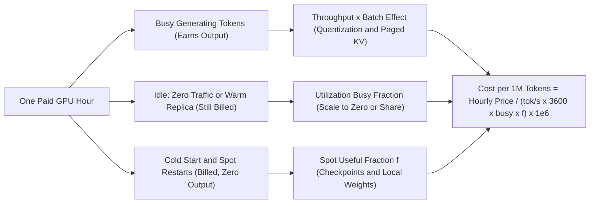
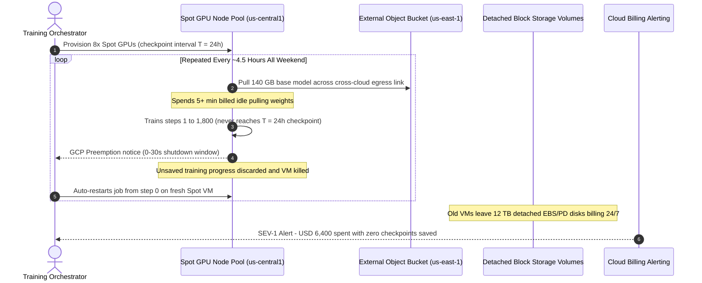

# Module 13: Cloud GPU Economics

> **Prerequisites:** [Module 03: Memory Hierarchy and Bandwidth](../03-memory-hierarchy-and-bandwidth/README.md), [Module 05: Model Memory Requirements](../05-calculating-a-models-memory-requirements/README.md), [Module 12: Choosing GPUs: Consumer vs. Datacenter](../12-choosing-gpus-consumer-vs-datacenter/README.md)  
> **Estimated Reading Time:** 30 minutes  
> **Target Audience:** AI Platform Engineers, FinOps Architects, ML Infrastructure Leads

> [!TIP]
> **The Golden Rule of Cloud GPU Economics**  
> Cost per useful unit of work equals hourly instance price divided by useful work per hour. Both **utilization** (fraction of paid hours doing real inference or training) and **throughput** (tokens per second via batching) sit in the denominator—moving either one usually changes your bill far more than negotiating a lower sticker rate per hour.

> [!WARNING]
> **Illustrative Inputs Notice**  
> Every price, throughput, and rate in this module's calculators is **ILLUSTRATIVE**. None is a real provider quote or measured hardware benchmark; they are round numbers chosen so you can verify every line of arithmetic by hand. Only the *structural* provider facts (how billing states, termination notices, and egress tiers work) are cited from provider pages fetched in Oct 2026. Replace every input with your own measured throughput and dated provider quotes.

---

## 1. Visual Mental Models & Unit Economics Formulas

**Where this sits.** [Module 12](../12-choosing-gpus-consumer-vs-datacenter/README.md) gave you a shortlist of cards that pass the six technical gates. This module prices running one, and the answer is a cost *model*, not a price list. It builds on memory sizing ([Module 05](../05-calculating-a-models-memory-requirements/README.md), how much batch fits) and memory bandwidth ([Module 03](../03-memory-hierarchy-and-bandwidth/README.md), why batching raises throughput). [Module 14](../14-running-models-on-cpu-and-apple-silicon/README.md) examines the alternative of avoiding GPU rentals entirely.

**After this module you can** convert an hourly instance rate and measured throughput into cost per million tokens, explain why idle utilization dominates sticker price, compute a rent-versus-buy break-even point, evaluate when preemptible spot capacity pays off, and audit non-GPU bill lines (storage, egress, and cold-start pulls).

**Why it matters.** A cloud GPU bills while allocated, not while producing tokens. Most of the gap between a cheap and an expensive deployment of the exact same model comes from idle time and batch concurrency, not hourly hardware rates.



### The Core Bridge Formula

A rented GPU is billed by allocation time, whereas your product unit is cost per million generated tokens (or per completed training run):

$$\text{tokens\_per\_hour} = \text{tokens\_per\_second} \times 3600 \times \text{busy\_fraction} \times f_{\text{useful}}$$

$$\text{cost\_per\_1M\_tokens} = \frac{\text{price\_per\_hour}}{\text{tokens\_per\_hour}} \times 10^6$$

Where $\text{busy\_fraction}$ is the share of paid hours actively serving requests, and $f_{\text{useful}}$ captures interruption loss if running on spot capacity. Every lever in cloud FinOps targets one of these terms: **price** (purchase commitment), **throughput** (batching, hardware, quantization), or **busy/useful fraction** (autoscaling, checkpoint cadence, image caching).

> [!NOTE]
> **The Chartered Bus Analogy**  
> A rented GPU is a chartered bus: the hourly fare is identical whether it carries one passenger or forty. Cost per passenger falls when you fill the seats (batching), keep the bus on active routes (utilization), and book a contract charter when demand is predictable (commitments). Buying a cheaper bus with 10% fewer seats rarely beats filling the bus you already pay for.

### Utilization Is the Dominant Variable

Because allocation drives billing, idle time costs exactly as much as peak compute. A development GPU box used 40 hours out of a 168-hour week has a busy fraction of $40 / 168 = 0.238$; its effective hourly cost per useful compute hour is $1 / 0.238 \approx 4.2\times$ the sticker price. Stopping an instance helps, yet AWS explicitly notes that *"Some AWS resources, such as Amazon EBS volumes and Elastic IP addresses, incur charges regardless of the instance's state"* ([instance lifecycle docs](https://docs.aws.amazon.com/AWSEC2/latest/UserGuide/ec2-instance-lifecycle.html)), meaning disk snapshots holding model weights continue billing 24/7.

Startup weight pulls count as paid idle time too: downloading 140 GB across a 0.5 GB/s link before serving token one wastes 4.7 minutes of GPU billing on every cold start or spot preemption.

### Throughput: Batching Moves the Denominator

Generating one token for a single request reads all model weights from VRAM. Generating one token each across 32 concurrent requests reads those weights *once*, raising step latency modestly while multiplying emitted tokens by $32\times$. As the vLLM paper opens: *"High throughput serving of large language models (LLMs) requires batching sufficiently many requests at a time"*, constrained directly by per-request KV-cache capacity ([Kwon et al., 2023](https://arxiv.org/abs/2309.06180)).

Our simplified memory-bound decode estimate models step time as:

$$t_{\text{step}} = \frac{W_{\text{bytes}} + B \cdot \text{KV}_{\text{bytes}}}{\text{Bandwidth}}$$

Real engines add scheduler, kernel-launch, and attention overheads, so measure your actual batch-latency curve in staging. Crucially, batching and utilization are two views of the same traffic problem: a lightly loaded endpoint neither stays busy nor fills batches.

### Rent Versus Buy Break-Even

Owning hardware trades hourly variable expense for monthly fixed depreciation plus marginal electricity:

$$F = \frac{\text{purchase\_price} - \text{resale\_value}}{\text{life\_months}} + \text{hosting\_per\_month}$$

$$m = \text{power\_kW} \times \text{electricity\_tariff} \times \text{cooling\_overhead}$$

Setting $\text{rent} = r \cdot H$ equal to $\text{own} = F + m \cdot H$ gives the break-even utilization threshold $H^*$ hours/month:

$$H^* = \frac{F}{r - m}$$

Below $H^*$ hours per month, renting is cheaper; above $H^*$, owning wins on raw cash flow. Remember that $H^*$ is an optimistic boundary: it omits engineering ops time, spare parts for failures, inter-node networking, hardware obsolescence, and driver licence constraints ([Module 12](../12-choosing-gpus-consumer-vs-datacenter/README.md)).

### Spot Capacity Under Interruptions

Each preemption wastes half a checkpoint interval $T/2$ of un-saved work on average, plus restart/reload time $R$. At interruption rate $\lambda$ interruptions/hour, the first-order useful fraction is:

$$f = \frac{1}{1 + \lambda \cdot \left(\frac{T}{2} + R\right)}$$

Spot beats on-demand whenever $\text{spot\_price} / f < \text{on\_demand\_price}$ (equivalently $f > \text{spot\_price} / \text{on\_demand\_price}$). Once $\lambda \cdot T$ approaches or exceeds $1$, jobs risk starving between checkpoints and the approximation breaks down.

### Egress, Storage, and the Rest of the Bill

- **Egress:** Cloud networks charge for data leaving their network while leaving ingress free. Google Cloud's VPC Standard Tier page states: *"Data transfer out pricing is per GiB delivered ... Ingress pricing is still free"* ([Google Cloud VPC network pricing](https://cloud.google.com/vpc/network-pricing)). AWS's [EC2 On-Demand pricing page](https://aws.amazon.com/ec2/pricing/on-demand/) follows the identical pattern with separate IN/OUT sections. Generated API tokens are tiny, whereas pulling multi-terabyte checkpoints, fine-tuning datasets, or media assets out to another region or cloud creates steep egress fees.
- **Persistent Storage:** Block volumes and object buckets charge continuously whether GPU instances are running or stopped.

---

## 2. Systematic Comparison Matrix: Cloud Purchase Options

Provider structural options fetched in Oct 2026 ([AWS pricing](https://aws.amazon.com/ec2/pricing/) and Google Compute Engine docs):

| Purchase Option | What You Give Up | What You Gain | Documented Provider Mechanics (Oct 2026) |
| :--- | :--- | :--- | :--- |
| **On-Demand** | Lowest hourly price | Start/stop anytime, per-hour or per-second billing, zero lock-in | [AWS pricing](https://aws.amazon.com/ec2/pricing/): *"No upfront payment or long-term commitment"* (Capacity Reservations / Capacity Blocks address availability) |
| **Committed (Savings Plans / Reserved)** | Flexibility: billed for full commitment term | Discounted hourly rate (AWS advertises up to 72% ceiling across eligible types) | AWS Reserved Instances *"applied to terminated instances are billed until the end of their term"* ([instance lifecycle](https://docs.aws.amazon.com/AWSEC2/latest/UserGuide/ec2-instance-lifecycle.html)) |
| **Spot / Preemptible** | Guarantee of retaining the VM | Deep spare-capacity discount (AWS up to 90%, GCP up to 91% ceilings) | AWS gives a *"two minutes before"* notice ([interruption notices](https://docs.aws.amazon.com/AWSEC2/latest/UserGuide/spot-instance-termination-notices.html)); GCP *"can preempt Spot VMs at any time"*, up to 30 s shutdown period, default notice 0 s ([Spot VMs](https://docs.cloud.google.com/compute/docs/instances/spot)) |

> [!CAUTION]
> **Commitments Are a Bet on Utilization**  
> A Savings Plan or Reserved Instance cuts the hourly rate while turning idle hours into fixed sunk cost. If an instance is busy only 20% of the week, an annual commitment bills the other 80% whether requests arrive or not. Treat "up to 72%/91%" marketing banners as ceilings on select CPU/TPU/GPU families, never your guaranteed GPU discount.

---

## 3. Production War Story: Incident Post-Mortem

### Spot Preemption Death Spiral & Orphaned Checkpoint Egress Bill Shock

- **Severity:** SEV-1 (Runaway Cloud Spend & Zero Training Progress Over 72 Hours)
- **Time to Detect:** 72 hours (discovered during Monday FinOps cost anomaly alert)
- **Time to Resolve:** 6 hours (migrated to regional object storage + frequent async checkpoints + On-Demand fallback)
- **Impact:** A fine-tuning job running across 8x Spot GPUs burned **\$6,400** in compute and cross-cloud egress fees over a weekend while advancing zero optimizer epochs, leaving 12 TB of orphaned EBS volumes billing **\$1,200/month** post-cancellation.

#### What Happened

An ML team launched a 70B LoRA fine-tuning run on GCP Spot VMs in `us-central1`, configured to checkpoint every 24 hours (`T = 24 h`) directly to an external S3 bucket in `us-east-1` over the public internet. Because weekend spot demand spiked in `us-central1`, VMs were preempted every ~4.5 hours ($\lambda \approx 0.22\text{ /hr}$) with a 30-second shutdown window.

With a 24-hour checkpoint interval, every single preemption wiped out 100% of progress since job start, then restarted from step 0—re-downloading the 140 GB base weights across the internet and burning GPU allocation during weight pulls before dying 4 hours later. Meanwhile, engineers testing fallback configurations manually deleted Pods/VMs without deleting detached block volumes, leaving 12 TB of orphaned persistent disks silently billing.

#### The Failure Sequence Diagram



#### Root Cause Analysis

1. **Violated Spot Stability Condition ($\lambda \cdot T \ll 1$):** Setting checkpoint interval $T = 24\text{ h}$ when $\lambda = 0.22\text{/h}$ yielded $\lambda \cdot T = 5.28 \gg 1$, guaranteeing near-zero useful progress ($f$ collapsed while restarts billed continuously).
2. **Cross-Region / Cross-Cloud Egress:** Pulling and pushing multi-hundred-gigabyte checkpoints across providers converted free ingress into continuous egress charges.
3. **Orphaned Storage Lifecycle:** Ephemeral compute terminations did not carry `DeleteOnTermination` volume policies, leaving idle block disks billing long after compute stopped.

#### The Fix & Architectural Hardening

1. **Enforce Frequent Asynchronous Checkpointing:** Lowered $T$ to 0.25 hours (15 minutes) with asynchronous background upload on SIGTERM/preemption signals, bringing $\lambda \cdot T$ down to $0.055$.
2. **Co-Locate Weights in Same-Region Object Storage:** Staged base weights and checkpoints inside the exact same cloud region (`us-central1`) to eliminate cross-cloud/internet egress and reduce cold weight load latency from 4.7 minutes to under 35 seconds.
3. **Hard Stop Policy & Volume Garbage Collection:** Implemented automated termination hooks (`DeleteOnTermination=true`) plus a daily FinOps reaper flagging unattached storage volumes older than 24 hours and Spot interruption ratios where $f \le \text{spot\_price} / \text{on\_demand\_price}$.

---

## 4. Multi-Language Production Implementations

The carousel below implements the core cloud GPU economics models—cost per 1M tokens under utilization, batching step throughput curve, rent-versus-buy break-even $H^*$, and spot useful fraction $f$—in Go, TypeScript, Python, and C#.

````carousel

### Go: Cloud GPU Unit Economics Calculator

```go
package main

import (
	"fmt"
	"math"
)

func CostPerMillionTokens(pricePerHour, tokensPerSec, busyFraction, usefulFraction float64) float64 {
	tokensPerHour := tokensPerSec * 3600.0 * busyFraction * usefulFraction
	return (pricePerHour / tokensPerHour) * 1e6
}

func BreakEvenHoursPerMonth(capex, resale, lifeYears, hostingPerMo, watts, tariffPerKwh, rentPerHour float64) float64 {
	fixedMonthly := (capex-resale)/(lifeYears*12.0) + hostingPerMo
	marginalHour := (watts / 1000.0) * tariffPerKwh
	if rentPerHour <= marginalHour {
		return math.Inf(1)
	}
	return fixedMonthly / (rentPerHour - marginalHour)
}

func SpotUsefulFraction(interruptionsPerHr, checkpointIntervalHr, restartHr float64) float64 {
	return 1.0 / (1.0 + interruptionsPerHr*(checkpointIntervalHr/2.0+restartHr))
}

func main() {
	// ILLUSTRATIVE placeholder inputs only
	price, tps := 2.00, 1000.0
	for _, busy := range []float64{1.00, 0.60, 0.30, 0.10} {
		fmt.Printf("busy=%4.0f%% -> $%.3f / 1M tokens\n", busy*100, CostPerMillionTokens(price, tps, busy, 1.0))
	}

	hStar := BreakEvenHoursPerMonth(8000, 2000, 3, 0, 450, 0.15, 1.50)
	fmt.Printf("Rent vs Buy break-even H* = %.1f h/mo (%.1f%% of 730h)\n", hStar, (hStar/730.0)*100)

	f := SpotUsefulFraction(0.20, 0.5, 0.10)
	fmt.Printf("Spot f=%.3f -> effective spot rate $%.3f/useful h (on $0.80/h spot)\n", f, 0.80/f)
}
```

<!-- slide -->

### TypeScript: Cloud GPU Unit Economics Calculator

```typescript
export function costPerMillionTokens(
  pricePerHour: number,
  tokensPerSecond: number,
  busyFraction: number = 1.0,
  usefulFraction: number = 1.0
): number {
  const tokensPerHour = tokensPerSecond * 3600 * busyFraction * usefulFraction;
  return (pricePerHour / tokensPerHour) * 1e6;
}

export function breakEvenHours(
  capex: number,
  resale: number,
  lifeYears: number,
  watts: number,
  tariffPerKwh: number,
  rentPerHour: number,
  hostingPerMonth: number = 0
): number {
  const fixedMonthly = (capex - resale) / (lifeYears * 12) + hostingPerMonth;
  const marginalPerHour = (watts / 1000) * tariffPerKwh;
  if (rentPerHour <= marginalPerHour) return Infinity;
  return fixedMonthly / (rentPerHour - marginalPerHour);
}

export function spotUsefulFraction(
  interruptionsPerHour: number,
  checkpointIntervalH: number,
  restartH: number
): number {
  return 1 / (1 + interruptionsPerHour * (checkpointIntervalH / 2 + restartH));
}

// ILLUSTRATIVE placeholder inputs only
for (const busy of [1.0, 0.6, 0.3, 0.1]) {
  const cost = costPerMillionTokens(2.0, 1000, busy);
  console.log(`busy=${(busy * 100).toFixed(0)}% -> $${cost.toFixed(3)} / 1M tokens`);
}

const hStar = breakEvenHours(8000, 2000, 3, 450, 0.15, 1.5);
console.log(`Break-even H* = ${hStar.toFixed(1)} h/month (${((hStar / 730) * 100).toFixed(1)}%)`);

const f = spotUsefulFraction(0.2, 0.5, 0.1);
console.log(`Spot f=${f.toFixed(3)}, effective $/useful hr = $${(0.8 / f).toFixed(3)}`);
```

<!-- slide -->

### Python: Cloud GPU Unit Economics Calculator

```python
# ILLUSTRATIVE placeholder inputs only.

def cost_per_million_tokens(price_per_hour: float, tokens_per_second: float,
                            busy_fraction: float = 1.0, useful_fraction: float = 1.0) -> float:
    tokens_per_hour = tokens_per_second * 3600 * busy_fraction * useful_fraction
    return (price_per_hour / tokens_per_hour) * 1e6

def break_even_hours(capex: float, resale: float, life_years: int,
                     watts: float, tariff_per_kwh: float, rent_per_hour: float,
                     hosting_per_month: float = 0.0) -> float:
    fixed = (capex - resale) / (life_years * 12) + hosting_per_month
    marginal = (watts / 1000.0) * tariff_per_kwh
    return float("inf") if rent_per_hour <= marginal else fixed / (rent_per_hour - marginal)

def spot_useful_fraction(lam: float, ckpt_h: float, restart_h: float) -> float:
    return 1.0 / (1.0 + lam * (ckpt_h / 2.0 + restart_h))

if __name__ == "__main__":
    for busy in (1.0, 0.6, 0.3, 0.1):
        print(f"busy={busy:4.0%} -> ${cost_per_million_tokens(2.00, 1000, busy):.3f} / 1M tokens")
    h_star = break_even_hours(8000, 2000, 3, 450, 0.15, 1.50)
    print(f"Break-even H* = {h_star:.1f} h/month ({h_star / 730:.1%})")
    f = spot_useful_fraction(0.20, 0.5, 0.10)
    print(f"Spot f={f:.3f}, effective rate=${0.80 / f:.3f}/useful h")
```

<!-- slide -->

### C#: Cloud GPU Unit Economics Calculator

```csharp
using System;

public static class CloudGpuEconomics
{
    public static double CostPerMillionTokens(
        double pricePerHour, double tokensPerSec, double busyFraction = 1.0, double usefulFraction = 1.0)
    {
        double tokensPerHour = tokensPerSec * 3600.0 * busyFraction * usefulFraction;
        return (pricePerHour / tokensPerHour) * 1e6;
    }

    public static double BreakEvenHours(
        double capex, double resale, int lifeYears, double watts,
        double tariffPerKwh, double rentPerHour, double hostingPerMonth = 0.0)
    {
        double fixedMonthly = (capex - resale) / (lifeYears * 12.0) + hostingPerMonth;
        double marginalHour = (watts / 1000.0) * tariffPerKwh;
        return rentPerHour <= marginalHour ? double.PositiveInfinity : fixedMonthly / (rentPerHour - marginalHour);
    }

    public static double SpotUsefulFraction(double lamPerHr, double ckptH, double restartH)
        => 1.0 / (1.0 + lamPerHr * (ckptH / 2.0 + restartH));

    public static void Main()
    {
        // ILLUSTRATIVE placeholder inputs only
        foreach (var busy in new[] { 1.0, 0.6, 0.3, 0.1 })
            Console.WriteLine($"busy={busy:P0} -> ${CostPerMillionTokens(2.00, 1000, busy):F3} / 1M tokens");

        double hStar = BreakEvenHours(8000, 2000, 3, 450, 0.15, 1.50);
        Console.WriteLine($"Break-even H* = {hStar:F1} h/month ({hStar / 730.0:P1})");

        double f = SpotUsefulFraction(0.20, 0.5, 0.10);
        Console.WriteLine($"Spot f={f:F3}, effective rate=${0.80 / f:F3}/useful h");
    }
}
```

````

### Verified Reference Calculations (Python 3.13)

All five blocks use standard-library Python 3.13 with placeholder inputs so every number can be checked by hand.

#### 1. Cost per Million Tokens vs. Utilization

```python
# ILLUSTRATIVE inputs only. None of these are real provider prices or measured throughputs.

def cost_per_million_tokens(price_per_hour, tokens_per_second, busy_fraction=1.0):
    """$ per 1M generated tokens = price_per_hour / tokens_per_hour * 1e6,
    where tokens_per_hour counts only the hours you actually pay for AND keep busy."""
    tokens_per_hour = tokens_per_second * 3600 * busy_fraction
    return price_per_hour / tokens_per_hour * 1e6

PRICE = 2.00      # ILLUSTRATIVE $/hour for one GPU
TPS = 1000        # ILLUSTRATIVE tokens/second at your serving batch size

print(f"price ${PRICE:.2f}/h, throughput {TPS} tok/s")
for busy in (1.00, 0.60, 0.30, 0.10):
    c = cost_per_million_tokens(PRICE, TPS, busy)
    print(f"  busy {busy:>4.0%}  ->  ${c:7.3f} per 1M tokens")
```

**Expected Output:**

```text
price $2.00/h, throughput 1000 tok/s
  busy 100%  ->  $  0.556 per 1M tokens
  busy  60%  ->  $  0.926 per 1M tokens
  busy  30%  ->  $  1.852 per 1M tokens
  busy  10%  ->  $  5.556 per 1M tokens
```

> [!NOTE]
> **Check It by Hand**  
> At 100% busy, $1{,}000\text{ tok/s} \times 3{,}600 = 3{,}600{,}000\text{ tokens/hour}$, so $\$2.00$ divided by $3.6 \times 10^6$ times $10^6$ equals **\$0.5556** per million tokens (`0.556`). At 30% busy, tokens/hour drops to $1{,}080{,}000$ and cost jumps to **\$1.8519** per million tokens—the identical GPU at the identical sticker rate costs $3.33\times$ more per token because 70% of paid hours sat idle.

#### 2. Batching: Throughput and Cost as Batch Size Grows (Estimate)

```python
# ESTIMATE with ILLUSTRATIVE inputs: a memory-bound decode model of throughput vs batch size.
W_GB = 14.0        # weights read once per decode step (7B params x 2 bytes)
KV_GB = 1.0        # KV cache per sequence at the context length you serve (assumption)
BW_GBS = 1000.0    # memory bandwidth (assumption)
COMPUTE_CAP = 5000 # tokens/s the arithmetic units could sustain (assumption)
VRAM_GB = 80.0     # card memory; 90% treated as usable
PRICE = 2.00       # $/hour (assumption)

max_batch = int((0.9 * VRAM_GB - W_GB) // KV_GB)
print(f"max batch that fits in memory: {max_batch}")
print(f"{'batch':>5} {'step ms':>8} {'tok/s':>8} {'$/1M tok':>9}")
for b in (1, 2, 4, 8, 16, 32, max_batch):
    step_s = (W_GB + b * KV_GB) / BW_GBS          # bytes moved per step / bandwidth
    tps = min(b / step_s, COMPUTE_CAP)            # b tokens per step, capped by compute
    cost = PRICE / (tps * 3600) * 1e6
    print(f"{b:>5} {step_s*1000:>8.1f} {tps:>8.0f} {cost:>9.2f}")
```

**Expected Output:**

```text
max batch that fits in memory: 58
batch  step ms    tok/s  $/1M tok
    1     15.0       67      8.33
    2     16.0      125      4.44
    4     18.0      222      2.50
    8     22.0      364      1.53
   16     30.0      533      1.04
   32     46.0      696      0.80
   58     72.0      806      0.69
```

> [!NOTE]
> **Check It by Hand**  
> At batch 1: step $= (14 + 1)\text{ GB} / 1000\text{ GB/s} = 15.0\text{ ms}$, giving $66.7\text{ tok/s} = 240{,}000\text{ tokens/hour}$, so **\$2.00** / $240{,}000 \times 10^6$ = **\$8.33**. At batch 32: step $= (14 + 32) / 1000 = 46.0\text{ ms}$, yielding $695.7\text{ tok/s} = 2{,}504{,}348\text{ tokens/hour}$ and **\$0.80** per million tokens. Step time grew $3.1\times$ while emitted tokens grew $32\times$. Memory capacity (`batch = 58`) caps the curve before the compute ceiling is ever reached.

#### 3. Rent Versus Buy

```python
# ILLUSTRATIVE inputs only.
HOURS_PER_MONTH = 730          # 8760 / 12

def own_monthly_fixed(capex, resale, life_years, hosting_per_month=0.0):
    """Cost of owning that does not depend on how much you use the card."""
    return (capex - resale) / (life_years * 12) + hosting_per_month

def own_marginal_per_hour(watts, tariff_per_kwh, overhead=1.0):
    """Electricity for an hour of actual use. overhead=1.0 means no cooling/PSU loss."""
    return watts / 1000 * tariff_per_kwh * overhead

def break_even_hours(fixed_per_month, own_per_hour, rent_per_hour):
    """Rent costs r*H, own costs F + m*H  =>  H* = F / (r - m)."""
    if rent_per_hour <= own_per_hour:
        return float("inf")
    return fixed_per_month / (rent_per_hour - own_per_hour)

CAPEX, RESALE, LIFE = 8000.0, 2000.0, 3     # ILLUSTRATIVE: card + share of the machine
F = own_monthly_fixed(CAPEX, RESALE, LIFE)
M = own_marginal_per_hour(450, 0.15)        # ILLUSTRATIVE: 450 W at $0.15/kWh
R = 1.50                                    # ILLUSTRATIVE rental $/hour for a comparable GPU

h = break_even_hours(F, M, R)
print(f"fixed ownership cost   F = (({CAPEX:.0f} - {RESALE:.0f}) / ({LIFE} x 12)) = ${F:.2f}/month")
print(f"marginal power cost    m = 0.450 kW x $0.15 = ${M:.4f}/hour")
print(f"rental                 r = ${R:.2f}/hour")
print(f"break-even             H* = F / (r - m) = {h:.1f} hours/month = {h/HOURS_PER_MONTH:.1%} of the month")
for hours in (50, 100, h, 200, 400, 730):
    rent = R * hours
    own = F + M * hours
    print(f"  use {hours:>6.1f} h/month: rent ${rent:8.2f}  own ${own:8.2f}  cheaper: {'rent' if rent < own - 0.005 else ('own' if own < rent - 0.005 else 'tie')}")
```

**Expected Output:**

```text
fixed ownership cost   F = ((8000 - 2000) / (3 x 12)) = $166.67/month
marginal power cost    m = 0.450 kW x $0.15 = $0.0675/hour
rental                 r = $1.50/hour
break-even             H* = F / (r - m) = 116.3 hours/month = 15.9% of the month
  use   50.0 h/month: rent $   75.00  own $  170.04  cheaper: rent
  use  100.0 h/month: rent $  150.00  own $  173.42  cheaper: rent
  use  116.3 h/month: rent $  174.52  own $  174.52  cheaper: tie
  use  200.0 h/month: rent $  300.00  own $  180.17  cheaper: own
  use  400.0 h/month: rent $  600.00  own $  193.67  cheaper: own
  use  730.0 h/month: rent $ 1095.00  own $  215.94  cheaper: own
```

> [!NOTE]
> **Check Break-Even by Hand**  
> Fixed cost $F = (8000 - 2000) / 36 =$ **\$166.67/month**. Marginal power $m = 0.450\text{ kW} \times$ **\$0.15** = **\$0.0675/hour**. Thus $H^* = 166.67 / (1.50 - 0.0675) = 116.35\text{ hours}$ ($15.9\%$ of a 730-hour month). At 200 hours/month: renting costs $200 \times$ **\$1.50** = **\$300.00**, while owning costs **\$166.67** + $200 \times$ **\$0.0675** = **\$180.17**.

#### 4. Spot Capacity with Interruptions, Idle Time, and Weight Load Time

```python
# ILLUSTRATIVE inputs only.

def spot_useful_fraction(interruptions_per_hour, checkpoint_every_h, restart_h):
    """First-order model: each interruption wastes half a checkpoint interval of work plus a restart.
    f = 1 / (1 + lam * (T/2 + R)).  Only trustworthy while lam * T is well below 1."""
    return 1 / (1 + interruptions_per_hour * (checkpoint_every_h / 2 + restart_h))

ON_DEMAND = 2.00   # ILLUSTRATIVE $/h
SPOT = 0.80        # ILLUSTRATIVE $/h

print(f"on-demand ${ON_DEMAND:.2f}/h, spot ${SPOT:.2f}/h  ->  spot wins when spot / f < on-demand,"
      f" i.e. when f > {SPOT/ON_DEMAND:.2f}")
print(f"{'lam /h':>7} {'ckpt h':>7} {'restart h':>10} {'lam*T':>6} {'f':>6} {'spot $/useful h':>16}  winner")
for lam, ckpt, restart in ((0.05, 0.5, 0.10), (0.20, 0.5, 0.10), (0.20, 2.0, 0.25), (0.20, 24.0, 0.25)):
    f = spot_useful_fraction(lam, ckpt, restart)
    eff = SPOT / f
    print(f"{lam:>7.2f} {ckpt:>7.1f} {restart:>10.2f} {lam*ckpt:>6.2f} {f:>6.3f} {eff:>16.3f}  "
          f"{'spot' if eff < ON_DEMAND else 'on-demand'}")

busy = (8 * 5) / (24 * 7)
print(f"\nalways-on dev box, 8 h/day x 5 days/week: busy = 40/168 = {busy:.3f}; "
      f"${ON_DEMAND:.2f}/h costs ${ON_DEMAND / busy:.2f} per useful hour")

print("\nGPU time spent loading weights before the first token (cost at on-demand price):")
for gb, gbps in ((16, 0.5), (140, 0.5), (140, 2.0)):
    secs = gb / gbps
    print(f"  {gb:>4} GB at {gbps:.1f} GB/s: {secs/60:5.1f} min = ${ON_DEMAND * secs / 3600:.3f}")
```

**Expected Output:**

```text
on-demand $2.00/h, spot $0.80/h  ->  spot wins when spot / f < on-demand, i.e. when f > 0.40
 lam /h  ckpt h  restart h  lam*T      f  spot $/useful h  winner
   0.05     0.5       0.10   0.03  0.983            0.814  spot
   0.20     0.5       0.10   0.10  0.935            0.856  spot
   0.20     2.0       0.25   0.40  0.800            1.000  spot
   0.20    24.0       0.25   4.80  0.290            2.760  on-demand

always-on dev box, 8 h/day x 5 days/week: busy = 40/168 = 0.238; $2.00/h costs $8.40 per useful hour

GPU time spent loading weights before the first token (cost at on-demand price):
    16 GB at 0.5 GB/s:   0.5 min = $0.018
   140 GB at 0.5 GB/s:   4.7 min = $0.156
   140 GB at 2.0 GB/s:   1.2 min = $0.039
```

#### 5. Egress and Storage in the Monthly Bill

```python
# ILLUSTRATIVE inputs only: round placeholder rates, NOT any provider's prices.
GPU_RATE = 2.00          # $/GPU-hour
STORAGE_RATE = 0.10      # $/GB-month for block/object storage (placeholder)
EGRESS_RATE = 0.10       # $/GB sent out to the internet (placeholder)

def monthly_bill(gpu_hours, stored_gb, egress_gb):
    compute = gpu_hours * GPU_RATE
    storage = stored_gb * STORAGE_RATE      # billed every hour of the month, even with the GPU stopped
    egress = egress_gb * EGRESS_RATE
    return compute, storage, egress

scenarios = {
    "occasional experiments": dict(gpu_hours=40,  stored_gb=600, egress_gb=20),
    "daily batch job":        dict(gpu_hours=200, stored_gb=600, egress_gb=500),
    "always-on endpoint":     dict(gpu_hours=730, stored_gb=600, egress_gb=3000),
}
print(f"{'scenario':<24}{'compute':>9}{'storage':>9}{'egress':>9}{'total':>9}  non-compute share")
for name, kw in scenarios.items():
    c, s, e = monthly_bill(**kw)
    total = c + s + e
    print(f"{name:<24}{c:>9.2f}{s:>9.2f}{e:>9.2f}{total:>9.2f}  {(s + e) / total:>7.1%}")
```

**Expected Output:**

```text
scenario                  compute  storage   egress    total  non-compute share
occasional experiments      80.00    60.00     2.00   142.00    43.7%
daily batch job            400.00    60.00    50.00   510.00    21.6%
always-on endpoint        1460.00    60.00   300.00  1820.00    19.8%
```

At low GPU usage (`40 h/month`), persistent storage alone causes non-compute lines to consume nearly 44% of the invoice because disk capacity never shrinks when GPUs power down.

---

## 5. Practical Hands-On Verification & CLI Workflows

### Verification 1: Sensitivity Check on Utilization & Break-Even

Run this Python CLI verification locally to observe how utilization from 30% to 80% drives cost per million tokens down by 62.5%:

```bash
python3 - << 'EOF'
def metrics(price, tps, busy, capex, resale, months, kw, kwh):
    cost_1m = price / (tps * 3600 * busy) * 1e6
    F = (capex - resale) / months
    m = kw * kwh
    H_star = F / (price - m)
    print(f"price=${price:.2f}/h busy={busy:.0%} -> ${cost_1m:.3f}/1M tok | break-even={H_star:.1f}h/mo ({H_star/730:.1%})")
metrics(2.00, 1000, 0.30, 8000, 2000, 36, 0.45, 0.15)
metrics(2.00, 1000, 0.80, 8000, 2000, 36, 0.45, 0.15)
EOF
```

**Expected Output:**

```text
price=$2.00/h busy=30% -> $1.852/1M tok | break-even=86.2h/mo (11.8%)
price=$2.00/h busy=80% -> $0.694/1M tok | break-even=86.2h/mo (11.8%)
```

### Verification 2: Auditing Orphaned Cloud Volumes & Unattached IPs (Cloud CLI)

Before stopping GPU fleets for the weekend, inspect unattached storage volumes and static IPs that continue accruing charges:

```bash
# AWS: Find unattached EBS volumes still billing while GPU instances are stopped
aws ec2 describe-volumes --filters Name=status,Values=available --query "Volumes[*].[VolumeId,Size,VolumeType]" --output table

# GCP: Find unattached persistent disks not mounted to any running VM
gcloud compute disks list --filter="-users:*" --format="table(name,zone,sizeGb,type)"
```

### Practice Exercises

#### 1. Utilization
A GPU costs \$3.50 per hour (placeholder) and serves 800 tokens/s when busy. What is the cost per million tokens at 50% busy? What busy fraction brings it to \$1.50?

<details><summary>Answer</summary>

At 100% busy the cost is 3.50 / (800 x 3600) x 1e6 = 3.50 / 2,880,000 x 1e6 = \$1.2153; cost scales as 1 / busy. At 50%: \$1.2153 / 0.5 = \$2.4306 per million tokens (check: tokens/hour = 1,440,000 and 3.50 / 1.44e6 x 1e6 = 2.4306). For \$1.50: busy = 1.2153 / 1.50 = 0.810, so about 81% of paid hours must be busy.

</details>

#### 2. Break-Even with New Inputs
Purchase \$3,000, resale \$800, life 2 years, 350 W at \$0.20 per kWh, rental \$1.00 per hour. Find the break-even hours per month and the share of a 730-hour month.

<details><summary>Answer</summary>

F = (3000 - 800) / 24 = \$91.67. m = 0.350 x 0.20 = \$0.07 per hour. H* = 91.67 / (1.00 - 0.07) = 91.67 / 0.93 = 98.57 hours per month, 98.57 / 730 = 13.5% of the month. Below about 99 hours a month, renting wins on these inputs.

</details>

#### 3. How Long Can the Checkpoint Interval Be?
On-demand is \$2.00 per hour, spot is \$1.60, interruptions arrive 0.2 per hour, restart takes 0.1 hour. What is the longest checkpoint interval at which spot still beats on-demand?

<details><summary>Answer</summary>

Spot wins when `f > 1.60 / 2.00 = 0.80`. With `f = 1 / (1 + lam (T/2 + R))` that means `lam (T/2 + R) < 0.25`, so `T/2 + 0.1 < 1.25`, so `T < 2.3` hours. Check at `T = 2.3`: lost per interruption = 1.15 + 0.10 = 1.25, times 0.2 = 0.25, `f = 1 / 1.25 = 0.80`, a tie. Here `lam x T` = 0.46, inside the model's comfort zone.

</details>

#### 4. The Bill That Is Not Compute
A team keeps 2 TB of checkpoints in storage for a month at a placeholder \$0.10 per GB-month, copies 500 GB out at a placeholder \$0.10 per GB, and uses 50 GPU-hours at \$2.00. What share of the bill is not compute?

<details><summary>Answer</summary>

Storage: 2000 GB x \$0.10 = \$200. Egress: 500 x \$0.10 = \$50. Compute: 50 x \$2.00 = \$100. Total \$350; non-compute is \$250, which is 71.4%. Compute was the smallest line.

</details>

### Checkpoint Quiz

1. State the cost-per-million-tokens formula and the three inputs that move it.
2. Why can a stopped instance still cost money?
3. Why does batching cut cost per token, and what caps the batch?
4. State the rent-versus-buy break-even and one thing it leaves out.
5. When does spot beat on-demand, in terms of `f`?

<details><summary>Answers</summary>

1. `price_per_hour / (tokens_per_second * 3600 * busy_fraction) * 1e6`; price, throughput, busy fraction.
2. Volumes and addresses charge regardless of instance state (AWS instance-state docs); commitments bill to the end of their term.
3. Weights are read once per step whatever the batch, so more requests per step give more tokens for a small step-time increase. Memory (weights plus a KV cache per request) and the number of simultaneous requests cap it.
4. `H* = F / (r - m)`. It leaves out operations effort, failures, networking, obsolescence and licence limits.
5. When `f > spot_price / on_demand_price`.

</details>

> [!NOTE]
> **Self-Check Mastery List**  
> - I can compute cost per million tokens and trace how each term moves the output.  
> - I can explain why an idle allocated GPU costs identically to a saturated one.  
> - I can derive a rent-versus-buy break-even and state what it omits.  
> - I can calculate when spot capacity beats on-demand and when preemption destroys progress.  
> - I can audit non-compute cloud invoice lines (storage, egress, weight pull time).

### Mini-Project: Full Deployment Cost Model & Sensitivity Report

Build a cost model for a stated scenario, with no code or solution provided here.

1. Pick a scenario, for example *"serve an open-weights chat model to a product with 200,000 requests per day, average 300 generated tokens each, with a daily peak of 20 times the average rate"*.
2. Build a calculator that compares at least four deployments: always-on on-demand, always-on with a commitment, scale-to-zero with a cold-start penalty, and spot for the batch part of the work. Include storage, egress and model-load time.
3. Every price is an input with a source URL and the date you read it, or an explicitly labelled placeholder; every throughput is measured by you or labelled an estimate with its formula.
4. Run a sensitivity analysis on the two inputs you trust least (utilization and throughput are likely) and show how the winning deployment changes.
5. Write a one-paragraph recommendation that states the condition under which you would reverse it.

Success looks like: the arithmetic of two cases checked by hand in your write-up, no unlabelled number, and a result that names its most fragile assumption.

---

## 6. Operational Validation Checkpoints

### Scenario 1: Hourly Rate Discount vs. Batching & Utilization

<details>
<summary><strong>Question:</strong> Provider A offers an older GPU at \$1.00/hour (illustrative) that sustains 180 tokens/s at your target batch, while Provider B offers a higher-bandwidth GPU at \$2.00/hour sustaining 720 tokens/s. Both run at 50% busy fraction. Which is cheaper per million generated tokens, and by what factor?</summary>

**Answer:**
Provider B is twice as cheap per million tokens despite costing twice as much per hour. Provider A emits $180 \times 3600 \times 0.50 = 324{,}000$ tokens/hour, costing **\$1.00** / $0.324 =$ **\$3.086** per 1M tokens. Provider B emits $720 \times 3600 \times 0.50 = 1{,}296{,}000$ tokens/hour, costing **\$2.00** / $1.296 =$ **\$1.543** per 1M tokens—a 50% unit cost reduction.

</details>

### Scenario 2: Commitment Lock-In vs. Diurnal Traffic

<details>
<summary><strong>Question:</strong> Your internal coding assistant receives heavy traffic 9 hours per weekday (45 hours/week) and sits nearly idle evenings and weekends. Finance suggests a 1-year reserved instance offering a 40% hourly discount over on-demand (\$1.20/hr vs. \$2.00/hr). Should you buy the 1-year commitment instead of auto-scaling on-demand?</summary>

**Answer:**
No—auto-scaling on-demand wins heavily. A 1-year reservation bills all 168 hours per week ($168 \times$ **\$1.20** = **\$201.60/week**), whereas running on-demand only for the 45 active hours bills $45 \times$ **\$2.00** = **\$90.00/week** (plus minor EBS snapshot storage), cutting weekly compute spend by more than half.

</details>

### Scenario 3: Spot Preemption Threshold Check

<details>
<summary><strong>Question:</strong> A batch offline summarization job runs on Spot GPUs priced at \$0.75/hr versus \$2.50/hr On-Demand. Interruptions arrive at $\lambda = 0.40\text{/hr}$, checkpoints run every $T = 1.0\text{ h}$, and restart + model load takes $R = 0.25\text{ h}$. Does Spot beat On-Demand?</summary>

**Answer:**
Spot requires $f > 0.75 / 2.50 = 0.30$. Computing $f = 1 / (1 + 0.40 \times (0.50 + 0.25)) = 1 / 1.30 = 0.769$, giving an effective spot cost of **\$0.75** / $0.769 =$ **\$0.975** per useful hour—still well below the **\$2.50** on-demand rate (with $\lambda \cdot T = 0.40$, inside the first-order model's safe zone).

</details>

---

## 7. Interview Questions

> [!interview]
> Our GPU bill doubled but traffic grew by 20%. Where do you look first?

<details><summary>What a strong answer covers</summary>

- Utilization and idle time first: allocated-but-idle instances, warm replicas, no scale-down.
- Throughput: batch size, whether the engine batches, whether the GPU is memory-bound.
- Non-GPU lines (storage left behind, egress) and purchase-option mismatches (commitments sized for peak).
- Ask for measured busy fraction and tokens/s before proposing changes.

</details>

> [!interview]
> When is buying GPUs cheaper than renting them?

<details><summary>What a strong answer covers</summary>

- The break-even `H* = F / (r - m)`: a utilization threshold, not a date.
- Stable high utilization over the hardware's life, plus power and cooling.
- Costs outside the formula: operations, failures, networking, obsolescence, and the licence limits on consumer cards in a datacenter (Module 12). Renting keeps the option to change generation.

</details>

> [!interview]
> When would you refuse to put a workload on spot capacity?

<details><summary>What a strong answer covers</summary>

- A latency-sensitive endpoint with no redundancy: notices are short (AWS two minutes; Google a shutdown period of up to 30 seconds, notice defaulting to 0 seconds).
- Long jobs without checkpoints, where `lam x T` is large and the useful fraction collapses; and capacity risk, since there may be no replacement GPU to restart on.
- It is good for retryable or checkpointed work where `f > spot / on-demand`.

</details>

---

## 8. Common Mistakes & Troubleshooting

- **Comparing hourly prices across GPUs without throughput.** A card at twice the price doing three times the work is cheaper per token. Compare cost per unit of work with measured throughput.
- **Using peak throughput as sustained.** A full-batch benchmark is the best case; your traffic may never fill the batch. Use your own load profile.
- **A stopped instance that still bills.** Check volumes, snapshots and addresses after stopping.
- **Quoting an "up to X%" discount as the expected one, or baking prices into code.** Keep prices as dated inputs, as this module's calculators do.

---

## 9. Further Reading & Sources

- [Amazon EC2 pricing](https://aws.amazon.com/ec2/pricing/) - AWS's own description of On-Demand, Savings Plans, Spot and capacity-reservation purchase options (fetched Oct 2026); cited for the structure of the options, not for any price.
- [Spot Instance interruption notices (AWS)](https://docs.aws.amazon.com/AWSEC2/latest/UserGuide/spot-instance-termination-notices.html) - the documented two-minute warning that the spot model assumes you can act on.
- [Spot VMs (Google Compute Engine)](https://docs.cloud.google.com/compute/docs/instances/spot) - preemption at any time, the best-effort 30-second shutdown period and the notice-duration setting.
- [Amazon EC2 instance state changes](https://docs.aws.amazon.com/AWSEC2/latest/UserGuide/ec2-instance-lifecycle.html) - which states bill, that EBS volumes and addresses charge regardless, and that reserved capacity bills to the end of its term.
- [Amazon EC2 On-Demand pricing: Data Transfer](https://aws.amazon.com/ec2/pricing/on-demand/) - AWS's IN/OUT data-transfer structure (fetched Oct 2026), cited for the shape of egress billing, not for any rate.
- [Google Cloud VPC network pricing](https://cloud.google.com/vpc/network-pricing) - the *"ingress is free, data transfer out is billed per GiB"* structure behind the egress discussion.
- [Efficient Memory Management for Large Language Model Serving with PagedAttention](https://arxiv.org/abs/2309.06180) - the vLLM paper, cited for batching as the route to high serving throughput and KV-cache memory as the limit.

---

## Next

[Module 14: Running Models on CPU and Apple Silicon](../14-running-models-on-cpu-and-apple-silicon/README.md)
