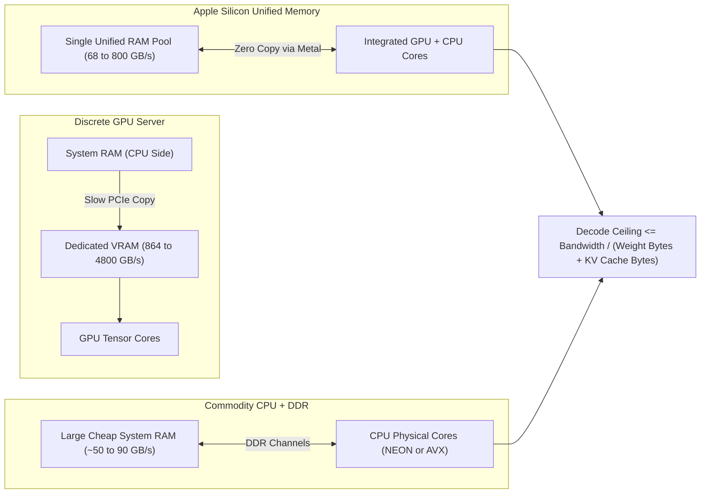
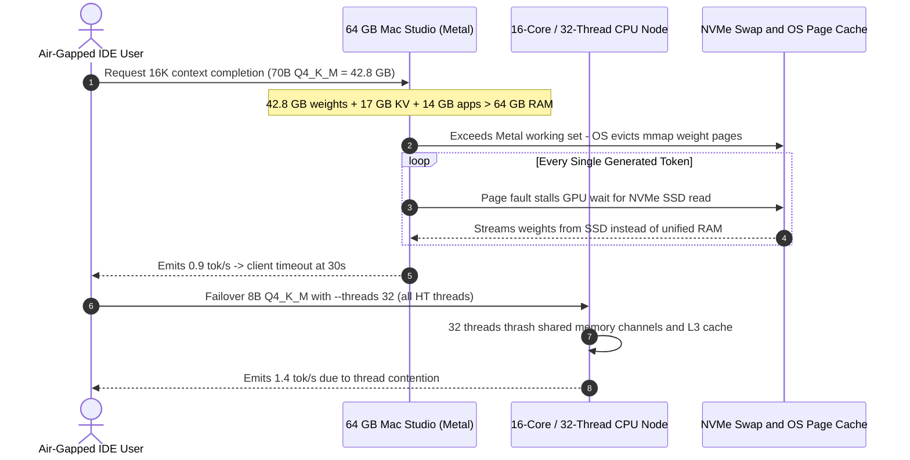

# Module 14: Running Models on CPU and Apple Silicon

> **Prerequisites:** [Module 03: Memory Hierarchy and Bandwidth](../03-memory-hierarchy-and-bandwidth/README.md), [Module 05: Model Memory Requirements](../05-calculating-a-models-memory-requirements/README.md), [Track 04, Module 15: Quantization: INT8, INT4, GGUF](../../04-training-fine-tuning-and-alignment/15-quantization-int8-int4-gguf/README.md)  
> **Estimated Reading Time:** 30 minutes  
> **Target Audience:** Edge AI Engineers, Local Tooling Builders, Backend Systems Architects

> [!TIP]
> **The Golden Rule of Local CPU & Unified-Memory Inference**  
> Single-batch token generation is a **memory-streaming job**: every generated token must read every active weight byte once, capping speed at `memory_bandwidth / bytes_read_per_token`. CPUs and Apple Silicon run large models without GPU rentals because system/unified RAM is large and cheap—and quantization shrinks the weight shelf you walk on every token.

---

## 1. Visual Mental Models & Hardware Streaming Limits

**Where this sits.** Modules 00–13 assumed a discrete GPU with dedicated high-bandwidth HBM/GDDR VRAM. This module explores the zero-rental alternative: executing models on commodity CPU DDR memory or Apple Silicon unified memory. It builds on [Module 03: Memory Hierarchy and Bandwidth](../03-memory-hierarchy-and-bandwidth/README.md) (why bandwidth sets the speed limit), [Module 05](../05-calculating-a-models-memory-requirements/README.md) (how many bytes a model occupies), and [Track 04, Module 15: Quantization: INT8, INT4, GGUF](../../04-training-fine-tuning-and-alignment/15-quantization-int8-int4-gguf/README.md), which this module applies rather than re-teaching. [Module 13](../13-cloud-gpu-economics/README.md) covers the cloud rental alternative; [Module 12](../12-choosing-gpus-consumer-vs-datacenter/README.md) benchmarks discrete cards.

**After this module you can** calculate an upper-bound decode ceiling from two numbers (memory bandwidth and bytes per token), validate estimates against measured `llama.cpp` benchmarks, operate GGUF / `llama.cpp` and Apple's MLX stack, and state realistically what a laptop or CPU box can and cannot serve.

**Why it matters.** Small and quantized models cover local development, offline tooling, and privacy-critical workflows on hardware you already own at zero marginal cost per token. Knowing the streaming bound upfront separates viable models from multi-second-per-token mistakes.



### Deriving the Decode Ceiling

At batch size 1, producing one token multiplies a single activation vector against every weight matrix. Each weight is read once and participates in roughly $2$ floating-point operations (one multiply, one add). Thus work per token is $\approx 2 \times \text{params}$ operations while bytes read equal $\text{params} \times \frac{\text{bits\_per\_weight}}{8}$. That yields **arithmetic intensity**:

- **16-bit weights:** $2\text{ ops} / 2\text{ bytes} \approx 1\text{ op/byte}$.
- **`Q4_K_M` (4.8944 bits/weight):** $2 / (4.8944 / 8) \approx 3.3\text{ ops/byte}$.

By contrast, an Apple M1 Pro sustains roughly $4\text{ TFLOP/s}$ against $200\text{ GB/s}$ of memory bandwidth—an operational ridge point of $\approx 20\text{ ops/byte}$. Because decode demands only $1\text{–}3\text{ ops/byte}$, arithmetic units spend most of the step waiting for memory reads:

$$\text{tokens\_per\_second} \le \frac{\text{bandwidth (bytes/s)}}{\text{bytes\_read\_per\_token}}$$

$$\text{bytes\_read\_per\_token} \approx \text{params} \times \frac{\text{bits\_per\_weight}}{8} + \text{KV\_cache\_bytes\_at\_current\_context}$$

> [!NOTE]
> **The Shelf-Walk Analogy**  
> Picture generating one token as walking once past a bookshelf holding the entire model. Walking speed is memory bandwidth; shelf length is model byte size. A 4-bit model is simply a shorter shelf. Adding faster compute cores does nothing for a walker already bottlenecked by walking speed.

Three direct consequences follow:
1. **Compute upgrades without bandwidth gains barely speed decode.** At fixed bandwidth, extra GPU cores improve prompt processing, not single-user generation.
2. **Prompt processing (`prefill`) is compute-bound, not bandwidth-bound.** Processing a 512-token prompt reuses each weight read 512 times, saturating ALUs so prompt tokens/s runs $7\text{–}34\times$ faster than generation tokens/s.
3. **Mixture-of-Experts (MoE) streams active experts only.** All total parameters must fit in RAM, yet bytes read per token scale only with *active* parameters.

> [!WARNING]
> **The 7% GB vs. GiB Unit Trap**  
> Hardware memory bandwidth is quoted in decimal $\text{GB/s}$ ($10^9\text{ bytes/s}$), whereas GGUF file sizes and `llama-bench` output report binary $\text{GiB}$ ($2^{30}\text{ bytes}$). Dividing GB/s by GiB directly introduces a **$7.37\%$ systematic error** in every estimate. Convert both operands to raw bytes before dividing.

### Checking the Estimate Against Published Measurements

The public benchmark thread [Performance of llama.cpp on Apple Silicon M-series](https://github.com/ggml-org/llama.cpp/discussions/4167) (fetched Oct 2026) reports bandwidth, prompt processing (`pp512`), and text generation (`tg128`, batch 1) for Llama-2-7B (6.74B params) in `F16` (12.55 GiB), `Q8_0` (6.67 GiB), and `Q4_0` (3.56 GiB) on a pinned build (`8e672ef`, 2023 Nov 21):

- **The ceiling strictly holds:** Every chip sits below `bandwidth / file_size`, achieving **45%–86%** of the theoretical ceiling.
- **Shortfall grows as models shrink on ultra-wide buses:** A 7-core M1 (68 GB/s) reaches 80%–83% of ceiling, whereas an M2 Ultra (800 GB/s) reaches 45% on `Q4_0`. Fixed per-token overheads (attention, dequantization, kernel dispatch/sync) consume a larger fraction when weight streaming finishes quickly.
- **Generation tracks bandwidth, not GPU core count:** Between the 60-core and 76-core M2 Ultra (both 800 GB/s), `F16` generation barely moves ($39.86$ vs. $41.02\text{ tok/s}$) while `pp512` jumps from $1128.59$ to $1401.85\text{ tok/s}$.
- **Software builds change measured throughput:** The same thread shows M2 Ultra `Q4_0` generation rising from $94.27\text{ tok/s}$ (`2023 Nov 21`) to $125.21\text{ tok/s}$ on a `2026 Aug 25` build—always record the exact commit/build alongside measurements.

### Apple Unified Memory, Metal, and MLX

Apple's [MLX Unified Memory documentation](https://ml-explore.github.io/mlx/build/html/usage/unified_memory.html) states: *"Apple silicon has a unified memory architecture. The CPU and GPU have direct access to the same memory pool."* Zero PCIe copies occur, yet two practical boundaries still apply:

1. **GPU Allocation Limit (`recommendedMaxWorkingSetSize`):** macOS reserves system headroom. On base 16 GB machines, a 13.5 GiB `F16` model fails because it exceeds the $12.7\text{ GB}$ Metal working set limit. On macOS 15+, the [MLX LM](https://github.com/ml-explore/mlx-lm) README documents raising the wired limit via `sudo sysctl iogpu.wired_limit_mb=N` while noting that models approaching full RAM *"can be slow"*.
2. **Tiered Memory Bandwidth:** M1 (68 GB/s), M1 Pro (200 GB/s), M1 Max (400 GB/s), and M1 Ultra (800 GB/s) span nearly $12\times$ in memory bandwidth, with `Q4_0` decode scaling $5.9\times$ from $14.19$ to $83.73\text{ tok/s}$.

Software paths on Mac:
- [llama.cpp](https://github.com/ggml-org/llama.cpp): Optimized for ARM NEON, Accelerate, and Metal; the [llama.cpp build guide](https://github.com/ggml-org/llama.cpp/blob/master/docs/build.md) confirms Metal is enabled on macOS by default (override to CPU-only with `--n-gpu-layers 0`).
- **MLX / `mlx-lm`:** Apple's native array framework and Python LLM runner supporting 4-bit quantization and LoRA fine-tuning directly on unified memory.

### GGUF and `llama.cpp`: The Practical Workflow

GGUF ([GGUF specification](https://github.com/ggml-org/ggml/blob/master/docs/gguf.md)) packages model architecture metadata, tokenizer vocabulary, and tensor weights into a single `mmap`-friendly binary file for zero-deserialization startup.

### What to Expect—and Not Expect

- **Expect** decode rate to scale roughly linearly with memory bandwidth and inversely with quantized file bytes.
- **Expect** long prompts to stall TTFT (`prompt_tokens / pp_rate`), while long contexts also slow ongoing decode because reading the growing KV cache adds bytes to every single token step.
- **Do not expect** multi-user datacenter throughput: 68–800 GB/s unified memory sits well below the 864–4,800 GB/s of discrete datacenter GPUs ([Module 12](../12-choosing-gpus-consumer-vs-datacenter/README.md)), capping batch concurrency ([Module 13](../13-cloud-gpu-economics/README.md)).
- **Do not skip measuring** on your exact build, context window, quantization, and thread count.

---

## 2. Systematic Comparison Matrix: Local Quantization & Hardware Scaling

### Llama-3.1-8B GGUF Quantization Formats ([quantize README](https://github.com/ggml-org/llama.cpp/blob/master/tools/quantize/README.md))

Block quantization stores per-block scaling factors alongside weights, pushing effective bits-per-weight slightly above nominal bit-widths while trading minor perplexity/KL-divergence loss for streaming speed:

| GGUF Format | Effective Bits / Weight | File Size (8B Model, GiB) | Size Ratio vs. F16 | Reported Generation Rate (tok/s, README) |
| :--- | :--- | :--- | :--- | :--- |
| **F16** | 16.0005 | 14.96 GiB | $1.00\times$ | 29.17 tok/s |
| **Q8_0** | 8.5008 | 7.95 GiB | $1.88\times$ smaller | 50.93 tok/s ($1.75\times$) |
| **Q4_K_M** | 4.8944 | 4.58 GiB | $3.27\times$ smaller | 71.93 tok/s ($2.47\times$) |
| **Q2_K** | 3.1593 | 2.95 GiB | $5.07\times$ smaller | Higher accuracy loss (perplexity rise) |

### Hardware Streaming Tiers (Llama-2-7B `Q4_0`, 3.56 GiB, `llama.cpp` Build `8e672ef`)

| Architecture / Chip | Memory Pool Type | Quoted Bandwidth | Decode Ceiling (tok/s) | Measured `tg128` (tok/s) | Achieved Ceiling % | Measured `pp512` (tok/s) |
| :--- | :--- | :--- | :--- | :--- | :--- | :--- |
| **Dual-Channel DDR5-5600** | CPU System RAM (est. 7B `Q4_K_M`) | 89.6 GB/s (peak) | 20.9 tok/s (est.) | Lower sustained | N/A | Compute-limited |
| **Apple M1 (7 GPU cores)** | Unified RAM | 68 GB/s | 17.8 tok/s | 14.19 tok/s | 80% | 107.81 tok/s |
| **Apple M4 (10 GPU cores)** | Unified RAM | 120 GB/s | 31.4 tok/s | 24.11 tok/s | 77% | 221.29 tok/s |
| **Apple M1 Pro (16 GPU cores)** | Unified RAM | 200 GB/s | 52.3 tok/s | 36.41 tok/s | 70% | 266.25 tok/s |
| **Apple M4 Max (40 GPU cores)** | Unified RAM | 546 GB/s | 142.8 tok/s | 83.06 tok/s | 58% | 885.68 tok/s |
| **Apple M2 Ultra (76 GPU cores)** | Unified RAM | 800 GB/s | 209.3 tok/s | 94.27 tok/s | 45% | 1,238.48 tok/s |

---

## 3. Production War Story: Incident Post-Mortem

### Unified-Memory Swap Thrashing & CPU Thread Oversubscription Stall Local Edge Appliance

- **Severity:** SEV-2 (Severe Tail Latency Degradation & Kernel Watchdog Restarts)
- **Time to Detect:** 25 minutes post-deploy on customer on-prem Mac Studio & Linux CPU nodes
- **Time to Resolve:** 4 hours (quantization downgrade + `sysctl` wired limit tuning + physical-core thread pinning)
- **Impact:** An air-gapped on-premise document assistant dropped from a projected 28 tok/s down to **0.9 tok/s** on 64 GB Mac Studio appliances and **1.4 tok/s** on 16-core Linux Xeon nodes, timing out internal IDE autocomplete clients.

#### What Happened

An engineering team packaged a local 70B `Q4_K_M` model (42.8 GB weights) for air-gapped 64 GB Apple Silicon workstations alongside a fallback Linux CPU build serving an 8B `Q4_K_M` model.

On the 64 GB Mac Studios, engineers configured a 16K context window (`~17 GB` FP16 KV cache) and left default macOS `recommendedMaxWorkingSetSize` settings untouched while background Docker containers consumed 14 GB of RAM. Combined working memory exceeded physical unified RAM, triggering continuous `mmap` page eviction and NVMe swap thrashing on every token pass—collapsing decode to disk I/O speed (`0.9 tok/s`). Simultaneously, on the 16-core/32-thread Linux CPU nodes, the team configured `llama-server --threads 32` matching logical Hyper-Threads instead of physical cores, triggering severe L3 cache thrashing and mutex spin contention across memory channels.

#### The Failure Sequence Diagram



#### Root Cause Analysis

1. **Exceeded Unified RAM & Metal Working Set:** Leaving macOS defaults while sizing only weight bytes ($42.8\text{ GB} < 64\text{ GB}$) ignored the 16K context KV cache and OS/app memory footprint, pushing hot weight pages onto SSD swap.
2. **Thread Oversubscription on Memory-Bound CPU Decode:** Setting `-t 32` equal to logical SMT/Hyper-Thread count doubled synchronization overhead on a job already capped by DDR memory channels.

#### The Fix & Architectural Hardening

1. **Right-Size Context & Quantization Margin:** Switched the 64 GB workstation profile to a 32B `Q4_K_M` (~19.6 GB) model with quantized KV cache and raised `iogpu.wired_limit_mb` cleanly below physical RAM after reserving 16 GB for OS/apps.
2. **Pin CPU Threads to Physical Cores Only:** Enforced `-t <physical_cores>` (16 threads, zero Hyper-Threads) per [llama.cpp token generation performance tips](https://github.com/ggml-org/llama.cpp/blob/master/docs/development/token_generation_performance_tips.md) and benchmarked with `llama-bench` sweeping `-t 1, 2, 4, 8, 16` before release.
3. **Pre-Flight Memory & Swap Guard:** Added startup validation refusing to load GGUF files whose `file_bytes_gb + max_kv_gb` exceed 75% of free physical RAM.

---

## 4. Multi-Language Production Implementations

The carousel below implements a GB/GiB-safe decode ceiling, context KV-cache degradation, and TTFT estimator across Go, TypeScript, Python, and C#.

````carousel

### Go: GB/GiB-Safe Decode Ceiling & Context Degradation Estimator

```go
package main

import "fmt"

const (
	DecimalGB = 1e9
	BinaryGiB = float64(1 << 30)
)

type LocalEstimate struct {
	ContextLen    int
	KVGB          float64
	TotalBytesGB  float64
	CeilingTokSec float64
	ExpectedLow   float64
	ExpectedHigh  float64
}

func EstimateDecodeProfile(fileSizeGiB, bandwidthGBs float64, layers, kvWidth, cacheBytes, ctx int) LocalEstimate {
	weightsBytes := fileSizeGiB * BinaryGiB
	kvPerToken := float64(2 * layers * kvWidth * cacheBytes)
	kvBytes := kvPerToken * float64(ctx)
	totalBytes := weightsBytes + kvBytes
	ceiling := (bandwidthGBs * DecimalGB) / totalBytes

	return LocalEstimate{
		ContextLen:    ctx,
		KVGB:          kvBytes / DecimalGB,
		TotalBytesGB:  totalBytes / DecimalGB,
		CeilingTokSec: ceiling,
		ExpectedLow:   ceiling * 0.45,
		ExpectedHigh:  ceiling * 0.86,
	}
}

func main() {
	// 7B Q4_0 (3.56 GiB) on M4 Max (546 GB/s)
	fmt.Printf("%-8s | %-7s | %-10s | %-12s | %s\n", "Context", "KV (GB)", "Total (GB)", "Ceiling t/s", "Realistic (45-86%)")
	for _, ctx := range []int{0, 2048, 8192, 32768} {
		e := EstimateDecodeProfile(3.56, 546.0, 32, 4096, 2, ctx)
		fmt.Printf("%-8d | %-7.2f | %-10.2f | %-12.1f | %.1f - %.1f tok/s\n",
			e.ContextLen, e.KVGB, e.TotalBytesGB, e.CeilingTokSec, e.ExpectedLow, e.ExpectedHigh)
	}
}
```

<!-- slide -->

### TypeScript: GB/GiB-Safe Decode Ceiling & Context Degradation Estimator

```typescript
const DECIMAL_GB = 1e9;
const BINARY_GIB = 1024 ** 3;

export interface DecodeProfile {
  contextTokens: number;
  kvCacheGB: number;
  bytesPerTokenGB: number;
  ceilingTokPerSec: number;
  expectedRangeTokPerSec: string;
}

export function estimateLocalDecode(
  fileSizeGiB: number,
  bandwidthGBs: number,
  layers: number,
  kvWidth: number,
  cacheBytesPerElem: number,
  contextTokens: number
): DecodeProfile {
  const weightsBytes = fileSizeGiB * BINARY_GIB;
  const kvPerTokenBytes = 2 * layers * kvWidth * cacheBytesPerElem;
  const kvBytes = kvPerTokenBytes * contextTokens;
  const totalBytes = weightsBytes + kvBytes;
  const ceiling = (bandwidthGBs * DECIMAL_GB) / totalBytes;

  return {
    contextTokens,
    kvCacheGB: Number((kvBytes / DECIMAL_GB).toFixed(2)),
    bytesPerTokenGB: Number((totalBytes / DECIMAL_GB).toFixed(2)),
    ceilingTokPerSec: Number(ceiling.toFixed(1)),
    expectedRangeTokPerSec: `${(ceiling * 0.45).toFixed(1)} - ${(ceiling * 0.86).toFixed(1)}`,
  };
}

const table = [0, 2048, 8192, 32768].map((ctx) =>
  estimateLocalDecode(3.56, 546, 32, 4096, 2, ctx)
);
console.table(table);
```

<!-- slide -->

### Python: GB/GiB-Safe Decode Ceiling & Context Degradation Estimator

```python
DECIMAL_GB = 1e9
BINARY_GIB = 2**30

def estimate_local_decode(file_gib: float, bandwidth_gbs: float,
                          layers: int, kv_width: int, cache_bytes: int,
                          context_tokens: int) -> dict:
    weights_bytes = file_gib * BINARY_GIB
    kv_per_token = 2 * layers * kv_width * cache_bytes
    kv_bytes = kv_per_token * context_tokens
    total_bytes = weights_bytes + kv_bytes
    ceiling = (bandwidth_gbs * DECIMAL_GB) / total_bytes
    return {
        "context": context_tokens,
        "kv_gb": round(kv_bytes / DECIMAL_GB, 2),
        "bytes_per_tok_gb": round(total_bytes / DECIMAL_GB, 2),
        "ceiling_tps": round(ceiling, 1),
        "band_45_86": (round(ceiling * 0.45, 1), round(ceiling * 0.86, 1)),
    }

if __name__ == "__main__":
    for ctx in (0, 2048, 8192, 32768):
        row = estimate_local_decode(3.56, 546.0, 32, 4096, 2, ctx)
        lo, hi = row["band_45_86"]
        print(f"ctx={row['context']:>5} KV={row['kv_gb']:>5.2f}GB "
              f"total={row['bytes_per_tok_gb']:>5.2f}GB ceil={row['ceiling_tps']:>5.1f} tok/s "
              f"(expected {lo}-{hi})")
```

<!-- slide -->

### C#: GB/GiB-Safe Decode Ceiling & Context Degradation Estimator

```csharp
using System;

public static class LocalInferenceEstimator
{
    private const double DecimalGB = 1e9;
    private const double BinaryGiB = 1024.0 * 1024.0 * 1024.0;

    public static void Main()
    {
        double fileGiB = 3.56, bwGBs = 546.0;
        int layers = 32, kvWidth = 4096, cacheBytes = 2;
        double weightsBytes = fileGiB * BinaryGiB;
        double kvPerToken = 2.0 * layers * kvWidth * cacheBytes;

        Console.WriteLine($"{"Context",-8} {"KV GB",7} {"Total GB",9} {"Ceil t/s",9} {"45-86% Band",16}");
        foreach (int ctx in new[] { 0, 2048, 8192, 32768 })
        {
            double kvBytes = kvPerToken * ctx;
            double totalBytes = weightsBytes + kvBytes;
            double ceiling = (bwGBs * DecimalGB) / totalBytes;
            Console.WriteLine($"{ctx,-8} {kvBytes / DecimalGB,7:F2} {totalBytes / DecimalGB,9:F2} {ceiling,9:F1} {ceiling * 0.45,6:F1} - {ceiling * 0.86:F1}");
        }
    }
}
```

````

### Verified Reference Calculations (Python 3.13)

All three blocks use standard-library Python 3.13 and print **estimates** unless labelled `"measured"`.

#### 1. Decode Ceiling for a 7B Model Across Bandwidth Tiers (Estimates)

```python
# ESTIMATES. Decode ceiling = memory bandwidth / bytes that must be read per generated token.
GB = 1e9

def model_bytes(params_billion, bits_per_weight):
    return params_billion * 1e9 * bits_per_weight / 8

def decode_ceiling_tps(bandwidth_gbs, bytes_per_token):
    return bandwidth_gbs * GB / bytes_per_token

# Peak DDR5 bandwidth is simple arithmetic: transfers/s x 8 bytes per 64-bit channel x channels.
ddr5_5600_dual = 5600e6 * 8 * 2 / GB
print(f"dual-channel DDR5-5600 peak (theoretical): {ddr5_5600_dual:.1f} GB/s")

MACHINES = {                      # ASSUMED bandwidths, in GB/s
    "dual-channel DDR5-5600 (peak)": ddr5_5600_dual,
    "200 GB/s unified memory":       200,
    "400 GB/s unified memory":       400,
    "800 GB/s unified memory":       800,
}
# bits/weight: 16 for FP16; 8.5008 for Q8_0 and 4.8944 for Q4_K_M are the values in llama.cpp's
# quantize README table (Llama-3.1-8B); applied here to a generic 7B model as an approximation.
FORMATS = {"FP16": 16.0, "Q8_0": 8.5008, "Q4_K_M": 4.8944}
PARAMS_B = 7.0

print(f"\n{PARAMS_B:.0f}B dense model, weights only, tokens/s CEILING (real speed is lower):")
print(f"{'machine':<32}" + "".join(f"{f:>9}" for f in FORMATS))
for name, bw in MACHINES.items():
    row = "".join(f"{decode_ceiling_tps(bw, model_bytes(PARAMS_B, b)):>9.1f}" for b in FORMATS.values())
    print(f"{name:<32}{row}")
print("\nbytes per token:", {f: f"{model_bytes(PARAMS_B, b)/GB:.2f} GB" for f, b in FORMATS.items()})
```

**Expected Output:**

```text
dual-channel DDR5-5600 peak (theoretical): 89.6 GB/s

7B dense model, weights only, tokens/s CEILING (real speed is lower):
machine                              FP16     Q8_0   Q4_K_M
dual-channel DDR5-5600 (peak)         6.4     12.0     20.9
200 GB/s unified memory              14.3     26.9     46.7
400 GB/s unified memory              28.6     53.8     93.4
800 GB/s unified memory              57.1    107.6    186.8

bytes per token: {'FP16': '14.00 GB', 'Q8_0': '7.44 GB', 'Q4_K_M': '4.28 GB'}
```

> [!NOTE]
> **Check One Cell by Hand**  
> A 7B model at `Q4_K_M` occupies $7\times 10^9 \times 4.8944 / 8 = 4.28\times 10^9\text{ bytes}$. At $200\text{ GB/s}$: $200\times 10^9 / 4.28\times 10^9 = 46.7\text{ tok/s}$. Dual-channel DDR5-5600 peaks theoretically at $5600\times 10^6\text{ transfers/s} \times 8\text{ bytes} \times 2\text{ channels} = 89.6\text{ GB/s}$; sustained CPU bandwidth sits lower, keeping real throughput beneath the ceiling.

#### 2. Bandwidth Ceiling vs. Measured `llama.cpp` Apple Silicon Numbers

```python
# Compare the bandwidth ceiling with MEASURED llama.cpp numbers.
# Source: ggml-org/llama.cpp discussion #4167 (page checked Oct 2026), Llama-2-7B GGUF, Metal backend,
# llama-bench pp512 / tg128, one fixed build (8e672ef) for every chip. BW is the table's own column.
GIB = 2**30
PARAMS = 6.74e9
SIZES_GIB = {"F16": 12.55, "Q8_0": 6.67, "Q4_0": 3.56}       # model sizes printed by llama-bench

# chip: (BW GB/s, {fmt: (pp512 t/s, tg128 t/s)})
ROWS = {
    "M1 (7 GPU cores)":      (68,  {"Q8_0": (108.21, 7.92),  "Q4_0": (107.81, 14.19)}),
    "M1 Pro (16 cores)":     (200, {"F16": (302.14, 12.75),  "Q8_0": (270.37, 22.34),  "Q4_0": (266.25, 36.41)}),
    "M4 (10 cores)":         (120, {"F16": (230.18, 7.43),   "Q8_0": (223.64, 13.54),  "Q4_0": (221.29, 24.11)}),
    "M4 Max (40 cores)":     (546, {"F16": (922.83, 31.64),  "Q8_0": (891.94, 54.05),  "Q4_0": (885.68, 83.06)}),
    "M2 Ultra (76 cores)":   (800, {"F16": (1401.85, 41.02), "Q8_0": (1248.59, 66.64), "Q4_0": (1238.48, 94.27)}),
}

print(f"{'chip':<22}{'fmt':<5}{'BW GB/s':>8}{'ceiling':>9}{'measured':>9}{'achieved':>9}{'PP/TG':>7}{'PP implied TFLOP/s':>20}")
for chip, (bw, fmts) in ROWS.items():
    for fmt, (pp, tg) in fmts.items():
        ceiling = bw * 1e9 / (SIZES_GIB[fmt] * GIB)      # tokens/s if every weight byte is read once per token
        implied_tflops = pp * 2 * PARAMS / 1e12          # ~2 FLOPs per parameter per prompt token
        print(f"{chip:<22}{fmt:<5}{bw:>8}{ceiling:>9.1f}{tg:>9.2f}{tg/ceiling:>9.0%}{pp/tg:>7.1f}{implied_tflops:>20.1f}")
```

**Expected Output:**

```text
chip                  fmt   BW GB/s  ceiling measured achieved  PP/TG  PP implied TFLOP/s
M1 (7 GPU cores)      Q8_0       68      9.5     7.92      83%   13.7                 1.5
M1 (7 GPU cores)      Q4_0       68     17.8    14.19      80%    7.6                 1.5
M1 Pro (16 cores)     F16       200     14.8    12.75      86%   23.7                 4.1
M1 Pro (16 cores)     Q8_0      200     27.9    22.34      80%   12.1                 3.6
M1 Pro (16 cores)     Q4_0      200     52.3    36.41      70%    7.3                 3.6
M4 (10 cores)         F16       120      8.9     7.43      83%   31.0                 3.1
M4 (10 cores)         Q8_0      120     16.8    13.54      81%   16.5                 3.0
M4 (10 cores)         Q4_0      120     31.4    24.11      77%    9.2                 3.0
M4 Max (40 cores)     F16       546     40.5    31.64      78%   29.2                12.4
M4 Max (40 cores)     Q8_0      546     76.2    54.05      71%   16.5                12.0
M4 Max (40 cores)     Q4_0      546    142.8    83.06      58%   10.7                11.9
M2 Ultra (76 cores)   F16       800     59.4    41.02      69%   34.2                18.9
M2 Ultra (76 cores)   Q8_0      800    111.7    66.64      60%   18.7                16.8
M2 Ultra (76 cores)   Q4_0      800    209.3    94.27      45%   13.1                16.7
```

#### 3. Long Contexts and Time to First Token (Estimates)

```python
# ESTIMATES with ASSUMED model shape. KV-cache bytes per token: 2 (K and V) x layers x kv_width x bytes.
LAYERS, KV_WIDTH, CACHE_BYTES = 32, 4096, 2     # ASSUMPTION: 7B-class dense model, no GQA, FP16 cache
kv_per_token = 2 * LAYERS * KV_WIDTH * CACHE_BYTES
print(f"KV cache per token: {kv_per_token:,} bytes ({kv_per_token/2**20:.2f} MiB)")

WEIGHTS_BYTES = 3.56 * 2**30                    # the Q4_0 7B file size from the llama-bench table
BW = 546e9                                      # the M4 Max row's bandwidth (GB/s column of the table)
print(f"\nweights {WEIGHTS_BYTES/1e9:.2f} GB, bandwidth {BW/1e9:.0f} GB/s")
print(f"{'context':>8} {'KV GB':>7} {'bytes/token GB':>15} {'ceiling tok/s':>14}")
for ctx in (0, 2048, 8192, 32768):
    kv = kv_per_token * ctx
    total = WEIGHTS_BYTES + kv
    print(f"{ctx:>8} {kv/1e9:>7.2f} {total/1e9:>15.2f} {BW/total:>14.1f}")

print("\ntime to first token = prompt tokens / prompt-processing rate (measured pp512, Q4_0 rows):")
for chip, pp in (("M1 Pro (200 GB/s)", 266.25), ("M4 Max (546 GB/s)", 885.68)):
    for prompt in (512, 4096, 16384):
        print(f"  {chip:<18} {prompt:>6}-token prompt: {prompt/pp:6.1f} s")
```

**Expected Output:**

```text
KV cache per token: 524,288 bytes (0.50 MiB)

weights 3.82 GB, bandwidth 546 GB/s
 context   KV GB  bytes/token GB  ceiling tok/s
       0    0.00            3.82          142.8
    2048    1.07            4.90          111.5
    8192    4.29            8.12           67.3
   32768   17.18           21.00           26.0

time to first token = prompt tokens / prompt-processing rate (measured pp512, Q4_0 rows):
  M1 Pro (200 GB/s)     512-token prompt:    1.9 s
  M1 Pro (200 GB/s)    4096-token prompt:   15.4 s
  M1 Pro (200 GB/s)   16384-token prompt:   61.5 s
  M4 Max (546 GB/s)     512-token prompt:    0.6 s
  M4 Max (546 GB/s)    4096-token prompt:    4.6 s
  M4 Max (546 GB/s)   16384-token prompt:   18.5 s
```

*(Note: KV shape assumes a 7B dense model without grouped-query attention; Module 05 shows how to read `num_key_value_heads` from `config.json`. Extending `pp512` linearly to 16K tokens is optimistic because quadratic attention work grows with prompt length.)*

---

## 5. Practical Hands-On Verification & CLI Workflows

### Verification 1: GB vs. GiB Unit Audit & Bandwidth Band Predictor

Run this local Python check (no GPU or Mac required) to compute the exact GiB-to-GB conversion delta and 45%–86% realistic tok/s bands for an 8B `Q4_K_M` file (4.58 GiB):

```bash
python3 - << 'EOF'
gib = 2**30; gb = 1e9
w_gib = 4.58
w_gb = w_gib * gib / gb
print(f"4.58 GiB = {w_gb:.2f} GB (delta {(w_gb/w_gib - 1)*100:.2f}%)")
for bw in (89.6, 200, 546, 800):
    ceil_tps = bw / w_gb
    print(f"BW={bw:5.1f} GB/s -> ceiling={ceil_tps:5.1f} tok/s (expected 45-86%: {0.45*ceil_tps:4.1f}-{0.86*ceil_tps:4.1f} tok/s)")
EOF
```

**Expected Output:**

```text
4.58 GiB = 4.92 GB (delta 7.37%)
BW= 89.6 GB/s -> ceiling= 18.2 tok/s (expected 45-86%:  8.2-15.7 tok/s)
BW=200.0 GB/s -> ceiling= 40.7 tok/s (expected 45-86%: 18.3-35.0 tok/s)
BW=546.0 GB/s -> ceiling=111.0 tok/s (expected 45-86%: 50.0-95.5 tok/s)
BW=800.0 GB/s -> ceiling=162.7 tok/s (expected 45-86%: 73.2-139.9 tok/s)
```

### Verification 2: Local `llama.cpp` and `mlx-lm` CLI Commands (Hardware-Dependent)

*(Commands sourced from project documentation; requires local `llama.cpp` or `mlx-lm` installation and downloaded model weights—not executed in this verification environment. Note that `llama.cpp` uses `llama cli` or `llama-cli` depending on build; run `--help` on your binary.)*

```bash
# --- llama.cpp (quantize README, llama-bench README, build guide) ---
python convert_hf_to_gguf.py --outfile model-bf16.gguf --outtype bf16 --remote <hf-org>/<hf-model>
./build/bin/llama-quantize model-bf16.gguf model-Q4_K_M.gguf Q4_K_M
./build/bin/llama cli -m model-Q4_K_M.gguf
./build/bin/llama-bench -m model-Q4_K_M.gguf -p 512 -n 128 -ngl 99   # pp512 / tg128 on Metal/GPU
./build/bin/llama-bench -m model-Q4_K_M.gguf -ngl 0 -t 8              # CPU-only; set -t to physical cores

# --- MLX LM on Apple Silicon (mlx-lm README) ---
pip install mlx-lm
mlx_lm.generate --prompt "How tall is Mt Everest?"
mlx_lm.convert --model mistralai/Mistral-7B-Instruct-v0.3 -q          # quantize to 4-bit
sudo sysctl iogpu.wired_limit_mb=N   # macOS 15+: N above model MB and safely below physical RAM
```

### Practice Exercises

#### 1. Estimate Decode Range
A 13B model at `Q4_K_M` (4.8944 bits per weight) on a machine with 400 GB/s. What is the decode ceiling, and what range would you expect if real machines reach 45-86% of it?

<details><summary>Answer</summary>

Bytes = 13e9 x 4.8944 / 8 = 7.953e9. Ceiling = 400e9 / 7.953e9 = 50.3 tokens/s. At 45-86%: about 23 to 43 tokens/s. The range comes from the measured table above, not from a law; measure on your own machine and build.

</details>

#### 2. Does It Fit in Unified Memory?
A 70B model on a Mac with 64 GB of unified memory. Assume (an assumption, not a measured value) the GPU may use 70% of it, 44.8 GB. Which of F16, Q8_0 (8.5008 bits) and Q4_K_M (4.8944 bits) fit as weights, and how much is left?

<details><summary>Answer</summary>

F16: 70e9 x 2 = 140 GB, no. Q8_0: 70e9 x 8.5008 / 8 = 74.4 GB, no. Q4_K_M: 70e9 x 4.8944 / 8 = 42.8 GB, yes, with about 2.0 GB left for KV cache and everything else, so a long context may not fit. Verify the real limit on the machine; the 70% figure is only a placeholder for it.

</details>

#### 3. Read the Benchmark Table
Which row of the Code block 2 output reaches the smallest fraction of its ceiling, and what pattern across rows does it suggest?

<details><summary>Answer</summary>

M2 Ultra, Q4_0: 45%. Across rows the fraction falls as the model gets smaller and the bandwidth larger (M1 Pro F16 86%, M4 Max Q4_0 58%, M2 Ultra Q4_0 45%). That fits per-token costs other than weight streaming taking a larger share when streaming is quick, but it is a hypothesis; confirming it needs profiling.

</details>

#### 4. Time to First Token
An 8,000-token prompt on the M1 Pro at its measured Q4_0 `pp512` rate of 266.25 tokens/s: how long, and in which direction is the real figure likely to be wrong?

<details><summary>Answer</summary>

8000 / 266.25 = 30.0 seconds. Real prompt processing slows as context grows (attention work rises with length), so the real figure is likely longer than 30 s.

</details>

### Checkpoint Quiz

1. State the decode ceiling formula and say what each term is.
2. Why is prompt processing so much faster per token than generation?
3. What did the benchmark thread show about tokens/s versus GPU core count at fixed bandwidth?
4. Why can a Mac run a model that does not fit a 24 GB GPU, and what limit still applies?
5. Why is the speed-up from F16 to `Q4_K_M` smaller than the size reduction?

<details><summary>Answers</summary>

1. `tokens/s <= bandwidth / bytes read per token`; bytes are weights (params x bits / 8) plus KV cache at the current context.
2. A batch of prompt tokens reuses each weight read many times, so the machine becomes compute-bound instead of memory-bound; generation reads all weights per token.
3. At 800 GB/s, generation barely moved between 60 and 76 cores (39.86 vs 41.02 tokens/s) while prompt processing rose (1128.59 vs 1401.85).
4. Unified memory is large and cheap relative to VRAM. The GPU can still use only part of it (`recommendedMaxWorkingSetSize`), and bandwidth, not capacity, then sets the speed.
5. Other per-token costs do not shrink with the weights, and quantization metadata adds bits; llama.cpp's own table shows 2.5x faster for a 3.3x smaller file.

</details>

> [!NOTE]
> **Self-Check Mastery List**  
> - I can compute the decode ceiling and convert decimal GB/s against binary GiB cleanly.  
> - I can explain why prompt prefill and token generation operate in different hardware regimes.  
> - I know how GGUF, `llama-quantize`, and MLX run models locally on CPU and Apple Silicon.  
> - I can predict both fit and realistic throughput before downloading weights.  
> - I always record the software build hash alongside any benchmark result.

### Mini-Project: Predict, Then Measure on Your Own Machine

Predict, then measure, on your own machine. No code or solution is given here.

1. Pick a small GGUF model that fits in your RAM. Find your machine's memory bandwidth from its specification (or measure it with a tool of your choice) and write it down with its source.
2. Before running anything, predict the generation ceiling from the formula and write a predicted range using the 45-86% band from this module.
3. Run `llama.cpp`'s benchmark tool for prompt processing and generation, note the build, and compare with your prediction. Convert GB and GiB correctly.
4. Sweep the thread count and one more variable (quantization level, or context length) and report what changed.
5. Write half a page: where the prediction was right, where it was wrong, and what you would profile next.

Success looks like: the prediction is recorded before the measurement, units are consistent, the build and settings are stated, and at least one result you did not expect is reported rather than smoothed over.

---

## 6. Operational Validation Checkpoints

### Scenario 1: Why Upgrading CPU/GPU Cores Fails to Speed Up Single-User Chat

<details>
<summary><strong>Question:</strong> You upgrade from a 60-core GPU Apple M2 Ultra (800 GB/s) to a 76-core GPU M2 Ultra (still 800 GB/s). Why does prompt processing (`pp512`) jump by ~24% while batch-1 text generation (`tg128`) improves by less than 3%?</summary>

**Answer:**
Prompt processing (`pp512`) processes 512 tokens in parallel per matrix weight read, achieving high arithmetic intensity and becoming **compute-bound**—so adding 27% more GPU cores directly boosts `pp512` throughput. Batch-1 text generation (`tg128`) operates at $1\text{–}3\text{ ops/byte}$ and is strictly **memory-bandwidth bound** at $800\text{ GB/s}$, leaving extra ALU/GPU cores idle waiting for weight bytes.

</details>

### Scenario 2: Mixture-of-Experts (MoE) on Unified Memory vs. Dense Models

<details>
<summary><strong>Question:</strong> An 8x7B Mixtral-style MoE model has ~47B total parameters but only ~13B active parameters per generated token. Can it fit in 16 GB RAM, and once it fits in 64 GB RAM, which parameter count governs its decode speed?</summary>

**Answer:**
It will **not** fit in 16 GB RAM because **all** 47B parameters (even at 4-bit `Q4_K_M`, $\approx 28.8\text{ GB}$) must stay resident in RAM so routing can select any expert per token. Once resident in 64 GB RAM, single-token decode speed is governed by the **active** parameters ($\approx 13\text{B}$ at `Q4_K_M`, $\approx 8.0\text{ GB}$ read per token), allowing much faster generation than a 47B dense model.

</details>

### Scenario 3: CPU Thread Count Scaling Paradox

<details>
<summary><strong>Question:</strong> Running `llama-bench -ngl 0` (CPU-only) on an 8-core / 16-thread laptop CPU gives 11.2 tok/s at `-t 8` and drops to 7.4 tok/s at `-t 16`. What explains the regression?</summary>

**Answer:**
CPU token generation is saturated by DDR memory-channel bandwidth well before 8 physical cores run out of compute. Increasing `-t` from 8 physical cores to 16 logical Hyper-Threads adds no memory bandwidth while introducing thread-barrier synchronization, cache-line bouncing, and contention on shared execution pipelines—reducing effective throughput.

</details>

---

## 7. Interview Questions

> [!interview]
> Why is LLM decoding memory-bound, and how would you estimate tokens per second for a model on a laptop?

<details><summary>What a strong answer covers</summary>

- At batch one, each weight is used for about 2 operations per token, so arithmetic intensity is 1-3 operations per byte, far below what the chip can do: memory limits speed.
- The formula `bandwidth / bytes per token`, with KV cache bytes added at long context, and the GB/GiB care.
- The estimate is a ceiling; real machines reached about 45-86% in the llama.cpp thread; measure on the target.
- Prompt processing is compute-bound and much faster per token.

</details>

> [!interview]
> A teammate says quantizing to 4 bits makes inference four times faster on a CPU. Is that right?

<details><summary>What a strong answer covers</summary>

- The bound says the *ceiling* scales with bytes per token, so up to about 3.3x going from F16 to `Q4_K_M` by file size (14.96 to 4.58 GiB in llama.cpp's table), not 4x, because block quantization stores scaling data.
- Measured speed-up is lower still (2.5x in the same README table) because other per-token costs remain.
- The earlier quantization module measured mixed CPU latency results too: measure, do not assume.
- Quality cost: perplexity or KL divergence rises as bits fall.

</details>

> [!interview]
> A Mac with 64 GB can load a model that will not fit on a 24 GB GPU. What is the catch?

<details><summary>What a strong answer covers</summary>

- Fitting is not speed: decode speed follows memory bandwidth, which on unified memory is lower than on a datacenter GPU's HBM.
- Only part of unified memory is usable by the GPU (`recommendedMaxWorkingSetSize`); wired-memory settings exist; large models relative to RAM are slow.
- Prompt processing for long contexts is slow, and concurrency is limited by compute and bandwidth.

</details>

---

## 8. Common Mistakes & Troubleshooting

- **Too many threads on CPU.** `llama.cpp`'s performance tips say the thread count must not be too large and to set it to the number of *physical* cores; if generation is extremely slow, try 1 and double until it stops improving. Memory-bound work does not scale with threads.
- **Mixing GB and GiB**, giving a 7% error in every estimate.
- **"It loads but it crawls."** The model may be too large for the memory the GPU may use, or too large relative to RAM (the `mlx-lm` README warns such models can be slow). Choose a smaller quantization or raise the wired-memory limit where supported.
- **Comparing numbers across builds.** The benchmark thread's own numbers moved by about a third in three years.
- **Expecting prompt speed from generation speed, or the reverse.** They are different regimes.

---

## 9. Further Reading & Sources

- [llama.cpp](https://github.com/ggml-org/llama.cpp) - the project README: LLM inference in C/C++, Apple silicon via ARM NEON, Accelerate and Metal, and the supported backends and quantization range.
- [llama.cpp quantize tool README](https://github.com/ggml-org/llama.cpp/blob/master/tools/quantize/README.md) - the GGUF conversion and `llama-quantize` workflow, and the bits-per-weight and size table used here.
- [Performance of llama.cpp on Apple Silicon M-series](https://github.com/ggml-org/llama.cpp/discussions/4167) - the measured prompt-processing and generation rates, with bandwidth per chip, used to check the ceiling formula.
- [GGUF specification](https://github.com/ggml-org/ggml/blob/master/docs/gguf.md) - what the file format contains and why it is single-file and mmap-friendly.
- [llama.cpp build guide](https://github.com/ggml-org/llama.cpp/blob/master/docs/build.md) - confirms Metal is on by default on macOS and how to disable GPU inference.
- [llama.cpp token generation performance tips](https://github.com/ggml-org/llama.cpp/blob/master/docs/development/token_generation_performance_tips.md) - the thread-count guidance cited in the troubleshooting section.
- [MLX documentation: Unified Memory](https://ml-explore.github.io/mlx/build/html/usage/unified_memory.html) - Apple's description of the CPU and GPU sharing one memory pool.
- [MLX LM](https://github.com/ml-explore/mlx-lm) - Apple's Python package for running, quantizing and fine-tuning LLMs on Apple silicon, including the large-model wired-memory note.

---

## Next

[Module 15: Capstone Project](../15-capstone-project/README.md)
