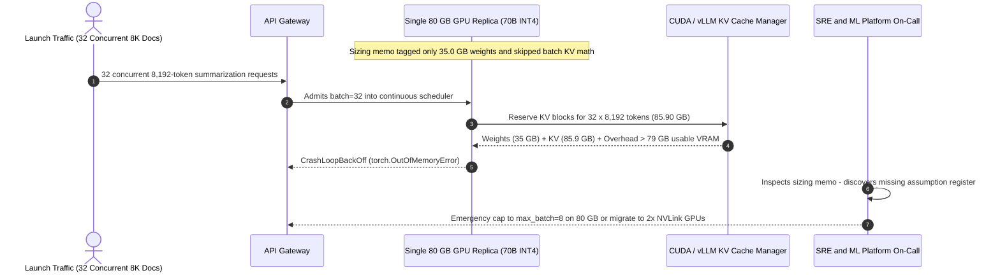

# Module 15: Capstone Project

> **Prerequisites:** [Modules 00–14 of Track 05: GPUs & GenAI Hardware](../00-why-gpus-not-cpus/README.md)  
> **Estimated Reading Time:** 20 minutes (+ 4–6 hours independent sizing & verification project)  
> **Target Audience:** AI Infrastructure Engineers, ML Systems Architects, Technical Leads

> [!TIP]
> **The Golden Rule of Hardware Sizing Reports**  
> A hardware recommendation is only as trustworthy as its weakest labelled number: strictly separate what you `[sourced]` (with URL and date), what you `[measured]` (with setup and build), what you `[estimated]` (with explicit formula), and what you `[assumed]` (with rationale)—then prove which single assumption flips your final decision.

---

## 1. Visual Mental Models & End-to-End Sizing Workflow

**What this capstone is.** Track 05 taught you every component of a hardware engineering decision one piece at a time: why GPUs and not CPUs ([Module 00](../00-why-gpus-not-cpus/README.md)), how a GPU executes work and where time goes ([Module 01](../01-gpu-architecture-for-software-engineers/README.md), [Module 02](../02-cuda-cores-vs-tensor-cores/README.md), [Module 03](../03-memory-hierarchy-and-bandwidth/README.md)), why VRAM binds first ([Module 04](../04-vram-the-real-constraint/README.md)) and how to calculate model memory ([Module 05](../05-calculating-a-models-memory-requirements/README.md)), which numeric formats and memory kernels compress it ([Module 06](../06-numeric-formats-fp32-fp16-bf16/README.md), [Module 07](../07-mixed-precision-training/README.md), [Module 08](../08-flashattention-and-memory-efficient-kernels/README.md)), how to split across cards when one GPU is not enough ([Module 09](../09-data-parallelism/README.md), [Module 10](../10-model-and-tensor-parallelism/README.md), [Module 11](../11-pipeline-parallelism-and-zero/README.md)), how to qualify cards through six gates ([Module 12](../12-choosing-gpus-consumer-vs-datacenter/README.md)), how to price utilization and ownership ([Module 13](../13-cloud-gpu-economics/README.md)), and what runs locally without discrete GPUs ([Module 14](../14-running-models-on-cpu-and-apple-silicon/README.md)).

This capstone ties the entire pipeline together end to end on an open-weights model you select, yielding a concise, decision-first hardware sizing report. There is no single dataset, solution, or right answer: two strong reports for the identical model may recommend different hardware because their serving concurrency or utilization curves differ. What makes a report production-grade is traceability, named rejection gates, and sensitivity transparency.

```mermaid
flowchart LR
    S1["1. Model Fact Sheet (Sourced and Dated)"] --> S2["2. Two Workloads (Serve and Adapt)"]
    S2 --> S3["3. Memory Tables (Inference and Fine-Tuning, Modules 05-08)"]
    S3 --> S4["4. Precision and Parallelism (Modules 06, 07, 09-11)"]
    S4 --> S5["5. Hardware Gates (Module 12 Shortlist and Rejections)"]
    S5 --> S6["6. Cost Model (Module 13 On-Demand, Spot and Buy)"]
    S6 --> S8["8. Decision-First Sizing Report (Caveats and Flips)"]
    S8 -->|"Validate Weakest Estimate"| S7["7. Empirical Check (Local Measurement or Published Benchmark)"]
    S7 -->|"Reconcile Gap and Update Register"| S1
```



Every single figure flowing through stages 1–8 must carry one explicit provenance tag: `[sourced]`, `[measured]`, `[estimated]`, or `[assumed]`.

---

## 2. Systematic Comparison Matrix: Evidence Provenance & Capstone Rubric

### Evidence Provenance Tags (Zero Untagged Numbers Allowed)

| Provenance Tag | Required Metadata | Valid Examples | Disallowed Anti-Pattern |
| :--- | :--- | :--- | :--- |
| **`[sourced]`** | Primary URL + fetch date | `hidden_size=8192` from Hugging Face `config.json` (fetched Oct 2026); `H100 NVL 94 GB` from product brief | *"H100 has ~96 GB from memory"* (no citation or date) |
| **`[measured]`** | Exact hardware, software build/commit, settings | `36.41 tok/s tg128` via `llama-bench` build `8e672ef` on M1 Pro 16-core | Mixing `pp512` and `tg128` without build hash |
| **`[estimated]`** | Exact formula + unit conversion (GB vs. GiB) | `ceil_tps = 546e9 / (3.56 * 2**30) = 142.8 tok/s` | Presenting theoretical bandwidth ceiling as guaranteed production SLA |
| **`[assumed]`** | Stated engineering rationale + sensitivity range | `10% framework/CUDA overhead`; `busy_fraction = 0.45` (tested over 0.20–0.75) | Silent peak utilization assumptions baked inside code |

### Grading Rubric: How to Know You Have Done It Well

| Criterion | Needs Work | Meets | Strong |
| :--- | :--- | :--- | :--- |
| **Memory arithmetic** | Missing components, mixed units, or unshown work | Weights, KV cache, activations, gradients and optimizer state computed with units for both workloads; binding component named | Also shows how the answer moves with context, batch and precision, and where it would stop fitting |
| **Precision and parallelism** | Asserted without reference to the memory table | Each choice tied to a number in the table and to a link requirement | Also quantifies the communication cost, or shows convincingly why none is needed |
| **Hardware selection** | A single favourite, or specifications from memory | Three or more candidates in two classes, dated sources, each rejection tied to a named gate | Also applies the terms and licence gate to the stated deployment and includes a non-GPU option |
| **Cost model** | One price, no utilization | Three payment options, stated utilization, cost per million tokens and per run, break-even computed | Sensitivity analysis names the assumption that flips the winner |
| **Evidence discipline** | Untagged numbers, estimates presented as measurements | Every number tagged and dated; sources are primary | One estimate checked against evidence, with the gap and its likely cause reported |
| **Communication** | Reader cannot find the decision | Decision first, four pages or fewer, assumption register present | States what would change the decision and what to measure next |

*(A report that honestly documents at least one surprising or disappointing result—an estimate that diverged from measurement, or a cheaper SKU disqualified by an operational gate—is far stronger than one where everything aligns artificially.)*

---

## 3. Production War Story: Incident Post-Mortem

### Unvalidated Sizing Report Triggers Launch-Night OOM Cascade on 70B INT4 Endpoint

- **Severity:** SEV-1 (Production Inference Crash Loop During Product Launch)
- **Time to Detect:** 12 minutes into launch traffic surge (`CUDA out of memory` across all 4 replicas)
- **Time to Resolve:** 3 hours (emergency context cap + batch throttle + failover to 2x H100 NVL nodes)
- **Impact:** A flagship SaaS summarization release failed 68% of requests during peak launch hour because an unreviewed capacity memo sized a 70B INT4 deployment on single 80 GB GPUs using *average* sequence length instead of concurrent tail KV-cache demand.

#### What Happened

An internal sizing document recommended deploying a 70B INT4 model (`35.0 GB` weights) onto four independent single-GPU 80 GB A100/H100 instances (`4 x 1` replicas, no tensor parallelism). The memo noted *"35 GB weights fit comfortably in 80 GB with 45 GB left over"*—leaving the KV cache uncalculated for peak concurrency (`batch = 32`, `8,192` token prompts) and omitting the 10% CUDA/activation margin.

During staging smoke tests (`batch = 1`), memory usage stayed near 41 GB and passed effortlessly. Twelve minutes after launch traffic hit 32 concurrent 8K-context documents per worker, the GQA KV cache alone expanded to `85.90 GB`, pushing total per-GPU demand to `132.99 GB` (with 10% overhead) and instantly crashing every replica in an OOM loop.

#### The Failure Sequence Diagram



#### Root Cause Analysis

1. **Missing Assumption Register & Sensitivity Sweep:** The sizing report cited average prompt length (512 tokens) at `batch = 1` without testing where KV cache growth flips single-card fit (`batch = 16` at 8K context already needs `85.74 GB` with 10% overhead).
2. **Untagged Capacity Headroom:** Treating 80 GB datasheet memory as 80 GB usable KV capacity ignored driver/CUDA context allocation and activation spikes.

#### The Fix & Architectural Hardening

1. **Mandatory Provenance & Boundary Stress Table:** Required every hardware sizing PR to compute a `(weights + KV(batch_max, ctx_max)) * 1.10` table explicitly proving the exact batch size where single-card fit breaks.
2. **Pre-Production Synthetic Max-Context Soak Test:** Added an automated staging gate sending `batch_max` requests padded to `ctx_max` before any sizing report earns sign-off.

---

## 4. Multi-Language Production Implementations

The carousel below implements an **Evidence-Tagged Capstone Hardware Sizing & Assumption Validator** across Go, TypeScript, Python, and C#—computing weights, GQA KV cache across concurrency/context, single-card fit, decode bandwidth ceiling, and token unit cost while rejecting untagged inputs.

````carousel

### Go: Evidence-Tagged Capstone Sizing & Assumption Validator

```go
package main

import (
	"fmt"
	"math"
)

type TaggedValue struct {
	Value  float64
	Source string // "sourced", "measured", "estimated", "assumed"
	Note   string
}

type CapstoneModel struct {
	ParamsBillion TaggedValue
	BytesPerParam TaggedValue
	Layers        int
	KVHeads       int
	HeadDim       int
	KVBytes       int
}

type HardwareOption struct {
	Name       string
	UsableGB   float64
	Bandwidth  float64 // GB/s
	HourlyUSD  float64
}

func EvaluateScenario(m CapstoneModel, hw HardwareOption, ctx, batch int, overhead, busy float64) {
	wGB := m.ParamsBillion.Value * m.BytesPerParam.Value
	kvPerTok := float64(2 * m.Layers * m.KVHeads * m.HeadDim * m.KVBytes)
	kvGB := (kvPerTok * float64(ctx*batch)) / 1e9
	totalGB := (wGB + kvGB) * (1.0 + overhead)
	cards := int(math.Ceil(totalGB / hw.UsableGB))

	stepBytesGB := wGB + kvGB
	aggTps := (hw.Bandwidth / stepBytesGB) * float64(batch)
	costPer1M := (float64(cards) * hw.HourlyUSD) / (aggTps * 3600.0 * busy) * 1e6

	fmt.Printf("%-14s batch=%-2d ctx=%-5d | need=%6.2fGB gpus=%d | ceil=%6.1f tok/s | est=$%.2f/1M\n",
		hw.Name, batch, ctx, totalGB, cards, aggTps, costPer1M)
}

func main() {
	llama70B := CapstoneModel{
		ParamsBillion: TaggedValue{70.0, "sourced", "model config"},
		BytesPerParam: TaggedValue{0.5, "assumed", "INT4 quantization"},
		Layers:        80, KVHeads: 8, HeadDim: 128, KVBytes: 2,
	}
	h100 := HardwareOption{"H100-SXM-80G", 79.0, 3350.0, 3.00} // ILLUSTRATIVE rate

	for _, b := range []int{1, 8, 16, 32} {
		EvaluateScenario(llama70B, h100, 8192, b, 0.10, 0.50)
	}
}
```

<!-- slide -->

### TypeScript: Evidence-Tagged Capstone Sizing & Assumption Validator

```typescript
export type ProvenanceTag = "sourced" | "measured" | "estimated" | "assumed";

export interface TaggedNumber {
  value: number;
  tag: ProvenanceTag;
  citation: string;
}

export interface SizingSummary {
  batch: number;
  context: number;
  weightsGB: number;
  kvCacheGB: number;
  totalWithOverheadGB: number;
  cardsRequired: number;
  decodeCeilingTokPerSec: number;
  costPer1MTokensUSD: number;
}

export function sizeCapstoneWorkload(
  paramsBillion: TaggedNumber,
  bytesPerParam: TaggedNumber,
  layers: number,
  kvHeads: number,
  headDim: number,
  ctx: number,
  batch: number,
  usableVramGB: number,
  bwGBs: number,
  hourlyRateUSD: number,
  busyFraction: number = 0.5,
  overhead: number = 0.10
): SizingSummary {
  const weightsGB = paramsBillion.value * bytesPerParam.value;
  const kvPerTokBytes = 2 * layers * kvHeads * headDim * 2;
  const kvCacheGB = (kvPerTokBytes * ctx * batch) / 1e9;
  const totalWithOverheadGB = (weightsGB + kvCacheGB) * (1 + overhead);
  const cardsRequired = Math.ceil(totalWithOverheadGB / usableVramGB);

  const decodeCeilingTokPerSec = (bwGBs / (weightsGB + kvCacheGB)) * batch;
  const costPer1MTokensUSD =
    ((cardsRequired * hourlyRateUSD) / (decodeCeilingTokPerSec * 3600 * busyFraction)) * 1e6;

  return {
    batch,
    context: ctx,
    weightsGB: Number(weightsGB.toFixed(1)),
    kvCacheGB: Number(kvCacheGB.toFixed(2)),
    totalWithOverheadGB: Number(totalWithOverheadGB.toFixed(2)),
    cardsRequired,
    decodeCeilingTokPerSec: Number(decodeCeilingTokPerSec.toFixed(1)),
    costPer1MTokensUSD: Number(costPer1MTokensUSD.toFixed(3)),
  };
}

const params: TaggedNumber = { value: 70, tag: "sourced", citation: "Model card (Oct 2026)" };
const bpp: TaggedNumber = { value: 0.5, tag: "assumed", citation: "INT4 weights" };
console.table([1, 8, 16, 32].map((b) =>
  sizeCapstoneWorkload(params, bpp, 80, 8, 128, 8192, b, 79, 3350, 3.0)
));
```

<!-- slide -->

### Python: Evidence-Tagged Capstone Sizing & Assumption Validator

```python
import math
from dataclasses import dataclass

@dataclass(frozen=True)
class TaggedNumber:
    value: float
    tag: str       # sourced | measured | estimated | assumed
    citation: str

    def __post_init__(self):
        if self.tag not in {"sourced", "measured", "estimated", "assumed"}:
            raise ValueError(f"Invalid tag {self.tag!r}; every capstone number must carry a valid tag.")

def evaluate_capstone_sizing(
    params_b: TaggedNumber,
    bytes_pp: TaggedNumber,
    layers: int,
    kv_heads: int,
    head_dim: int,
    ctx: int,
    batch: int,
    usable_vram_gb: float = 79.0,
    bw_gbs: float = 3350.0,
    hourly_rate: float = 3.00,  # ILLUSTRATIVE placeholder rate
    busy: float = 0.50,
    overhead: float = 0.10,
):
    weights_gb = params_b.value * bytes_pp.value
    kv_per_tok = 2 * layers * kv_heads * head_dim * 2
    kv_gb = (kv_per_tok * ctx * batch) / 1e9
    total_gb = (weights_gb + kv_gb) * (1.0 + overhead)
    gpus = math.ceil(total_gb / usable_vram_gb)
    agg_ceil_tps = (bw_gbs / (weights_gb + kv_gb)) * batch
    cost_1m = (gpus * hourly_rate) / (agg_ceil_tps * 3600 * busy) * 1e6
    return total_gb, gpus, agg_ceil_tps, cost_1m

if __name__ == "__main__":
    p = TaggedNumber(70.0, "sourced", "70B GQA config")
    bpp = TaggedNumber(0.5, "assumed", "INT4 quantized weights")
    for b in (1, 8, 16, 32):
        tot, gpus, tps, c1m = evaluate_capstone_sizing(p, bpp, 80, 8, 128, 8192, b)
        print(f"batch={b:<2} total(+10%)={tot:6.2f}GB gpus={gpus} ceil={tps:6.1f} tok/s est=${c1m:.3f}/1M")
```

<!-- slide -->

### C#: Evidence-Tagged Capstone Sizing & Assumption Validator

```csharp
using System;

public record TaggedMetric(double Value, string Tag, string Citation);

public static class CapstoneValidator
{
    public static void Main()
    {
        var paramsB = new TaggedMetric(70.0, "sourced", "70B model config");
        var bpp = new TaggedMetric(0.5, "assumed", "INT4 quantization");
        int layers = 80, kvHeads = 8, headDim = 128, ctx = 8192;
        double usableVramGB = 79.0, bwGBs = 3350.0, hourlyRate = 3.00, busy = 0.50, overhead = 0.10;

        double weightsGB = paramsB.Value * bpp.Value;
        double kvPerToken = 2.0 * layers * kvHeads * headDim * 2.0;

        foreach (int batch in new[] { 1, 8, 16, 32 })
        {
            double kvGB = (kvPerToken * ctx * batch) / 1e9;
            double totalGB = (weightsGB + kvGB) * (1.0 + overhead);
            int gpus = (int)Math.Ceiling(totalGB / usableVramGB);
            double aggTps = (bwGBs / (weightsGB + kvGB)) * batch;
            double cost1M = (gpus * hourlyRate) / (aggTps * 3600.0 * busy) * 1e6;

            Console.WriteLine($"batch={batch,-2} total(+10%)={totalGB,6:F2}GB gpus={gpus} ceil={aggTps,6:F1} tok/s est=${cost1M:F3}/1M");
        }
    }
}
```

````

---

## 5. Practical Hands-On Verification & CLI Workflows

### Verification 1: Detecting Where Batch Concurrency Breaks Single-GPU Fit

Run this Python CLI verification before drafting your Step 3 memory table to verify how KV cache growth forces sharding even when INT4 weights fit on half a card:

```bash
python3 - << 'EOF'
params_b, bpp, layers, kv_heads, head_dim, ctx = 70, 0.5, 80, 8, 128, 8192
w_gb = params_b * bpp
kv_per_tok = 2 * layers * kv_heads * head_dim * 2
for batch in (1, 8, 16, 32):
    kv_gb = (kv_per_tok * ctx * batch) / 1e9
    total = (w_gb + kv_gb) * 1.10
    step_tps = 3350 / (w_gb + kv_gb) * batch
    print(f"batch={batch:<2} weights={w_gb:.1f}GB KV={kv_gb:5.2f}GB total(+10%)={total:6.2f}GB fits_80GB={str(total<=79.0):<5} ceil_agg_tps={step_tps:6.1f}")
EOF
```

**Expected Output:**

```text
batch=1  weights=35.0GB KV= 2.68GB total(+10%)= 41.45GB fits_80GB=True  ceil_agg_tps=  88.9
batch=8  weights=35.0GB KV=21.47GB total(+10%)= 62.12GB fits_80GB=True  ceil_agg_tps= 474.5
batch=16 weights=35.0GB KV=42.95GB total(+10%)= 85.74GB fits_80GB=False ceil_agg_tps= 687.6
batch=32 weights=35.0GB KV=85.90GB total(+10%)=132.99GB fits_80GB=False ceil_agg_tps= 886.7
```

### Verification 2: Inspecting Primary Model Architecture (`config.json`)

Always pull layer counts and GQA `num_key_value_heads` directly from a published model's `config.json` rather than guessing from model family names:

```bash
# Example: fetch primary JSON fields from Hugging Face (replace org/model with your chosen open-weights model)
curl -sL "https://huggingface.co/<org>/<model>/raw/main/config.json" | python3 -m json.tool | grep -E "hidden_size|num_hidden_layers|num_attention_heads|num_key_value_heads|max_position_embeddings|torch_dtype"
```

---

## 6. Capstone Deliverables, Constraints & Step-by-Step Brief

### 1. Choose a Model and Write Its Fact Sheet
Pick an open-weights language model whose configuration is published, in the range where decisions are not trivial (a few billion up to roughly seventy billion parameters is a sensible window). Record, each with a source URL and the date you read it: parameter count, number of layers, hidden size, attention heads and key/value heads, maximum context length, whether it is dense or mixture-of-experts, and the precision it was released in.

### 2. Define Two Workloads
- **Serving.** Target context length, number of concurrent requests, tokens per second each user should see, and how bursty the traffic is.
- **Adaptation.** One fine-tuning run on a dataset size and sequence length you choose, and whether you will update all weights or use an adapter method from Track 04.

Write both down as numbers. Everything later is computed from them.

### 3. Compute Memory for Both Workloads
For serving and for the fine-tuning run, and at several precisions, produce a table of weights, KV cache, activations, and (for fine-tuning) gradients and optimizer state. Show the formulas and the arithmetic with units, including the GB versus GiB distinction. Identify which component binds at each precision, and show how the answer moves when you change context length or batch size.

### 4. Choose Precision and a Parallelism Strategy
State the number format you would use for each workload and why. Decide between a single GPU, data parallelism, tensor parallelism, pipeline parallelism and optimizer-state sharding, or none, and tie that choice to your memory table. If you split across cards, say what traffic that creates and what link it needs; if you do not, show that capacity suffices.

### 5. Choose Hardware and Justify It
Build a shortlist of at least three candidates spanning at least two classes (for example a consumer or workstation card, a datacenter card, and a non-GPU option from Module 14). Take every specification from a datasheet or product page you fetch yourself, with its URL and the date. Apply the gates from Module 12 and show each rejected candidate with the gate that rejected it, including the driver-licence and terms question for the setting you chose. For serving, estimate the decode ceiling from bandwidth and label it as an estimate.

### 6. Cost It
Build a cost model for both workloads with at least three ways of paying (for example on-demand, spot or committed capacity, and buying). Give cost per million generated tokens for serving and cost per run for fine-tuning, with your utilization and throughput assumptions stated. Include storage, egress, and load time. Compute a rent-versus-buy break-even and run a sensitivity analysis on the two inputs you trust least. Prices must be inputs with a source URL and date, or clearly labelled placeholders.

### 7. Validate One Estimate
Choose the estimate you trust least and test it against something real: a measurement you take yourself (a small model on your own CPU is enough), or a published measurement for similar hardware. Report the gap between estimate and evidence, and what you think causes it.

### 8. Write the Report
At most four pages. Decision first, in one paragraph. Then the fact sheet, the workloads, the memory tables, the precision and parallelism decisions, the shortlist with rejections, the cost table with the sensitivity result, the validation, the risks, and an assumption register. Close with a list of what would change your recommendation and the first thing you would measure before spending money.

### Mandatory Project Constraints
- No GPU is required. Everything can be done with arithmetic, vendor documents, and optionally a CPU.
- Every number carries one tag: `sourced` (with URL and date), `measured` (by you, with the setup), `estimated` (with the formula), or `assumed` (with the reason). A number with no tag is a defect.
- Do not present a provider price as fact unless you fetched it and dated it. Do not claim any option is *"the best"* or *"the latest"*; say what it was compared against and when.
- Show arithmetic and units. A result that cannot be recomputed from the report does not count.
- If your estimate and your evidence disagree, report the disagreement. A diagnosed gap is worth more than a forced match.

---

## 7. Operational Validation Checkpoints

### Scenario 1: Reconciling Estimate vs. Measured Throughput Gap

<details>
<summary><strong>Question:</strong> Your sizing report `[estimated]` a batch-1 decode ceiling of 142.8 tok/s for a 7B quantized model on 546 GB/s unified memory, but your `[measured]` `llama-bench` check outputs 83.06 tok/s (58% of ceiling). Should you silently adjust the formula or report the 42% gap?</summary>

**Answer:**
Report both figures and explain the gap honestly. The bandwidth formula is strictly an upper bound ignoring dequantization overhead, attention compute, and kernel synchronization. In Module 14's measured benchmarks, fast-bus chips consistently hit 45%–86% of ceiling—so recording the measured `83.06 tok/s` (with build hash) alongside the `142.8 tok/s` ceiling demonstrates strong evidence discipline and prevents over-promising production throughput.

</details>

### Scenario 2: Fine-Tuning Memory Binding Shift (Full Parameters vs. QLoRA)

<details>
<summary><strong>Question:</strong> In Step 3, your full mixed-precision Adam fine-tuning memory table for a 70B model requires $16\Psi = 1{,}120\text{ GB}$ for model states alone (requiring ZeRO-3 across 16+ 80 GB GPUs). What single precision/adaptation switch in Step 4 collapses that footprint onto a single 48 GB–80 GB GPU?</summary>

**Answer:**
Switching from full-parameter mixed-precision training to **QLoRA** (storing frozen base weights in 4-bit NormalFloat $\approx 35\text{ GB}$ and holding trainable BF16 LoRA adapters + Adam optimizer states for $<1\%$ of parameters). Only adapter weights accumulate gradients and 32-bit Adam momentum/variance, eliminating the $14\Psi$ gradient + optimizer state wall (activating only activation memory + adapter overhead).

</details>

### Scenario 3: Sensitivity Inversion in the Assumption Register

<details>
<summary><strong>Question:</strong> Your Step 6 report recommends an always-on 1-year reserved H100 node because break-even occurs at $H^* = 180\text{ hours/month}$ and you `[assumed]` 450 active hours/month. Which real-world workload shift flips the winner back to scale-to-zero On-Demand?</summary>

**Answer:**
Any sustained drop in actual monthly active hours below $H^* = 180\text{ h/month}$ (for example, switching from steady 24/7 enterprise API traffic to sporadic weekday batch jobs running 80 hours/month) or a workload migration to a quantized/smaller model that renders the reserved GPU oversized for the next 10 months of the locked contract.

</details>

---

## 8. Interview Questions

> [!interview]
> Walk me through how you would size the hardware to serve a 70-billion-parameter model to 50 concurrent users.

<details><summary>What a strong answer covers</summary>

- Start from the workload numbers (context length, tokens/s per user), then weights at a chosen precision, then KV cache for 50 sequences at that context, plus overhead.
- Check capacity per card, decide whether the model must be split, and what link that split needs.
- Estimate the decode ceiling from bandwidth and bytes per token, and say it is an upper bound.
- Then terms (licence for the deployment setting), operations (power, cooling), and only then cost per million tokens at a realistic utilization, with the assumptions labelled.

</details>

> [!interview]
> Your sizing says the model fits, but it runs out of memory in production. What did you most likely miss?

<details><summary>What a strong answer covers</summary>

- KV cache growth with real context lengths and concurrency, not the average case.
- Usable memory below the printed capacity, framework and CUDA overhead, fragmentation, activation peaks.
- Decimal versus binary units, or a precision assumption the stack was not actually using.
- How you would find it: measure memory on the real hardware at the real load, and update the register.

</details>

> [!interview]
> How would you justify a GPU purchase to a finance team when future utilization is uncertain?

<details><summary>What a strong answer covers</summary>

- Present the break-even utilization (hours per month at which owning beats renting) rather than one forecast.
- Show the sensitivity analysis and which assumption flips the decision.
- Include costs outside the formula (operations, power, obsolescence, licence limits) and the option value of renting.
- Propose a measurement or pilot that reduces the most uncertain input before committing.

</details>

---

## 9. Common Mistakes & Troubleshooting

- **Untagged numbers in the final memo.** If a reader cannot tell whether a throughput or price is `[sourced]`, `[measured]`, `[estimated]`, or `[assumed]`, the sizing cannot be audited or reproduced when inputs change.
- **Sizing from average traffic instead of tail concurrency.** Peak batch size times `max_context` determines KV cache OOM limits; average request size hides memory explosions.
- **Skipping Gate 6 (licence terms) until procurement.** Catching consumer driver restrictions after ordering hardware stalls launches by weeks.
- **Hiding estimate-to-measurement discrepancies.** Always report the exact delta between your bandwidth-ceiling estimate and your empirical benchmark alongside the build hash.

---

## 10. Further Reading & Sources

- [ZeRO: Memory Optimizations Toward Training Trillion Parameter Models](https://arxiv.org/abs/1910.02054) - the accounting of weights, gradients and optimizer state that your fine-tuning memory table needs, and how sharding changes it.
- [FlashAttention: Fast and Memory-Efficient Exact Attention with IO-Awareness](https://arxiv.org/abs/2205.14135) - why the full attention matrix does not have to be stored, relevant to the activation memory in step 3.
- [QLoRA: Efficient Finetuning of Quantized LLMs](https://arxiv.org/abs/2305.14314) - the memory story for adapting a large model on one card, relevant to the adaptation workload.
- [Efficient Memory Management for Large Language Model Serving with PagedAttention](https://arxiv.org/abs/2309.06180) - KV-cache memory and batching for the serving workload.
- [License for Customer use of GeForce Software (NVIDIA Driver License Agreement)](https://www.nvidia.com/en-us/drivers/geforce-license/) - the primary text behind the terms gate in step 5.
- [nccl-tests: Performance reported by NCCL tests](https://github.com/NVIDIA/nccl-tests/blob/master/doc/PERFORMANCE.md) - the all-reduce time formula for estimating communication in step 4.
- [Amazon EC2 pricing](https://aws.amazon.com/ec2/pricing/) - one provider's own description of on-demand, committed and spot purchase options for step 6 (structure only; fetch current prices yourself and date them).
- [Performance of llama.cpp on Apple Silicon M-series](https://github.com/ggml-org/llama.cpp/discussions/4167) - an example of published measurements you can set your own estimates against in step 7.

---

## Next

[Track 06: OpenAI & the Model Landscape](../../06-openai-and-the-model-landscape/README.md)
