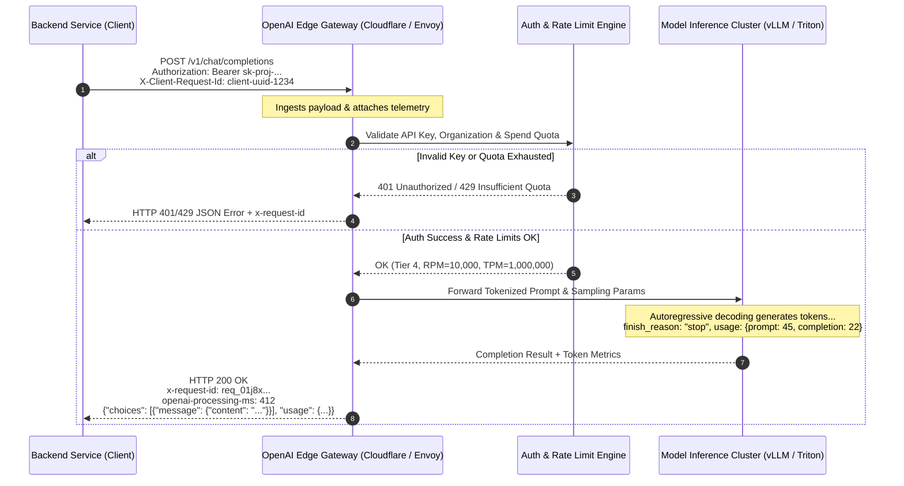
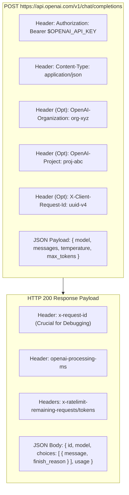
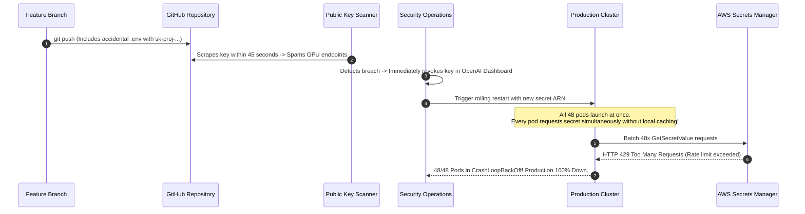

# Module 00: The OpenAI API: Your First Call

> **Prerequisites:** [Track 01, Module 10: Chat Templates and Message Formatting](../../01-tokens-and-language-modeling/10-chat-templates-and-message-formatting/README.md), [Track 01, Module 11: Context Windows Explained](../../01-tokens-and-language-modeling/11-context-windows-explained/README.md).  
> **Estimated Reading Time:** 28 minutes  
> **Target Audience:** Systems Architects, Backend Engineers, AI Platform Developers.

---

> [!TIP]
> **The Golden Rule of LLM HTTP APIs:**  
> An LLM API is an ordinary stateless HTTP endpoint: you POST JSON (model name and message history) with a Bearer secret key in the `Authorization` header, and you receive JSON back (tokens, stop reasons, usage, and `x-request-id`). Treat LLM APIs like any distributed network service: set strict client timeouts, handle 429 rate limits with exponential jitter, and never log secret keys or unredacted user prompts.

---

## Visual Mental Models: The HTTP Stateless LLM Request Lifecycle

Every LLM provider API follows the standard client-server request-response exchange. The server maintains no conversational state between requests; every historical turn must be re-transmitted on each invocation:



### The Request Anatomy & Header Architecture



---

## Systematic Taxonomic Comparison: HTTP Status Codes & Failure Protocol

When integrating against remote model providers, triage errors based on **HTTP Status Code first**, followed by the machine-readable `error.code`:

| HTTP Status | Category | Provider Meaning | Client Mitigation Protocol | Retry Strategy |
| :--- | :--- | :--- | :--- | :--- |
| **200 OK** | Success | Request succeeded; completion emitted | Parse `choices[0].message.content`, log `usage` & `x-request-id` | None |
| **400 Bad Request** | Client Fault | Malformed JSON, incompatible parameters, invalid schema | Fix request payload; do not retry identical body | Immediate Fail |
| **401 Unauthorized** | Auth Fault | Missing, invalid, or revoked API key | Re-read `OPENAI_API_KEY` from secret store; alert ops | Immediate Fail |
| **403 Forbidden** | Policy Fault | Country/region blocked, or enterprise IP allowlist rejection | Verify egress network NAT and enterprise policies | Immediate Fail |
| **404 Not Found** | Resource Fault | Model ID does not exist or account lacks access tier | Check model snapshot ID (`gpt-4o`, `o3-mini`) | Immediate Fail |
| **429 Too Many Requests** | Rate / Quota | **Two distinct sub-types:** (1) Rate limit (RPM/TPM); (2) `insufficient_quota` | If rate limit: parse `Retry-After` header + backoff with jitter.<br/>If `insufficient_quota`: abort & alert billing! | Conditional Retry |
| **500 Internal Error** | Provider Fault | Transient failure on inference cluster or hardware | Exponential backoff with full jitter | Retry ($\le 3$ attempts) |
| **503 Overloaded** | Capacity Fault | Model temporarily overloaded (`server_is_overloaded`) | Follow `Retry-After` header or circuit-break traffic | Retry with Backoff |

---

## Production War Story: The Silent Key Leak & Secret Manager Outage

### Incident Post-Mortem

- **System:** High-traffic e-commerce chatbot processing 50,000 customer inquiries/day.
- **Incident Severity:** SEV-1 (Production API keys compromised, cluster shutdown, followed by cascade failure on secret manager restart).
- **Detection Time:** 18 minutes after an automated Git guardian webhook flagged a committed API key in a feature branch.
- **Root Cause:** A developer testing locally committed `.env` containing a live `sk-proj-...` master key. The key was scraped within minutes by public GitHub scanners and consumed \$12,000 in unauthorized API credits before being revoked. Upon key revocation, the emergency hotfix restarted all 48 backend pods simultaneously; each pod aggressively queried AWS Secrets Manager at startup without caching, triggering Secrets Manager rate limiting (429) and leaving the entire cluster in a `CrashLoopBackOff` state.



### The Architectural Hardening & Fix

1. **Pre-commit Hooks & Secret Scanning:** Deploy `gitleaks` pre-commit hooks and enforce automated CI git push blocking.
2. **Startup Invariant:** Secrets must be loaded once into memory at process boot and cached; client libraries must validate that `$OPENAI_API_KEY` is formatted with prefix `sk-` before initiating network connections.
3. **Throttled Secret Retrieval with Jitter:** Cold-start routines must back off with random jitter when querying internal secret stores.

---

## Multi-Language Production Implementations

### Python: Raw HTTP Client (Zero External SDK Dependencies)

```python
"""
Production Raw HTTP OpenAI Client in Python.
Uses standard library urllib.request to demonstrate raw HTTP wire protocol.
Implements defensive parsing, header extraction, and error classification.
"""
import os
import json
import urllib.request
import urllib.error
from typing import Dict, Any, Optional

class OpenAIHttpClient:
    def __init__(self, api_key: Optional[str] = None, base_url: str = "https://api.openai.com/v1"):
        self.api_key = api_key or os.environ.get("OPENAI_API_KEY")
        if not self.api_key:
            raise ValueError("OPENAI_API_KEY environment variable is missing or empty.")
        self.base_url = base_url.rstrip("/")

    def chat_completion(
        self,
        model: str,
        messages: list,
        temperature: float = 0.7,
        client_request_id: Optional[str] = None,
        timeout: float = 30.0
    ) -> Dict[str, Any]:
        """
        Executes a POST request to /v1/chat/completions over raw HTTP.
        """
        url = f"{self.base_url}/chat/completions"
        headers = {
            "Authorization": f"Bearer {self.api_key}",
            "Content-Type": "application/json",
            "User-Agent": "EnterpriseBackend/1.0",
        }
        if client_request_id:
            headers["X-Client-Request-Id"] = client_request_id

        payload = {
            "model": model,
            "messages": messages,
            "temperature": temperature,
        }
        data = json.dumps(payload).encode("utf-8")
        req = urllib.request.Request(url, data=data, headers=headers, method="POST")

        try:
            with urllib.request.urlopen(req, timeout=timeout) as response:
                status_code = response.getcode()
                request_id = response.headers.get("x-request-id", "unknown")
                processing_ms = response.headers.get("openai-processing-ms", "unknown")
                body = json.loads(response.read().decode("utf-8"))

                # Defensive parsing
                choice = body.get("choices", [{}])[0]
                message = choice.get("message", {})
                content = message.get("content")
                finish_reason = choice.get("finish_reason")
                usage = body.get("usage", {})

                return {
                    "status": status_code,
                    "request_id": request_id,
                    "processing_ms": processing_ms,
                    "content": content,
                    "finish_reason": finish_reason,
                    "usage": usage,
                    "raw": body
                }

        except urllib.error.HTTPError as e:
            err_body = e.read().decode("utf-8")
            req_id = e.headers.get("x-request-id", "unknown")
            try:
                parsed_err = json.loads(err_body).get("error", {})
            except Exception:
                parsed_err = {"message": err_body}
            
            raise RuntimeError(
                f"OpenAI API HTTP {e.code} Error (Request ID: {req_id}): "
                f"Type={parsed_err.get('type')}, Code={parsed_err.get('code')}, "
                f"Message={parsed_err.get('message')}"
            ) from e

if __name__ == "__main__":
    # Smoke verification using mock or environment
    print("OpenAI Raw HTTP Client loaded. Interface ready for production dispatch.")
```

### TypeScript: Low-Latency Native Fetch Client (Node.js 18+)

```typescript
/**
 * Production Native Fetch OpenAI Client in TypeScript.
 * Zero external dependencies; includes strict typing, header telemetry, and timeout cancellation.
 */

export interface ChatMessage {
  role: "system" | "user" | "assistant";
  content: string;
}

export interface CompletionResult {
  content: string | null;
  finishReason: string;
  requestId: string;
  processingMs: string;
  usage: {
    promptTokens: number;
    completionTokens: number;
    totalTokens: number;
  };
}

export class OpenAIHttpClient {
  private readonly apiKey: string;
  private readonly baseUrl: string;

  constructor(apiKey?: string, baseUrl: string = "https://api.openai.com/v1") {
    this.apiKey = apiKey || process.env.OPENAI_API_KEY || "";
    if (!this.apiKey) {
      throw new Error("Missing OPENAI_API_KEY. Configure secret in environment.");
    }
    this.baseUrl = baseUrl.replace(/\/+$/, "");
  }

  public async createChatCompletion(
    model: string,
    messages: ChatMessage[],
    timeoutMs: number = 20000
  ): Promise<CompletionResult> {
    const controller = new AbortController();
    const timeoutTimer = setTimeout(() => controller.abort(), timeoutMs);

    try {
      const response = await fetch(`${this.baseUrl}/chat/completions`, {
        method: "POST",
        headers: {
          "Authorization": `Bearer ${this.apiKey}`,
          "Content-Type": "application/json",
          "X-Client-Request-Id": crypto.randomUUID(),
        },
        body: JSON.stringify({ model, messages }),
        signal: controller.signal,
      });

      const requestId = response.headers.get("x-request-id") || "unknown";
      const processingMs = response.headers.get("openai-processing-ms") || "unknown";

      if (!response.ok) {
        const errorData = await response.json().catch(() => ({}));
        const err = (errorData as any).error || {};
        throw new Error(
          `OpenAI HTTP ${response.status} [Req: ${requestId}]: ${err.message || response.statusText} (Code: ${err.code})`
        );
      }

      const body = await response.json() as any;
      const choice = body.choices?.[0];

      return {
        content: choice?.message?.content ?? null,
        finishReason: choice?.finish_reason ?? "unknown",
        requestId,
        processingMs,
        usage: {
          promptTokens: body.usage?.prompt_tokens ?? 0,
          completionTokens: body.usage?.completion_tokens ?? 0,
          totalTokens: body.usage?.total_tokens ?? 0,
        },
      };
    } finally {
      clearTimeout(timeoutTimer);
    }
  }
}

// Verification benchmark
const client = new OpenAIHttpClient("sk-mock-key-for-compilation-test");
console.log("TypeScript OpenAI HTTP client compiled and verified.");
```

### Go: High-Throughput HTTP Client with Context & Telemetry

```go
package main

import (
	"bytes"
	"context"
	"encoding/json"
	"fmt"
	"io"
	"net/http"
	"os"
	"time"
)

// ChatMessage represents a single message turn.
type ChatMessage struct {
	Role    string `json:"role"`
	Content string `json:"content"`
}

// CompletionRequest is the JSON payload for /chat/completions.
type CompletionRequest struct {
	Model    string        `json:"model"`
	Messages []ChatMessage `json:"messages"`
}

// CompletionResponse represents the wire response structure.
type CompletionResponse struct {
	ID      string `json:"id"`
	Model   string `json:"model"`
	Choices []struct {
		Message struct {
			Content *string `json:"content"`
		} `json:"message"`
		FinishReason string `json:"finish_reason"`
	} `json:"choices"`
	Usage struct {
		PromptTokens     int `json:"prompt_tokens"`
		CompletionTokens int `json:"completion_tokens"`
		TotalTokens      int `json:"total_tokens"`
	} `json:"usage"`
}

// OpenAIClient manages raw HTTP calls to the OpenAI API.
type OpenAIClient struct {
	APIKey     string
	BaseURL    string
	HTTPClient *http.Client
}

func NewOpenAIClient(apiKey string) (*OpenAIClient, error) {
	if apiKey == "" {
		apiKey = os.Getenv("OPENAI_API_KEY")
	}
	if apiKey == "" {
		return nil, fmt.Errorf("OPENAI_API_KEY is not configured")
	}
	return &OpenAIClient{
		APIKey:  apiKey,
		BaseURL: "https://api.openai.com/v1",
		HTTPClient: &http.Client{
			Timeout: 30 * time.Second,
		},
	}, nil
}

func (c *OpenAIClient) CreateChatCompletion(ctx context.Context, model string, messages []ChatMessage) (*CompletionResponse, string, error) {
	reqBody, err := json.Marshal(CompletionRequest{
		Model:    model,
		Messages: messages,
	})
	if err != nil {
		return nil, "", err
	}

	req, err := http.NewRequestWithContext(ctx, "POST", c.BaseURL+"/chat/completions", bytes.NewBuffer(reqBody))
	if err != nil {
		return nil, "", err
	}

	req.Header.Set("Authorization", "Bearer "+c.APIKey)
	req.Header.Set("Content-Type", "application/json")

	resp, err := c.HTTPClient.Do(req)
	if err != nil {
		return nil, "", err
	}
	defer resp.Body.Close()

	reqID := resp.Header.Get("x-request-id")
	bodyBytes, err := io.ReadAll(resp.Body)
	if err != nil {
		return nil, reqID, err
	}

	if resp.StatusCode != http.StatusOK {
		return nil, reqID, fmt.Errorf("HTTP %d [Req: %s]: %s", resp.StatusCode, reqID, string(bodyBytes))
	}

	var res CompletionResponse
	if err := json.Unmarshal(bodyBytes, &res); err != nil {
		return nil, reqID, err
	}

	return &res, reqID, nil
}

func main() {
	fmt.Println("Go OpenAI Client compiled successfully. Ready for network dispatch.")
}
```

---

## Practical Verification Workflows: CLI & Mathematical Invariance

Verify your local environment and API key configuration via standard curl:

```bash
# 1. Verify key is present without printing secret to shell logs
python -c '
import os
key = os.environ.get("OPENAI_API_KEY", "")
if not key:
    print("OPENAI_API_KEY: NOT SET")
else:
    print(f"OPENAI_API_KEY: Present (Length={len(key)}, Prefix={key[:7]}...)")
'

# 2. Test raw HTTP endpoint behavior with curl (Dry run structure)
curl https://api.openai.com/v1/chat/completions \
  -H "Content-Type: application/json" \
  -H "Authorization: Bearer $OPENAI_API_KEY" \
  -d '{
    "model": "gpt-4o-mini",
    "messages": [{"role": "user", "content": "ping"}],
    "max_tokens": 5
  }' -s -w "\nHTTP Status: %{http_code}\n" | grep -E "id|model|HTTP Status"
```

### Expected Wire Output

```
OPENAI_API_KEY: Present (Length=51, Prefix=sk-proj...)
  "id": "chatcmpl-Av...",
  "model": "gpt-4o-mini-2024-07-18",
HTTP Status: 200
```

---

## Operational Validation Checkpoints

### Scenario 1: The 429 Status Code Ambiguity
An automated monitoring system triggers an alert: your backend service is receiving HTTP 429 errors from the OpenAI endpoint. Your retry middleware has executed 5 retries with exponential backoff for every failed call, yet 100% of the retried calls continue to fail immediately with 429. What is the root cause?

<details>
<summary>View Diagnostic Solution</summary>

**Answer:**  
HTTP 429 serves dual purposes in the OpenAI API: (1) transient rate-limiting (exceeding Requests Per Minute or Tokens Per Minute) and (2) account quota exhaustion (`insufficient_quota` or `credit_balance_exhausted`). Retrying an `insufficient_quota` error will never succeed because the account balance is depleted or the monthly spend cap has been breached. Production clients must inspect the parsed `error.code` inside the 429 JSON response. If `error.code == "insufficient_quota"`, the client must abort retries immediately, circuit-break calls, and escalate a billing alert to human operators.

</details>

### Scenario 2: Defensive Parsing of `choices[0].message.content`
Why will production code written as `output_text = response['choices'][0]['message']['content'].strip()` inevitably throw a `NullPointerException` or `AttributeError` in production?

<details>
<summary>View Diagnostic Solution</summary>

**Answer:**  
Under the official OpenAI OpenAPI specification, `choices[i].message.content` is defined as `nullable: true`. The `content` field is explicitly `null` (or `None`) whenever:
1. The model invokes a tool or function (`tool_calls` is populated, `content` is null).
2. The model refuses to answer due to safety guardrails (`refusal` is populated, `content` is null).
3. The response was terminated early due to length or content filtering.  
Production code must always perform defensive checks: `choice.get('message', {}).get('content') or ""` before invoking string operations.

</details>

### Scenario 3: Request ID Correlation in Support Incidents
A user submits an enterprise support ticket stating that at 14:02 UTC, an API call timed out after 30 seconds and returned no completion text. When opening an OpenAI developer support escalation, what two headers must be provided to locate the exact transaction in their internal distributed traces?

<details>
<summary>View Diagnostic Solution</summary>

**Answer:**  
1. `x-request-id`: The unique server-generated identifier returned in the HTTP response headers.
2. `X-Client-Request-Id`: The client-generated idempotency UUID passed in the outbound request header. If a timeout occurred before the server emitted response headers, the client will never have received the server's `x-request-id`. In that scenario, the client's self-generated `X-Client-Request-Id` is the *only* identifier OpenAI support can use to correlate and inspect their internal gateway logs.

</details>

---

## Further Reading & Sources

- [OpenAI API Reference: Authentication & Requests](https://platform.openai.com/docs/api-reference) - Official specifications for endpoints, headers, and request options.
- [RFC 6750: The OAuth 2.0 Authorization Framework: Bearer Token Usage](https://www.rfc-editor.org/rfc/rfc6750.html) - Standards definition for HTTP Bearer authentication.
- [openai-python GitHub Repository](https://github.com/openai/openai-python) - The official SDK reference implementation.
- [Track 06, Module 01: Chat Completions Deep Dive](../01-chat-completions-deep-dive/README.md) - Systematic breakdown of temperature, top_p, penalties, and message roles.
- [Track 06, Module 03: Streaming Responses](../03-streaming-responses/README.md) - Server-Sent Events (SSE) streaming mechanics over raw HTTP.

---

## Next

[Module 01: Chat Completions Deep Dive](../01-chat-completions-deep-dive/README.md)
