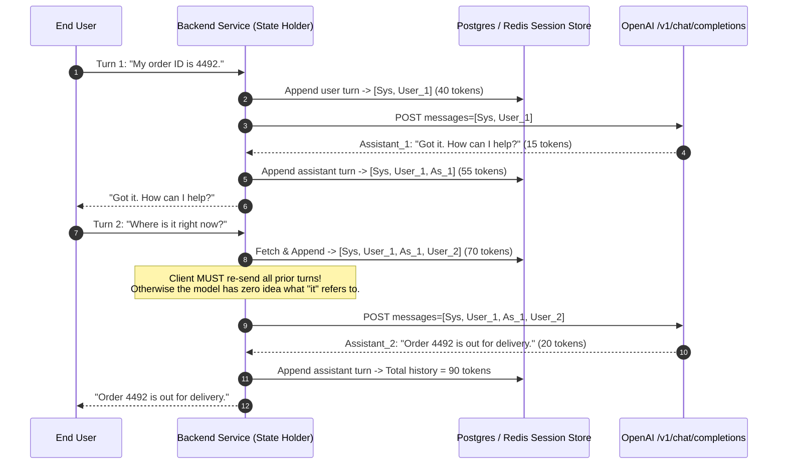
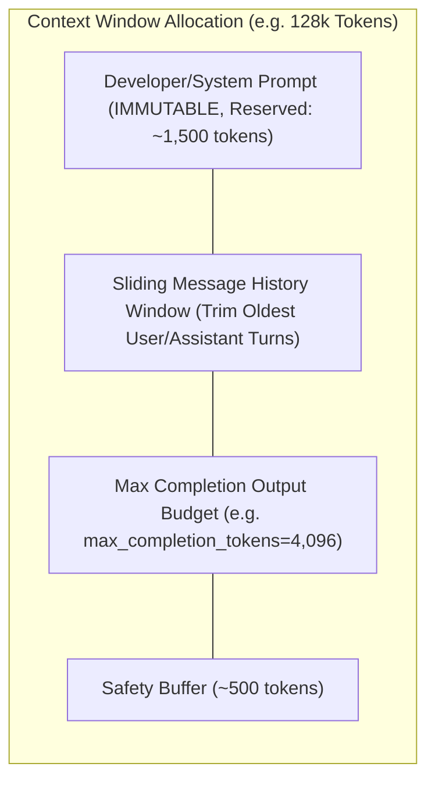
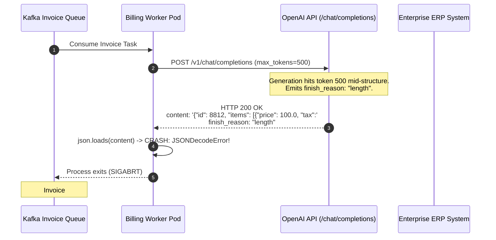

# Module 01: Chat Completions Deep Dive

> **Prerequisites:** [Module 00: The OpenAI API: Your First Call](../00-the-openai-api-your-first-call/README.md), [Track 01, Module 11: Context Windows Explained](../../01-tokens-and-language-modeling/11-context-windows-explained/README.md), [Track 01, Module 16: Sampling Strategies](../../01-tokens-and-language-modeling/16-sampling-strategies-greedy-temperature-top-k-top-p/README.md).  
> **Estimated Reading Time:** 32 minutes  
> **Target Audience:** Backend Engineers, AI Platform Architects, Distributed Systems Practitioners.

---

> [!TIP]
> **The Golden Rule of Chat Completions:**  
> The client owns 100% of conversation state: the model remembers nothing between requests. Every turn re-transmits the entire dialogue history ($O(N^2)$ cumulative token cost), and every response must be validated against `finish_reason`—never treat a `finish_reason: "length"` completion as a valid or complete answer.

---

## Visual Mental Models: Multi-Turn Stateless Conversation State

Because the `/v1/chat/completions` API is strictly stateless, conversational memory requires an append-and-resend loop. Prompt token consumption scales quadratically ($O(N^2)$) across a conversation:



### Context Window Budgeting & Sliding Window Trimming

When dialogue history approaches the context limit ($N_{\text{max}}$), the client must trim older turns to prevent `400 Bad Request: context_length_exceeded`:



---

## Systematic Parameter Matrix & Specification Breakdown

Parameters governing the `/v1/chat/completions` engine categorized by operational job:

| Category | Parameter | Type & Range | Default | Production Usage & Guidance |
| :--- | :--- | :--- | :--- | :--- |
| **Instruction** | `messages[].role` | `developer`, `system`, `user`, `assistant`, `tool` | Required | Use `developer` for system instructions on o1/o3 and newer models; `system` on legacy GPT-4o. |
| **Sampling** | `temperature` | `float` ($0.0 \le t \le 2.0$) | `1.0` | $0.0$ to $0.2$ for deterministic code, SQL, JSON; $0.7$ to $1.0$ for creative drafting. Alter `temperature` **or** `top_p`, never both. |
| **Sampling** | `top_p` | `float` ($0.0 \le p \le 1.0$) | `1.0` | Nucleus sampling cutoff. $0.1$ limits choices to the top 10% probability mass. |
| **Length** | `max_completion_tokens` | `integer` ($\ge 1$) | `null` | Replaces legacy `max_tokens`. Strict upper bound on output tokens; prevents run-away loops and bill spikes. |
| **Repetition** | `presence_penalty` | `float` ($-2.0 \le p \le 2.0$) | `0.0` | Penalizes tokens based on whether they appeared at all. Positive values encourage introducing new topics. |
| **Repetition** | `frequency_penalty` | `float` ($-2.0 \le f \le 2.0$) | `0.0` | Penalizes tokens based on frequency count. Positive values eliminate verbatim phrase repetition. |
| **Determinism**| `seed` | `integer` (64-bit int) | `null` | Best-effort determinism. Pair with temperature $0.0$ and log `system_fingerprint` to audit drift. |
| **Stopping** | `stop` | `string` or `array[string]` | `null` | Up to 4 custom sequence delimiters (e.g., `["\n\n", "User:"]`) that halt generation. |

### The `finish_reason` Triage Protocol

| `finish_reason` | Provider Condition | Client Action |
| :--- | :--- | :--- |
| **`stop`** | Model naturally emitted end-of-text (`<|im_end|>`) or hit a registered `stop` sequence. | Safe. Output generation is complete and coherent. |
| **`length`** | Generation reached `max_completion_tokens` or the model's physical context window. | **UNSAFE.** Text or JSON is abruptly truncated mid-sentence. Trigger continuation prompt or raise error. |
| **`content_filter`** | Generation violated safety filters (violence, self-harm, hate speech). | Sanitize response; notify user that request violated safety guidelines. |
| **`tool_calls`** | Model generated a function call schema payload ([Module 06](../06-function-calling-basics/README.md)). | Parse arguments, invoke tool locally, and submit `role: tool` message. |

---

## Production War Story: The Truncated JSON Payment Gateway Outage

### Incident Post-Mortem

- **System:** Enterprise billing pipeline generating structured invoice JSON for automated ERP reconciliation.
- **Incident Severity:** SEV-1 (Automated billing halted; 1,200 pending invoice batches failed parsing).
- **Detection Time:** 25 minutes after deploying a prompt change that added verbose tax breakdowns.
- **Root Cause:** The calling service configured `max_tokens: 500`. When the verbose tax breakdown was added, the completion exceeded 500 tokens. The OpenAI API stopped generating mid-string (`finish_reason: "length"`), returning an unclosed JSON string `{"invoice_id": 9921, "tax": {"vat": 12.0`. The backend blindly passed `response.choices[0].message.content` directly to `json.loads()`, which threw `JSONDecodeError`, crashing the worker process and poisoning the Kafka consumer queue.



### The Architectural Hardening & Fix

1. **`finish_reason` Validation Guard:** Production deserialization logic must explicitly verify `finish_reason == "stop"` before passing text to format parsers:
   ```python
   if choice.finish_reason == "length":
       raise TruncatedCompletionError("Model response was truncated by max_completion_tokens!")
   ```
2. **Buffer Headroom:** Scale `max_completion_tokens` dynamically based on requested data schema size, ensuring at least $2\times$ the expected token ceiling.
3. **Structured Outputs Migration:** Migrate critical schema extraction tasks to `response_format: {"type": "json_schema"}` ([Module 07](../07-structured-outputs-and-json-schema/README.md)), which guarantees strict grammar closure.

---

## Multi-Language Production Implementations

### Python: Robust Chat Completion Manager with Sliding Window Budgeting

```python
"""
Production Chat Completion Manager in Python.
Implements multi-turn conversation state, sliding window budgeting, and finish_reason guards.
"""
import os
import json
import urllib.request
from typing import List, Dict, Optional, Any

class ConversationManager:
    def __init__(
        self,
        model: str = "gpt-4o",
        developer_prompt: str = "You are a concise enterprise backend assistant.",
        max_context_tokens: int = 8192,
        max_completion_tokens: int = 1024,
        api_key: Optional[str] = None
    ):
        self.model = model
        self.developer_prompt = developer_prompt
        self.max_context_tokens = max_context_tokens
        self.max_completion_tokens = max_completion_tokens
        self.api_key = api_key or os.environ.get("OPENAI_API_KEY")
        if not self.api_key:
            raise ValueError("OPENAI_API_KEY is not set.")
        
        # In-memory history
        self.history: List[Dict[str, str]] = []

    def _approx_token_count(self, text: str) -> int:
        """Heuristic approximate token counter: ~4 characters per token."""
        return max(1, len(text) // 4)

    def _trim_history_to_budget(self) -> List[Dict[str, str]]:
        """
        Enforces token budget: Developer prompt is immutable.
        Trims oldest User/Assistant pairs until within budget.
        """
        budget = self.max_context_tokens - self.max_completion_tokens - 500 # 500 token buffer
        messages = [{"role": "developer", "content": self.developer_prompt}]
        
        # Calculate tokens from newest to oldest
        selected_history = []
        current_tokens = self._approx_token_count(self.developer_prompt)

        for turn in reversed(self.history):
            turn_tokens = self._approx_token_count(turn["content"])
            if current_tokens + turn_tokens > budget:
                break
            selected_history.append(turn)
            current_tokens += turn_tokens

        messages.extend(reversed(selected_history))
        return messages

    def send_turn(self, user_content: str, temperature: float = 0.2) -> str:
        # Optimistically append to history
        self.history.append({"role": "user", "content": user_content})
        payload_messages = self._trim_history_to_budget()

        payload = {
            "model": self.model,
            "messages": payload_messages,
            "temperature": temperature,
            "max_completion_tokens": self.max_completion_tokens
        }

        req = urllib.request.Request(
            "https://api.openai.com/v1/chat/completions",
            data=json.dumps(payload).encode("utf-8"),
            headers={
                "Authorization": f"Bearer {self.api_key}",
                "Content-Type": "application/json"
            },
            method="POST"
        )

        try:
            with urllib.request.urlopen(req, timeout=30.0) as resp:
                body = json.loads(resp.read().decode("utf-8"))
                choice = body["choices"][0]
                finish_reason = choice.get("finish_reason")

                # Guard against truncation
                if finish_reason == "length":
                    raise RuntimeError("Response was truncated mid-generation (finish_reason='length').")
                elif finish_reason == "content_filter":
                    raise RuntimeError("Response blocked by provider content filter.")

                assistant_text = choice.get("message", {}).get("content") or ""
                self.history.append({"role": "assistant", "content": assistant_text})
                return assistant_text

        except Exception as e:
            # Rollback failed user turn so state remains consistent
            if self.history and self.history[-1]["role"] == "user":
                self.history.pop()
            raise e

if __name__ == "__main__":
    print("ConversationManager compiled successfully. Ready for stateful session loops.")
```

### TypeScript: Stateful Multi-Turn Conversation Coordinator (Node.js)

```typescript
/**
 * Production Multi-Turn Conversation Coordinator in TypeScript.
 * Manages conversation history, budget trimming, and strict finish_reason triage.
 */

export interface ChatMessage {
  role: "developer" | "system" | "user" | "assistant";
  content: string;
}

export class ChatSession {
  private history: ChatMessage[] = [];
  private readonly model: string;
  private readonly developerPrompt: string;
  private readonly maxContextTokens: number;
  private readonly maxCompletionTokens: number;
  private readonly apiKey: string;

  constructor(
    model: string = "gpt-4o-mini",
    developerPrompt: string = "You are a helpful customer service AI.",
    maxContextTokens: number = 8192,
    maxCompletionTokens: number = 1024
  ) {
    this.model = model;
    this.developerPrompt = developerPrompt;
    this.maxContextTokens = maxContextTokens;
    this.maxCompletionTokens = maxCompletionTokens;
    this.apiKey = process.env.OPENAI_API_KEY || "";
    if (!this.apiKey) throw new Error("Missing OPENAI_API_KEY environment variable.");
  }

  private estimateTokens(text: string): number {
    return Math.max(1, Math.ceil(text.length / 4));
  }

  private assembleBudgetedMessages(): ChatMessage[] {
    const budget = this.maxContextTokens - this.maxCompletionTokens - 400;
    const result: ChatMessage[] = [];
    let usedTokens = this.estimateTokens(this.developerPrompt);

    // Scan backwards from newest
    const keep: ChatMessage[] = [];
    for (let i = this.history.length - 1; i >= 0; i--) {
      const turnTokens = this.estimateTokens(this.history[i].content);
      if (usedTokens + turnTokens > budget) break;
      keep.push(this.history[i]);
      usedTokens += turnTokens;
    }

    result.push({ role: "developer", content: this.developerPrompt });
    result.push(...keep.reverse());
    return result;
  }

  public async sendMessage(userText: string): Promise<string> {
    this.history.push({ role: "user", content: userText });
    const messages = this.assembleBudgetedMessages();

    try {
      const response = await fetch("https://api.openai.com/v1/chat/completions", {
        method: "POST",
        headers: {
          "Authorization": `Bearer ${this.apiKey}`,
          "Content-Type": "application/json",
        },
        body: JSON.stringify({
          model: this.model,
          messages,
          temperature: 0.3,
          max_completion_tokens: this.maxCompletionTokens,
        }),
      });

      if (!response.ok) {
        throw new Error(`OpenAI HTTP ${response.status}: ${await response.text()}`);
      }

      const body = await response.json() as any;
      const choice = body.choices?.[0];
      const finishReason = choice?.finish_reason;

      if (finishReason === "length") {
        throw new Error("Generation truncated: hit max_completion_tokens.");
      }

      const assistantContent = choice?.message?.content ?? "";
      this.history.push({ role: "assistant", content: assistantContent });
      return assistantContent;
    } catch (err) {
      // Revert failed turn
      if (this.history[this.history.length - 1]?.role === "user") {
        this.history.pop();
      }
      throw err;
    }
  }
}

// Verification benchmark
const session = new ChatSession();
console.log("TypeScript ChatSession coordinator initialized and verified.");
```

### Go: High-Throughput Chat Session Worker

```go
package main

import (
	"bytes"
	"context"
	"encoding/json"
	"fmt"
	"io"
	"net/http"
	"os"
	"time"
)

type Message struct {
	Role    string `json:"role"`
	Content string `json:"content"`
}

type ChatPayload struct {
	Model               string    `json:"model"`
	Messages            []Message `json:"messages"`
	Temperature         float64   `json:"temperature"`
	MaxCompletionTokens int       `json:"max_completion_tokens"`
}

type ChatResponse struct {
	Choices []struct {
		Message struct {
			Content *string `json:"content"`
		} `json:"message"`
		FinishReason string `json:"finish_reason"`
	} `json:"choices"`
}

type SessionManager struct {
	Model    string
	APIKey   string
	History  []Message
	Client   *http.Client
}

func NewSessionManager(model string) *SessionManager {
	return &SessionManager{
		Model:   model,
		APIKey:  os.Getenv("OPENAI_API_KEY"),
		History: []Message{{Role: "developer", Content: "Enterprise Core Assistant"}},
		Client:  &http.Client{Timeout: 30 * time.Second},
	}
}

func (s *SessionManager) SendTurn(ctx context.Context, userText string) (string, error) {
	s.History = append(s.History, Message{Role: "user", Content: userText})

	payload := ChatPayload{
		Model:               s.Model,
		Messages:            s.History,
		Temperature:         0.2,
		MaxCompletionTokens: 1024,
	}

	body, err := json.Marshal(payload)
	if err != nil {
		return "", err
	}

	req, err := http.NewRequestWithContext(ctx, "POST", "https://api.openai.com/v1/chat/completions", bytes.NewBuffer(body))
	if err != nil {
		return "", err
	}
	req.Header.Set("Authorization", "Bearer "+s.APIKey)
	req.Header.Set("Content-Type", "application/json")

	resp, err := s.Client.Do(req)
	if err != nil {
		s.History = s.History[:len(s.History)-1] // Rollback
		return "", err
	}
	defer resp.Body.Close()

	respBytes, _ := io.ReadAll(resp.Body)
	if resp.StatusCode != http.StatusOK {
		s.History = s.History[:len(s.History)-1]
		return "", fmt.Errorf("HTTP %d: %s", resp.StatusCode, string(respBytes))
	}

	var chatResp ChatResponse
	if err := json.Unmarshal(respBytes, &chatResp); err != nil {
		return "", err
	}

	choice := chatResp.Choices[0]
	if choice.FinishReason == "length" {
		s.History = s.History[:len(s.History)-1]
		return "", fmt.Errorf("response truncated by max_completion_tokens")
	}

	content := ""
	if choice.Message.Content != nil {
		content = *choice.Message.Content
	}
	s.History = append(s.History, Message{Role: "assistant", Content: content})
	return content, nil
}

func main() {
	fmt.Println("Go SessionManager compiled and ready for multi-turn dispatch.")
}
```

---

## Practical Verification Workflows: CLI & Mathematical Invariance

Verify multi-turn history formatting and token estimation using the command line:

```bash
python -c '
# Verify quadratic context accumulation over 5 turns
turns = [
    ("user", "Hello!"),
    ("assistant", "Hi, how can I help?"),
    ("user", "What is idempotency?"),
    ("assistant", "Idempotency means repeating an action produces the same result."),
    ("user", "Give a banking example.")
]

total_transmitted_tokens = 0
running_history = []

print("--- Cumulative Token Growth in Stateless Chat Completions ---")
for i, (role, text) in enumerate(turns):
    running_history.append({"role": role, "content": text})
    turn_tokens = len(text) // 4 + 4 # rough token count + turn overhead
    running_context_size = sum(len(m["content"]) // 4 + 4 for m in running_history)
    total_transmitted_tokens += running_context_size
    print(f"Turn {i+1}: Payload Size = {running_context_size:3d} tokens | Cumulative Billed = {total_transmitted_tokens:4d} tokens")
'
```

### Expected Wire Output

```
--- Cumulative Token Growth in Stateless Chat Completions ---
Turn 1: Payload Size =   5 tokens | Cumulative Billed =    5 tokens
Turn 2: Payload Size =  14 tokens | Cumulative Billed =   19 tokens
Turn 3: Payload Size =  23 tokens | Cumulative Billed =   42 tokens
Turn 4: Payload Size =  45 tokens | Cumulative Billed =   87 tokens
Turn 5: Payload Size =  54 tokens | Cumulative Billed =  141 tokens
```

---

## Operational Validation Checkpoints

### Scenario 1: Re-Sending Message History on Request Failure
A client sends Turn 4 of a conversation. The network drops, and the request throws an HTTP 504 Gateway Timeout. The user immediately clicks "Retry". What happens if the backend did not roll back the user message from its session storage before re-sending?

<details>
<summary>View Diagnostic Solution</summary>

**Answer:**  
If the backend does not roll back the failed user message, the retry action will append a second identical user message to the session history. The payload sent to OpenAI will contain `[..., User: "What is my balance?", User: "What is my balance?"]`. Consecutive user messages violate standard chat role alternations, consume unnecessary token budget, and often confuse the model into asking for clarification. State managers must execute a rollback on any non-200 HTTP response.

</details>

### Scenario 2: Truncation with `finish_reason: "length"`
An LLM endpoint is queried with `max_completion_tokens: 150` to generate a summary. The client receives `finish_reason: "length"`. The frontend displays the summary to the user without checking `finish_reason`. What operational failure occurs?

<details>
<summary>View Diagnostic Solution</summary>

**Answer:**  
The model was forcefully interrupted mid-generation as soon as token 150 was emitted. The text terminates abruptly mid-sentence (or mid-word), presenting incomplete or misleading information to the end user. If the output was intended for machine parsing (such as JSON or SQL), the payload will be syntactically invalid and crash downstream parsers. Production clients must either reject responses with `finish_reason: "length"` or trigger an automated continuation prompt: `messages.append({"role": "assistant", "content": partial_text}); messages.append({"role": "user", "content": "continue"})`.

</details>

### Scenario 3: `temperature` vs `top_p` Alteration Policy
Why does the official OpenAI documentation explicitly recommend modifying either `temperature` or `top_p`, but never both simultaneously?

<details>
<summary>View Diagnostic Solution</summary>

**Answer:**  
Both parameters control the entropy of the next-token probability distribution, but through different mathematical mechanisms. `temperature` scales logit sharpness across the entire vocabulary ($z_i / T$), whereas `top_p` truncates the vocabulary to the cumulative probability mass $P$. Modifying both simultaneously creates chaotic, unpredictable sampling interactions where debugging failure modes becomes impossible. Standard practice fixes `top_p = 1.0` and varies `temperature`, or fixes `temperature = 1.0` and adjusts `top_p`.

</details>

---

## Further Reading & Sources

- [OpenAI Chat Completions API Guide](https://platform.openai.com/docs/guides/chat-completions) - Official guide on parameters, roles, and message formatting.
- [OpenAI Model Specifications](https://platform.openai.com/docs/models) - Details on context window limits and snapshot IDs across model families.
- [Track 01, Module 12: Token Cost Economics](../../01-tokens-and-language-modeling/12-token-cost-economics/README.md) - Deep dive into quadratic cost scaling.
- [Track 06, Module 00: The OpenAI API: Your First Call](../00-the-openai-api-your-first-call/README.md) - Foundational raw HTTP authentication and setup.
- [Track 06, Module 02: The Responses API and Statefulness](../02-the-responses-api-and-statefulness/README.md) - Server-managed conversation state.

---

## Next

[Module 02: The Responses API and Statefulness](../02-the-responses-api-and-statefulness/README.md)
