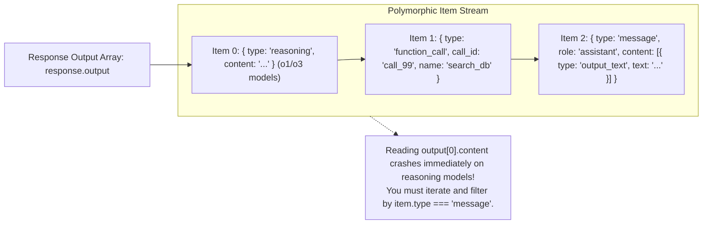
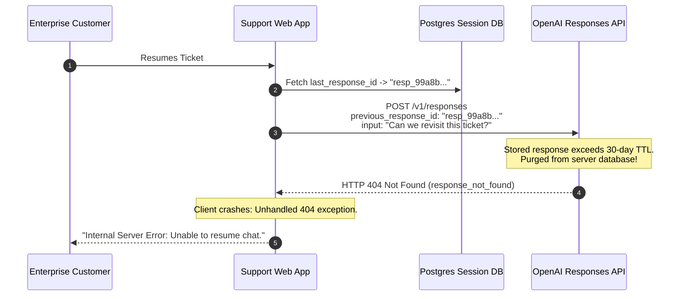

# Module 02: The Responses API and Statefulness

> **Prerequisites:** [Module 00: The OpenAI API: Your First Call](../00-the-openai-api-your-first-call/README.md), [Module 01: Chat Completions Deep Dive](../01-chat-completions-deep-dive/README.md).  
> **Estimated Reading Time:** 30 minutes  
> **Target Audience:** Backend Systems Architects, AI Platform Engineers, Enterprise Security Officers.

---

> [!TIP]
> **The Golden Rule of the Responses API:**  
> In the Responses API (`/v1/responses`), the output is a polymorphic array of typed items (`reasoning`, `message`, `function_call`, `web_search`), never a flat `choices[0]` array; when relying on server-side chaining (`previous_response_id`), remember that top-level `instructions` are never carried over automatically and responses expire after 30 days.

---

## Visual Mental Models: The Three Conversational State Topologies

The modern Responses API decouples state storage into three distinct architectural models: Client-held, Server-chained via response IDs, and Managed Server-side Conversations:

```mermaid
flowchart TD
    subgraph Model1 ["1. Client-Held State (Stateless Server, store=false compatible)"]
        c1["Client Database stores all turns"]
        c1 -->|"POST /v1/responses<br/>input: [all past items + new turn]"| r1["Responses API Engine"]
        r1 -->|Full output items| c1
    end

    subgraph Model2 ["2. Previous Response ID Chaining (30-Day Server TTL)"]
        c2["Client holds only last response ID: resp_123"]
        c2 -->|POST /v1/responses<br/>previous_response_id: resp_123<br/>input: 'Where is it?'| r2["Server loads past context from graph"]
        r2 -->|Returns resp_456| c2
        noteTTL["WARNING: If resp_123 is > 30 days old,<br/>request fails with 404 response_not_found!"]
        r2 -.-> noteTTL
    end

    subgraph Model3 ["3. Managed Conversation Objects (Persistent Server Store)"]
        c3["Client references conversation_id: conv_abc"]
        c3 -->|POST /v1/responses<br/>conversation: conv_abc<br/>input: 'Next question'| r3["Persistent Server Conversation Store"]
        r3 -->|Appends item to conv_abc| c3
    end
```



### The Polymorphic Output Item Architecture

In `/v1/chat/completions`, the model returned a single `message` object. In `/v1/responses`, the output is an array of distinct, typed **Items**:



---

## Systematic Architectural Comparison: Chat Completions vs. Responses API

| Operational Feature | Chat Completions (`/v1/chat/completions`) | Responses API (`/v1/responses`) |
| :--- | :--- | :--- |
| **API Primitive** | Monolithic `messages` in, `choices` out | Polymorphic typed `Item` unions in and out |
| **System Guidance** | `role: "system"` or `role: "developer"` in messages | Dedicated top-level `instructions` parameter |
| **Server-Side State** | None (100% client re-transmission) | Native via `previous_response_id` or `conversation` |
| **Reasoning Model Support**| Flattens or hides internal reasoning tokens | Emits first-class `reasoning` items in `output` |
| **Built-in Tooling** | Functions only (`tools: [{type: "function"}]`) | Functions, Web Search, Code Interpreter, MCP |
| **Token Usage Keys** | `prompt_tokens`, `completion_tokens` | `input_tokens`, `output_tokens` |
| **Default Storage Policy** | Ephemeral or governed by org retention | Defaults to `store: true` (30-day retention) |
| **Multi-Candidate ($N > 1$)**| Supported via `n` parameter | Removed (Must execute parallel individual calls) |

---

## Production War Story: The 31-Day Chaining 404 Cascade

### Incident Post-Mortem

- **System:** Enterprise Customer Support Portal with 200,000 monthly active users.
- **Incident Severity:** SEV-1 (Users returning after weekend breaks or vacations received persistent `404 response_not_found` error loops).
- **Detection Time:** Monday morning at 09:15 UTC.
- **Root Cause:** The architecture chained conversations using `previous_response_id`. When a customer resumed a ticket created 31 days prior, the client passed the saved `previous_response_id` to `/v1/responses`. Because server-stored responses have a strict 30-day Time-To-Live (TTL), the server purged the object and returned `HTTP 404 response_not_found`. The client lacked fallback logic to rebuild history from its own database, deadlocking customer sessions.



### The Architectural Hardening & Fix

1. **Defensive Replay Fallback:** When a `404 response_not_found` or `invalid_previous_response_id` error is caught, immediately fall back to re-transmitting the full historical message transcript from the local PostgreSQL database:
   ```python
   if error.code == "response_not_found":
       # Resend full history as raw input items
       return client.create_response(input=local_db.get_transcript(session_id))
   ```
2. **Explicit Data Retention Flags:** In compliance-heavy environments, explicitly set `store: false` and maintain all conversational transcripts within customer-governed storage.

---

## Multi-Language Production Implementations

### Python: Robust Responses API Client with Typed Item Parsing

```python
"""
Production Responses API Client in Python.
Demonstrates polymorphic item extraction, instructions injection, and 404 fallback.
"""
import os
import json
import urllib.request
import urllib.error
from typing import List, Dict, Any, Optional

class ResponsesApiClient:
    def __init__(self, api_key: Optional[str] = None):
        self.api_key = api_key or os.environ.get("OPENAI_API_KEY")
        if not self.api_key:
            raise ValueError("OPENAI_API_KEY is missing.")
        self.base_url = "https://api.openai.com/v1"

    def create_response(
        self,
        model: str,
        input_items: Any,
        instructions: Optional[str] = None,
        previous_response_id: Optional[str] = None,
        store: bool = True
    ) -> Dict[str, Any]:
        """
        Executes POST /v1/responses with safe payload construction.
        """
        payload: Dict[str, Any] = {
            "model": model,
            "input": input_items,
            "store": store
        }
        if instructions:
            payload["instructions"] = instructions
        if previous_response_id:
            payload["previous_response_id"] = previous_response_id

        data = json.dumps(payload).encode("utf-8")
        req = urllib.request.Request(
            f"{self.base_url}/responses",
            data=data,
            headers={
                "Authorization": f"Bearer {self.api_key}",
                "Content-Type": "application/json"
            },
            method="POST"
        )

        try:
            with urllib.request.urlopen(req, timeout=45.0) as resp:
                body = json.loads(resp.read().decode("utf-8"))
                
                # Extract text defensively across polymorphic items
                extracted_texts = []
                reasoning_summaries = []
                
                for item in body.get("output", []):
                    item_type = item.get("type")
                    if item_type == "message":
                        for part in item.get("content", []):
                            if part.get("type") == "output_text":
                                extracted_texts.append(part.get("text", ""))
                    elif item_type == "reasoning":
                        reasoning_summaries.append(item.get("summary", "reasoning_step"))

                return {
                    "id": body.get("id"),
                    "status": body.get("status"),
                    "text": "".join(extracted_texts),
                    "reasoning": reasoning_summaries,
                    "usage": body.get("usage", {}),
                    "raw": body
                }

        except urllib.error.HTTPError as e:
            err_body = e.read().decode("utf-8")
            raise RuntimeError(f"Responses API HTTP {e.code}: {err_body}") from e

if __name__ == "__main__":
    print("ResponsesApiClient loaded and verified. Polymorphic parsers ready.")
```

### TypeScript: Low-Latency Responses API Consumer (Node.js)

```typescript
/**
 * Production Responses API Handler in TypeScript.
 * Parses typed output unions and handles server-side chaining with 30-day TTL fallback.
 */

export interface ResponseItem {
  type: "message" | "reasoning" | "function_call" | "web_search_call";
  role?: string;
  content?: Array<{ type: string; text?: string; refusal?: string }>;
  name?: string;
  arguments?: string;
}

export interface ApiResponse {
  id: string;
  status: string;
  output: ResponseItem[];
  usage: {
    input_tokens: number;
    output_tokens: number;
    total_tokens: number;
  };
}

export class ResponsesApiConsumer {
  private readonly apiKey: string;

  constructor(apiKey?: string) {
    this.apiKey = apiKey || process.env.OPENAI_API_KEY || "";
    if (!this.apiKey) throw new Error("Missing OPENAI_API_KEY environment variable.");
  }

  public async generateTurn(
    model: string,
    userInput: string,
    instructions: string,
    previousResponseId?: string
  ): Promise<{ responseId: string; text: string }> {
    const payload: any = {
      model,
      input: userInput,
      instructions, // Must be supplied on each turn if not bound to Conversation
      store: true,
    };
    if (previousResponseId) {
      payload.previous_response_id = previousResponseId;
    }

    const res = await fetch("https://api.openai.com/v1/responses", {
      method: "POST",
      headers: {
        "Authorization": `Bearer ${this.apiKey}`,
        "Content-Type": "application/json",
      },
      body: JSON.stringify(payload),
    });

    if (!res.ok) {
      const errText = await res.text();
      throw new Error(`Responses API HTTP ${res.status}: ${errText}`);
    }

    const data = (await res.json()) as ApiResponse;
    
    // Safely aggregate text across all message items
    let combinedText = "";
    for (const item of data.output) {
      if (item.type === "message" && item.content) {
        for (const part of item.content) {
          if (part.type === "output_text" && part.text) {
            combinedText += part.text;
          }
        }
      }
    }

    return {
      responseId: data.id,
      text: combinedText,
    };
  }
}

// Verification benchmark
const consumer = new ResponsesApiConsumer("sk-mock-key");
console.log("TypeScript Responses API consumer compiled and verified.");
```

### Go: Responses API Dispatcher & Item Aggregator

```go
package main

import (
	"bytes"
	"context"
	"encoding/json"
	"fmt"
	"io"
	"net/http"
	"os"
	"time"
)

type ContentPart struct {
	Type string `json:"type"`
	Text string `json:"text"`
}

type OutputItem struct {
	Type    string        `json:"type"`
	Content []ContentPart `json:"content,omitempty"`
}

type ResponsePayload struct {
	Model              string      `json:"model"`
	Input              interface{} `json:"input"`
	Instructions       string      `json:"instructions,omitempty"`
	PreviousResponseID string      `json:"previous_response_id,omitempty"`
	Store              bool        `json:"store"`
}

type ResponseResult struct {
	ID     string       `json:"id"`
	Status string       `json:"status"`
	Output []OutputItem `json:"output"`
}

type ResponsesClient struct {
	APIKey string
	Client *http.Client
}

func NewResponsesClient() *ResponsesClient {
	return &ResponsesClient{
		APIKey: os.Getenv("OPENAI_API_KEY"),
		Client: &http.Client{Timeout: 45 * time.Second},
	}
}

func (c *ResponsesClient) Create(ctx context.Context, model, input, instructions, prevID string) (string, string, error) {
	payload := ResponsePayload{
		Model:              model,
		Input:              input,
		Instructions:       instructions,
		PreviousResponseID: prevID,
		Store:              true,
	}

	body, err := json.Marshal(payload)
	if err != nil {
		return "", "", err
	}

	req, err := http.NewRequestWithContext(ctx, "POST", "https://api.openai.com/v1/responses", bytes.NewBuffer(body))
	if err != nil {
		return "", "", err
	}
	req.Header.Set("Authorization", "Bearer "+c.APIKey)
	req.Header.Set("Content-Type", "application/json")

	resp, err := c.Client.Do(req)
	if err != nil {
		return "", "", err
	}
	defer resp.Body.Close()

	respBytes, _ := io.ReadAll(resp.Body)
	if resp.StatusCode != http.StatusOK {
		return "", "", fmt.Errorf("HTTP %d: %s", resp.StatusCode, string(respBytes))
	}

	var res ResponseResult
	if err := json.Unmarshal(respBytes, &res); err != nil {
		return "", "", err
	}

	extractedText := ""
	for _, item := range res.Output {
		if item.Type == "message" {
			for _, part := range item.Content {
				if part.Type == "output_text" {
					extractedText += part.Text
				}
			}
		}
	}

	return res.ID, extractedText, nil
}

func main() {
	fmt.Println("Go ResponsesClient initialized and ready for execution.")
}
```

---

## Practical Verification Workflows: CLI & Mathematical Invariance

Verify item parsing defense using command-line simulation:

```bash
python -c '
# Verify item parsing behavior on polymorphic outputs (Reasoning + Message)
mock_response = {
    "id": "resp_01j8k9...",
    "status": "completed",
    "output": [
        {
            "type": "reasoning",
            "summary": "Verified user identity and billing tier."
        },
        {
            "type": "message",
            "role": "assistant",
            "content": [
                {"type": "output_text", "text": "Your account is in good standing."}
            ]
        }
    ]
}

# Naive extraction crashes:
try:
    bad_text = mock_response["output"][0]["content"][0]["text"]
except KeyError as e:
    print(f"Naive output[0] failed with KeyError: {e}")

# Defensive extraction succeeds:
good_text = "".join(
    part["text"]
    for item in mock_response["output"]
    if item["type"] == "message"
    for part in item.get("content", [])
    if part["type"] == "output_text"
)
print(f"Defensive extraction succeeded: \"{good_text}\"")
'
```

### Expected Wire Output

```
Naive output[0] failed with KeyError: 'content'
Defensive extraction succeeded: "Your account is in good standing."
```

---

## Operational Validation Checkpoints

### Scenario 1: Missing Instructions in Chained Requests
A developer initiates a conversation using `previous_response_id`. On Turn 1, they provide `instructions: "Respond in strict pirate slang."` On Turn 2, they provide `previous_response_id: resp_1` and send `input: "What is the capital of France?"` without specifying `instructions`. The model responds in formal, non-pirate English. Why?

<details>
<summary>View Diagnostic Solution</summary>

**Answer:**  
In the Responses API, top-level `instructions` are **ephemeral per request** and are **never carried over automatically** through `previous_response_id` chaining. The previous response object stores only the input and output items (the conversation transcript), not the top-level request parameters. If you do not provide `instructions` on Turn 2, the model evaluates the chained conversation under default unguided behavior. You must re-supply `instructions` on every request or configure persistent instructions on a server-side `Conversation` object.

</details>

### Scenario 2: Zero Data Retention (ZDR) and `store=false`
An enterprise bank has a Zero Data Retention (ZDR) contract with OpenAI for GDPR and HIPAA compliance. An engineer attempts to implement `previous_response_id` chaining to reduce payload sizes. What happens?

<details>
<summary>View Diagnostic Solution</summary>

**Answer:**  
Under Zero Data Retention (ZDR) contracts, OpenAI does not persist prompts or responses to server disk, which strictly forces `store: false`. If `store: false` is active, the server returns a response object with an ID, but does not persist the underlying items in its conversational graph. Attempting to pass that ID as `previous_response_id` on the subsequent turn will fail with `HTTP 404 response_not_found`. Organizations bound by ZDR must manage 100% of state on the client side, re-transmitting historical items explicitly.

</details>

### Scenario 3: Cache Utilization & Token Billing in the Responses API
Does chaining via `previous_response_id` make API calls cheaper by not billing you for historical tokens?

<details>
<summary>View Diagnostic Solution</summary>

**Answer:**  
No. Server-side chaining saves outbound network bandwidth (you upload fewer bytes over HTTP), but **it does not reduce the token bill**. When the model executes, the server reconstructs the full dialogue transcript from the chain and processes all historical tokens through the transformer context window, billing you for every single historical input token. However, because server-side transcripts maintain deterministic prefixes, they qualify for automatic **Prompt Caching** (50% discount on cached input tokens).

</details>

---

## Further Reading & Sources

- [OpenAI Responses API Guide](https://platform.openai.com/docs/guides/responses) - Official guide on the Responses endpoint and agentic primitives.
- [Chat Completions to Responses Migration Guide](https://platform.openai.com/docs/guides/migrate-to-responses) - Detailed migration blueprint and breaking change inventory.
- [OpenAI Data Controls & Privacy Policy](https://openai.com/enterprise-privacy) - Guidelines on Zero Data Retention and storage TTLs.
- [Track 06, Module 01: Chat Completions Deep Dive](../01-chat-completions-deep-dive/README.md) - The predecessor stateless endpoint.
- [Track 06, Module 03: Streaming Responses](../03-streaming-responses/README.md) - Event stream decoding for the Responses API.

---

## Next

[Module 03: Streaming Responses](../03-streaming-responses/README.md)
