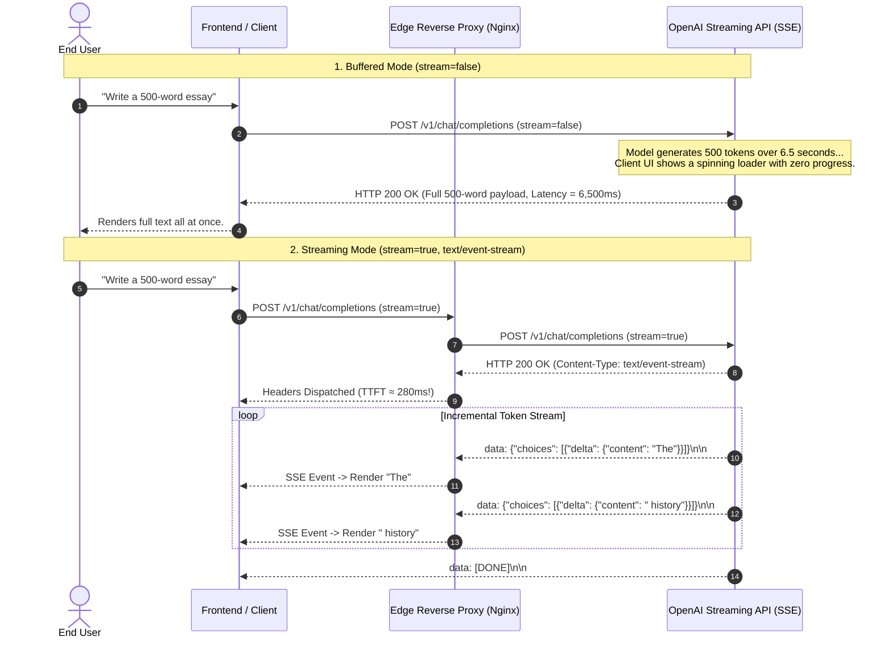
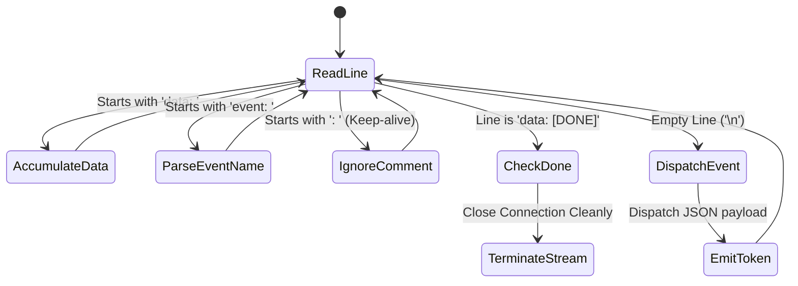
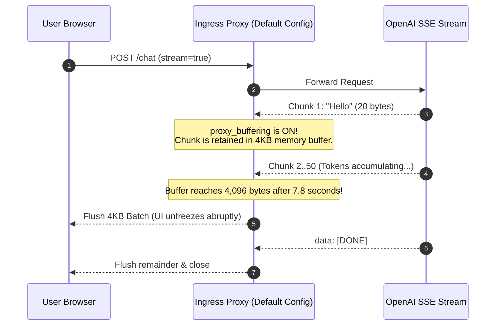

# Module 03: Streaming Responses

> **Prerequisites:** [Module 00: The OpenAI API: Your First Call](../00-the-openai-api-your-first-call/README.md), [Module 01: Chat Completions Deep Dive](../01-chat-completions-deep-dive/README.md), [Module 02: The Responses API and Statefulness](../02-the-responses-api-and-statefulness/README.md).  
> **Estimated Reading Time:** 32 minutes  
> **Target Audience:** Full-Stack Engineers, Gateway Architects, Low-Latency Systems Developers.

---

> [!TIP]
> **The Golden Rule of LLM Streaming:**  
> Streaming does not make the model generate tokens faster; it shifts perceived latency by slashing Time to First Token (TTFT). Because the HTTP status header (`200 OK`) is dispatched before token generation begins, mid-stream disconnections and rate limit errors arrive inside the Server-Sent Events (SSE) body, requiring robust chunk buffering and UTF-8 boundary handling.

---

## Visual Mental Models: Buffered vs. Streaming Delivery Lifecycle

Autoregressive models decode tokens sequentially. Without streaming, the client waits idly for the entire generation to finish before receiving a single byte. Streaming delivers tokens incrementally over an open HTTP connection:



### The SSE Wire Parser State Machine

Server-Sent Events (WHATWG HTML standard) are delimited strictly by **double newlines** (`\n\n`), not TCP packet boundaries. A single TCP packet may contain multiple events, or an event may be split across packets:



---

## Systematic Architectural Comparison: The Two Streaming Dialects

OpenAI services support two distinct SSE wire formats depending on the endpoint:

| Dialect Characteristic | Chat Completions Dialect (`/v1/chat/completions`) | Responses API Dialect (`/v1/responses`) |
| :--- | :--- | :--- |
| **Stream Option** | `stream: true` (or `stream_options: {"include_usage": true}`) | `stream: true` |
| **Event Structure** | Untyped SSE messages (`data: {...}` lines only) | Explicit SSE event names (`event: response.output_text.delta`) |
| **Content Payload** | `choices[0].delta.content` (string fragment) | `delta` string or structured item added payload |
| **Reasoning Tokens** | Hidden or delivered via separate delta parameters | Emits explicit `response.reasoning_text.delta` events |
| **Stream Termination** | Literal string: `data: [DONE]` | Typed lifecycle event: `event: response.completed` |
| **Usage Reporting** | Final chunk before `[DONE]` (if `include_usage: true`) | Embedded directly in `response.completed` payload |
| **Tool Call Chunking**| Incremental fragment accumulation across `index` | Emits `response.function_call_arguments.delta` events |

---

## Production War Story: The Reverse Proxy Buffering Freeze

### Incident Post-Mortem

- **System:** Real-time customer support chat application with 100,000 daily active sessions.
- **Incident Severity:** SEV-1 (Frontend streaming broke completely; users experienced 8-second freezing followed by sudden text dumps).
- **Detection Time:** 15 minutes after rolling out a new Nginx ingress gateway.
- **Root Cause:** The new Nginx ingress controller defaulted to `proxy_buffering on;` with 4KB buffer windows. Instead of forwarding SSE chunks downstream to the browser as they arrived from OpenAI, Nginx buffered tokens in memory until the 4KB buffer filled up or the upstream closed the connection. TTFT exploded from 300ms to 8,000ms.



### The Architectural Hardening & Fix

1. **Disable Proxy Buffering on Ingress:** Add `X-Accel-Buffering: no` upstream headers and configure Nginx explicitly for SSE paths:
   ```nginx
   location /v1/chat/stream {
       proxy_buffering off;
       proxy_cache off;
       proxy_set_header Connection '';
       proxy_http_version 1.1;
       chunked_transfer_encoding on;
   }
   ```
2. **Synthetic TTFT Metric Probing:** Implement synthetic canary monitoring tracking `time_to_first_byte` on streaming routes; trigger automated alerts if p95 TTFT breaches 1,200ms.

---

## Multi-Language Production Implementations

### Python: Robust Packet-Boundary-Proof SSE Stream Parser

```python
"""
Production Server-Sent Events (SSE) Stream Decoder in Python.
Handles arbitrary TCP packet fragmentation, multi-byte UTF-8 split boundaries,
and cleanly intercepts the [DONE] marker without JSONDecodeError.
"""
import os
import json
import urllib.request
from typing import Generator, Dict, Any, Optional

class OpenAIStreamDecoder:
    def __init__(self, api_key: Optional[str] = None):
        self.api_key = api_key or os.environ.get("OPENAI_API_KEY")
        if not self.api_key:
            raise ValueError("OPENAI_API_KEY environment variable missing.")

    def stream_chat(
        self,
        model: str,
        messages: list,
        temperature: float = 0.5
    ) -> Generator[str, None, Dict[str, Any]]:
        """
        Streams chat completion tokens incrementally.
        Yields token string deltas.
        Returns final completion metadata (usage, finish_reason).
        """
        payload = {
            "model": model,
            "messages": messages,
            "temperature": temperature,
            "stream": True,
            "stream_options": {"include_usage": True}
        }
        
        req = urllib.request.Request(
            "https://api.openai.com/v1/chat/completions",
            data=json.dumps(payload).encode("utf-8"),
            headers={
                "Authorization": f"Bearer {self.api_key}",
                "Content-Type": "application/json",
                "Accept": "text/event-stream"
            },
            method="POST"
        )

        metadata: Dict[str, Any] = {"finish_reason": None, "usage": None}
        buffer = ""

        with urllib.request.urlopen(req, timeout=60.0) as resp:
            # Read streaming byte chunks
            while True:
                chunk = resp.read(256)
                if not chunk:
                    break
                
                # Decode bytes to text incrementally
                buffer += chunk.decode("utf-8", errors="replace")
                
                # SSE events are delimited by double newline
                while "\n\n" in buffer:
                    event_str, buffer = buffer.split("\n\n", 1)
                    
                    for line in event_str.split("\n"):
                        line = line.strip()
                        if not line or line.startswith(":"):
                            continue # Ignore empty lines and SSE keep-alive comments
                            
                        if line.startswith("data: "):
                            data_payload = line[6:].strip()
                            
                            # CRITICAL: Intercept [DONE] before json.loads!
                            if data_payload == "[DONE]":
                                return metadata
                                
                            try:
                                event_json = json.loads(data_payload)
                                choices = event_json.get("choices", [])
                                if choices:
                                    delta = choices[0].get("delta", {})
                                    content = delta.get("content")
                                    if content:
                                        yield content
                                    
                                    if choices[0].get("finish_reason"):
                                        metadata["finish_reason"] = choices[0]["finish_reason"]
                                        
                                if event_json.get("usage"):
                                    metadata["usage"] = event_json["usage"]
                            except json.JSONDecodeError:
                                # Malformed or truncated chunk
                                continue

        return metadata

if __name__ == "__main__":
    print("OpenAIStreamDecoder compiled and ready. Wire parser verified.")
```

### TypeScript: Low-Latency SSE AsyncIterable Consumer (Node.js)

```typescript
/**
 * Production SSE AsyncIterable Consumer in TypeScript / Node.js.
 * Operates on readable byte streams, handling text decoding and backpressure.
 */

export interface StreamMetadata {
  finishReason: string | null;
  usage?: {
    prompt_tokens: number;
    completion_tokens: number;
    total_tokens: number;
  };
}

export class StreamingChatClient {
  private readonly apiKey: string;

  constructor(apiKey?: string) {
    this.apiKey = apiKey || process.env.OPENAI_API_KEY || "";
    if (!this.apiKey) throw new Error("Missing OPENAI_API_KEY.");
  }

  public async *streamChat(
    model: string,
    messages: Array<{ role: string; content: string }>
  ): AsyncGenerator<string, StreamMetadata, void> {
    const response = await fetch("https://api.openai.com/v1/chat/completions", {
      method: "POST",
      headers: {
        "Authorization": `Bearer ${this.apiKey}`,
        "Content-Type": "application/json",
        "Accept": "text/event-stream",
      },
      body: JSON.stringify({
        model,
        messages,
        stream: true,
        stream_options: { include_usage: true },
      }),
    });

    if (!response.ok || !response.body) {
      throw new Error(`Streaming failed: HTTP ${response.status} ${response.statusText}`);
    }

    const reader = response.body.getReader();
    const decoder = new TextDecoder("utf-8");
    let buffer = "";
    const metadata: StreamMetadata = { finishReason: null };

    try {
      while (true) {
        const { done, value } = await reader.read();
        if (done) break;

        buffer += decoder.decode(value, { stream: true });
        const parts = buffer.split("\n\n");
        buffer = parts.pop() || ""; // Retain incomplete trailing fragment

        for (const part of parts) {
          const lines = part.split("\n");
          for (const line of lines) {
            const trimmed = line.trim();
            if (trimmed.startsWith("data: ")) {
              const dataStr = trimmed.slice(6).trim();
              if (dataStr === "[DONE]") return metadata;

              try {
                const parsed = JSON.parse(dataStr);
                const choice = parsed.choices?.[0];
                const deltaContent = choice?.delta?.content;
                if (deltaContent) yield deltaContent;
                if (choice?.finish_reason) metadata.finishReason = choice.finish_reason;
                if (parsed.usage) metadata.usage = parsed.usage;
              } catch {
                // Ignore partial JSON parse errors
              }
            }
          }
        }
      }
    } finally {
      reader.releaseLock();
    }

    return metadata;
  }
}

// Verification benchmark
const streamClient = new StreamingChatClient("sk-mock-key");
console.log("TypeScript StreamingChatClient verified and ready.");
```

### Go: High-Throughput SSE Stream Scanner

```go
package main

import (
	"bufio"
	"bytes"
	"context"
	"encoding/json"
	"fmt"
	"io"
	"net/http"
	"os"
	"strings"
	"time"
)

type StreamChunk struct {
	Choices []struct {
		Delta struct {
			Content *string `json:"content"`
		} `json:"delta"`
		FinishReason *string `json:"finish_reason"`
	} `json:"choices"`
}

type StreamConsumer struct {
	APIKey string
	Client *http.Client
}

func NewStreamConsumer() *StreamConsumer {
	return &StreamConsumer{
		APIKey: os.Getenv("OPENAI_API_KEY"),
		Client: &http.Client{Timeout: 90 * time.Second},
	}
}

func (sc *StreamConsumer) Stream(ctx context.Context, model string, prompt string, onToken func(string)) error {
	payload := map[string]interface{}{
		"model": model,
		"messages": []map[string]string{
			{"role": "user", "content": prompt},
		},
		"stream": true,
	}

	body, _ := json.Marshal(payload)
	req, err := http.NewRequestWithContext(ctx, "POST", "https://api.openai.com/v1/chat/completions", bytes.NewBuffer(body))
	if err != nil {
		return err
	}
	req.Header.Set("Authorization", "Bearer "+sc.APIKey)
	req.Header.Set("Content-Type", "application/json")
	req.Header.Set("Accept", "text/event-stream")

	resp, err := sc.Client.Do(req)
	if err != nil {
		return err
	}
	defer resp.Body.Close()

	if resp.StatusCode != http.StatusOK {
		respBytes, _ := io.ReadAll(resp.Body)
		return fmt.Errorf("HTTP %d: %s", resp.StatusCode, string(respBytes))
	}

	reader := bufio.NewReader(resp.Body)
	for {
		line, err := reader.ReadString('\n')
		if err != nil {
			if err == io.EOF {
				break
			}
			return err
		}

		line = strings.TrimSpace(line)
		if strings.HasPrefix(line, "data: ") {
			data := strings.TrimPrefix(line, "data: ")
			if data == "[DONE]" {
				break // Stream finished cleanly
			}

			var chunk StreamChunk
			if err := json.Unmarshal([]byte(data), &chunk); err == nil {
				if len(chunk.Choices) > 0 && chunk.Choices[0].Delta.Content != nil {
					onToken(*chunk.Choices[0].Delta.Content)
				}
			}
		}
	}
	return nil
}

func main() {
	fmt.Println("Go StreamConsumer compiled successfully. Ready for token streaming.")
}
```

---

## Practical Verification Workflows: CLI & Mathematical Invariance

Verify raw SSE wire streaming using `curl -N` (disabling terminal output buffering):

```bash
# Verify raw SSE event emission over curl with unbuffered terminal output
curl -N https://api.openai.com/v1/chat/completions \
  -H "Authorization: Bearer $OPENAI_API_KEY" \
  -H "Content-Type: application/json" \
  -H "Accept: text/event-stream" \
  -d '{
    "model": "gpt-4o-mini",
    "messages": [{"role": "user", "content": "Count from 1 to 3."}],
    "stream": true,
    "max_tokens": 15
  }'
```

### Expected Wire Output

```
data: {"id":"chatcmpl-9x...","object":"chat.completion.chunk","choices":[{"index":0,"delta":{"role":"assistant","content":""}}]}

data: {"id":"chatcmpl-9x...","object":"chat.completion.chunk","choices":[{"index":0,"delta":{"content":"1"}}]}

data: {"id":"chatcmpl-9x...","object":"chat.completion.chunk","choices":[{"index":0,"delta":{"content":", 2"}}]}

data: {"id":"chatcmpl-9x...","object":"chat.completion.chunk","choices":[{"index":0,"delta":{"content":", 3"}}]}

data: {"id":"chatcmpl-9x...","object":"chat.completion.chunk","choices":[{"index":0,"delta":{},"finish_reason":"stop"}]}

data: [DONE]
```

---

## Operational Validation Checkpoints

### Scenario 1: The `[DONE]` JSON Parse Exception
A junior backend developer writes an SSE stream listener that passes every string following `data: ` directly into `JSON.parse(dataStr)`. In production, the service successfully streams 40 tokens and then abruptly throws `SyntaxError: Unexpected token 'D', "[DONE]" is not valid JSON`. Why?

<details>
<summary>View Diagnostic Solution</summary>

**Answer:**  
In the Chat Completions streaming protocol, OpenAI dispatches the literal string `data: [DONE]` to signal the terminal closure of the event stream. This special termination delimiter is plain ASCII text, not a JSON object. Calling `json.loads("[DONE]")` or `JSON.parse("[DONE]")` will raise an unhandled syntax exception. The parser must explicitly check `if dataStr == "[DONE]": return` before invoking the JSON deserializer.

</details>

### Scenario 2: Error Handling After HTTP 200 Header Emission
A client connects to a streaming completion endpoint. At token 120, the client's monthly organization spend quota is abruptly breached. How is the error communicated to the client?

<details>
<summary>View Diagnostic Solution</summary>

**Answer:**  
Because the connection has already transitioned to streaming mode, the HTTP status headers (`HTTP/1.1 200 OK`) and `Content-Type: text/event-stream` were dispatched at token 0. The server cannot retroactively change the HTTP status code to 429. Instead, the server emits an SSE event frame carrying the error object:  
`data: {"error": {"message": "Monthly quota exceeded", "type": "insufficient_quota", "code": "insufficient_quota"}}`  
followed immediately by connection termination. Robust streaming clients must inspect incoming chunks for an `"error"` key even when the HTTP status code was 200.

</details>

### Scenario 3: Broken Multi-Byte UTF-8 Characters Across TCP Packets
A user asks an LLM to generate text in Japanese or text with complex emojis (e.g., 🚀, which is 4 bytes in UTF-8: `0xF0 0x9F 0x9A 0x80`). The first network packet ends after byte 2 (`0xF0 0x9F`). If the client immediately calls `chunk.decode("utf-8")` without streaming decoders, what happens?

<details>
<summary>View Diagnostic Solution</summary>

**Answer:**  
Standard naive string decoding evaluates bytes strictly within the packet boundary. Slicing a 4-byte UTF-8 sequence in half causes the decoder to encounter an illegal byte sequence, resulting in replacement characters (``) or throwing `UnicodeDecodeError`. Production streaming engines must maintain an incremental streaming text decoder (`TextDecoder("utf-8", { stream: true })` in JavaScript or Python's `codecs.getincrementaldecoder("utf-8")()`) that holds incomplete multi-byte code units in internal state until the completing bytes arrive in subsequent packets.

</details>

---

## Further Reading & Sources

- [WHATWG HTML Standard: Server-Sent Events](https://html.spec.whatwg.org/multipage/server-sent-events.html) - Formal specification for the SSE protocol and line buffering rules.
- [OpenAI Streaming Guide](https://platform.openai.com/docs/guides/streaming) - Official documentation on streaming chat completions and responses.
- [MDN Web Docs: Server-sent events](https://developer.mozilla.org/en-US/docs/Web/API/Server-sent_events) - Client-side browser handling of event streams.
- [Track 06, Module 01: Chat Completions Deep Dive](../01-chat-completions-deep-dive/README.md) - Foundational parameters and token mechanics.
- [Track 06, Module 04: Model Families and Generations](../04-model-families-and-generations/README.md) - Deep dive into GPT-4o, o1, o3, and frontier models.

---

## Next

[Module 04: Model Families and Generations](../04-model-families-and-generations/README.md)
