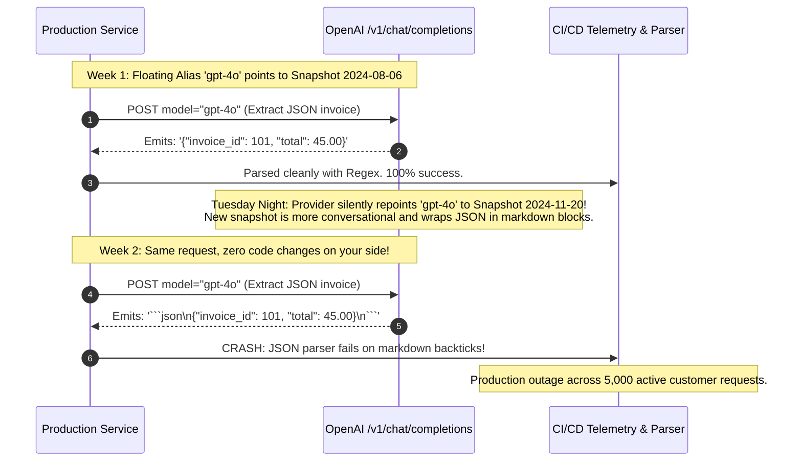
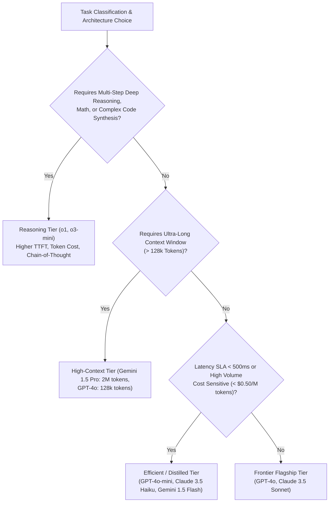
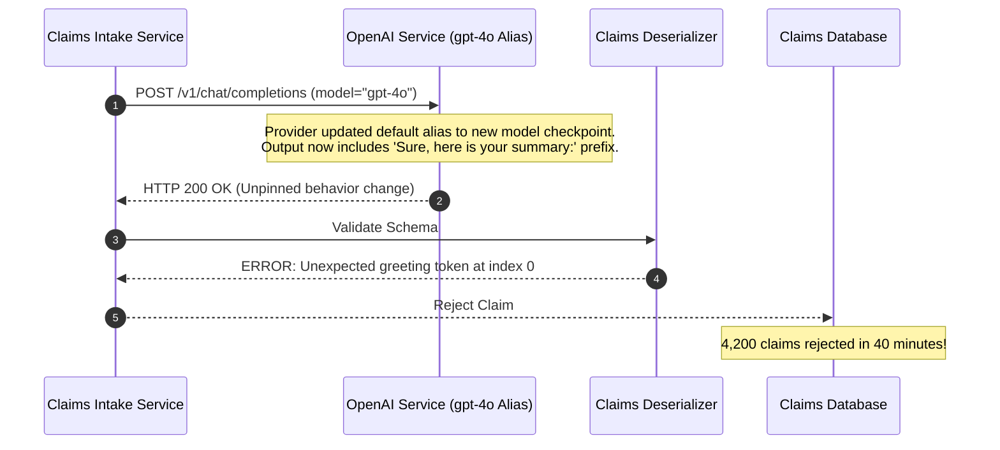

# Module 04: Model Families and Generations

> **Prerequisites:** [Module 00: The OpenAI API: Your First Call](../00-the-openai-api-your-first-call/README.md), [Module 01: Chat Completions Deep Dive](../01-chat-completions-deep-dive/README.md), [Module 02: The Responses API and Statefulness](../02-the-responses-api-and-statefulness/README.md).  
> **Estimated Reading Time:** 30 minutes  
> **Target Audience:** Lead Architects, AI Platform Engineers, Infrastructure Evaluators.

---

> [!TIP]
> **The Golden Rule of Model Lifecycle Management:**  
> Never deploy floating model aliases (such as `gpt-4o` or `-latest`) in mission-critical production; pin exact dated model snapshots (e.g., `gpt-4o-2024-08-06`) and execute automated regression evaluation suites before promoting new generations. Upstream provider updates can alter output syntax and reasoning distributions without warning.

---

## Visual Mental Models: Pinned Snapshots vs. Floating Aliases

Model catalogs evolve continuously. Deploying unpinned aliases delegates your application's behavioral stability to third-party release schedules:



### The Multi-Axis Model Selection Decision Tree

Select models based on objective operational constraints (cost, latency, context length, reasoning depth) rather than vendor branding:



---

## Systematic Model Tiering Reference Matrix

| Model Tier | Primary Archetypes | Cost Profile (Input/Output per 1M) | Primary Strength | Ideal Production Workloads |
| :--- | :--- | :--- | :--- | :--- |
| **Frontier Reasoning** | OpenAI o1, o3-mini | High (\$1.10 to \$15.00 / \$4.40 to \$60.00) | Test-time search, formal logic, multi-step debugging | Competitive coding, mathematical proofs, architectural review |
| **Frontier Flagship** | GPT-4o, Claude 3.5 Sonnet | Medium-High (\$2.50 to \$3.00 / \$10.00 to \$15.00) | Nuanced instruction following, high coding proficiency | Complex agentic workflows, long-form drafting, legal analysis |
| **Efficient / Distilled** | GPT-4o-mini, Claude 3.5 Haiku, Gemini 1.5 Flash | Ultra-Low (\$0.15 to \$0.80 / \$0.60 to \$4.00) | Extreme throughput, low TTFT ($< 250\text{ms}$) | High-volume categorization, summarization, search re-ranking |
| **Massive Context** | Google Gemini 1.5 Pro | Dynamic Tiered Pricing | Up to 2,000,000 tokens in active memory | Multi-hour audio analysis, whole-codebase repository search |
| **Open-Weight Frontier**| Meta Llama 3.1 70B/405B, Mistral Large 2 | Self-hosted compute cost (or serverless tokens) | Full data sovereignty, zero rate limits, fine-tunable | On-prem enterprise banking, air-gapped sovereign intelligence |

---

## Production War Story: The Floating Alias Drift Outage

### Incident Post-Mortem

- **System:** Automated insurance claim processing engine serving 12 healthcare providers.
- **Incident Severity:** SEV-1 (Automated claim extraction pipeline failure rate spiked from 0.02% to 44.8%).
- **Detection Time:** 42 minutes after morning shift hospital filings began.
- **Root Cause:** The microservice was configured with `model: "gpt-4o"` (a moving alias) instead of a dated snapshot (`gpt-4o-2024-08-06`). Over the weekend, the cloud provider promoted a new checkpoint as the default `gpt-4o`. The new checkpoint introduced stricter alignment constraints, refusing claim summaries containing medical terminology that had previously passed, and emitted markdown code fences around raw CSV outputs.



### The Architectural Hardening & Fix

1. **Mandatory Snapshot Pinning:** Platform linting rules block any deployment configuration containing unpinned aliases (`gpt-4o`, `gpt-4`, `claude-3-5-sonnet-latest`). All configurations must explicitly specify dated snapshots:
   ```yaml
   model_id: "gpt-4o-2024-08-06"
   fallback_model_id: "gpt-4o-mini-2024-07-18"
   ```
2. **Canary Regression Testing:** Run automated eval suites (500 historical golden tasks) against newly announced snapshots before bumping configuration strings.

---

## Multi-Language Production Implementations

### Python: Validated Model Registry & Task Router

```python
"""
Production Model Registry and Task Router in Python.
Enforces snapshot pinning, validates context limits, and routes tasks based on SLA.
"""
from dataclasses import dataclass
from typing import Dict, Optional

@dataclass(frozen=True)
class ModelCapability:
    model_id: str
    is_snapshot: bool
    context_window: int
    max_output_tokens: int
    cost_per_million_input: float
    cost_per_million_output: float
    supports_reasoning: bool

class ModelRegistry:
    def __init__(self):
        # Strict registry: All production IDs must be pinned snapshots
        self._registry: Dict[str, ModelCapability] = {
            "gpt-4o-2024-08-06": ModelCapability(
                model_id="gpt-4o-2024-08-06",
                is_snapshot=True,
                context_window=128000,
                max_output_tokens=16384,
                cost_per_million_input=2.50,
                cost_per_million_output=10.00,
                supports_reasoning=False
            ),
            "gpt-4o-mini-2024-07-18": ModelCapability(
                model_id="gpt-4o-mini-2024-07-18",
                is_snapshot=True,
                context_window=128000,
                max_output_tokens=16384,
                cost_per_million_input=0.15,
                cost_per_million_output=0.60,
                supports_reasoning=False
            ),
            "o3-mini-2025-01-31": ModelCapability(
                model_id="o3-mini-2025-01-31",
                is_snapshot=True,
                context_window=200000,
                max_output_tokens=100000,
                cost_per_million_input=1.10,
                cost_per_million_output=4.40,
                supports_reasoning=True
            ),
        }

    def get_capability(self, model_id: str) -> ModelCapability:
        if model_id not in self._registry:
            raise KeyError(
                f"Model ID '{model_id}' is unapproved or is an unpinned alias. "
                f"Approved pinned snapshots: {list(self._registry.keys())}"
            )
        return self._registry[model_id]

    def route_task(self, task_type: str, token_budget: int) -> str:
        """
        Selects the most cost-effective pinned model matching workload requirements.
        """
        if task_type in ("code_synthesis", "mathematical_reasoning"):
            return "o3-mini-2025-01-31"
        elif task_type in ("quick_classification", "sentiment", "simple_extraction"):
            return "gpt-4o-mini-2024-07-18"
        else:
            # Default to flagship
            return "gpt-4o-2024-08-06"

if __name__ == "__main__":
    registry = ModelRegistry()
    selected = registry.route_task("quick_classification", 1000)
    cap = registry.get_capability(selected)
    print(f"Routed task to: {cap.model_id} (Input Cost: ${cap.cost_per_million_input}/1M)")
```

### TypeScript: Strictly-Typed Model Router (Node.js)

```typescript
/**
 * Production Model Registry in TypeScript.
 * Enforces pinned snapshot validation at compile time and runtime.
 */

export interface ModelMetadata {
  id: string;
  isPinned: boolean;
  contextWindow: number;
  maxOutputTokens: number;
  inputCostPerMillion: number;
  outputCostPerMillion: number;
}

export const APPROVED_MODELS: Record<string, ModelMetadata> = {
  "gpt-4o-2024-08-06": {
    id: "gpt-4o-2024-08-06",
    isPinned: true,
    contextWindow: 128000,
    maxOutputTokens: 16384,
    inputCostPerMillion: 2.50,
    outputCostPerMillion: 10.00,
  },
  "gpt-4o-mini-2024-07-18": {
    id: "gpt-4o-mini-2024-07-18",
    isPinned: true,
    contextWindow: 128000,
    maxOutputTokens: 16384,
    inputCostPerMillion: 0.15,
    outputCostPerMillion: 0.60,
  },
  "claude-3-5-sonnet-20241022": {
    id: "claude-3-5-sonnet-20241022",
    isPinned: true,
    contextWindow: 200000,
    maxOutputTokens: 8192,
    inputCostPerMillion: 3.00,
    outputCostPerMillion: 15.00,
  },
};

export class ProductionModelRouter {
  public static resolveModel(requestedModel: string): ModelMetadata {
    const meta = APPROVED_MODELS[requestedModel];
    if (!meta) {
      throw new Error(
        `FATAL: Unapproved or unpinned model ID: '${requestedModel}'. You must pin a dated snapshot.`
      );
    }
    return meta;
  }
}

// Verification benchmark
const model = ProductionModelRouter.resolveModel("gpt-4o-2024-08-06");
console.log(`Validated Pinned Snapshot: ${model.id} (Context: ${model.contextWindow.toLocaleString()} tokens)`);
```

### Go: Concurrent Model Dispatcher & Registry

```go
package main

import (
	"fmt"
)

// ModelProfile contains operational parameters.
type ModelProfile struct {
	ID                  string
	IsSnapshot          bool
	ContextWindow       int
	MaxOutputTokens     int
	InputCostPerMillion float64
}

// ModelCatalog holds approved models.
var ModelCatalog = map[string]ModelProfile{
	"gpt-4o-2024-08-06": {
		ID:                  "gpt-4o-2024-08-06",
		IsSnapshot:          true,
		ContextWindow:       128000,
		MaxOutputTokens:     16384,
		InputCostPerMillion: 2.50,
	},
	"gpt-4o-mini-2024-07-18": {
		ID:                  "gpt-4o-mini-2024-07-18",
		IsSnapshot:          true,
		ContextWindow:       128000,
		MaxOutputTokens:     16384,
		InputCostPerMillion: 0.15,
	},
}

func ValidateAndResolve(modelID string) (ModelProfile, error) {
	profile, exists := ModelCatalog[modelID]
	if !exists {
		return ModelProfile{}, fmt.Errorf("rejected unpinned model: %s", modelID)
	}
	return profile, nil
}

func main() {
	profile, err := ValidateAndResolve("gpt-4o-mini-2024-07-18")
	if err != nil {
		panic(err)
	}
	fmt.Printf("Model Verified: %s (Context: %d tokens)\n", profile.ID, profile.ContextWindow)
}
```

---

## Practical Verification Workflows: CLI & Mathematical Invariance

Query the live OpenAI model catalog and inspect model identifiers using standard CLI commands:

```bash
# Query active model list and verify availability of pinned snapshots
curl https://api.openai.com/v1/models \
  -H "Authorization: Bearer $OPENAI_API_KEY" -s | \
  python -c '
import sys, json

data = json.load(sys.stdin)
models = [m["id"] for m in data.get("data", [])]

# Check for presence of snapshots
pinned_4o = [m for m in models if "gpt-4o-" in m and any(char.isdigit() for char in m)]
print(f"Total available models: {len(models)}")
print("Discovered Pinned GPT-4o Snapshots:")
for snap in sorted(pinned_4o)[:5]:
    print(f"  - {snap}")
'
```

### Expected Wire Output

```
Total available models: 104
Discovered Pinned GPT-4o Snapshots:
  - gpt-4o-2024-05-13
  - gpt-4o-2024-08-06
  - gpt-4o-2024-11-20
  - gpt-4o-mini-2024-07-18
```

---

## Operational Validation Checkpoints

### Scenario 1: The Cost of Over-Provisioned Model Tiers
An engineering team routes all customer support ticket classification requests to `gpt-4o` ($3.00/M input tokens). The application processes 10,000,000 classification requests per month (average prompt: 800 tokens). What is the monthly cost, and what would the savings be if routed to `gpt-4o-mini` ($0.15/M input tokens)?

<details>
<summary>View Diagnostic Solution</summary>

**Answer:**  
- Total monthly input tokens = $10,000,000 \times 800 = 8,000,000,000 \text{ tokens} = 8,000 \text{ Million tokens}$.  
- Cost on `gpt-4o` = $8,000 \times \$3.00 = \$24,000 \text{/month}$.  
- Cost on `gpt-4o-mini` = $8,000 \times \$0.15 = \$1,200 \text{/month}$.  
Routing to the efficient tier reduces monthly spend from \$24,000 to \$1,200—a **95% cost reduction** (\$22,800/month in net savings) for a classification task that requires zero complex reasoning.

</details>

### Scenario 2: Deprecation Lifecycles and Scheduled Shutdown Dates
When querying the `/v1/models` API endpoint, what does the `shutdown_date` (or `deprecation_date`) attribute represent, and how should CI/CD pipelines consume it?

<details>
<summary>View Diagnostic Solution</summary>

**Answer:**  
The `shutdown_date` field is an integer Unix timestamp indicating when the provider will permanently terminate the model endpoint. After this date, all requests targeting that model ID will immediately return `HTTP 404 Model Not Found`. CI/CD health checks should poll `/v1/models` weekly and trigger an automated warning alert if any model referenced in production configurations has a `shutdown_date` within the next 60 days, giving engineering teams sufficient runway to run regression evals and bump pinned snapshots.

</details>

### Scenario 3: Pinned Snapshots vs Alignment Drift
Can a provider alter the weights of a pinned snapshot (e.g., `gpt-4o-2024-08-06`) after release?

<details>
<summary>View Diagnostic Solution</summary>

**Answer:**  
Under official provider SLAs, weights of a pinned snapshot are strictly immutable. However, provider-side system changes (such as safety filter guardrails, moderation models sitting in front of the inference gateway, or system-level infrastructure shifts) can occasionally induce subtle behavioral drift. While snapshot pinning protects against model weight updates, production teams must still run continuous regression monitoring on their evaluation benchmarks.

</details>

---

## Further Reading & Sources

- [OpenAI Model Documentation](https://platform.openai.com/docs/models) - Official catalog of active models, context windows, and cutoff dates.
- [OpenAI Deprecations Page](https://platform.openai.com/docs/deprecations) - Schedule of announced model retirements and migration paths.
- [How Is ChatGPT's Behavior Changing Over Time? (Chen et al., 2023)](https://arxiv.org/abs/2307.09009) - Empirical analysis of performance drift across model releases.
- [Track 06, Module 03: Streaming Responses](../03-streaming-responses/README.md) - SSE streaming mechanics across models.
- [Track 06, Module 05: Reasoning Models and Test-Time Compute](../05-reasoning-models-and-test-time-compute/README.md) - Deep dive into o1 and o3 test-time search mechanisms.

---

## Next

[Module 05: Reasoning Models and Test-Time Compute](../05-reasoning-models-and-test-time-compute/README.md)
