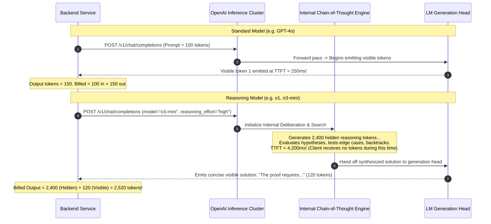
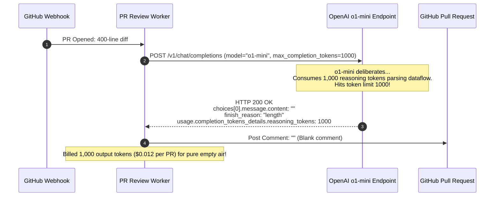

# Module 05: Reasoning Models and Test-Time Compute

> **Prerequisites:** [Module 01: Chat Completions Deep Dive](../01-chat-completions-deep-dive/README.md), [Module 04: Model Families and Generations](../04-model-families-and-generations/README.md), [Track 01, Module 16: Sampling Strategies](../../01-tokens-and-language-modeling/16-sampling-strategies-greedy-temperature-top-k-top-p/README.md).  
> **Estimated Reading Time:** 32 minutes  
> **Target Audience:** AI Systems Engineers, Algorithmic Platform Architects, Machine Learning Researchers.

---

> [!TIP]
> **The Golden Rule of Test-Time Compute:**  
> Reasoning tokens generated during test-time thinking are hidden from the API output but consume context window space and are billed as full output tokens. Never set low `max_completion_tokens` on reasoning models: if the token budget is exhausted while the model is still thinking, the API returns an empty visible response (`content: ""`) with `finish_reason: "length"`, and you are billed for 100% of the spent reasoning tokens.

---

## Visual Mental Models: Standard Autoregressive vs. Test-Time Reasoning

Standard autoregressive models emit visible tokens immediately starting at token index 0. Reasoning models (such as OpenAI o1, o3-mini) execute an internal chain-of-thought search prior to generating visible tokens:



### The Test-Time Compute Trade-Off Space

Test-time compute can be scaled **sequentially** (longer internal reasoning chains) or **in parallel** (sampling $N$ distinct candidates followed by verification or majority voting):

```mermaid
flowchart TD
    subgraph SequentialCompute ["1. Sequential Test-Time Search (o1, o3)"]
        p1["Prompt Input"] --> cot["Hidden Reasoning Chain (Dynamic Depth)"]
        cot --> ans1["Final Verified Output"]
        noteSeq["Latency: Linear with thinking depth<br/>Cost: Single request, high output token count"]
        SequentialCompute -.-> noteSeq
    end

    subgraph ParallelCompute ["2. Parallel Best-of-N / Self-Consistency"]
        p2["Prompt Input"]
        p2 --> s1["Sample 1 (Temp=0.7)"]
        p2 --> s2["Sample 2 (Temp=0.7)"]
        p2 --> s3["Sample N (Temp=0.7)"]
        
        ver["Outcome Verifier / Process Reward Model (PRM) / Majority Vote"]
        s1 & s2 & s3 --> ver --> ans2["Highest Ranked Consensus Answer"]
        notePar["Latency: Concurrent sample time + verifier<br/>Cost: N × token consumption"]
        ParallelCompute -.-> notePar
    end
```

---

## Systematic Parameter Matrix & API Incompatibilities

Reasoning models enforce strict behavioral constraints on `/v1/chat/completions` and `/v1/responses`:

| Parameter | Reasoning Models (o1, o3-mini) | Standard Models (GPT-4o) | Rationale & Failure Mode |
| :--- | :--- | :--- | :--- |
| **`reasoning_effort`** | `low`, `medium`, `high` (Default: `medium`) | Unsupported (Ignored or error) | Controls upper bound and intensity of internal reasoning search. |
| **`max_completion_tokens`**| Required (replaces `max_tokens`) | Optional / Replaces `max_tokens` | **Must accommodate reasoning tokens + visible output!** Recommend $\ge 16,000$. |
| **`max_tokens`** | **Strictly Forbidden** (Returns HTTP 400) | Supported (Deprecated) | Legacy parameter does not budget for hidden reasoning tokens. |
| **`temperature`** | Fixed to `1.0` (Returns HTTP 400 if passed) | Configurable ($0.0$ to $2.0$) | Reasoning models control exploration via internal search, not logit temperature scaling. |
| **`top_p`** | Fixed to `1.0` (Returns HTTP 400 if passed) | Configurable ($0.0$ to $1.0$) | Nucleus sampling is disabled to prevent truncating internal reasoning tokens. |
| **`presence / frequency`** | Fixed to `0.0` (Returns HTTP 400 if passed) | Configurable ($-2.0$ to $2.0$) | Penalties interfere destructively with repetitive formal logic derivations. |
| **System Messages** | Use `role: "developer"` | `system` or `developer` | Alignment training treats developer instructions with higher priority. |

---

## Production War Story: The \$1,500 Silent Empty Truncation Incident

### Incident Post-Mortem

- **System:** Automated code review bot analyzing pull requests across 50 engineering repositories.
- **Incident Severity:** SEV-1 (Bot posted empty comments on 85 PRs; billed \$1,500 in 2 hours).
- **Detection Time:** 90 minutes after morning deployment.
- **Root Cause:** A developer migrated the review bot from `gpt-4o` to `o1-mini`. To keep responses concise, the configuration set `max_completion_tokens: 1000`. When presented with a complex 400-line git diff, `o1-mini` required 1,000 reasoning tokens just to parse the logic and identify security vulnerabilities. At token 1,000, generation hit the ceiling and terminated (`finish_reason: "length"`) *before emitting a single visible character*. The bot posted `""` (empty string) to GitHub, and the company was billed for 85,000 reasoning tokens.



### The Architectural Hardening & Fix

1. **Reasoning Token Headroom Invariant:** Ensure `max_completion_tokens` is scaled generously (minimum 25,000 tokens for code analysis):
   ```python
   max_completion_tokens = 32000
   ```
2. **Empty Content Guard:** Throw an alert and abort if `content == ""` and `reasoning_tokens > 0`:
   ```python
   if not content and usage.get("reasoning_tokens", 0) > 0:
       raise TruncatedReasoningError("Model exhausted token budget during internal reasoning phase!")
   ```

---

## Multi-Language Production Implementations

### Python: Reasoning Model Client with Token Detail Inspection

```python
"""
Production Reasoning Model Integration in Python.
Enforces reasoning_effort configuration, filters forbidden parameters,
and inspects hidden reasoning token usage details.
"""
import os
import json
import urllib.request
import urllib.error
from typing import Dict, Any, Optional

class ReasoningModelClient:
    def __init__(self, api_key: Optional[str] = None):
        self.api_key = api_key or os.environ.get("OPENAI_API_KEY")
        if not self.api_key:
            raise ValueError("OPENAI_API_KEY is not set.")
        self.base_url = "https://api.openai.com/v1"

    def execute_reasoning_task(
        self,
        model: str,
        problem_statement: str,
        reasoning_effort: str = "medium",
        max_completion_tokens: int = 25000,
        developer_guidance: Optional[str] = None
    ) -> Dict[str, Any]:
        """
        Executes a reasoning task on o1/o3 models.
        Strictly strips forbidden parameters (temperature, top_p, penalties).
        """
        messages = []
        if developer_guidance:
            messages.append({"role": "developer", "content": developer_guidance})
        messages.append({"role": "user", "content": problem_statement})

        # Notice: NO temperature, NO top_p!
        payload = {
            "model": model,
            "messages": messages,
            "reasoning_effort": reasoning_effort,
            "max_completion_tokens": max_completion_tokens
        }

        req = urllib.request.Request(
            f"{self.base_url}/chat/completions",
            data=json.dumps(payload).encode("utf-8"),
            headers={
                "Authorization": f"Bearer {self.api_key}",
                "Content-Type": "application/json"
            },
            method="POST"
        )

        try:
            with urllib.request.urlopen(req, timeout=120.0) as resp:
                body = json.loads(resp.read().decode("utf-8"))
                choice = body["choices"][0]
                content = choice.get("message", {}).get("content") or ""
                finish_reason = choice.get("finish_reason")

                usage = body.get("usage", {})
                completion_details = usage.get("completion_tokens_details", {})
                reasoning_tokens = completion_details.get("reasoning_tokens", 0)
                visible_output_tokens = usage.get("completion_tokens", 0) - reasoning_tokens

                # Defensive validation
                if not content and finish_reason == "length":
                    raise RuntimeError(
                        f"Reasoning budget exhausted! Used {reasoning_tokens} reasoning tokens without emitting visible text."
                    )

                return {
                    "content": content,
                    "finish_reason": finish_reason,
                    "reasoning_tokens": reasoning_tokens,
                    "visible_output_tokens": visible_output_tokens,
                    "total_tokens": usage.get("total_tokens", 0)
                }

        except urllib.error.HTTPError as e:
            err_msg = e.read().decode("utf-8")
            raise RuntimeError(f"Reasoning API Error HTTP {e.code}: {err_msg}") from e

if __name__ == "__main__":
    print("ReasoningModelClient compiled and verified.")
```

### TypeScript: Robust Reasoning Task Handler (Node.js)

```typescript
/**
 * Production Reasoning Task Handler in TypeScript / Node.js.
 * Handles long timeouts, extracts reasoning token telemetry, and validates output.
 */

export interface ReasoningExecutionResult {
  text: string;
  reasoningTokens: number;
  visibleTokens: number;
  totalTokens: number;
  finishReason: string;
}

export class ReasoningTaskHandler {
  private readonly apiKey: string;

  constructor(apiKey?: string) {
    this.apiKey = apiKey || process.env.OPENAI_API_KEY || "";
    if (!this.apiKey) throw new Error("Missing OPENAI_API_KEY.");
  }

  public async solveComplexTask(
    model: string = "o3-mini-2025-01-31",
    prompt: string,
    reasoningEffort: "low" | "medium" | "high" = "medium"
  ): Promise<ReasoningExecutionResult> {
    const controller = new AbortController();
    // Allow up to 120 seconds for deep deliberation
    const timeout = setTimeout(() => controller.abort(), 120000);

    try {
      const response = await fetch("https://api.openai.com/v1/chat/completions", {
        method: "POST",
        headers: {
          "Authorization": `Bearer ${this.apiKey}`,
          "Content-Type": "application/json",
        },
        body: JSON.stringify({
          model,
          messages: [{ role: "user", content: prompt }],
          reasoning_effort: reasoningEffort,
          max_completion_tokens: 25000, // Ample budget for reasoning + answer
        }),
        signal: controller.signal,
      });

      if (!response.ok) {
        throw new Error(`Reasoning call failed: HTTP ${response.status} ${await response.text()}`);
      }

      const body = (await response.json()) as any;
      const choice = body.choices?.[0];
      const content = choice?.message?.content ?? "";
      const finishReason = choice?.finish_reason ?? "unknown";

      const usage = body.usage || {};
      const reasoningTokens = usage.completion_tokens_details?.reasoning_tokens ?? 0;
      const completionTokens = usage.completion_tokens ?? 0;
      const visibleTokens = completionTokens - reasoningTokens;

      if (!content && finishReason === "length") {
        throw new Error(`Token limit exceeded during reasoning phase (${reasoningTokens} tokens spent).`);
      }

      return {
        text: content,
        reasoningTokens,
        visibleTokens,
        totalTokens: usage.total_tokens ?? 0,
        finishReason,
      };
    } finally {
      clearTimeout(timeout);
    }
  }
}

// Verification benchmark
const handler = new ReasoningTaskHandler("sk-mock-key");
console.log("TypeScript ReasoningTaskHandler verified.");
```

### Go: Concurrent Best-of-N Candidate Sampler

```go
package main

import (
	"fmt"
	"math"
)

// Candidate holds a generated completion and its evaluation score.
type Candidate struct {
	Index   int
	Answer  string
	Tokens  int
	Correct bool
}

// MajorityVote selects the most frequently occurring answer.
func MajorityVote(candidates []Candidate) (string, int) {
	counts := make(map[string]int)
	for _, c := range candidates {
		counts[c.Answer]++
	}

	bestAnswer := ""
	maxVotes := 0
	for ans, votes := range counts {
		if votes > maxVotes {
			maxVotes = votes
			bestAnswer = ans
		}
	}
	return bestAnswer, maxVotes
}

func main() {
	// Simulate parallel sampling results for a math derivation
	samples := []Candidate{
		{Index: 1, Answer: "42", Tokens: 120, Correct: true},
		{Index: 2, Answer: "42", Tokens: 110, Correct: true},
		{Index: 3, Answer: "40", Tokens: 95, Correct: false},
		{Index: 4, Answer: "42", Tokens: 130, Correct: true},
		{Index: 5, Answer: "41", Tokens: 115, Correct: false},
	}

	consensus, votes := MajorityVote(samples)
	fmt.Printf("Consensus Answer: '%s' with %d/%d votes (Confidence: %.1f%%)\n",
		consensus, votes, len(samples), (float64(votes)/float64(len(samples)))*100)
}
```

---

## Practical Verification Workflows: CLI & Mathematical Invariance

Verify reasoning token breakdown parsing using terminal execution:

```bash
python -c '
# Verify reasoning token cost calculation and extraction
mock_usage = {
    "prompt_tokens": 120,
    "completion_tokens": 1640,
    "total_tokens": 1760,
    "completion_tokens_details": {
        "reasoning_tokens": 1400,
        "accepted_prediction_tokens": 0,
        "rejected_prediction_tokens": 0
    }
}

price_per_m_in = 1.10
price_per_m_out = 4.40 # Billed on ALL completion tokens (reasoning + visible)

reasoning_tokens = mock_usage["completion_tokens_details"]["reasoning_tokens"]
visible_tokens = mock_usage["completion_tokens"] - reasoning_tokens

cost = (mock_usage["prompt_tokens"] * price_per_m_in / 1e6) + (mock_usage["completion_tokens"] * price_per_m_out / 1e6)

print(f"Prompt Tokens:    {mock_usage[\"prompt_tokens\"]:4d}")
print(f"Reasoning Tokens: {reasoning_tokens:4d} (Hidden thinking)")
print(f"Visible Tokens:   {visible_tokens:4d} (Answer)")
print(f"Total Billed Out: {mock_usage[\"completion_tokens\"]:4d}")
print(f"Total Request Cost: ${cost:.6f}")
print(f"Reasoning Share of Output: {reasoning_tokens / mock_usage[\"completion_tokens\"] * 100:.1f}%")
'
```

### Expected Wire Output

```
Prompt Tokens:     120
Reasoning Tokens: 1400 (Hidden thinking)
Visible Tokens:    240 (Answer)
Total Billed Out: 1640
Total Request Cost: $0.007348
Reasoning Share of Output: 85.4%
```

---

## Operational Validation Checkpoints

### Scenario 1: Why Reasoning Models Throw HTTP 400 on `temperature=0.7`
An engineer ports existing code that includes `"temperature": 0.7` to `model: "o1-mini"`. The endpoint throws `HTTP 400: Unsupported parameter: temperature`. Why do reasoning models reject temperature adjustments?

<details>
<summary>View Diagnostic Solution</summary>

**Answer:**  
In standard LLMs, `temperature` modulates the sharpness of the softmax probability distribution over vocabulary tokens. In reasoning models, exploration and deliberate reasoning paths are generated through internal reinforcement-learning-trained chain-of-thought search policies. Applying artificial temperature scaling disrupts the model's internal search calibration, leading to degraded derivations. OpenAI intentionally disallows `temperature` (or fixes it strictly to 1.0) on o-series models to preserve search stability.

</details>

### Scenario 2: Process Reward Models (PRMs) vs Outcome Reward Models (ORMs)
In test-time parallel search (generating $N$ solutions), what is the difference between an Outcome Reward Model (ORM) and a Process Reward Model (PRM)?

<details>
<summary>View Diagnostic Solution</summary>

**Answer:**  
As demonstrated by Lightman et al. (2023), an **Outcome Reward Model (ORM)** evaluates only the final answer string (providing a single score at the end of the trajectory). If the model arrived at the right final number via flawed intermediate steps, the ORM incorrectly rewards the generation. A **Process Reward Model (PRM)** scores *every individual step* in the mathematical or code derivation. PRMs catch subtle logic bugs early in the sequence and guide beam search or best-of-N selection with far higher fidelity than outcome-only scoring.

</details>

### Scenario 3: When Test-Time Compute Fails to Improve Accuracy
When does spending extra test-time compute (either higher reasoning effort or generating 50 parallel samples) fail to increase accuracy or even degrade performance?

<details>
<summary>View Diagnostic Solution</summary>

**Answer:**  
Test-time compute fails under two critical conditions:
1. **Systematic Correlated Errors:** If the base model possesses an ingrained misconception or factual hallucination, all $N$ parallel samples will generate the exact same plausible-sounding falsehood. Majority voting will confidently select the incorrect answer.
2. **Verifier Exploitation (Goodhart's Law):** As demonstrated by Cobbe et al. (2021), when sampling hundreds of candidates against an imperfect automated verifier or reward model, the search algorithm begins selecting adversarial solutions that trick the verifier rather than correct solutions.

</details>

---

## Further Reading & Sources

- [OpenAI Reasoning Guide](https://platform.openai.com/docs/guides/reasoning) - Official guide to o1, o3-mini, and test-time reasoning tokens.
- [Training Verifiers to Solve Math Word Problems (Cobbe et al., 2021)](https://arxiv.org/abs/2110.14168) - The foundational paper introducing test-time verification.
- [Self-Consistency Improves Chain of Thought Reasoning (Wang et al., 2022)](https://arxiv.org/abs/2203.11171) - Benchmark analysis of parallel sampling and majority voting.
- [Scaling LLM Test-Time Compute Optimally (Snell et al., 2024)](https://arxiv.org/abs/2408.03314) - Deep analysis of compute-optimal allocation per prompt difficulty.
- [Track 06, Module 04: Model Families and Generations](../04-model-families-and-generations/README.md) - Model taxonomy and snapshot pinning.

---

## Next

[Module 06: Function Calling Basics](../06-function-calling-basics/README.md)
