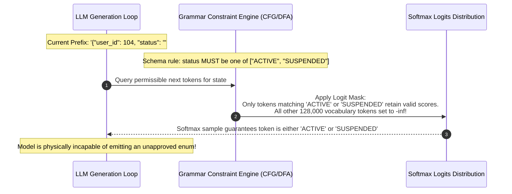
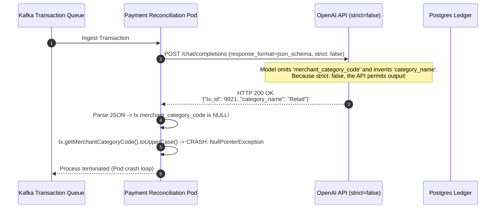

# Module 07: Structured Outputs and JSON Schema

> **Prerequisites:** [Module 01: Chat Completions Deep Dive](../01-chat-completions-deep-dive/README.md), [Module 02: The Responses API and Statefulness](../02-the-responses-api-and-statefulness/README.md), [Module 06: Function Calling Basics](../06-function-calling-basics/README.md).  
> **Estimated Reading Time:** 32 minutes  
> **Target Audience:** Systems Architects, Data Platform Engineers, API Security Developers.

---

> [!TIP]
> **The Golden Rule of Structured Outputs:**  
> Structured Outputs (`type: "json_schema"`, `strict: true`) guarantees 100% schema adherence through grammar-constrained logit masking at decoding time; however, the guarantee is strictly conditioned on completion. Your code must always verify that `message.refusal` is null and that `finish_reason == "stop"`.

---

## Visual Mental Models: The Three Tiers of JSON Reliability

LLM JSON generation has evolved across three distinct technological generations:

```mermaid
flowchart TD
    subgraph Tier1 ["Tier 1: Prompted JSON (Unconstrained)"]
        p1["Prompt: 'Respond only in JSON'"] --> llm1["Unconstrained Next-Token Decoding"]
        llm1 --> out1["Output: Often includes markdown '```json', hallucinated keys, or syntax errors"]
        note1["Reliability: ~85% (Fails unpredictably in production)"]
        Tier1 -.-> note1
    end

    subgraph Tier2 ["Tier 2: JSON Mode (Syntactic Validity Only)"]
        p2["response_format: { type: 'json_object' }"] --> llm2["Syntactic JSON Enforcer"]
        llm2 --> out2["Output: Valid JSON, but ANY shape or schema!"]
        note2["Reliability: Valid syntax, zero schema guarantees"]
        Tier2 -.-> note2
    end

    subgraph Tier3 ["Tier 3: Structured Outputs (Constrained Grammar Decoding)"]
        p3["response_format: { type: 'json_schema', strict: true }"] --> dfa["Deterministic Finite Automaton (CFG Grammar Mask)"]
        dfa --> llm3["Logit Mask: Non-compliant tokens masked to -∞"]
        llm3 --> out3["Output: 100% Guaranteed Schema Adherence"]
        note3["Reliability: Deterministic grammar enforcement"]
        Tier3 -.-> note3
    end
```

### Grammar-Constrained Logit Masking Mechanics

During autoregressive generation with `strict: true`, the inference engine converts the supplied JSON Schema into a Context-Free Grammar (CFG) or pushdown automaton. At every decoding step $t$, tokens that violate schema rules are dynamically masked to $-\infty$ before softmax:



---

## Systematic Architectural Comparison: The Three Generation Modes

| Feature / Guarantee | Prompted JSON | JSON Mode (`json_object`) | Structured Outputs (`json_schema`) |
| :--- | :--- | :--- | :--- |
| **Request Configuration** | Prompt string only | `response_format: {"type": "json_object"}` | `response_format: {"type": "json_schema", "json_schema": {"strict": true, ...}}` |
| **Valid JSON Syntax** | Probabilistic (May wrap in markdown) | Guaranteed (Valid JSON object) | Guaranteed (Valid JSON object) |
| **Schema Adherence** | None (Keys hallucinate freely) | None (Keys, types, and nesting unconstrained) | **Guaranteed (100% adherence to schema)** |
| **Enum Enforcement** | Hallucinations common | Hallucinations common | Strictly enforced via vocabulary masking |
| **Missing Fields** | Common failure mode | Common failure mode | Impossible (`required` strictly enforced) |
| **Strict Schema Rules** | None | Must contain the word "JSON" in prompt | `additionalProperties: false`, all fields `required` |
| **Refusal Handling** | Injected into JSON string | Injected into JSON string | Emitted as first-class `message.refusal` object |

---

## Production War Story: The Silent Null Pointer and Unstrict Schema Outage

### Incident Post-Mortem

- **System:** High-throughput B2B payment reconciliation engine processing \$40M daily.
- **Incident Severity:** SEV-1 (Database insertion jobs stalled; 2,400 financial transaction records failed validation).
- **Detection Time:** 14 minutes after rolling out a new transaction classification model.
- **Root Cause:** The team configured `response_format: {"type": "json_schema"}`, but omitted `"strict": true` (which defaults to `false` in the raw OpenAPI spec) and left `additionalProperties: true` on an internal object. The model occasionally hallucinated an alternative spelling for a key (`merchant_category` instead of `merchant_category_code`). Because `strict` was false, the API permitted the hallucinated key. Downstream Java ingestion workers attempted to access `tx.getMerchantCategoryCode().toUpperCase()`, throwing a `NullPointerException` that deadlocked the processing queue.



### The Architectural Hardening & Fix

1. **Mandatory Strict Mode Invariant:** Enforce that all production JSON schemas configure `strict: true` and specify `"additionalProperties": false` on every object level:
   ```json
   {
     "type": "object",
     "properties": { ... },
     "required": ["all_keys_must_be_listed_here"],
     "additionalProperties": false
   }
   ```
2. **Nullable Types for Optionality:** Emulate optional properties using explicit union types with null: `"type": ["string", "null"]`.

---

## Multi-Language Production Implementations

### Python: Pydantic-Driven Structured Outputs (PyTorch / OpenAI SDK Pattern)

```python
"""
Production Structured Outputs in Python with Pydantic.
Enforces strict schema compilation, additionalProperties=False,
and handles first-class refusals and truncation guards.
"""
import os
import json
import urllib.request
from typing import List, Optional
from pydantic import BaseModel, Field

# 1. Define Strict Pydantic Data Contract
class InvoiceItem(BaseModel):
    description: str = Field(description="Description of the billed item or service.")
    quantity: int = Field(gt=0, description="Number of units purchased.")
    unit_price: float = Field(gt=0.0, description="Price per unit in USD.")

class StructuredInvoice(BaseModel):
    invoice_number: str = Field(description="Formatted invoice string, e.g. INV-2026-001")
    customer_id: str = Field(description="Internal customer UUID or identifier.")
    items: List[InvoiceItem] = Field(description="List of purchased line items.")
    tax_rate: float = Field(ge=0.0, le=1.0, description="Applicable tax rate between 0 and 1.")
    notes: Optional[str] = Field(None, description="Optional payment instructions or notes.")

# 2. Extract Schema & Enforce Strict Mode Constraints
def generate_strict_json_schema(model_cls: type[BaseModel]) -> dict:
    schema = model_cls.model_json_schema()
    
    def enforce_strict_recursively(obj: dict):
        if obj.get("type") == "object":
            obj["additionalProperties"] = False
            # In strict mode, every declared property must be in 'required'
            if "properties" in obj:
                obj["required"] = list(obj["properties"].keys())
                for prop_val in obj["properties"].values():
                    enforce_strict_recursively(prop_val)
        elif obj.get("type") == "array" and "items" in obj:
            enforce_strict_recursively(obj["items"])
            
    enforce_strict_recursively(schema)
    return schema

# 3. Execution Client
class StructuredOutputClient:
    def __init__(self, api_key: Optional[str] = None):
        self.api_key = api_key or os.environ.get("OPENAI_API_KEY")
        if not self.api_key:
            raise ValueError("OPENAI_API_KEY is missing.")

    def extract_structured(self, raw_text: str, target_cls: type[BaseModel]) -> BaseModel:
        strict_schema = generate_strict_json_schema(target_cls)
        
        payload = {
            "model": "gpt-4o-2024-08-06",
            "messages": [
                {"role": "developer", "content": "You are a financial entity extraction engine."},
                {"role": "user", "content": raw_text}
            ],
            "response_format": {
                "type": "json_schema",
                "json_schema": {
                    "name": target_cls.__name__,
                    "strict": True,
                    "schema": strict_schema
                }
            },
            "temperature": 0.0
        }

        req = urllib.request.Request(
            "https://api.openai.com/v1/chat/completions",
            data=json.dumps(payload).encode("utf-8"),
            headers={
                "Authorization": f"Bearer {self.api_key}",
                "Content-Type": "application/json"
            },
            method="POST"
        )

        with urllib.request.urlopen(req, timeout=30.0) as resp:
            body = json.loads(resp.read().decode("utf-8"))

        choice = body["choices"][0]
        message = choice.get("message", {})

        # Guard 1: Check for model refusal
        if message.get("refusal"):
            raise ValueError(f"Model refused generation: {message['refusal']}")

        # Guard 2: Check for truncation
        if choice.get("finish_reason") == "length":
            raise RuntimeError("Model response truncated mid-generation! Output token ceiling reached.")

        raw_content = message.get("content", "")
        # Deserialize directly into validated Pydantic model
        return target_cls.model_validate_json(raw_content)

if __name__ == "__main__":
    schema = generate_strict_json_schema(StructuredInvoice)
    print("Strict JSON Schema compiled successfully.")
    print(f"Schema Name: {schema.get('title')}, additionalProperties: {schema.get('additionalProperties')}")
```

### TypeScript: Zod-Backed Structured Output Handler (Node.js)

```typescript
/**
 * Production Structured Outputs in TypeScript with Zod.
 * Validates JSON Schema conformance and maps raw completions to typed records.
 */
import { z } from "zod";

// 1. Define Strict Zod Schema
export const UserProfileSchema = z.object({
  userId: z.string().uuid(),
  username: z.string().min(3).max(30),
  role: z.enum(["ADMIN", "OPERATOR", "VIEWER"]),
  isActive: z.boolean(),
  tags: z.array(z.string()),
}).strict(); // Enforces additionalProperties: false equivalent

export type UserProfile = z.infer<typeof UserProfileSchema>;

// 2. Strict JSON Schema Descriptor
export const USER_PROFILE_JSON_SCHEMA = {
  type: "object",
  properties: {
    userId: { type: "string", format: "uuid" },
    username: { type: "string" },
    role: { type: "string", enum: ["ADMIN", "OPERATOR", "VIEWER"] },
    isActive: { type: "boolean" },
    tags: { type: "array", items: { type: "string" } },
  },
  required: ["userId", "username", "role", "isActive", "tags"],
  additionalProperties: false,
};

export class StructuredExtractor {
  private readonly apiKey: string;

  constructor(apiKey?: string) {
    this.apiKey = apiKey || process.env.OPENAI_API_KEY || "";
    if (!this.apiKey) throw new Error("Missing OPENAI_API_KEY.");
  }

  public async extractProfile(rawBio: string): Promise<UserProfile> {
    const response = await fetch("https://api.openai.com/v1/chat/completions", {
      method: "POST",
      headers: {
        "Authorization": `Bearer ${this.apiKey}`,
        "Content-Type": "application/json",
      },
      body: JSON.stringify({
        model: "gpt-4o-2024-08-06",
        messages: [{ role: "user", content: rawBio }],
        response_format: {
          type: "json_schema",
          json_schema: {
            name: "UserProfileExtraction",
            strict: true,
            schema: USER_PROFILE_JSON_SCHEMA,
          },
        },
      }),
    });

    if (!response.ok) {
      throw new Error(`OpenAI HTTP ${response.status}: ${await response.text()}`);
    }

    const data = (await response.json()) as any;
    const choice = data.choices?.[0];

    if (choice?.message?.refusal) {
      throw new Error(`Model refused: ${choice.message.refusal}`);
    }
    if (choice?.finish_reason === "length") {
      throw new Error("Generation truncated: max completion tokens exceeded.");
    }

    const contentStr = choice?.message?.content || "";
    const parsedJson = JSON.parse(contentStr);
    
    // Validate with Zod runtime check
    return UserProfileSchema.parse(parsedJson);
  }
}

// Verification benchmark
console.log("TypeScript Zod StructuredExtractor compiled and verified.");
```

### Go: Struct-Validated Schema Deserializer

```go
package main

import (
	"encoding/json"
	"fmt"
)

// MetricReport defines the strictly expected schema.
type MetricReport struct {
	Timestamp string  `json:"timestamp"`
	CPUUsage  float64 `json:"cpu_usage"`
	Status    string  `json:"status"`
}

func ValidateAndParseMetric(rawJSON string) (*MetricReport, error) {
	var report MetricReport
	if err := json.Unmarshal([]byte(rawJSON), &report); err != nil {
		return nil, fmt.Errorf("JSON parse failure: %w", err)
	}

	// Runtime business validation
	if report.Status != "OK" && report.Status != "DEGRADED" && report.Status != "CRITICAL" {
		return nil, fmt.Errorf("invalid status enum value: %s", report.Status)
	}

	return &report, nil
}

func main() {
	sample := `{"timestamp": "2026-11-10T14:00:00Z", "cpu_usage": 84.5, "status": "DEGRADED"}`
	report, err := ValidateAndParseMetric(sample)
	if err != nil {
		panic(err)
	}
	fmt.Printf("Metric Ingested: %s | CPU: %.1f%% | Status: %s\n",
		report.Timestamp, report.CPUUsage, report.Status)
}
```

---

## Practical Verification Workflows: CLI & Mathematical Invariance

Verify strict JSON schema adherence and validation via terminal execution:

```bash
python -c '
# Verify grammar constraint rule: all properties must be listed in required
schema = {
    "type": "object",
    "properties": {
        "name": {"type": "string"},
        "age": {"type": "integer"}
    },
    "required": ["name", "age"],
    "additionalProperties": False
}

assert schema["additionalProperties"] is False
assert set(schema["properties"].keys()) == set(schema["required"])
print("Schema strictness verified: Zero unconstrained or unrequired properties permitted.")
'
```

### Expected Wire Output

```
Schema strictness verified: Zero unconstrained or unrequired properties permitted.
```

---

## Operational Validation Checkpoints

### Scenario 1: Model Refusal Under Safety Guardrails
A user prompts an LLM with Structured Outputs active to extract parameters from a document describing unauthorized network intrusion techniques. Instead of returning the expected JSON schema, what does the API return, and what happens if your code assumes valid JSON?

<details>
<summary>View Diagnostic Solution</summary>

**Answer:**  
If the input violates safety guardrails, the model triggers an intentional **Refusal**. Instead of generating JSON matching your schema, the model leaves `choices[0].message.content` as `null` and populates `choices[0].message.refusal` with an explanation (e.g., *"I cannot fulfill this request..."*). Code that blindly attempts `json.loads(response.choices[0].message.content)` will immediately crash with a `TypeError` or `JSONDecodeError`. Production parsers must check `if message.get("refusal"): raise RefusalError(...)` before attempting deserialization.

</details>

### Scenario 2: Emulating Optional Fields in Strict Mode
In strict Structured Outputs (`strict: true`), OpenAI requires that **every single field** defined under `properties` must be included in the `required` array. How do you implement an optional field (e.g., `phone_number` which may or may not exist)?

<details>
<summary>View Diagnostic Solution</summary>

**Answer:**  
In strict mode, optionality is achieved through **nullable union types**, not by omitting fields from `required`. You define the property as:  
`"phone_number": {"type": ["string", "null"], "description": "User phone number, or null if not provided."}`  
and keep `"phone_number"` in the `required` list. The model is forced to emit the `"phone_number"` key on every generation, but has the mathematical liberty to generate `null` when the data is absent.

</details>

### Scenario 3: Pre-Compilation Latency (The First-Request Schema Warmup)
When a backend service initiates its first API call using a large, complex JSON schema (300+ properties), the first request takes 3,200ms to return, while subsequent identical requests take only 350ms. What architectural process causes this initial delay?

<details>
<summary>View Diagnostic Solution</summary>

**Answer:**  
Under the hood, OpenAI's inference engine converts the supplied JSON Schema into a Context-Free Grammar (CFG) and pre-compiles a specialized prefix tree / DFA for vocabulary logit masking. This compilation step occurs synchronously on the first request for a given schema and is subsequently cached in memory across the provider's inference cluster. To eliminate user-facing cold starts, production systems should "warm up" complex schemas during CI/CD deployment or service startup by issuing a synthetic dry-run request.

</details>

---

## Further Reading & Sources

- [OpenAI Structured Outputs Guide](https://platform.openai.com/docs/guides/structured-outputs) - Official documentation on grammar-constrained decoding and supported schema features.
- [JSON Schema Specification Draft 2020-12](https://json-schema.org/draft/2020-12/release-notes) - Core standard for declarative structural schemas.
- [Outlines: Structured Text Generation (Willard & Louf, 2023)](https://arxiv.org/abs/2307.09702) - Seminal research on efficient grammar-constrained finite-state machine decoding.
- [Track 06, Module 06: Function Calling Basics](../06-function-calling-basics/README.md) - Applying structured schemas to tool arguments.
- [Track 06, Module 08: The Embeddings API](../08-the-embeddings-api/README.md) - Moving from generative text to dense vector representations.

---

## Next

[Module 08: The Embeddings API](../08-the-embeddings-api/README.md)
