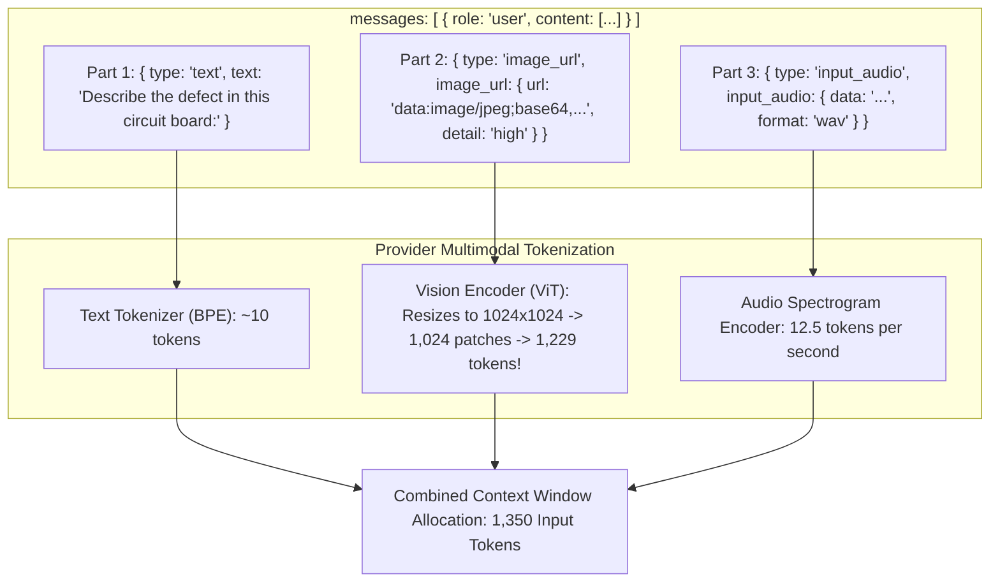
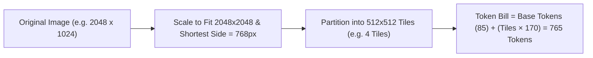
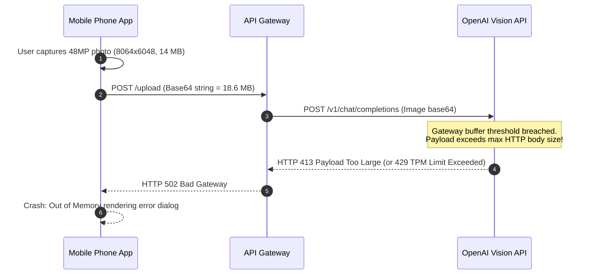

# Module 09: Vision and Audio Inputs

> **Prerequisites:** [Module 00: The OpenAI API: Your First Call](../00-the-openai-api-your-first-call/README.md), [Module 01: Chat Completions Deep Dive](../01-chat-completions-deep-dive/README.md), [Track 01, Module 12: Token Cost Economics](../../01-tokens-and-language-modeling/12-token-cost-economics/README.md).  
> **Estimated Reading Time:** 30 minutes  
> **Target Audience:** Full-Stack AI Engineers, Multimodal Platform Architects, Mobile Backend Developers.

---

> [!TIP]
> **The Golden Rule of Multimodal Ingestion:**  
> A multimodal message is a list of typed content parts (`text`, `image_url`, `input_audio`), not a raw string. Vision models do not read raw image files; they cut images into $32 \times 32$ pixel patches or $512 \times 512$ tiles and bill them as full input tokens. Always resize high-resolution images and set `detail: "low"` for simple classification to prevent accidental 10,000-token prompt explosions.

---

## Visual Mental Models: The Multimodal Content Part Envelope

In multimodal requests, `content` transitions from a simple string to an ordered array of polymorphic content objects:



### The Vision Patch & Tiling Mechanics

When images are submitted at `detail: "high"`, the provider scales the shortest side to 768px, caps the longest side at 2,048px, and cuts the resulting canvas into $512 \times 512$ pixel tiles:



---

## Systematic Architectural Comparison: Image Transport Mechanisms

| Transfer Method | Payload Construction | Primary Benefit | Operational Risk & Cost Overhead |
| :--- | :--- | :--- | :--- |
| **Public HTTPS URL** | `image_url: { url: "https://example.com/photo.jpg" }` | Tiny request body ($< 1\text{ KB}$); zero client encoding | External dependency: Image can 404, expire, or change. Private VPC images unreachable. |
| **Inline Base64 Data URL** | `image_url: { url: "data:image/jpeg;base64,/9j/4AAQ..." }` | Self-contained, tamper-proof, air-gapped / HIPAA compliant | Base64 adds 33% byte inflation; increases HTTP request payload size and log volumes. |
| **OpenAI Files API** | `input_image: { file_id: "file-abc123xyz" }` (Responses API) | Upload once, reference across 100+ requests | Requires separate upload round-trip; stored files incur retention/storage fees until deleted. |

---

## Production War Story: The 50-Megapixel Photo Context Overflow

### Incident Post-Mortem

- **System:** Mobile roadside assistance app allowing drivers to upload photos of vehicle damage for auto-claims.
- **Incident Severity:** SEV-1 (Production API rate limits breached; mobile app crashed on claim submission).
- **Detection Time:** 20 minutes after peak morning commute accident spike.
- **Root Cause:** Modern smartphone cameras capture images at $48\text{ MP}$ ($8064 \times 6048$ pixels, ~14 MB). The mobile client converted the raw uncompressed photo directly to a Base64 data URL and posted it with `detail: "auto"`. Because the image was massive, the base64 string was 18.6 MB, exceeding the provider's HTTP JSON payload limit ($20\text{ MB}$). For images that barely passed, the vision tokenizer allocated the maximum 30,000-patch ceiling, consuming 36,000 input tokens per claim (\$0.09 per photo) and exhausting the organization's TPM (Tokens Per Minute) limit.



### The Architectural Hardening & Fix

1. **Client-Side Image Resizing:** Pre-process and resize images in the mobile client or edge gateway before transmission: downscale to a maximum dimension of 1,024px and compress to JPEG ($85\%$ quality), reducing file sizes from 14 MB to $\sim 180\text{ KB}$.
2. **Explicit Detail Selection:** Use `detail: "low"` ($85\text{ tokens}$ flat fee) for vehicle make/model identification; use `detail: "high"` only when examining minute scratch details.

---

## Multi-Language Production Implementations

### Python: Robust Image Resizing, Base64 Encoding & Token Estimator

```python
"""
Production Multimodal Vision Pipeline in Python.
Includes image dimension extraction, token cost estimation, and base64 formatting.
"""
import os
import json
import base64
import math
import urllib.request
from typing import Dict, Any, Tuple

def estimate_image_tokens(width: int, height: int, detail: str = "high") -> int:
    """
    Estimates billable vision input tokens using the OpenAI tile-based formula.
    """
    if detail == "low":
        return 85 # Fixed base cost

    # Step 1: Scale to fit inside 2048 x 2048
    if width > 2048 or height > 2048:
        scale = 2048.0 / max(width, height)
        width = int(width * scale)
        height = int(height * scale)

    # Step 2: Scale shortest side to 768
    if min(width, height) > 768:
        scale = 768.0 / min(width, height)
        width = int(width * scale)
        height = int(height * scale)

    # Step 3: Count 512x512 tiles needed to cover image
    tiles_x = math.ceil(width / 512.0)
    tiles_y = math.ceil(height / 512.0)
    total_tiles = tiles_x * tiles_y

    # Total = 85 (base) + 170 tokens per tile
    return 85 + (total_tiles * 170)

def file_to_data_url(file_path: str) -> Tuple[str, int]:
    """
    Reads a local image file and formats it into a valid RFC 2397 Data URL.
    Returns (data_url, byte_size).
    """
    ext = os.path.splitext(file_path)[1].lower().lstrip(".")
    mime_type = "image/jpeg" if ext in ("jpg", "jpeg") else f"image/{ext}"
    
    with open(file_path, "rb") as f:
        raw_bytes = f.read()
        
    b64_content = base64.b64encode(raw_bytes).decode("utf-8")
    data_url = f"data:{mime_type};base64,{b64_content}"
    return data_url, len(raw_bytes)

def submit_vision_query(prompt: str, image_data_url: str, detail: str = "auto") -> str:
    api_key = os.environ.get("OPENAI_API_KEY")
    if not api_key:
        raise ValueError("OPENAI_API_KEY is not set.")

    payload = {
        "model": "gpt-4o",
        "messages": [
            {
                "role": "user",
                "content": [
                    {"type": "text", "text": prompt},
                    {
                        "type": "image_url",
                        "image_url": {
                            "url": image_data_url,
                            "detail": detail
                        }
                    }
                ]
            }
        ],
        "max_completion_tokens": 500
    }

    req = urllib.request.Request(
        "https://api.openai.com/v1/chat/completions",
        data=json.dumps(payload).encode("utf-8"),
        headers={
            "Authorization": f"Bearer {api_key}",
            "Content-Type": "application/json"
        },
        method="POST"
    )

    with urllib.request.urlopen(req, timeout=45.0) as resp:
        body = json.loads(resp.read().decode("utf-8"))
        return body["choices"][0]["message"]["content"]

if __name__ == "__main__":
    w, h = 1024, 1024
    tokens = estimate_image_tokens(w, h, "high")
    print(f"Image {w}x{h} (detail=high) estimated token cost: {tokens} tokens")
    assert tokens == 765, f"Expected 765 tokens, got {tokens}"
```

### TypeScript: Multimodal Payload Builder (Node.js)

```typescript
/**
 * Production Multimodal Payload Builder in TypeScript / Node.js.
 * Encodes binary buffers to Data URLs and estimates token consumption.
 */

export interface MultimodalTextPart {
  type: "text";
  text: string;
}

export interface MultimodalImagePart {
  type: "image_url";
  image_url: {
    url: string;
    detail?: "low" | "high" | "auto";
  };
}

export type MultimodalPart = MultimodalTextPart | MultimodalImagePart;

export class MultimodalPayloadBuilder {
  public static bufferToDataUrl(buffer: Buffer, mimeType: "image/jpeg" | "image/png" | "image/webp"): string {
    const b64 = buffer.toString("base64");
    return `data:${mimeType};base64,${b64}`;
  }

  public static buildUserMessage(promptText: string, imageDataUrl: string, detail: "low" | "high" = "high") {
    return {
      role: "user",
      content: [
        { type: "text", text: promptText },
        {
          type: "image_url",
          image_url: {
            url: imageDataUrl,
            detail,
          },
        },
      ] as MultimodalPart[],
    };
  }
}

// Verification benchmark
const sampleBuffer = Buffer.from("mock-binary-pixel-data");
const dataUrl = MultimodalPayloadBuilder.bufferToDataUrl(sampleBuffer, "image/png");
console.log("Constructed Data URL prefix:", dataUrl.slice(0, 30));
```

### Go: High-Throughput Image Token Estimator

```go
package main

import (
	"fmt"
	"math"
)

// EstimateVisionTokens calculates input token usage for an image.
func EstimateVisionTokens(width, height int, detail string) int {
	if detail == "low" {
		return 85
	}

	w := float64(width)
	h := float64(height)

	// Step 1: Fit 2048x2048
	if w > 2048 || h > 2048 {
		scale := 2048.0 / math.Max(w, h)
		w *= scale
		h *= scale
	}

	// Step 2: Scale shortest side to 768
	if math.Min(w, h) > 768 {
		scale := 768.0 / math.Min(w, h)
		w *= scale
		h *= scale
	}

	tilesX := math.Ceil(w / 512.0)
	tilesY := math.Ceil(h / 512.0)
	totalTiles := int(tilesX * tilesY)

	return 85 + (totalTiles * 170)
}

func main() {
	tokens := EstimateVisionTokens(1920, 1080, "high")
	fmt.Printf("1080p Image Token Estimation: %d tokens\n", tokens)
}
```

---

## Practical Verification Workflows: CLI & Mathematical Invariance

Verify image token budgeting calculation via command-line execution:

```bash
python -c '
import math

def calc_tiles(w, h):
    # Scale within 2048
    if w > 2048 or h > 2048:
        s = 2048 / max(w, h)
        w, h = w * s, h * s
    # Scale shortest side to 768
    if min(w, h) > 768:
        s = 768 / min(w, h)
        w, h = w * s, h * s
    tiles = math.ceil(w / 512) * math.ceil(h / 512)
    return 85 + tiles * 170

# 1024x1024 -> 4 tiles -> 85 + 4*170 = 765 tokens
assert calc_tiles(1024, 1024) == 765
# 2048x2048 -> shrinks to 768x768 -> 4 tiles -> 765 tokens
assert calc_tiles(2048, 2048) == 765

print("Image tile tokenization math verified across standard resolutions.")
'
```

### Expected Wire Output

```
Image tile tokenization math verified across standard resolutions.
```

---

## Operational Validation Checkpoints

### Scenario 1: Remote HTTPS Image URL Failures
A developer builds an image processing service passing public image URLs (`{"type": "image_url", "image_url": {"url": "https://storage.mycompany.internal/doc.jpg"}}`). The endpoint returns `HTTP 400: Error downloading image from URL`. Why?

<details>
<summary>View Diagnostic Solution</summary>

**Answer:**  
OpenAI's inference servers reside in their cloud data centers. They can only fetch images from **publicly accessible internet URLs**. If the image URL points to an internal corporate intranet (`mycompany.internal`), a private VPC S3 bucket, `localhost`, or requires custom authentication cookies/headers, OpenAI's image crawler will be blocked, resulting in an HTTP 400 download failure. Production systems dealing with private, sensitive, or behind-firewall assets must either convert the image to an inline Base64 data URL (`data:image/jpeg;base64,...`) or upload it via the OpenAI Files API (`purpose="vision"`).

</details>

### Scenario 2: Selecting `detail: "low"` vs `detail: "high"`
A document processing team is ingesting 100,000 PDF pages. Some pages are full of dense 8-point legal text, while other pages are simply cover pages with the company logo. How should `detail` be configured to optimize cost without sacrificing OCR quality?

<details>
<summary>View Diagnostic Solution</summary>

**Answer:**  
- For dense legal text and tables, use **`detail: "high"`** (or `"auto"`). High detail slices the page into $512 \times 512$ pixel tiles, allowing the vision transformer to resolve small characters. Using `low` on dense text severely downscales the image, blurring characters and causing hallucination.  
- For cover pages, logo classification, or basic image tagging, use **`detail: "low"`**. Low detail scales the image down and bills a flat 85 tokens per page ($\sim \$0.0002$), yielding an **88% cost savings** over high-detail tiling (~765 tokens).

</details>

### Scenario 3: Audio Transcription vs Native Audio Multimodal Comprehension
What is the difference between sending audio to `/v1/audio/transcriptions` (Whisper) versus passing `input_audio` directly to a multimodal model like `gpt-4o-audio-preview`?

<details>
<summary>View Diagnostic Solution</summary>

**Answer:**  
- **Whisper (`/v1/audio/transcriptions`):** A dedicated Automatic Speech Recognition (ASR) model. It transcribes spoken audio into plain text, discarding vocal emotion, pitch, tone, background ambiance, and pauses. The text must then be passed to a second LLM in a two-stage pipeline.  
- **Native Audio Multimodal (`gpt-4o-audio`):** The model directly ingests raw audio spectrogram tokens into its transformer attention layers. It can detect emotional inflection (anger, sarcasm, distress), speaker accents, musical rhythm, and ambient background noises (sirens, machinery), and can reason about acoustic properties directly in a single end-to-end forward pass.

</details>

---

## Further Reading & Sources

- [OpenAI Images and Vision Guide](https://platform.openai.com/docs/guides/vision) - Official reference on patch budgets, detail modes, and format limits.
- [RFC 2397: The "data" URL scheme](https://www.rfc-editor.org/rfc/rfc2397) - Internet standard for inline Base64 media data URLs.
- [OpenAI Audio in Chat Completions Guide](https://platform.openai.com/docs/guides/audio) - Specs for native audio inputs and outputs.
- [Track 06, Module 08: The Embeddings API](../08-the-embeddings-api/README.md) - Dense vector semantic search.
- [Track 06, Module 10: The Anthropic Claude API](../10-the-anthropic-claude-api/README.md) - Cross-provider multimodal comparison.

---

## Next

[Module 10: The Anthropic Claude API](../10-the-anthropic-claude-api/README.md)
