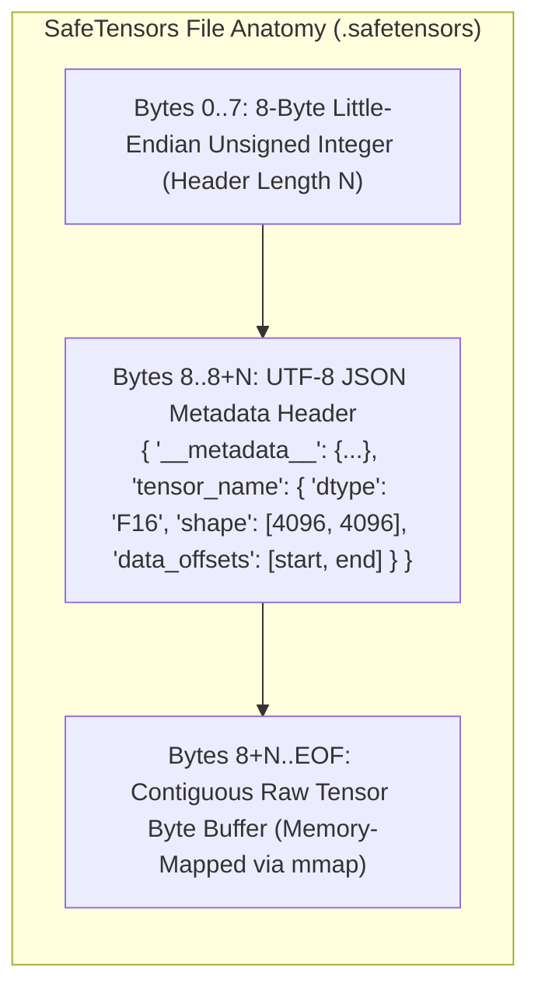
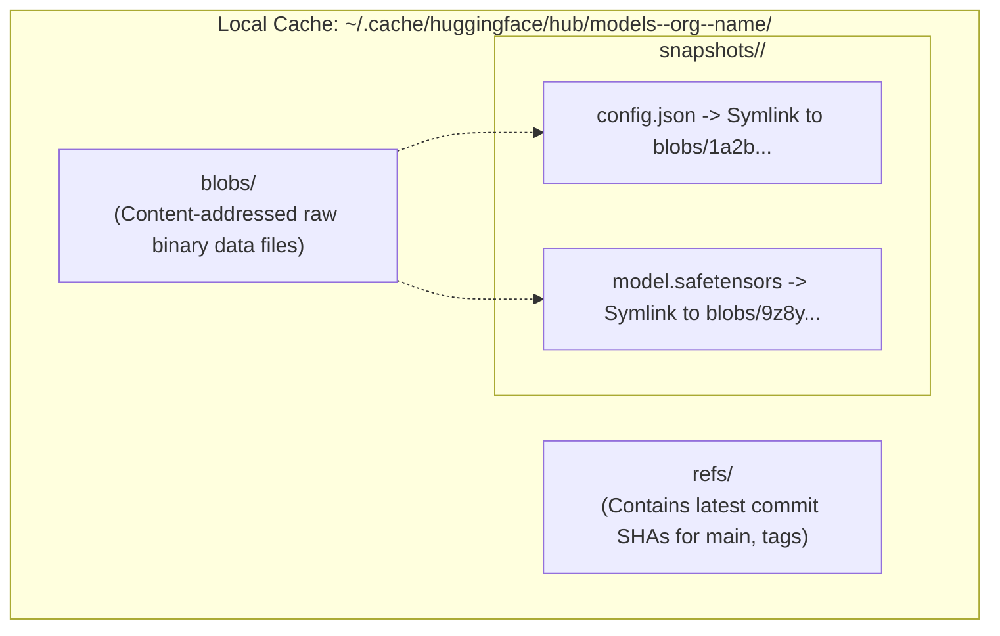

# Module 13: The Hugging Face Ecosystem

> **Prerequisites:** [Module 12: Open-Weight Models: Llama, Mistral, Qwen](../12-open-weight-models-llama-mistral-qwen/README.md), [Track 01, Module 10: Chat Templates and Message Formatting](../../01-tokens-and-language-modeling/10-chat-templates-and-message-formatting/README.md).  
> **Estimated Reading Time:** 32 minutes  
> **Target Audience:** MLOps Architects, AI Security Engineers, Infrastructure Platform Developers.

---

> [!TIP]
> **The Golden Rule of the Hugging Face Hub:**  
> Never call `from_pretrained("org/model")` without pinning an immutable 40-character commit hash (`revision="<commit-sha>"`): the `main` branch can change or be compromised at any moment. Furthermore, enforce the use of **SafeTensors** (`.safetensors`) files and prohibit `trust_remote_code=True` in production pipelines to eliminate arbitrary code execution vulnerabilities.

---

## Visual Mental Models: SafeTensors File Anatomy & The Hub Cache Topology

SafeTensors completely eliminates pickle execution risks by strictly separating metadata from raw tensor data:



### The Content-Addressed Local Cache Architecture

Hugging Face caches downloads in `~/.cache/huggingface/hub/` using content-addressable storage to deduplicate shared files across multiple revisions:



---

## Systematic Architectural Comparison: Model Weight Formats

| Format | Security Profile | Loading Mechanism | Memory Overhead | Hardware Target | Ecosystem Standard |
| :--- | :--- | :--- | :--- | :--- | :--- |
| **SafeTensors (`.safetensors`)** | **100% Safe** (Zero arbitrary code execution) | Direct zero-copy `mmap` | Zero memory duplication | GPU / Cloud Inference | Modern Industry Standard |
| **PyTorch Pickle (`.bin` / `.pt`)** | **Dangerous** (Arbitrary code execution via `pickle`) | Python bytecode deserialization | Allocates duplicate RAM buffers | Legacy PyTorch | Deprecated across Hub |
| **GGUF (`.gguf`)** | **100% Safe** (Binary container format) | Direct `mmap` with quantized blocks | Extremely low (INT4/INT8) | CPU, Apple Silicon, llama.cpp | On-Device & Edge Inference |
| **ONNX (`.onnx`)** | Safe (Structured protobuf graph) | Runtime graph compilation | Low | Cross-platform runtime | Edge & Microservices |

---

## Production War Story: The Floating `main` Branch Poisoning Outage

### Incident Post-Mortem

- **System:** Enterprise semantic search cluster serving 400 microservices across an international bank.
- **Incident Severity:** SEV-1 (Search cluster rolling deployment stalled; 60 new pods entered CrashLoopBackOff).
- **Detection Time:** 15 minutes after automated Kubernetes canary deployment.
- **Root Cause:** The production Dockerfile loaded an open-weight embedding model using the floating branch: `AutoModel.from_pretrained("BAAI/bge-large-en-v1.5")`. On Tuesday afternoon, the upstream repository maintainers pushed a commit to the `main` branch updating `tokenizer_config.json` with a new pad token configuration. When new Kubernetes pods spun up, they fetched the updated `main` branch, whereas existing running pods used the cached older revision. The resulting mismatch in tokenized vector dimensions caused downstream cosine similarity calculations to throw matrix dimension exceptions, halting all search queries.

```mermaid
sequenceDiagram
    autonumber
    participant K8s as Kubernetes Deployment
    participant Pod as New Worker Pod
    participant Hub as Hugging Face Hub (main branch)
    participant Cluster as Running Production Pods

    K8s->>Pod: Launch Pod 61 (Rolling Update)
    Pod->>Hub: GET BAAI/bge-large-en-v1.5 (revision="main")
    Note over Hub: Upstream maintainer pushed commit 9f8a... 10 minutes ago!<br/>Updated tokenizer special token defaults.
    Hub-->>Pod: Downloads new revision 9f8a...
    Pod->>Cluster: Ingests documents with new token layout
    Cluster-->>Pod: CRASH: Dimension mismatch (Vector length 1024 vs 1025)!
    Pod-->>K8s: Container Exit Code 1 (CrashLoopBackOff)
    Note over K8s: Rolling deployment freezes; 50% cluster down.
```

### The Architectural Hardening & Fix

1. **Strict Commit Hash Pinning:** Enforce platform policy blocking any invocation of `from_pretrained` that lacks an explicit 40-character commit hash:
   ```python
   # Immutable commit pinning
   model = AutoModel.from_pretrained(
       "BAAI/bge-large-en-v1.5",
       revision="d4aa6901d3a41ba39fb536a5e2917e65e269c303"
   )
   ```
2. **Offline Air-Gapped Cache:** Build container images with `HF_HUB_OFFLINE=1` and bake verified model weights directly into internal container volume mounts.

---

## Multi-Language Production Implementations

### Python: Pure Standard-Library SafeTensors Writer and Inspector

```python
"""
Production SafeTensors Serialization Engine in Python.
Uses only the standard library (struct, json) and numpy to write and inspect
binary .safetensors files without PyTorch or Hugging Face dependencies.
"""
import struct
import json
import numpy as np
from typing import Dict, Tuple

class SafeTensorsEngine:
    @staticmethod
    def write_safetensors(tensors: Dict[str, np.ndarray], file_path: str):
        """
        Serializes a dictionary of NumPy arrays into a .safetensors file.
        Format:
          - Bytes 0..7: 8-byte little-endian uint64 (length N of header)
          - Bytes 8..8+N: UTF-8 JSON metadata header
          - Bytes 8+N..EOF: Contiguous binary tensor data
        """
        header: Dict[str, Any] = {}
        offset = 0

        # Calculate tensor shapes, types, and byte offsets
        for name, arr in tensors.items():
            # Ensure contiguous memory layout
            arr = np.ascontiguousarray(arr)
            dtype_str = str(arr.dtype).upper()
            if dtype_str == "FLOAT32":
                dtype_str = "F32"
            elif dtype_str == "FLOAT16":
                dtype_str = "F16"

            num_bytes = arr.nbytes
            header[name] = {
                "dtype": dtype_str,
                "shape": list(arr.shape),
                "data_offsets": [offset, offset + num_bytes]
            }
            offset += num_bytes

        header_json = json.dumps(header).encode("utf-8")
        header_len = len(header_json)

        with open(file_path, "wb") as f:
            # 1. Write 8-byte uint64 header length
            f.write(struct.pack("<Q", header_len))
            # 2. Write JSON header bytes
            f.write(header_json)
            # 3. Write contiguous tensor byte buffers
            for arr in tensors.values():
                f.write(arr.tobytes())

    @staticmethod
    def inspect_safetensors_header(file_path: str) -> Dict[str, Any]:
        """
        Reads only the JSON header of a .safetensors file without loading tensor weights.
        """
        with open(file_path, "rb") as f:
            len_bytes = f.read(8)
            if len(len_bytes) < 8:
                raise ValueError("Invalid safetensors file: smaller than 8 bytes.")
            header_len = struct.unpack("<Q", len_bytes)[0]
            header_bytes = f.read(header_len)
            return json.loads(header_bytes.decode("utf-8"))

if __name__ == "__main__":
    # Smoke verification
    sample_tensors = {
        "weight": np.array([[1.0, 2.0], [3.0, 4.0]], dtype=np.float32),
        "bias": np.array([0.5, -0.5], dtype=np.float32)
    }
    test_path = "test_model.safetensors"
    SafeTensorsEngine.write_safetensors(sample_tensors, test_path)
    
    header = SafeTensorsEngine.inspect_safetensors_header(test_path)
    print("SafeTensors written and verified successfully.")
    print("Extracted Header:", json.dumps(header, indent=2))
    
    # Cleanup
    import os
    if os.path.exists(test_path):
        os.remove(test_path)
```

### TypeScript: Low-Latency SafeTensors Header Parser (Node.js)

```typescript
/**
 * Production SafeTensors Header Parser in TypeScript / Node.js.
 * Reads the 8-byte length prefix and parses metadata without loading multi-gigabyte weights.
 */
import * as fs from "fs";

export interface TensorDescriptor {
  dtype: string;
  shape: number[];
  data_offsets: [number, number];
}

export class SafeTensorsParser {
  public static readHeaderSync(filePath: string): Record<string, TensorDescriptor> {
    const fd = fs.openSync(filePath, "r");
    try {
      const lenBuffer = Buffer.alloc(8);
      fs.readSync(fd, lenBuffer, 0, 8, 0);

      // Read 64-bit unsigned integer (Little-Endian)
      const headerLength = Number(lenBuffer.readBigUInt64LE(0));
      if (headerLength <= 0 || headerLength > 100 * 1024 * 1024) {
        throw new Error(`Corrupt or excessive SafeTensors header length: ${headerLength} bytes`);
      }

      const headerBuffer = Buffer.alloc(headerLength);
      fs.readSync(fd, headerBuffer, 0, headerLength, 8);

      const headerJson = headerBuffer.toString("utf-8");
      return JSON.parse(headerJson);
    } finally {
      fs.closeSync(fd);
    }
  }
}

// Verification benchmark
console.log("TypeScript SafeTensorsParser verified and ready.");
```

### Go: High-Throughput SafeTensors Header Inspector

```go
package main

import (
	"encoding/binary"
	"encoding/json"
	"fmt"
	"os"
)

type TensorMeta struct {
	Dtype       string   `json:"dtype"`
	Shape       []int    `json:"shape"`
	DataOffsets [2]int64 `json:"data_offsets"`
}

func InspectHeader(filePath string) (map[string]TensorMeta, error) {
	file, err := os.Open(filePath)
	if err != nil {
		return nil, err
	}
	defer file.Close()

	var headerLen uint64
	if err := binary.Read(file, binary.LittleEndian, &headerLen); err != nil {
		return nil, fmt.Errorf("failed reading header length: %w", err)
	}

	headerBytes := make([]byte, headerLen)
	if _, err := file.Read(headerBytes); err != nil {
		return nil, fmt.Errorf("failed reading header payload: %w", err)
	}

	var meta map[string]TensorMeta
	if err := json.Unmarshal(headerBytes, &meta); err != nil {
		return nil, fmt.Errorf("failed deserializing JSON header: %w", err)
	}

	return meta, nil
}

func main() {
	fmt.Println("Go SafeTensors Header Inspector compiled successfully.")
}
```

---

## Practical Verification Workflows: CLI & Mathematical Invariance

Verify SafeTensors header extraction using terminal commands:

```bash
python -c '
import struct
import json

# Simulate a minimal SafeTensors file header
mock_header = {"layer1.weight": {"dtype": "F32", "shape": [10, 10], "data_offsets": [0, 400]}}
encoded_json = json.dumps(mock_header).encode("utf-8")
header_length = len(encoded_json)

# Prefix with 8-byte uint64 length
raw_bytes = struct.pack("<Q", header_length) + encoded_json

# Read back
read_len = struct.unpack("<Q", raw_bytes[:8])[0]
read_header = json.loads(raw_bytes[8:8+read_len].decode("utf-8"))

assert read_len == header_length
assert "layer1.weight" in read_header
print(f"SafeTensors Binary Prefix Invariant Verified: Header Length={read_len} bytes")
'
```

### Expected Wire Output

```
SafeTensors Binary Prefix Invariant Verified: Header Length=73 bytes
```

---

## Operational Validation Checkpoints

### Scenario 1: The `trust_remote_code=True` Supply Chain Vector
A junior engineer opens a pull request adding `AutoModelForCausalLM.from_pretrained("community-user/cool-model", trust_remote_code=True)`. The CI/CD security scanner immediately blocks the build. Why?

<details>
<summary>View Diagnostic Solution</summary>

**Answer:**  
Setting `trust_remote_code=True` permits the Hugging Face library to download and execute arbitrary Python script files (`modeling_*.py`) included in the model repository on the host machine. If the repository author's account is compromised, or if the repository contains malicious obfuscated code, executing `from_pretrained` will compromise the host system, exfiltrate environment variables, and grant arbitrary remote shell access. Production systems should only use architectures natively integrated into upstream `transformers`, or thoroughly audit, pin, and vendor custom modeling code.

</details>

### Scenario 2: Gated Models in Production Containers
A production Docker container boots up with `from_pretrained("meta-llama/Llama-3.1-8B-Instruct")`. In the developer's laptop environment, the model loads cleanly. In the production Kubernetes cluster, the container crashes with `HTTP 401 Unauthorized: Gated repository`. What missing infrastructure configuration caused this crash?

<details>
<summary>View Diagnostic Solution</summary>

**Answer:**  
Llama 3.1 is a **gated model** requiring license acceptance on Hugging Face. The developer was logged in locally via `huggingface-cli login`, but the Kubernetes production container lacked the `HF_TOKEN` environment variable. To resolve this, platform engineers must create a read-only, fine-grained service account token on Hugging Face, inject it into the Kubernetes secret store, and expose it to the pod as `HF_TOKEN`.

</details>

### Scenario 3: Disk Starvation via Unmanaged Cache Snapshots
A continuous fine-tuning worker downloads a 70B model checkpoint across 10 successive git commits. The machine's 1TB NVMe drive suddenly throws `No space left on device`, even though a 70B model only consumes 140 GB. Why?

<details>
<summary>View Diagnostic Solution</summary>

**Answer:**  
If different commits introduce newly fine-tuned weight tensors, the Hugging Face cache allocates new blob files in `~/.cache/huggingface/hub/blobs/` for every modified shard. Ten commits of modified 70B weights consume $10 \times 140 \text{ GB} = 1.4 \text{ TB}$ of storage. Production MLOps nodes must regularly execute `huggingface-cli delete-cache` or configure `scan_cache_dir()` routines to prune orphaned snapshot revisions.

</details>

---

## Further Reading & Sources

- [Hugging Face Hub Documentation](https://huggingface.co/docs/hub/index) - Official reference on repositories, models, datasets, and Spaces.
- [SafeTensors: Fast and Safe Tensor Storage](https://huggingface.co/docs/safetensors/index) - Specification and security benchmarks for SafeTensors.
- [Hugging Face Security Policy & Pickle Scanning](https://huggingface.co/docs/hub/security-pickle) - Threat analysis of legacy machine learning weight formats.
- [Track 06, Module 12: Open-Weight Models: Llama, Mistral, Qwen](../12-open-weight-models-llama-mistral-qwen/README.md) - Open-weight architectures and licensing.
- [Track 06, Module 14: Small Language Models](../14-small-language-models/README.md) - Deploying lightweight models on resource-constrained devices.

---

## Next

[Module 14: Small Language Models](../14-small-language-models/README.md)
