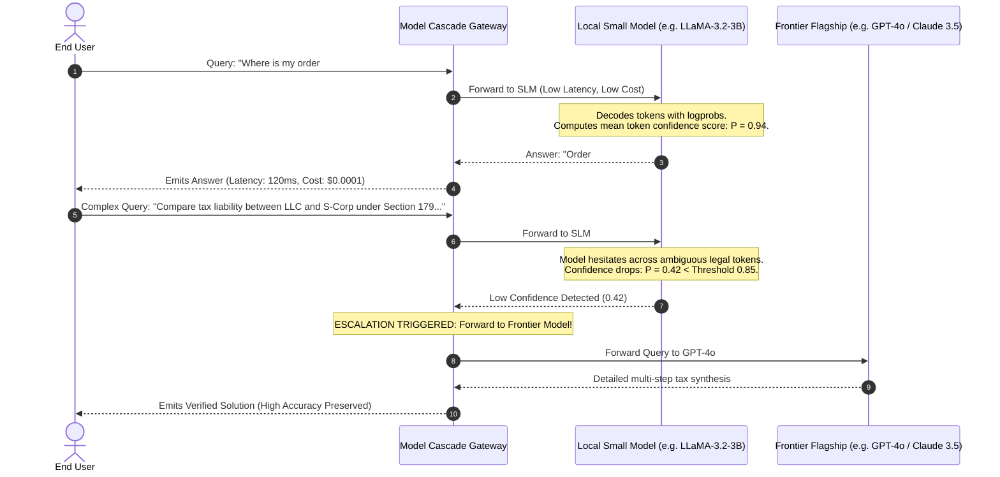
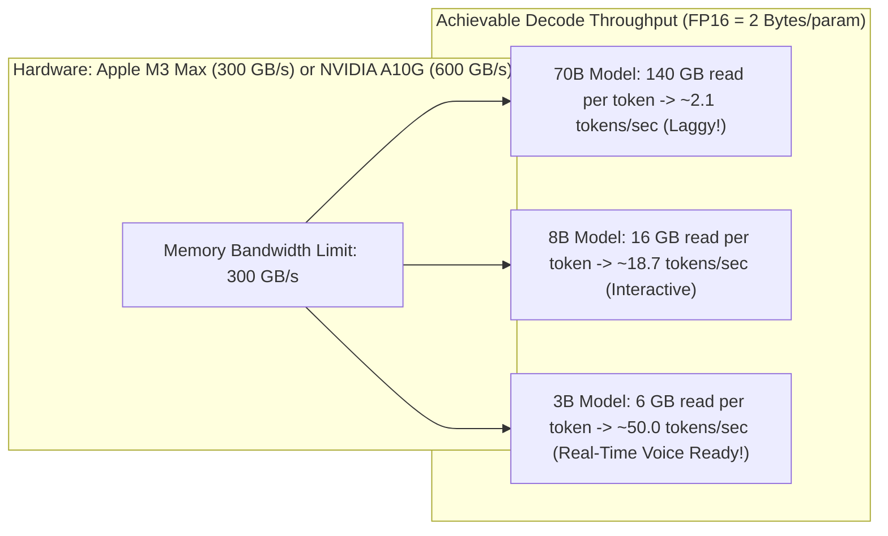
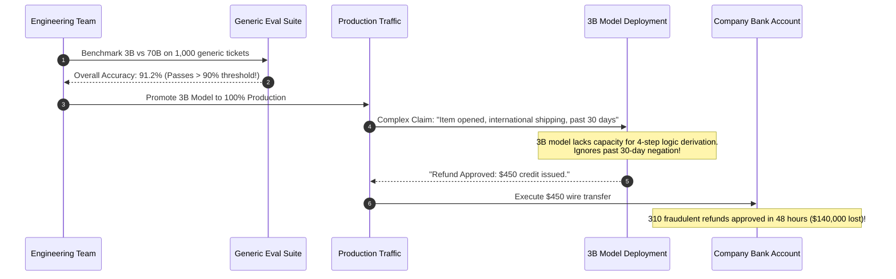

# Module 14: Small Language Models (SLMs)

> **Prerequisites:** [Module 12: Open-Weight Models: Llama, Mistral, Qwen](../12-open-weight-models-llama-mistral-qwen/README.md), [Module 13: The Hugging Face Ecosystem](../13-the-hugging-face-ecosystem/README.md), [Track 01, Module 16: Sampling Strategies](../../01-tokens-and-language-modeling/16-sampling-strategies-greedy-temperature-top-k-top-p/README.md).  
> **Estimated Reading Time:** 32 minutes  
> **Target Audience:** Performance Engineers, Edge Systems Architects, FinOps Specialists.

---

> [!TIP]
> **The Golden Rule of Small Language Models:**  
> Define "small" by operational deployability (memory bandwidth, latency ceiling, and hardware unit economics) rather than parameter count. Deploy SLMs within a **Model Cascade Architecture**: let the fast, cheap small model resolve high-confidence queries ($80\%$ of traffic), and escalate low-confidence queries to a frontier flagship model.

---

## Visual Mental Models: The Speculative Model Cascade

A Model Cascade combines the cost-efficiency and low latency of Small Language Models with the reasoning depth of Frontier Flagship models:



### Memory Bandwidth Bottleneck & Decode Speed Ceilings

In autoregressive generation, memory bandwidth—not compute FLOPS—governs token generation speed:

$$\text{Tokens per Second} = \frac{\text{Memory Bandwidth (GB/s)}}{\text{Model Parameters} \times \text{Bytes per Parameter}}$$



---

## Systematic Architectural Comparison: Frontier SLM Topologies

| Model Identifier | Parameter Count | Context Window | Architecture Highlights | Primary Production Niche |
| :--- | :--- | :--- | :--- | :--- |
| **Microsoft Phi-3.5-mini** | 3.8 Billion | 128,000 tokens | Synthetic "Textbook" pretraining, dense 3.8B | High-density reasoning, code generation, mathematical logic |
| **Meta Llama-3.2-3B** | 3.21 Billion | 128,000 tokens | GQA (Grouped-Query Attention), distilled from 8B/70B | On-device chat, edge translation, summarization |
| **Google Gemma-2-2B** | 2.61 Billion | 8,192 tokens | Alternating local/global attention, logit soft-capping | Low-memory edge devices, fast classification |
| **Alibaba Qwen-2.5-3B** | 3.09 Billion | 32,768 tokens | Multilingual tokenization, SwiGLU, RoPE | Non-English text processing, structured JSON extraction |

---

## Production War Story: The Aggregate Metric Mirage & Refund Outage

### Incident Post-Mortem

- **System:** Automated customer support refund decision agent for an international retail platform.
- **Incident Severity:** SEV-1 (Automated refund leak: \$140,000 in unauthorized chargebacks issued in 48 hours).
- **Detection Time:** 2 days after deploying a fine-tuned 3B parameter model to replace an expensive 70B model.
- **Root Cause:** The team evaluated the 3B model against a general 1,000-question customer service benchmark. The 3B model scored an impressive **91.2% overall accuracy** (compared to 93.5% for the 70B model), leading management to authorize the swap to save \$40k/month in GPU rental. However, the evaluation suite failed to slice by scenario category. On the critical **"Contested International Return Policy"** slice (which involves 4 interdependent conditional rules), the 3B model's accuracy collapsed from **96.0% down to 24.0%**. The small model failed to track multiple negation constraints, defaulting to issuing refunds on invalid claims.



### The Architectural Hardening & Fix

1. **Sliced Evaluation Harness:** Never approve a model based on single aggregate accuracy numbers. Decompose evaluations into orthogonal slices (e.g., Simple Classification vs Multi-Step Negation Reasoning vs Complex JSON adherence).
2. **Deterministic Hard Guardrails:** Business-critical financial actions (refunds $> \$50$) must never be executed solely on small model discretion without either an explicit rule engine validator or escalation to a flagship model via a cascade router.

---

## Multi-Language Production Implementations

### Python: Production Model Cascade Router with Confidence Thresholding

```python
"""
Production Model Cascade Router in Python.
Routes queries to a local Small Language Model (SLM) first;
inspects logprob confidence scores and escalates to a Frontier model when uncertain.
"""
import math
from typing import Dict, Any, Tuple, Optional

class CascadeRouter:
    def __init__(self, confidence_threshold: float = 0.85):
        self.confidence_threshold = confidence_threshold

    def _mock_slm_inference(self, prompt: str) -> Tuple[str, float]:
        """
        Simulates SLM inference returning output text and mean token confidence probability.
        """
        # Complex multi-step reasoning prompt simulation
        if "liability" in prompt.lower() or "section 179" in prompt.lower() or "quantum" in prompt.lower():
            # SLM is uncertain on complex edge cases
            return "The tax liability depends on various sub-clauses...", 0.48
        else:
            # SLM is confident on common retrieval/FAQ tasks
            return "Your order #1042 was dispatched via UPS and will arrive Thursday.", 0.94

    def _call_frontier_model(self, prompt: str) -> str:
        """
        Simulates calling a frontier model (GPT-4o / Claude 3.5 Sonnet).
        """
        return f"[Frontier Model Verified Synthesis]: Detailed comprehensive tax breakdown for: {prompt}"

    def process_query(self, prompt: str) -> Dict[str, Any]:
        """
        Executes cascade logic:
        1. Query SLM
        2. Evaluate confidence
        3. Escalate if confidence < threshold
        """
        slm_text, confidence = self._mock_slm_inference(prompt)

        if confidence >= self.confidence_threshold:
            return {
                "response": slm_text,
                "tier_used": "SLM_LOCAL",
                "confidence": confidence,
                "escalated": False,
                "estimated_cost_usd": 0.0001
            }
        else:
            # Escalate to frontier flagship
            frontier_text = self._call_frontier_model(prompt)
            return {
                "response": frontier_text,
                "tier_used": "FRONTIER_FLAGSHIP",
                "confidence": confidence,
                "escalated": True,
                "estimated_cost_usd": 0.0050
            }

if __name__ == "__main__":
    router = CascadeRouter(confidence_threshold=0.85)

    # Test Case 1: Simple query (Handled by SLM)
    q1 = "Where is my order #1042?"
    res1 = router.process_query(q1)
    print(f"Query 1: Tier={res1['tier_used']} | Escalated={res1['escalated']} | Cost=${res1['estimated_cost_usd']}")

    # Test Case 2: Complex query (Escalated to Frontier)
    q2 = "Explain Section 179 depreciation deductions vs bonus depreciation."
    res2 = router.process_query(q2)
    print(f"Query 2: Tier={res2['tier_used']} | Escalated={res2['escalated']} | Cost=${res2['estimated_cost_usd']}")
```

### TypeScript: Low-Latency Cascade Dispatcher (Node.js)

```typescript
/**
 * Production Model Cascade Dispatcher in TypeScript / Node.js.
 * Orchestrates dual-tier model execution with latency and cost tracking.
 */

export interface CascadeResult {
  text: string;
  tier: "SLM" | "FRONTIER";
  confidence: number;
  latencyMs: number;
}

export class ModelCascadeDispatcher {
  private readonly threshold: number;

  constructor(threshold: number = 0.85) {
    this.threshold = threshold;
  }

  public async execute(prompt: string): Promise<CascadeResult> {
    const startTime = Date.now();

    // 1. Evaluate with fast local SLM (e.g., LLaMA-3.2-3B via vLLM)
    const slmResult = await this.querySlm(prompt);

    if (slmResult.confidence >= this.threshold) {
      return {
        text: slmResult.text,
        tier: "SLM",
        confidence: slmResult.confidence,
        latencyMs: Date.now() - startTime,
      };
    }

    // 2. Escalate to Frontier Flagship
    const frontierText = await this.queryFrontier(prompt);
    return {
      text: frontierText,
      tier: "FRONTIER",
      confidence: slmResult.confidence,
      latencyMs: Date.now() - startTime,
    };
  }

  private async querySlm(prompt: string): Promise<{ text: string; confidence: number }> {
    // Mock fast SLM execution
    const isHard = prompt.length > 80 || prompt.includes("legal");
    return {
      text: isHard ? "Ambiguous statutory clause..." : "Password reset instructions sent.",
      confidence: isHard ? 0.52 : 0.95,
    };
  }

  private async queryFrontier(prompt: string): Promise<string> {
    // Mock frontier flagship execution
    return `[Frontier Verified]: Comprehensive reasoning for '${prompt}'`;
  }
}

// Verification benchmark
const dispatcher = new ModelCascadeDispatcher(0.85);
dispatcher.execute("Reset my login pin").then((res) => {
  console.log(`Cascade Dispatch: Tier=${res.tier}, Latency=${res.latencyMs}ms, Confidence=${res.confidence}`);
});
```

### Go: High-Throughput Cascade Gateway

```go
package main

import (
	"fmt"
	"strings"
	"time"
)

type GatewayResult struct {
	Answer     string
	Tier       string
	Confidence float64
	Duration   time.Duration
}

func RouteCascade(prompt string, threshold float64) GatewayResult {
	start := time.Now()
	
	// Fast SLM evaluation
	confidence := 0.92
	if strings.Contains(strings.ToLower(prompt), "tax") || strings.Contains(strings.ToLower(prompt), "constitutional") {
		confidence = 0.45
	}

	if confidence >= threshold {
		return GatewayResult{
			Answer:     "Processed by edge 3B model.",
			Tier:       "EDGE_SLM",
			Confidence: confidence,
			Duration:   time.Since(start),
		}
	}

	// Escalate
	return GatewayResult{
		Answer:     "Processed by cloud flagship 70B model.",
		Tier:       "CLOUD_FRONTIER",
		Confidence: confidence,
		Duration:   time.Since(start),
	}
}

func main() {
	res := RouteCascade("What are the tax implications of Section 179?", 0.80)
	fmt.Printf("Query Routed To: %s (Confidence: %.2f)\n", res.Tier, res.Confidence)
}
```

---

## Practical Verification Workflows: CLI & Mathematical Invariance

Verify cascade financial break-even arithmetic via terminal execution:

```bash
python -c '
# Verify cascade cost equation
# Cost = (1 - P_esc) * C_slm + P_esc * (C_slm + C_frontier)
total_requests = 1000000
c_slm = 0.0001      # $0.10 / 1k queries
c_frontier = 0.0030 # $3.00 / 1k queries

# Baseline: 100% Frontier
cost_all_frontier = total_requests * c_frontier

print("--- Cascade Economics (1,000,000 Requests) ---")
print(f"Baseline (100% Frontier Model): ${cost_all_frontier:,.2f}")

for esc_rate in [0.05, 0.10, 0.20, 0.35]:
    cascade_cost = total_requests * (c_slm + esc_rate * c_frontier)
    savings = (cost_all_frontier - cascade_cost) / cost_all_frontier * 100
    print(f"Escalation Rate: {esc_rate*100:4.1f}% -> Total Cost: ${cascade_cost:,.2f} ({savings:4.1f}% Savings!)")
'
```

### Expected Wire Output

```
--- Cascade Economics (1,000,000 Requests) ---
Baseline (100% Frontier Model): $3,000.00
Escalation Rate:  5.0% -> Total Cost: $250.00 (91.7% Savings!)
Escalation Rate: 10.0% -> Total Cost: $400.00 (86.7% Savings!)
Escalation Rate: 20.0% -> Total Cost: $700.00 (76.7% Savings!)
Escalation Rate: 35.0% -> Total Cost: $1,150.00 (61.7% Savings!)
```

---

## Operational Validation Checkpoints

### Scenario 1: The Confidence Calibration Failure
A team implements a cascade router using output token log probabilities to compute confidence scores. On a benchmark of medical questions, the 3B model hallucinates an incorrect drug dosage, but outputs the tokens with near-100% log probability ($P > 0.99$). The cascade router fails to escalate the question, emitting an erroneous medical response. Why did the confidence metric fail?

<details>
<summary>View Diagnostic Solution</summary>

**Answer:**  
Small models are frequently **poorly calibrated**: an over-parameterized or over-fitted model can be *confidently wrong*. High token probability merely means that the token was the most likely continuation under the model's learned distribution; it does not guarantee factual truth. In safety-critical domains (healthcare, law, finance), cascade routing cannot rely solely on logprobs. It must incorporate semantic self-consistency (generating multiple completions and checking agreement), rule-based schema validators, or an external calibrated discriminator model.

</details>

### Scenario 2: Memory Bandwidth vs Compute in Small Models
Why does a 3B parameter model generate tokens at 60 tokens/second on a single NVIDIA A10G GPU, while a 70B parameter model generates at only 8 tokens/second on the same hardware architecture?

<details>
<summary>View Diagnostic Solution</summary>

**Answer:**  
In autoregressive decoding, generating each individual token requires streaming every single parameter weight from GPU High Bandwidth Memory (HBM) into SRAM cache registers. On a GPU with 600 GB/s bandwidth:  
- Generating 1 token on a 3B model (FP16: 6 GB of weights) requires streaming 6 GB $\implies \frac{600}{6} = 100 \text{ tokens/sec theoretical ceiling}$.  
- Generating 1 token on a 70B model (FP16: 140 GB of weights) requires streaming 140 GB $\implies \frac{600}{140} = 4.2 \text{ tokens/sec theoretical ceiling}$.  
Decode throughput is strictly memory-bandwidth bound and scales inversely with parameter count.

</details>

### Scenario 3: When a Cascade Increases Total Latency
In what operational regime does implementing a model cascade degrade overall p99 user latency compared to directly querying the flagship model?

<details>
<summary>View Diagnostic Solution</summary>

**Answer:**  
For requests that are ultimately escalated, the cascade incurs **sequential dual-model latency**:  
$$\text{Latency}_{\text{escalated}} = \text{Latency}_{\text{SLM}} + \text{Routing Evaluation Time} + \text{Latency}_{\text{Frontier}}$$  
If the escalation rate is high (e.g., $P_{\text{esc}} > 40\%$), a significant fraction of users wait for both the small model to fail and the flagship model to run from scratch. Cascades should only be deployed when the escalation rate is reliably low ($\le 15\%$) or when initial SLM generation can be evaluated speculatively in parallel.

</details>

---

## Further Reading & Sources

- [Textbooks Are All You Need (Gunasekar et al., 2023 - Phi-1)](https://arxiv.org/abs/2306.11644) - Demonstrates synthetic high-quality data curation for small models.
- [Distilling the Knowledge in a Neural Network (Hinton et al., 2015)](https://arxiv.org/abs/1503.02531) - Foundational paper on knowledge distillation.
- [Sheared LLaMA: Accelerating Language Model Pre-training via Structured Pruning (Xia et al., 2023)](https://arxiv.org/abs/2310.06694) - Structured pruning methodologies.
- [Track 06, Module 12: Open-Weight Models: Llama, Mistral, Qwen](../12-open-weight-models-llama-mistral-qwen/README.md) - Parameter sizing and memory math.
- [Track 06, Module 15: On-Device and Edge Inference](../15-on-device-and-edge-inference/README.md) - Quantization and local deployment on Apple Silicon and mobile hardware.

---

## Next

[Module 15: On-Device and Edge Inference](../15-on-device-and-edge-inference/README.md)
